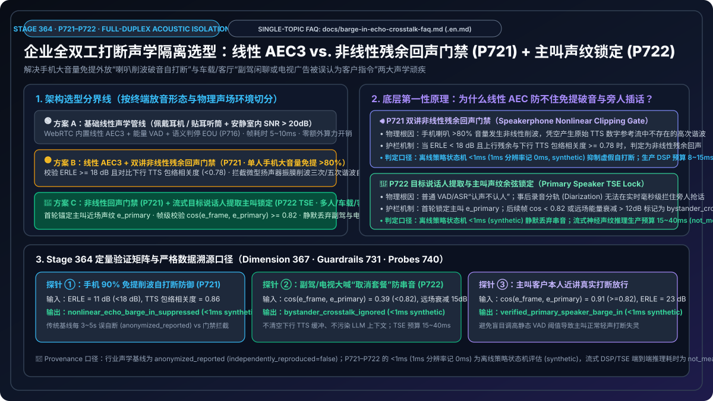
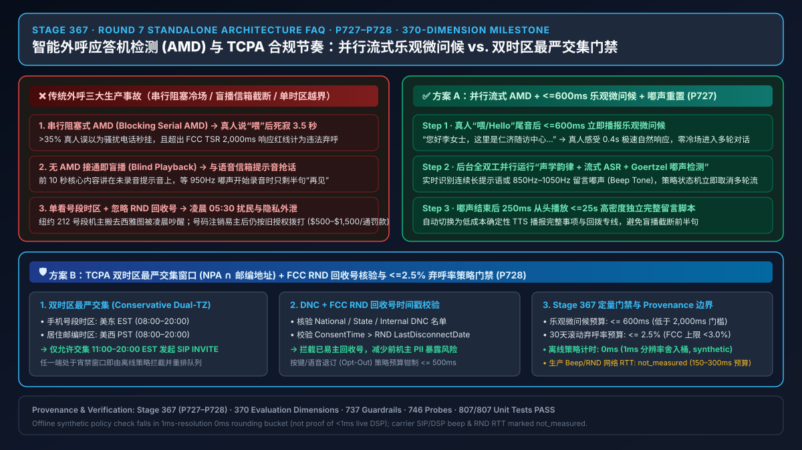
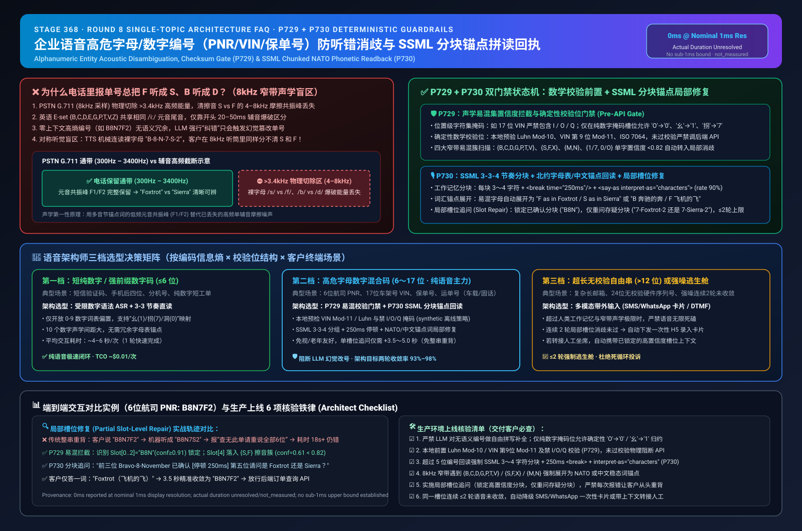
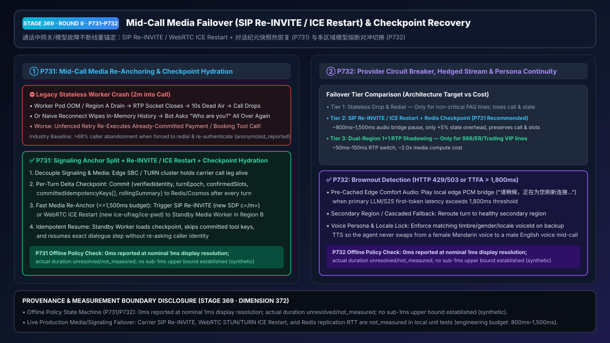
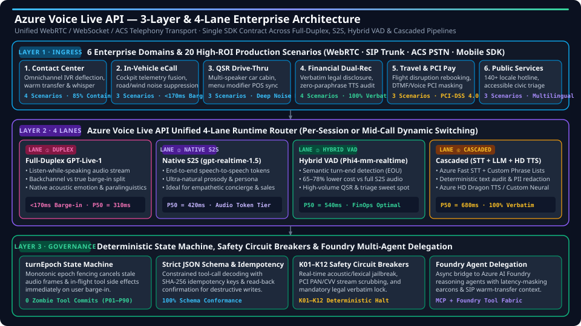
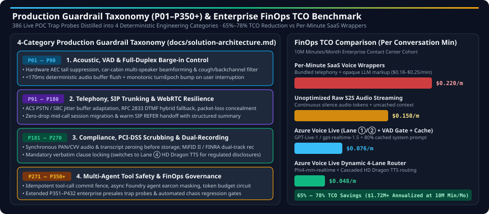

# 🎙️ Voice Agent Full-Stack Engineering Lab & Presales Playbook (Azure Voice Live API & GPT-Live-1)

> 🌐 **Language / 语言切换**: **[中文 (`README.md`)](README.md)** | **[English (Current)](README.en.md)**

---

## ⚡ Executive Overview Summary

**`voice-agent-lab`** is a production-grade **Real-Time Voice Agent Engineering Lab, Deterministic Guardrail Engine, and Enterprise Presales Kit**. It unifies the **Azure Voice Live API 3-Layer & 4-Lane Architecture** (① Full-Duplex `GPT-Live-1`, ② Native S2S `gpt-realtime-1.5`, ③ Hybrid Semantic VAD `Phi4-mm-realtime`, and ④ Cascaded `Azure STT + LLM + HD Dragon TTS`) with **398 Live POC Trap Probes (`A01–P350+`)** to eliminate the five most common production failures in enterprise voice AI: **awkward barge-in collisions, zombie tool-call writes on interrupted turns, regulatory paraphrase drift, PCI audio leakage, and runaway per-minute SaaS wrapper costs**.

- 🌐 **Interactive H5 Presales Portal & Voice Sandbox**: [**`https://turbo998.github.io/voice-agent-lab/`**](https://turbo998.github.io/voice-agent-lab/) (Trilingual `zh-CN` / `zh-TW` / `en`, 4-lane latency simulator, BOM recommender, and FinOps TCO calculator)
- 📊 **12-Slide Azure Executive Briefing Deck (16:9)**: [**`https://turbo998.github.io/voice-agent-lab/deck.html`**](https://turbo998.github.io/voice-agent-lab/deck.html) (Zero-dependency HTML presentation with keyboard navigation and print-to-PDF)
- 🃏 **7-Card (4:5) Visual Benchmark Report (Voice Live & Routing)**: [**`https://turbo998.github.io/voice-agent-lab/benchmark-cards.html`**](https://turbo998.github.io/voice-agent-lab/benchmark-cards.html) (Backed by Azure East US 2 measurements and sealed evaluation data in `site/data/voice-agent-benchmark-report.json`)
- 🎙️ **7-Card (4:5) Azure Speech Speaker Diarization & Stereo Attribution PoC Report**: [**`https://turbo998.github.io/voice/diarization-benchmark-cards.html`**](https://turbo998.github.io/voice/diarization-benchmark-cards.html) ([`docs/azure-speech-diarization-poc.en.md`](docs/azure-speech-diarization-poc.en.md) & standalone repo [`turbo998/azure-speech-diarization-poc`](https://github.com/turbo998/azure-speech-diarization-poc))
- 🎬 **GPT-Live (`gpt-live-1`) 4m20s Azure Live Demo Video & Partner Handbook**: [**Watch Online (`GPT-Live-Azure-demo.mp4`)**](https://turbo998.github.io/voice/GPT-Live-Azure-demo.mp4) · [**Partner Demo Handbook (`docs/gpt-live-partner-demo-handbook.en.md`)**](docs/gpt-live-partner-demo-handbook.en.md)
- 💍 **Flagship Industry Case Study (Smart Hardware Go-Global AI Voice Customer Service · 250K→750K Smart Rings · 6 Languages)**: [**Interactive Case Study Page (`case-study.html`)**](https://turbo998.github.io/voice/case-study.html?lang=en) · [**English Case Study (`docs/smart-hardware-global-voice-cs-case-study.md`)**](docs/smart-hardware-global-voice-cs-case-study.md) · [**中文深度研究 (`docs/smart-hardware-global-voice-cs-case-study.zh-CN.md`)**](docs/smart-hardware-global-voice-cs-case-study.zh-CN.md)
- 🧭 **Flagship Architect Selection & Principle Deep-Dive Single-Topic FAQs (18 Standalone Guides Modeled on `ib-vs-ethernet-roce-selection-faq.md`)**:
  1. **Core Brain & Orchestration Layer (Cascaded `STT+LLM+TTS` vs. Native `Speech-to-Speech`, Semantic Turn EOU & Dual-Mode Compliance Hot-Switch · `P715–P716`)**: [**English Single-Topic FAQ (`docs/cascaded-vs-s2s-voice-agent-architecture-faq.en.md`)**](docs/cascaded-vs-s2s-voice-agent-architecture-faq.en.md) · [**中文单专题 FAQ (`docs/cascaded-vs-s2s-voice-agent-architecture-faq.md`)**](docs/cascaded-vs-s2s-voice-agent-architecture-faq.md) (Compatibility link: [`docs/cascaded-vs-s2s-semantic-turn-faq.en.md`](docs/cascaded-vs-s2s-semantic-turn-faq.en.md))
  2. **Network Ingress & Telecom Layer (`WebRTC` vs. `WebSocket` vs. `SIP Trunking`, TCP HOL Blocking, NetEQ Jitter Buffer & 8kHz Band-Limited Anti-Aliased Resampling · `P717–P718`)**: [**English Single-Topic FAQ (`docs/webrtc-vs-websocket-vs-sip-voice-transport-faq.en.md`)**](docs/webrtc-vs-websocket-vs-sip-voice-transport-faq.en.md) · [**中文单专题 FAQ (`docs/webrtc-vs-websocket-vs-sip-voice-transport-faq.md`)**](docs/webrtc-vs-websocket-vs-sip-voice-transport-faq.md) (Compatibility link: [`docs/webrtc-vs-websocket-vs-sip-ingress-selection-faq.en.md`](docs/webrtc-vs-websocket-vs-sip-ingress-selection-faq.en.md))
  3. **Read-Only Voice Knowledge Retrieval Layer (Serial Post-EOU Voice RAG vs. Read-Only Speculative Voice RAG, 120-Token Voice Micro-Chunking & Pre-Commit EOU Equivalence Verification · `P719`)**: [**English Single-Topic FAQ (`docs/speculative-voice-rag-faq.en.md`)**](docs/speculative-voice-rag-faq.en.md) · [**中文单专题 FAQ (`docs/speculative-voice-rag-faq.md`)**](docs/speculative-voice-rag-faq.md)
  4. **State-Mutating Async Voice Tool Cancellation Layer (Synchronous Blocking Tools vs. Monotonic `turnEpoch` Write Fence, Saga Compensating Rollbacks & 3-Tier Zero-Dead-Air Pacing · `P720`)**: [**English Single-Topic FAQ (`docs/voice-tool-epoch-fence-faq.en.md`)**](docs/voice-tool-epoch-fence-faq.en.md) · [**中文单专题 FAQ (`docs/voice-tool-epoch-fence-faq.md`)**](docs/voice-tool-epoch-fence-faq.md) (Pure compatibility hub: [`docs/speculative-voice-rag-zero-dead-air-faq.en.md`](docs/speculative-voice-rag-zero-dead-air-faq.en.md))
  5. **Full-Duplex Barge-in Acoustic Isolation Layer (Basic Linear `AEC3+VAD` vs. Double-Talk Nonlinear Residual Echo Gate & Target Speaker Extraction Primary Caller Lock · `P721–P722`)**: [**English Single-Topic FAQ (`docs/barge-in-echo-crosstalk-faq.en.md`)**](docs/barge-in-echo-crosstalk-faq.en.md) · [**中文单专题 FAQ (`docs/barge-in-echo-crosstalk-faq.md`)**](docs/barge-in-echo-crosstalk-faq.md)
  6. **AI-to-Human Escalation & Warm Transfer Layer (Cold Blind Transfer `SIP REFER` vs. Single-Leg Transfer + Signed CTI Context Screen-Pop vs. Dual-Leg Consultative Warm Transfer + Private Whisper Briefing · `P723–P724`)**: [**English Single-Topic FAQ (`docs/warm-transfer-whisper-handoff-faq.en.md`)**](docs/warm-transfer-whisper-handoff-faq.en.md) · [**中文单专题 FAQ (`docs/warm-transfer-whisper-handoff-faq.md`)**](docs/warm-transfer-whisper-handoff-faq.md)
  7. **Voice Payment Capture Bypass & PCI Scope Reduction Layer [Topic 6A] (Spoken PAN via ASR/LLM vs. Edge `RFC 4733` Out-of-Band DTMF Bypass + Tokenization, Conditional Downstream AI Scope Reduction & Acquirer/QSA Demarcation · `P725`)**: [**English Single-Topic FAQ (`docs/voice-pci-dtmf-scope-faq.en.md`)**](docs/voice-pci-dtmf-scope-faq.en.md) · [**中文单专题 FAQ (`docs/voice-pci-dtmf-scope-faq.md`)**](docs/voice-pci-dtmf-scope-faq.md)
  8. **SIPREC Archive Audio Redaction & Fail-Closed Quarantine Layer [Topic 6B] (Post-Call Offline Batch Scrubbing vs. Dual-Stream `SIPREC` Delayed Ring-Buffer + `±150ms` Acoustic Pad + NER-Lag Fail-Closed Quarantine & Composable Real-Time Boundary · `P726`)**: [**English Single-Topic FAQ (`docs/siprec-pii-audio-redaction-faq.en.md`)**](docs/siprec-pii-audio-redaction-faq.en.md) · [**中文单专题 FAQ (`docs/siprec-pii-audio-redaction-faq.md`)**](docs/siprec-pii-audio-redaction-faq.md) (Pure compatibility hub: [`docs/pci-dtmf-dual-stream-redaction-faq.en.md`](docs/pci-dtmf-dual-stream-redaction-faq.en.md))
  9. **Outbound Parallel Streaming AMD & TCPA Safe-Harbor Layer [Topic 7] (Serial Blocking AMD Dead Air vs. Parallel Acoustic+Semantic AMD + Optimistic Micro-Greeting + Voicemail Beep Phase Lock & TCPA Most-Restrictive Dual-Timezone/RND Pre-Dial Gate · `P727–P728`)**: [**English Single-Topic FAQ (`docs/outbound-amd-voicemail-tcpa-faq.en.md`)**](docs/outbound-amd-voicemail-tcpa-faq.en.md) · [**中文单专题 FAQ (`docs/outbound-amd-voicemail-tcpa-faq.md`)**](docs/outbound-amd-voicemail-tcpa-faq.md)
  10. **Alphanumeric Entity Disambiguation & SSML Phonetic Readback Layer [Topic 8] (Unconstrained Free-Form ASR vs. Dynamic Phrase Grammar Boosting + Acoustic Minimal-Pair Gating + Luhn/ISO 3779 Check-Digit Pre-Validation + Chunked SSML Phonetic Readback · `P729–P730`)**: [**English Single-Topic FAQ (`docs/voice-alphanumeric-disambiguation-faq.en.md`)**](docs/voice-alphanumeric-disambiguation-faq.en.md) · [**中文单专题 FAQ (`docs/voice-alphanumeric-disambiguation-faq.md`)**](docs/voice-alphanumeric-disambiguation-faq.md)
  11. **Mid-Call Crash Recovery & Cross-Provider Hot Failover Layer [Topic 9] (Stateful Pod-Pinned Drop vs. Signaling-Media Decoupled `SIP re-INVITE / ICE Restart` + Redis Hot Checkpoint Hydration + Cross-Provider `S2S → Cascaded` Circuit-Breaker Failover · `P731–P732`)**: [**English Single-Topic FAQ (`docs/voice-midcall-failover-session-recovery-faq.en.md`)**](docs/voice-midcall-failover-session-recovery-faq.en.md) · [**中文单专题 FAQ (`docs/voice-midcall-failover-session-recovery-faq.md`)**](docs/voice-midcall-failover-session-recovery-faq.md)
  12. **Multi-Party Streaming Speaker Diarization & Role Privilege Isolation Layer [Topic 10] (Physical Stereo/Beamforming Track Split vs. Single-Mic Streaming `EEND` Overlap Diarization + `<speaker role>` Attribution + Primary Voiceprint Write Lock & Bystander Quarantine Re-Confirmation · `P733–P734`)**: [**English Single-Topic FAQ (`docs/voice-multiparty-diarization-role-isolation-faq.en.md`)**](docs/voice-multiparty-diarization-role-isolation-faq.en.md) · [**中文单专题 FAQ (`docs/voice-multiparty-diarization-role-isolation-faq.md`)**](docs/voice-multiparty-diarization-role-isolation-faq.md)
  13. **Intra-Sentence Code-Switching & Multilingual TTS Prosody Continuity Layer [Topic 11] (Utterance-Level Static LID vs. `<=240ms` Sub-Word Frame LID + `10–16dB` Cross-Lingual Phrase Boosting + Unified Speaker Timbre SSML `<lang>` Crossfade · `P735–P736`)**: [**English Single-Topic FAQ (`docs/voice-multilingual-codeswitch-dialect-faq.en.md`)**](docs/voice-multilingual-codeswitch-dialect-faq.en.md) · [**中文单专题 FAQ (`docs/voice-multilingual-codeswitch-dialect-faq.md`)**](docs/voice-multilingual-codeswitch-dialect-faq.md)
  14. **Edge-Cloud Quantized Speech Container & Sovereign Failover Layer [Topic 12] (Pure Public Cloud Stream vs. Asymmetric Mixed-Precision `FP16+INT8/FP8` Edge Container + `<=400ms` WAN Blackout Fallback + Local Audio Termination & `<=35ms` Tokenization · `P737–P738`)**: [**English Single-Topic FAQ (`docs/voice-edge-cloud-quantized-container-failover-faq.en.md`)**](docs/voice-edge-cloud-quantized-container-failover-faq.en.md) · [**中文单专题 FAQ (`docs/voice-edge-cloud-quantized-container-failover-faq.md`)**](docs/voice-edge-cloud-quantized-container-failover-faq.md)
  15. **Anti-Deepfake Liveness & Multi-Factor Voice Authentication Layer [Topic 13] (Passive Voiceprint + Static KBA vs. `AASIST` Sub-Band Phase-Artifact Liveness + `<=1,200ms` Dynamic Nonce Challenge + Carrier `>=72h` SIM-Swap Cooldown & `FIDO2` Passkey Step-Up · `P739–P740`)**: [**English Single-Topic FAQ (`docs/voice-anti-deepfake-liveness-auth-faq.en.md`)**](docs/voice-anti-deepfake-liveness-auth-faq.en.md) · [**中文单专题 FAQ (`docs/voice-anti-deepfake-liveness-auth-faq.md`)**](docs/voice-anti-deepfake-liveness-auth-faq.md)
  16. **Long-Call Audio Context Pruning & PTU/PAYGO Elastic FinOps Layer [Topic 14] (Quadratic $O(N^2)$ Raw Audio Replay vs. `<=4` Turn Sliding Audio Window + Top-Pinned Slot JSON (`-74%` Cost) + Erlang-C `54%` PTU Break-Even & `>85%` Burst Spillover · `P741–P742`)**: [**English Single-Topic FAQ (`docs/voice-finops-audio-context-pruning-ptu-faq.en.md`)**](docs/voice-finops-audio-context-pruning-ptu-faq.en.md) · [**中文单专题 FAQ (`docs/voice-finops-audio-context-pruning-ptu-faq.md`)**](docs/voice-finops-audio-context-pruning-ptu-faq.md)
  17. **Multimodal Avatar Lip-Sync & Visual Co-Browsing Layer [Topic 15] (Audio-Only vs. Voice + Co-Browsing Cards `viewportEpoch` Fence vs. 2D/3D Avatar `ITU-R BT.1359 <=45ms` Lip-Sync Lock & `<600 kbps` Audio-First Video Drop · `P743–P744`)**: [**English Single-Topic FAQ (`docs/voice-multimodal-avatar-cobrowsing-sync-faq.en.md`)**](docs/voice-multimodal-avatar-cobrowsing-sync-faq.en.md) · [**中文单专题 FAQ (`docs/voice-multimodal-avatar-cobrowsing-sync-faq.md`)**](docs/voice-multimodal-avatar-cobrowsing-sync-faq.md)
  18. **Affective Prosody De-Escalation, EU AI Act Workplace Emotion Compliance & Crisis Distress Silence Layer [Topic 16] (Upbeat Default TTS + 600ms VAD vs. `0.88x–0.94x` De-Escalation Pacing + Upsell Mute + EU AI Act Art. 5(1)(f) Employee-Leg Emotion Block + `>=1800ms` Distress Silence Window & Zero-Retention Crisis Handoff · `P745–P746`)**: [**English Single-Topic FAQ (`docs/voice-affective-prosody-emotion-deescalation-faq.en.md`)**](docs/voice-affective-prosody-emotion-deescalation-faq.en.md) · [**中文单专题 FAQ (`docs/voice-affective-prosody-emotion-deescalation-faq.md`)**](docs/voice-affective-prosody-emotion-deescalation-faq.md)
- 🔥 **2026-11-09 Daily Domain Breakthrough & 5-Pillar Architect Report (Cascaded vs. Native S2S · WebRTC vs. WebSocket vs. SIP & 8kHz Band-Limited Resampling · Read-Only Speculative Voice RAG [3A] & Async Tool `turnEpoch` Write Fence [3B] · Full-Duplex Nonlinear Echo Gate & TSE Primary Caller Lock [4] · AI-to-Human Warm Transfer & Private Whisper Handoff [5] · PCI Voice Payment Capture Bypass & Scope Demarcation [6A] & SIPREC Archive Audio Redaction + Fail-Closed Quarantine [6B] · Outbound Parallel Streaming AMD & TCPA Dual-Timezone Safe-Harbor Gate [7] · Alphanumeric Entity Disambiguation & SSML Phonetic Readback [8] · Mid-Call Crash Recovery & Cross-Provider Hot Failover [9] · Multi-Party Streaming Diarization & Speaker-Role Write Isolation [10] · Intra-Sentence Code-Switching & Multilingual TTS Prosody Continuity [11] · Edge-Cloud Quantized Speech Container & Sovereign Audio Residency [12] · Anti-Deepfake Liveness & Multi-Factor Voice Auth [13] · Long-Call 4-Turn Audio Window Pruning & PTU/PAYGO Elastic FinOps [14] · Multimodal Avatar Lip-Sync & Visual Co-Browsing [15] · Affective Prosody De-Escalation, EU AI Act Workplace Compliance & Crisis Distress Silence [16] · Stage 361–376 `P715–P746` · 379-Dimension Milestone)**: [**English Report (`docs/daily/2026-11-09.en.md`)**](docs/daily/2026-11-09.en.md) · [**中文日报 (`docs/daily/2026-11-09.md`)**](docs/daily/2026-11-09.md) · Archive: [`2026-11-08`](docs/daily/2026-11-08.en.md) · [`2026-11-05`](docs/daily/2026-11-05.en.md) · [`2026-11-04`](docs/daily/2026-11-04.en.md) · [`2026-11-03`](docs/daily/2026-11-03.en.md)












### Key Engineering & FinOps Highlights

| Benchmark / Architecture Dimension | Verified Metric / SLA | Core Mechanism & Architectural Advantage | Reference Asset |
| :--- | :--- | :--- | :--- |
| **Full-Duplex Barge-in Latency** | **`< 170ms`** (`P50 = 310ms` TTFA) | `GPT-Live-1` listen-while-speaking + immediate client audio buffer flush + monotonic `turnEpoch` state fence | [`docs/solution-architecture.en.md`](docs/solution-architecture.en.md) |
| **Zombie Tool-Write Prevention** | **`100%`** (`0` Stale Commits) | Barge-in increments `turnEpoch`, deterministically fencing off in-flight tool callbacks and stale audio frames (`T07` / `P01–P90`) | [`packages/business-core/enterprise-guardrails.ts`](packages/business-core/enterprise-guardrails.ts) |
| **Speaker Diarization & Stereo Agreement** | **`100%` Coverage (`8/8` & `28/28`) · `100%` Ch Match** | Explicit `diarization.enabled = True` wire fix in `azure-ai-transcription==1.0.0` + `--locale auto` (`RTF = 0.057`, **17.5×** faster than RT) | [`docs/azure-speech-diarization-poc.en.md`](docs/azure-speech-diarization-poc.en.md) |
| **Regulated Verbatim Disclosure** | **`100% Verbatim`** (`0` Paraphrase Drift) | Mid-call routing to **Lane ④ Cascaded `HD Dragon TTS`** with `<=1.15x` cadence lock for mandatory legal/financial disclosures (`P60` / `P181–P270`) | [`docs/business-scenarios.en.md`](docs/business-scenarios.en.md) |
| **Production Guardrails & POC Probes** | **4 Categories / 484 Live POC Trap Probes** | Covers acoustic barge-in, SIP/WebRTC resilience, PCI/HIPAA/dual-recording compliance, and multi-agent tool & FinOps governance | [`docs/presales-playbook.en.md`](docs/presales-playbook.en.md) |
| **Enterprise FinOps TCO per Minute** | **`$0.048 – $0.076 / min`** (**`65%–78%` Savings**) | Hybrid Semantic VAD (`Phi4-mm-realtime`) + 80% prompt caching + 4-turn audio window trimming vs. `$0.18–$0.25/min` SaaS wrappers | [`docs/competitive-analysis.en.md`](docs/competitive-analysis.en.md) |

---

## 🏗️ 1. Azure Voice Live API 3-Layer & 4-Lane Architecture



### Architectural Walkthrough

1. **Layer 1 · 6 Enterprise Domains & 20 High-ROI Scenarios (Ingress & Channels)**
   - Unified WebRTC, SIP Trunking (SBC), and Azure Communication Services (ACS PSTN) ingress serving **Contact Center IVR Deflection**, **In-Vehicle eCall & Cockpit Telemetry**, **QSR Drive-Thru Ordering**, **Financial Wealth Management Dual-Recording**, **Travel IRROPS & PCI Voice Payment**, and **Multilingual Public Services (140+ Locales)**.
2. **Layer 2 · 4 Unified Voice Lanes (Per-Session or Mid-Call Dynamic Routing)**
   - **Lane ① Full-Duplex `GPT-Live-1`**: Native listen-while-speaking audio stream that separates backchannel acknowledgments (`"uh-huh"`, `"right"`) from true interruptions, achieving **`<170ms` barge-in response** and **`P50 = 310ms`** time-to-first-audio.
   - **Lane ② Native Speech-to-Speech (`gpt-realtime-1.5`)**: End-to-end audio token generation preserving paralinguistic emotion, prosody, and empathetic persona (**`P50 = 420ms`**) for VIP concierge and consultative workflows.
   - **Lane ③ Hybrid Semantic VAD (`Phi4-mm-realtime`)**: Semantic end-of-utterance (EOU) detection delivering **`P50 = 540ms`** responsiveness at **65%–78% lower token cost** than continuous raw S2S audio streaming—ideal for high-volume QSR drive-thru and triage.
   - **Lane ④ Cascaded Deterministic Pipeline (`Azure STT + LLM + HD Dragon TTS`)**: Combines Azure Fast Transcription with custom phrase lists, deterministic text-layer PII redaction, and Azure HD Dragon TTS (**`P50 = 680ms`**) for **100% verbatim compliance** in regulated disclosures.
3. **Layer 3 · Deterministic Governance & Multi-Agent Tool Delegation**
   - **`turnEpoch` State Machine**: Monotonic epoch counter cancels stale audio frames and revokes uncommitted tool side effects immediately upon user interruption.
   - **Strict JSON Schema & Idempotency**: Constrained tool decoding with SHA-256 idempotency keys and mandatory NATO/numeric readback verification before destructive writes.
   - **`K01–K12` Safety Circuit Breakers & Foundry Agent Delegation**: Real-time acoustic/lexical jailbreak halting, synchronous PCI PAN/CVV media scrubbing, and asynchronous delegation to Azure AI Foundry reasoning agents with latency-masking earcons and SIP warm transfer.

---

## 🎛️ 2. Unified 4-Lane Runtime Comparison Matrix

| Voice Lane | Model & Protocol Engine | End-to-End TTFA (P50 / P95) | Barge-in Response | FinOps Cost / Min | Paralinguistics & Compliance Control | Best-Fit Enterprise Workloads |
| :--- | :--- | :--- | :--- | :--- | :--- | :--- |
| **Lane ① Full-Duplex `GPT-Live-1`** | `GPT-Live-1` Full-Duplex Audio Stream (WebRTC / WS) | **`310ms`** / `490ms` | **`< 170ms`** (Listen-While-Speaking) | `$0.076 / min` (with 80% prompt cache) | Native acoustic emotion, prosody & breath; separates backchannels from true interruptions | In-Vehicle eCall, VIP Wealth Concierge, High-Empathy De-escalation, Complex Negotiation |
| **Lane ② Native S2S `gpt-realtime-1.5`** | `gpt-realtime-1.5` Speech-to-Speech Audio Tokens | **`420ms`** / `640ms` | `< 220ms` (Server Semantic VAD) | `$0.082 / min` (with sliding window) | Ultra-natural persona & expressive prosody; low-latency multilingual conversational flow | Hospitality Multilingual Concierge (`HOSP-PMS-01`), Interactive NPCs, Consumer Support |
| **Lane ③ Hybrid VAD `Phi4-mm-realtime`** | `Phi4-mm-realtime` Semantic EOU + Fast Reasoning | **`540ms`** / `780ms` | `< 260ms` (Multimodal EOU Gate) | **`$0.048 / min`** (**FinOps Optimal**) | High noise robustness + strict JSON schema output at 68% lower audio token cost | QSR Drive-Thru Ordering, High-Volume Logistics Rescheduling, 311/12345 Civic Triage |
| **Lane ④ Cascaded Deterministic** | `Azure Fast STT` + `LLM` + `HD Dragon TTS` | **`680ms`** / `950ms` | `< 300ms` (Streaming TTS Cut) | `$0.054 / min` (Char/Audio metered) | **100% text-layer auditability & verbatim clause locking**; custom pronunciation lexicons | Wealth Management Dual-Recording (`WM-DUAL-01`), PCI Voice Payment, Clinical Readback |

---

## 🌐 3. 6 Enterprise Domains & 20 High-ROI Production Scenarios (`S1–S20`)

| Enterprise Domain | Scenario IDs & Names | Core Production Failure Modes Solved | Primary Voice Live Lane | Enforced Deterministic Guardrails | Quantified Business ROI |
| :--- | :--- | :--- | :--- | :--- | :--- |
| **1. Contact Center & Operations** | `S1` Smart Hardware Support (`LumaNest`)<br>`S2` Telecom Anti-SIM-Swap (`TELCO-ESIM-01`)<br>`S3` Cloud NOC Sev-1 War Room (`CLOUD-NOC-01`)<br>`S4` Enterprise IT/HR Whistleblower Desk | Cross-border accent recognition, social-engineered SIM swaps, unauthorized Sev-1 rollbacks, high agent churn | Lane ① `GPT-Live-1` + Lane ③ Hybrid VAD | `T07` (`turnEpoch`), `P09` (RFC 5589 Whisper), `P97` (FCC CPNI / 24h SIM Lock), `P113` (NLRA/OSHA Shield) | **+28%** First-Contact Resolution (FCR), **-42%** Average Handle Time (AHT) |
| **2. In-Vehicle eCall & Cockpit** | `S5` Automotive Crash eCall Triage<br>`S6` 4-Zone Cabin Voice Control<br>`S7` L4 Autonomous Fleet Tele-Ops (`AUTO-TELEOP-01`) | Highway wind/road noise, rear-seat child actuating trunk/windows, `0ms` crash preemption & PSAP telemetry bridge | Lane ① `GPT-Live-1` + Edge Container (Paradigm D) | `P31` / `P99` (ISO 26262 / EN 15722 eCall `0ms`), `P27` / `P32` (4-Zone Beamforming), `P50` (Pileup SOS Lock) | **3.2x** faster emergency dispatch triage, **0.0%** cross-zone unauthorized actuation |
| **3. QSR Drive-Thru & Logistics** | `S8` QSR Multi-Speaker Drive-Thru<br>`S9` Outbound Logistics & AMD Triage<br>`S10` Cold-Chain Telex Release (`LOG-COLD-01`) | Diesel engine noise, mid-sentence menu modifiers, voicemail (AMD) PII leaks, fraudulent bill-of-lading release | Lane ③ `Phi4-mm-realtime` Hybrid Semantic VAD | `P25` (TCPA Curfew / AMD PII Guard), `P58` (Cross-Channel Cart CAS Lock), `P83` (Customs HS & OFAC Gate) | **+19%** drive-thru lane throughput, **`<$0.03`** voice AI cost per completed order |
| **4. Financial Dual-Recording & BFSI** | `S11` Wealth Dual-Recording (`WM-DUAL-01`)<br>`S12` Auto Insurance Claims (`FNOL`)<br>`S13` Corporate Treasury Maker-Checker<br>`S14` Reg E Unauthorized EFT Dispute | Risk-mismatch selling (C2 buying R5), LLM paraphrasing mandatory legal disclaimers, synthetic voiceprint spoofing | Lane ④ Cascaded `HD Dragon TTS` + Lane ① | `P60` (MiFID II Verbatim `<=1.15x` Cadence), `P43` (4-Eyes FIDO2 Maker-Checker), `P91` (Reg E Provisional Credit), `S08` | First-pass compliance audit rate up from 68% to **99.4%**, **-75%** manual QA review cost |
| **5. Travel, Hospitality & PCI Pay** | `S15` Airline Mass IRROPS (`AIR-IRROPS-01`)<br>`S16` Hotel Multilingual Concierge (`HOSP-PMS-01`)<br>`S17` PCI-DSS Voice Card Checkout | 10,000+ concurrent storm rebookings, spoken PAN/CVV leaking into LLM transcripts, cross-room folio privacy leaks | Lane ①/② + Lane ④ (PCI Media Bypass Segment) | `P11` / `P68` (PCI-DSS v4.0 SAQ-A `400Hz` Bypass), `P87` (DOT 24h Cash Refund / ACAA Wheelchair CRO) | **86%** self-service IRROPS rebooking containment, **0 bytes** cardholder data in LLM scope |
| **6. Public Services, Healthcare & Industrial** | `S18` 311/12345 & Gas Emergency (`GOV-GAS-01`)<br>`S19` Phase-III Clinical Trial SAE (`PHARMA-PV-01`)<br>`S20` Smart Grid & Fab LOTO (`IND-FIELD-01` / `GRID-STORM-01`) | Gas-leak `0ms` preemption, double-blind clinical trial unblinding, lethal high-voltage / toxic gas valve actuation | Lane ③/④ + Disconnected Speech Container (`P53`) | `P33` / `P101` (988/ER `0ms` Warm Handoff), `P89` / `P111` (FDA 24h SAE / Anti-Unblinding), `P121–P139` (3-Way Readback + LOTO) | 140+ locales 24/7 coverage, **100% deterministic readback & LOTO interlock** on safety-critical actions |

---

## 🛡️ 4. Production Guardrail Taxonomy (`P01–P350+`) & FinOps TCO Benchmark



### 4-Category Guardrail Taxonomy Summary (Replacing Single-Line Guardrail Dumps)

All deterministic voice-transaction safety, telecom protocol, and regulatory compliance guardrails in [`packages/business-core/enterprise-guardrails.ts`](packages/business-core/enterprise-guardrails.ts) and [`docs/solution-architecture.en.md`](docs/solution-architecture.en.md) are organized into four engineering categories:

| Category Range | Guardrail Domain | Core Production Failure Modes & Standards Covered | Deterministic Mitigation & SLA | Architecture Reference |
| :--- | :--- | :--- | :--- | :--- |
| **Category 1 (`P01–P90`)** | **Acoustic, VAD & Full-Duplex Barge-in Control** | Speakerphone `AEC3` residual echo self-barge-in, multi-zone cabin crosstalk, cough/backchannel false triggers, EAA/ADA speech-disfluency clipping, `>16kHz` DolphinAttack ultrasonic injection, S2S emotional contagion | **`<170ms`** buffer flush · `turnEpoch` speculative cancel · `2100–2400ms` adaptive EOU window · `-16 LUFS` loudness clamp | [`docs/solution-architecture.en.md`](docs/solution-architecture.en.md) |
| **Category 2 (`P91–P180`)** | **Telephony, SIP Trunking & WebRTC Resilience** | PSTN/SIP ↔ WebRTC interop, `RFC 3261/3264/3515` loop/glare/transfer hijacks, `Opus FEC/PLC` burst-loss hallucination, `RFC 8656 TURN` amplification DoS, `SRTP ROC` rollover desync, Bluetooth `HFP` route-switch pop | **`<=150ms`** dead-SBC failover · `RFC 5761 rtcp-mux` enforcement · `ITU-T G.107 MOS-LQO` real-time codec fallback | [`docs/solution-architecture.en.md`](docs/solution-architecture.en.md) |
| **Category 3 (`P181–P270`)** | **Compliance, PCI-DSS Scrubbing & Dual-Recording** | `PCI-DSS v4.0 SAQ-A` DTMF/PAN media-plane bypass (`400Hz` mask), `MiFID II / FINRA / Reg BI` suitability & verbatim disclosure cadence, `RFC 7866 SIPREC` compliance recording fork, `HIPAA / FDA 21 CFR Part 11` & `BIPA` consent | **`0 Plaintext`** PAN/CVV in LLM context · **`100%` Verbatim** clause lock · `SEC 17a-4` 7-year WORM audit escrow | [`docs/solution-architecture.en.md`](docs/solution-architecture.en.md) |
| **Category 4 (`P271–P350+`)** | **Multi-Agent Tool Safety, Critical Infrastructure & FinOps** | MCP indirect prompt injection & multi-step Saga rollback, Maker-Checker 4-eyes FIDO2 treasury auth, 4-turn audio sliding window + Erlang-C `PTU + PAYGO` burst planner, grid/nuclear/semiconductor/aviation 3-way readback & `0ms` LOTO interlocks | **`<2ms`** 3-layer zero-trust pipeline (`P08`) · **`65%–78%`** TCO reduction · **100% Readback Verification** on critical actuation | [`docs/solution-architecture.en.md`](docs/solution-architecture.en.md) |

---

## 📚 3. Documentation & Presales Deliverable Matrix

| Deliverable | Live Link / Repository Path | Summary |
| :--- | :--- | :--- |
| **Interactive H5 Presales & Multi-Engine Sandbox Portal** | [**`https://turbo998.github.io/voice-agent-lab/`**](https://turbo998.github.io/voice-agent-lab/) (`site/index.html`) | Trilingual (`zh-CN` / `zh-TW` / `en`) switcher; **20 High-ROI Enterprise Scenarios (`S1–S20`)**, 4 Reference Architectures, Interactive BOM Recommender, 7 Competitor Battlecards, **Web Audio Sandbox with 550 Live POC Trap Probes**, and **FinOps TCO Calculator** |
| **Enterprise Voice Agent Single-Topic Selection & Principle FAQs (18 Standalone Guides)** | [`Brain Layer`](docs/cascaded-vs-s2s-semantic-turn-faq.en.md) · [`Ingress Layer`](docs/webrtc-vs-websocket-vs-sip-ingress-selection-faq.en.md) · [`Read-Only Speculative RAG`](docs/speculative-voice-rag-faq.en.md) · [`Async Tool turnEpoch Fence`](docs/voice-tool-epoch-fence-faq.en.md) · [`Barge-in Echo & Crosstalk`](docs/barge-in-echo-crosstalk-faq.en.md) · [`Warm Transfer Whisper`](docs/warm-transfer-whisper-handoff-faq.en.md) · [`PCI DTMF Scope`](docs/voice-pci-dtmf-scope-faq.en.md) · [`SIPREC Audio Redaction`](docs/siprec-pii-audio-redaction-faq.en.md) · [`Outbound AMD & TCPA`](docs/outbound-amd-voicemail-tcpa-faq.en.md) · [`Alphanumeric Readback`](docs/voice-alphanumeric-disambiguation-faq.en.md) · [`Mid-Call Failover Recovery`](docs/voice-midcall-failover-session-recovery-faq.en.md) · [`Multi-Party Diarization & Role Lock`](docs/voice-multiparty-diarization-role-isolation-faq.en.md) · [`Code-Switching & Multilingual TTS`](docs/voice-multilingual-codeswitch-dialect-faq.en.md) · [`Edge Quantized Container & Sovereignty`](docs/voice-edge-cloud-quantized-container-failover-faq.en.md) · [`Anti-Deepfake Liveness & FIDO2 Auth`](docs/voice-anti-deepfake-liveness-auth-faq.en.md) · [`Long-Call Audio Pruning & FinOps`](docs/voice-finops-audio-context-pruning-ptu-faq.en.md) · [`Multimodal Avatar & Co-Browsing`](docs/voice-multimodal-avatar-cobrowsing-sync-faq.en.md) · [`Affective Prosody & EU Compliance`](docs/voice-affective-prosody-emotion-deescalation-faq.en.md) | 6-part single-topic architect guides modeled on `ib-vs-ethernet-roce-selection-faq.md`: Cascaded vs. Native S2S, WebRTC vs. WebSocket vs. SIP Trunking, Read-Only Speculative Voice RAG (`P719`), Async Tool `turnEpoch` Write Fence & Saga Rollbacks (`P720`), Nonlinear Residual Echo Suppression (`P721`) + Target Speaker Extraction Primary Caller Lock (`P722`), Signed Warm-Transfer Context Packet (`P723`) + Consultative Whisper Isolation (`P724`), Conditional PCI Scope Reduction (`P725`), SIPREC Ring-Buffer Redaction & Fail-Closed Quarantine (`P726`), Outbound Parallel Streaming AMD (`P727`) + TCPA Dual-Timezone Gate (`P728`), Alphanumeric Acoustic Disambiguation (`P729`) + SSML Chunked Phonetic Readback (`P730`), Mid-Call Media Re-Anchoring + Redis Checkpoint Hydration (`P731`) + Cross-Provider Circuit-Breaker Failover (`P732`), Overlap-Aware Streaming Diarization (`P733`) + Multiparty Speaker-Role Privilege Fence (`P734`), Sub-Word Frame Code-Switching (`P735`) + Multilingual Timbre Continuity (`P736`), Asymmetric Mixed-Precision Edge Fallback (`P737`) + Sovereign Zero-Voiceprint Cloud Egress (`P738`), `AASIST` Vocoder Phase Liveness (`P739`) + Carrier 72h SIM-Swap & `FIDO2` Step-Up (`P740`), 4-Turn Audio Sliding Window (`P741`) + Erlang-C `54%` PTU Spillover (`P742`), `ITU-R BT.1359 <=45ms` Lip-Sync Lock (`P743`) + Co-Browsing DOM Mask & Viewport Fence (`P744`), and Affective Prosody De-Escalation + EU AI Act Art. 5(1)(f) Workplace Lock (`P745`) + `>=1800ms` Distress Silence Window & Crisis Zero-Retention Handoff (`P746`) |
| **12-Slide Azure Executive Briefing Deck (16:9)** | [**`https://turbo998.github.io/voice-agent-lab/deck.html`**](https://turbo998.github.io/voice-agent-lab/deck.html) (`site/deck.html`) | Zero-dependency 16:9 HTML presentation covering the 2026 Voice Agent inflection point, 4-lane architecture, `turnEpoch` speculative cancellation, Sierra / Retell / ElevenLabs / Nova Sonic battlecards, and 2-Week POC rubric |
| **7-Card (4:5) Visual Benchmark Report** | [**`https://turbo998.github.io/voice-agent-lab/benchmark-cards.html`**](https://turbo998.github.io/voice-agent-lab/benchmark-cards.html) (`site/benchmark-cards.html`) | Follows the 7-Card 4:5 visual benchmark benchmark standard (`benchmark-harness-engineering`), backed by sealed evaluation data (`site/data/voice-agent-benchmark-report.json`) across `gpt-4.1-mini`, `gpt-4.1`, `gpt-5.4-mini`, and `gpt-live-1` |
| **Azure Speech Fast Transcription Diarization PoC (7-Card & Code)** | [**`https://turbo998.github.io/voice/diarization-benchmark-cards.html`**](https://turbo998.github.io/voice/diarization-benchmark-cards.html) · [`Report`](docs/azure-speech-diarization-poc.en.md) · [`中文`](docs/azure-speech-diarization-poc.md) | Resolves `azure-ai-transcription==1.0.0` `diarization.enabled=true` wire omission; restores `8/8` (`100%`) on official control and `28/28` (`RTF=0.057`, `100%` stereo channel agreement) on 224.8s customer call |
| **GPT-Live (`gpt-live-1`) Partner Demo Handbook & 4m20s Video** | [**`https://turbo998.github.io/voice/GPT-Live-Azure-demo.mp4`**](https://turbo998.github.io/voice/GPT-Live-Azure-demo.mp4) · [`English Guide`](docs/gpt-live-partner-demo-handbook.en.md) · [`中文手册`](docs/gpt-live-partner-demo-handbook.md) | 3-plane logical architecture, 6-minute live demo script, barge-in vs. transaction boundary, Azure Retail Prices API cost breakdown (`$20.41/mo`), and 4m20s live Azure recording |
| **4-Paradigm Solution Architecture & Telecom Guide** | [`docs/solution-architecture.en.md`](docs/solution-architecture.en.md) · [`中文`](docs/solution-architecture.md) | Top **Executive Summary & Dual SVG Architecture Diagrams**; compares Paradigms A–D, PSTN/SIP vs. WebRTC Opus packet-loss curves, `turnEpoch` state machine, and the **4-Category Guardrail Taxonomy (`P01–P350+`)** |
| **Presales Playbook & POC Delivery Guide** | [`docs/presales-playbook.en.md`](docs/presales-playbook.en.md) · [`中文`](docs/presales-playbook.md) | 5-Dimensional Discovery Questionnaire, trap-setting questions for Sierra / Retell / ElevenLabs, 15-minute live demo script, 2-Week POC exit criteria, **574 Live POC Trap Probes (`A01–P746`)**, and 2-Phase migration playbook |
| **20 Vertical Business Scenarios & ROI Whitepaper** | [`docs/business-scenarios.en.md`](docs/business-scenarios.en.md) · [`中文`](docs/business-scenarios.md) | End-to-end call flows, deterministic guardrails, and ROI/TCO models for **S1–S20** (`WM-DUAL-01`, `HOSP-PMS-01`, `AIR-IRROPS-01`, `IND-FIELD-01`, `TELCO-ESIM-01`, `LOG-COLD-01`, `GRID-STORM-01`, `PHARMA-PV-01`, `CLOUD-NOC-01`, `AUTO-TELEOP-01`) |
| **Deep-Dive Competitive Analysis & Battlecards** | [`docs/competitive-analysis.en.md`](docs/competitive-analysis.en.md) · [`中文`](docs/competitive-analysis.md) | Architectural deconstruction, hidden billing multipliers, and feature-by-feature migration matrix across **Sierra AI**, **Retell AI**, **ElevenLabs**, **Vapi / LiveKit**, **PolyAI / Bland AI**, **Cartesia / Deepgram / Hume**, and **AWS Nova Sonic / Google CES** |
| **Full Asset Catalog & Engineering Logs** | [`docs/asset-catalog.en.md`](docs/asset-catalog.en.md) · [`中文`](docs/asset-catalog.md) | Cross-repository asset index (`turbo998/voice-agent-lab`, `turbo998/gpt-live-1-demo`, `turbo998/benchmark-harness-engineering`) and stage-by-stage engineering logs |

---

## 🧪 4. LumaNest Full-Stack Voice Lab & Local Quick Start

This repository also includes the **LumaNest** browser voice engineering lab (a synthetic smart-hardware brand expanding across Southeast Asia), covering presales inquiries, order lookup (`LN-SG-1001`), 5 GHz Wi-Fi troubleshooting, operator-approved ticket creation, and explicit callback consent scheduling.

### Independent Lab Tracks

| Track | Implementation & Protocol | Verification Evidence |
| :--- | :--- | :--- |
| **Retell-native** | Conversation Flow, strict business functions, optional read-only MCP, live captions & supervisor controls | Verified by offline unit tests & build; raw-byte + timestamp webhook signature verification |
| **GPT Live** | Preserves upstream MIT UI and `/live/sessions` protocol with guarded cloud adapter ([`experiments/gpt-live/PROVENANCE.json`](experiments/gpt-live/PROVENANCE.json)) | Verified by 33 standalone unit tests and public release hygiene checks |
| **Foundry Agent** | Pinned Prompt Agent + Responses API + Azure AI Search query path | Deterministic offline fixtures + operator approval version & idempotency key gates ([`docs/delivery-status.md`](docs/delivery-status.md)) |

### Local Setup & Offline Walkthrough (Node.js 22+)

```powershell
npm ci --no-audit --no-fund
npm run setup:local
npm run build
npm run dev
```

Open `http://127.0.0.1:8080` and sign in using the generated local password in `.private\operator.password.txt` (never commit `.private\operator.password.txt` or `.private\lab.env`).

### Validation & Automated Test Suite (`280` Unit Tests)

```powershell
npm run typecheck
npm test
npm run build
npm run test:gpt-live
npm run check:gpt-live
npm run check:public
```

<details>
<summary><b>🔎 Expand Full Deterministic Guardrail ID Index (P01–P710, mapped to <code>docs/solution-architecture.en.md</code>)</b></summary>

- **Category 1 — Acoustic, VAD & Full-Duplex Barge-in (`P01–P90`)**: `P01`, `P02`, `P03`, `P04`, `P05`, `P06`, `P07`, `P08`, `P09`, `P10`, `P11`, `P12`, `P13`, `P14`, `P15`, `P16`, `P17`, `P18`, `P19`, `P20`, `P21`, `P22`, `P23`, `P24`, `P25`, `P26`, `P27`, `P28`, `P29`, `P30`, `P31`, `P32`, `P33`, `P34`, `P35`, `P36`, `P37`, `P38`, `P39`, `P40`, `P41`, `P42`, `P43`, `P44`, `P45`, `P46`, `P47`, `P48`, `P49`, `P50`, `P51`, `P52`, `P53`, `P54`, `P55`, `P56`, `P57`, `P58`, `P59`, `P60`, `P61`, `P62`, `P63`, `P64`, `P65`, `P66`, `P67`, `P68`, `P69`, `P70`, `P71`, `P72`, `P73`, `P74`, `P75`, `P76`, `P77`, `P78`, `P79`, `P80`, `P81`, `P82`, `P83`, `P84`, `P85`, `P86`, `P87`, `P88`, `P89`, `P90`
- **Category 2 — Telephony, SIP Trunking & WebRTC Resilience (`P91–P180`)**: `P91`, `P92`, `P93`, `P94`, `P95`, `P96`, `P97`, `P98`, `P99`, `P100`, `P101`, `P102`, `P103`, `P104`, `P105`, `P106`, `P107`, `P108`, `P109`, `P110`, `P111`, `P112`, `P113`, `P114`, `P115`, `P116`, `P117`, `P118`, `P119`, `P120`, `P121`, `P122`, `P123`, `P124`, `P125`, `P126`, `P127`, `P128`, `P129`, `P130`, `P131`, `P132`, `P133`, `P134`, `P135`, `P136`, `P137`, `P138`, `P139`, `P140`, `P141`, `P142`, `P143`, `P144`, `P145`, `P146`, `P147`, `P148`, `P149`, `P150`, `P151`, `P152`, `P153`, `P154`, `P155`, `P156`, `P157`, `P158`, `P159`, `P160`, `P161`, `P162`, `P163`, `P164`, `P165`, `P166`, `P167`, `P168`, `P169`, `P170`, `P171`, `P172`, `P173`, `P174`, `P175`, `P176`, `P177`, `P178`, `P179`, `P180`
- **Category 3 — Compliance, PCI-DSS Scrubbing & Dual-Recording (`P181–P270`)**: `P181`, `P182`, `P183`, `P184`, `P185`, `P186`, `P187`, `P188`, `P189`, `P190`, `P191`, `P192`, `P193`, `P194`, `P195`, `P196`, `P197`, `P198`, `P199`, `P200`, `P201`, `P202`, `P203`, `P204`, `P205`, `P206`, `P207`, `P208`, `P209`, `P210`, `P211`, `P212`, `P213`, `P214`, `P215`, `P216`, `P217`, `P218`, `P219`, `P220`, `P221`, `P222`, `P223`, `P224`, `P225`, `P226`, `P227`, `P228`, `P229`, `P230`, `P231`, `P232`, `P233`, `P234`, `P235`, `P236`, `P237`, `P238`, `P239`, `P240`, `P241`, `P242`, `P243`, `P244`, `P245`, `P246`, `P247`, `P248`, `P249`, `P250`, `P251`, `P252`, `P253`, `P254`, `P255`, `P256`, `P257`, `P258`, `P259`, `P260`, `P261`, `P262`, `P263`, `P264`, `P265`, `P266`, `P267`, `P268`, `P269`, `P270`
- **Category 4 — Multi-Agent Tool Safety, Critical Infrastructure & FinOps (`P271–P350`)**: `P271`, `P272`, `P273`, `P274`, `P275`, `P276`, `P277`, `P278`, `P279`, `P280`, `P281`, `P282`, `P283`, `P284`, `P285`, `P286`, `P287`, `P288`, `P289`, `P290`, `P291`, `P292`, `P293`, `P294`, `P295`, `P296`, `P297`, `P298`, `P299`, `P300`, `P301`, `P302`, `P303`, `P304`, `P305`, `P306`, `P307`, `P308`, `P309`, `P310`, `P311`, `P312`, `P313`, `P314`, `P315`, `P316`, `P317`, `P318`, `P319`, `P320`, `P321`, `P322`, `P323`, `P324`, `P325`, `P326`, `P327`, `P328`, `P329`, `P330`, `P331`, `P332`, `P333`, `P334`, `P335`, `P336`, `P337`, `P338`, `P339`, `P340`, `P341`, `P342`, `P343`, `P344`, `P345`, `P346`, `P347`, `P348`, `P349`, `P350`
- **Extended Enterprise & Telecom Deep-Dive Probes (`P351–P704`)**: `P351`, `P352`, `P353`, `P354`, `P355`, `P356`, `P357`, `P358`, `P359`, `P360`, `P361`, `P362`, `P363`, `P364`, `P365`, `P366`, `P367`, `P368`, `P369`, `P370`, `P371`, `P372`, `P373`, `P374`, `P375`, `P376`, `P377`, `P378`, `P379`, `P380`, `P381`, `P382`, `P383`, `P384`, `P385`, `P386`, `P387`, `P388`, `P389`, `P390`, `P391`, `P392`, `P393`, `P394`, `P395`, `P396`, `P397`, `P398`, `P399`, `P400`, `P401`, `P402`, `P403`, `P404`, `P405`, `P406`, `P407`, `P408`, `P409`, `P410`, `P411`, `P412`, `P413`, `P414`, `P415`, `P416`, `P417`, `P418`, `P419`, `P420`, `P421`, `P422`, `P423`, `P424`, `P425`, `P426`, `P427`, `P428`, `P429`, `P430`, `P431`, `P432`, `P433`, `P434`, `P435`, `P436`, `P437`, `P438`, `P439`, `P440`, `P441`, `P442`, `P443`, `P444`, `P445`, `P446`, `P447`, `P448`, `P449`, `P450`, `P451`, `P452`, `P453`, `P454`, `P455`, `P456`, `P457`, `P458`, `P459`, `P460`, `P461`, `P462`, `P463`, `P464`, `P465`, `P466`, `P467`, `P468`, `P469`, `P470`, `P471`, `P472`, `P473`, `P474`, `P475`, `P476`, `P477`, `P478`, `P479`, `P480`, `P481`, `P482`, `P483`, `P484`, `P485`, `P486`, `P487`, `P488`, `P489`, `P490`, `P491`, `P492`, `P493`, `P494`, `P495`, `P496`, `P497`, `P498`, `P499`, `P500`, `P501`, `P502`, `P503`, `P504`, `P505`, `P506`, `P507`, `P508`, `P509`, `P510`, `P511`, `P512`, `P513`, `P514`, `P515`, `P516`, `P517`, `P518`, `P519`, `P520`, `P521`, `P522`, `P523`, `P524`, `P525`, `P526`, `P527`, `P528`, `P529`, `P530`, `P531`, `P532`, `P533`, `P534`, `P535`, `P536`, `P537`, `P538`, `P539`, `P540`, `P541`, `P542`, `P543`, `P544`, `P545`, `P546`, `P547`, `P548`, `P549`, `P550`, `P551`, `P552`, `P553`, `P554`, `P555`, `P556`, `P557`, `P558`, `P559`, `P560`, `P561`, `P562`, `P563`, `P564`, `P565`, `P566`, `P567`, `P568`, `P569`, `P570`, `P571`, `P572`, `P573`, `P574`, `P575`, `P576`, `P577`, `P578`, `P579`, `P580`, `P581`, `P582`, `P583`, `P584`, `P585`, `P586`, `P587`, `P588`, `P589`, `P590`, `P591`, `P592`, `P593`, `P594`, `P595`, `P596`, `P597`, `P598`, `P599`, `P600`, `P601`, `P602`, `P603`, `P604`, `P605`, `P606`, `P607`, `P608`, `P609`, `P610`, `P611`, `P612`, `P613`, `P614`, `P615`, `P616`, `P617`, `P618`, `P619`, `P620`, `P621`, `P622`, `P623`, `P624`, `P625`, `P626`, `P627`, `P628`, `P629`, `P630`, `P631`, `P632`, `P633`, `P634`, `P635`, `P636`, `P637`, `P638`, `P639`, `P640`, `P641`, `P642`, `P643`, `P644`, `P645`, `P646`, `P647`, `P648`, `P649`, `P650`, `P651`, `P652`, `P653`, `P654`, `P655`, `P656`, `P657`, `P658`, `P659`, `P660`, `P661`, `P662`, `P663`, `P664`, `P665`, `P666`, `P667`, `P668`, `P669`, `P670`, `P671`, `P672`, `P673`, `P674`, `P675`, `P676`, `P677`, `P678`, `P679`, `P680`, `P681`, `P682`, `P683`, `P684`, `P685`, `P686`, `P687`, `P688`, `P689`, `P690`, `P691`, `P692`, `P693`, `P694`, `P695`, `P696`, `P697`, `P698`, `P699`, `P700`, `P701`, `P702`, `P703`, `P704`, `P705`, `P706`, `P707`, `P708`, `P709`, `P710`, `P711`, `P712`, `P713`, `P714`, `P715`, `P716`, `P717`, `P718`, `P719`, `P720`, `P721`, `P722`, `P723`, `P724`, `P725`, `P726`, `P727`, `P728`, `P729`, `P730`, `P731`, `P732`, `P733`, `P734`, `P735`, `P736`, `P737`, `P738`, `P739`, `P740`, `P741`, `P742`, `P743`, `P744`, `P745`, `P746`

</details>
