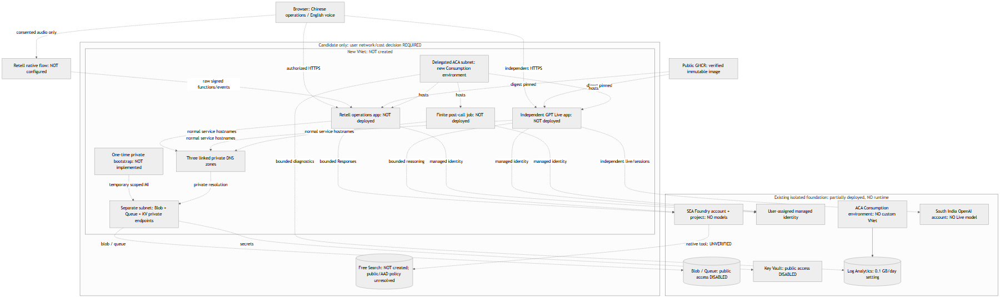
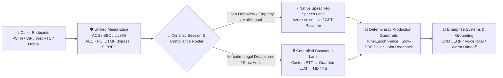

# 🎙️ Enterprise Voice & Multimodal AI Lab (`voice-agent-lab`)

[简体中文](./README.md) | **English** | [🌐 Live Interactive Architecture Portal](https://turbo998.github.io/voice-agent-lab/) | [📑 Full Bilingual Asset Catalog](./docs/asset-catalog.en.md)

> **An Enterprise Voice & Multimodal AI Architecture Knowledge Base, Decision Matrix, Benchmark Suite, and Production Guardrail Toolkit built for AI Solution Architects.**
> Focused on contact center modernization, sub-500ms full-duplex voice agents, BFSI/Healthcare/Retail compliance governance, speaker diarization, and Voice AI capacity/FinOps sizing—delivering clear, client-ready architecture artifacts free of low-level protocol packet-header clutter.



---

## ⚡ Executive Deliverables at a Glance

| Deliverable | Engineering & Presales Value | Entrypoint |
| :--- | :--- | :--- |
| **🌐 Interactive Architecture & Presales Portal** | Stack matcher, TCO/ROI calculator, 8-scenario deterministic guardrail sandbox, and trilingual UI | [Live Portal ↗](https://turbo998.github.io/voice-agent-lab/) · [`site/index.html`](./site/index.html) |
| **📽️ 16:9 Executive Presales Slide Deck** | Self-contained 12-slide HTML presentation for CXO briefings and architecture workshops | [`site/deck.html`](./site/deck.html) |
| **📊 7-Card 4:5 Benchmark Decks (2 Reports)** | *Realtime Voice & Multi-Model Router 7-Card Deck* and *Azure Speech Diarization PoC 7-Card Deck* | [`benchmark-cards.html`](./site/benchmark-cards.html) · [`diarization-cards.html`](./site/diarization-benchmark-cards.html) |
| **🏭 Global 6-Language Voice CS Case Study** | Production case study scaling 250k → 750k smart devices at `$0.08/min` with two-phase idempotent writes | [`site/case-study.html`](./site/case-study.html) · [Markdown](./docs/smart-hardware-global-voice-cs-case-study.md) |
| **🏛️ Core Whitepapers & Runnable PoCs** | Reference architecture, 12-scenario ROI whitepaper, competitive battlecards, 2-week PoC playbook, and runnable code | [Jump to Whitepapers](#-1-core-architecture-whitepapers--runnable-pocs-bilingual) |
| **🧭 63 Enterprise Voice AI Selection Guides** | Organized across *Foundation Architecture & Ingress*, *Production Engineering, Compliance & FinOps*, and *Industry Playbooks* | [Jump to 63 Guides](#-2-63-enterprise-voice-ai-architecture-selection-guides-bilingual) |
| **🛡️ Deterministic Guardrail Modules (TypeScript)** | Zero-dependency modules for Turn-Epoch write fencing, slow-ERP zero-dead-air pacing, slot readback, warm handoff, and dual-recording | [`packages/`](./packages) |

---

## 🎯 Executive One-Page Voice Architecture Selection Matrix

Every enterprise voice engagement starts by choosing between an **Enterprise Cascaded Pipeline**, **Native Speech-to-Speech (S2S)**, or a **Hybrid Compliance Dual-Track Architecture**:

| Decision Dimension | 1. Enterprise Cascaded (`Streaming ASR → LLM → Streaming TTS`) | 2. Native Speech-to-Speech (`GPT-Realtime / Voice Live / Gemini Live / Nova Sonic`) | 3. Hybrid Compliance Dual-Track (Recommended Enterprise Default ⭐) |
| :--- | :--- | :--- | :--- |
| **Voice-to-Voice Latency (P50 / P95)** | `750ms – 1,250ms` / `1,600ms` | **`280ms – 450ms` / `680ms`** | `<450ms` S2S for open discovery; deterministic TTS on regulated clauses |
| **Prosody, Empathy & Natural Barge-In** | Requires external semantic turn detector; paralinguistic cues lost at STT boundary | **Native emotion, hesitation, and interruption awareness** | Natural conversational flow paired with deterministic action gating |
| **Text Auditability & Verbatim Disclosures** | **100% inspectable text seam for regex redaction & verbatim SSML** | Stochastic audio generation—unsuitable alone for statutory verbatim scripts | **Mandatory disclosures switch deterministically to locked SSML + WORM archival** |
| **Long-Call (`>10 min`) Unit Economics** | **Lowest & linear** (`$0.04 – $0.08 / min`) | Quadratic audio context growth if unpruned (`$0.12 – $0.24 / min`) | **`$0.07 – $0.11 / min`** via rolling 4-turn audio-to-text context pruning |
| **Best-Fit Workloads** | Regulated outbound campaigns, heavy domain SKU/code correction, high-volume standardized IVR | VIP concierge, language coaching, automotive in-cabin companions, smart hardware | **BFSI wealth/banking, insurance claims, airline rebooking, clinical triage, contact centers** |



---

## 📚 1. Core Architecture Whitepapers & Runnable PoCs (Bilingual)

| Deliverable | Solution Architect Focus | EN | 中文 |
| :--- | :--- | :---: | :---: |
| **Enterprise Realtime Voice Reference Architecture** | Native S2S vs. Cascaded vs. Hybrid topologies, semantic noise immunity, and async tool fences | [EN](./docs/solution-architecture.en.md) | [中文](./docs/solution-architecture.md) |
| **Enterprise Business Scenarios & ROI Whitepaper** | 12 high-value enterprise voice scenarios, SLA targets, and 400k-min/month TCO model | [EN](./docs/business-scenarios.en.md) | [中文](./docs/business-scenarios.md) |
| **Competitive Battlecards** | Head-to-head comparison of Azure Voice Live vs. Sierra, Retell/Vapi, ElevenLabs, and AWS Nova Sonic | [EN](./docs/competitive-analysis.en.md) | [中文](./docs/competitive-analysis.md) |
| **Presales Playbook & 2-Week PoC Guide** | 5-dimension discovery questionnaire, 15-min live demo script, and 2-week PoC validation probes | [EN](./docs/presales-playbook.en.md) | [中文](./docs/presales-playbook.md) |
| **Azure Speech Diarization & Stereo Split PoC** | Empirical multi-speaker diarization benchmarks plus runnable pipeline in [`experiments/azure-speech-diarization-poc/`](./experiments/azure-speech-diarization-poc/) | [EN](./docs/azure-speech-diarization-poc.en.md) | [中文](./docs/azure-speech-diarization-poc.md) |
| **GPT-Live Partner Demo Handbook** | Full-duplex Speech-to-Speech web prototype ([`experiments/gpt-live/`](./experiments/gpt-live/)) setup and demo walkthrough | [EN](./docs/gpt-live-partner-demo-handbook.en.md) | [中文](./docs/gpt-live-partner-demo-handbook.md) |
| **Global Smart Hardware 6-Language Voice CS Case Study** | End-to-end production architecture & FinOps review scaling 250k → 750k smart rings | [EN](./docs/smart-hardware-global-voice-cs-case-study.md) | [中文](./docs/smart-hardware-global-voice-cs-case-study.zh-CN.md) |
| **Evaluation Rubric & Edge Speech Containers** | 24-probe red-teaming rubric and disconnected Azure Speech Container deployment guide | [Rubric](./docs/voice-agent-evaluation-rubric.md) | [Containers](./docs/speech-container-guide.md) |

---

## 🧭 2. 63 Enterprise Voice AI Architecture Selection Guides (Bilingual)

> Also indexed in [`docs/asset-catalog.en.md`](./docs/asset-catalog.en.md).

### 3.1 Foundation Architecture, Models & Telephony Ingress (11 Guides)
1. **Cascaded (ASR→LLM→TTS) vs. Native Speech-to-Speech Architecture Selection**: [EN](./docs/cascaded-vs-s2s-semantic-turn-faq.en.md) | [中文](./docs/cascaded-vs-s2s-semantic-turn-faq.md)
2. **Native S2S Foundation Models Head-to-Head (GPT-Realtime / Azure Voice Live / Gemini Live / Nova Sonic)**: [EN](./docs/voice-native-s2s-models-gpt-live-realtime-gemini-live-nova-sonic-selection-faq.en.md) | [中文](./docs/voice-native-s2s-models-gpt-live-realtime-gemini-live-nova-sonic-selection-faq.md)
3. **Voice Orchestration Frameworks (LiveKit Agents vs. Pipecat vs. ACS vs. Retell / Vapi)**: [EN](./docs/voice-orchestration-framework-livekit-pipecat-acs-retell-vapi-selection-faq.en.md) | [中文](./docs/voice-orchestration-framework-livekit-pipecat-acs-retell-vapi-selection-faq.md)
4. **Microsoft Copilot Studio & D365 Contact Center vs. Azure AI Foundry + ACS**: [EN](./docs/microsoft-copilot-studio-d365-vs-azure-foundry-voice-selection-faq.en.md) | [中文](./docs/microsoft-copilot-studio-d365-vs-azure-foundry-voice-selection-faq.md)
5. **Global Cloud CCaaS & AI Contact Center Platforms (D365 Contact Center vs. Amazon Connect vs. Genesys vs. Google CES vs. Sierra)**: [EN](./docs/cloud-ccaas-d365-amazon-connect-genesys-google-sierra-selection-faq.en.md) | [中文](./docs/cloud-ccaas-d365-amazon-connect-genesys-google-sierra-selection-faq.md)
6. **Streaming STT, Low-Latency TTS, Brand Voice Cloning & Avatar Selection**: [EN](./docs/voice-stt-tts-cloning-avatar-azure-elevenlabs-deepgram-opensource-selection-faq.en.md) | [中文](./docs/voice-stt-tts-cloning-avatar-azure-elevenlabs-deepgram-opensource-selection-faq.md)
7. **WebRTC vs. WebSocket vs. SIP Trunking / ACS Ingress Selection**: [EN](./docs/webrtc-vs-websocket-vs-sip-ingress-selection-faq.en.md) | [中文](./docs/webrtc-vs-websocket-vs-sip-ingress-selection-faq.md)
8. **Enterprise PBX & CCaaS Integration (Genesys / Cisco / Avaya / Connect / Teams Phone)**: [EN](./docs/enterprise-pbx-ccaas-genesys-cisco-avaya-teams-voice-integration-selection-faq.en.md) | [中文](./docs/enterprise-pbx-ccaas-genesys-cisco-avaya-teams-voice-integration-selection-faq.md)
9. **Full-Duplex Barge-In, Semantic Turn Detection (EOU) & Echo/Crosstalk Architecture**: [EN](./docs/enterprise-voice-barge-in-semantic-turn-detection-aec-selection-faq.en.md) | [中文](./docs/enterprise-voice-barge-in-semantic-turn-detection-aec-selection-faq.md)
10. **Multi-Party Streaming Speaker Diarization & Voice-Bound Tool Authorization**: [EN](./docs/voice-multiparty-diarization-role-isolation-faq.en.md) | [中文](./docs/voice-multiparty-diarization-role-isolation-faq.md)
11. **Intra-Sentence Code-Switching (`zh-EN-Yue`) & Enterprise Dialect Routing**: [EN](./docs/voice-multilingual-codeswitch-dialect-faq.en.md) | [中文](./docs/voice-multilingual-codeswitch-dialect-faq.md)

### 3.2 Production Engineering, Compliance, High Availability & FinOps (12 Guides)
12. **Voice-Native RAG, Phonetic Homophone Recall & Zero-Trust MCP Tool Guardrails**: [EN](./docs/enterprise-voice-rag-knowledge-graph-mcp-tool-security-selection-faq.en.md) | [中文](./docs/enterprise-voice-rag-knowledge-graph-mcp-tool-security-selection-faq.md)
13. **Slow ERP/CRM Async Tool Integration, Zero-Dead-Air Pacing & Turn-Epoch Fencing**: [EN](./docs/enterprise-voice-async-erp-crm-integration-zero-dead-air-selection-faq.en.md) | [中文](./docs/enterprise-voice-async-erp-crm-integration-zero-dead-air-selection-faq.md)
14. **Voice AI FinOps: Azure PTU vs. PayGo Capacity Sizing & Audio Context Pruning**: [EN](./docs/enterprise-voice-ai-tco-ptu-capacity-finops-selection-faq.en.md) | [中文](./docs/enterprise-voice-ai-tco-ptu-capacity-finops-selection-faq.md)
15. **Mid-Call High Availability, Cross-Region S2S Failover & Session Recovery**: [EN](./docs/voice-midcall-failover-session-recovery-faq.en.md) | [中文](./docs/voice-midcall-failover-session-recovery-faq.md)
16. **Disconnected Edge Speech Containers & Sovereign Hybrid Cloud Failover**: [EN](./docs/voice-edge-cloud-quantized-container-failover-faq.en.md) | [中文](./docs/voice-edge-cloud-quantized-container-failover-faq.md)
17. **Warm Transfer, Supervisor Whisper & Human-in-the-Loop Escalation**: [EN](./docs/warm-transfer-whisper-handoff-faq.en.md) | [中文](./docs/warm-transfer-whisper-handoff-faq.md)
18. **Multi-Agent Voice Swarm Orchestration & Low-Latency Context Handoff**: [EN](./docs/enterprise-multi-agent-voice-swarm-supervisor-whisper-selection-faq.en.md) | [中文](./docs/enterprise-multi-agent-voice-swarm-supervisor-whisper-selection-faq.md)
19. **PCI-DSS v4.0 Dual-Stream DTMF Redaction & Payment Scope Isolation**: [EN](./docs/voice-pci-dtmf-scope-faq.en.md) | [中文](./docs/voice-pci-dtmf-scope-faq.md)
20. **Dual-Track SIPREC Compliance Recording & Real-Time PII Audio Redaction**: [EN](./docs/siprec-pii-audio-redaction-faq.en.md) | [中文](./docs/siprec-pii-audio-redaction-faq.md)
21. **Voice Biometrics Anti-Deepfake Liveness & Global Privacy Compliance (GDPR / BIPA / PIPL)**: [EN](./docs/enterprise-voice-biometrics-privacy-compliance-selection-faq.en.md) | [中文](./docs/enterprise-voice-biometrics-privacy-compliance-selection-faq.md)
22. **Voice Agent Evaluation, OpenTelemetry Latency Waterfall & Canary Rollout**: [EN](./docs/enterprise-voice-agent-evaluation-observability-redteaming-selection-faq.en.md) | [中文](./docs/enterprise-voice-agent-evaluation-observability-redteaming-selection-faq.md)
23. **Automated Post-Call QA & Spoken-Promise vs. CRM Ticket Reconciliation**: [EN](./docs/voice-postcall-promise-ticket-reconciliation-qa-faq.en.md) | [中文](./docs/voice-postcall-promise-ticket-reconciliation-qa-faq.md)

### 3.3 Enterprise Industry Solution Playbooks (40 Guides)
24. **Enterprise Contact Center Copilot: Tier-1 Deflection, Warm Handoff & Agent Assist**: [EN](./docs/contact-center-ai-copilot-tier1-deflection-agent-assist-selection-faq.en.md) | [中文](./docs/contact-center-ai-copilot-tier1-deflection-agent-assist-selection-faq.md)
25. **Telecom 5G New Calling & Multimodal Visual IVR Modernization**: [EN](./docs/telecom-5g-new-calling-visual-ivr-modernization-selection-faq.en.md) | [中文](./docs/telecom-5g-new-calling-visual-ivr-modernization-selection-faq.md)
26. **BFSI Wealth Management Dual-Recording, Suitability & Insurance Claims**: [EN](./docs/bfsi-wealth-dual-recording-claims-compliant-outbound-voice-selection-faq.en.md) | [中文](./docs/bfsi-wealth-dual-recording-claims-compliant-outbound-voice-selection-faq.md)
27. **Corporate Banking Treasury Maker-Checker & Anti-Deepfake Voice Compliance**: [EN](./docs/corporate-banking-treasury-maker-checker-trading-desk-voice-selection-faq.en.md) | [中文](./docs/corporate-banking-treasury-maker-checker-trading-desk-voice-selection-faq.md)
28. **Healthcare Pre-Triage, Ambient Clinical Scribe & Chronic Care Follow-Up**: [EN](./docs/healthcare-clinical-triage-chronic-followup-ambient-scribe-voice-selection-faq.en.md) | [中文](./docs/healthcare-clinical-triage-chronic-followup-ambient-scribe-voice-selection-faq.md)
29. **Retail Pharmacy Rx Refill, Drug Safety Disambiguation & Prior Authorization**: [EN](./docs/retail-pharmacy-rx-refill-pbm-prior-authorization-voice-selection-faq.en.md) | [中文](./docs/retail-pharmacy-rx-refill-pbm-prior-authorization-voice-selection-faq.md)
30. **Retail & QSR Drive-Thru Noise-Robust Voice Ordering**: [EN](./docs/qsr-drivethru-smart-restaurant-retail-voice-ordering-selection-faq.en.md) | [中文](./docs/qsr-drivethru-smart-restaurant-retail-voice-ordering-selection-faq.md)
31. **E-Commerce Showroom Concierge & Interactive Voice + Digital Human Avatar**: [EN](./docs/ecommerce-livestream-showroom-voice-avatar-digital-human-selection-faq.en.md) | [中文](./docs/ecommerce-livestream-showroom-voice-avatar-digital-human-selection-faq.md)
32. **Airline IRROPS Rebooking & Global Hospitality Multilingual Voice Concierge**: [EN](./docs/travel-airline-irrops-hotel-pms-multilingual-voice-concierge-selection-faq.en.md) | [中文](./docs/travel-airline-irrops-hotel-pms-multilingual-voice-concierge-selection-faq.md)
33. **Automotive In-Cabin Multimodal Voice Assistant & Smart Hardware Support**: [EN](./docs/in-vehicle-cockpit-smart-hardware-multimodal-voice-assistant-selection-faq.en.md) | [中文](./docs/in-vehicle-cockpit-smart-hardware-multimodal-voice-assistant-selection-faq.md)
34. **AI Sales Coach, Pitch Roleplay & Interactive Enablement Copilot**: [EN](./docs/ai-sales-roleplay-mock-interview-language-coach-selection-faq.en.md) | [中文](./docs/ai-sales-roleplay-mock-interview-language-coach-selection-faq.md)
35. **Compliant Outbound Voice SDR, AMD Voicemail Detection & TCPA Governance**: [EN](./docs/enterprise-outbound-voice-sales-lead-qualification-selection-faq.en.md) | [中文](./docs/enterprise-outbound-voice-sales-lead-qualification-selection-faq.md)
36. **Enterprise Multilingual Simultaneous Interpretation & Meeting Intelligence**: [EN](./docs/enterprise-multilingual-simultaneous-interpretation-meeting-minutes-selection-faq.en.md) | [中文](./docs/enterprise-multilingual-simultaneous-interpretation-meeting-minutes-selection-faq.md)
37. **Enterprise Internal IT Service Desk & HR Employee Voice Copilot**: [EN](./docs/enterprise-it-helpdesk-hr-employee-voice-copilot-selection-faq.en.md) | [中文](./docs/enterprise-it-helpdesk-hr-employee-voice-copilot-selection-faq.md)
38. **Government Citizen Hotline (12345 / 311), Utility Outage Storm Deflection & 0ms Gas-Leak Preemption**: [EN](./docs/government-12345-hotline-utility-outage-emergency-dispatch-voice-selection-faq.en.md) | [中文](./docs/government-12345-hotline-utility-outage-emergency-dispatch-voice-selection-faq.md)
39. **Enterprise Bulk Hiring AI Voice Interviewer (STAR Probing), Anti-Teleprompter & Fairness Audit**: [EN](./docs/enterprise-ai-voice-interviewer-bulk-hiring-fairness-audit-selection-faq.en.md) | [中文](./docs/enterprise-ai-voice-interviewer-bulk-hiring-fairness-audit-selection-faq.md)
40. **Field Wealth Advisor, Insurance Agent & Pharma MSL In-Person Voice Copilot**: [EN](./docs/field-wealth-advisor-insurance-pharma-inperson-voice-copilot-selection-faq.en.md) | [中文](./docs/field-wealth-advisor-insurance-pharma-inperson-voice-copilot-selection-faq.md)
41. **Cross-Border E-Commerce 20-Lang After-Sales, Last-Mile Delivery & Customs / Telex Release**: [EN](./docs/cross-border-ecommerce-global-logistics-delivery-customs-voice-selection-faq.en.md) | [中文](./docs/cross-border-ecommerce-global-logistics-delivery-customs-voice-selection-faq.md)
42. **K12 & Higher-Ed Socratic AI Voice Tutor, Campus FERPA Privacy & Speech Accessibility**: [EN](./docs/education-socratic-voice-tutor-campus-privacy-accessibility-selection-faq.en.md) | [中文](./docs/education-socratic-voice-tutor-campus-privacy-accessibility-selection-faq.md)
43. **Telecom Carrier & Broadband ISP Outage Deflection, ONT Vision (TR-069) & Anti-SIM-Swap**: [EN](./docs/telecom-isp-broadband-outage-router-vision-simswap-voice-selection-faq.en.md) | [中文](./docs/telecom-isp-broadband-outage-router-vision-simswap-voice-selection-faq.md)
44. **Insurance Tele-Underwriting (Anti-Estoppel), Pension Proof-of-Life & Catastrophe Adjuster Copilot**: [EN](./docs/insurance-underwriting-pension-annuity-adjuster-voice-selection-faq.en.md) | [中文](./docs/insurance-underwriting-pension-annuity-adjuster-voice-selection-faq.md)
45. **EV Supercharging 15s OCPP Self-Healing, Virtual Power Plant (VPP) & Solar/BESS Voice AI**: [EN](./docs/energy-virtual-power-plant-ev-charging-station-voice-selection-faq.en.md) | [中文](./docs/energy-virtual-power-plant-ev-charging-station-voice-selection-faq.md)
46. **FMCG Route Sales (DSD), B2B Kitchen Dialect Reordering & Smart Cooler 8s Dispute Voice AI**: [EN](./docs/fmcg-dsd-route-sales-b2b-wholesale-vending-voice-selection-faq.en.md) | [中文](./docs/fmcg-dsd-route-sales-b2b-wholesale-vending-voice-selection-faq.md)
47. **Smart Mall Parking Exit-Gate 10s Rescue, Landmark Wayfinding & Code-Adam Child SOS Voice AI**: [EN](./docs/smart-mall-parking-gate-wayfinding-retail-concierge-voice-selection-faq.en.md) | [中文](./docs/smart-mall-parking-gate-wayfinding-retail-concierge-voice-selection-faq.md)
48. **Short-Drama & Film Multilingual AI Dubbing (Isochrony Lip-Sync), Multi-Role Audiobook & Podcast Platform**: [EN](./docs/media-video-dubbing-audiobook-podcast-voice-localization-selection-faq.en.md) | [中文](./docs/media-video-dubbing-audiobook-podcast-voice-localization-selection-faq.md)
49. **Cultural Tourism, Theme Park Queue Load-Balancing & Museum Sub-Meter (UWB/BLE) Voice Docent**: [EN](./docs/cultural-tourism-theme-park-museum-voice-concierge-selection-faq.en.md) | [中文](./docs/cultural-tourism-theme-park-museum-voice-concierge-selection-faq.md)
50. **Smart Property Concierge, Elevator SOS Entrapment Rescue & Real Estate 3D VR Voice Advisor**: [EN](./docs/real-estate-smart-property-elevator-emergency-voice-selection-faq.en.md) | [中文](./docs/real-estate-smart-property-elevator-emergency-voice-selection-faq.md)
51. **Legal Intake Conflict-Check (ABA Rule 1.18), Courtroom Multi-Track & Remote Notary (RON) Voice AI**: [EN](./docs/legal-court-transcription-law-firm-intake-notary-voice-selection-faq.en.md) | [中文](./docs/legal-court-transcription-law-firm-intake-notary-voice-selection-faq.md)
52. **Automotive NG-eCall Crash Triage (GB 45672 / EN 17240), EV Roadside Rescue & Dealer DMS Voice AI**: [EN](./docs/automotive-ecall-roadside-rescue-dealer-aftersales-voice-selection-faq.en.md) | [中文](./docs/automotive-ecall-roadside-rescue-dealer-aftersales-voice-selection-faq.md)
53. **Smart Elderly Care Bathroom Fall Guardian (mmWave/SED), Presbycusis EQ & Matter Smart Home Voice**: [EN](./docs/smart-home-elderly-care-ambient-acoustic-guardian-selection-faq.en.md) | [中文](./docs/smart-home-elderly-care-ambient-acoustic-guardian-selection-faq.md)
54. **Smart Hospital Inpatient Bedside Nurse Call, Sterile OR PACS Control & WHO Surgical Safety Timeout**: [EN](./docs/smart-hospital-inpatient-nurse-call-surgical-or-voice-selection-faq.en.md) | [中文](./docs/smart-hospital-inpatient-nurse-call-surgical-or-voice-selection-faq.md)
55. **Aviation In-Flight Cabin Crew & MedLink Triage, Cruise Ship 0-bps Edge Concierge & High-Speed Rail Voice**: [EN](./docs/aviation-inflight-cabin-cruise-ship-highspeed-rail-voice-selection-faq.en.md) | [中文](./docs/aviation-inflight-cabin-cruise-ship-highspeed-rail-voice-selection-faq.md)
56. **Gaming Real-Time Voice NPC (85/15 Tactical Bark Cache), EdTech Companion Toys & COPPA Minor Safety**: [EN](./docs/gaming-voice-npc-edtech-companion-minor-safety-selection-faq.en.md) | [中文](./docs/gaming-voice-npc-edtech-companion-minor-safety-selection-faq.md)
57. **Affective Prosody De-Escalation (0.88x–0.94x Rate), EU AI Act Workplace Emotion Lock & 1800ms Distress EOU**: [EN](./docs/voice-affective-prosody-emotion-deescalation-faq.en.md) | [中文](./docs/voice-affective-prosody-emotion-deescalation-faq.md)
58. **High-Risk Alphanumeric ID Disambiguation (Airline PNR / 17-Char VIN / Policy IDs) & NATO Phonetic Readback**: [EN](./docs/voice-alphanumeric-disambiguation-faq.en.md) | [中文](./docs/voice-alphanumeric-disambiguation-faq.md)
59. **Multimodal Avatar Lip-Sync (<=45ms Skew) & Visual Co-Browsing (DOM PII Masking & Viewport Epoch Lock)**: [EN](./docs/voice-multimodal-avatar-cobrowsing-sync-faq.en.md) | [中文](./docs/voice-multimodal-avatar-cobrowsing-sync-faq.md)
60. **Voice Agent Canary Shadow Rollout (Dry-Run Muted Fork & <=500ms Auto-Rollback) & Memory Poisoning Isolation**: [EN](./docs/voice-canary-shadow-rollout-memory-poisoning-faq.en.md) | [中文](./docs/voice-canary-shadow-rollout-memory-poisoning-faq.md)
61. **EAA/ADA Speech Accessibility (2200ms Disfluency EOU & RTT Fallback) & E911/112 PIDF-LO Zero-Auth Preemption**: [EN](./docs/voice-accessibility-disfluency-e911-pidflo-bridge-faq.en.md) | [中文](./docs/voice-accessibility-disfluency-e911-pidflo-bridge-faq.md)
62. **Omnichannel Voice + Mobile App CAS Optimistic Concurrency Lock, 8kHz Ultrasonic Filter & $2.50 Wallet Guard**: [EN](./docs/voice-omnichannel-cas-concurrency-ultrasonic-wallet-guard-faq.en.md) | [中文](./docs/voice-omnichannel-cas-concurrency-ultrasonic-wallet-guard-faq.md)
63. **Native S2S Emotional Contagion Clamp (-18 LUFS), Syntactic Incomplete-Clause Hold (1350ms) & C2PA Watermark**: [EN](./docs/voice-s2s-emotional-contagion-lufs-syntactic-incomplete-hold-faq.en.md) | [中文](./docs/voice-s2s-emotional-contagion-lufs-syntactic-incomplete-hold-faq.md)

---

## 🗂️ 3. Repository Layout & Verification

```text
voice-agent-lab/
├── site/                                 # Interactive architecture portal, 16:9 slide deck, 7-Card benchmark decks & case study
│   ├── index.html & app.js               # Main portal (stack matcher, ROI calculator, 8 SA guardrail probes)
│   ├── deck.html                         # 12-slide 16:9 executive presales presentation
│   ├── benchmark-cards.html              # Realtime Voice & Router 7-Card 4:5 visual benchmark report
│   ├── diarization-benchmark-cards.html  # Azure Speech Diarization 7-Card benchmark report
│   └── case-study.html                   # Global 6-language smart-hardware voice CS case study
├── docs/                                 # Bilingual architecture whitepapers, asset catalog & 36 SA selection guides
├── assets/svg/                           # Clean visual architecture summary infographics (SVG)
├── experiments/                          # Reproducible PoCs (Azure Speech Diarization PoC & GPT-Live prototype)
├── packages/                             # Zero-dependency TypeScript production guardrail modules
│   ├── duplex-core/                      # Turn-Epoch write fence & slow-API zero-dead-air filler state machine
│   └── business-core/                    # High-risk slot readback, warm-handoff packet builder & wealth dual-recording gate
├── scripts/                              # Public-repo PII/secret hygiene check script
└── tests/                                # Unit tests for guardrails, bilingual parity, link integrity & portal readiness
```

### Quick Local Validation

```bash
npm install
npm test              # Runs guardrail unit tests, bilingual catalog parity & Markdown/SVG link checks
npm run typecheck     # Strict TypeScript type-checking
npm run build         # Compiles TypeScript guardrail modules
npm run check:public  # Scans repository for PII, internal URLs, or local path leaks
```

To preview the interactive portal locally, open `site/index.html` directly in a browser or run `npx serve site`.
