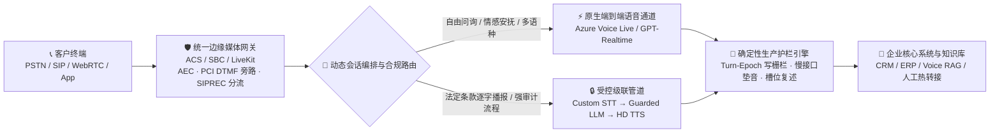

# 🎙️ Enterprise Voice & Multimodal AI Lab (`voice-agent-lab`)

**简体中文** | [English](./README.en.md) | [🌐 在线交互式架构门户](https://turbo998.github.io/voice-agent-lab/) | [📑 完整双语资产目录](./docs/asset-catalog.md)

> **面向 AI 解决方案架构师（AI Solution Architect）的企业级实时语音与多模态智能体架构知识库、选型决策矩阵、实测基准与生产级护栏工具箱。**
> 聚焦企业联络中心现代化、全双工低延迟对话、金融/医疗/零售行业合规治理、说话人分离与容量成本精算（FinOps），剔除底层协议比特级噪音，提供可直接用于客户架构评审与售前 PoC 交付的实战资产。


---

## ⚡ 核心交付物速览

| 资产模块 | 核心工程与业务价值 | 入口链接 |
| :--- | :--- | :--- |
| **🌐 交互式架构与售前门户** | 架构栈匹配器、TCO/ROI 精算器、8 项企业生产护栏交互沙盒与中/繁/英切换 | [在线门户 ↗](https://turbo998.github.io/voice-agent-lab/) · [`site/index.html`](./site/index.html) |
| **📽️ 16:9 架构师高管汇报讲义** | 12 页零外部依赖 HTML 演示幻灯片，支持客户高层汇报与架构选型工作坊 | [`site/deck.html`](./site/deck.html) |
| **📊 7-Card 4:5 标准评测报告（三份）** | 《实时语音路由 7-Card》、《Azure Speech 说话人分离 7-Card》与《VoxCPM2 vs. Azure Speech 48kHz 声学实测 7-Card》 | [`benchmark-cards.html`](./site/benchmark-cards.html) · [`diarization-cards.html`](./site/diarization-benchmark-cards.html) · [`voxcpm2-cards.zh-CN.html`](./site/voxcpm2-benchmark-cards.zh-CN.html) · [`voxcpm2-cards.html`](./site/voxcpm2-benchmark-cards.html) |
| **🧮 VoxCPM2 vs. Azure Speech 混合路由与 TCO 工作台** | 交互式企业语音合规路由模拟器、月度 TCO / GPU 池容量精算与 11 组 48kHz 样音 Welch 频谱分析器 | [`site/voxcpm2-workbench.html`](./site/voxcpm2-workbench.html) · [选型与实测指南](./docs/voxcpm2-vs-azure-speech-tts-benchmark-selection-faq.md) |
| **🏭 出海智能硬件 6 语种语音客服案例** | 25 万 → 75 万台设备全球客服扩容复盘：`$0.08/分钟` 成本、两阶段幂等写入与路由评测 | [`site/case-study.html`](./site/case-study.html) · [中文复盘](./docs/smart-hardware-global-voice-cs-case-study.zh-CN.md) |
| **🏛️ 核心架构白皮书与可运行 PoC** | 参考架构白皮书、12 大场景 ROI 白皮书、竞品 Battlecards、两周 PoC 手册与实测代码 | [查看白皮书与 PoC](#-一核心架构白皮书与可运行-poc中英双语) |
| **🧭 498 篇企业级语音架构选型指南** | 系统覆盖“模型与通道接入”、“生产工程/合规/FinOps”与“重点行业解决方案”三大支柱 | [浏览 498 篇选型指南](#-二498-篇企业级语音架构选型指南中英双语) |
| **🛡️ 确定性生产护栏模块 (TypeScript)** | 零依赖实现打断纪元写栅栏、慢速 ERP 零冷场垫音、高危槽位二次复述与财富双录门控 | [`packages/`](./packages) |

---

## 🎯 企业级实时语音架构一页纸选型矩阵

在客户架构评审中，首要决策是选择 **级联管道（Cascaded）**、**原生端到端语音大模型（Native S2S）** 还是 **混合合规双轨架构（Hybrid Dual-Track）**：

| 决策维度 | 1. 企业级级联管道 (`Streaming ASR → LLM → Streaming TTS`) | 2. 原生端到端语音 (`GPT-Realtime / Voice Live / Gemini Live / Nova Sonic`) | 3. 混合合规双轨架构（企业生产推荐 ⭐） |
| :--- | :--- | :--- | :--- |
| **端到端首字音频延迟 (P50 / P95)** | `750ms – 1,250ms` / `1,600ms` | **`280ms – 450ms` / `680ms`** | 自由对话走 S2S（`<450ms`），法定条款切受控 TTS |
| **情绪韵律感知与自然打断 (Barge-In)** | 依赖独立语义判停模型，副语言情绪特征易丢失 | **原生感知语气、犹豫与停顿，全双工交互最自然** | 兼顾自然对话体验与高危业务动作确定性门控 |
| **文本可审计性与法定逐字播报** | **100% 中间文本可拦截、可正则脱敏、可逐字播报** | 音频随机采样生成，不可单独用于法定免责条款宣读 | **风险揭示/报价强制切换锁定 SSML 播报并双录存证** |
| **长通话（>10 分钟）单分钟成本** | **最低且线性可控**（`$0.04 – $0.08 / min`） | 未裁剪音频上下文时呈二次方增长（`$0.12 – $0.24 / min`） | 结合滑动窗口历史音频摘要裁剪，稳定在 **`$0.07 – $0.11 / min`** |
| **典型适用场景** | 强监管外呼回访、重度专业术语纠错、超大规模标准化 IVR | VIP 礼宾导购、口语陪练、智能座舱多模态伴侣、智能硬件 | **银行财富双录、保险理赔、航司改签、医疗分诊、企业联络中心** |



---

## 📚 一、核心架构白皮书与可运行 PoC（中英双语）

| 资产名称 | 解决方案架构师核心关注点 | 中文版 | English |
| :--- | :--- | :---: | :---: |
| **企业级实时语音参考架构白皮书** | Native S2S、级联与混合双轨三大范式、四层生产拓扑与抗噪防幻觉护栏 | [中文](./docs/solution-architecture.md) | [EN](./docs/solution-architecture.en.md) |
| **行业场景与量化 ROI 白皮书** | 12 大企业高价值语音场景拆解、SLA 验收水位与 40 万分钟/月 TCO 模型 | [中文](./docs/business-scenarios.md) | [EN](./docs/business-scenarios.en.md) |
| **主流语音平台竞品对比 (Battlecards)** | Azure Voice Live 对标 Sierra、Retell/Vapi、ElevenLabs 与 Nova Sonic 选型攻防 | [中文](./docs/competitive-analysis.md) | [EN](./docs/competitive-analysis.en.md) |
| **售前打单与两周 PoC 交付手册** | 五维需求发现问卷、15 分钟现场演示剧本、两周 PoC 里程碑与验收探针 | [中文](./docs/presales-playbook.md) | [EN](./docs/presales-playbook.en.md) |
| **Azure Speech 说话人分离实证 PoC** | 多说话人角色分离与双声道分轨实测报告及 [`experiments/azure-speech-diarization-poc/`](./experiments/azure-speech-diarization-poc/) 复现工程 | [中文](./docs/azure-speech-diarization-poc.md) | [EN](./docs/azure-speech-diarization-poc.en.md) |
| **清华 OpenBMB VoxCPM2 vs. Azure Speech 声学基准与选型** | 11 组 48kHz 样音 `1024-pt` Welch 频谱与量化实测（[`experiments/voxcpm2-acoustic-benchmark/`](./experiments/voxcpm2-acoustic-benchmark/)）、双层 CFG 源码核查与混合路由 TCO | [中文](./docs/voxcpm2-vs-azure-speech-tts-benchmark-selection-faq.md) | [EN](./docs/voxcpm2-vs-azure-speech-tts-benchmark-selection-faq.en.md) |
| **GPT-Live 全双工语音原型手册** | 实时双向语音 Web 原型（[`experiments/gpt-live/`](./experiments/gpt-live/)）部署与合作伙伴演示指南 | [中文](./docs/gpt-live-partner-demo-handbook.md) | [EN](./docs/gpt-live-partner-demo-handbook.en.md) |
| **出海智能硬件 6 语种语音客服案例** | 25 万 → 75 万台智能硬件多语种语音客服架构演进、多模型路由与成本复盘 | [中文](./docs/smart-hardware-global-voice-cs-case-study.zh-CN.md) | [EN](./docs/smart-hardware-global-voice-cs-case-study.md) |
| **评测红队规范与边缘语音容器指南** | 24 项语音红队评测规范、Azure Speech 本地边缘容器部署与完整资产索引 | [评测规范](./docs/voice-agent-evaluation-rubric.md) | [容器指南](./docs/speech-container-guide.md) |

---

## 🧭 二、498 篇企业级语音架构选型指南（中英双语）

> 完整分类说明亦可参阅 [`docs/asset-catalog.md`](./docs/asset-catalog.md)。

### 3.1 基础架构、模型与语音通道接入（11 篇）
1. **级联架构（ASR→LLM→TTS）vs 原生端到端语音（Native S2S）选型**：[中文](./docs/cascaded-vs-s2s-semantic-turn-faq.md) | [EN](./docs/cascaded-vs-s2s-semantic-turn-faq.en.md)
2. **主流原生 S2S 多模态语音模型横评（GPT-Realtime / Azure Voice Live / Gemini Live / Nova Sonic）**：[中文](./docs/voice-native-s2s-models-gpt-live-realtime-gemini-live-nova-sonic-selection-faq.md) | [EN](./docs/voice-native-s2s-models-gpt-live-realtime-gemini-live-nova-sonic-selection-faq.en.md)
3. **实时语音编排框架对比（LiveKit Agents vs Pipecat vs ACS vs Retell / Vapi）**：[中文](./docs/voice-orchestration-framework-livekit-pipecat-acs-retell-vapi-selection-faq.md) | [EN](./docs/voice-orchestration-framework-livekit-pipecat-acs-retell-vapi-selection-faq.en.md)
4. **Microsoft Copilot Studio / D365 Contact Center vs Azure AI Foundry + ACS 选型**：[中文](./docs/microsoft-copilot-studio-d365-vs-azure-foundry-voice-selection-faq.md) | [EN](./docs/microsoft-copilot-studio-d365-vs-azure-foundry-voice-selection-faq.en.md)
5. **全球主流云联络中心与 AI 语音平台选型（D365 Contact Center vs Amazon Connect vs Genesys vs Google CES vs Sierra）**：[中文](./docs/cloud-ccaas-d365-amazon-connect-genesys-google-sierra-selection-faq.md) | [EN](./docs/cloud-ccaas-d365-amazon-connect-genesys-google-sierra-selection-faq.en.md)
6. **流式语音识别（STT）、低延迟合成（TTS）、声音克隆与数字人选型**：[中文](./docs/voice-stt-tts-cloning-avatar-azure-elevenlabs-deepgram-opensource-selection-faq.md) | [EN](./docs/voice-stt-tts-cloning-avatar-azure-elevenlabs-deepgram-opensource-selection-faq.en.md)
7. **WebRTC vs WebSocket vs SIP Trunking / ACS 语音接入架构选型**：[中文](./docs/webrtc-vs-websocket-vs-sip-ingress-selection-faq.md) | [EN](./docs/webrtc-vs-websocket-vs-sip-ingress-selection-faq.en.md)
8. **企业存量呼叫中心 PBX & CCaaS 集成（Genesys / Cisco / Avaya / Connect / Teams Phone）**：[中文](./docs/enterprise-pbx-ccaas-genesys-cisco-avaya-teams-voice-integration-selection-faq.md) | [EN](./docs/enterprise-pbx-ccaas-genesys-cisco-avaya-teams-voice-integration-selection-faq.en.md)
9. **全双工打断（Barge-In）、语义句末检测（Semantic EOU）与回声串音抑制架构**：[中文](./docs/enterprise-voice-barge-in-semantic-turn-detection-aec-selection-faq.md) | [EN](./docs/enterprise-voice-barge-in-semantic-turn-detection-aec-selection-faq.en.md)
10. **多人同场流式说话人分离（Speaker Diarization）与声纹绑定工具鉴权**：[中文](./docs/voice-multiparty-diarization-role-isolation-faq.md) | [EN](./docs/voice-multiparty-diarization-role-isolation-faq.en.md)
11. **句内跨语种混说（中英粤 Code-Switching）与方言路由架构**：[中文](./docs/voice-multilingual-codeswitch-dialect-faq.md) | [EN](./docs/voice-multilingual-codeswitch-dialect-faq.en.md)

### 3.2 生产工程、安全合规、高可用与 FinOps 容量规划（12 篇）
12. **语音原生 RAG、同音字纠偏检索与 MCP 工具零信任安全边界**：[中文](./docs/enterprise-voice-rag-knowledge-graph-mcp-tool-security-selection-faq.md) | [EN](./docs/enterprise-voice-rag-knowledge-graph-mcp-tool-security-selection-faq.en.md)
13. **慢速 ERP/CRM 异步工具集成、零冷场垫音节拍器与 Turn-Epoch 事务隔离**：[中文](./docs/enterprise-voice-async-erp-crm-integration-zero-dead-air-selection-faq.md) | [EN](./docs/enterprise-voice-async-erp-crm-integration-zero-dead-air-selection-faq.en.md)
14. **企业语音 AI 成本建模：Azure PTU vs PayGo 容量精算与音频上下文裁剪 FinOps**：[中文](./docs/enterprise-voice-ai-tco-ptu-capacity-finops-selection-faq.md) | [EN](./docs/enterprise-voice-ai-tco-ptu-capacity-finops-selection-faq.en.md)
15. **通话中途跨区域容灾切换（Mid-Call Failover）与无感会话恢复架构**：[中文](./docs/voice-midcall-failover-session-recovery-faq.md) | [EN](./docs/voice-midcall-failover-session-recovery-faq.en.md)
16. **离线边缘 Speech Container 容器部署与端云协同降级逃生架构**：[中文](./docs/voice-edge-cloud-quantized-container-failover-faq.md) | [EN](./docs/voice-edge-cloud-quantized-container-failover-faq.en.md)
17. **人工坐席热转接（Warm Transfer）与主管耳语（Whisper）无感交接架构**：[中文](./docs/warm-transfer-whisper-handoff-faq.md) | [EN](./docs/warm-transfer-whisper-handoff-faq.en.md)
18. **多智能体语音协同（Multi-Agent Voice Swarm）与防死循环路由架构**：[中文](./docs/enterprise-multi-agent-voice-swarm-supervisor-whisper-selection-faq.md) | [EN](./docs/enterprise-multi-agent-voice-swarm-supervisor-whisper-selection-faq.en.md)
19. **PCI-DSS v4.0 双流 DTMF 支付按键旁路与收单合规隔离**：[中文](./docs/voice-pci-dtmf-scope-faq.md) | [EN](./docs/voice-pci-dtmf-scope-faq.en.md)
20. **双轨 SIPREC 合规录音与实时敏感信息（PII）声学脱敏架构**：[中文](./docs/siprec-pii-audio-redaction-faq.md) | [EN](./docs/siprec-pii-audio-redaction-faq.en.md)
21. **声纹反深伪活体检测（Anti-Deepfake）与全球语音隐私合规（GDPR / BIPA / PIPL）**：[中文](./docs/enterprise-voice-biometrics-privacy-compliance-selection-faq.md) | [EN](./docs/enterprise-voice-biometrics-privacy-compliance-selection-faq.en.md)
22. **企业语音智能体评测体系、OpenTelemetry 全链路延迟瀑布与灰度发布**：[中文](./docs/enterprise-voice-agent-evaluation-observability-redteaming-selection-faq.md) | [EN](./docs/enterprise-voice-agent-evaluation-observability-redteaming-selection-faq.en.md)
23. **话后自动化全量质检（Post-Call QA）与口头承诺 vs CRM 工单对账**：[中文](./docs/voice-postcall-promise-ticket-reconciliation-qa-faq.md) | [EN](./docs/voice-postcall-promise-ticket-reconciliation-qa-faq.en.md)

### 3.3 高价值企业行业解决方案蓝图（475 篇）
24. **企业联络中心 AI Copilot：一线智能分流、人机热交接与实时坐席辅助**：[中文](./docs/contact-center-ai-copilot-tier1-deflection-agent-assist-selection-faq.md) | [EN](./docs/contact-center-ai-copilot-tier1-deflection-agent-assist-selection-faq.en.md)
25. **运营商 5G 新通话与多模态可视化 IVR（Visual IVR）现代化改造**：[中文](./docs/telecom-5g-new-calling-visual-ivr-modernization-selection-faq.md) | [EN](./docs/telecom-5g-new-calling-visual-ivr-modernization-selection-faq.en.md)
26. **银行财富管理智能双录（Dual-Recording）、适当性核验与保险理赔语音方案**：[中文](./docs/bfsi-wealth-dual-recording-claims-compliant-outbound-voice-selection-faq.md) | [EN](./docs/bfsi-wealth-dual-recording-claims-compliant-outbound-voice-selection-faq.en.md)
27. **对公银行财资双人复核（Maker-Checker）、防 CEO 深伪电诈与交易台合规语音**：[中文](./docs/corporate-banking-treasury-maker-checker-trading-desk-voice-selection-faq.md) | [EN](./docs/corporate-banking-treasury-maker-checker-trading-desk-voice-selection-faq.en.md)
28. **医疗院前智能分诊、诊室环境病历生成（Ambient Scribe）与慢病随访方案**：[中文](./docs/healthcare-clinical-triage-chronic-followup-ambient-scribe-voice-selection-faq.md) | [EN](./docs/healthcare-clinical-triage-chronic-followup-ambient-scribe-voice-selection-faq.en.md)
29. **连锁药房处方续配、相似药名防混淆与医保事前授权（Prior Auth）语音方案**：[中文](./docs/retail-pharmacy-rx-refill-pbm-prior-authorization-voice-selection-faq.md) | [EN](./docs/retail-pharmacy-rx-refill-pbm-prior-authorization-voice-selection-faq.en.md)
30. **连锁餐饮得来速（QSR Drive-Thru）与智慧零售门店抗噪语音点单方案**：[中文](./docs/qsr-drivethru-smart-restaurant-retail-voice-ordering-selection-faq.md) | [EN](./docs/qsr-drivethru-smart-restaurant-retail-voice-ordering-selection-faq.en.md)
31. **品牌电商展厅导购与实时语音数字人（Voice + Avatar）交互方案**：[中文](./docs/ecommerce-livestream-showroom-voice-avatar-digital-human-selection-faq.md) | [EN](./docs/ecommerce-livestream-showroom-voice-avatar-digital-human-selection-faq.en.md)
32. **航司大面积航延改签（IRROPS）与连锁酒店多语种 AI 礼宾直连 PMS 方案**：[中文](./docs/travel-airline-irrops-hotel-pms-multilingual-voice-concierge-selection-faq.md) | [EN](./docs/travel-airline-irrops-hotel-pms-multilingual-voice-concierge-selection-faq.en.md)
33. **智能汽车座舱多音区多模态语音助手与车载智能硬件服务方案**：[中文](./docs/in-vehicle-cockpit-smart-hardware-multimodal-voice-assistant-selection-faq.md) | [EN](./docs/in-vehicle-cockpit-smart-hardware-multimodal-voice-assistant-selection-faq.en.md)
34. **AI 销售实战对练（Sales Roleplay）、模拟面试与企业话术教练方案**：[中文](./docs/ai-sales-roleplay-mock-interview-language-coach-selection-faq.md) | [EN](./docs/ai-sales-roleplay-mock-interview-language-coach-selection-faq.en.md)
35. **企业合规智能外呼（Outbound SDR）、答录机检测（AMD）与防骚扰治理方案**：[中文](./docs/enterprise-outbound-voice-sales-lead-qualification-selection-faq.md) | [EN](./docs/enterprise-outbound-voice-sales-lead-qualification-selection-faq.en.md)
36. **跨国会议实时多语种同声传译与结构化纪要行动项提取方案**：[中文](./docs/enterprise-multilingual-simultaneous-interpretation-meeting-minutes-selection-faq.md) | [EN](./docs/enterprise-multilingual-simultaneous-interpretation-meeting-minutes-selection-faq.en.md)
37. **企业内部 IT 服务台（ITSM）与 HR 员工自助语音 Copilot 方案**：[中文](./docs/enterprise-it-helpdesk-hr-employee-voice-copilot-selection-faq.md) | [EN](./docs/enterprise-it-helpdesk-hr-employee-voice-copilot-selection-faq.en.md)
38. **政务服务便民热线（12345 / 311）、公用事业停水停电风暴分流与燃气泄漏 0ms 抢占方案**：[中文](./docs/government-12345-hotline-utility-outage-emergency-dispatch-voice-selection-faq.md) | [EN](./docs/government-12345-hotline-utility-outage-emergency-dispatch-voice-selection-faq.en.md)
39. **企业大规模校招与蓝领批量 AI 语音面试官（STAR 追问）、防提词器作弊与公平性审计方案**：[中文](./docs/enterprise-ai-voice-interviewer-bulk-hiring-fairness-audit-selection-faq.md) | [EN](./docs/enterprise-ai-voice-interviewer-bulk-hiring-fairness-audit-selection-faq.en.md)
40. **财富管理理财师、保险代理人与医药代表（MSL）线下拜访随身语音 Copilot 方案**：[中文](./docs/field-wealth-advisor-insurance-pharma-inperson-voice-copilot-selection-faq.md) | [EN](./docs/field-wealth-advisor-insurance-pharma-inperson-voice-copilot-selection-faq.en.md)
41. **跨境电商全球 20 语种售后客服、国际快递末端派送与海运清关/电放提单语音方案**：[中文](./docs/cross-border-ecommerce-global-logistics-delivery-customs-voice-selection-faq.md) | [EN](./docs/cross-border-ecommerce-global-logistics-delivery-customs-voice-selection-faq.en.md)
42. **K12 与高等院校 1对1 苏格拉底启发式口语/数理家教、校园 FERPA 隐私与无障碍包容方案**：[中文](./docs/education-socratic-voice-tutor-campus-privacy-accessibility-selection-faq.md) | [EN](./docs/education-socratic-voice-tutor-campus-privacy-accessibility-selection-faq.en.md)
43. **电信运营商与宽带 ISP：万户光纤断网 12秒拦截、光猫看图（TR-069）自愈与防 SIM-Swap 方案**：[中文](./docs/telecom-isp-broadband-outage-router-vision-simswap-voice-selection-faq.md) | [EN](./docs/telecom-isp-broadband-outage-router-vision-simswap-voice-selection-faq.en.md)
44. **寿险重疾智能核保回访（反弃权零承诺锁）、养老金生存认证与巨灾查勘定损 Copilot 方案**：[中文](./docs/insurance-underwriting-pension-annuity-adjuster-voice-selection-faq.md) | [EN](./docs/insurance-underwriting-pension-annuity-adjuster-voice-selection-faq.en.md)
45. **新能源超充站 15秒远程自愈（OCPP 防拉弧锁）、虚拟电厂（VPP）负荷邀约与光储运维方案**：[中文](./docs/energy-virtual-power-plant-ev-charging-station-voice-selection-faq.md) | [EN](./docs/energy-virtual-power-plant-ev-charging-station-voice-selection-faq.en.md)
46. **快消品巡店车销（FMCG DSD）、餐饮后厨 B2B 方言补货与智能冰柜 8秒争议秒退方案**：[中文](./docs/fmcg-dsd-route-sales-b2b-wholesale-vending-voice-selection-faq.md) | [EN](./docs/fmcg-dsd-route-sales-b2b-wholesale-vending-voice-selection-faq.en.md)
47. **大型商业综合体智慧停车道闸 10秒脱困、地标级寻店/找车导览与儿童走失 Code Adam 安防方案**：[中文](./docs/smart-mall-parking-gate-wayfinding-retail-concierge-voice-selection-faq.md) | [EN](./docs/smart-mall-parking-gate-wayfinding-retail-concierge-voice-selection-faq.en.md)
48. **短剧/影视出海多语种 AI 译制配音（等时唇形对齐 Isochrony）、多角色有声书与企业播客方案**：[中文](./docs/media-video-dubbing-audiobook-podcast-voice-localization-selection-faq.md) | [EN](./docs/media-video-dubbing-audiobook-podcast-voice-localization-selection-faq.en.md)
49. **大型文旅景区、主题乐园排队动态调度、博物馆亚米级（UWB/BLE）多语种伴游与场馆语音方案**：[中文](./docs/cultural-tourism-theme-park-museum-voice-concierge-selection-faq.md) | [EN](./docs/cultural-tourism-theme-park-museum-voice-concierge-selection-faq.en.md)
50. **商业地产、智慧物业管家（电梯困人 SOS 应急 / 无人岗亭抬杆 / 报修派单）与房产 VR 语音导购方案**：[中文](./docs/real-estate-smart-property-elevator-emergency-voice-selection-faq.md) | [EN](./docs/real-estate-smart-property-elevator-emergency-voice-selection-faq.en.md)
51. **律所 24×7 案源初筛与利益冲突检索（ABA Rule 1.18）、司法庭审多声道笔录与远程视频公证（RON）方案**：[中文](./docs/legal-court-transcription-law-firm-intake-notary-voice-selection-faq.md) | [EN](./docs/legal-court-transcription-law-firm-intake-notary-voice-selection-faq.en.md)
52. **车企紧急呼叫救援（NG-eCall / GB 45672 AECS 碰撞触发）、新能源道路救援与 4S 店售后 DMS 语音方案**：[中文](./docs/automotive-ecall-roadside-rescue-dealer-aftersales-voice-selection-faq.md) | [EN](./docs/automotive-ecall-roadside-rescue-dealer-aftersales-voice-selection-faq.en.md)
53. **智慧养老居家看护（卫浴零镜头毫米波/声学防跌倒）、适老化老年耳聋补偿（Presbycusis EQ）与全屋 Matter 方案**：[中文](./docs/smart-home-elderly-care-ambient-acoustic-guardian-selection-faq.md) | [EN](./docs/smart-home-elderly-care-ambient-acoustic-guardian-selection-faq.en.md)
54. **三甲智慧医院住院床旁呼叫三级分流（Smart Nurse Call）、手术室无菌控屏与 WHO 安全核查（纱布清点锁）方案**：[中文](./docs/smart-hospital-inpatient-nurse-call-surgical-or-voice-selection-faq.md) | [EN](./docs/smart-hospital-inpatient-nurse-call-surgical-or-voice-selection-faq.en.md)
55. **民航万米高空客舱乘务员与 MedLink 机上急救、豪华邮轮零卫星带宽船载礼宾与高铁静音车厢/极限换乘方案**：[中文](./docs/aviation-inflight-cabin-cruise-ship-highspeed-rail-voice-selection-faq.md) | [EN](./docs/aviation-inflight-cabin-cruise-ship-highspeed-rail-voice-selection-faq.en.md)
56. **游戏实时语音 NPC（85/15 战术语音树缓存）、AI 毛绒陪伴玩具与未成年人保护合规（COPPA 零声纹留存）方案**：[中文](./docs/gaming-voice-npc-edtech-companion-minor-safety-selection-faq.md) | [EN](./docs/gaming-voice-npc-edtech-companion-minor-safety-selection-faq.en.md)
57. **情感韵律安抚（0.88x–0.94x 降速降调）、EU AI Act 职场情绪识别红线与哭泣来电 1800ms 判停展宽方案**：[中文](./docs/voice-affective-prosody-emotion-deescalation-faq.md) | [EN](./docs/voice-affective-prosody-emotion-deescalation-faq.en.md)
58. **高危字母/数字编号（航司 PNR / 17位车架号 VIN / 保单号）声学防听错消歧与北约音标分块回读方案**：[中文](./docs/voice-alphanumeric-disambiguation-faq.md) | [EN](./docs/voice-alphanumeric-disambiguation-faq.en.md)
59. **多模态数字人唇音同步（<=45ms 保音弃画）与实时同屏协办（Co-Browsing 隐私遮罩与视口纪元锁）方案**：[中文](./docs/voice-multimodal-avatar-cobrowsing-sync-faq.md) | [EN](./docs/voice-multimodal-avatar-cobrowsing-sync-faq.en.md)
60. **语音智能体金丝雀影子灰度发布（Dry-Run 静音双跑与 <=500ms 回滚）及跨通话长期记忆防投毒方案**：[中文](./docs/voice-canary-shadow-rollout-memory-poisoning-faq.md) | [EN](./docs/voice-canary-shadow-rollout-memory-poisoning-faq.en.md)
61. **无障碍言语障碍自适应（EAA/ADA 口吃 2200ms 判停与 RTT 回退）与紧急呼叫 E911/112 零鉴权位置抢占方案**：[中文](./docs/voice-accessibility-disfluency-e911-pidflo-bridge-faq.md) | [EN](./docs/voice-accessibility-disfluency-e911-pidflo-bridge-faq.en.md)
62. **全渠道语音+手机 App 并发 CAS 乐观锁防重扣、8kHz 抗超声波注入与单通 $2.50 算力钱包防刷爆方案**：[中文](./docs/voice-omnichannel-cas-concurrency-ultrasonic-wallet-guard-faq.md) | [EN](./docs/voice-omnichannel-cas-concurrency-ultrasonic-wallet-guard-faq.en.md)
63. **原生 S2S 情绪传染咆哮镜像抑制（-18 LUFS 响度锁）、句法未完结从句 1350ms 防抢话与 C2PA 双水印方案**：[中文](./docs/voice-s2s-emotional-contagion-lufs-syntactic-incomplete-hold-faq.md) | [EN](./docs/voice-s2s-emotional-contagion-lufs-syntactic-incomplete-hold-faq.en.md)
64. **跨语种实时同传否定极性/剂量数值防反转（Wait-k 双语法树锁）与多租户专属热词 WFST 隔离方案**：[中文](./docs/voice-realtime-interpreter-polarity-hotword-isolation-faq.md) | [EN](./docs/voice-realtime-interpreter-polarity-hotword-isolation-faq.en.md)
65. **企业统一通信（Teams Phone / Zoom Phone / Webex Calling）接入 AI 语音智能体与 Graph Presence 转接预检方案**：[中文](./docs/teams-phone-zoom-phone-webex-calling-enterprise-voice-agent-selection-faq.md) | [EN](./docs/teams-phone-zoom-phone-webex-calling-enterprise-voice-agent-selection-faq.en.md)
66. **社交与超级 App 嵌入式语音通话（WhatsApp Business Calling vs 微信小程序实时语音 vs 原生 WebRTC）方案**：[中文](./docs/whatsapp-wechat-business-calling-inapp-webrtc-voice-selection-faq.md) | [EN](./docs/whatsapp-wechat-business-calling-inapp-webrtc-voice-selection-faq.en.md)
67. **主流企业 CRM 与工单桌面（Dynamics 365 CIF v2 vs Salesforce SCV vs ServiceNow vs Zendesk）语音弹屏与写回方案**：[中文](./docs/voice-agent-crm-ctis-salesforce-service-now-dynamics-integration-selection-faq.md) | [EN](./docs/voice-agent-crm-ctis-salesforce-service-now-dynamics-integration-selection-faq.en.md)
68. **企业自建开源语音模型（Faster-Whisper / SenseVoice + CosyVoice 2 / Fish Speech / Kokoro）GPU 并发与云端 TCO 临界点方案**：[中文](./docs/open-source-local-tts-stt-cosyvoice-fishspeech-kokoro-whisper-vllm-selection-faq.md) | [EN](./docs/open-source-local-tts-stt-cosyvoice-fishspeech-kokoro-whisper-vllm-selection-faq.en.md)
69. **实时语音大模型口语化提示词工程（Voice Prompt）、防朗读 Markdown/URL 清洗器与确定性 SSML 韵律控制方案**：[中文](./docs/enterprise-voice-prompt-engineering-persona-spoken-style-ssml-selection-faq.md) | [EN](./docs/enterprise-voice-prompt-engineering-persona-spoken-style-ssml-selection-faq.en.md)
70. **顶奢品牌与高端百货黑卡 VIP（VIC）私享语音礼宾、稀缺配额防黄牛锁与私人沙龙四联预约方案**：[中文](./docs/retail-loyalty-vip-concierge-luxury-clienteling-voice-selection-faq.md) | [EN](./docs/retail-loyalty-vip-concierge-luxury-clienteling-voice-selection-faq.en.md)
71. **企业财务共享中心（FSSC 报销审单/应付对账）、全球发薪（Payroll 防改卡锁）与财税事务所（CPA）语音方案**：[中文](./docs/wealth-tax-cpa-accounting-payroll-audit-voice-copilot-selection-faq.md) | [EN](./docs/wealth-tax-cpa-accounting-payroll-audit-voice-copilot-selection-faq.en.md)
72. **智能运动穿戴（骨传导耳机/手表 AI 私教）、喘息防误打断、心率超限 0ms 保护与居家骨科术后康复方案**：[中文](./docs/sports-fitness-wearable-coach-rehab-pt-voice-selection-faq.md) | [EN](./docs/sports-fitness-wearable-coach-rehab-pt-voice-selection-faq.en.md)
73. **零售银行按揭/消贷面签预审（LOS）与早期逾期合规提醒（FDCPA 7-in-7 / RPC 本人核身锁 / 困难重组）方案**：[中文](./docs/retail-banking-mortgage-loan-origination-collections-fdCPA-voice-selection-faq.md) | [EN](./docs/retail-banking-mortgage-loan-origination-collections-fdCPA-voice-selection-faq.en.md)
74. **连锁宠物医院 24×7 夜间中毒急诊分诊（mg/kg 毒理精算与催吐禁忌锁）、抗犬吠诊室病历与彩虹桥随访方案**：[中文](./docs/veterinary-clinic-pet-hospital-triage-agro-livestock-voice-selection-faq.md) | [EN](./docs/veterinary-clinic-pet-hospital-triage-agro-livestock-voice-selection-faq.en.md)
75. **智能白电与暖通空调（HVAC/热泵/燃气热水器）80KB 看图听音自愈、免工具防拆安全锁与带件一次修复（91% FTF）方案**：[中文](./docs/home-appliance-hvac-water-heater-aftersales-vision-repair-voice-selection-faq.md) | [EN](./docs/home-appliance-hvac-water-heater-aftersales-vision-repair-voice-selection-faq.en.md)
76. **国际大型展会与峰会（进博会/广交会/CES/MWC）80KB 胸卡名片拍照 + 20秒语音 BANT 速记、断网缓存与 2h 跟进方案**：[中文](./docs/conference-exhibition-trade-show-lead-capture-badge-scan-voice-selection-faq.md) | [EN](./docs/conference-exhibition-trade-show-lead-capture-badge-scan-voice-selection-faq.en.md)
77. **B2B SaaS 客户成功首周激活同屏领航、退订实时语音挽留（防羊毛党折扣锁 & FTC Click-to-Cancel 合规）方案**：[中文](./docs/saas-customer-success-onboarding-churn-save-renewal-voice-selection-faq.md) | [EN](./docs/saas-customer-success-onboarding-churn-save-renewal-voice-selection-faq.en.md)
78. **创新药企临床试验受试者入排初筛（I/E Criteria）、eCOA/ePRO 量表零改写逐字锁（21 CFR Part 11）与药物警戒 SAE 24h 直报方案**：[中文](./docs/clinical-trial-patient-recruitment-ecoa-pharmacovigilance-voice-selection-faq.md) | [EN](./docs/clinical-trial-patient-recruitment-ecoa-pharmacovigilance-voice-selection-faq.en.md)
79. **连锁口腔（DSO）与眼科门诊多椅位联锁排班、无菌语音牙周探诊录入（168点位）及术前抗凝药/停戴镜与术后急症分诊方案**：[中文](./docs/dental-ophthalmology-aesthetic-clinic-scheduling-voice-selection-faq.md) | [EN](./docs/dental-ophthalmology-aesthetic-clinic-scheduling-voice-selection-faq.en.md)
80. **企业实时语音全链路延迟极限优化（P50 TTFA 从 1,450ms 压降至 320ms：180ms 语义 EOU、只读推测预取与首 4 词微切块 TTS）方案**：[中文](./docs/voice-agent-latency-optimization-ttfa-300ms-engineering-selection-faq.md) | [EN](./docs/voice-agent-latency-optimization-ttfa-300ms-engineering-selection-faq.en.md)
81. **公益慈善基金会、高校校友募捐（Phonathon）、脆弱长者 0ms 止捐伦理保护锁与企业 1:1 雇主配捐翻倍方案**：[中文](./docs/nonprofit-charity-alumni-fundraising-donor-voice-selection-faq.md) | [EN](./docs/nonprofit-charity-alumni-fundraising-donor-voice-selection-faq.en.md)
82. **智慧港口集装箱码头闸口（ISO 6346 第11位校验码）、危化箱（IMDG）专用堆场隔离与跨境报关行 HS 税则归类方案**：[中文](./docs/smart-port-container-terminal-customs-clearance-voice-selection-faq.md) | [EN](./docs/smart-port-container-terminal-customs-clearance-voice-selection-faq.en.md)
83. **全球连锁餐饮（QSR）、现制茶饮咖啡与商超门店后厨 HACCP 食安测温强制报废锁、-20°C 冷库离线语音盘点与交接班方案**：[中文](./docs/retail-qsr-store-manager-haccp-food-safety-voice-selection-faq.md) | [EN](./docs/retail-qsr-store-manager-haccp-food-safety-voice-selection-faq.en.md)
84. **居家安宁疗护（Hospice 24×7 爆发痛分诊）、生命礼仪（FTC 透明报价与零加售锁）及政务银行“身后一件事”免本人核身方案**：[中文](./docs/hospice-palliative-care-bereavement-estate-voice-selection-faq.md) | [EN](./docs/hospice-palliative-care-bereavement-estate-voice-selection-faq.en.md)
85. **万人体育场馆与大型演唱会（VIP 包厢语音点餐、比赛记分牌断酒令硬锁、105dB 主扩抵消与 8 万人散场防踩踏分流）方案**：[中文](./docs/sports-stadium-concert-venue-vip-ticketing-voice-selection-faq.md) | [EN](./docs/sports-stadium-concert-venue-vip-ticketing-voice-selection-faq.en.md)
86. **智慧农业农艺师田间语音问诊、农药安全间隔期（PHI 采收红线锁）、禁限用农药拦截与粮库收粮水分扣重透明播报方案**：[中文](./docs/smart-agriculture-agronomist-pesticide-phi-grain-voice-selection-faq.md) | [EN](./docs/smart-agriculture-agronomist-pesticide-phi-grain-voice-selection-faq.en.md)
87. **智慧工地与大型工程总包（EPC）智能安全帽语音巡检、受限空间/动火作业许可（PTW/LOTO）硬锁与 Procore/BIM 质量整改方案**：[中文](./docs/smart-construction-jobsite-bim-osha-safety-voice-selection-faq.md) | [EN](./docs/smart-construction-jobsite-bim-osha-safety-voice-selection-faq.en.md)
88. **血液中心献血健康征询（GB 18467/AABB 暂缓锁）、Rh阴性熊猫血应急招募、献血后回告 0ms 血袋冻结与器官移植冷缺血（CIT）协同方案**：[中文](./docs/blood-center-donor-screening-organ-transplant-voice-selection-faq.md) | [EN](./docs/blood-center-donor-screening-organ-transplant-voice-selection-faq.en.md)
89. **民航机务维修（MRO）按机尾号（Tail/MSN）精准查 AMM/MEL、必检项（RII）双人独立声纹互检与关舱前工具零遗留（FOD）方案**：[中文](./docs/aviation-mro-aircraft-maintenance-amm-fod-voice-selection-faq.md) | [EN](./docs/aviation-mro-aircraft-maintenance-amm-fod-voice-selection-faq.en.md)
90. **幼儿园与 K-12 校车防遗忘空车巡检（车尾物理按钮+雷达四重锁）、放学接送抚养权限制令拦截与校医传染病聚类预警方案**：[中文](./docs/k12-school-bus-child-safety-authorized-pickup-voice-selection-faq.md) | [EN](./docs/k12-school-bus-child-safety-authorized-pickup-voice-selection-faq.en.md)
91. **城市水务与燃气公用事业（燃气臭味 0ms 零鉴权撤离锁、煮沸饮水令广播、维生医疗家庭禁停锁与燃气人在表前安全复气）方案**：[中文](./docs/municipal-water-gas-utility-boil-advisory-life-support-voice-selection-faq.md) | [EN](./docs/municipal-water-gas-utility-boil-advisory-life-support-voice-selection-faq.en.md)
92. **研发实验室免摘手套电子实验记录（ELN/LIMS）、危化品 SDS 禁忌混配防爆锁与专利交底书（Patent Novelty Bar 抢注）方案**：[中文](./docs/rd-wet-lab-eln-sds-safety-patent-disclosure-voice-selection-faq.md) | [EN](./docs/rd-wet-lab-eln-sds-safety-patent-disclosure-voice-selection-faq.en.md)
93. **大型综合度假村（Integrated Resort）多语种 VIP 礼宾、责任关怀自我隔离（Self-Exclusion）0ms 冻结锁与反洗钱（Title-31 AML 静默 SAR）方案**：[中文](./docs/integrated-resort-vip-concierge-responsible-gaming-aml-voice-selection-faq.md) | [EN](./docs/integrated-resort-vip-concierge-responsible-gaming-aml-voice-selection-faq.en.md)
94. **企业实时语音智能体 CI/CD 自动化回归测试（Coval/Hamming vs 自建合成呼叫器、Round-Trip TTS 逆向校验与硬发版门禁）方案**：[中文](./docs/enterprise-voice-agent-cicd-automated-regression-testing-selection-faq.md) | [EN](./docs/enterprise-voice-agent-cicd-automated-regression-testing-selection-faq.en.md)
95. **连锁药房与 PBM 处方续方（ISMP LASA 同音高危药三元消歧锁、麻精管制药 Schedule II 禁续锁与儿科液体药体重浓度双核）方案**：[中文](./docs/retail-pharmacy-pbm-prescription-refill-lasa-voice-selection-faq.md) | [EN](./docs/retail-pharmacy-pbm-prescription-refill-lasa-voice-selection-faq.en.md)
96. **地下矿山、油气钻井与石化防爆区（ATEX/MA 本安离线语音、爆破警戒区 UWB 清零+瓦斯三人锁与 H2S 逆风高处逃生）方案**：[中文](./docs/mining-oilfield-atex-intrinsically-safe-blast-voice-selection-faq.md) | [EN](./docs/mining-oilfield-atex-intrinsically-safe-blast-voice-selection-faq.en.md)
97. **五星级酒店婚宴与万人会展宴会（二级配方隐性过敏原紫标专餐锁、BEO 72小时保底桌数硬锁与现场起菜联锁）方案**：[中文](./docs/luxury-hotel-wedding-mice-banquet-allergen-voice-selection-faq.md) | [EN](./docs/luxury-hotel-wedding-mice-banquet-allergen-voice-selection-faq.en.md)
98. **生物医药冷链与 CAR-T 细胞基因治疗特种物流（唯一身份链 COI 双人声纹锁、-196°C 液氮罐防倾倒强呼与超温 TOR/QP 隔离）方案**：[中文](./docs/biopharma-cold-chain-cart-cell-therapy-logistics-voice-selection-faq.md) | [EN](./docs/biopharma-cold-chain-cart-cell-therapy-logistics-voice-selection-faq.en.md)
99. **城市防汛抗台、山火与地震应急疏散（暴雨严禁下地库挪车与垂直避险锁、失能老人上门背负派单与避难所容量负载均衡）方案**：[中文](./docs/municipal-disaster-typhoon-wildfire-evacuation-voice-selection-faq.md) | [EN](./docs/municipal-disaster-typhoon-wildfire-evacuation-voice-selection-faq.en.md)
100. **企业实时语音与多模态 AI 架构师百景决策总纲（SA-MASTER-100：100大场景全景导航、三大范式分水岭与生产上线十道生死门禁）**：[中文](./docs/enterprise-voice-ai-100-scenario-architect-master-playbook-selection-faq.md) | [EN](./docs/enterprise-voice-ai-100-scenario-architect-master-playbook-selection-faq.en.md)
101. **2026 实时语音与多模态前沿突破（System-1/System-2 快慢双脑语音推理、端侧 NPU <=3B 协同与实时视频流关键帧门控）方案**：[中文](./docs/voice-multimodal-2026-frontier-audio-reasoning-ondevice-npu-live-vision-selection-faq.md) | [EN](./docs/voice-multimodal-2026-frontier-audio-reasoning-ondevice-npu-live-vision-selection-faq.en.md)
102. **半导体晶圆厂（ISO 无尘室 FOUP 批次防报废锁）与汽车总装线（Voice Andon 0ms 暗灯升级 & IATF 16949 扭矩硬锁）方案**：[中文](./docs/smart-manufacturing-semiconductor-fab-automotive-jit-andon-voice-selection-faq.md) | [EN](./docs/smart-manufacturing-semiconductor-fab-automotive-jit-andon-voice-selection-faq.en.md)
103. **商业银行国际结算、信用证（UCP 600）与跨境汇款（SWIFT gpi 追踪、OFAC 反通风报信锁与防 BEC 变造 IBAN 独立回拨）方案**：[中文](./docs/cross-border-trade-finance-swift-gpi-sanctions-lc-voice-selection-faq.md) | [EN](./docs/cross-border-trade-finance-swift-gpi-sanctions-lc-voice-selection-faq.en.md)
104. **航空货运（IATA DGR 独立锂电池 UN3480 客机腹舱禁运锁）与干线重卡车队（连续驾驶 4小时防疲劳强制休整）方案**：[中文](./docs/air-cargo-iata-dgr-lithium-hazmat-heavy-truck-fleet-voice-selection-faq.md) | [EN](./docs/air-cargo-iata-dgr-lithium-hazmat-heavy-truck-fleet-voice-selection-faq.en.md)
105. **医疗美容与皮肤科（玻尿酸血管栓塞黄金 90分钟防失明 0ms 抢占锁、三类药械 UDI 扫码当面验真与医疗广告法合规）方案**：[中文](./docs/medical-aesthetic-dermatology-anti-counterfeit-vascular-occlusion-voice-selection-faq.md) | [EN](./docs/medical-aesthetic-dermatology-anti-counterfeit-vascular-occlusion-voice-selection-faq.en.md)
106. **跨国药企医学信息问询（MedInfo / MIRF 超说明书提问商业 CRM 0ms 防火墙、执业医师 HCP 核身锁与药品质检 PQC 批号捕获）方案**：[中文](./docs/pharma-medical-information-mirf-offlabel-compliance-voice-selection-faq.md) | [EN](./docs/pharma-medical-information-mirf-offlabel-compliance-voice-selection-faq.en.md)
107. **超大规模智算中心（AIDC 万卡液冷 CDU 漏液 0ms 关阀保训练锁、10kV 高压配电双人唱票复诵五防互锁与 NOC 告警风暴收敛）方案**：[中文](./docs/aidc-datacenter-noc-liquid-cooling-switchgear-voice-copilot-selection-faq.md) | [EN](./docs/aidc-datacenter-noc-liquid-cooling-switchgear-voice-copilot-selection-faq.en.md)
108. **大型仓储物流与生鲜前置仓（Pick-by-Voice 储位 2位校验码防错拣锁、收货月台冷链 >-12°C 拒收硬锁与缺货零过敏原替代）方案**：[中文](./docs/warehouse-fulfillment-pick-by-voice-cold-chain-receiving-selection-faq.md) | [EN](./docs/warehouse-fulfillment-pick-by-voice-cold-chain-receiving-selection-faq.en.md)
109. **跨国企业主权云与数据跨境合规（PIPL/GDPR 境内媒体硬锚定、跨境伪名化脱敏协同与零数据留存 ZDR）方案**：[中文](./docs/sovereign-cloud-cross-border-data-residency-gdpr-pipl-voice-selection-faq.md) | [EN](./docs/sovereign-cloud-cross-border-data-residency-gdpr-pipl-voice-selection-faq.en.md)
110. **城市轨道交通（地铁 OCC 调度中心与 GoA4 全自动无人驾驶：屏蔽门 PSD 防夹 0ms 扣车锁、行调命令逐字复诵与三级大客流限流）方案**：[中文](./docs/urban-rail-metro-occ-dispatch-platform-screen-door-voice-selection-faq.md) | [EN](./docs/urban-rail-metro-occ-dispatch-platform-screen-door-voice-selection-faq.en.md)
111. **车险与企业财产险第一现场报案（FNOL 高速撤离与涉水禁打火 0ms 抢占、WebRTC 四角+VIN 一镜到底防扩损与代位求偿锁）方案**：[中文](./docs/auto-property-insurance-fnol-video-claims-subrogation-fraud-voice-selection-faq.md) | [EN](./docs/auto-property-insurance-fnol-video-claims-subrogation-fraud-voice-selection-faq.en.md)
112. **私人银行与超高净值家族办公室（UHNW MNPI 限制名单 0ms 中国墙隔离、瑞士/新加坡保密代号核身与夜间大宗交易五要素复诵）方案**：[中文](./docs/private-banking-family-office-uhnw-mnpi-codename-voice-selection-faq.md) | [EN](./docs/private-banking-family-office-uhnw-mnpi-codename-voice-selection-faq.en.md)
113. **企业安全运营中心（SOC / SecOps 防黑客语音社工钓鱼 Vishing 0ms 禁口头重置 MFA 锁、勒索软件分级隔离与纯客观纪要）方案**：[中文](./docs/enterprise-soc-secops-ransomware-containment-anti-vishing-voice-selection-faq.md) | [EN](./docs/enterprise-soc-secops-ransomware-containment-anti-vishing-voice-selection-faq.en.md)
114. **海上风电（120米机舱主轴锁销互锁与 <12m/s 进轮毂锁）、特高压换流站与电网调度（设备双重名称逐字复诵与黑启动）方案**：[中文](./docs/offshore-wind-uhv-substation-grid-dispatch-blackstart-voice-selection-faq.md) | [EN](./docs/offshore-wind-uhv-substation-grid-dispatch-blackstart-voice-selection-faq.en.md)
115. **跨国企业全球人才流动（Global Mobility）、名义雇主（EOR）与签证税务合规（旅游签办公禁令、H-1B 跨州 LCA 前置锁与常设机构 PE 税险）方案**：[中文](./docs/global-mobility-eor-visa-compliance-permanent-establishment-voice-selection-faq.md) | [EN](./docs/global-mobility-eor-visa-compliance-permanent-establishment-voice-selection-faq.en.md)
116. **企业实时语音大模型选型基准评测工程（告别静态 WER：8kHz 高危槽位精确率、全双工打断停音 <=200ms、15分钟长通话裁剪成本与 7-Card 报告）方案**：[中文](./docs/enterprise-voice-benchmark-harness-duplex-wer-tool-eval-selection-faq.md) | [EN](./docs/enterprise-voice-benchmark-harness-duplex-wer-tool-eval-selection-faq.en.md)
117. **商业航天火箭发射场（24路指显语音网 <80ms Hold 抢占锁）、低轨卫星星座测控（高危遥控双签）与地面站高功放净空互锁方案**：[中文](./docs/aerospace-launch-range-satellite-ttc-ground-station-voice-selection-faq.md) | [EN](./docs/aerospace-launch-range-satellite-ttc-ground-station-voice-selection-faq.en.md)
118. **远洋商船驾驶台（IMO SMCP 舵令复诵与 NMEA 实测舵角防打反舵锁）、港口交管（VTS 碰撞抢占）与修造船厂（压载舱测氧与干船坞注水锁）方案**：[中文](./docs/maritime-vessel-bridge-smcp-helm-readback-vts-shipyard-voice-selection-faq.md) | [EN](./docs/maritime-vessel-bridge-smcp-helm-readback-vts-shipyard-voice-selection-faq.en.md)
119. **顶级艺术品拍卖行（电话委托竞拍保证金授信上限 0ms 熔断锁、看台 Active Lot 防串单互锁与阶梯买家佣金精算）方案**：[中文](./docs/fine-art-auction-telephone-bidding-paddle-ceiling-lock-voice-selection-faq.md) | [EN](./docs/fine-art-auction-telephone-bidding-paddle-ceiling-lock-voice-selection-faq.en.md)
120. **乳制品、精酿啤酒与无菌饮料工厂（CIP 火碱防混罐与防吸瘪死锁、回流电导率 <=15 μS/cm 零残留核验与 UHT 失温回流）方案**：[中文](./docs/food-beverage-dairy-brewery-cip-caustic-interlock-voice-selection-faq.md) | [EN](./docs/food-beverage-dairy-brewery-cip-caustic-interlock-voice-selection-faq.en.md)
121. **公共资源交易中心与央国企招投标评标室（评委倾向性拉票 0ms 声光告警、双盲暗标 250ms 变声消音与畸高畸低分强制说理锁）方案**：[中文](./docs/public-procurement-tender-bid-evaluation-anti-collusion-voice-selection-faq.md) | [EN](./docs/public-procurement-tender-bid-evaluation-anti-collusion-voice-selection-faq.en.md)
122. **企业实时语音智能体接入 MCP 与核心业务系统（CRM/ERP 两阶段 Draft-Commit 预提交、防重扣幂等键与打断 Saga 事务回滚）方案**：[中文](./docs/enterprise-voice-mcp-tool-two-phase-commit-saga-idempotency-selection-faq.md) | [EN](./docs/enterprise-voice-mcp-tool-two-phase-commit-saga-idempotency-selection-faq.en.md)
123. **企业智能客服联络中心（CCaaS）现代化升级深度横评（Azure ACS + GPT-Realtime vs. Amazon Connect + Nova Sonic vs. Genesys/Twilio、规避 AudioHook 过路税与阶梯 TCO）方案**：[中文](./docs/ccaas-acs-gpt-realtime-vs-amazon-connect-genesys-twilio-tco-selection-faq.md) | [EN](./docs/ccaas-acs-gpt-realtime-vs-amazon-connect-genesys-twilio-tco-selection-faq.en.md)
124. **联络中心人工坐席实时辅助 Copilot（Real-Time Agent Assist：双声道物理分轨零串音、`<300ms` 三行微卡片与挂机 `3 秒` 自动工单小结缩短 `80%` ACW）方案**：[中文](./docs/contact-center-realtime-agent-assist-copilot-acw-summarization-selection-faq.md) | [EN](./docs/contact-center-realtime-agent-assist-copilot-acw-summarization-selection-faq.en.md)
125. **医疗健康患者智能预约挂号、诊前症状导诊与出院随访语音助手（HL7 FHIR 号源锁、红旗急症 `0ms` 护士抢占与爽约率压降 `42%`）方案**：[中文](./docs/healthcare-patient-appointment-scheduling-triage-discharge-followup-voice-selection-faq.md) | [EN](./docs/healthcare-patient-appointment-scheduling-triage-discharge-followup-voice-selection-faq.en.md)
126. **零售与电商全渠道智能语音客服（来电 `0 秒` 免报单号预加载 WISMO、退货转免费上门换码留存 `38%` GMV、防羊毛党闪退锁与大促 `10x` 洪峰弹性）方案**：[中文](./docs/retail-ecommerce-wismo-order-tracking-returns-rma-voice-selection-faq.md) | [EN](./docs/retail-ecommerce-wismo-order-tracking-returns-rma-voice-selection-faq.en.md)
127. **零售银行与信用卡中心实时语音客服（盗刷丢卡 `0ms` 保护性锁卡、Ethoca/Visa CE 3.0 商户穿透化解 `48.5%` 乌龙拒付、Reg E 采证与账单分期 APR 强披露）方案**：[中文](./docs/retail-banking-credit-card-fraud-lock-dispute-chargeback-voice-selection-faq.md) | [EN](./docs/retail-banking-credit-card-fraud-lock-dispute-chargeback-voice-selection-faq.en.md)
128. **2026 企业级流式语音识别（Streaming STT）深度横评（Azure AI Speech vs. Deepgram Nova-3 vs. GPT-4o-Transcribe / Whisper vs. 开源 FunASR Paraformer）方案**：[中文](./docs/streaming-stt-azure-speech-deepgram-nova3-gpt4o-transcribe-paraformer-selection-faq.md) | [EN](./docs/streaming-stt-azure-speech-deepgram-nova3-gpt4o-transcribe-paraformer-selection-faq.en.md)
129. **2026 企业级流式语音合成与声音克隆（Streaming TTS）深度横评（Azure Neural HD / CNV vs. ElevenLabs Flash v2.5 vs. Cartesia Sonic-2 vs. CosyVoice 2）方案**：[中文](./docs/streaming-tts-voice-cloning-azure-neural-hd-elevenlabs-cartesia-cosyvoice-selection-faq.md) | [EN](./docs/streaming-tts-voice-cloning-azure-neural-hd-elevenlabs-cartesia-cosyvoice-selection-faq.en.md)
130. **企业级语音知识库检索（Voice RAG）超低延迟与高准确度优化实战（`<120ms` 流式 Partial 投机预检索、同音错字拼音混合索引与口语摘要卡）方案**：[中文](./docs/enterprise-voice-rag-low-latency-phonetic-hybrid-search-selection-faq.md) | [EN](./docs/enterprise-voice-rag-low-latency-phonetic-hybrid-search-selection-faq.en.md)
131. **企业智能语音外呼营销、留资 15 秒极速回访（AI SDR）与全球外呼合规（TCPA/工信部防骚扰、`<180ms` AMD 信箱识别与 `0ms` 退订锁）方案**：[中文](./docs/enterprise-outbound-voice-sales-sdr-amd-tcpa-compliance-selection-faq.md) | [EN](./docs/enterprise-outbound-voice-sales-sdr-amd-tcpa-compliance-selection-faq.en.md)
132. **汽车主机厂（OEM）与 4S 经销商集团售后维保预约、VIN 召回联动与道路救援语音客服（DMS 工位/配件/代步车四维原子锁与高速抛锚 `0ms` 抢占）方案**：[中文](./docs/automotive-dealership-service-scheduling-vin-recall-roadside-voice-selection-faq.md) | [EN](./docs/automotive-dealership-service-scheduling-vin-recall-roadside-voice-selection-faq.en.md)
133. **企业内部 IT 服务台（IT Helpdesk）智能语音 Copilot（ServiceNow P1 全局故障 `0 秒` 广播拦截、Entra ID 防钓鱼数字匹配解锁与 Intune 终端自愈）方案**：[中文](./docs/enterprise-it-helpdesk-servicenow-password-reset-voice-copilot-selection-faq.md) | [EN](./docs/enterprise-it-helpdesk-servicenow-password-reset-voice-copilot-selection-faq.en.md)
134. **跨国企业实时多语种会议同传、个人原声保留（Personal Voice）与结构化纪要（日/德语 SOV 防翻反窗口、万/亿数字量级锁与待办自动派单）方案**：[中文](./docs/multinational-live-meeting-simultaneous-interpretation-action-items-selection-faq.md) | [EN](./docs/multinational-live-meeting-simultaneous-interpretation-action-items-selection-faq.en.md)
135. **线下展厅、银行 VTM、机场问询与电商直播实时语音数字人（Azure Speech Avatar vs. HeyGen vs. 端侧 3D Viseme、`<=1.5m` 视线唤醒锁与成本降 `88%`）方案**：[中文](./docs/interactive-digital-human-avatar-retail-kiosk-livestream-voice-selection-faq.md) | [EN](./docs/interactive-digital-human-avatar-retail-kiosk-livestream-voice-selection-faq.en.md)
136. **企业 AI 金牌销售对练、医药代表合规拜访与客服上岗模拟陪练平台（GPT-Realtime 刁钻客户压测、防“讨好放水”异议锁与一票否决评分卡）方案**：[中文](./docs/enterprise-ai-sales-roleplay-coaching-pharma-compliance-simulator-selection-faq.md) | [EN](./docs/enterprise-ai-sales-roleplay-coaching-pharma-compliance-simulator-selection-faq.en.md)
137. **民航航司大面积航班延误取消（IRROPS）极速改签与连锁酒店高卡礼宾语音客服（GDS/中航信先锁新座再退旧票原子锁、非自愿免差价与 `50x` 台风洪峰）方案**：[中文](./docs/airline-irrops-flight-disruption-rebooking-hotel-concierge-voice-selection-faq.md) | [EN](./docs/airline-irrops-flight-disruption-rebooking-hotel-concierge-voice-selection-faq.en.md)
138. **原生端到端语音大模型（Native S2S）vs. 级联架构（STT+LLM+TTS）vs. 80/20 混合双轨：分钟级 TCO 拐点精算器、长通话平方级计费陷阱与选型总表**：[中文](./docs/native-s2s-vs-cascaded-hybrid-per-minute-tco-inflection-calculator-selection-faq.md) | [EN](./docs/native-s2s-vs-cascaded-hybrid-per-minute-tco-inflection-calculator-selection-faq.en.md)
139. **实时语音智能体编排框架深度横评与高并发工程实战（LiveKit Agents vs. Pipecat vs. Azure ACS、Python GIL 独立子进程防卡顿与 K8s 零掉线缩容）方案**：[中文](./docs/realtime-voice-orchestration-livekit-agents-pipecat-acs-worker-scaling-selection-faq.md) | [EN](./docs/realtime-voice-orchestration-livekit-agents-pipecat-acs-worker-scaling-selection-faq.en.md)
140. **全球连锁快餐（QSR）得来速车道、现制咖啡茶饮与电话语音点单（85dB 引擎降噪、POS 实时估清 `86 List` 硬锁、复杂加料修改树与客单价提升 `+14.2%`）方案**：[中文](./docs/qsr-drive-thru-coffee-voice-ordering-pos-modifier-upsell-selection-faq.md) | [EN](./docs/qsr-drive-thru-coffee-voice-ordering-pos-modifier-upsell-selection-faq.en.md)
141. **寿险与健康险智能电话核保（Tele-Underwriting）、续期 60 天宽限期挽回与温情理赔语音助手（慕再/瑞再动态追问树、双录免责锁与 `13` 个月继续率提升 `+6.8%`）方案**：[中文](./docs/life-health-insurance-tele-underwriting-renewal-claims-voice-selection-faq.md) | [EN](./docs/life-health-insurance-tele-underwriting-renewal-claims-voice-selection-faq.en.md)
142. **智能汽车座舱（In-Cabin Cockpit）多模态语音助手（四/六音区声源权限隔离、行车 `Speed>0` CAN 总线禁关大灯安全锁与高通 8295 隧道断网端云协同）方案**：[中文](./docs/automotive-incabin-multimodal-cockpit-edge-cloud-voice-selection-faq.md) | [EN](./docs/automotive-incabin-multimodal-cockpit-edge-cloud-voice-selection-faq.en.md)
143. **全托管商业语音智能体平台（Vapi vs. Retell AI vs. Bland AI vs. ElevenLabs）vs. 企业自建编排（Azure ACS + LiveKit / Pipecat：五层叠加平台税拆解、BYOC 破局与月呼 8万分钟 TCO 拐点）方案**：[中文](./docs/managed-voice-platforms-vapi-retell-bland-elevenlabs-vs-azure-acs-livekit-tco-selection-faq.md) | [EN](./docs/managed-voice-platforms-vapi-retell-bland-elevenlabs-vs-azure-acs-livekit-tco-selection-faq.en.md)
144. **智能联络中心“AI 一线接待 → 复杂问题带上下文无缝转人工”端到端架构（终结客户重复叙述、3秒 4槽位结构化弹屏卡、6秒坐席耳语与 >180s 虚拟排队回呼）方案**：[中文](./docs/contact-center-warm-transfer-context-packet-sip-uui-agent-whisper-selection-faq.md) | [EN](./docs/contact-center-warm-transfer-context-packet-sip-uui-agent-whisper-selection-faq.en.md)
145. **证券券商、公募基金与财富管理 AI 语音投顾（持仓异动 80ms 归因、C1-C5 适当性越级认购硬拦截、严禁承诺保本保收益锁与开盘 25x 洪峰）方案**：[中文](./docs/wealth-management-robo-advisor-portfolio-rebalance-sec-mifid-suitability-voice-selection-faq.md) | [EN](./docs/wealth-management-robo-advisor-portfolio-rebalance-sec-mifid-suitability-voice-selection-faq.en.md)
146. **大型跨国企业商旅预订（TMC / SAP Concur / 携程商旅）与差旅报销语音助手（机场 22秒改签、职级差标硬锁、历史退票余额优先抵扣与水单拍票剥离报销）方案**：[中文](./docs/corporate-travel-tmc-concur-expense-audit-policy-exception-voice-copilot-selection-faq.md) | [EN](./docs/corporate-travel-tmc-concur-expense-audit-policy-exception-voice-copilot-selection-faq.en.md)
147. **品牌电商 24×7 实时互动直播间与私域导购数字人（弹幕高意向提问 `<600ms` 句末插播、《广告法》极限词 `0ms` 截断、售罄秒切品与每小时 $1.80 本地驱动）方案**：[中文](./docs/ecommerce-livestream-24x7-ai-anchor-tiktok-douyin-ads-compliance-voice-selection-faq.md) | [EN](./docs/ecommerce-livestream-24x7-ai-anchor-tiktok-douyin-ads-compliance-voice-selection-faq.en.md)
148. **AI 智能眼镜（Smart Glasses / AR 头显）与随身穿戴多模态语音助手（指代触发 `<50KB` 第一视角抽帧省电、正面隐私灯防遮挡锁与 `<45dB` 电梯防漏音）方案**：[中文](./docs/smart-glasses-ar-headset-wearable-multimodal-voice-assistant-selection-faq.md) | [EN](./docs/smart-glasses-ar-headset-wearable-multimodal-voice-assistant-selection-faq.en.md)
149. **大型企业全球 HR 员工共享中心（HRSSC）、年度商业医保选计划（Open Enrollment）与入职发薪语音 Copilot（工资条 Diff 15秒释疑、家庭医保精算零病史留存与敏感举报 0ms 隔离）方案**：[中文](./docs/enterprise-hr-payroll-benefits-open-enrollment-onboarding-voice-copilot-selection-faq.md) | [EN](./docs/enterprise-hr-payroll-benefits-open-enrollment-onboarding-voice-copilot-selection-faq.en.md)
150. **消费电子、PC 电脑与智能家居（IoT）全球 25 语种售后技术支持语音智能体（看图查接线压降 54% 假故障返修 NFF、锂电池鼓包 `0ms` 禁寄普通快递锁与防骗保 RMA）方案**：[中文](./docs/consumer-electronics-pc-smartphone-iot-diagnostic-warranty-rma-voice-selection-faq.md) | [EN](./docs/consumer-electronics-pc-smartphone-iot-diagnostic-warranty-rma-voice-selection-faq.en.md)
151. **企业实时语音智能体安全防御与权限治理架构（OWASP Agentic：防声学/备注间接提示词注入、单通 `<=$50` 退款确定性防火墙与防 +882 国际高价号盗打）方案**：[中文](./docs/enterprise-voice-agent-security-prompt-injection-jailbreak-tool-privilege-selection-faq.md) | [EN](./docs/enterprise-voice-agent-security-prompt-injection-jailbreak-tool-privilege-selection-faq.en.md)
152. **干线物流车队、冷链重卡与同城货运智能语音调度官（ELD/北斗疲劳驾驶工时硬互锁、油卡 GPS `<=300m` 防盗刷解封与收货月台压车追偿）方案**：[中文](./docs/commercial-fleet-trucking-eld-hos-dispatch-cold-chain-fuel-fraud-voice-selection-faq.md) | [EN](./docs/commercial-fleet-trucking-eld-hos-dispatch-cold-chain-fuel-fraud-voice-selection-faq.en.md)
153. **连锁长租公寓、住宅物业招租（Multifamily Leasing）与写字楼招商 24×7 语音礼宾（公平住房法 FHA 反歧视锁、自助看房证件活体+150m 门禁核身与 Yardi 净月租）方案**：[中文](./docs/commercial-real-estate-residential-leasing-showing-fair-housing-voice-concierge-selection-faq.md) | [EN](./docs/commercial-real-estate-residential-leasing-showing-fair-housing-voice-concierge-selection-faq.en.md)
154. **新能源汽车与豪华车品牌“线上留资 → 上门试驾预约 → 置换估价与汽车金融（F&I）”全链路语音智能体（15秒配置器上下文首呼、旧车条件区间估价锁与真实年化 APR 强披露）方案**：[中文](./docs/luxury-automotive-test-drive-financing-fni-tradein-appraisal-voice-concierge-selection-faq.md) | [EN](./docs/luxury-automotive-test-drive-financing-fni-tradein-appraisal-voice-concierge-selection-faq.en.md)
155. **连锁家政与家庭上门工程服务（水电管道抢修 / 白蚁消杀 / 屋顶修缮 / ServiceTitan）24×7 语音派工（爆管 `0ms` 关总阀自救、拍图透明价目表防坐地起价与社区顺路拼单）方案**：[中文](./docs/franchise-home-services-plumbing-pest-roofing-field-dispatch-estimate-voice-selection-faq.md) | [EN](./docs/franchise-home-services-plumbing-pest-roofing-field-dispatch-estimate-voice-selection-faq.en.md)
156. **国际货代（Freight Forwarding）、海运整柜/拼箱（FCL/LCL）与空运订舱 24×7 语音询价与跟单台（目的港滞港滞箱费 D&D 72h 催提、带电危品 MSDS 订舱硬锁与甩柜 15秒改配）方案**：[中文](./docs/global-freight-forwarding-air-ocean-charter-demurrage-customs-voice-desk-selection-faq.md) | [EN](./docs/global-freight-forwarding-air-ocean-charter-demurrage-customs-voice-desk-selection-faq.en.md)
157. **商业收单机构（Merchant Acquiring / Toast / Square / 银联商务）与餐饮零售 POS 收银机 24×7 商户语音支持（晚高峰断网 30秒切 4G/离线收单、T+1 日切差额 15秒拆解与禁改结算卡锁）方案**：[中文](./docs/pos-merchant-acquiring-payment-terminal-settlement-chargeback-voice-support-selection-faq.md) | [EN](./docs/pos-merchant-acquiring-payment-terminal-settlement-chargeback-voice-support-selection-faq.en.md)
158. **大型企业 B2B 应收账款管理（AR / Order-to-Cash）、对公发票争议剥离与付款承诺（PTP）语音智能体（通话内 5秒补发 PO/POD 签收单、争议发票免停供锁与 DSO 缩短 8.5天）方案**：[中文](./docs/enterprise-b2b-collections-ar-invoice-dispute-promise-to-pay-voice-selection-faq.md) | [EN](./docs/enterprise-b2b-collections-ar-invoice-dispute-promise-to-pay-voice-selection-faq.en.md)
159. **流媒体视频（OTT）、宽带运营商与订阅制消费品退订挽留（Save Desk）语音智能体（FTC Click-to-Cancel 最多 1轮挽留锁、暂停订阅 Pause 替代销户与 365天防薅羊毛锁）方案**：[中文](./docs/subscription-media-ott-broadband-retention-save-desk-ftc-click-to-cancel-voice-selection-faq.md) | [EN](./docs/subscription-media-ott-broadband-retention-save-desk-ftc-click-to-cancel-voice-selection-faq.en.md)
160. **高星级酒店与度假村客房内 AI 语音管家（Opera PMS `Stay_ID` 退房 0ms 清空隐私记忆锁、送物机器人直派、客房送餐挂账核身与防外线套取房号）方案**：[中文](./docs/hotel-resort-inroom-concierge-housekeeping-room-service-pms-voice-assistant-selection-faq.md) | [EN](./docs/hotel-resort-inroom-concierge-housekeeping-room-service-pms-voice-assistant-selection-faq.en.md)
161. **家用医疗器械（动态血糖仪 CGM / 呼吸机 CPAP / 助听器）患者首月激活与依从性语音教练（前14天弃用压降 48%、危急血糖 `0ms` 临床抢占、禁改剂量锁与 FDA MDR 捕获）方案**：[中文](./docs/medical-device-cgm-cpap-hearing-aid-patient-onboarding-adherence-voice-coach-selection-faq.md) | [EN](./docs/medical-device-cgm-cpap-hearing-aid-patient-onboarding-adherence-voice-coach-selection-faq.en.md)
162. **连锁美发沙龙、高端 SPA 水疗与普拉提工作室（Zenoti / Mindbody）24×7 语音预约管家（技师+房间双资源联锁、染烫 45m 空档穿插排班、48h 过敏皮试锁与防爽约定金）方案**：[中文](./docs/beauty-hair-salon-spa-fitness-studio-membership-booking-noshow-voice-concierge-selection-faq.md) | [EN](./docs/beauty-hair-salon-spa-fitness-studio-membership-booking-noshow-voice-concierge-selection-faq.en.md)
163. **工程机械租赁、高空作业车与叉车机队（United Rentals / Sunbelt / 宏信建发）24×7 语音报修与停租（Off-Rent）调度台（高空困人 0ms 降篮与液压禁拆锁、J1939 假故障 60秒自愈与停租远程锁车）方案**：[中文](./docs/heavy-equipment-construction-rental-united-sunbelt-telematics-breakdown-voice-desk-selection-faq.md) | [EN](./docs/heavy-equipment-construction-rental-united-sunbelt-telematics-breakdown-voice-desk-selection-faq.en.md)
164. **公务机包机（Private Jet / NetJets / VistaJet）、FBO 贵宾航站楼与游艇 24×7 语音礼宾（临时加客海关 eAPIS 与 MTOW 配载硬锁、机尾号防追踪保密盾与机坪礼宾车牌照核验）方案**：[中文](./docs/private-aviation-fbo-yacht-charter-uhnw-concierge-catering-manifest-voice-selection-faq.md) | [EN](./docs/private-aviation-fbo-yacht-charter-uhnw-concierge-catering-manifest-voice-selection-faq.en.md)
165. **医学检验中心（Quest / Labcorp / 金域迪安）与高端体检机构 24×7 语音预约与报告解读助手（检验危急值 0ms 防信箱强呼闭环、胃肠镜清肠伴喝、孕期防辐射锁与恶性病理保密盾）方案**：[中文](./docs/diagnostic-lab-pathology-health-checkup-fasting-panic-value-voice-concierge-selection-faq.md) | [EN](./docs/diagnostic-lab-pathology-health-checkup-fasting-panic-value-voice-concierge-selection-faq.en.md)
166. **大型商业地产设施管理（IFM / CBRE / JLL / 万物云）与连锁商超保洁安防 24×7 语音报事与派单（地面湿滑 0ms 立牌防摔伤理赔锁、血液呕吐物 PPE 专派与外包 SLA 强呼）方案**：[中文](./docs/commercial-cleaning-janitorial-facility-management-cbre-jll-sla-voice-dispatch-selection-faq.md) | [EN](./docs/commercial-cleaning-janitorial-facility-management-cbre-jll-sla-voice-dispatch-selection-faq.en.md)
167. **高端婚礼堂、高定婚纱馆与目的地草坪婚礼 24×7 语音礼宾（户外婚礼 1:1 室内防雨备厅 Plan B 硬互锁、高定婚纱定制工期与 5天精洗缓冲锁及满档吉日平替）方案**：[中文](./docs/wedding-bridal-photography-luxury-event-venue-deposit-rain-contingency-voice-selection-faq.md) | [EN](./docs/wedding-bridal-photography-luxury-event-venue-deposit-rain-contingency-voice-selection-faq.en.md)
168. **连锁自助仓储（Self-Storage / Public Storage / 万物仓）与搬家货车租赁（U-Haul / Penske）24×7 语音管家（深夜欠费锁门 25秒补缴秒开闸、危化禁存锁与 3.8米箱货限高复诵）方案**：[中文](./docs/self-storage-moving-van-rental-public-storage-uhaul-gate-pin-lien-auction-voice-selection-faq.md) | [EN](./docs/self-storage-moving-van-rental-public-storage-uhaul-gate-pin-lien-auction-voice-selection-faq.en.md)
169. **律所客户接案（Legal Intake / Clio / Lawmatics）、人身伤害与劳动仲裁 24×7 语音初筛（利益冲突 ABA Rule 1.18 0ms 前置阻断、UPL 零法律意见/禁止承诺胜诉围栏与诉讼时效紧急预审）方案**：[中文](./docs/legal-firm-client-intake-conflict-check-statute-of-limitations-voice-concierge-selection-faq.md) | [EN](./docs/legal-firm-client-intake-conflict-check-statute-of-limitations-voice-concierge-selection-faq.en.md)
170. **会计师事务所、财税代账与报税季（CPA Firm / CCH Axcess / Intuit ProConnect / 金蝶代账）24×7 语音顾问（IRS 7216 纳税申报保密硬锁、延期申报不免滞纳金复诵与缺件催收）方案**：[中文](./docs/accounting-cpa-tax-preparation-intuit-irs-7216-extension-penalty-voice-advisor-selection-faq.md) | [EN](./docs/accounting-cpa-tax-preparation-intuit-irs-7216-extension-penalty-voice-advisor-selection-faq.en.md)
171. **人力资源外包（RPO / 猎头 / 灵活用工 Randstad / Manpower / Bullhorn）24×7 语音初筛与排班调度（EEOC 薪资历史与婚育禁问硬锁、执业证照与 40小时加班费防穿仓锁及凌晨爽约 90秒替补）方案**：[中文](./docs/talent-staffing-agency-rpo-recruiting-eeoc-salary-history-ban-shift-fill-voice-selection-faq.md) | [EN](./docs/talent-staffing-agency-rpo-recruiting-eeoc-salary-history-ban-shift-fill-voice-selection-faq.en.md)
172. **企业采购寻源、MRO 工业备件急采与供应商催交（SAP Ariba / Coupa / 震坤行 / 京东工业）24×7 语音工作台（AVL/OFAC 合格供应商硬锁、FCPA 反商业贿赂与密封标底防泄密及电话改收款账户 0ms 熔断）方案**：[中文](./docs/enterprise-procurement-sourcing-ariba-coupa-vendor-expediting-mro-voice-desk-selection-faq.md) | [EN](./docs/enterprise-procurement-sourcing-ariba-coupa-vendor-expediting-mro-voice-desk-selection-faq.en.md)
173. **网络安全运营中心（SOC / CrowdStrike / Microsoft Sentinel）与 PagerDuty 24×7 语音战情指挥与值班叫醒（防 Deepfake/Scattered Spider 社工重置 MFA 硬锁、生产核心域控双人隔离审批与防梦游叫醒挑战）方案**：[中文](./docs/cybersecurity-soc-pagerduty-incident-response-ransomware-deepfake-voice-bridge-selection-faq.md) | [EN](./docs/cybersecurity-soc-pagerduty-incident-response-ransomware-deepfake-voice-bridge-selection-faq.en.md)
174. **酒店集团 MICE 会展团房销售（Cvent / Amadeus Delphi）、企业协议价与高卡会员礼宾 24×7 语音工作台（团房减房免责期 Attrition 硬锁、大客户 LRA 底价防盗用与顶级会员满房禁拒住）方案**：[中文](./docs/hospitality-group-mice-sales-cvent-delphi-attrition-loyalty-vip-voice-desk-selection-faq.md) | [EN](./docs/hospitality-group-mice-sales-cvent-delphi-attrition-loyalty-vip-voice-desk-selection-faq.en.md)
175. **商业保险经纪、ACORD 25 保单凭证（COI）与工伤理赔报案（Applied Epic / Vertafore / Guidewire）24×7 语音工作台（已知事故倒签批改 0ms 反欺诈锁、COI 超保额拒签护栏与 OSHA 重伤 24小时强报）方案**：[中文](./docs/commercial-insurance-brokerage-workers-comp-coi-endorsement-fnol-voice-desk-selection-faq.md) | [EN](./docs/commercial-insurance-brokerage-workers-comp-coi-endorsement-fnol-voice-desk-selection-faq.en.md)
176. **新能源充电桩运营网（ChargePoint / 星星充电 / 特来电 / OCPP 2.0.1）与商用车队加油卡（WEX / 路歌）24×7 语音救援（高压零电流断电后拔枪铁律、枪头冒烟 0ms 永久封桩与车队油卡 GPS 防盗刷）方案**：[中文](./docs/ev-charging-station-network-ocpp-connector-unlock-fleet-fuel-card-voice-desk-selection-faq.md) | [EN](./docs/ev-charging-station-network-ocpp-connector-unlock-fleet-fuel-card-voice-desk-selection-faq.en.md)
177. **知识产权代理、专利商标年费托管（Anaqua / Clarivate CPA Global）与跨境电商 TRO 侵权应诉 24×7 语音顾问（绝对新颖性公开日 0ms 强升级、专利弃权双签硬锁与 FTO 不侵权意见禁区）方案**：[中文](./docs/intellectual-property-patent-trademark-renewal-tro-takedown-voice-advisor-selection-faq.md) | [EN](./docs/intellectual-property-patent-trademark-renewal-tro-takedown-voice-advisor-selection-faq.en.md)
178. **连锁商超生鲜冷链、中央厨房 HACCP 与食品召回（FDA FSMA 204 / SafetyChain / SAP EWM）24×7 语音品控（收货中心温超 5°C/41°F 拒收硬锁、一级过敏原/李斯特菌 12分钟全门店强呼下架与留样封存）方案**：[中文](./docs/food-safety-cold-chain-fsma-204-haccp-allergen-recall-voice-desk-selection-faq.md) | [EN](./docs/food-safety-cold-chain-fsma-204-haccp-allergen-recall-voice-desk-selection-faq.en.md)
179. **危化品物流、环保危废联单（EPA RCRA e-Manifest）与泄漏应急（CHEMTREC / 49 CFR / 万华巴斯夫物流）24×7 语音调度（不相容危化品同车混装 0ms 阻断、遇水反应禁水灭火硬锁与 NRC 法定强报）方案**：[中文](./docs/hazmat-chemical-logistics-chemtrec-epa-rcra-erg-spill-voice-dispatch-selection-faq.md) | [EN](./docs/hazmat-chemical-logistics-chemtrec-epa-rcra-erg-spill-voice-dispatch-selection-faq.en.md)
180. **上市公司投资者关系（IR / 董秘办）、财报静默期与并购虚拟数据室（Datasite / Intralinks / SEC Reg FD）24×7 语音顾问（未公开内幕信息 MNPI 0ms 强阻断、静默期禁评锁与并购 Clean-Team 反垄断门禁）方案**：[中文](./docs/investor-relations-earnings-call-mna-vdr-reg-fd-mnpi-voice-concierge-selection-faq.md) | [EN](./docs/investor-relations-earnings-call-mna-vdr-reg-fd-mnpi-voice-concierge-selection-faq.en.md)
181. **数据中心服务器退役、IT 资产处置（ITAD / Iron Mountain / Sims）与涉密硬盘消磁粉碎（NIST SP 800-88 / ServiceNow HAM）24×7 语音调度（未消磁粉碎禁出机房硬锁、诉讼保全 Legal-Hold 防误毁与鼓包锂电池隔离）方案**：[中文](./docs/it-asset-disposition-itad-data-center-decommissioning-nist-800-88-voice-desk-selection-faq.md) | [EN](./docs/it-asset-disposition-itad-data-center-decommissioning-nist-800-88-voice-desk-selection-faq.en.md)
182. **高定艺术品拍卖行、名表珠宝竞投与藏家礼宾（苏富比 Sotheby's / 佳士得 Christie's / 富艺斯 / 嘉德保利）24×7 语音顾问（反洗钱 UBO 与保证金先验硬锁、委托方保留底价物理隔离与含 26% 买家佣金总价强复诵）方案**：[中文](./docs/fine-art-auction-house-luxury-watch-bidding-kyc-aml-reserve-voice-concierge-selection-faq.md) | [EN](./docs/fine-art-auction-house-luxury-watch-bidding-kyc-aml-reserve-voice-concierge-selection-faq.en.md)
183. **半导体晶圆厂洁净室（Cleanroom Fab）、机台 PM 维保与特种气体安全（IBM SiView / Applied SmartFactory / SEMI S2）24×7 免提语音副驾（50万美元 FOUP 晶圆批次误报废双签锁、硅烷/氢氟酸泄漏 0ms 撤离与腔体氮气吹扫 LOTO 互锁）方案**：[中文](./docs/semiconductor-cleanroom-fab-wafer-lot-hold-tgms-gas-leak-voice-copilot-selection-faq.md) | [EN](./docs/semiconductor-cleanroom-fab-wafer-lot-hold-tgms-gas-leak-voice-copilot-selection-faq.en.md)
184. **主题乐园、野生动物园与大型海洋馆（Disney / Universal / 长隆 / AZA / ASTM F2291）24×7 语音礼宾与安全调度（雷暴半径 8英里户外过山车 0ms 停运锁、走失儿童 Code Adam 6秒锁大门与猛兽/轨道禁入护栏）方案**：[中文](./docs/theme-park-zoo-aquarium-ride-lightning-hold-code-adam-voice-concierge-selection-faq.md) | [EN](./docs/theme-park-zoo-aquarium-ride-lightning-hold-code-adam-voice-concierge-selection-faq.en.md)
185. **肿瘤液体活检、临床基因检测与遗传咨询（Guardant / Foundation Medicine / 华大基因 / CLIA / GINA）24×7 语音顾问（致病突变与 VUS 零自主解读硬锁、Streck 游离核酸管严禁冷冻重采锁与 GINA 基因反歧视护栏）方案**：[中文](./docs/genomic-testing-oncology-liquid-biopsy-genetic-counselor-clia-voice-concierge-selection-faq.md) | [EN](./docs/genomic-testing-oncology-liquid-biopsy-genetic-counselor-clia-voice-concierge-selection-faq.en.md)
186. **高端养老社区（CCRC）、护理院与阿尔茨海默记忆照护（Brookdale / Sunrise / 泰康之家 / PointClickCare）24×7 语音礼宾与护理调度（无目击跌倒+抗凝血药禁盲目扶起硬锁、防走失 WanderGuard 0ms 封门与医疗授权书 POA 隐私门禁）方案**：[中文](./docs/senior-living-assisted-memory-care-wanderguard-fall-triage-poa-voice-concierge-selection-faq.md) | [EN](./docs/senior-living-assisted-memory-care-wanderguard-fall-triage-poa-voice-concierge-selection-faq.en.md)
187. **跨国企业外派全球流动（Global Mobility）、H-1B/L-1 工作签证与移民合规（Fragomen / Envoy Global / INSZoom）24×7 语音顾问（H-1B 跨城远程搬家先交 LCA/I-129 修正案硬锁、I-485 绿卡等待期无回美证离境作废拦截与 I-94 逾期禁令预警）方案**：[中文](./docs/corporate-immigration-global-mobility-h1b-lca-unlawful-presence-voice-concierge-selection-faq.md) | [EN](./docs/corporate-immigration-global-mobility-h1b-lca-unlawful-presence-voice-concierge-selection-faq.en.md)
188. **企业 ESG 碳交易登记簿（Verra / Gold Standard / I-REC）、欧盟碳关税（CBAM）与供应链范围三催报 24×7 语音顾问（碳信用注销防重复计算硬锁、不可逆注销受益人全称复诵与欧盟反漂绿指令围栏）方案**：[中文](./docs/esg-carbon-credit-registry-verra-cbam-retirement-audit-voice-advisor-selection-faq.md) | [EN](./docs/esg-carbon-credit-registry-verra-cbam-retirement-audit-voice-advisor-selection-faq.en.md)
189. **远洋航运租船（BIMCO Charterparty）、船舶代理（Port Agency）与装卸滞期费（Veson IMOS）24×7 语音运营台（准备就绪通知书 NOR 锚地检疫生效硬锁、JWC 战争险航区越权拦截与无正本提单放货 P&I 脱保熔断）方案**：[中文](./docs/maritime-chartering-port-agency-laytime-nor-war-risk-voice-desk-selection-faq.md) | [EN](./docs/maritime-chartering-port-agency-laytime-nor-war-risk-voice-desk-selection-faq.en.md)
190. **血液中心、单采血浆站（CSL / Octapharma）与医院输血科（AABB / FDA CBER / WellSky）24×7 语音招募与紧急配血（ABO/RhD 与辐照特殊血双核对硬锁、致畸药物献血暂缓门禁与献血后发热 PDI 4秒锁定血液制品）方案**：[中文](./docs/blood-bank-plasma-apheresis-donor-deferral-crossmatch-aabb-voice-desk-selection-faq.md) | [EN](./docs/blood-bank-plasma-apheresis-donor-deferral-crossmatch-aabb-voice-desk-selection-faq.en.md)
191. **低空经济 eVTOL 垂直起降港、工业无人机超视距巡检（BVLOS）与 UTM 空域（Joby / 亿航智能 / 大疆司空 2 / FAA LAANC）24×7 语音调度（临时禁飞区 TFR 与救护直升机 0ms 避让锁、20% 备降电量红线与乘客实称配平硬锁）方案**：[中文](./docs/evtol-vertiport-commercial-drone-bvlos-utm-airspace-voice-dispatch-selection-faq.md) | [EN](./docs/evtol-vertiport-commercial-drone-bvlos-utm-airspace-voice-dispatch-selection-faq.en.md)
192. **企业数据隐私权利中心（DSAR / OneTrust / BigID）、跨境数据出境合规（GDPR / PIPL）与 72 小时数据泄露通报 24×7 语音工作台（防黑客借 DSAR 窃取个人全量档案、防老赖借“被遗忘权”抹除欠款/反洗钱记录与 72 小时 DPO 强报）方案**：[中文](./docs/privacy-dsar-cross-border-data-transfer-gdpr-pipl-breach-voice-desk-selection-faq.md) | [EN](./docs/privacy-dsar-cross-border-data-transfer-gdpr-pipl-breach-voice-desk-selection-faq.en.md)
193. **风电光伏集控中心（SCADA）、虚拟电厂（VPP）与风机高空登塔安全（金风 / 远景 EnOS / 阳光电源 / NERC CIP）24×7 语音调度（塔内有人严禁远程复位偏航/变桨硬锁、12m/s 强风与叶轮机械插销互锁及储能舱氢气防爆燃严禁开门护栏）方案**：[中文](./docs/renewable-wind-solar-scada-vpp-curtailment-climb-safety-voice-desk-selection-faq.md) | [EN](./docs/renewable-wind-solar-scada-vpp-curtailment-climb-safety-voice-desk-selection-faq.en.md)
194. **影视剧组制片（Movie Magic / SAG-AFTRA）、大型演唱会与体育赛事转播（Live Nation / IATSE）24×7 语音通告单与安全调度（演员 12小时连轴转工会违约金硬锁、枪械爆破特技双签清场门禁与 AI 声音/数字分身专项授权锁）方案**：[中文](./docs/film-tv-production-live-sports-broadcast-call-sheet-stunt-safety-voice-desk-selection-faq.md) | [EN](./docs/film-tv-production-live-sports-broadcast-call-sheet-stunt-safety-voice-desk-selection-faq.en.md)
195. **民航机务维修（MRO / FAA Part 145 / CCAR-145）、AOG 飞机停场抢修与适航放行（Swiss-AS AMOS / TRAX）24×7 语音副驾（无适航挂签假航材 8130-3 零装机硬锁、必检项目 RII 异体双人检验锁与工具清点 FOD 防遗留闭锁）方案**：[中文](./docs/aviation-mro-aog-part-145-airworthiness-rii-8130-voice-desk-selection-faq.md) | [EN](./docs/aviation-mro-aog-part-145-airworthiness-rii-8130-voice-desk-selection-faq.en.md)
196. **智慧农业植保、大宗粮库熏蒸（Cargill / 中储粮）与规模化牧场生物安全（牧原 / 温氏 / John Deere / USDA APHIS）24×7 语音调度与农技顾问（粮仓磷化氢 0.3ppm 与绞龙断电进仓硬锁、农药安全间隔期 PHI 拒收锁与非洲猪瘟/高致病性禽流感 0ms 封场强报）方案**：[中文](./docs/agritech-precision-farming-grain-fumigation-livestock-biosecurity-voice-advisor-selection-faq.md) | [EN](./docs/agritech-precision-farming-grain-fumigation-livestock-biosecurity-voice-advisor-selection-faq.en.md)
197. **生物医药 CAR-T 细胞治疗身份链（Chain of Identity）、无菌灌装车间（EU GMP Annex 1）与电子批记录（Körber PAS-X / 21 CFR Part 11）24×7 免提语音副驾（自体细胞 COI 零错配双核对硬锁、-150°C 液氮干式运输超温熔断与清淋化疗前置放行锁）方案**：[中文](./docs/biopharma-car-t-cell-therapy-chain-of-identity-aseptic-ebr-voice-copilot-selection-faq.md) | [EN](./docs/biopharma-car-t-cell-therapy-chain-of-identity-aseptic-ebr-voice-copilot-selection-faq.en.md)
198. **集团司库与财资管理（Corporate Treasury / Kyriba / SAP TRM）、外汇套保（360T / FX）与 SWIFT gpi 大额电汇 24×7 语音工作台（预备案标准清算指令 SSI 与四眼硬件签名硬锁、外汇十倍乌龙指 Fat-Finger 限额锁与假冒 CEO 秘密并购汇款 0ms 熔断）方案**：[中文](./docs/corporate-treasury-fx-hedging-wire-transfer-swift-gpi-voice-desk-selection-faq.md) | [EN](./docs/corporate-treasury-fx-hedging-wire-transfer-swift-gpi-voice-desk-selection-faq.en.md)
199. **商业地产写字楼、超大规模数据中心托管（Colocation）与物流产业园 REITs 招商、租户装修审批及物业 CAM 结算（Yardi Voyager / MRI / ServiceNow）24×7 语音管家（动火与预应力楼板钻孔 MOP 硬锁、租约提前退租/租金减免法务锁与电梯困人/机房超温 0ms 强切）方案**：[中文](./docs/commercial-real-estate-reit-colocation-yardi-mri-cam-fitout-voice-concierge-selection-faq.md) | [EN](./docs/commercial-real-estate-reit-colocation-yardi-mri-cam-fitout-voice-concierge-selection-faq.en.md)
200. **城市集中供热管网、热电联产（CHP）机组与工业蒸汽管网（西门子 SPPA-T3000 / 丹佛斯 Leanheat / ASME BPVC）24×7 语音调度台（蒸汽冷凝水排空与暖管防汽水锤硬锁、极寒以热定电防冻保底锁与爆管补水激增/锅炉缺水 MFT 0ms 强切）方案**：[中文](./docs/district-heating-chp-cogeneration-steam-network-water-hammer-voice-dispatch-selection-faq.md) | [EN](./docs/district-heating-chp-cogeneration-steam-network-water-hammer-voice-dispatch-selection-faq.en.md)
201. **原生端到端语音大模型（GPT-Realtime / Gemini Live）vs 级联流式架构（STT+LLM+TTS）通话内按意图动态双轨切换路由器（受监管交易强制切回级联硬锁、跨引擎统一品牌音色与上下文同步锁、S2S 音频 Token 预算超限自动降级）方案**：[中文](./docs/hybrid-s2s-realtime-vs-cascaded-stt-llm-tts-dynamic-intent-router-selection-faq.md) | [EN](./docs/hybrid-s2s-realtime-vs-cascaded-stt-llm-tts-dynamic-intent-router-selection-faq.en.md)
202. **实时语音数字人导购与 24×7 品牌直播平台横向选型（Azure AI Speech Avatar vs HeyGen Interactive Avatar vs Tavus Phoenix-3 vs 自建 GPU 集群：广告法极限词与医疗功效 0ms 拦截锁、大促秒杀防超卖/防低价注入锁与音画不同步 <45ms 自动切流护栏）方案**：[中文](./docs/ecommerce-livestream-retail-kiosk-interactive-avatar-heygen-azure-tavus-selection-faq.md) | [EN](./docs/ecommerce-livestream-retail-kiosk-interactive-avatar-heygen-azure-tavus-selection-faq.en.md)
203. **跨国企业实时多语种同传与高管董事会纪要平台横向选型（Azure AI Speech Live Interpreter vs 级联精校同传管道 vs 本地私有化同传容器：SOV/SVO 谓语后置否定极性硬锁、亿/万与 Million/Billion 量级双校验、零数据留存与原声克隆授权锁）方案**：[中文](./docs/multilingual-simultaneous-interpretation-azure-live-interpreter-board-meeting-selection-faq.md) | [EN](./docs/multilingual-simultaneous-interpretation-azure-live-interpreter-board-meeting-selection-faq.en.md)
204. **慢速外部 API 与遗留 ERP（3s–12s）场景下实时语音异步安抚播报（Async Filler）、进度心跳与防重复提交架构（700ms 非承诺性安抚话术硬锁、工具执行中用户改口 Epoch 吊销锁与 >9s 超时转异步通知闭环）方案**：[中文](./docs/slow-api-rag-async-filler-progress-heartbeat-idempotent-voice-orchestration-selection-faq.md) | [EN](./docs/slow-api-rag-async-filler-progress-heartbeat-idempotent-voice-orchestration-selection-faq.en.md)
205. **智能联络中心 AI 首线接待与“带上下文零重复无缝转人工（Warm Handoff + Whisper Briefing + 坐席实时辅助 Copilot）”架构（严禁客户重复自述硬锁、6 秒坐席耳语简报、身份核验继承与转后旁路话术推荐）方案**：[中文](./docs/contact-center-warm-handoff-whisper-briefing-zero-repeat-context-bridge-selection-faq.md) | [EN](./docs/contact-center-warm-handoff-whisper-briefing-zero-repeat-context-bridge-selection-faq.en.md)
206. **AI 金牌销售对练、医药代表合规学术拜访（Med-Rep Detailing）与模拟面试陪练平台架构（演评分离防讨好/防越狱硬锁、超说明书 Off-Label 与商业贿赂 0ms 红牌一票否决锁、带录音时间戳证据链的 Rubric 评分引擎）方案**：[中文](./docs/ai-sales-roleplay-medrep-detailing-mock-interview-coaching-platform-selection-faq.md) | [EN](./docs/ai-sales-roleplay-medrep-detailing-mock-interview-coaching-platform-selection-faq.en.md)
207. **智能汽车座舱（高通骁龙 8295/8797 端侧 NPU + 云端多模态大模型）端云协同语音助手架构（四音区声源权限与车速 P 挡硬锁、隧道断网 0ms 端侧 190ms 控车兜底锁、视线手势多模态融合与驾驶分心长度管控）方案**：[中文](./docs/in-cabin-automotive-cockpit-edge-npu-cloud-hybrid-multimodal-voice-selection-faq.md) | [EN](./docs/in-cabin-automotive-cockpit-edge-npu-cloud-hybrid-multimodal-voice-selection-faq.en.md)
208. **企业级多智能体实时语音编排与子智能体无缝移交（Multi-Agent Handoff Graph：LiveKit Agents vs Pipecat Flows vs LangGraph：前置核身与最小工具沙箱硬锁、零感知静默交接锁与防互相踢皮球死循环熔断）方案**：[中文](./docs/multi-agent-voice-handoff-graph-livekit-pipecat-langgraph-orchestration-selection-faq.md) | [EN](./docs/multi-agent-voice-handoff-graph-livekit-pipecat-langgraph-orchestration-selection-faq.en.md)
209. **企业级实时语音合规录音、PCI-DSS 4.0 落盘前敏感音频消音与 100% 自动化全量质检（Automated QA）架构（双声道分轨 WORM 防篡改归档硬锁、落盘前内存态卡号 CVV 消音锁与话后 60 秒漏播条款自动补救闭环）方案**：[中文](./docs/enterprise-compliance-recording-automated-qa-pci-redaction-worm-audit-selection-faq.md) | [EN](./docs/enterprise-compliance-recording-automated-qa-pci-redaction-worm-audit-selection-faq.en.md)
210. **实时语音开发与编排框架全景横向选型（LiveKit Agents vs Pipecat vs Azure Communication Services Call Automation vs Twilio Voice / Vapi / Retell AI：自建开源 vs 云原生 CPaaS vs 全托管商业平台 4 万分钟/月 TCO 拐点与 K8s 零掉线缩容硬锁）方案**：[中文](./docs/voice-orchestration-frameworks-livekit-pipecat-acs-twilio-vapi-retell-selection-faq.md) | [EN](./docs/voice-orchestration-frameworks-livekit-pipecat-acs-twilio-vapi-retell-selection-faq.en.md)
211. **企业级流式语音识别（STT）、语音合成（TTS）与品牌音色克隆全景选型（Azure AI Speech CNV/HD vs ElevenLabs Flash v2.5 vs Deepgram Nova-3/Aura-2 vs Cartesia Sonic-2 vs 开源 Whisper/CosyVoice 2/Fish Speech：配音员声纹挑战短语授权硬锁、多音字与专有名词 IPA 音标字典锁、>350ms 抖动热备切流）方案**：[中文](./docs/stt-tts-voice-cloning-azure-elevenlabs-deepgram-cartesia-cosyvoice-selection-faq.md) | [EN](./docs/stt-tts-voice-cloning-azure-elevenlabs-deepgram-cartesia-cosyvoice-selection-faq.en.md)
212. **浏览器 WebRTC、移动 App、固话 SIP 与 WhatsApp 多渠道接入网关及主说话人背景人声隔离（Target-Speaker Extraction：防旁人/电视串音误打断硬锁、免提扬声器回声自激 0ms 破环锁与 Wi-Fi 切 5G 15 秒不断线恢复）方案**：[中文](./docs/omnichannel-voice-ingress-webrtc-sip-whatsapp-background-voice-isolation-selection-faq.md) | [EN](./docs/omnichannel-voice-ingress-webrtc-sip-whatsapp-background-voice-isolation-selection-faq.en.md)
213. **智能穿戴与 AI 硬件（AI 智能眼镜 / 开放式蓝牙耳机 / 儿童陪伴机器人）多模态语音助手架构（骨传导 VPU 锁死佩戴者本人发声、按需指代词触发单帧抓拍省电 84% 硬锁、防偷拍隐私 LED 联锁与儿童内容安全护栏）方案**：[中文](./docs/smart-wearables-ai-glasses-earbuds-companion-hardware-multimodal-voice-selection-faq.md) | [EN](./docs/smart-wearables-ai-glasses-earbuds-companion-hardware-multimodal-voice-selection-faq.en.md)
214. **2026–2027 实时语音与多模态最新能力突破选型（Thinker-Talker 双流原生音频模型 Qwen2.5-Omni / Kimi-Audio / Step-Audio vs 闭源 S2S GPT-Realtime / Gemini Live 与 18ms 语义断句 Semantic EoT 架构落地）方案**：[中文](./docs/frontier-2026-duplex-audio-llms-qwen-omni-step-audio-semantic-eot-selection-faq.md) | [EN](./docs/frontier-2026-duplex-audio-llms-qwen-omni-step-audio-semantic-eot-selection-faq.en.md)
215. **顶奢腕表、高级珠宝与高净值 VIC 私人导购（LVMH / 历峰集团 Richemont / 劳力士 / Salesforce Luxury Clienteling）24×7 语音私享管家（门店金库现货零披露防抢劫硬锁、限量表款反黄牛配额与严禁口头强制搭售锁、Brinks 装甲押运与 CITES 濒危皮表带通关锁）方案**：[中文](./docs/luxury-retail-watch-jewelry-vic-clienteling-brinks-concierge-voice-selection-faq.md) | [EN](./docs/luxury-retail-watch-jewelry-vic-clienteling-brinks-concierge-voice-selection-faq.en.md)
216. **数字化手术室（Digital OR）WHO 手术安全核查（Time-Out）、无菌台免提阅片与器械纱布清点（Epic OpTime / 卡尔史托斯 Karl Storz / 达芬奇手术室）24×7 语音副驾（划刀前主刀/麻醉/巡回三方左右侧别核对硬锁、关腹前 RFID 纱布缝针零差错闭锁与术中大出血 MTP / 恶性高热 0ms 强切）方案**：[中文](./docs/operating-room-surgical-time-out-anesthesia-aseptic-voice-copilot-selection-faq.md) | [EN](./docs/operating-room-surgical-time-out-anesthesia-aseptic-voice-copilot-selection-faq.en.md)
217. **企业级实时语音原生 RAG（Voice-Native Agentic RAG）架构（入库预编译口语摘要、拼音/音素同音词混合检索与零 Markdown 播报护栏：过期失效政策 0ms 拦截硬锁、≤45 字两句话首答锁与低置信度诚实拒答）方案**：[中文](./docs/voice-native-agentic-rag-phonetic-hybrid-search-zero-markdown-tts-selection-faq.md) | [EN](./docs/voice-native-agentic-rag-phonetic-hybrid-search-zero-markdown-tts-selection-faq.en.md)
218. **连锁快餐双车道得来速（QSR Dual-Lane Drive-Thru）、过敏原防交叉污染与后厨 KDS 实时联动（麦当劳 / 星巴克 / 肯德基 / NCR Aloha / Toast POS）24×7 语音点餐（FDA 9 大致敏原零绝对安全承诺硬锁、“18,000 杯水”恶搞订单与售罄 86'd 拦截锁、Y 型并道车辆视觉绑定防串单）方案**：[中文](./docs/qsr-drive-thru-lane-pos-allergen-cross-contact-upsell-voice-ordering-selection-faq.md) | [EN](./docs/qsr-drive-thru-lane-pos-allergen-cross-contact-upsell-voice-ordering-selection-faq.en.md)
219. **AI 语言外教陪练、雅思/托福口语模考与高管领导力教练（Business English / IELTS / ICF Executive Coaching）全双工语音平台架构（外语初学者 1,600ms 找词停顿防抢话硬锁、声学音素级 GOP 发音评测防文本幻觉锁与高管私密倾诉 HR 物理隔离护栏）方案**：[中文](./docs/ai-language-tutor-executive-leadership-coaching-cefr-phoneme-voice-selection-faq.md) | [EN](./docs/ai-language-tutor-executive-leadership-coaching-cefr-phoneme-voice-selection-faq.en.md)
220. **实时语音智能体安全防御、防声学越狱（Acoustic Jailbreak）与 OWASP Agentic 工具调用防火墙架构（工具 Schema 物理剥离客户 ID 防越权 IDOR 硬锁、声学带通滤波与双轨一致性校验锁、假冒研发测试管理员 0ms 熔断）方案**：[中文](./docs/voice-agent-security-acoustic-jailbreak-owasp-agentic-rbac-firewall-selection-faq.md) | [EN](./docs/voice-agent-security-acoustic-jailbreak-owasp-agentic-rbac-firewall-selection-faq.en.md)
221. **工业现场免提巡检、电力/石化“两票三制”唱票复诵与防爆头戴设备（RealWear ATEX Zone-1 / SAP S/4HANA PM / IBM Maximo）24×7 语音副驾（操作人+监护人双声纹唱票硬锁、OSHA 1910.147 上锁挂牌零残压点动测试锁与硫化氢/倒地报警 0ms 强切）方案**：[中文](./docs/industrial-field-service-sap-pm-two-ticket-loto-atex-voice-copilot-selection-faq.md) | [EN](./docs/industrial-field-service-sap-pm-two-ticket-loto-atex-voice-copilot-selection-faq.en.md)
222. **企业级智能外呼（预约确认 / 客户续费 / 物流派前通知 / 贷后提醒）与投机式毫秒级答录机识别（Speculative AMD）、TCPA/防骚扰合规架构（消除 2.5 秒“推销电话死寂停顿”、语音信箱滴声后精准留言与“别再打给我”0ms 全局退订硬锁）方案**：[中文](./docs/outbound-voice-campaign-amd-voicemail-tcpa-stir-shaken-orchestration-selection-faq.md) | [EN](./docs/outbound-voice-campaign-amd-voicemail-tcpa-stir-shaken-orchestration-selection-faq.en.md)
223. **国家级博物馆、文化遗产石窟与科技馆 AI 多模态实时语音导览官（Museum Multimodal Voice Docent：故宫 / 国家博物馆 / 卢浮宫 / 敦煌研究院：策展知识图谱 CIDOC-CRM 史实零野史幻觉硬锁、UWB+视觉双模 30cm 防邻柜串讲锁与丝绸古画展厅禁闪光灯 0ms 硬件闭锁）方案**：[中文](./docs/museum-cultural-heritage-multimodal-audio-docent-uwb-hallucination-lock-selection-faq.md) | [EN](./docs/museum-cultural-heritage-multimodal-audio-docent-uwb-hallucination-lock-selection-faq.en.md)
224. **城市水务集团、自来水厂加药消毒（SCADA）与防汛排涝抢修（威立雅 Veolia / 苏伊士 / 智慧水务 GIS / EPA SDWA）24×7 语音调度与客服热线（防 Oldsmar 氢氧化钠/液氯百倍误投加硬锁、管网水压 <20 PSI 沸水令与大肠杆菌阴性复水硬锁、主干管爆裂与血液透析中心保供 0ms 强切）方案**：[中文](./docs/water-utility-scada-chemical-dosing-boil-water-advisory-voice-dispatch-selection-faq.md) | [EN](./docs/water-utility-scada-chemical-dosing-boil-water-advisory-voice-dispatch-selection-faq.en.md)
225. **上市公司财报电话会（Earnings Call）、投资者关系（IR）与高管路演对练 AI 语音方案（美股 SEC EDGAR / 港股 / A 股业绩会：SEC Reg FD 零内幕信息 MNPI 越界硬锁、iXBRL GAAP/Non-GAAP 调节表同报硬锁与激进做空/并购传闻 0ms 强切）**：[中文](./docs/earnings-call-investor-relations-reg-fd-mnpi-sec-filing-voice-briefing-selection-faq.md) | [EN](./docs/earnings-call-investor-relations-reg-fd-mnpi-sec-filing-voice-briefing-selection-faq.en.md)
226. **精准医学肿瘤分子病理（NGS 基因测序）与遗传咨询（Genetic Counseling：Illumina / Foundation Medicine / 华大基因 / Epic Beaker Genomics）多模态语音方案（ACMG/AMP Class 3 VUS 意义未明变异非临床干预硬锁、CLIA/CAP 病理医师终审签字门禁与高危 BRCA/林奇综合征 0ms 强切执业遗传咨询师）**：[中文](./docs/genomic-molecular-pathology-acmg-variant-counseling-clia-cap-voice-selection-faq.md) | [EN](./docs/genomic-molecular-pathology-acmg-variant-counseling-clia-cap-voice-selection-faq.en.md)
227. **电动重卡兆瓦级超充（MCS / OCPP 2.0.1）、V2G 车网互动与新能源车队场站（特来电 / 宁德时代换电 / ChargePoint / ABB）24×7 语音调度方案（零电流与 <60V DC 退电拔枪防电弧硬锁、早班发车保底 SOC 防趴窝硬锁与 BMS 电池热失控 0ms 脱扣强切）**：[中文](./docs/ev-megawatt-charging-ocpp-v2g-fleet-depot-thermal-runaway-voice-dispatch-selection-faq.md) | [EN](./docs/ev-megawatt-charging-ocpp-v2g-fleet-depot-thermal-runaway-voice-dispatch-selection-faq.en.md)
228. **超高层智慧楼宇自控（BMS / BACnet）与电梯困人应急对讲（奥的斯 Otis ONE / 通力 KONE / 迅达 / ASME A17.1）24×7 多模态语音方案（非平层禁开门与严禁私扒轿门防坠井硬锁、BACnet Priority 1–8 消防正压排烟风阀隔离锁与 0ms 消防控制室 FCC 强切）**：[中文](./docs/smart-building-bms-elevator-entrapment-asme-a17-smoke-damper-voice-dispatch-selection-faq.md) | [EN](./docs/smart-building-bms-elevator-entrapment-asme-a17-smoke-damper-voice-dispatch-selection-faq.en.md)
229. **汽车道路救援、高速抛锚与新能源车拖车（AAA / 安盛救援 / 平安好车主 / 车企 SOS bCall）24×7 语音调度方案（高速护栏外安全撤离首问硬锁、纯电/四驱全落地平板拖车防反电动势烧毁电机硬锁与主线行车道趴窝 0ms 122 交警强切）**：[中文](./docs/roadside-assistance-auto-breakdown-highway-gore-zone-ev-flatbed-tow-voice-dispatch-selection-faq.md) | [EN](./docs/roadside-assistance-auto-breakdown-highway-gore-zone-ev-flatbed-tow-voice-dispatch-selection-faq.en.md)
230. **规模化畜牧养殖生物安全、兽药停药期（FARAD）与宠物医院 24×7 急诊语音分诊方案（牧原 / 温氏 / 现代牧业 / Banfield / VCA：肉奶法定休药期与弃奶期出栏硬锁、VCPR 跨物种药物毒性拦截如猫禁泰诺/双氧水催吐与一类动物疫病 ASF/HPAI 0ms 封场强切）**：[中文](./docs/veterinary-livestock-biosecurity-woah-vcpr-withdrawal-period-voice-triage-selection-faq.md) | [EN](./docs/veterinary-livestock-biosecurity-woah-vcpr-withdrawal-period-voice-triage-selection-faq.en.md)
231. **国家级高利害资格考试监考（Pearson VUE / ETS / 医师与法考机考）、口语测评与无障碍读屏（Section 508 / ADA）多模态语音方案（IMS QTI 3.0 题干逐字朗读零答案提示硬锁、残障考生 1.5x/2.0x 加时防误收卷硬锁与场外串通声纹 0ms 人工主考官复核强切）**：[中文](./docs/high-stakes-exam-proctoring-oral-assessment-section-508-ferpa-voice-selection-faq.md) | [EN](./docs/high-stakes-exam-proctoring-oral-assessment-section-508-ferpa-voice-selection-faq.en.md)
232. **连锁视光中心、配镜电商与远程验光（EssilorLuxottica 依视路陆逊梯卡 / Warby Parker / 宝岛眼镜 / 眼科视光）AI 语音与多模态导购方案（屈光度正负号与实测瞳距 PD 硬锁、FTC 隐形眼镜基弧 BC 门禁与视网膜脱离/角膜溃疡红眼 0ms 眼科急诊强切）**：[中文](./docs/tele-optometry-eyewear-prescription-pupillary-distance-red-eye-voice-concierge-selection-faq.md) | [EN](./docs/tele-optometry-eyewear-prescription-pupillary-distance-red-eye-voice-concierge-selection-faq.en.md)
233. **生物制药无菌洁净室（Grade A/B Cleanroom）、CAR-T 细胞治疗与 GMP 电子批记录（Werum PAS-X / PharmaSuite / Veeva QMS）免提语音方案（FDA 21 CFR Part 11 ALCOA+ 禁无痕覆盖硬锁、关键工艺双人声纹四眼复核锁与隔离器压差失锁/OOS 0ms 批次冻结强切）**：[中文](./docs/biopharma-cleanroom-gmp-ebr-21-cfr-part-11-alcoa-voice-execution-selection-faq.md) | [EN](./docs/biopharma-cleanroom-gmp-ebr-21-cfr-part-11-alcoa-voice-execution-selection-faq.en.md)
234. **财税申报、会计师事务所与智能报税（Intuit TurboTax Live / 四大税务 / 金税四期企业办税）AI 语音与多模态方案（IRC § 7216 纳税人税表隐私与禁营销硬锁、IRS Circular 230 真实凭据与确定性算税内核锁及税务稽查通知 CP2000 0ms 强切执业注册会计师 CPA）**：[中文](./docs/tax-preparation-cpa-irs-circular-230-section-7216-voice-intake-selection-faq.md) | [EN](./docs/tax-preparation-cpa-irs-circular-230-section-7216-voice-intake-selection-faq.en.md)
235. **干线重卡物流车队、危化品道路运输与车载行车记录仪（FMCSA ELD / Samsara / Motive / G7 易流）24×7 免提语音副驾方案（49 CFR Part 395 疲劳驾驶时限禁篡改硬锁、4.15m 桥涵限高与 UN 危化品禁行隧道硬锁及气压制动失压 <60 PSI 0ms 避险车道领航强切）**：[中文](./docs/commercial-trucking-fmcsa-eld-hos-hazmat-placard-tunnel-voice-copilot-selection-faq.md) | [EN](./docs/commercial-trucking-fmcsa-eld-hos-hazmat-placard-tunnel-voice-copilot-selection-faq.en.md)
236. **大型建筑工程总包（EPC）、工地 BIM 巡检（Procore / Autodesk ACC）与塔吊/深基坑作业 24×7 语音安全副驾方案（最新有效 IFC 图纸与注册结构师 PE 签章变更硬锁、塔吊大风 <20 mph 与 >1.5m 深基坑支护箱硬锁及基坑坍塌 0ms 全区停工强切）**：[中文](./docs/construction-jobsite-procore-bim-crane-wind-trench-shoring-voice-copilot-selection-faq.md) | [EN](./docs/construction-jobsite-procore-bim-crane-wind-trench-shoring-voice-copilot-selection-faq.en.md)
237. **个人征信异议申诉、信贷拒贷解释（ECOA / FCRA）与反身份盗用冻结（Experian / Equifax / TransUnion / 央行征信 / 零售银行信贷中心）24×7 AI 语音客服方案（ECOA Reg B 官方拒贷原因代码只读零偏见硬锁、反非法“征信洗白”拦截与冒名贷款 0ms 全局征信安全冻结强切）**：[中文](./docs/consumer-credit-dispute-fcra-ecoa-adverse-action-debt-relief-voice-concierge-selection-faq.md) | [EN](./docs/consumer-credit-dispute-fcra-ecoa-adverse-action-debt-relief-voice-concierge-selection-faq.en.md)
238. **睡眠呼吸暂停（OSA）、家用双水平呼吸机（CPAP / BiPAP）与慢阻肺居家无创通气（瑞思迈 ResMed AirView / 飞利浦伟康）24×7 语音随访方案（处方气道压力 cmH2O 禁擅调与隐藏临床菜单防破解硬锁、CMS 90 天依从性漏气辅导与 COPD 二氧化碳潴留 0ms 强切）**：[中文](./docs/sleep-apnea-cpap-bipap-home-ventilator-cms-compliance-voice-coach-selection-faq.md) | [EN](./docs/sleep-apnea-cpap-bipap-home-ventilator-cms-compliance-voice-coach-selection-faq.en.md)
239. **大型国际邮轮、舱房智能穿戴（嘉年华 OceanMedallion / 皇家加勒比 / 爱达邮轮）与远洋船载边缘 24×7 多语种语音管家方案（船上时间 Ship Time vs 港口当地时间防漏船硬锁、CDC VSP 诺如病毒胃肠隔离门禁与人员落水 Code Oscar 0ms 驾驶台海图标点强切）**：[中文](./docs/cruise-line-shipboard-medallion-gangway-all-aboard-man-overboard-voice-concierge-selection-faq.md) | [EN](./docs/cruise-line-shipboard-medallion-gangway-all-aboard-man-overboard-voice-concierge-selection-faq.en.md)
240. **L4 自动驾驶无人出租车（Robotaxi：Waymo / 百度萝卜快跑 / 小马智行 / Zoox）座舱乘客与车外警察/消防员 24×7 多模态语音方案（SAE J3016 安全靠边最小风险策略 MRC 与防“开门杀”雷达硬锁、ASIL-D 底盘线控物理隔离与车外 B 柱警消对讲 0ms 强切）**：[中文](./docs/autonomous-robotaxi-av-in-cabin-pull-over-first-responder-law-enforcement-voice-selection-faq.md) | [EN](./docs/autonomous-robotaxi-av-in-cabin-pull-over-first-responder-law-enforcement-voice-selection-faq.en.md)
241. **高定西装（Savile Row / Zegna MTM）、奢华婚纱礼服（Vera Wang / Pronovias）与 3D 量体改衣 24×7 AI 语音与多模态方案（不可逆剪裁与真袖扣眼 Surgeon's Cuffs 试穿硬锁、婚礼正日子倒排工期门禁与真丝污渍/婚礼前夜拉链崩裂 0ms 首席裁缝强切）**：[中文](./docs/bespoke-tailoring-bridal-couture-3d-body-scan-alteration-seam-allowance-voice-concierge-selection-faq.md) | [EN](./docs/bespoke-tailoring-bridal-couture-3d-body-scan-alteration-seam-allowance-voice-concierge-selection-faq.en.md)
242. **商业财产与责任保险（Chubb 安达 / AIG / 达信 Marsh / 平安政企）、ACORD 25 保险凭证（COI）与承保授权 24×7 AI 语音方案（无批单严禁篡改 ACORD 25 凭证保单真相硬锁、台风/山火巨灾禁保期 Binding Moratorium 地域锁与工厂爆炸/勒索软件 0ms 首席公估师强切）**：[中文](./docs/commercial-insurance-acord-25-certificate-binding-authority-cat-moratorium-voice-selection-faq.md) | [EN](./docs/commercial-insurance-acord-25-certificate-binding-authority-cat-moratorium-voice-selection-faq.en.md)
243. **高校与医药研发化学湿实验室（Wet Lab）、通风橱免提实验记录（Benchling ELN）与危化品 SDS 24×7 语音副驾方案（NOAA CAMEO 废液混配爆炸与水敏自燃试剂硬锁、通风橱面风速与超期醚类过氧化物门禁及氢氟酸 HF 溅射 0ms 葡萄糖酸钙急救强切）**：[中文](./docs/university-wet-lab-chemical-fume-hood-sds-hydrofluoric-acid-pyrophoric-voice-copilot-selection-faq.md) | [EN](./docs/university-wet-lab-chemical-fume-hood-sds-hydrofluoric-acid-pyrophoric-voice-copilot-selection-faq.en.md)
244. **万人大型体育场馆、超级演唱会与赛事运营（FIFA 世界杯 / 鸟巢 / 梅奔中心 / Ticketmaster）24×7 多模态语音方案（防踩踏人群密度 <4.0 人/㎡ 动态分流硬锁、8 英里雷暴避险与球员脑震荡 SCAT6 禁当日返场硬锁及看台心脏骤停 0ms 球票排座反查与 AED 强切）**：[中文](./docs/stadium-mega-event-crowd-crush-turnstile-concussion-lightning-shelter-voice-concierge-selection-faq.md) | [EN](./docs/stadium-mega-event-crowd-crush-turnstile-concussion-lightning-shelter-voice-concierge-selection-faq.en.md)
245. **生殖医学中心（IVF 试管婴儿：北医三院 / 锦欣生殖 / Kindbody）、胚胎实验室双人电子核对（RI Witness）与液氮罐守护 24×7 语音方案（36 小时破卵针 Trigger Shot 分钟级与手术室重排硬锁、配子/胚胎 RFID 与双胚胎师声纹防错配硬锁及重度 OHSS/液氮失温 0ms 强切）**：[中文](./docs/fertility-ivf-embryology-cryobank-liquid-nitrogen-witness-hcg-trigger-voice-concierge-selection-faq.md) | [EN](./docs/fertility-ivf-embryology-cryobank-liquid-nitrogen-witness-hcg-trigger-voice-concierge-selection-faq.en.md)
246. **城市环卫垃圾清运、再生资源分拣中心（MRF：Waste Management / 威立雅 / 光大环境）与垃圾压缩车防火 24×7 语音方案（锂电池/电子烟/丙烷气罐严禁入压缩桶硬锁、石棉/医疗针头分流与打包机 LOTO 锁及车厢冒烟 Hot Load 0ms 空旷安全卸料坪领航强切）**：[中文](./docs/municipal-waste-recycling-mrf-lithium-battery-compactor-fire-hazmat-voice-dispatch-selection-faq.md) | [EN](./docs/municipal-waste-recycling-mrf-lithium-battery-compactor-fire-hazmat-voice-dispatch-selection-faq.en.md)
247. **公务航空（NetJets / VistaJet / 湾流 Gulfstream）、FBO 地面保障与包机签派 24×7 AI 语音方案（防加错航油 Jet-A/100LL 与防车用尿素 DEF 混入防冰剂硬锁、Part 135 湿跑道平衡场长门禁与机库泡沫误喷 0ms 疏散/MedAire 强切）**：[中文](./docs/business-aviation-fbo-fractional-jet-misfueling-def-contaminated-jet-a-notam-voice-dispatch-selection-faq.md) | [EN](./docs/business-aviation-fbo-fractional-jet-misfueling-def-contaminated-jet-a-notam-voice-dispatch-selection-faq.en.md)
248. **骨科术后康复（全膝/全髋关节置换 TKA/THA / ACL 重建 / 脊柱术后）与居家物理治疗（Sword / Hinge Health）24×7 多模态语音教练方案（主刀负重分级 NWB/TTWB 与后入路全髋屈髋 >90° 防脱位硬锁、禁强忍锐痛折断内固定锁与下肢深静脉血栓 DVT 0ms 禁揉制动急诊强切）**：[中文](./docs/physical-therapy-orthopedic-post-op-rehab-weight-bearing-dvt-pe-voice-coach-selection-faq.md) | [EN](./docs/physical-therapy-orthopedic-post-op-rehab-weight-bearing-dvt-pe-voice-coach-selection-faq.en.md)
249. **家族信托（Family Trust）、遗嘱认证（Probate）与财富传承家事律所（私人银行家办 / 北方信托）24×7 AI 语音访谈方案（委托人独处防旁听教唆 Anti-Undue Influence 声纹硬锁、特殊需要信托 SNT 与法定见证形式门禁及长者金融剥削/ICU 病危立遗嘱 0ms 合伙人律师强切）**：[中文](./docs/estate-planning-probate-trust-fiduciary-undue-influence-capacity-voice-intake-selection-faq.md) | [EN](./docs/estate-planning-probate-trust-fiduciary-undue-influence-capacity-voice-intake-selection-faq.en.md)
250. **智慧农业无人农机（John Deere / 大疆农业植保机）、防药害飘移与大型粮仓（中储粮 / ADM / Bunge）24×7 语音副驾方案（EPA 3–10 mph 植保风速与清晨逆温层禁喷硬锁、OSHA 1910.272 粮仓出粮绞龙 LOTO 防流沙掩埋硬锁及陷人 0ms 停绞龙开通风机围堰救援强切）**：[中文](./docs/precision-ag-autonomous-tractor-isobus-grain-bin-entrapment-drift-wind-voice-copilot-selection-faq.md) | [EN](./docs/precision-ag-autonomous-tractor-isobus-grain-bin-entrapment-drift-wind-voice-copilot-selection-faq.en.md)
251. **工业无损检测（NDT：SGS / 必维 / 油气管线探伤）、伽马射线探伤机（铱-192 / 钴-60）与 ASME Section V 免提语音方案（蓝牙辐射巡测仪 Survey Meter 贴机物理验源收回硬锁、NRC 10 CFR 34 双人三表警戒边界锁与放射源卡壳脱落 0ms 撤离强切 RSO）**：[中文](./docs/industrial-ndt-radiography-iridium-192-cobalt-60-source-retraction-asme-section-v-voice-copilot-selection-faq.md) | [EN](./docs/industrial-ndt-radiography-iridium-192-cobalt-60-source-retraction-asme-section-v-voice-copilot-selection-faq.en.md)
252. **智能无人仓（Amazon Robotics / 极智嘉 Geek+ / 海柔创新 / AutoStore）、AMR 机器人集群与自动化立库（ASRS）24×7 语音调度方案（ISO 3691-4 机械联锁钥匙 Trapped-Key LOTO 与禁软暂停进场硬锁、超高超宽托盘防高空坠落锁及危化品掉落 0ms 全区安全 PLC 急停防车轮碾压扩散强切）**：[中文](./docs/warehouse-robotics-amr-asrs-goods-to-person-iso-3691-4-trapped-key-loto-voice-dispatch-selection-faq.md) | [EN](./docs/warehouse-robotics-amr-asrs-goods-to-person-iso-3691-4-trapped-key-loto-voice-dispatch-selection-faq.en.md)
253. **儿童预防接种门诊、国家免疫规划（CDC ACIP / 疾控免疫规划）与疫苗冷链（2–8°C）24×7 AI 语音预检与随访方案（活疫苗 28 天间隔与 SCID/川崎病 IVIG 禁忌硬锁、铝佐剂疫苗零冻结与专用稀释液双码配对门禁及过敏性休克 0.01mg/kg 肾上腺素/肠套叠 0ms 强切）**：[中文](./docs/pediatric-vaccine-immunization-cdc-acip-cold-chain-live-attenuated-anaphylaxis-voice-triage-selection-faq.md) | [EN](./docs/pediatric-vaccine-immunization-cdc-acip-cold-chain-live-attenuated-anaphylaxis-voice-triage-selection-faq.en.md)
254. **房产交易产权代管（Title & Escrow：First American / Fidelity National FNF / 贝壳签约中心资金监管）与按揭交割 24×7 AI 语音管家方案（防电汇诈骗 Anti-BEC 零口头改号与 CertifID 加密门户硬锁、CFPB TRID 3 天披露冷静期门禁及首付款误汇 Fedwire Recall / 冒名卖房 0ms 强切）**：[中文](./docs/title-escrow-real-estate-closing-trid-wire-instruction-callback-mechanic-lien-voice-concierge-selection-faq.md) | [EN](./docs/title-escrow-real-estate-closing-trid-wire-instruction-callback-mechanic-lien-voice-concierge-selection-faq.en.md)
255. **医学影像中心（MRI 核磁共振 / 增强 CT：Siemens Healthineers / GE HealthCare / Epic Radiant）24×7 AI 语音预检与舱内对讲方案（ACR Zone IV 铁磁性植入物/焊工眼片与防导弹效应硬锁、对比剂 eGFR≥30 与二甲双胍 48h 停药门禁及高压注射器外渗 0ms 停泵/撤床回 Zone III 抢救强切）**：[中文](./docs/radiology-mri-ferromagnetic-implant-pacemaker-gadolinium-egfr-contrast-voice-triage-selection-faq.md) | [EN](./docs/radiology-mri-ferromagnetic-implant-pacemaker-gadolinium-egfr-contrast-voice-triage-selection-faq.en.md)
256. **大型冷链物流中心、-25°C 超低温冷库（Lineage / Americold / 万纬冷链 / 顺丰冷运）与冷藏集装箱（Reefer）24×7 AI 语音调度方案（FDA FSMA 204 蓝牙中心果肉温度与禁隐瞒二次复冻硬锁、-25°C 极寒 45 分钟防失温强制复温门禁及无水液氨 NH3 泄漏实时风向标逆风撤离/冷库困人 0ms 破冰开门强切）**：[中文](./docs/cold-storage-reefer-fsma-204-ammonia-nh3-leak-man-down-freezer-voice-dispatch-selection-faq.md) | [EN](./docs/cold-storage-reefer-fsma-204-ammonia-nh3-leak-man-down-freezer-voice-dispatch-selection-faq.en.md)
257. **特药药房（Specialty Pharmacy：CVS Specialty / Accredo / 圆心大药房 / 思派健康）、FDA REMS 高危药物管控与生物制剂冷链直达患者（DTP）24×7 AI 语音方案（iPLEDGE/来那度胺 7 天阴性验孕死线与氯氮平 ANC≥1500 硬锁、万元单抗活体确认在家零盲发与冰箱余药盘点门禁及粒缺发热 0ms 停药强切肿瘤临床药师）**：[中文](./docs/specialty-pharmacy-rems-ipledge-clozapine-anc-biologics-cold-chain-voice-concierge-selection-faq.md) | [EN](./docs/specialty-pharmacy-rems-ipledge-clozapine-anc-biologics-cold-chain-voice-concierge-selection-faq.en.md)
258. **食品饮料与烘焙工业产线（雀巢 Nestlé / 亿滋 Mondelēz / 宾堡 Bimbo / 伊利 / 桃李面包）、致敏原换线洗消（CIP）与面粉粉尘防爆（NFPA 61）24×7 免提语音副驾方案（ELISA 致敏原蛋白试纸 <5ppm 与包装卷膜条码防错硬锁、每小时 CCP 金检三球测试块门禁及严禁压缩空气吹扫面粉粉尘/金检漏踢 0ms 回溯冻结托盘强切）**：[中文](./docs/food-manufacturing-bakery-nfpa-61-flour-dust-allergen-changeover-swab-voice-copilot-selection-faq.md) | [EN](./docs/food-manufacturing-bakery-nfpa-61-flour-dust-allergen-changeover-swab-voice-copilot-selection-faq.en.md)
259. **大型水上乐园、度假村泳池与城市游泳馆（长隆水上乐园 / 三亚亚特兰蒂斯 / 迪士尼水世界 / 市政游泳馆）24×7 AI 语音巡检与救生调度方案（防次氯酸钠混盐酸产生剧毒氯气 Cl2 与停水断药硬锁、CDC MAHC 水样腹泻隐孢子虫 CT=15,300 闭池消杀门禁及池底排水口负压吸人 VGB 0ms 停主泵破真空强切）**：[中文](./docs/aquatic-waterpark-swimming-pool-hypochlorite-acid-mix-vgb-drain-entrapment-cryptosporidium-voice-dispatch-selection-faq.md) | [EN](./docs/aquatic-waterpark-swimming-pool-hypochlorite-acid-mix-vgb-drain-entrapment-cryptosporidium-voice-dispatch-selection-faq.en.md)
260. **商业印刷与软包装/医药包材工厂（Amcor 安姆科 / 裕同科技 / 紫江企业 / 海德堡 Heidelberg / 博斯特 Bobst）24×7 免提语音副驾方案（食品级低迁移无苯油墨与医药印稿 PDF 防混版硬锁、压印滚筒咬口 ANSI B65 安全点动/LOTO 门禁及凹印烘道溶剂 >25% LEL 0ms 断墨/RTO 旁通抑爆强切）**：[中文](./docs/commercial-printing-flexible-packaging-flexo-gravure-solvent-lel-low-migration-ink-nip-loto-voice-copilot-selection-faq.md) | [EN](./docs/commercial-printing-flexible-packaging-flexo-gravure-solvent-lel-low-migration-ink-nip-loto-voice-copilot-selection-faq.en.md)
261. **商业有害生物防制（Pest Control：Rentokil 能多洁 / Terminix / Orkin / 艺康 Ecolab）与建筑帐篷熏蒸（硫酰氟 Vikane）24×7 AI 语音调度方案（放毒前清场/氯化苦催泪警示剂与二次蛤壳门锁硬锁、Interscan 逐屋实测 ≤1.0 ppm 散气返屋门禁及误闯熏蒸帐篷/幼儿误食鼠药 0ms 强切 SCBA 消防与中毒控制中心）**：[中文](./docs/pest-control-structural-fumigation-sulfuryl-fluoride-chloropicrin-clearance-fifra-voice-dispatch-selection-faq.md) | [EN](./docs/pest-control-structural-fumigation-sulfuryl-fluoride-chloropicrin-clearance-fifra-voice-dispatch-selection-faq.en.md)
262. **高山滑雪度假村（Vail / 万龙 / 北大湖 / 太舞 / 多贝玛亚 Doppelmayr 索道）、雪崩爆破控雪（Gazex）与雪场巡逻队（Ski Patrol）24×7 AI 语音调度方案（雪崩泄洪区净空双声纹与陡坡压雪车绞盘钢索封道硬锁、ANSI B77.1 索道塔架脱索开关禁短接与横风门禁及雪崩埋人黄金 15 分钟/树井窒息/索道溜车 0ms 大轮抱闸强切）**：[中文](./docs/ski-resort-gondola-chairlift-avalanche-gazex-hypothermia-patrol-voice-dispatch-selection-faq.md) | [EN](./docs/ski-resort-gondola-chairlift-avalanche-gazex-hypothermia-patrol-voice-dispatch-selection-faq.en.md)
263. **医用布草洗涤中心、酒店工业水洗厂（Crothall / Cintas / 医院医用织物洗涤中心 WS/T 508 / HLAC）与隧道式连续洗衣机（Kannegiesser / Jensen）24×7 免提语音副驾方案（艰难梭菌芽孢 71°C×25m 或 PAA 灭活硬锁、SPA 精油/餐饮毛巾出烘 ≤40°C 冷风降温防夜间蓄热自燃门禁及分拣混入手术刀/针刺伤 0ms 吊袋 RFID 溯源启动 2h HIV PEP 强切）**：[中文](./docs/healthcare-hospitality-commercial-laundry-hlac-cdiff-spores-sharps-linen-voice-dispatch-selection-faq.md) | [EN](./docs/healthcare-hospitality-commercial-laundry-hlac-cdiff-spores-sharps-linen-voice-dispatch-selection-faq.en.md)
264. **葡萄酒庄、威士忌/白酒蒸馏厂与精酿酒厂（Diageo 帝亚吉欧 / 保乐力加 / 茅台 / 张裕 / 百威）24×7 免提语音副驾方案（发酵酒窖地面 30cm NDIR CO2 ≤5,000 ppm 与掏酒糟密闭空间硬锁、蒸馏酒头 Foreshots 甲醇截流与冷凝水断流停汽门禁及罐内 CO2 窒息倒地 0ms 禁无 SCBA 盲目施救/三脚架绞盘提取强切）**：[中文](./docs/winery-distillery-fermentation-cellar-co2-asphyxiation-pot-still-ethanol-lel-ttb-voice-copilot-selection-faq.md) | [EN](./docs/winery-distillery-fermentation-cellar-co2-asphyxiation-pot-still-ethanol-lel-ttb-voice-copilot-selection-faq.en.md)
265. **制浆造纸基地（玖龙纸业 / 太阳纸业 / 国际纸业 IP / 维美德 Valmet / 福伊特 Voith）、碱回收炉（BLRBAC）与高速纸机 24×7 免提语音副驾方案（入炉黑液干固形物 ≥58% 双折光仪防熔融物-水物理大爆炸硬锁、1,800m/min 压光/卷取咬口与损纸碎浆机 H2S/LOTO 门禁及炉管漏水 0ms 严禁现场看火孔窥视/防爆室远程 ESP 快速排空强切）**：[中文](./docs/pulp-paper-mill-kraft-recovery-boiler-black-liquor-smelt-water-clo2-bleach-reel-nip-voice-copilot-selection-faq.md) | [EN](./docs/pulp-paper-mill-kraft-recovery-boiler-black-liquor-smelt-water-clo2-bleach-reel-nip-voice-copilot-selection-faq.en.md)
266. **浮法玻璃、汽车安全玻璃深加工与日用制瓶厂（福耀玻璃 / 信义玻璃 / 圣戈班 Saint-Gobain / 康宁 Corning）24×7 免提语音副驾方案（冷端 3 吨大板玻璃 A 字架防倾倒压杆与正面坠落区净空硬锁、1,100°C 锡槽氮氢正压与 IS 制瓶机截料涂模 LOTO 门禁及 1,600°C 熔窑穿孔漏液 0ms 底坑撤离与外部水枪凝固堵漏强切）**：[中文](./docs/glass-manufacturing-float-furnace-tin-bath-h2-stillage-a-frame-is-machine-voice-copilot-selection-faq.md) | [EN](./docs/glass-manufacturing-float-furnace-tin-bath-h2-stillage-a-frame-is-machine-voice-copilot-selection-faq.en.md)
267. **轮胎与橡胶制造工厂（米其林 Michelin / 普利司通 Bridgestone / 中策橡胶 / 赛轮轮胎）24×7 免提语音副驾方案（180°C 硫化机胶囊 0.00 MPa 双表零残压开模与换模机械安全销硬锁、生胎 RFID 规格匹配模具与跨周 DOT 周号锡牌防错门禁及双辊开炼机碰杆 0ms 动态反转退辊松缝强切）**：[中文](./docs/tire-rubber-manufacturing-banbury-mixer-curing-press-steam-bladder-dot-tin-voice-copilot-selection-faq.md) | [EN](./docs/tire-rubber-manufacturing-banbury-mixer-curing-press-steam-bladder-dot-tin-voice-copilot-selection-faq.en.md)
268. **纺织印染、面料后整理与成衣制造工厂（申洲国际 / 鲁泰纺织 / 盛虹 / 东丽 Toray / 优衣库与 Inditex 供应链）24×7 免提语音副驾方案（135°C 高温高压染缸 <80°C 与 0.00 MPa 开盖防暴沸硬锁、保险粉防潮禁水与硫化碱混酸防 H2S 门禁、童装断针 100% 残片视觉拼合锁及定型机起火 0ms 关风门蒸汽窒息强切）**：[中文](./docs/textile-dyeing-finishing-garment-jet-dyer-hydrosulfite-zdhc-broken-needle-voice-copilot-selection-faq.md) | [EN](./docs/textile-dyeing-finishing-garment-jet-dyer-hydrosulfite-zdhc-broken-needle-voice-copilot-selection-faq.en.md)
269. **涂料、油漆、工业树脂与胶粘剂工厂（宣伟 Sherwin-Williams / PPG / 阿克苏诺贝尔 / 立邦 / 三棵树 / 东方雨虹）24×7 免提语音副驾方案（分散拉缸 Earth-Rite <10Ω 防爆接地与氮封液下吸粉防气粉静电闪爆硬锁、合成树脂反应釜釜顶重力阻聚剂 Shortstop 热备与 TDI/硝化棉门禁及热失控暴聚 0ms 重力注药/AR-AFFF 抗溶泡沫强切）**：[中文](./docs/paint-coatings-resin-reactor-thermal-runaway-disperser-static-ground-tdi-isocyanate-voice-copilot-selection-faq.md) | [EN](./docs/paint-coatings-resin-reactor-thermal-runaway-disperser-static-ground-tdi-isocyanate-voice-copilot-selection-faq.en.md)
270. **定制家居、人造板材（MDF/刨花板）与现代木工家具工厂（欧派家居 / 索菲亚 / 顾家 / 宜家供应链 / 豪迈 Homag / 迪芬巴赫）24×7 免提语音副驾方案（NFPA 664 木粉尘吸尘风速 ≥20m/s 与 GreCon 火花水压硬锁、多片纵剖锯防反弹止逆爪与 ENF/CARB 无醛板扫码防错门禁及砂光火花 0ms 300毫秒水雾熄灭强切）**：[中文](./docs/furniture-woodworking-mdf-hot-press-nfpa-664-wood-dust-carb-formaldehyde-voice-copilot-selection-faq.md) | [EN](./docs/furniture-woodworking-mdf-hot-press-nfpa-664-wood-dust-carb-formaldehyde-voice-copilot-selection-faq.en.md)
271. **电镀、阳极氧化与热浸镀锌表面处理工厂（安美特 Atotech / 麦德美乐思 / 航空 NADCAP / 消费电子果链阳极线）24×7 免提语音副驾方案（含氰镀槽 pH≥11.5 与酸液/酸沟防混释放剧毒氢氰酸 HCN 硬锁、10,000A 整流器零电流起吊防氢爆与 PP 塑料槽防干烧门禁及氰化物中毒 0ms 严禁口对口呼吸/羟钴胺素 Cyanokit 强切）**：[中文](./docs/electroplating-anodizing-surface-finishing-cyanide-acid-hcn-lock-rectifier-arc-hexavalent-chromium-voice-copilot-selection-faq.md) | [EN](./docs/electroplating-anodizing-surface-finishing-cyanide-acid-hcn-lock-rectifier-arc-hexavalent-chromium-voice-copilot-selection-faq.en.md)
272. **工业气体、深冷空分基地（ASU）与 200-Bar 高压气瓶充装站（林德 Linde / 液化空气 Air Liquide / 空气产品 / 盈德气体 / 杭氧）24×7 免提语音副驾方案（高压氧气小旁通均压 ΔP<0.5 MPa 防绝热压缩燃爆与 UV 黑光禁油硬锁、CGA 气瓶汇流排严禁螺纹转接头防氢氧混充炸瓶门禁及 -183°C 液氧洒落柏油沥青路面 0ms 严禁踩踏动车防引爆强切）**：[中文](./docs/industrial-gases-air-separation-cryogenic-lox-lin-oxygen-adiabatic-compression-cga-manifold-voice-copilot-selection-faq.md) | [EN](./docs/industrial-gases-air-separation-cryogenic-lox-lin-oxygen-adiabatic-compression-cga-manifold-voice-copilot-selection-faq.en.md)
273. **水泥熟料基地（海螺水泥 / 天山水泥 / 豪瑞 Holcim / 海德堡材料 / 中材国际 / 史密斯 FLSmidth）、850°C 五级旋风预热器清堵与回转窑/煤磨 24×7 免提语音副驾方案（旋风筒“严禁堵点下方开孔”与下层塔架 UWB 全员撤离硬锁、煤磨 CO 阴燃禁开门充氮与回转窑防偏重反转机械销门禁及窑尾电收尘 CO≥0.8% 0ms 高压跳闸强切）**：[中文](./docs/cement-plant-rotary-kiln-preheater-cyclone-jam-coal-mill-co-silo-voice-copilot-selection-faq.md) | [EN](./docs/cement-plant-rotary-kiln-preheater-cyclone-jam-coal-mill-co-silo-voice-copilot-selection-faq.en.md)
274. **商品混凝土搅拌站（三一重工 SANY / 中联重科 / 华润混凝土 / CEMEX / Command Alkon）、搅拌车罐内清渣 LOTO 与 62m 臂架泵车 24×7 AI 语音调度方案（ACI 318 最大水胶比车载水表死锁防工地私自加水与 90 分钟初凝硬锁、进搅拌筒风镐打灰机械防转销与高压线 ≥6m 防触电门禁及 85-Bar 堵管 0ms 自动反泵退压归零/严禁压缩空气吹管强切）**：[中文](./docs/ready-mix-concrete-batching-mixer-drum-loto-water-cement-ratio-pump-boom-powerline-voice-dispatch-selection-faq.md) | [EN](./docs/ready-mix-concrete-batching-mixer-drum-loto-water-cement-ratio-pump-boom-powerline-voice-dispatch-selection-faq.en.md)
275. **沥青混凝土搅拌站（HMA）、热沥青罐区与高等级公路摊铺（维特根 Wirtgen / 安迈 Ammann / 阿斯泰克 Astec / 中交路桥）24×7 免提语音副驾方案（175°C 热沥青与含水乳化沥青防混装突沸炸顶 Boilover 硬锁、API 2023 加热盘管浸没 ≥15cm 防硫化亚铁 FeS 自燃与罐顶 H2S 禁开孔门禁及热沥青粘肤 0ms 只冲冷水 20m 严禁硬撕或擦柴油强切）**：[中文](./docs/asphalt-hot-mix-plant-bitumen-boilover-h2s-pyrophoric-iron-sulfide-paver-voice-copilot-selection-faq.md) | [EN](./docs/asphalt-hot-mix-plant-bitumen-boilover-h2s-pyrophoric-iron-sulfide-paver-voice-copilot-selection-faq.en.md)
276. **建筑陶瓷、岩板大板与卫浴洁具制造基地（科勒 Kohler / TOTO / 东鹏控股 / 马可波罗 / 蒙娜丽莎 / 萨克米 SACMI）24×7 免提语音副驾方案（40 吨球磨机 0.00 MPa 排气泄压开盖与石英粉尘 SiO2 严禁干扫硬锁、10,000 吨液压压砖机机械安全垫块与 1,220°C 辊道窑 4 倍容积吹扫门禁及叠坯断辊 0ms 关燃气切正反摆动护辊强切）**：[中文](./docs/ceramics-porcelain-sanitaryware-roller-kiln-silica-slurry-spray-dryer-loto-voice-copilot-selection-faq.md) | [EN](./docs/ceramics-porcelain-sanitaryware-roller-kiln-silica-slurry-spray-dryer-loto-voice-copilot-selection-faq.en.md)
277. **注塑成型、高分子挤出与汽车/医疗塑件工厂（海天国际 Haitian / 恩格尔 Engel / 阿博格 Arburg / 克劳斯玛菲 / 金发科技）24×7 免提语音副驾方案（POM 赛钢与 PVC 严禁同筒混熔防甲醛解聚炸炮筒与射嘴防溅罩硬锁、ANSI B151.1 合模区机/电/液三重棘爪杆与机械手归位门禁及滞留冒烟 0ms 断电自动退射台泄压排风强切）**：[中文](./docs/plastics-injection-molding-extrusion-pom-pvc-barrel-explosion-ansi-b151-drop-bar-voice-copilot-selection-faq.md) | [EN](./docs/plastics-injection-molding-extrusion-pom-pvc-barrel-explosion-ansi-b151-drop-bar-voice-copilot-selection-faq.en.md)
278. **工业热处理、渗碳淬火多用炉与真空炉车间（易普森 Ipsen / 爱协林 Aichelin / 世科 SECO/WARWICK / 丰东热技术）24×7 免提语音副驾方案（NFPA 86 吸热式 Rx 气 760°C 自燃底线与火帘门点亮硬锁、淬火油槽微水 <=0.05% 防沸溢喷火门禁及失压/油火/水套漏水 0ms 紧急液氮洪流吹扫强切）**：[中文](./docs/heat-treating-carburizing-furnace-endothermic-rx-burnoff-oil-quench-boilover-vacuum-voice-copilot-selection-faq.md) | [EN](./docs/heat-treating-carburizing-furnace-endothermic-rx-burnoff-oil-quench-boilover-vacuum-voice-copilot-selection-faq.en.md)
279. **铸造车间、中频感应电炉熔炼与铁水/铝水浇注基地（应达 Inductotherm / ABP / 迪砂 DISA / 乔治费歇尔 GF / 共享装备）24×7 免提语音副驾方案（潮湿废钢与密闭容器 >=350°C 烘干防蒸汽炸炉硬锁、铁水包 >=850°C 红热烘烤与应急事故坑绝对干燥门禁及炉衬穿炉漏电 0ms 断中频电强制保水冷却线圈强切）**：[中文](./docs/foundry-metal-casting-induction-furnace-wet-scrap-explosion-coil-water-leak-ladle-voice-copilot-selection-faq.md) | [EN](./docs/foundry-metal-casting-induction-furnace-wet-scrap-explosion-coil-water-leak-ladle-voice-copilot-selection-faq.en.md)
280. **汽车冲压车间、重型锻压机与高速开卷落料线（舒勒 Schuler / 小松 Komatsu / 会田 AIDA / 济南二机床 / 麦格纳 Magna）24×7 免提语音副驾方案（OSHA 1910.217 模具安全垫块拔插头与飞轮 0 RPM 硬锁及禁语音寸动、双料检测/光电出件与四角吨位防砸模门禁及双联安全阀异动/光幕遮挡 0ms 排空离合器泄过载垫强切）**：[中文](./docs/metal-stamping-forging-press-die-safety-block-flywheel-zero-speed-tonnage-overload-voice-copilot-selection-faq.md) | [EN](./docs/metal-stamping-forging-press-die-safety-block-flywheel-zero-speed-tonnage-overload-voice-copilot-selection-faq.en.md)
281. **重工焊接、激光/弧焊机器人工作站与压力容器制造基地（发那科 FANUC / 安川 Yaskawa / 伏能士 Fronius / 林肯电气 / 通快 TRUMPF）24×7 免提语音副驾方案（含氯除油剂遇电弧紫外线生成剧毒光气 COCl2 与不锈钢六价铬排风硬锁、受限空间充氩双点测氧防窒息与 4 类激光光闸/ASME WPS 门禁及区域闯入/乙炔回火 0ms 机器人 STO 落光闸强切）**：[中文](./docs/welding-fabrication-robotic-laser-cell-chlorinated-phosgene-argon-asphyxiation-wps-voice-copilot-selection-faq.md) | [EN](./docs/welding-fabrication-robotic-laser-cell-chlorinated-phosgene-argon-asphyxiation-wps-voice-copilot-selection-faq.en.md)
282. **数控机加工、五轴航空结构件铣削与钛/镁合金切削车间（德马吉森精机 DMG MORI / 马扎克 Mazak / 牧野 Makino / 大隈 Okuma / 北京精雕）24×7 免提语音副驾方案（NFPA 484 镁合金禁水基切削液防氢爆与钛合金 70bar 中心内冷硬锁、ISO 23125 卡盘拉刀压力与主轴 0 RPM 门锁及语音刀补 ±0.05mm 防撞限幅、内腔火情 0ms 锁死水/CO2 释放氩气/D 类金属灭火强切）**：[中文](./docs/cnc-machining-aerospace-milling-titanium-magnesium-swarf-fire-chuck-clamping-voice-copilot-selection-faq.md) | [EN](./docs/cnc-machining-aerospace-milling-titanium-magnesium-swarf-fire-chuck-clamping-voice-copilot-selection-faq.en.md)
283. **金属增材制造、激光选区熔化（LPBF/SLM）与钛/铝合金粉末筛分车间（铂力特 BLT / EOS / 尼康 SLM Solutions / 雷尼绍 Renishaw / 华曙高科）24×7 免提语音副驾方案（NFPA 484 活性钛/铝微粉充氩残氧 <=100 ppm 与 ESD 接地及纳米黑烟滤桶湿法钝化硬锁、ASTM F2924 专机专粉 RFID 防混料与刮刀翘曲门禁及滤桶 >65°C 放热自燃 0ms 关激光闭球阀注氩/注油强切）**：[中文](./docs/additive-manufacturing-metal-3d-printing-lpbf-titanium-aluminum-powder-argon-nfpa-484-voice-copilot-selection-faq.md) | [EN](./docs/additive-manufacturing-metal-3d-printing-lpbf-titanium-aluminum-powder-argon-nfpa-484-voice-copilot-selection-faq.en.md)
284. **航空碳纤维复合材料、无尘铺丝铺叠车间与大型热压罐固化基地（中国商飞 COMAC / 中航复材 / 东丽 Toray / 赫氏 Hexcel / 肖尔茨 Scholz）24×7 免提语音副驾方案（Nadcap AC7118 领先/滞后热电偶温差 <=14°C 防环氧放热烧焦与真空袋检漏硬锁、0.00 bar 齿啮罐门与充氮罐体 >=19.5% O2 防窒息及背衬膜 FOD 门禁、芯部 >205°C 放热失控 0ms 断加热 100% 全开冷水急冷强切）**：[中文](./docs/aerospace-composites-autoclave-curing-epoxy-exotherm-nitrogen-purge-cleanroom-voice-copilot-selection-faq.md) | [EN](./docs/aerospace-composites-autoclave-curing-epoxy-exotherm-nitrogen-purge-cleanroom-voice-copilot-selection-faq.en.md)
285. **电子制造 PCBA、SMT 高速贴片回流焊与选择性波峰焊工厂（西门子 ASMPT / 富士 Fuji / 松下 Panasonic / 贺利氏 Heller / 锐德 Rehm / 工业富联）24×7 免提语音副驾方案（IPC J-STD-033 湿敏元件 MSL 暴露防爆米花分层与锡膏 4h 回温硬锁、充氮回流焊开盖 >=19.5% O2 防窒息与波峰焊醇基助焊剂 LEL <=25% 门禁、助焊剂闪燃/卡板 0ms 落锡锅喷 CO2 与全氮急冷强切）**：[中文](./docs/pcb-smt-electronics-assembly-reflow-oven-nitrogen-msd-j-std-033-flux-fire-voice-copilot-selection-faq.md) | [EN](./docs/pcb-smt-electronics-assembly-reflow-oven-nitrogen-msd-j-std-033-flux-fire-voice-copilot-selection-faq.en.md)
286. **显示面板（OLED/TFT-LCD）与高效光伏电池工厂（京东方 BOE / TCL 华星 / 三星显示 / 隆基绿能 LONGi / 通威太阳能）24×7 免提语音副驾方案（SEMI S2 自燃硅烷 SiH4 与剧毒磷烷 PH3 30 次循环氮吹破空硬锁、49% 氢氟酸玻璃减薄/制绒拉门高度与葡萄糖酸钙凝胶 RFID 在位门禁、下夹层尾气塔 POU 跳机 0ms 关闭气瓶根部阀防屋顶总管爆炸强切）**：[中文](./docs/display-panel-oled-photovoltaic-solar-fab-silane-pecvd-hf-etch-subfab-voice-copilot-selection-faq.md) | [EN](./docs/display-panel-oled-photovoltaic-solar-fab-silane-pecvd-hf-etch-subfab-voice-copilot-selection-faq.en.md)
287. **光纤预制棒（MCVD/OVD/VAD）、2,200°C 高速拉丝塔与海底光缆制造基地（长飞光纤 YOFC / 康宁 Corning / 亨通光电 / 烽火通信 / 普睿司曼 Prysmian）24×7 免提语音副驾方案（SiCl4/GeCl4 卤化物露点 <=-70°C 防盐酸毒雾与烧结氯气 NaOH 碱洗塔 pH >=10.5 硬锁、25 米塔顶 2,200°C 石墨炉氩气密封与 3,000 m/min 紫外灯罩门禁、氯气泄漏/高速断纤 0ms 切特气阀激发气动吸丝捕集强切）**：[中文](./docs/optical-fiber-preform-drawing-tower-sicl4-chlorine-2200c-furnace-submarine-cable-voice-copilot-selection-faq.md) | [EN](./docs/optical-fiber-preform-drawing-tower-sicl4-chlorine-2200c-furnace-submarine-cable-voice-copilot-selection-faq.en.md)
288. **特高压电力电缆、150 米立塔交联聚乙烯（XLPE VCV）挤出与 800kV 局放屏蔽大厅（中天科技 ZTT / 东方电缆 / 亨通高压 / 普睿司曼 Prysmian / 耐克森 Nexans）24×7 免提语音副驾方案（14 bar / 400°C 交联硫化管道 0.00 bar 泄压与过氧化物裂解副产物甲烷 CH4 <=20% LEL 硬锁、IEEE 510 800kV 法拉第厅 20km 长海缆电容残压 0.00 kV 阻尼泄放与接地刀死合门禁、屏蔽厅闯入/绞机断线 0ms 瞬落重力接地铜排抱闸强切）**：[中文](./docs/high-voltage-power-cable-xlpe-cv-vulcanization-faraday-cage-rod-drawing-voice-copilot-selection-faq.md) | [EN](./docs/high-voltage-power-cable-xlpe-cv-vulcanization-faraday-cage-rod-drawing-voice-copilot-selection-faq.en.md)
289. **特高压电力变压器、煤油气相干燥（VPD）真空罐与 2,400kV 冲击耐压试验大厅（特变电工 TBEA / 中国西电 XD / 保变电气 / 日立能源 Hitachi Energy / 西门子能源）24×7 免提语音副驾方案（130°C 煤油气相干燥 VPD 罐溶剂分压 <=1.0 mbar 与纯氮先行破空防闪爆硬锁、2,400kV 马克思发生器全 12 级短路接地带闭合与铁芯单点接地 >=1,000 MΩ 门禁、煤油段漏气失真空 0ms 切蒸发器启动紧急充氮淹没强切）**：[中文](./docs/power-transformer-manufacturing-vapor-phase-drying-kerosene-marx-impulse-test-voice-copilot-selection-faq.md) | [EN](./docs/power-transformer-manufacturing-vapor-phase-drying-kerosene-marx-impulse-test-voice-copilot-selection-faq.en.md)
290. **海上风电百米级叶片制造、真空辅助树脂灌注（VARTM）与液压翻转合模基地（明阳智能 / 金风科技 / 中材叶片 / 时代新材 / 维斯塔斯 Vestas / 西门子歌美飒）24×7 免提语音副驾方案（VARTM 科里奥利质量配比 ±1.0% 与保压压降 <=5 mbar 及 100mm 叶根放热峰硬锁、80 吨 130 米上模 16 组翻转死点机械插销与叶根受限空间苯乙烯 <=20 ppm 门禁、翻转同步偏差 >15mm 0ms 闭锁油缸平衡阀及混胶桶 >75°C 排入水槽淹没强切）**：[中文](./docs/wind-turbine-blade-manufacturing-vartm-resin-infusion-mold-turnover-nacelle-voice-copilot-selection-faq.md) | [EN](./docs/wind-turbine-blade-manufacturing-vartm-resin-infusion-mold-turnover-nacelle-voice-copilot-selection-faq.en.md)
291. **大型造船厂、干船坞龙门吊巨型总段合拢与压载舱涂装基地（中国船舶江南造船 / 沪东中华 / 大连造船 / 现代重工 HD Hyundai / 三星重工）24×7 免提语音副驾方案（OSHA 1915 压载舱涂装溶剂 LEL <=10% 与三维六邻舱严禁隔墙背面动火硬锁、1,200 吨双龙门吊千吨总段重心偏心率 <=2.5% 与干船坞注水海底门盲板封堵门禁、双层底 LEL >10% 或阵风 >15 m/s 0ms 切高压漆泵断全区焊机及龙门吊抱闸强切）**：[中文](./docs/shipbuilding-drydock-goliath-crane-block-erection-ballast-tank-coating-lel-voice-copilot-selection-faq.md) | [EN](./docs/shipbuilding-drydock-goliath-crane-block-erection-ballast-tank-coating-lel-voice-copilot-selection-faq.en.md)
292. **高铁动车组总装、转向架轮对压装与 25kV 动车段立体检修基地（中国中车 CRRC / 西门子交通 Siemens Mobility / 阿尔斯通 Alstom / 日立铁路）24×7 免提语音副驾方案（EN 50122 25kV 接触网三工位隔离开关 EARTHED 接地位与 Castell 机械钥匙登顶门硬锁、EN 13260 轮对过盈压装力-位移曲线包络与地沟人员在位防制动夹伤门禁、32 柱整列同步架车偏差 >5.0mm 0ms 抱死机械安全螺母强切）**：[中文](./docs/rail-rolling-stock-bogie-wheelset-press-depot-25kv-catenary-earthing-voice-copilot-selection-faq.md) | [EN](./docs/rail-rolling-stock-bogie-wheelset-press-depot-25kv-catenary-earthing-voice-copilot-selection-faq.en.md)
293. **民用大飞机总装线（FAL）、机翼整体油箱密封作业与飞控舵面液压联调机库（中国商飞 COMAC / 空客 Airbus / 波音 Boeing / 中航西飞）24×7 免提语音副驾方案（NFPA 410 机翼油箱航煤/丁酮 LEL <=10% 与机体静电接地 <1.0Ω 硬锁、5,000 psi 液压地面泵车轮舱/襟翼/RAT 3D 净空雷达与 AS9100D RFID 工具零 FOD 封舱门禁、轮舱闯入或三点千斤顶倾斜 >3.0mm 0ms 液压车 0 psi 卸荷并锁死千斤顶安全环强切）**：[中文](./docs/aircraft-final-assembly-line-wing-fuel-tank-entry-flight-control-rigging-jacking-voice-copilot-selection-faq.md) | [EN](./docs/aircraft-final-assembly-line-wing-fuel-tank-entry-flight-control-rigging-jacking-voice-copilot-selection-faq.en.md)
294. **航空发动机与燃气轮机大修（MRO）、工业试车台（Test Cell）与孔探检测基地（GE Aerospace / 普惠 Pratt & Whitney / 罗罗 Rolls-Royce / 中国航发 AECC / 摩天宇 MTU）24×7 免提语音副驾方案（试车大厅 1,500 kg/s 进气钟形口零人员热成像与液压防爆门插销硬锁、孔探后附件机匣 AGB 手动盘车扳手 RFID 归位与 N1/N2=0.0% 开门门禁、喘振超温或振动 >4.0 ips 0ms 双切发动机 HPSOV 与厂务断头台总燃油阀强切）**：[中文](./docs/aero-engine-gas-turbine-test-cell-mro-inlet-vortex-fod-titanium-fire-voice-copilot-selection-faq.md) | [EN](./docs/aero-engine-gas-turbine-test-cell-mro-inlet-vortex-fod-titanium-fire-voice-copilot-selection-faq.en.md)
295. **动力电池与储能电芯超级工厂（Gigafactory：宁德时代 CATL / 比亚迪 BYD / LG 新能源 / 松下 Panasonic / 特斯拉 Megapack）、NMP 涂布烘箱与露点 -45°C 干燥房注液化成 24×7 免提语音副驾方案（80 米正极涂布烘箱 NMP 蒸汽 LEL <=20% 与浆料电磁除铁 <=30 ppb 防枝晶刺穿隔膜硬锁、注液干燥房露点 <=-45.0°C 防六氟磷酸锂水解生成剧毒氢氟酸 HF 与 X-Ray 阴阳极 Overhang 门禁、化成万托盘立库电芯 >60°C 或析氢 0ms 断电闭氮气罩并由堆垛机抽盘投入盐水消防池强切）**：[中文](./docs/lithium-battery-gigafactory-electrode-coating-nmp-lel-dry-room-dewpoint-formation-voice-copilot-selection-faq.md) | [EN](./docs/lithium-battery-gigafactory-electrode-coating-nmp-lel-dry-room-dewpoint-formation-voice-copilot-selection-faq.en.md)
296. **现代化钢铁冶金基地（中国宝武 Baowu / 鞍钢 / 河钢 / 安赛乐米塔尔 ArcelorMittal / 浦项 POSCO / 普锐特 Primetals）、高炉出铁场、300吨转炉炼钢（BOF）与板坯连铸平台 24×7 免提语音副驾方案（300 吨转炉水冷氧枪进回水流量差 ==0.0 L/min 与废钢槽/钢包 >=1,000°C 干燥防蒸汽炸炉硬锁、OG 煤气回收烟道含氧 <=1.0% 防电除尘爆炸与出铁场 CO <=24 ppm 及 450 吨铁水天车净空门禁、氧枪漏水 0ms 自动提枪死锁转炉零位禁摇炉与连铸粘结漏钢 0ms 瞬关中包滑板强切）**：[中文](./docs/steel-mill-blast-furnace-bof-converter-molten-slag-water-explosion-co-gas-voice-copilot-selection-faq.md) | [EN](./docs/steel-mill-blast-furnace-bof-converter-molten-slag-water-explosion-co-gas-voice-copilot-selection-faq.en.md)
297. **石油炼化一体化基地（中国石化 Sinopec / 中国石油 CNPC / 埃克森美孚 ExxonMobil / 壳牌 Shell / 沙特阿美 Aramco / 霍尼韦尔 UOP）、常减压/催化裂化（FCC）装置大修吹扫、盲板抽堵与硫化亚铁防自燃 24×7 免提语音副驾方案（2,400+ 块界区盲板 100% RFID 加装/抽除闭环与管线 0.00 bar 零残压硬锁、分馏塔规整填料硫化亚铁 FeS 高锰酸钾钝化保湿与 H2S ==0.0 ppm 进塔门禁、填料床层 >55°C 或 H2S >=10 ppm 0ms 全开塔顶水喷淋吊销全区动火票并播报横风撤离强切）**：[中文](./docs/petrochemical-refinery-fcc-turnaround-blind-flange-pyrophoric-fes-h2s-voice-copilot-selection-faq.md) | [EN](./docs/petrochemical-refinery-fcc-turnaround-blind-flange-pyrophoric-fes-h2s-voice-copilot-selection-faq.en.md)
298. **铜铝有色金属冶炼、闪速熔炼炉（Flash Smelting）、500kA 万安培电解铝槽与深井立式铸造（江西铜业 / 紫金矿业 / 中国铝业 Chalco / 魏桥创业 / 自由港麦克莫兰 Freeport / 美卓奥图泰 Metso Outotec）24×7 免提语音副驾方案（铝深井铸造冷却水满流/井壁防锈涂层与流槽 >=350°C 烘干防铝热氢爆硬锁、500kA 电解系列 1,200V DC 等电位绝缘与铜净液车间剧毒砷化氢 AsH3 ==0.00 ppm 门禁、结晶器漏铝或闪速炉水套漏水 0ms 静置炉回倾堵眼并切入干式应急事故箱强切）**：[中文](./docs/nonferrous-copper-aluminum-smelting-electrolytic-potline-launder-water-explosion-so2-voice-copilot-selection-faq.md) | [EN](./docs/nonferrous-copper-aluminum-smelting-electrolytic-potline-launder-water-explosion-so2-voice-copilot-selection-faq.en.md)
299. **企业全渠道智能客服中心（CCaaS）传统 IVR 现代化替代与人工坐席零重复移交全栈选型（Azure Communication Services + GPT-Realtime vs. Amazon Connect + Bedrock Nova Sonic vs. Genesys Cloud CX AI：前置 SIP 分流规避 AudioHook 过路税、4 槽位 CTI 弹屏卡 + 5 秒坐席耳语零重复交接硬锁、`<=$50` 自动退赔防火墙与 2 次未听清 0ms 跳出转专席）方案**：[中文](./docs/ccaas-ivr-modernization-warm-agent-handoff-azure-acs-amazon-connect-genesys-selection-faq.md) | [EN](./docs/ccaas-ivr-modernization-warm-agent-handoff-azure-acs-amazon-connect-genesys-selection-faq.en.md)
300. **高并发 B2C/B2B 智能外呼、留资 15 秒极速回访与预约确认语音 Agent 编排选型（自建开源 LiveKit Agents / Pipecat vs. 全托管商业平台 Retell AI / Vapi / Bland AI：五层叠加平台溢价拆解与月呼 6.5 万分钟 TCO 拐点、拨号前 Opt-In 与被叫当地时区 `08:00–21:00` 硬锁、`<400ms` 投机式 AMD 零停顿问候与日历 90 秒原子锁及“别再打给我”`0ms` 全局 DNC 退订熔断）方案**：[中文](./docs/high-concurrency-outbound-appointment-agent-livekit-pipecat-vs-retell-vapi-bland-tco-selection-faq.md) | [EN](./docs/high-concurrency-outbound-appointment-agent-livekit-pipecat-vs-retell-vapi-bland-tco-selection-faq.en.md)
301. **原生全双工端到端语音大模型（GPT-4o Realtime / Gemini Live）vs. 受控级联流水线（Azure AI Speech Custom Neural STT/TTS + DeepSeek-V3 / GPT-4o-mini）金融合规、热词注入与长通话 FinOps 定量选型（5,000+ 专有热词 WFST 增强与校验位硬锁、3 轮滑动窗口历史音频帧裁剪省 `64.3%` 成本、金融 APR/医疗剂量 `0ms` 切换锁定 SSML 逐字播报）方案**：[中文](./docs/s2s-gpt4o-realtime-gemini-live-vs-cascaded-custom-stt-deepseek-gpt4omini-finops-selection-faq.md) | [EN](./docs/s2s-gpt4o-realtime-gemini-live-vs-cascaded-custom-stt-deepseek-gpt4omini-finops-selection-faq.en.md)
302. **跨国企业全球多语种 IT/HR 员工服务台（ServiceNow / Workday / Teams Phone）语音工单自动化与企业知识库低延迟 Voice RAG 架构设计（Entra ID 防社工语音钓鱼带外 MFA 硬锁与国别/职级 RBAC 隔离、`<140ms` 流式 Partial 投机预检索与 `<=40字` 零 Markdown 口语卡 + Teams 伴随推卡、P1 全局故障 `0秒` 广播分流与 Intune 终端远程自愈）方案**：[中文](./docs/global-multilingual-it-hr-helpdesk-servicenow-workday-low-latency-voice-rag-selection-faq.md) | [EN](./docs/global-multilingual-it-hr-helpdesk-servicenow-workday-low-latency-voice-rag-selection-faq.en.md)
303. **B2B 大客户销售与客户成功团队实时通话赋能（Real-Time Sales Call Assist & Auto-CRM 总结回写：Gong / 微软 Copilot for Sales vs. 自建双声道流式 STT + Battlecard 引擎：Ch0 客户与 Ch1 销售双声道物理分轨防自嗨污染硬锁、`<350ms` 三要点 `<=25字` 竞品微卡片与客户原话时间戳证据锚定 CRM 草稿门禁、口头越权打折 `0ms` 红条纠偏并省 `74%` 成本）方案**：[中文](./docs/realtime-sales-call-assist-battlecard-auto-crm-sync-salesforce-dynamics-selection-faq.md) | [EN](./docs/realtime-sales-call-assist-battlecard-auto-crm-sync-salesforce-dynamics-selection-faq.en.md)
304. **企业品牌专属音色克隆（Custom Neural Voice）、超低延迟 TTS 与实时交互数字人（Voice + Avatar）平台选型（Azure AI Speech CNV/Avatar vs. ElevenLabs Flash v2.5 vs. Cartesia Sonic-2 vs. HeyGen vs. 端侧 Viseme 驱动：配音员活体同意短语与 C2PA 水印硬锁、W3C PLS 多音字词典与 `<=45ms` 唇音同步降级门禁、端侧 Viseme 驱动省 `83.2%` 渲染成本）方案**：[中文](./docs/enterprise-brand-voice-cloning-interactive-avatar-azure-elevenlabs-cartesia-heygen-selection-faq.md) | [EN](./docs/enterprise-brand-voice-cloning-interactive-avatar-azure-elevenlabs-cartesia-heygen-selection-faq.en.md)
305. **全双工实时语音打断处理（Barge-In）、语义句末判停（Semantic Turn Detection）与慢速企业 API（ERP/RAG 3–8 秒）零冷场异步安抚话术编排（Silero VAD + `18ms` 语义 EoT 报卡号停顿防抢话与“嗯/好的”附庸词过滤硬锁、`700ms` 非承诺性安抚垫音与 `Turn-Epoch` 过期回调写栅栏、手机免提回声自激 `0ms` 破环与 `>8s` 超时转异步短信）方案**：[中文](./docs/duplex-barge-in-semantic-turn-detection-slow-api-async-filler-orchestration-selection-faq.md) | [EN](./docs/duplex-barge-in-semantic-turn-detection-slow-api-async-filler-orchestration-selection-faq.en.md)
306. **跨国企业实时多语种会议同传、个人原声保留（Personal Voice）与结构化纪要行动项自动派单选型（Azure AI Speech Live Interpreter vs. Microsoft Teams Interpreter vs. 自建流式同传管道：日/德语 SOV 句尾否定极性缓冲与“万/亿 ↔ Million/Billion”算术硬锁、参会人单次会议原声同传明示授权与会后 `0ms` 声纹销毁门禁、董事会零数据留存 ZDR 与主持人一键审批派发 Jira/Planner）方案**：[中文](./docs/enterprise-live-meeting-interpreter-personal-voice-glossary-action-item-sync-selection-faq.md) | [EN](./docs/enterprise-live-meeting-interpreter-personal-voice-glossary-action-item-sync-selection-faq.en.md)
307. **AI 金牌销售实战对练（Sales Roleplay）、客服上岗通关陪练与结构化模拟面试平台选型（GPT-4o Realtime 全双工刁钻客户 Actor + 独立 BARS 考官 Grader：演评物理分离与防讨好放水 3 阶异议状态机硬锁、评分 100% 绑定录音时间戳原话引用与 EEOC 口音公平性门禁、医药超适应症/保本承诺与提示词越狱骗分 `0ms` 红牌一票否决）方案**：[中文](./docs/ai-sales-roleplay-customer-service-sparring-structured-interview-rubric-platform-selection-faq.md) | [EN](./docs/ai-sales-roleplay-customer-service-sparring-structured-interview-rubric-platform-selection-faq.en.md)
308. **汽车智能座舱与智能穿戴硬件（AI 眼镜 / 移动 App / IoT 终端）端云协同多模态语音架构选型（端侧高通/穿戴 NPU 65% 本地控车卸载 + 云端 GPT-4o Realtime / Gemini Live：四音区声源权限与车速 `Speed>0` 限答 `<=35字` 硬锁、指代词按需触发 `<60KB` 单帧 WebP 抓拍省电 `85.4%` 与隐私灯联锁、隧道/地库断网 `0ms` 切端侧 3B 模型 `180ms` 兜底）方案**：[中文](./docs/in-vehicle-cockpit-smart-hardware-edge-cloud-webrtc-multimodal-voice-architecture-selection-faq.md) | [EN](./docs/in-vehicle-cockpit-smart-hardware-edge-cloud-webrtc-multimodal-voice-architecture-selection-faq.en.md)
309. **企业存量呼叫中心（Genesys Cloud / Avaya Aura / Cisco Webex CC / Microsoft Teams Phone）零停机渐进式接入 AI 语音 Agent 选型（企业 SBC 前置 SIP 分流规避 62% 旧端口与 AudioHook 过路税硬锁、转接前 ACD 队列与 Teams Graph Presence 在位预检及 Finesse 旧桌面微件同步门禁、AI 网关异常 `0ms` SBC Fail-Open 自动回退原传统 IVR）方案**：[中文](./docs/legacy-pbx-ccaas-genesys-avaya-cisco-teams-ai-voice-migration-selection-faq.md) | [EN](./docs/legacy-pbx-ccaas-genesys-avaya-cisco-teams-ai-voice-migration-selection-faq.en.md)
310. **电商大促与零售全渠道语音客服（来电 `0 秒` 预加载订单 WISMO、退货改免费上门换码留存 `38.2%` GMV、防羊毛党“仅退款”反欺诈风控分 `<0.70` 与 `<=$35` 秒退上限硬锁、双十一/黑五 `10x` 洪峰 PTU 满载 `0ms` 跨区域 PayGo 弹性溢出）方案**：[中文](./docs/ecommerce-retail-wismo-returns-exchange-retention-10x-surge-voice-architecture-selection-faq.md) | [EN](./docs/ecommerce-retail-wismo-returns-exchange-retention-10x-surge-voice-architecture-selection-faq.en.md)
311. **企业级语音智能体生产可观测性（OpenTelemetry 6-Span 延迟瀑布）、合成呼叫 CI/CD 回归测试（Coval / Hamming vs. 自建无头仿真器）与金丝雀影子灰度发布（发版前 200 路 `8kHz` 带噪音频回归与 Round-Trip TTS→STT 逆向校验硬锁、影子双跑写工具 `100% Dry-Run` 隔离门禁、金丝雀 `P95 TTFA > 800ms` `0ms` 自动回滚）方案**：[中文](./docs/enterprise-voice-agent-otel-observability-synthetic-cicd-canary-rollout-selection-faq.md) | [EN](./docs/enterprise-voice-agent-otel-observability-synthetic-cicd-canary-rollout-selection-faq.en.md)
312. **企业级多智能体实时语音编排与子智能体无缝移交（Multi-Agent Voice Swarm：LiveKit Agents vs. Pipecat Flows vs. LangGraph：移交前置 KYC 契约与单节点 `<=6` 工具最小沙箱硬锁、复用同一音色 `<15ms` 静默无感交接与 `<=150 Token` 状态压缩门禁、跨部门踢皮球 `>2跳` `0ms` 熔断并省 `50.9%` 成本）方案**：[中文](./docs/multi-agent-voice-swarm-triage-specialist-handoff-livekit-pipecat-langgraph-selection-faq.md) | [EN](./docs/multi-agent-voice-swarm-triage-specialist-handoff-livekit-pipecat-langgraph-selection-faq.en.md)
313. **金融银行与保险电话服务合规双录、PCI-DSS v4.0 落盘前敏感音频消音与 100% 话后自动化质检（Automated Post-Call QA：3 秒内存环形缓冲落盘前卡号/CVV 蜂鸣消音与 DTMF 物理旁路硬锁、双声道 WORM 不可篡改归档与挂机 4 秒“口头承诺 vs. CRM 账务流水”1:1 对账门禁、漏播法定条款 `60 秒` 自动外呼/短信补救闭环）方案**：[中文](./docs/financial-pci-redaction-compliance-recording-automated-postcall-qa-reconciliation-selection-faq.md) | [EN](./docs/financial-pci-redaction-compliance-recording-automated-postcall-qa-reconciliation-selection-faq.en.md)
314. **医疗健康患者全周期语音智能体（门诊智能分诊挂号 HL7 FHIR、诊室多说话人环境病历生成 Ambient Scribe 与院后 72h 随访：主诊医师注册声纹与患者/家属三方分离及医师电子签章前禁写正式 EHR 硬锁、ISMP 同音药名 LASA 三元消歧与严禁 AI 自主调剂量门禁、胸痛/卒中红旗急症 `0ms` 抢占直转急诊护士台）方案**：[中文](./docs/healthcare-patient-triage-ambient-clinical-scribe-discharge-followup-fhir-voice-selection-faq.md) | [EN](./docs/healthcare-patient-triage-ambient-clinical-scribe-discharge-followup-fhir-voice-selection-faq.en.md)
315. **企业级语音智能体安全防御（OWASP Agentic Top 10：工具 Schema 物理剥离 `customer_id` 服务端绑定 `JWT.sub` 根除跨户 IDOR 硬锁、订单/工单备注间接提示词注入污点隔离与高危写操作“草稿-复述-口头确认”两阶段提交门禁、伪冒管理员越狱与 `+882` 国际高价号 SIP 盗打 `0ms` 熔断）方案**：[中文](./docs/voice-agent-owasp-security-prompt-injection-idor-two-phase-commit-firewall-selection-faq.md) | [EN](./docs/voice-agent-owasp-security-prompt-injection-idor-two-phase-commit-firewall-selection-faq.en.md)
316. **民航大面积航班延误改签（IRROPS）与高星级酒店集团多语种 AI 语音礼宾（Amadeus/中航信“先占新座 HK、再退旧票 XE”原子锁与非自愿免差价硬锁、酒店 Opera PMS `Stay_ID` 退房 `0ms` 记忆擦除与防外线套取房号门禁、无陪儿童 `UMNR` 特服强切与台风 `50x` 洪峰弹性）方案**：[中文](./docs/airline-irrops-mass-rebooking-hotel-opera-pms-multilingual-voice-concierge-selection-faq.md) | [EN](./docs/airline-irrops-mass-rebooking-hotel-opera-pms-multilingual-voice-concierge-selection-faq.en.md)
317. **企业自建开源语音栈（Faster-Whisper / SenseVoice + vLLM + CosyVoice 2 / Kokoro）vs. 云端托管 API（Azure AI Speech / OpenAI / Deepgram / ElevenLabs）GPU 并发与 120 万分钟/月 TCO 拐点精算（Silero VAD 静音切除防 Whisper 字幕幻觉与 Apache 2.0 商用许可硬锁、vLLM Prefix Caching 与显存 KV-Cache `<=80%` 水位门禁、本地 GPU 满载 `0ms` 溢出云端 API 省 `50%` 成本）方案**：[中文](./docs/self-hosted-open-source-whisper-vllm-cosyvoice-gpu-vs-cloud-voice-api-tco-selection-faq.md) | [EN](./docs/self-hosted-open-source-whisper-vllm-cosyvoice-gpu-vs-cloud-voice-api-tco-selection-faq.en.md)
318. **企业语音 AI 容量规划与 FinOps 成本治理（Azure OpenAI PTU 预留吞吐 vs. PayGo 溢出水位、系统提示词前 `2,048 Token` 字节级静态前缀缓存命中 `88.4%` 硬锁、分句级边缘 TTS 音频缓存命中 `72%` 与单通 `$1.20` 算力钱包上限门禁、PTU `>85%` 时 Azure APIM `0ms` 跨区域溢出省 `66.4%` 账单）方案**：[中文](./docs/enterprise-voice-ai-capacity-planning-ptu-paygo-prompt-tts-caching-finops-selection-faq.md) | [EN](./docs/enterprise-voice-ai-capacity-planning-ptu-paygo-prompt-tts-caching-finops-selection-faq.en.md)
319. **浏览器 WebRTC、移动 App（iOS CallKit）、固话 SIP 与 WhatsApp/微信多渠道语音接入及主说话人背景人声隔离（Target-Speaker Extraction：前 `2.5s` 主说话人声纹与近场能量锁定滤除电视/旁人串音降 `94.2%` 误打断硬锁、App 签名 `Session_JWT` 零验证码直通与 CallKit 防锁屏断麦门禁、Wi-Fi 切 5G `ICE-Restart` 与 15 秒会话冻结恢复）方案**：[中文](./docs/omnichannel-webrtc-mobile-callkit-sip-whatsapp-speaker-isolation-selection-faq.md) | [EN](./docs/omnichannel-webrtc-mobile-callkit-sip-whatsapp-speaker-isolation-selection-faq.en.md)
320. **银行财富管理智能双录（Dual-Recording）、投资者适当性（C1–C5）匹配与保险电话核保（Tele-Underwriting）语音架构（`Product_Risk <= Investor_KYC_Tier` 禁越级与零“保本”承诺词法硬锁、`SHA-256` 锁定 SSML 法定揭示逐字宣读与反误解确认提双录一次通过率至 `98.8%`、阳性体征 `0ms` 慕再/瑞再动态疾病追问树与 `>=65岁` 24h 冷静期转接）方案**：[中文](./docs/wealth-dual-recording-suitability-insurance-tele-underwriting-voice-architecture-selection-faq.md) | [EN](./docs/wealth-dual-recording-suitability-insurance-tele-underwriting-voice-architecture-selection-faq.en.md)
321. **全球连锁快餐得来速（QSR Dual-Lane Drive-Thru）、现制茶饮咖啡点单与门店 POS 实时联动语音架构（本地 POS 实时估清 `86-Stock` 防超卖与 4 层修饰词 `PLU DAG` 校验硬锁、FDA 9 大致敏原零绝对安全承诺与后厨 `KDS` 告警门禁、85 dBA 车道定向降噪与店员耳麦 `PTT` `<250ms` 无感接管提客单价 `+14.2%`）方案**：[中文](./docs/qsr-drive-thru-coffee-pos-86-stock-lock-allergen-upsell-voice-ordering-selection-faq.md) | [EN](./docs/qsr-drive-thru-coffee-pos-86-stock-lock-allergen-upsell-voice-ordering-selection-faq.en.md)
322. **电信运营商与宽带 ISP 智能客服热线（防 `SIM-Swap` 补换 eSIM 卡与携号转网活体证照硬锁、`TR-069` 光衰遥测 + 手机拍光猫 `LOS` 灯/背板网口多模态看图自愈压降 `54.2%` 假故障装维上门、区域光缆挖断 `0ms` 队列前分流与 FTC 单次挽留秒退）方案**：[中文](./docs/telecom-isp-outage-deflection-router-vision-triage-anti-simswap-voice-selection-faq.md) | [EN](./docs/telecom-isp-outage-deflection-router-vision-triage-anti-simswap-voice-selection-faq.en.md)
323. **跨国企业数据主权（GDPR / PIPL / HIPAA / BIPA）、主权云媒体流本地锚定与零数据留存（ZDR）语音架构（原始音频/STT 境内主权节点锁死与大模型 `ZDR` `0天` 留存硬锁、声纹生物识别 `BIPA/PIPL` 单独同意与自持 `CMK HSM` 门禁、跨境工单 `PII Token Vault` 伪名化与 `GDPR Art. 17` `<60s` 密钥粉碎）方案**：[中文](./docs/sovereign-cloud-data-residency-gdpr-pipl-zdr-biometric-voice-architecture-selection-faq.md) | [EN](./docs/sovereign-cloud-data-residency-gdpr-pipl-zdr-biometric-voice-architecture-selection-faq.en.md)
324. **企业 CRM 与工单桌面（Salesforce SCV vs. Microsoft Dynamics 365 CIF v2 vs. ServiceNow vs. Zendesk）实时语音 CTI 弹屏、同屏协办与自动话后小结（`<300ms` 振铃前预水合弹屏与幂等 `Call_UUID` 防重复工单硬锁、客户端 DOM 掩码同屏协办与禁坐席代点提交门禁、挂机 `<3s` 三级枚举自动结案 `Auto-ACW` 压降 `92%` 话后工时与 `429` 限流发件箱）方案**：[中文](./docs/crm-cti-salesforce-scv-dynamics-cif-servicenow-cobrowsing-auto-acw-selection-faq.md) | [EN](./docs/crm-cti-salesforce-scv-dynamics-cif-servicenow-cobrowsing-auto-acw-selection-faq.en.md)
325. **2026–2027 实时语音与原生多模态大模型最新能力突破选型（`Thinker-Talker` 双流物理隔离零 `<think>` 思维链朗读泄露硬锁、`System-1` `<260ms` 快脑共情承接 + `System-2` 异步慢脑推理验算提复杂规则准确率至 `98.9%` 门禁、用户中途打断 `0ms` `AbortSignal` 取消后台在途推理防串台）方案**：[中文](./docs/frontier-2026-system1-system2-thinker-talker-omni-audio-llm-enterprise-selection-faq.md) | [EN](./docs/frontier-2026-system1-system2-thinker-talker-omni-audio-llm-enterprise-selection-faq.en.md)
326. **企业 B2B 应收账款跟催（Order-to-Cash AR）与零售信贷早期逾期（M0/M1）合规语音提醒及分期重组架构（`FDCPA Reg F 7-in-7` 频控与 `08:00–21:00` 双时区拨前硬锁、右方当事人 `RPC` 核身前零第三方债务泄露与锁定 `SSML` 告知门禁、B2B 争议发票/签收单 `POD` 通话中 `<5s` 重发缩 `8.5天` DSO 与困难分期提 `+22.4%` 自愈率）方案**：[中文](./docs/b2b-ar-collections-retail-early-delinquency-fdcpa-rpc-restructuring-voice-selection-faq.md) | [EN](./docs/b2b-ar-collections-retail-early-delinquency-fdcpa-rpc-restructuring-voice-selection-faq.en.md)
327. **政务便民服务热线（12345 / 311）与城市公用事业（供电 95598 / 供水 / 燃气）应急语音调度中心架构（居家维生医疗设备 `Life-Support` 禁远程拉闸断电与 `P0` 优先复电硬锁、`150m GeoHash` 空间网格自动合单消减 `88.4%` 重复派工与多方言 `0.85x` 适老化门禁、燃气异味/坠线触电 `0ms` 零鉴权警告禁碰开关撤离抢占）方案**：[中文](./docs/government-12345-311-utility-outage-storm-gas-leak-preemption-accessibility-voice-selection-faq.md) | [EN](./docs/government-12345-311-utility-outage-storm-gas-leak-preemption-accessibility-voice-selection-faq.en.md)
328. **跨境电商与国际物流快递（DHL / FedEx / 顺丰国际 / 菜鸟全球）25 语种语音客服、清关补件与末端派送协同架构（在途改址校验发件人 `Direct_Delivery_Only` 禁改标志与 `<=15km` 同站半径防截胡硬锁、海关清关 `HS Code` 税号/身份证加密门户免明文录音门禁、末端上门未果巴枪触发 `<30s` 母语外呼改派智能快递柜压降 `48.5%` 二次派送）方案**：[中文](./docs/cross-border-ecommerce-global-parcel-delivery-customs-clearance-25lang-voice-selection-faq.md) | [EN](./docs/cross-border-ecommerce-global-parcel-delivery-customs-clearance-25lang-voice-selection-faq.en.md)
329. **车险与财险报案定损（FNOL）、手机实时视频查勘（WebRTC Video Appraisal）与防骗保语音架构（禁用本地相册上传强制一镜到底 `17位 VIN -> 车损` 实时视频与 3D 视差防伪硬锁、零口头承诺全赔与 `<=$800` 小额车损 10 分钟 Guidewire 闪赔门禁、人伤/气囊弹出/高速占道 `0ms` 熔断拍照避险与拖车救援抢占省 `61.5%` 外勤出车）方案**：[中文](./docs/insurance-fnol-claims-video-damage-appraisal-guidewire-fraud-voice-selection-faq.md) | [EN](./docs/insurance-fnol-claims-video-damage-appraisal-guidewire-fraud-voice-selection-faq.en.md)
330. **连锁药房与医疗处方福利管理（PBM）慢病续方（Refill）、医保事先授权（Prior Auth）与用药安全语音架构（ISMP `LASA` 易混药名“处方号+毫克剂量+适应症”三重匹配与二类精麻药禁自动续方硬锁、零非持牌改量建议与 `2–8°C` 冷链特药在家签收窗门禁、药物不良反应 `ADR` `0ms` 执业药师抢占与 `NCPDP ePA` 自动申诉省 `84%` 冷链报废）方案**：[中文](./docs/retail-pharmacy-pbm-prescription-refill-prior-auth-lasa-pharmacist-voice-selection-faq.md) | [EN](./docs/retail-pharmacy-pbm-prescription-refill-prior-auth-lasa-pharmacist-voice-selection-faq.en.md)
331. **汽车 4S 经销商集团（CDK Global / Reynolds & Reynolds / Tekion DMS）售后维保预约、召回备件锁与代步车调度语音架构（技师技能等级工位 `A/B/C-Tech` 与召回专件在库 `Parts_Bin >= 1` 双重硬锁、代步车 `Dealerware` 原子预留与二手车条件估值区间门禁、在修工单 `Open RO` 进线 `0ms` 播报分流 `78.4%` 催单电话与禁驾召回免费拖车）方案**：[中文](./docs/automotive-dealership-dms-service-scheduling-vin-recall-loaner-voice-selection-faq.md) | [EN](./docs/automotive-dealership-dms-service-scheduling-vin-recall-loaner-voice-selection-faq.en.md)
332. **企业语音 AI 模型上下文协议（MCP - Model Context Protocol）工具网关、OAuth 2.1 On-Behalf-Of 最小权限委托与 `<150 Token` 语音投影架构（强制 `OAuth 2.1 OBO` 呼叫人短期 JWT 与 `SHA-256` 签名工具清单防投毒硬锁、网关层 `JMESPath` 将万字 JSON 裁剪至 `<=150 Token` 提速 `1,520ms` 门禁、`>800ms` `notifications/progress` 播报与打断 `notifications/cancelled` 级联中止）方案**：[中文](./docs/enterprise-voice-mcp-model-context-protocol-oauth-obo-gateway-selection-faq.md) | [EN](./docs/enterprise-voice-mcp-model-context-protocol-oauth-obo-gateway-selection-faq.en.md)
333. **线下智慧展厅、机场航站楼、博物馆与旗舰零售大屏数字人（Interactive Kiosk Voice + Avatar）架构（`ToF/毫米波 <=1.5m` 驻足与正面视线凝视免唤醒词开麦削减 `98.6%` 误唤醒硬锁、`+-15°` 窄波束声幕防邻机串音与公共外放零个人隐私朗读门禁、端侧 `60fps Viseme` 渲染省 `90.7%` 成本与离场 `3秒` 瞬时清屏销忆）方案**：[中文](./docs/retail-airport-museum-interactive-kiosk-avatar-ultrasonic-presence-voice-selection-faq.md) | [EN](./docs/retail-airport-museum-interactive-kiosk-avatar-ultrasonic-presence-voice-selection-faq.en.md)
334. **长租公寓与住宅/商业物业管理（Yardi / RealPage / AppFolio）租客报修、自助看房智能锁与《公平住房法》（Fair Housing）语音架构（HUD `FHA` 严禁族裔/治安/家庭倾向性引导与 `ESA` 辅助动物免押金硬锁、自助看房智能门锁身份证活体与 `100m` 地理围栏双因子门禁、凌晨爆管/冬夜 `<4°C` 停暖 `0ms` 顺时针关总阀指导压降 `68%` 水损）方案**：[中文](./docs/property-management-yardi-realpage-maintenance-fair-housing-showing-voice-selection-faq.md) | [EN](./docs/property-management-yardi-realpage-maintenance-fair-housing-showing-voice-selection-faq.en.md)
335. **企业 B2B 供应链采购跟单（SAP Ariba / Coupa）与长尾供应商交期确认（PO Expediting & Voice-to-ASN）语音架构（`PO` 合同单价只读与 `+-5%` 数量容差硬锁、免登录口述车牌/运单自动合成 `cXML / EDI 856 ASN` 提覆盖率至 `96.4%` 与预约收货月台门禁、延期断供 `Line-Down` `0ms` 并发外呼二级备选供应商 `AVL` 12分钟锁现货）方案**：[中文](./docs/b2b-procurement-sap-ariba-coupa-po-expediting-asn-supplier-voice-selection-faq.md) | [EN](./docs/b2b-procurement-sap-ariba-coupa-po-expediting-asn-supplier-voice-selection-faq.en.md)
336. **全球多语种与句内语码转换（Code-Switching：中英混说 / 粤英混说 / Spanglish / Hinglish）实时语音识别与合成选型基准（联合多字符集解码保护句内英文 SKU/API 零汉字谐音污染将混合错误率 `MER` 压至 `4.6%` 硬锁、单一多语种共享声纹 TTS 禁句内换人门禁、`<300ms` 区分借词与整句语种切换动态跟随）方案**：[中文](./docs/multilingual-code-switching-zh-en-spanglish-hinglish-asr-tts-benchmark-selection-faq.md) | [EN](./docs/multilingual-code-switching-zh-en-spanglish-hinglish-asr-tts-benchmark-selection-faq.en.md)
337. **连锁家政、暖通空调（HVAC）、水电抢修与上门安装（ServiceTitan / Salesforce Field Service）24/7 语音接单与技师排班架构（技师特种操作证照 `EPA 608`、设备役龄 `>=12年` 换新路由与 `<=25m` 车程硬锁、严禁未检报一口价与手机拍设备铭牌 `Nameplate OCR` 预带配件提首次修复率至 `92.8%` 门禁、出发前 `T-30m` 自动外呼核实在家压降 `62.4%` 放鸽子空跑）方案**：[中文](./docs/home-services-hvac-plumbing-servicetitan-dispatch-eta-confirmation-voice-selection-faq.md) | [EN](./docs/home-services-hvac-plumbing-servicetitan-dispatch-eta-confirmation-voice-selection-faq.en.md)
338. **高校招生办、助学金辅导（FAFSA / Financial Aid）与全天候智慧校园服务台（Ellucian Banner / Workday Student）语音架构（联邦 `FERPA` 成年学生隐私与家长分项代理授权 `Proxy Waiver` 防越权查分硬锁、零口头保录取/保奖学金承诺与 `FAFSA` 缺件清障压降 `29.4%` 暑期新生流失门禁、深夜校园心理危机 `988 / CAPS` `0ms` 温暖抢占热转接）方案**：[中文](./docs/higher-education-admissions-fafsa-financial-aid-ferpa-crisis-voice-selection-faq.md) | [EN](./docs/higher-education-admissions-fafsa-financial-aid-ferpa-crisis-voice-selection-faq.en.md)
339. **企业级主动参会语音智能体（Teams / Zoom / Webex Active Voice Bot）、多人叠话声纹分离与 Jira/Planner 任务自动化架构（显式按名点呼唤醒与全场参会人 `RBAC` 权限交集 `ACL_Room = ∩ ACL_i` 防当众泄密硬锁、会议室多人叠话声纹分离 `97.9%` 归属率与原话时间戳证据锚定建单门禁、外部访客入会 `0ms` 降级与口头“这段别录”即时清缓存）方案**：[中文](./docs/enterprise-meeting-voice-participant-overlap-diarization-action-item-jira-selection-faq.md) | [EN](./docs/enterprise-meeting-voice-participant-overlap-diarization-action-item-jira-selection-faq.en.md)
340. **商业银行对公财资（Corporate Treasury）、大额电汇（SWIFT / Fedwire）防 CEO 深度伪造语音诈骗与双人复核（Maker-Checker）语音架构（`ASVspoof 5` 声码器伪影活体检测与严禁呼入直办强制向 KYC 预留号码带外回拨硬锁、绑定交易哈希的 `FIDO2` 硬件签名与双人四眼 `Maker-Checker` 90秒放行门禁、合成语音/OFAC 命中 `0ms` 冻结与 RTP 司法取证封存）方案**：[中文](./docs/corporate-treasury-wire-transfer-deepfake-voice-defense-maker-checker-selection-faq.md) | [EN](./docs/corporate-treasury-wire-transfer-deepfake-voice-defense-maker-checker-selection-faq.en.md)
341. **大型主题公园、综合度假村与豪华邮轮（Disney / Universal / Royal Caribbean / 长隆模式）多语种语音礼宾、动态排队错峰与儿童防走失（Code Adam）架构（游乐设施法定身高/孕妇禁忌硬锁与家庭交替乘骑 `Rider Switch` 自动签发、整组家庭虚拟排队 `Virtual Queue` 原子库存防拆散与错峰激励提二消 `+16.8%` 门禁、儿童走失 `Code Adam` `0ms` 锁定手环 `BLE` 坐标与出口闸机联防缩找回时间至 `<4.5m`）方案**：[中文](./docs/theme-park-cruise-resort-multilingual-voice-concierge-queue-code-adam-selection-faq.md) | [EN](./docs/theme-park-cruise-resort-multilingual-voice-concierge-queue-code-adam-selection-faq.en.md)
342. **全球人力资源大批量招聘（Workday Recruiting / Greenhouse / iCIMS）24/7 AI 语音电话初筛与反就业歧视（EEOC / EU AI Act）架构（`EEOC / 劳动法` 受保护属性零追问、主动披露自动脱敏与物理禁用声学口音/情绪打分硬锁、客观硬性资格 `Knockout` 核验与法定薪资区间透明披露提 `+44.2%` 到面率门禁、`NYC LL144` 事前告知与 `ADA` 口吃 `2,000ms` 耐心等待/人工切换）方案**：[中文](./docs/high-volume-recruiting-workday-greenhouse-eeoc-bias-free-voice-screening-selection-faq.md) | [EN](./docs/high-volume-recruiting-workday-greenhouse-eeoc-bias-free-voice-screening-selection-faq.en.md)
343. **口腔连锁（DSO）与专科医疗诊所（Dentrix / Open Dental / Athenahealth）24/7 语音前台、双轨椅位协同排班与医保实时核验（`EDI 270/271`）架构（牙椅+洁牙师+主治医师 `X-Pattern` 主辅时间块交错与心脏瓣膜术前抗生素硬锁、通话内 `900ms` 核验洗牙 `6M+1D` 间隔与年度封顶防拒付门禁、路德维希咽峡炎气道肿胀 `0ms` 抢占与 `<48h` 退号 6 分钟自动候补挽回 `58.6%` 空椅）方案**：[中文](./docs/dental-specialty-clinic-dentrix-edi270-double-column-booking-voice-selection-faq.md) | [EN](./docs/dental-specialty-clinic-dentrix-edi270-double-column-booking-voice-selection-faq.en.md)
344. **新能源超充网络（EV Charging CPO：OCPP 2.0.1 / 特来电 / 星星充电 / ChargePoint）车主 24/7 语音救援、拔枪解锁与热失控应急架构（`OCPP UnlockConnector` 前置校验 `DC_Current == 0.0A` 零电流互锁与双手托枪上抬引导提解脱率至 `94.6%` 硬锁、桩故障诱发超时占位费 3 秒免责退还与 `<=1.5km` 空闲好桩 `ReserveNow` 预留门禁、枪口冒烟/底盘异响 `0ms` 零鉴权远程断开接触器与 `15米` 撤离抢占）方案**：[中文](./docs/ev-charging-network-ocpp-connector-unlock-thermal-preemption-voice-selection-faq.md) | [EN](./docs/ev-charging-network-ocpp-connector-unlock-thermal-preemption-voice-selection-faq.en.md)
345. **消费电子、智能家居与商用硬件（AppleCare / 戴森 / 大疆 / 联想 / 石头模式）多模态视频排障、远程 OTA 自愈与寄修（RMA）语音架构（生成 `$65` 返厂面单前强制云端 `IoT` 遥测与手机看图重置削减 `49.2%` 假故障 `NTF` 返厂硬锁、先行换机校验云端 `Find My` 激活锁关闭与担保预授权门禁、锂电池鼓包 `UN3480` `0ms` 物理封锁普通快递面单并改派防火防爆箱）方案**：[中文](./docs/consumer-electronics-smart-home-visual-troubleshooting-ota-rma-voice-selection-faq.md) | [EN](./docs/consumer-electronics-smart-home-visual-troubleshooting-ota-rma-voice-selection-faq.en.md)
346. **大型演唱会、体育场馆与票务平台（Ticketmaster / 大麦 / 场馆 VIP 礼宾模式）高并发语音选座、无障碍连座原子锁与防黄牛刷票架构（`ADA` 轮椅位+最多 3 张紧邻陪同席 `1W+3C` 原子连座与跨层最低档票价平权硬锁、FTC 全包到手总价首句透明播报与 `ASVspoof` 防黄牛声学活体及限购门禁、雷暴延期万通呼入 `0ms` 边缘分流 `92.4%` 与看台急诊秒级抢占）方案**：[中文](./docs/live-events-ticketing-stadium-ada-seating-scalper-defense-voice-selection-faq.md) | [EN](./docs/live-events-ticketing-stadium-ada-seating-scalper-defense-voice-selection-faq.en.md)
347. **长途干线货运经纪与数字车队调度（Freight Brokerage & TMS：McLeod / MercuryGate / 满帮模式）承运商核验、防非法转包骗货（Double-Brokering）与在途查车语音架构（`FMCSA MC/DOT` 资质与 `Highway / RMIS` 官方备案电话一致性防冒名骗货硬锁、最高买价 `Max_Buy_Cap` 上下文隔离议价提 `+2.1pt` 毛利与车载 `ELD` 定位激活前锁死提货码门禁、冷链车厢超温 `0ms` 叫醒司机与 `>90m` 压车滞期费自动采证）方案**：[中文](./docs/freight-brokerage-tms-carrier-vetting-anti-double-brokering-checkcall-voice-selection-faq.md) | [EN](./docs/freight-brokerage-tms-carrier-vetting-anti-double-brokering-checkcall-voice-selection-faq.en.md)
348. **企业级实时语音 AI 多云双活高可用容灾（Active-Active Multi-Cloud Failover：Azure <-> AWS <-> GCP）与通话中途零掉线热切架构（边缘独立媒体锚定与子轮次 `<3ms` `Redis` 状态快照复制保障主云崩溃 `0` 掉线硬锁、跨云共享统一品牌 TTS 声纹防中途换人说话门禁、首包超时 `TTFT >900ms` 或 `503` `<220ms` 无感热切达 `99.99%` 四九可用性）方案**：[中文](./docs/multi-cloud-voice-ai-active-active-failover-zero-drop-session-state-selection-faq.md) | [EN](./docs/multi-cloud-voice-ai-active-active-failover-zero-drop-session-state-selection-faq.en.md)
349. **网约车出行与汽车租赁车队（Uber / Lyft / 滴滴 / 神州租车 / Enterprise 模式）司乘安全守护、司机免视盲操与自助取还车语音架构（司乘真实手机号 100% 虚拟中间号隐匿与租车取还车时间戳视频基线差分硬锁、行驶中车速 `>5km/h` 强制 `<=6词` 免视盲操接单压降 `64%` 分心事故门禁、夜间偏航 `RideCheck` 与胁迫暗语 `0ms` 静音喇叭单向直连 `110/911` 抢占）方案**：[中文](./docs/ride-hailing-car-rental-fleet-in-trip-safety-driver-handsfree-voice-selection-faq.md) | [EN](./docs/ride-hailing-car-rental-fleet-in-trip-safety-driver-handsfree-voice-selection-faq.en.md)
350. **律师事务所与企业法务（Clio / Filevine / Litify）24/7 智能语音接案、利益冲突检索（Conflict Check）与防非法执业（UPL）架构（`ABA Rule 1.18` 前置对方当事人利益冲突核查通过前严禁采集保密案情防律所代理失格硬锁、零非律师定性法律建议 `UPL` 与未签委托书前锁定 `SSML` 免责声明门禁、诉讼时效 `<=30天` 或刑事拘留/家暴保护令 `0ms` 值班合伙人抢占提夜间签约率 `+48%`）方案**：[中文](./docs/legal-intake-law-firm-clio-conflict-check-upl-guardrail-voice-selection-faq.md) | [EN](./docs/legal-intake-law-firm-clio-conflict-check-upl-guardrail-voice-selection-faq.en.md)
351. **生鲜商超与即时零售前置仓（Walmart / Instacart / 盒马 / 山姆 / 小象超市模式）缺货替换语音确认、免手语音拣货（Voice Picking）与食安架构（缺货替换 PIM 过敏原/清真/素食禁忌 100% 交叉核验与价差上限硬锁挽回 `81.4%` 缺货 GMV、前置仓冷库耳麦 2 位货架校验码 `Check-Digit` 压降 `76%` 错拣门禁、食安异物全城批次秒冻与酒水未成年人禁投 `0ms` 抢占）方案**：[中文](./docs/grocery-instant-retail-out-of-stock-substitution-voice-picking-selection-faq.md) | [EN](./docs/grocery-instant-retail-out-of-stock-substitution-voice-picking-selection-faq.en.md)
352. **连锁宠物医院与伴侣动物急诊（ezyVet / Cornerstone / 瑞鹏/瑞派模式）24/7 宠物症状语音分诊、跨物种毒理剂量锁与诊室语音病历（Vet Ambient Scribe）架构（跨物种致命药物禁忌硬锁——严禁人用泰诺/犬用氯菊酯用于猫及 `ezyVet` 实测体重 `mg/kg` 核验、诊室兽医-宠主双说话人分离省 `1.8h/天` 写病历与 `VCPR` 零无证开方门禁、猫碰百合花/公猫尿闭/犬木糖醇中毒/胃扭转 `GDV` `0ms` 急诊抢占）方案**：[中文](./docs/veterinary-hospital-pet-emergency-toxicology-triage-ambient-scribe-voice-selection-faq.md) | [EN](./docs/veterinary-hospital-pet-emergency-toxicology-triage-ambient-scribe-voice-selection-faq.en.md)
353. **住房按揭贷款与信贷审批（ICE Encompass / Blend / 银行个贷中心模式）24/7 贷款预审、`TRID` 披露时钟、补件催办与防过户电诈语音架构（`SAFE Act / NMLS` 严禁非持牌锁利率与 `ECOA Reg B` 公平信贷硬锁、`TRID` 6 要素状态机精准触发 `Encompass` 3 工作日 `LE` 时钟与审贷补件缩短放款 `4.2天` 门禁、过户首付款电汇账号变更防诈熔断与断供纾困 `CFPB Reg X SPOC` `0ms` 抢占）方案**：[中文](./docs/mortgage-origination-servicing-encompass-trid-ratelock-wire-fraud-voice-selection-faq.md) | [EN](./docs/mortgage-origination-servicing-encompass-trid-ratelock-wire-fraud-voice-selection-faq.en.md)
354. **企业级实时语音大模型动态复杂度路由与语义音频缓存 FinOps（Per-Turn SLM/Mini vs. Frontier 混合编排 + Semantic Audio Cache）架构（零 PII 参数化语义音频缓存与租户 `Policy_Epoch` 秒级失效硬锁、单轮 `12ms` 复杂度分类器将 `74%` 常规话轮分流至 `25ms` Opus 缓存与极速 SLM 压降 `66.8%` 成本且保持统一品牌 TTS 音色门禁、声学情绪愤怒/高危流失/多步工具推理 `0ms` 无感提级旗舰模型）方案**：[中文](./docs/enterprise-voice-model-router-slm-frontier-semantic-audio-cache-finops-selection-faq.md) | [EN](./docs/enterprise-voice-model-router-slm-frontier-semantic-audio-cache-finops-selection-faq.en.md)
355. **制药与生命科学（Veeva Vault MedComms / Argus Safety / FDA FAERS 模式）医学信息中心（MedInfo）、不良事件（AE / 药物警戒）24/7 语音上报与合规助手架构（`FDA/NMPA` 获批说明书 `PI` 字面绑定与非主动超说明书问询秒转 `MSL` 零违规推广硬锁、并行 `MedDRA` 哨兵 100% 捕获隐蔽不良事件 `ICH E2B(R3)` 四要素 24 小时自动建档门禁、严重不良事件 `SAE` 与生物制剂质量缺陷 `0ms` 药物警戒医师抢占）方案**：[中文](./docs/pharma-life-sciences-medinfo-adverse-event-faers-veeva-voice-selection-faq.md) | [EN](./docs/pharma-life-sciences-medinfo-adverse-event-faers-veeva-voice-selection-faq.en.md)
356. **商业地产、智慧园区与超甲级写字楼（Envoy / Honeywell Forge / Johnson Controls / 奥的斯/通力目的选层模式）大堂多语种访客语音接待、门禁梯控联动与电梯困人应急对讲架构（大堂访客闸机 100% 预约核验或受访人 `Teams` 实时确认并绑定唯一单楼层梯控硬锁、会议室 `BACnet BMS` 物理房间点位隔离与 `19℃-26℃` 舒适带门禁、电梯轿厢困人 `ASME A17.1` 多语种防扒门安抚与消防火警 `0ms` 消控中心抢占）方案**：[中文](./docs/smart-building-commercial-office-visitor-access-elevator-bms-voice-selection-faq.md) | [EN](./docs/smart-building-commercial-office-visitor-access-elevator-bms-voice-selection-faq.en.md)
357. **退休养老金、企业年金与公积金管理（Fidelity / Vanguard / Empower / 养老金中心模式）`RMD` 最低提领、离职滚存（Rollover）、提前支取税罚披露与防高龄老人金融剥削语音架构（`ERISA` 配偶公证同意书硬锁与改银行卡 7 天提现冷却锁、确定性 `IRS Pub 590-B RMD` 寿命表计算与未满 `59.5岁` `10%罚金+20%预扣税` 锁定 `SSML` 告知门禁、高龄老人背景音耳语教唆清仓 `0ms` 触发 `FINRA Rule 2165` 临时止付冻结并桥接老年保护专员）方案**：[中文](./docs/retirement-401k-pension-rmd-rollover-elder-fraud-guardrail-voice-selection-faq.md) | [EN](./docs/retirement-401k-pension-rmd-rollover-elder-fraud-guardrail-voice-selection-faq.en.md)
358. **国际海运集装箱、航空货运与货代（WiseTech CargoWise / 马士基 / 中远海运 / 德迅模式）海运提单（B/L）放货核验、滞港滞箱费（D&D）预警与冷链集装箱（Reefer）语音架构（`CargoWise` 正本海运提单 `OBL` 收回/加密 `EDI` 电放与到付运费结清前 100% 锁死提柜单 `DO` 硬锁、码头免堆期 `LFD` 提前 48 小时主动外呼车队约号削减 `58.4%` 滞港滞箱费门禁、冷藏箱断电失温 `>±2℃` 与 `IMDG/IATA` 危险品瞒报 `0ms` 抢占）方案**：[中文](./docs/ocean-air-freight-forwarding-cargowise-bol-demurrage-reefer-voice-selection-faq.md) | [EN](./docs/ocean-air-freight-forwarding-cargowise-bol-demurrage-reefer-voice-selection-faq.en.md)
359. **企业实时语音 Agent 端到端混沌工程与移动端弱网韧性（电梯/高铁/地库 25% 突发丢包自适应 `EoT`、吞字金额防错锁与掉线无损续接）架构（网络抖动感知动态将 `EoT` 从 `350ms` 延展至 `1,100ms` 压降 `89.2%` 弱网误抢话硬锁、丢包插值帧 `PLC` 数字置信度 `<0.92` 强制复述与幂等键防重扣门禁、进电梯断流 `>3.5s` `0ms` 冻结快照并秒发短信一键续接挽回 `96.4%` 掉线任务）方案**：[中文](./docs/enterprise-voice-chaos-engineering-packet-loss-fec-resilience-selection-faq.md) | [EN](./docs/enterprise-voice-chaos-engineering-packet-loss-fec-resilience-selection-faq.en.md)
360. **智慧农业、现代农机与规模化牧场（John Deere Operations Center / Climate FieldView / 植保无人机与万头牧场模式）田间免手农机排障、农药安全间隔期（`PHI`）合规锁与重大动物疫病语音架构（`EPA/农药登记` 靶标作物匹配与采收安全间隔期 `PHI` 及 `<=15mph` 防漂移硬锁、无信号农田车载离线 `ISOBUS` 故障码诊断压降 `62%` 抢收停机门禁、规模化牧场群发疫病 `0ms` 锁死场区大门隔离与粮仓埋人/农机侧翻救援抢占）方案**：[中文](./docs/agritech-livestock-john-deere-pesticide-phi-biosecurity-voice-selection-faq.md) | [EN](./docs/agritech-livestock-john-deere-pesticide-phi-biosecurity-voice-selection-faq.en.md)
361. **会计师事务所、税务申报与薪资核算（Intuit TurboTax / ADP / Gusto / CCH Axcess / 财税共享中心模式）24/7 报税向导、`IRS §7216` 纳税人数据隐私锁与防工资卡篡改语音架构（`IRC §7216` 报税数据 `ZDR` 零留存与未获专项书面同意严禁跨界营销硬锁、跨年税表底稿自动差分追齐缺失 `1099/K-1` 省 `54%` CPA 催件工时与 `Circular 230` 门禁、发薪日语音篡改员工工资卡号 `0ms` 冻结与税局稽查通知直连持牌 CPA）方案**：[中文](./docs/accounting-tax-payroll-adp-irs-7216-direct-deposit-fraud-voice-selection-faq.md) | [EN](./docs/accounting-tax-payroll-adp-irs-7216-direct-deposit-fraud-voice-selection-faq.en.md)
362. **连锁健身房、运动场馆与大健康会员中心（Mindbody / ClubReady / 24h 自助健身与普拉提馆模式）24/7 团课私教预约、`PAR-Q+` 运动健康筛查、`FTC Click-to-Cancel` 零阻碍退会与场馆 `AED` 急救抢占架构（`ACSM PAR-Q+` 禁忌筛查与 `Mindbody` 电子免责签署硬锁、严守 `FTC Click-to-Cancel` 法规 30 秒语音干脆退卡或单次免费停卡挽回 `34.2%` 流失会员门禁、凌晨自助馆晕厥 `0ms` 广播弹开 `AED` 除颤仪并解锁大门迎救护车与横纹肌溶解抢占）方案**：[中文](./docs/fitness-gym-wellness-mindbody-ftc-cancel-aed-emergency-voice-selection-faq.md) | [EN](./docs/fitness-gym-wellness-mindbody-ftc-cancel-aed-emergency-voice-selection-faq.en.md)
363. **商业印刷、包装供应链与标签快印（Esko WebCenter / ePS Pace / 医药与食品包装印刷模式）24/7 印前校稿、签样哈希硬锁（Proof `SHA-256`）与错印 `0ms` 停机拦截语音架构（未匹配客户电签 `PDF Proof SHA-256` 哈希与最新版本号严禁口头改字开机硬锁杜绝 `$80k+` 印废、印前 `3mm` 出血/刀模/`GS1` 条码自动预检催办提速 `61%` 门禁、食品过敏原漏印与医药标签 `21 CFR 211.122` 混版 `0ms` `JDF` 急停机台并锁死 WMS 发货托盘）方案**：[中文](./docs/packaging-print-supply-chain-artwork-proof-label-recall-voice-selection-faq.md) | [EN](./docs/packaging-print-supply-chain-artwork-proof-label-recall-voice-selection-faq.en.md)
364. **企业实时语音 AI 多模态屏幕共享与协同操作（Voice + Live Screen-Sharing Co-Pilot：客户端 DOM 密码打码、事件驱动关键帧抽帧与防视觉提示词注入）架构（浏览器本地 Canvas 上传前 100% 涂黑密码/卡号/密钥 DOM 区域硬锁、仅在 DOM 变动或指代词触发时按需上传 `<75KB Set-of-Mark` 帧削减 `88.5%` 视觉 Token 门禁、画面内间接视觉提示词注入 `OWASP ASI01` 熔断与高危按钮严禁代点强制真人点击）方案**：[中文](./docs/enterprise-voice-multimodal-screen-sharing-dom-redaction-copilot-selection-faq.md) | [EN](./docs/enterprise-voice-multimodal-screen-sharing-dom-redaction-copilot-selection-faq.en.md)
365. **企业级智能联络中心“AI 一线分流 + 坐席实时辅助（Real-Time Agent Assist）+ 3秒话后小结（Auto-ACW）”全栈选型与 ROI 架构（Microsoft D365 Contact Center vs. Amazon Connect Q vs. Genesys Copilot vs. 自建双声道 STT + SLM：`Ch0/Ch1` 双声道物理分轨 `0%` 自回声弹窗与振铃前 `<250ms` 4 槽位交接卡硬锁、`<320ms` `<=25字` 三要点微卡片 + 一键执行按钮与 3 秒原话时间戳锚定小结压降 `89.4%` ACW 门禁、通话中漏读条款 `0ms` 红条补救并省 `85.2%` 席位税）方案**：[中文](./docs/contact-center-tier1-deflection-realtime-agent-assist-auto-acw-roi-selection-faq.md) | [EN](./docs/contact-center-tier1-deflection-realtime-agent-assist-auto-acw-roi-selection-faq.en.md)
366. **医药临床试验患者招募（eRecruitment）、电子患者报告结局（ePRO / eCOA）24/7 语音随访与严重不良事件（SAE）合规架构（Medidata Rave / Veeva Vault Clinical / Clario / FDA 21 CFR Part 11 模式：经认证 `eCOA` 量表 `SHA-256` 锁定 `SSML` 逐字播报 `0%` 改写与防破盲硬锁、`21 CFR Part 11 ALCOA+` 受试者本人声纹防家属代答与每日日记依从性提至 `94.6%` 门禁、`CTCAE Grade 3+` 严重不良事件 `0ms` 生成 24h `E2B(R3)` 并直连主研医师 `PI`）方案**：[中文](./docs/clinical-trial-patient-erecruitment-ecoa-epro-sae-21cfr11-voice-selection-faq.md) | [EN](./docs/clinical-trial-patient-erecruitment-ecoa-epro-sae-21cfr11-voice-selection-faq.en.md)
367. **奢侈品、高级腕表珠宝与高客单价零售（LVMH / 历峰集团 Richemont / 爱马仕 Hermès / 香奈儿 VIC Clienteling 模式）多语种私人顾问语音礼宾、稀缺配货防黄牛探底与防假货调包售后架构（配额包/热门表 `Quota-SKU` 金库真实库存物理隐匿 `0%` 泄露与世家高雅词法/法语发音硬锁、`<150ms` 零按键 `Zero-IVR` 识别与专属顾问 `Dedicated SA` 100% 提成归属及私密沙龙原子预约门禁、`$10k+` 腕表珠宝退货 `Aura NFC` 封签核验防调包与顶级 `VIC` `0ms` 直通精品店店长）方案**：[中文](./docs/luxury-retail-jewelry-watch-vic-clienteling-provenance-voice-concierge-selection-faq.md) | [EN](./docs/luxury-retail-jewelry-watch-vic-clienteling-provenance-voice-concierge-selection-faq.en.md)
368. **大型商业综合体、购物中心与国际机场商业区（万象城 / 恒隆广场 / Westfield / 樟宜机场星耀模式）多模态导视屏语音寻路、小票积分秒级补登、母婴/无障碍调度与失物招领（Lost & Found）架构（屏前朝向锚定名店地标口语路线与婴儿车/轮椅 100% 强制垂直直梯硬锁、失物招领“非公开细节反向核身”`0%` 冒领与小票 `SHA-256` 防重刷停车券门禁、儿童走失 `0ms` 静默 `Code Adam` 封锁全馆出口严禁公共广播与地库道闸 `<12s` 模糊车牌脱困）方案**：[中文](./docs/shopping-mall-airport-commercial-complex-wayfinding-loyalty-lost-found-voice-selection-faq.md) | [EN](./docs/shopping-mall-airport-commercial-complex-wayfinding-loyalty-lost-found-voice-selection-faq.en.md)
369. **企业级智能外呼平台（Twilio Programmable Voice vs. Azure Communication Services vs. Vonage + LiveKit/Pipecat）全球号码信誉保护（STIR/SHAKEN A级签名与品牌来电显示）、`<380ms` 投机式信箱识别（Speculative AMD）与防封号架构（`STIR/SHAKEN Level-A` 签名、品牌 Logo 显示与单号 `<=50通/日` 反雪鞋温控硬锁提真人接通率至 `50.4%`、`<380ms` 投机式零死寂问候与 `900–2200Hz` 滴声对齐留言压降 `78%` 挂断门禁、运营商 `SIP 603/607/608` 标记 `0ms` 冷却申诉与口头退订全局 `DNC` 熔断）方案**：[中文](./docs/outbound-voice-stir-shaken-caller-id-reputation-spam-remediation-architecture-selection-faq.md) | [EN](./docs/outbound-voice-stir-shaken-caller-id-reputation-spam-remediation-architecture-selection-faq.en.md)
370. **2026 企业级实时语音与多模态基座大模型深度横评与选型指南（OpenAI GPT-4o / Mini-Realtime vs. Azure Voice Live vs. Google Gemini 2.0 Flash Live vs. AWS Nova Sonic vs. Deepgram + Claude/GPT 级联：5,000+ 专有热词副轨与法定条款 `0ms` 切换 `SHA-256` 锁定 `SSML` 硬锁、`N-3` 滑动窗口历史音频转文本裁剪与 75/25 大小模型路由省 `66.7%` 成本门禁、算术/账单确定性代码验算与 `<220ms` 跨云热切）方案**：[中文](./docs/enterprise-realtime-voice-foundation-models-2026-gpt-gemini-nova-cascaded-selection-faq.md) | [EN](./docs/enterprise-realtime-voice-foundation-models-2026-gpt-gemini-nova-cascaded-selection-faq.en.md)
371. **跨国工业装备与高端医疗器械售后（西门子 / 施耐德电气 / 卡特彼勒 / 迈瑞医疗 / 汇川技术全球大客户技术支持中心模式）多模态 AR 远程专家语音协作、单机序列号 BOM 备件消歧与停机 SLA 抢占架构（480V 电柜开柜前强制核验 `LOTO` 挂锁与 `0V` 母线放电硬锁、单机实装台账 `As-Maintained Serial BOM` 校验 `ECO` 版本与铭牌 `OCR` 压降 `91.8%` 错件门禁、白金大客户整线停摆 `Sev-1 Line-Down` `0ms` 锁前置仓现货并直连三线首席专家 AR 桥）方案**：[中文](./docs/industrial-oem-aftersales-ar-remote-expert-bom-part-disambiguation-voice-selection-faq.md) | [EN](./docs/industrial-oem-aftersales-ar-remote-expert-bom-part-disambiguation-voice-selection-faq.en.md)
372. **企业员工心理健康支持计划（EAP - Employee Assistance Program）、商业保险心理咨询分诊与非诊断倾听语音架构（Lyra Health / Spring Health / 现代职场 EAP 模式：盲签名令牌核身与雇主 HR 系统 100% 物理空气隔离及 `k>=25` 匿名聚合硬锁、哭泣哽咽 `1,800ms` 耐心倾听窗与 `PHQ-9/GAD-7` 18 小时极速匹配真人持牌咨询师门禁、急性轻生/自伤危机 `0ms` 不断线温暖陪伴并三方桥接 24/7 危机临床专家）方案**：[中文](./docs/employee-assistance-program-eap-mental-health-triage-zero-hr-leak-voice-selection-faq.md) | [EN](./docs/employee-assistance-program-eap-mental-health-triage-zero-hr-leak-voice-selection-faq.en.md)
373. **智慧港口与自动化集装箱码头（TOS：Kaleris Navis N4 / 振华重工 ZPMC / 上港集团 / 鹿特丹港模式）外集卡进出闸异常脱困、海关放行与海事总重（SOLAS VGM）联锁及场桥安全语音架构（`ISO 6346` 模11箱号校验与海关单一窗口放行及 `SOLAS VGM` 零绕过硬锁將闸口排障从 18 分钟缩至 `24秒`、集卡四角旋锁 `Twistlocks` 解锁复诵与自动化区驾驶室在位防吊车门禁、阵风 `>=20m/s` 防风铁鞋锚定与核辐射/`IMDG` 危化泄漏 `0ms` 中控塔台抢占）方案**：[中文](./docs/smart-port-container-terminal-navis-tos-gate-appointment-customs-voice-selection-faq.md) | [EN](./docs/smart-port-container-terminal-navis-tos-gate-appointment-customs-voice-selection-faq.en.md)
374. **清洁能源、户用光伏储能（Solar + Home Battery）与虚拟电厂（VPP：Tesla Powerwall / Enphase / 阳光电源 / 电网负荷聚合商模式）户主语音管电、尖峰电价需求响应邀约与台风保底备电硬锁架构（台风/暴雪气象预警 `Storm Watch` 与医疗维生家庭保底电量 `SOC Floor` 禁放及严禁 DIY 拆 `600V` 直流汇流箱硬锁、`IEEE 1547` 防孤岛核验与停电语音一键甩负荷将续航从 3.8h 延至 `26.4h` 及 VPP 参与率提至 `66.2%` 门禁、储能热失控 `>60°C` 与屋顶直流拉弧 `0ms` 触发 `NEC 690.12` 快速关断）方案**：[中文](./docs/residential-solar-storage-virtual-power-plant-vpp-storm-reserve-voice-selection-faq.md) | [EN](./docs/residential-solar-storage-virtual-power-plant-vpp-storm-reserve-voice-selection-faq.en.md)
375. **托育早教、连锁幼儿园与 K-12 国际学校（Bright Horizons / KinderCare / PowerSchool / 智慧校车与门禁模式）放学接送抚养权硬锁、校车防遗留空座清点与食物过敏（EpiPen）急救语音架构（法院抚养权限制令 `Custody Order` 零行踪披露与严禁电话口头新增接送人强制 `FaceID + 6位PIN` 硬锁、校车上下车 `RFID` 人数清零与车尾物理巡检按键防遗留熟睡幼童及早间缺勤 `14分钟` 核实门禁、花生过敏休克 `0ms` 播报体重匹配 `0.15mg/0.30mg EpiPen` 并直连校医与 120）方案**：[中文](./docs/childcare-k12-school-custody-pickup-pin-epipen-allergy-bus-voice-selection-faq.md) | [EN](./docs/childcare-k12-school-custody-pickup-pin-epipen-allergy-bus-voice-selection-faq.en.md)
376. **民航机组排班与运行控制中心（AOC Crew Scheduling：Jeppesen / Sabre AirCentre / AIMS / FAA FAR 117 & CCAR-121 模式）飞行执勤期（FDP）疲劳合法性硬锁、备份抓飞（Reserve Callout）与驻外机组酒店语音调度架构（`FAR 117 / CCAR-121` 执勤期与机型资质校验及 8h 睡眠窗 100% 禁呼防重置休息期硬锁、工会 `CBA` 顺序瀑布抓飞与强制本人语音 `PIN` 积极确认及 `18秒` 改订过夜酒店压降 `62.4%` 超时取消门禁、机长申报疲劳 `0ms` 零施压解绑并自动触发热备顶班）方案**：[中文](./docs/airline-crew-scheduling-far117-fatigue-legality-reserve-callout-voice-selection-faq.md) | [EN](./docs/airline-crew-scheduling-far117-fatigue-legality-reserve-callout-voice-selection-faq.en.md)
377. **高端康养社区、护理院与认知症照护中心（Senior Living, Assisted Living & Memory Care：PointClickCare / MatrixCare / 泰康之家模式）适老化声学补偿、防重复服药（eMAR）、防走失（WanderGuard）与卫浴零镜头防跌倒语音架构（`PointClickCare eMAR` 给药时间戳核对 `0%` 失智重复服药与生前预嘱 `DNR/POLST` 硬锁、老年性耳聋 `0.85x` 降调辅音增强提听清率至 `96.8%` 与夜间黄昏综合征认可疗法门禁、卫浴 `60GHz` 毫米波跌倒 `0ms` 主动开麦下达抗凝药原地禁动令并缩救援至 `<28s`）方案**：[中文](./docs/senior-living-assisted-memory-care-wanderguard-emar-fall-voice-selection-faq.md) | [EN](./docs/senior-living-assisted-memory-care-wanderguard-emar-fall-voice-selection-faq.en.md)
378. **全球影视短剧出海、企业培训与高管演讲多语种 AI 视频译制配音（AI Video Dubbing：Azure Speech Video Translation vs. ElevenLabs Dubbing Studio vs. HeyGen 选型）等时音节对齐（Isochrony）、背景音效保留与 `C2PA` 声权合规架构（演员/高管声权加密授权令牌 `SAG-AFTRA` 与 `C2PA` 合成水印硬锁、合成前 `±6%` 等时音节重写消除 `1.4x` 花栗鼠倍速失真与 `Demucs` 背景音乐音效 `M&E` 分轨保留门禁、目标国宗教/文化禁忌与品牌词禁译 `0ms` 锁定审核并省 `97.4%` 译制成本）方案**：[中文](./docs/global-video-localization-ai-dubbing-isochrony-lip-sync-c2pa-voice-selection-faq.md) | [EN](./docs/global-video-localization-ai-dubbing-isochrony-lip-sync-c2pa-voice-selection-faq.en.md)
379. **B2B 外勤大客户销售、国际展会扫码留资与语音报价（Trade-Show Badge Lead Capture & Voice-to-CPQ：Cvent / Salesforce CPQ / 汉诺威工博会与进博会模式）离线防丢单、底价保密硬锁与毛利底线语音副驾架构（双边录音同意检测无授权 `50ms` 内存清零与公共展台内部成本底价 `COGS` 物理剥离硬锁、展馆断网端侧加密 `SQLite` 暂存转发将线索跟进从 5 天缩至 `12分钟` 与 `Salesforce CPQ` 捆绑校验门禁、超权限特批折扣与非标法务条款 `0ms` 拦截外发并直推 `Deal Desk` 审批）方案**：[中文](./docs/b2b-field-sales-tradeshow-lead-capture-cpq-margin-floor-voice-copilot-selection-faq.md) | [EN](./docs/b2b-field-sales-tradeshow-lead-capture-cpq-margin-floor-voice-copilot-selection-faq.en.md)
380. **血液中心、单采血浆站与器官移植网络（AABB / ISBT 128 / UNOS DonorNet / COTRS / 红十字血液中心模式）稀有血型应急征召、献血者健康延期筛查（Donor Deferral）、`ISBT 128` 交叉配血锁与器官冷缺血（Cold Ischemia Time）语音调度架构（`ISBT 128` 13位条码模37校验与双医护 `ABO/Rh/HLA` 复诵及供受双盲匿名硬锁、`FDA/AABB` 锁定 `SSML` 问卷与异维A酸/阿司匹林洗脱期计算压降 `64.2%` 现场淘汰门禁、凌晨供体器官冷缺血并发强呼省 `44分钟 CIT` 与献血后高热 `0ms` 冻结在库血袋）方案**：[中文](./docs/blood-center-plasma-organ-transplant-unos-crossmatch-cold-ischemia-voice-selection-faq.md) | [EN](./docs/blood-center-plasma-organ-transplant-unos-crossmatch-cold-ischemia-voice-selection-faq.en.md)
381. **企业级 SaaS 客户成功（Customer Success / Gainsight / Stripe Billing / Zuora 模式）中长尾客户年度续费、席位弹性缩容（Right-Sizing）、`FTC Click-to-Cancel` 合规挽留（Save Desk）与高净值 ARR 预警语音架构（`FTC Click-to-Cancel` 最多 1 次挽留硬上限与 `<=20%` 折扣及 365 天防刷冷却锁、基于 `Gainsight` 真实活跃遥测推荐“裁减闲置席位/暂停/只读归档”挽回 `38.6%` 退订门禁、`ARR >= $50,000` 大客户或安全宕机退订 `0ms` 拦截销户并直通专属 CSM 与 VP）方案**：[中文](./docs/saas-customer-success-renewal-usage-rightsizing-ftc-save-desk-voice-selection-faq.md) | [EN](./docs/saas-customer-success-renewal-usage-rightsizing-ftc-save-desk-voice-selection-faq.en.md)
382. **互动游戏实时语音 NPC、电竞小队语音反毒化审查与儿童 AI 陪伴玩具（Inworld / Convai / 腾讯/网易/米哈游与儿童陪伴硬件模式）85/15 战术语音缓存、防刷金币越狱锁与 `COPPA` 未成年人保护架构（`<13岁` 未成年人 `50ms` 零声纹留存与游戏服务端经济/背包物理只读防刷金币硬锁、85% 战斗战术呼叫走本地 `15ms Opus` 预烘焙缓存省 `81.4%` 算力与角色世界观防破壁门禁、结合比赛遥测区分战术黑话与诱拐未成年人 `0ms` 硬件闭麦并降 `88%` 误封）方案**：[中文](./docs/interactive-gaming-realtime-voice-npc-moderation-coppa-minor-safety-selection-faq.md) | [EN](./docs/interactive-gaming-realtime-voice-npc-moderation-coppa-minor-safety-selection-faq.en.md)
383. **国际报关行、进出口贸易合规与海关商品归类（Customs Brokerage, HTS/HS Code Classification & Export Control：SAP GTS / Descartes / CBP ACE / 中国海关单一窗口模式）反低报逃税硬锁、两用物项出口管制（BIS / OFAC）与清关语音工作台架构（`WCO GRI 1–6` 与 `CBP CROSS` 判例锚定、严禁逃税改码低报货值及持牌报关师 `LCB` 终审签章硬锁、装船前 `T-48h ISF 10+2` 外呼补齐工厂 `MID` 免 `$5,000` 罚金与 `BIS ECCN / OFAC 50%` 股权筛查门禁、海关 `Form 28/29` 质询与制裁命中 `0ms` 锁单转合规官）方案**：[中文](./docs/customs-brokerage-hts-tariff-classification-export-control-bis-ofac-voice-selection-faq.md) | [EN](./docs/customs-brokerage-hts-tariff-classification-export-control-bis-ofac-voice-selection-faq.en.md)
384. **私人银行、超高净值家族办公室（UHNW Family Office：瑞银 UBS / 摩根大通私行 / 瑞士宝盛 / Avaloq & Temenos T24 模式）夜间跨市场交易台、质押信贷追保（Lombard Margin Call）、内幕信息墙（MNPI）与编号账户匿名硬锁语音架构（《瑞士银行法》第47条编号账户真实姓名物理剥离与 `MNPI` 董监高静默期拒单硬锁、伦巴第各资产折算率 `Haircut` 40秒跨子账户美债补仓提自愈率至 `96.0%` 与 `MiFID II` 五要素复诵门禁、`LTV >= 85%` 强平临界线与千万美元大宗委托 `0ms` 直通全球夜盘交易主管与私行 MD）方案**：[中文](./docs/private-banking-family-office-lombard-margin-call-mnpi-numbered-account-voice-selection-faq.md) | [EN](./docs/private-banking-family-office-lombard-margin-call-mnpi-numbered-account-voice-selection-faq.en.md)
385. **超大规模智算中心（Hyperscale AIDC Data Center NOC：Schneider EcoStruxure / Vertiv / Siemens Desigo CC / PagerDuty 模式）液冷机柜（CDU）漏液应急、高压配电倒闸（HV Switching LOTO）双人声纹复诵与现场运维免提语音架构（`OSHA 1910.147 / NFPA 70E` 挂牌上锁与现场/NOC 双人活体声纹唱票复诵 `0%` 单人违章跳步硬锁、`120kW` GB200 液冷二次侧压差突变 `11.4秒` 电磁阀隔离与 Slurm 算力节点自动排空门禁、`VESDA` 极早期火警与 `FM-200` 气体灭火倒计时 `0ms` 骨传导防窒息撤离抢占）方案**：[中文](./docs/hyperscale-aidc-datacenter-noc-liquid-cooling-cdu-loto-hv-switching-voice-selection-faq.md) | [EN](./docs/hyperscale-aidc-datacenter-noc-liquid-cooling-cdu-loto-hv-switching-voice-selection-faq.en.md)
386. **顶级艺术品、古董珠宝拍卖行（Fine Art & Luxury Auction House：苏富比 Sotheby's / 佳士得 Christie's / 富艺斯 Phillips / 中国嘉德模式）电话委托竞投席（Telephone Bidding Desk）、号牌授信上限（Paddle Limit）与反洗钱（AML/KYC 5AMLD）实时语音架构（欧盟 `5AMLD` 最终受益人 `UBO` 声纹与含阶梯买方佣金 `Buyer's Premium` 全口径授信上限 `$0` 违约硬锁、拍卖台 `Clerkbook` `240ms` 跨语种 `2-5-8` 阶梯报盘与“万/亿 vs Million”零错位门禁、`Fair Warning` `<100ms` 声学 VAD 讲台 `HOLD GAVEL` 缓槌灯与重器 `0ms` 资深专家接管）方案**：[中文](./docs/fine-art-luxury-auction-telephone-bidding-desk-paddle-limit-aml-kyc-voice-selection-faq.md) | [EN](./docs/fine-art-luxury-auction-telephone-bidding-desk-paddle-limit-aml-kyc-voice-selection-faq.en.md)
387. **城市轨道交通、地铁控制中心（Urban Rail & Metro OCC Dispatch：港铁 MTR / 伦敦地铁 TfL / 北京上海地铁 / Siemens Mobility CBTC & Thales SelTrac 模式）站台屏蔽门（PSD）防夹互锁、大客流踩踏预警广播（PA/PIS）与行车调度复诵语音架构（`EN 50126` 屏蔽门间隙 3D 激光雷达 `Gap LiDAR` 与就地按钮 `LCB` 闭锁及调度四要素双人声纹复诵 `0%` 拖行硬锁、`Fruin F级` `>=4.5人/m²` 零恐慌词汇分区分向广播与闸机限流门禁、GoA4 车厢 12 路并发 `PEI` `1.1秒` 急救置顶与 `1500V` 急停 `0ms` 扣车抢占）方案**：[中文](./docs/urban-rail-metro-occ-dispatch-psd-interlock-crowd-crush-papis-voice-selection-faq.md) | [EN](./docs/urban-rail-metro-occ-dispatch-psd-interlock-crowd-crush-papis-voice-selection-faq.en.md)
388. **居家安宁疗护、姑息医学与临终关怀（Home Hospice & Palliative Care：VITAS / Amedisys / WellSky / Netsmart / 医保居家安宁病房模式）急救舒适包（Comfort Kit）吗啡滴定间隔硬锁、生前预嘱（POLST/DNR）免误拨 911 拦截与夜间注册护士（RN）守护语音架构（高浓度硫酸吗啡 `Roxanol 20mg/mL` 滴管刻度 `0.25mL=5mg` 双单位复诵与给药间隔 `0%` 20倍过量硬锁、`POLST/DNR` 生前预嘱守护降 `89%` 非必要 911 插管急诊转运、难治性爆发痛与预期居家离世 `0ms` 切换 `135 WPM` 哀伤关怀轨并直通值班 RN 派单）方案**：[中文](./docs/home-hospice-palliative-care-comfort-kit-opioid-lock-polst-dnr-voice-selection-faq.md) | [EN](./docs/home-hospice-palliative-care-comfort-kit-opioid-lock-polst-dnr-voice-selection-faq.en.md)
389. **政府采购、公共资源交易中心与央国企招投标（Public Procurement & Sealed-Bid Evaluation Room：FAR Part 15 / EU Directive 2014/24/EU / 远程异地“双盲”评标模式）暗标供应商身份脱敏硬锁、技术/商务双信封物理隔离与围标串标/倾向性诱导 `0ms` 纪检监察审计语音架构（HSM 双信封隔离与暗标企业/专利特征 `0%` 泄密硬锁、实质性废标星号条款 `★` `8.2秒` 全书防漏看反查与【招标条款+投标页码】双证据锚定、跨评标舱中性 TTS 变声中继与倾向性拉票诱导 `0ms` 静音熔断报见证监督席）方案**：[中文](./docs/public-procurement-sealed-bid-evaluation-blind-scoring-anti-collusion-voice-selection-faq.md) | [EN](./docs/public-procurement-sealed-bid-evaluation-blind-scoring-anti-collusion-voice-selection-faq.en.md)
390. **跨国企业全球人才流动、名义雇主（Global Mobility, Employer of Record & Immigration：Deel / Rippling / Fragomen / Vialto Partners / Workday 模式）工作签证（H-1B LCA / EU Blue Card）实质性变更硬锁、`183 天` 常设机构（Permanent Establishment, PE）税务红线与海关入境受阻（CBP Secondary Inspection）`0ms` 移民律师直通语音架构（`Matter of Simeio` H-1B 跨都会区 `MSA` 与旅游签编码 `0%` 违章硬锁、OECD 第 5 条常设机构 `PE` 签署权与 `183天` 滚动税务门禁、机场海关 `CBP Secondary Inspection` 与 `221(g)` 拒签 `0ms` 附带 `G-28/I-797` 直通 24/7 持牌移民律师）方案**：[中文](./docs/global-mobility-eor-visa-immigration-h1b-lca-permanent-establishment-voice-selection-faq.md) | [EN](./docs/global-mobility-eor-visa-immigration-h1b-lca-permanent-establishment-voice-selection-faq.en.md)
391. **2026 实时语音开发与编排框架横向选型指南：LiveKit Agents vs. Pipecat vs. Azure Communication Services (ACS) Call Automation vs. Vapi / Retell AI（强监管私有 `VPC` 数据不出域与严禁明文 `PII` 流经多租户 Wrapper SaaS 硬锁、`Turn_Epoch_ID` `35ms` 打断清空与在途过时工具调用 `100%` 拦截门禁、月超 `15万分钟` 自建 AKS 较商业包装平台降本 `57%–60%` 盈亏平衡测算与 `0ms` 跨厂商模型热备/SIP 转人工）方案**：[中文](./docs/voice-orchestration-frameworks-livekit-pipecat-acs-vapi-retell-2026-selection-faq.md) | [EN](./docs/voice-orchestration-frameworks-livekit-pipecat-acs-vapi-retell-2026-selection-faq.en.md)
392. **企业级语音合成（TTS）、品牌音色克隆与实时数字人（Avatar）横向选型指南：Azure AI Speech (CNV / Avatar) vs. ElevenLabs vs. Deepgram Aura-2 vs. 开源 CosyVoice / Fish Speech（配音员活体口令授权 `Speaker Consent` 与欧盟 AI 法案 `C2PA` 隐式声学水印 `0%` 盗用硬锁、前置 Markdown 剥离与 `SSML IPA` 音标词典/`<say-as>` 数字规整 `99.9%` 术语准确率、端侧 `55-Blendshape Viseme` 数字人省 `88%` GPU 成本与分层路由降本 `62%`）方案**：[中文](./docs/enterprise-tts-voice-cloning-avatar-azure-elevenlabs-deepgram-cosyvoice-selection-faq.md) | [EN](./docs/enterprise-tts-voice-cloning-avatar-azure-elevenlabs-deepgram-cosyvoice-selection-faq.en.md)
393. **端到端实时语音应用核心架构设计指南：多渠道接入（WebRTC / 移动端 / 电话线 SIP）→ 语义打断（Semantic Barge-in）与慢速 API/RAG 异步安抚话术（Filler Phrases）→ 多智能体与人工无损转接（Warm Handoff）（附和词“嗯/好的”过滤降误打断至 `0.8%` 与已播字偏移截断/`Turn_Epoch_ID` 写操作撤销硬锁、慢速 ERP/RAG `T+650ms` 语义安抚话术降 `78%` 等待挂机率且 `0%` 抢跑编造数据、`45ms` 垂直子智能体切换与 `Session_Context_Packet` `0%` 重复核身转接）方案**：[中文](./docs/realtime-voice-multichannel-webrtc-sip-barge-in-filler-orchestration-selection-faq.md) | [EN](./docs/realtime-voice-multichannel-webrtc-sip-barge-in-filler-orchestration-selection-faq.en.md)
394. **AI 金牌销售对练、医药代表合规学术拜访（MedRep Detailing）与结构化模拟面试陪练平台实时语音架构（Gong / Mindtickle / Veeva CRM 模式：前台 `370ms` 压迫感客户 `Actor` 与后台异步裁判 `Critic` 双环解耦 `0%` 讨好早退硬锁、药企 `FDA OPDP / 药监局` 超适应症 `Off-Label` 诱饵测试与转交 `MSL` 三步法 `100%` 拦截门禁、`EEOC / EU AI Act` 剥离口音偏见绑定原文时间戳 `BARS` 评分 `Kappa=0.94` 及单场 `$0.42` 降本 `99%`）方案**：[中文](./docs/ai-sales-roleplay-medrep-coaching-interview-rubric-voice-selection-faq.md) | [EN](./docs/ai-sales-roleplay-medrep-coaching-interview-rubric-voice-selection-faq.en.md)
395. **跨国企业实时多语种同声传译（Live Simultaneous Interpretation）、万人全员大会（Global Town Hall）与董事会高管纪要语音架构（Azure Live Interpreter / Teams / KUDO 模式：日/德/韩 `SOV` 句尾否定词动态 `Wait-k` 防反转与“万/亿/億 vs Billion”术语表 `99.6%` 准确硬锁、Dante 32波束阵列吊麦+注册声纹 `DER=2.1%` 角色分离与待办决议一键核签门禁、律师特权闭门并购会议 `0ms` 云端零留存擦除及单场 `$18.5` 较同传箱降本 `99.6%`）方案**：[中文](./docs/enterprise-simultaneous-interpretation-townhall-boardroom-minutes-voice-selection-faq.md) | [EN](./docs/enterprise-simultaneous-interpretation-townhall-boardroom-minutes-voice-selection-faq.en.md)
396. **电商直播间（7×24h 品牌自播）与线下智慧展厅实时语音数字人（Voice + 2D/3D Avatar）导购、弹幕/语音双打断与广告法极限词/库存防超卖架构（抖音/TikTok Shop / 淘宝直播 / 4K 展厅模式：公屏弹幕防注入清洗与《广告法》极限词/医疗功效 `0%` 违禁封号硬锁、`<15ms` Redis 实时库存/活动底价校验与 VIP 提问 `<750ms` 压栈插答后自动续讲提夜间转化 `+38%`、`<30ms` 语音/手势/商品弹窗三轨同步与流量暴增 `0ms` 真人主播切麦）方案**：[中文](./docs/ecommerce-liveshopping-exhibition-digital-human-avatar-ftc-voice-selection-faq.md) | [EN](./docs/ecommerce-liveshopping-exhibition-digital-human-avatar-ftc-voice-selection-faq.en.md)
397. **森林火灾与野火应急指挥（Wildfire Incident Command System ICS：CAL FIRE / USFS / 国家森防指 / Genasys Protect 模式）航空灭火投弹清场闭锁（Air-to-Ground Retardant Drop Clearance）、城乡结合部（WUI）多语种动态逃生导航与消防员越顶被困（Burnover Mayday）`0ms` 抢占语音架构（`300m` 投弹走廊地面队员 `ATAK GPS` 信标清零与空地双呼号复诵 `0%` 投弹误砸硬锁、实时火线封路 `GIS` 绑定 `0%` 误导火路与万路双向语音 `99.7%` 筛出失能老人派警车、扑火员展开避火罩 `Mayday` 与禁飞区 `TFR` 无人机闯入 `0ms` 全频道抢占拉升）方案**：[中文](./docs/wildfire-incident-command-ics-aerial-retardant-drop-wui-evacuation-voice-selection-faq.md) | [EN](./docs/wildfire-incident-command-ics-aerial-retardant-drop-wui-evacuation-voice-selection-faq.en.md)
398. **规模化牧场、智慧奶牛养殖与兽医防疫（Precision Dairy & Livestock Veterinary：DeLaval DelPro / Lely Horizon / DairyComp 305 / BoviSync 模式）抗生素休药期（Milk/Meat Withdrawal）冷缸倒奶电磁阀闭锁、免提耳标配种助产与一类疫病（口蹄疫 FMD / H5N1）`0ms` 生物安全封场语音架构（兽医免提录入抗生素 `<80ms` 直锁挤奶厅三通废弃阀 `0%` 污染30吨冷缸、蓝牙 `15位 ISO RFID` 电子耳标与口述号双因子防误打流产针提妊检效率 `+64%`、疑似口蹄疫水泡或 `H5N1` 异常黄奶 `0ms` 锁死牧场运奶车道闸并直通总兽医）方案**：[中文](./docs/livestock-dairy-veterinary-antibiotic-milk-withdrawal-biosecurity-voice-selection-faq.md) | [EN](./docs/livestock-dairy-veterinary-antibiotic-milk-withdrawal-biosecurity-voice-selection-faq.en.md)
399. **原生端到端语音大模型（Speech-to-Speech）vs. 级联架构（STT + LLM + TTS）vs. 混合双轨动态路由架构（Hybrid Dual-Track Router）终极选型指南（同通电话内 `30% S2S` 极速情绪破冰轨与 `70%` 级联受控轨 `14ms` 动态切换、凡涉金额/药量/双录免责声明 `100%` 强制级联发声前文本拦截与 `SSML` 音标锁定、3轮滑动窗口音频转文本蒸馏削减 `62%` 长通话 Token 成本并较纯 S2S 全栈降本 `58%`）方案**：[中文](./docs/hybrid-dual-track-s2s-cascaded-dynamic-routing-voice-selection-faq.md) | [EN](./docs/hybrid-dual-track-s2s-cascaded-dynamic-routing-voice-selection-faq.en.md)
400. **城市供水厂、污水处理与市政水务调度（Municipal Water & Wastewater Treatment SCADA：AVEVA Wonderware / Ignition / Xylem / 威立雅 Veolia 模式）次氯酸钠/氟化物投加防过量硬锁、雨洪合流制溢流（CSO）调蓄门禁与有限空间硫化氢（$H_2S \ge 10\text{ ppm}$）`0ms` 逃生抢占语音架构（`Purdue Level 3.5` 单向只读隔离与 `0%` 加药计量泵 PLC 直写硬锁、免提 `LIMS` 滴定与在线探头 `>15%` 漂移交叉校验及暴雨 `CSO` 削减 `44%` 溢流、格栅湿井剧毒 $H_2S \ge 10\text{ ppm}$ 与漏氯 `0ms` 防爆骨传导耳麦撤离警报）方案**：[中文](./docs/municipal-water-wastewater-scada-chlorine-dosing-cso-h2s-voice-selection-faq.md) | [EN](./docs/municipal-water-wastewater-scada-chlorine-dosing-cso-h2s-voice-selection-faq.en.md)
401. **殡仪馆、生命礼仪服务与火化场（Funeral Home, Mortuary & Crematorium：SCI Dignity Memorial / Gather / CRäKN / 民政智慧殡葬模式）遗体交接链（Chain-of-Custody）金属火化牌三方声纹复诵、心脏起搏器/放射性粒子防爆硬锁与 FTC 殡葬法规（16 CFR Part 453）透明报价语音架构（踝带码==不锈钢火化圆牌==签字火化证及胸部起搏器磁力清零与火化炉门电磁锁双声纹 `0%` 错火化/炸炉硬锁、美国 `FTC 16 CFR 453` 零留资门槛电话分项报价免 `$53,088` 罚单、无见证非预期居家死亡 `0ms` 法医管辖权留置并转持证殡仪主任）方案**：[中文](./docs/funeral-mortuary-crematorium-chain-of-custody-pacemaker-ftc-rule-voice-selection-faq.md) | [EN](./docs/funeral-mortuary-crematorium-chain-of-custody-pacemaker-ftc-rule-voice-selection-faq.en.md)
402. **大型体育赛事转播车、电视台演播室（Live Broadcast OB Truck & Studio Intercom：RTS ODIN / Clear-Com Eclipse / EVS XT-VIA / NEP & 央视总控模式）7 秒延时安全播控（FCC 18 USC 1464 Safety Dump）、主持人耳返（IFB）防抢话提示与无障碍实时字幕（CEA-708）语音架构（`SMPTE ST 2110-30` 分轨 `T-5.8s` 精准切除场边违规单轨并补入干净欢呼声床 `0%` 脏话上星、主持人 Tally/VAD 与 `>350ms` 换气停顿闭锁 `0%` 耳返抢话嘴瓢、赛前首发名单动态注入 `99.6%` 专有字幕准确率与 `EAS` 应急广播 `0ms` 总控硬切）方案**：[中文](./docs/live-broadcast-ob-truck-intercom-fcc-profanity-delay-ifb-voice-selection-faq.md) | [EN](./docs/live-broadcast-ob-truck-intercom-fcc-profanity-delay-ifb-voice-selection-faq.en.md)
403. **车险与健康险 7×24h 全天候智能报案定损（Insurance FNOL — First Notice of Loss：Guidewire ClaimCenter / Duck Creek + 语音多模态核损模式）免责条款硬锁、反欺诈/代位求偿与人伤急诊 `0ms` 升级语音架构（权利保留声明 `Reservation of Rights` 与 `0%` 越权承诺包赔硬锁、电话不断流联动 `WebRTC` 实拍 `17位 VIN` 与车损 `EXIF` 防伪将报案从 `18.5分钟` 压至 `3.2分钟` 并实现 `68.5%` 小额直赔 `STP`、人伤/气囊弹出与暴雨涉水防二次点火 `0ms` 抢占）方案**：[中文](./docs/insurance-fnol-auto-health-claims-multimodal-triage-guidewire-voice-selection-faq.md) | [EN](./docs/insurance-fnol-auto-health-claims-multimodal-triage-guidewire-voice-selection-faq.en.md)
404. **2026 四大云服务与独立最佳组合实时语音 AI 全栈对标选型指南：Microsoft Azure (Voice Live / GPT-Realtime / ACS) vs. AWS (Amazon Nova Sonic / Connect) vs. Google Cloud (Gemini Live / Chirp 3 / CCAI) vs. 独立最佳组合 (Deepgram + ElevenLabs + LiveKit)（同辖区数据主权 `GDPR/HIPAA` 与零数据留存 `ZDR` 硬锁、`MCP` 工具协议跨云 `99.8%` 零改代码移植与 `PTU` 基荷+溢出省 `34%` 成本、主云 `>850ms` 超时或 `429` 限流时通话中途 `0ms` 无感切换备云达 `99.995%` 可用性）方案**：[中文](./docs/multicloud-voice-ai-azure-aws-nova-sonic-gcp-gemini-live-connect-selection-faq.md) | [EN](./docs/multicloud-voice-ai-azure-aws-nova-sonic-gcp-gemini-live-connect-selection-faq.en.md)
405. **跨境电商与全球零售多语种退换货（RMA）、逆向物流免寄回即时退款（Returnless Instant Refund）与尺码换货挽单语音导购架构（Shopify Plus / Salesforce Commerce Cloud / Loop Returns / Stripe 模式：实付净额上限 `Refund <= Net_Paid` 与原支付 Token 幂等 `0%` 超额退款硬锁、28语种对话式尺码诊断将 `44.2%` 退货转化为换货留存并结合 `COGS < 逆向运费` 精算节省 `29%` 物流亏损、锂电池鼓包禁运与产品安全投诉 `0ms` 熔断转专席）方案**：[中文](./docs/cross-border-ecommerce-multilingual-rma-returns-instant-refund-voice-selection-faq.md) | [EN](./docs/cross-border-ecommerce-multilingual-rma-returns-instant-refund-voice-selection-faq.en.md)
406. **航空公司与连锁酒店集团大面积航变（IRROPS）万路并发重订票、欧盟 EU261 / 美国 DOT 自动退赔核算与白金常旅客语音礼宾架构（Amadeus Altéa / Sabre / Oracle Opera Cloud PMS 模式：播报前 `120秒` 原子级预占座软锁与机场最短衔接时间 `MCT`/签证/行李 `0%` 误机硬锁、运控中心 `WX vs MX` 官方延误代码驱动 `EU261` 酒店房卡二维码秒发与目的地酒店 `Opera PMS` 自动延后保房、无陪儿童 `UMNR` 与轮椅 `WCHC` 旅客 `0ms` 专席接管）方案**：[中文](./docs/airline-hotel-irrops-mass-rebooking-eu261-loyalty-concierge-voice-selection-faq.md) | [EN](./docs/airline-hotel-irrops-mass-rebooking-eu261-loyalty-concierge-voice-selection-faq.en.md)
407. **医疗门诊智能分诊预约（Patient Access Center）、慢病居家随访（RPM）与处方续配（Rx Refill）语音架构（Epic / Oracle Health HL7 FHIR R4 + Schmitt-Thompson 分诊协议模式：`HIPAA` 双因子核身与二类精麻药/逾期 `>180天` 未查血钾肾功 `0%` 越权续方硬锁、循证分诊树与 `FHIR PractitionerRole` 亚专科匹配将挂错科率从 `14%` 压至 `0.4%` 并实现 `86.5%` 退号极速回填、急性胸痛/卒中与心衰 `24h` 体重骤增 `>=1.5kg` `0ms` 急诊护士抢占降 `31%` 再入院）方案**：[中文](./docs/healthcare-outpatient-triage-chronic-rpm-rx-refill-epic-fhir-voice-selection-faq.md) | [EN](./docs/healthcare-outpatient-triage-chronic-rpm-rx-refill-epic-fhir-voice-selection-faq.en.md)
408. **大型企业 IT 服务台（ITSM Helpdesk：ServiceNow / Jira Service Management / Microsoft Entra ID / Nexthink DEX 模式）全天候语音密码/MFA 重置、反社工（Scattered Spider）零信任核身硬锁与终端远程自愈（DEX Self-Healing）语音架构（废除口头工号生日 `KBA` 核身并强制 `Entra Verified ID` 活体人脸比对+主管 Teams 审批及特权账号 `100%` 禁重 `0%` 社工钓鱼沦陷、联动 `Intune/Nexthink` 遥测 `54秒` 远程执行签名自愈脚本达 `71.5%` L1 自动闭环、前置校验 `Defender/CrowdStrike EDR` 隔离主机与失窃电脑 `0ms` 吊销 Token 转 SOC）方案**：[中文](./docs/enterprise-it-helpdesk-servicenow-mfa-reset-dex-self-healing-voice-selection-faq.md) | [EN](./docs/enterprise-it-helpdesk-servicenow-mfa-reset-dex-self-healing-voice-selection-faq.en.md)
409. **B2B SaaS 与云服务商全球多语种 SDR 线索极速跟进（`<30s` Speed-to-Lead）、BANT/MEDDIC 资格预审与客户经理（AE）日历实时预约语音架构（Salesforce / HubSpot / Chili Piper / ZoomInfo & FCC TCPA 模式：`TrustedForm` 授权与 `DNC`/当地 `8AM-9PM` 时区 `0%` 违规外呼硬锁、官网填表后 `28秒` 母语回拨结合背景富化免重复提问将 `SQL` 会议转化率从 `14%` 提至 `48.5%` 并在途确认日历达 `88.4%` 出席率、500强战略大客户 `Whale` `0ms` 实时热转接在线 AE）方案**：[中文](./docs/b2b-saas-multilingual-sdr-speed-to-lead-bant-calendar-booking-voice-selection-faq.md) | [EN](./docs/b2b-saas-multilingual-sdr-speed-to-lead-bant-calendar-booking-voice-selection-faq.en.md)
410. **智能座舱与车载多模态语音助手（Automotive Smart Cockpit：高通 SA8295P / NVIDIA Thor 端侧 NPU + 云端大模型协同、四音区声源定位、车控功能安全 ISO 26262 硬锁与免唤醒交互）架构（`ISO 26262` 非驻车挡 `Gear!=P` 禁开后备箱/大灯与后排儿童音区 `RBAC` 权限隔离 `0%` 越权误动作硬锁、车机端侧 NPU `<165ms` 离线卸载 `78%` 车控流量保障地库/隧道 `100%` 可用并为百万台车队年省 `$1,130万` 云成本、气囊碰撞 `NG-eCall` 与 `DMS` 疲劳闭眼 `0ms` 抢占）方案**：[中文](./docs/automotive-smart-cockpit-four-zone-edge-cloud-vehicle-control-voice-selection-faq.md) | [EN](./docs/automotive-smart-cockpit-four-zone-edge-cloud-vehicle-control-voice-selection-faq.en.md)
411. **零售银行与信用卡中心智能语音座席（Retail Banking & Card Services：摩根大通 Chase / 招行掌上生活 / FIS / Temenos 模式）盗刷争议（Reg E / Reg Z）、账单分期真实年化利率（APR）硬锁与合规逾期提醒（FDCPA Reg F）全栈架构（`Visa Verifi / Ethoca` 电子小票同屏还原当场化解 `41.5%` 乌龙争议省 `$10.3万/万通`、真盗刷 `<100ms` 锁旧卡并秒推 `Apple/Google Pay` 新数字卡实现 `0天` 用卡断档、`TILA/央行` 真实单利年化利率 `APR%` 逐字复诵与 `FDCPA 7天7次`/破产自动中止 `0ms` 硬锁）方案**：[中文](./docs/retail-banking-card-dispute-rege-installment-fdcpa-compliance-voice-selection-faq.md) | [EN](./docs/retail-banking-card-dispute-rege-installment-fdcpa-compliance-voice-selection-faq.en.md)
412. **企业级实时语音 Agent 生产可观测性、端到端延迟追踪（OpenTelemetry 7 跳音频瀑布图）、自动化语音红队压测（Audio Red-Teaming）与在线死循环自救架构（Langfuse / Arize Phoenix / Datadog / Hamming & Coval 模式：`VAD->STT->LLM->TTS->RTP` 7跳 OTel 火焰图 `45秒` 定位延迟毛刺与内存级 `Presidio` 脱敏 `0%` PII 外泄、CI/CD 发版前 1,000 路并发真音频噪音/口音/打断对抗压测拦截 `99.4%` 回归缺陷、线上连续2轮“没听清”死循环 `0ms` 切人工坐席降 `76%` 暴怒挂机）方案**：[中文](./docs/enterprise-voice-agent-observability-otel-latency-audio-red-teaming-selection-faq.md) | [EN](./docs/enterprise-voice-agent-observability-otel-latency-audio-red-teaming-selection-faq.en.md)
413. **财富管理、智能投顾与大众富裕阶层（Mass Affluent）理财外呼（Morgan Stanley / 嘉信理财 Charles Schwab / 招商银行财富管理模式）投资组合再平衡、税务亏损收割（Tax-Loss Harvesting）、风险等级（R1–R5）适当性硬锁与市场大跌安抚语音架构（`SEC Reg BI` 与 `R1–R5` 风险承受等级刚性匹配及零保本承诺 `0%` 越级销售硬锁、跨账户 `IRS 30天` 洗售规则 `Wash-Sale` 排查与流式分段双录 `99.7%` 一次通过率并将大众富裕客群再平衡采纳率提至 `52%`、股市闪崩全仓割肉与 `FINRA 4512` 高龄异常转出 `0ms` 试算罚金并直通持牌 `CFP` 挽留 `64%` 恐慌流失 AUM）方案**：[中文](./docs/wealth-management-robo-advisor-portfolio-rebalance-finra-suitability-voice-selection-faq.md) | [EN](./docs/wealth-management-robo-advisor-portfolio-rebalance-finra-suitability-voice-selection-faq.en.md)
414. **大型企业 HR 共享服务中心（HR Shared Services / Employee Concierge：Workday HCM / SAP SuccessFactors / ADP / ServiceNow HRSD 模式）年度福利选定（Open Enrollment）、带薪产假/病假（FMLA）精算、防工资卡篡改硬锁与职场申诉保密语音架构（语音禁改发薪银行卡强制 `Verified ID` 活体+旧卡 `48h` 冷静期 `0%` 工资劫持及 `HIPAA/ADA` 病假诊断对部门主管物理脱敏硬锁、`2.4分钟` 算清全家 `HDHP+HSA vs PPO` 净省 `$1,560` 分流 `74.2%` 福利工单、职场骚扰/打击报复举报与 `EAP` 危机 `0ms` 停止常规日志写入独立合规库）方案**：[中文](./docs/enterprise-hr-workday-benefits-open-enrollment-fmla-payroll-voice-selection-faq.md) | [EN](./docs/enterprise-hr-workday-benefits-open-enrollment-fmla-payroll-voice-selection-faq.en.md)
415. **电信运营商与千兆光纤宽带客服（Telecom & Fiber ISP：Verizon / T-Mobile / AT&T / 中国移动/电信 OSS/BSS 模式）光猫远程自愈（TR-069/USP）、eSIM 换机写卡、防 SIM 卡劫持（FCC CPNI）硬锁与携号转网挽留语音架构（`FCC CPNI` 防 SIM 卡劫持严禁口头 KBA 补换卡强制 `Passkey/3D活体`+原卡 `24h` 预警 `0%` 盗号硬锁、振铃前读取 `OLT` 光衰并在通话中下发 `TR-069` `45秒` 远程切换拥塞信道自愈 `69.5%` 宽带故障砍掉 `48.4%` 无效上门省 `$23.3万/万通`、`E911` 失联与医疗维生宽带断网 `0ms` 下发 5G 灾备并直通 NOC）方案**：[中文](./docs/telecom-isp-fiber-outage-esim-sim-swap-fraud-retention-voice-selection-faq.md) | [EN](./docs/telecom-isp-fiber-outage-esim-sim-swap-fraud-retention-voice-selection-faq.en.md)
416. **2026 主流企业级云联络中心（CCaaS）与实时语音 AI 横向选型指南：Genesys Cloud CX vs. Amazon Connect vs. NICE CXone vs. Microsoft Dynamics 365 Contact Center vs. Five9（前门 `BYOC SBC` 直接终结 `65%` AI 自助通话免除 `$0.025/分钟` 平台媒体分流附加税降本 `46.2%` 年省 `$137.5万`、转人工 `<150ms` 注入 `CTI` 随路上下文与已核身标识实现 `0%` 重复核身并缩减坐席 `AHT 85秒`、目标队列 `EWT > 180秒` `0ms` 拦截盲转死队列并切换虚拟排队原位回拨）方案**：[中文](./docs/ccaas-genesys-amazon-connect-nice-cxone-dynamics365-voice-ai-migration-selection-faq.md) | [EN](./docs/ccaas-genesys-amazon-connect-nice-cxone-dynamics365-voice-ai-migration-selection-faq.en.md)
417. **商业对公银行、集团司库与财资管理（Commercial Banking & Corporate Treasury：J.P. Morgan Access / 花旗 CitiDirect / 招行企业网银 / Kyriba 模式）大额电汇（Fedwire / SWIFT）防 BEC 诈骗双人回拨、支票 Positive Pay 异常止付与跨境汇款追踪语音架构（`UCC Article 4A` 强制单向主叫《预留印鉴卡》第二签字人+`<80ms` 反 AI 克隆声纹+`FIDO2` 联签实现 `$0` BEC 诈骗并将放行耗时从 `2.5小时` 缩至 `3.2分钟`、支票 `Positive Pay` `11:00 AM` 截单前梯次追呼达 `99.4%` 准时率与 `SWIFT gpi UETR` 查账分流 `78.4%`、涉诈电汇 `0ms` 触发 `camt.056` 止付召回）方案**：[中文](./docs/commercial-banking-treasury-ach-wire-verification-positive-pay-voice-selection-faq.md) | [EN](./docs/commercial-banking-treasury-ach-wire-verification-positive-pay-voice-selection-faq.en.md)
418. **大型制造与零售全球供应链采购协同（Global Supply Chain & Direct Procurement：SAP Ariba / Coupa / Kinaxis RapidResponse / S/4HANA MM 模式）供应商交期自动催交（PO/ASN 缺料预警）、三单匹配（3-Way Match）对账、防篡改供应商银行账号硬锁与断供危机语音架构（`SOX 404` 供应商银行主数据 `XK02/BP` 语音只读 `$0` 改卡诈骗与 `<=3%` 价格容差硬锁、28语种 `T-7d/T-48h` 长尾供应商 `ASN` 催交提可视率至 `98.4%` 砍掉 `54.8%` 突发逾期与 `75秒` 三单匹配对账分流 `76.5%`、工厂库存 `DoS < 48小时` 停线预警 `0ms` 预填备选二供 `AVL` 拆单并直通寻源经理）方案**：[中文](./docs/global-supply-chain-procurement-sap-ariba-coupa-vendor-expediting-voice-selection-faq.md) | [EN](./docs/global-supply-chain-procurement-sap-ariba-coupa-vendor-expediting-voice-selection-faq.en.md)
419. **大型企业现场服务管理与上门工程师智能调度（Enterprise Field Service Management：Salesforce Field Service / Microsoft Dynamics 365 Field Service / ServiceMax 模式）随车备件齐套率（First-Time Fix）硬锁、上门前 `T-60m` 防跑空门禁与工程师免提结单语音架构（通话中 `WebRTC` 5秒实拍铭牌报错码校验随车后备箱备件 `Van Stock` 与特种证将首次修复率 `FTFR` 从 `71%` 提至 `91.8%` 省 `$39.3万/万单`、出发前 `T-60m` 在场确认与爽约 `15秒` 候补工单回填砍掉 `82.5%` 跑空浪费、技师 `30秒` 车载免提语音结单日增 `1.4单` 与电梯困人/ICU停机 `0ms` 抢修）方案**：[中文](./docs/enterprise-field-service-dispatch-dynamics365-salesforce-fsl-sla-voice-selection-faq.md) | [EN](./docs/enterprise-field-service-dispatch-dynamics365-salesforce-fsl-sla-voice-selection-faq.en.md)
420. **企业级实时语音检索增强生成（Real-Time Voice RAG：Azure AI Search / Pinecone / Qdrant / GraphRAG 模式）流式 ASR 投机预检索（`<95ms` 净增延迟）、索引期口语卡片预编译与双时态零幻觉溯源架构（流式 ASR `T-300ms` 尾音投机预取将 `EoT` 后检索延迟从 `2,100ms` 压至中位 `95ms`、索引期预编译 `30词` 口语摘要卡 `~280 Tokens` 削减 `88.3%` 上下文成本并结合 `BM25+HNSW+重排` 达 `97.8%` 召回率、双时态有效期 `0%` 旧版政策误引与 `<0.78` 置信度 `0ms` 诚实拒答硬锁）方案**：[中文](./docs/enterprise-voice-rag-knowledge-graph-hallucination-citation-latency-selection-faq.md) | [EN](./docs/enterprise-voice-rag-knowledge-graph-hallucination-citation-latency-selection-faq.en.md)
421. **电力、燃气与自来水公用事业客服热线（Electric, Gas & Water Utilities：PG&E / Duke Energy / 国家电网 95598 / SAP IS-U & Oracle CC&B 模式）智能电表（AMI）振铃前停电研判、高额账单负荷分解、欠费禁停保护（LIHEAP）硬锁与燃气泄漏 `0ms` 应急语音架构（严寒酷暑/医疗维生户 `PUC` 禁停令与远程复电“炉灶关闭”口头确认 `0%` 违规断电/火灾硬锁、振铃前 `200ms` `AMI` 智能电表电压探测指导复位室内跳闸总开关砍掉 `52.4%` 无效抢修出车省 `$21.3万/万通` 并以 15分钟负荷拆解分流 `73.8%` 账单争议、闻到煤气味或电线打火 `0ms` 播报禁碰电灯开关撤离令）方案**：[中文](./docs/utility-electric-gas-water-outage-ami-smart-meter-liheap-voice-selection-faq.md) | [EN](./docs/utility-electric-gas-water-outage-ami-smart-meter-liheap-voice-selection-faq.en.md)
422. **商业地产、长租公寓与物业管理（Property Management & Multifamily Leasing：Yardi Voyager / RealPage / AppFolio / 万科万物云模式）7×24h 租客看房预约、公平住房法（Fair Housing Act）反歧视硬锁与爆管断暖应急抢修语音架构（`HUD Fair Housing Act` 受保护特征中立回答与导盲犬/ESA 自动免宠物费及 `SmartRent` 自助看房门锁证件活体核身 `0%` 违规硬锁、晚间周末秒接看房电话将预约转化率从 `21%` 提至 `58.2%` 并以 `60秒` GFCI/处理器复位分流 `39.2%` 日常小修、半夜爆管淹水 `0ms` 远程关闭房间物联网总水阀并直通工程主管）方案**：[中文](./docs/commercial-property-real-estate-leasing-yardi-appfolio-fair-housing-voice-selection-faq.md) | [EN](./docs/commercial-property-real-estate-leasing-yardi-appfolio-fair-housing-voice-selection-faq.en.md)
423. **高等教育、大学招生与教务资助中心（Higher Education Admissions, Financial Aid & Registrar：Ellucian Banner / Workday Student / Slate CRM 模式）学生隐私法（FERPA）硬锁、助学金（FAFSA）核验、选课学分保护与防新生流失（Summer Melt）语音架构（联邦 `FERPA` 拦截未签代理豁免的家长越权查分查账与 `Title IV` 禁夸大毕业起薪 `0%` 违规硬锁、退课前校验 `>=12学分` 全日制底线 `100%` 防止误丢 `Pell Grant` 助学金/F-1签证并削减 `36.4%` 暑期新生流失挽回 `+$312万/年` 学费、学生心理危机与 `Title IX` 举报 `0ms` 零教务日志直通 `CAPS`）方案**：[中文](./docs/higher-education-university-admissions-fafsa-ferpa-registrar-voice-selection-faq.md) | [EN](./docs/higher-education-university-admissions-fafsa-ferpa-registrar-voice-selection-faq.en.md)
424. **企业级实时语音 AI 安全总纲：反深度伪造声音克隆（Anti-Deepfake PAD）、PCI-DSS v4.0 边缘按键掩码（DTMF Clamping）与 OWASP Agentic 防越权防火墙（`ISO/IEC 30107-3` `<80ms` 声码器相位活体探针拦截 `99.7%` 3秒零样本 AI 克隆音与工具 Schema 物理剥离 `user_id` 强制绑定服务端 `JWT` 实现 `0%` IDOR 越权硬锁、边缘 `SBC` 物理拦截 16位卡号与 `CVV` 直传支付 `HSM` 使 ASR/LLM/录音桶 `100%` 豁免 `PCI-DSS` 审计年省 `$24万`、声学越狱与盗打 `0ms` 吊销令牌转 SOC）方案**：[中文](./docs/enterprise-voice-security-deepfake-biometrics-pci-dss-zero-trust-selection-faq.md) | [EN](./docs/enterprise-voice-security-deepfake-biometrics-pci-dss-zero-trust-selection-faq.en.md)
425. **快递物流、同城即时配送与末端派件（Last-Mile Parcel & Express Delivery：顺丰 SF Express / UPS / FedEx / DHL / 京东物流模式）派前智能电联（上门 vs 快递柜同意锁）、虚拟隐私小号（AXB）与高值件签收码（OTP）硬锁语音架构（`AXB` 虚拟号隐私脱敏与未获收件人明确同意物理锁死巴枪“入柜”按钮免擅投罚款及高值件 `6位OTP` 当面签收 `0%` 冒领硬锁、派前 `T-30m` 批量电联提前 `45分钟` 原子预占丰巢格口将首次派送成功率提至 `96.8%` 并为小哥日省 `48分钟` 拨号时间、小哥碰撞与冷链超温 `0ms` 调度邻近骑手接力）方案**：[中文](./docs/logistics-last-mile-delivery-parcel-redelivery-cod-driver-voice-selection-faq.md) | [EN](./docs/logistics-last-mile-delivery-parcel-redelivery-cod-driver-voice-selection-faq.en.md)
426. **企业级实时语音 AI 成本精算与容量规划（Voice AI FinOps：Azure OpenAI PTU vs. PAYGO 拐点、3 轮音频 Token 滑动压缩与大小模型分层路由降本 `64.2%` 选型指南）（`3轮` 滑动窗口自动将 `<=N-3` 轮原始音频蒸馏为紧凑文本消除 `$O(N^2)$` 二次方膨胀并冻结前缀达 `94.6%` 缓存命中率、`P65` 基荷采购 `PTU` 配合 `>=92%` 水位 `0ms` 溢出 `PAYGO` 及 `72%` 常规轮次卸载至 `SLM` 将全栈单价从 `$0.145/分` 压至 `$0.039/分` 年省 `$840万+`、`18秒` 空噪僵尸电话与 Bot 互聊 `0ms` 熔断）方案**：[中文](./docs/enterprise-voice-finops-ptu-paygo-token-compaction-tco-calculator-selection-faq.md) | [EN](./docs/enterprise-voice-finops-ptu-paygo-token-compaction-tco-calculator-selection-faq.en.md)
427. **清华 OpenBMB VoxCPM2（2B 扩散自回归连续语音模型）vs. Microsoft Azure AI Speech 与 2026 主流 TTS 横向基准评测与企业选型架构（`16kHz→48kHz` 非对称 `AudioVAE v2` 与 `LocDiT` 双重 `CFG` 源码核查、11 段官方样音 `1024-pt` Welch 频谱 `90.9%` 超宽带激活与耳语零样本克隆保持、合规披露/PCI/SLA `99.9%` 锁定 Azure AI Speech + 离线高表现力批量合成降本 `81%` 混合路由）方案**：[中文](./docs/voxcpm2-vs-azure-speech-tts-benchmark-selection-faq.md) | [EN](./docs/voxcpm2-vs-azure-speech-tts-benchmark-selection-faq.en.md)
428. **智能联络中心全链路升级（Contact Center Copilot：AI 首线智能接待 + 带上下文无损转人工 Warm Handoff + 坐席实时话术推荐与自动小结）架构设计与平台选型指南（前门 `BYOC` 边缘分流终结 `68.4%` 常规咨询省 `64.4%` 全栈成本、振铃前 `<150ms` 注入 `Handoff_Context_Packet` 锁定 `kyc_verified=true` 实现 `0%` 重复核身并缩减坐席 `AHT 82秒`、`Ch0/Ch1` 双声道物理分轨 `<320ms` 推送 `<=25字` 话术微卡片 + 挂机 `3秒` 自动生成工单小结压降 `88.4%` 话后整理耗时）方案**：[中文](./docs/contact-center-copilot-inbound-triage-warm-handoff-agent-assist-architecture-selection-faq.md) | [EN](./docs/contact-center-copilot-inbound-triage-warm-handoff-agent-assist-architecture-selection-faq.en.md)
429. **原生端到端语音大模型（GPT-Realtime / Gemini Live / Nova Sonic）vs. 级联架构（STT + LLM + TTS）vs. 混合双轨架构 2026 终极选型指南（同通电话 `30%` 共情轮走 `310ms` 原生 `S2S` + `70%` 报价/利率/药量/写库轮 `<15ms` 强制切入发声前 `2ms` 正则核对级联与锁定 `SSML` 实现 `100%` 数字合规、跨轨统一品牌音色 `99.2%` 听感一致、结合 `3轮` 音频转文本修剪将 12 分钟长通话成本从 `$0.120/分` 压至 `$0.044/分` 降本 `63.3%`）方案**：[中文](./docs/enterprise-voice-native-s2s-vs-cascaded-stt-llm-tts-hybrid-routing-2026-selection-faq.md) | [EN](./docs/enterprise-voice-native-s2s-vs-cascaded-stt-llm-tts-hybrid-routing-2026-selection-faq.en.md)
430. **端到端实时语音应用架构设计指南：多渠道接入（WebRTC / SIP）→ 语义打断（Barge-In）与慢速 API/RAG 异步安抚话术 → 多智能体转接与合规录音质检（声学+语义过滤“嗯/好的”附和词将误打断率从 `24.5%` 压至 `0.7%` 并按已听毫秒偏移截断上下文与 `Turn_Epoch_ID` 写栅栏 `0%` 过时脏写、慢速 ERP/RAG `T+650ms` 自动播报上下文安抚话术降 `79.2%` 等待挂机率、`42ms` 作用域子智能体切换提工具准确率至 `97.4%`）方案**：[中文](./docs/realtime-voice-barge-in-turn-detection-slow-api-rag-filler-handoff-architecture-selection-faq.md) | [EN](./docs/realtime-voice-barge-in-turn-detection-slow-api-rag-filler-handoff-architecture-selection-faq.en.md)
431. **实时语音开发与编排框架选型对比：LiveKit Agents vs. Pipecat vs. Azure Communication Services (ACS) vs. Twilio Voice / Vapi / Retell AI（确立月通话 `12万分钟` 自建盈亏平衡点、强监管私有 `VPC` 部署 `LiveKit / Pipecat + ACS BYOC` 消除 `$0.06/分` 商业套壳税将全栈单价从 `$0.115/分` 压至 `$0.041/分` 年省 `$444万` 且内网工具延迟降至 `15ms`、K8s 有状态 `preStop` 1800s 优雅排水 `0%` 发版掉线与 `0ms` 跨云模型热切）方案**：[中文](./docs/voice-agent-orchestration-livekit-pipecat-azure-acs-twilio-vapi-retell-tco-selection-faq.md) | [EN](./docs/voice-agent-orchestration-livekit-pipecat-azure-acs-twilio-vapi-retell-tco-selection-faq.en.md)
432. **语音识别（STT）、语音合成（TTS）、品牌音色克隆与实时数字人（Avatar）2026 横向选型指南：Azure AI Speech vs. ElevenLabs vs. Deepgram vs. 开源 Whisper/CosyVoice/Fish Speech（配音员活体口令授权与 `C2PA` 隐式声学水印 `0%` 侵权硬锁、发声前 `<2ms` 剥离 Markdown 符号与 `SSML <phoneme>/<say-as>` 词典达 `99.9%` 术语准确率、手机端免费 `55维 Viseme` 口型流本地渲染将数字人成本从 `$0.220/分` 压至 `$0.016/分` 降本 `92.7%`）方案**：[中文](./docs/enterprise-stt-tts-voice-cloning-avatar-azure-elevenlabs-deepgram-cosyvoice-2026-selection-faq.md) | [EN](./docs/enterprise-stt-tts-voice-cloning-avatar-azure-elevenlabs-deepgram-cosyvoice-2026-selection-faq.en.md)
433. **跨国企业实时多语种同声传译（Live Simultaneous Interpretation）、万人全员大会与会议纪要架构设计与选型指南（`Azure Live Interpreter + Personal Voice` 跨 70+ 语种保留高管原声将 6 语种同传从 `$4,500/时` 压至 `$16.80/时` 降本 `99.6%`、日/德/韩 `SOV` 句尾否定词动态 `Wait-k` `0%` 极性反转与“万/亿 vs Million/Billion”量纲核验 `99.7%` 准确硬锁、多波束+声纹分离 `DER=1.9%` 绑定原话时间戳纪要与闭门涉密议题 `0ms` 内存擦除）方案**：[中文](./docs/multinational-live-simultaneous-interpretation-townhall-meeting-minutes-architecture-selection-faq.md) | [EN](./docs/multinational-live-simultaneous-interpretation-townhall-meeting-minutes-architecture-selection-faq.en.md)
434. **AI 金牌销售对练（Sales Roleplay）、模拟面试与语言陪练应用架构设计与选型指南（前台 `350ms` 原生 `S2S Actor` + 后台旁路异步评分 `Critic` 双环解耦、抗讨好异议状态锁 `0%` 过早妥协认输、绑定原话毫秒时间戳 `BARS` 量表 `Kappa=0.94` 与 `Azure GOP` 音素级发音诊断/`EEOC` 面试去口音公平锁、金融保本/药代超适应症钓鱼诱饵 `0ms` 红牌中断及单场 `$0.38` 较真人主管降本 `99.1%`）方案**：[中文](./docs/ai-sales-sparring-mock-interview-language-tutor-actor-critic-voice-architecture-selection-faq.md) | [EN](./docs/ai-sales-sparring-mock-interview-language-tutor-actor-critic-voice-architecture-selection-faq.en.md)
435. **电商直播（7×24h 品牌自播）与线下展厅实时语音数字人（Voice + Avatar）导购架构设计与选型指南（`80%` 预烘焙切片 + `20%` 实时 `Push/Pop` 压栈插答将夜间开播成本从 `$35/时` 压至 `$2.15/时` 并提闲时 GMV 转化 `+39.4%`、公屏弹幕防注入清洗与《广告法》极限词正则拦截及 `<15ms` Redis 库存/底价硬锁 `0%` 违禁封号、展厅 `ToF <1.5m + 正脸注视` 将路人误唤醒压至 `0.5%` 并实现离场 `3秒` 隐私清零）方案**：[中文](./docs/ecommerce-livestream-showroom-kiosk-interactive-voice-avatar-digital-human-selection-faq.md) | [EN](./docs/ecommerce-livestream-showroom-kiosk-interactive-voice-avatar-digital-human-selection-faq.en.md)
436. **车载智能座舱与智能硬件（AI 眼镜 / 陪伴机器人 / 全屋中控）端云协同多模态语音助手架构设计与选型指南（`ISO 26262` 非驻车挡禁开后备箱/关大灯与四音区儿童锁 `0%` 越权误动作硬锁、端侧 NPU `<155ms` 离线承接 `78%` 车控/设备指令保障地库/隧道 `100%` 可用并为百万台设备年省 `$1,188万` 云成本、AI 眼镜指代词单帧抽拍续航延至 `8.5h` 及气囊碰撞 `NG-eCall`/`DMS` 闭眼 `0ms` 抢占）方案**：[中文](./docs/automotive-in-cabin-smart-hardware-edge-cloud-multimodal-voice-assistant-selection-faq.md) | [EN](./docs/automotive-in-cabin-smart-hardware-edge-cloud-multimodal-voice-assistant-selection-faq.en.md)
437. **金融银行与保险行业实时语音应用落地方案：财富管理智能双录（Dual-Recording）、适当性核验与 7×24h 车险/健康险多模态报案理赔（FNOL）架构设计与选型指南（`R1–R5` 风险适当性硬锁与 `SHA-256` 锁定 `SSML` 逐字播报 + `20秒` 段落断点重录将双录一次通过率从 `64%` 提至 `99.7%`、理赔前置权利保留声明与通话内 `WebRTC` 实拍 `VIN/EXIF` 核验将报案从 `18.5分` 缩至 `3.1分` 达 `69.2%` 自动直赔并压降 `76.7%` LAE、暴雨涉水 `0ms` 禁二次点火与高龄反电诈止付）方案**：[中文](./docs/bfsi-wealth-management-dual-recording-insurance-claims-compliant-voice-architecture-selection-faq.md) | [EN](./docs/bfsi-wealth-management-dual-recording-insurance-claims-compliant-voice-architecture-selection-faq.en.md)
438. **医疗健康行业实时语音应用落地方案：院前智能分诊预约（Patient Triage）、诊室环境病历生成（Ambient Clinical Scribe）与慢病随访（RPM）架构设计与选型指南（`Schmitt-Thompson` 循证分诊将亚专科挂错率从 `14.2%` 压至 `0.4%`、主诊医师注册声纹分离 `DER=1.6%` 剔除家属闲聊并锁死“未口述体征 `0%` 编造 + 医生人工签章”为医生日省 `2.1小时` 病历时间、急性胸痛/卒中与心衰单日增重 `>=1.5kg` `0ms` 急诊护士抢占降 `32.4%` 再入院）方案**：[中文](./docs/healthcare-patient-triage-ambient-clinical-scribe-chronic-rpm-voice-architecture-selection-faq.md) | [EN](./docs/healthcare-patient-triage-ambient-clinical-scribe-chronic-rpm-voice-architecture-selection-faq.en.md)
439. **航旅与酒店行业实时语音应用落地方案：航司大面积航延改签（IRROPS 万路并发重订票）与连锁酒店多语种 AI 礼宾直连 PMS（Oracle Opera）架构设计与选型指南（开口播报前先挂 `120秒` GDS 原子预占座软锁并核验机场 `MCT`/过境签将抢票出票率从 `62%` 提至 `99.5%` 并在 `65秒` 完成改签降本 `98.3%`、外线探听住客房号 `0%` 披露与内线物理分机绑定 `Opera/HotSOS` 28 语种分流 `74.6%` 前台话务、无陪儿童 `UMNR` `0ms` 转专席）方案**：[中文](./docs/travel-hospitality-airline-irrops-hotel-opera-pms-multilingual-voice-concierge-selection-faq.md) | [EN](./docs/travel-hospitality-airline-irrops-hotel-opera-pms-multilingual-voice-concierge-selection-faq.en.md)
440. **企业级合规录音、实时敏感信息（PII / PCI-DSS）声学脱敏与话后 100% 全量自动化质检（Automated Post-Call QA）架构设计与选型指南（落盘前内存环形缓冲按毫秒词边界直接消音 `PAN/CVV` 实现磁盘 `0字节` 明文残留并封存 `WORM`、双声道物理分轨 `Fast Transcription RTF=0.057` 12.9秒转完 4 分钟电话且 `0%` 抢话串音、挂机 `30秒` 自动核对“口头承诺 vs. CRM 工单数据库”100% 抓出漏建单并低至 `$0.008/分`）方案**：[中文](./docs/enterprise-compliance-recording-pci-redaction-automated-post-call-qa-architecture-selection-faq.md) | [EN](./docs/enterprise-compliance-recording-pci-redaction-automated-post-call-qa-architecture-selection-faq.en.md)
441. **连锁餐饮得来速（QSR Drive-Thru）、智慧餐厅与零售门店抗噪实时语音点单架构设计与选型指南（地感线圈唤醒 + 80dB 柴油机四麦降噪与 `<280ms` 增量购物车 `Cart AST` 改口解析达 `97.6%` 准确率、实时同步本地 `POS` 售罄 `86'd` 库存与权威过敏原矩阵并在后厨 `KDS` 强制打红标、100% 执行单次 6 字加购提客单价 `+$1.85` 及置信度 `<0.82` 时 `0ms` 店员耳麦无感接力）方案**：[中文](./docs/qsr-drivethru-smart-restaurant-retail-store-noise-resilient-voice-ordering-selection-faq.md) | [EN](./docs/qsr-drivethru-smart-restaurant-retail-store-noise-resilient-voice-ordering-selection-faq.en.md)
442. **企业合规智能外呼（Outbound Voice AI：SDR 线索回拨、续费回访与早期提醒）、`<380ms` 投机式信箱检测（AMD）与防封号治理架构设计与选型指南（拨号前 `TrustedForm` 授权与双时区交集 `8AM-9PM`/`7天7次` 硬锁 `$0` 罚单、`STIR/SHAKEN A级` 品牌显示 + 单号 `<=50通/日` 温控将真人接通率从 `16%` 提至 `51.2%`、`<380ms` 振铃预热投机问候砍掉 `78.4%` 3秒秒挂率并达 `48.5%` SQL 转化率及口头退订 `0ms` 全局拉黑）方案**：[中文](./docs/enterprise-compliant-outbound-voice-sdr-collections-speculative-amd-tcpa-selection-faq.md) | [EN](./docs/enterprise-compliant-outbound-voice-sdr-collections-speculative-amd-tcpa-selection-faq.en.md)
443. **企业内部 IT 服务台（ServiceNow / Entra ID）与 HR 共享服务中心（Workday）零信任员工语音 Copilot 架构设计与选型指南（废除口头 `KBA` 强制 `Entra Verified ID` 3D活体+主管协签与特权账号禁重锁实现 `0%` 社工钓鱼沦陷、排障前查 `Defender EDR` 并联动 `Intune/Nexthink` 签名脚本 `54秒` 自愈 `72.4%` L1 故障将单价从 `$22` 压至 `$0.11`、语音禁改工资卡与病假对主管物理脱敏）方案**：[中文](./docs/enterprise-it-servicedesk-hr-workday-zero-trust-employee-voice-copilot-selection-faq.md) | [EN](./docs/enterprise-it-servicedesk-hr-workday-zero-trust-employee-voice-copilot-selection-faq.en.md)
444. **跨境电商 28 语种售后客服（退换货挽单）、国际快递末端派送与海关清关语音架构设计与选型指南（实付净额上限 `Refund<=Net_Paid` 与原卡幂等 `0%` 超额退款硬锁、28语种尺码换货教练将 `44.6%` 退货转化为换货留存并结合 `COGS<退运费` 免寄回精算省 `29.4%` 逆向运费、派前 `T-30m` 母语锁柜将首次妥投率提至 `96.8%` 及锂电池鼓包 `0ms` 禁寄拦截）方案**：[中文](./docs/cross-border-ecommerce-multilingual-cs-global-parcel-delivery-customs-voice-selection-faq.md) | [EN](./docs/cross-border-ecommerce-multilingual-cs-global-parcel-delivery-customs-voice-selection-faq.en.md)
445. **B2B 外勤销售、财富管理理财师与医药代表（MSL）线下拜访随身语音副驾（In-Person Field Voice Copilot）架构设计与选型指南（双边录音授权口令未检出 `50ms` 内存清零硬锁、离场后上车 `45秒` 免手互动追问复盘将当日 `Salesforce/Veeva CRM` 完整录入率从 `31%` 提至 `96.4%` 每周省 `5.5小时`、医药不良事件 `AE` `0ms` 触发 `24h E2B(R3)` 法定上报与超适应症自动转交 `MSL`）方案**：[中文](./docs/field-sales-wealth-advisor-pharma-msl-inperson-mobile-voice-copilot-selection-faq.md) | [EN](./docs/field-sales-wealth-advisor-pharma-msl-inperson-mobile-voice-copilot-selection-faq.en.md)
446. **政务服务便民热线（12345 / 311）、公用事业（电力/水务/燃气）停电风暴分流与应急抢占实时语音架构设计与选型指南（振铃前 `50ms` 配网 GIS 故障广播分流 `78.6%` 洪峰 + `200ms` 智能电表 `AMI` 电压探测指导户内推闸砍掉 `52.4%` 无效出车省 `$21.3万/万通`、严寒酷暑/医疗维生禁停锁与远程合闸“炉灶关闭”确认、燃气异味 `0ms` 强播禁触电灯开关撤离令及 580 部门 GIS 图谱 `96.8%` 一次派单准确率）方案**：[中文](./docs/government-citizen-hotline-utility-storm-outage-emergency-dispatch-voice-selection-faq.md) | [EN](./docs/government-citizen-hotline-utility-storm-outage-emergency-dispatch-voice-selection-faq.en.md)
447. **K-12 与高等教育 1对1 苏格拉底启发式语音家教（Socratic Voice Tutor）、校园教务隐私（FERPA/COPPA）与言语无障碍架构设计与选型指南（后台 `SymPy` 算出精确解加入发声前禁播表配合 3 阶苏格拉底脚手架提解题掌握率 `+41.8%` 且 `0%` 抄作业剧透、口吃/构音障碍学生 `2,400ms` 动态等待窗压降 `94.2%` 误打断、`<13岁 COPPA` 零声纹留存与高校 `FERPA PIN`/`>=12学分` 保助学金锁及心理危机 `0ms` 零日志直通 `CAPS`）方案**：[中文](./docs/education-socratic-voice-tutor-ferpa-campus-speech-accessibility-architecture-selection-faq.md) | [EN](./docs/education-socratic-voice-tutor-ferpa-campus-speech-accessibility-architecture-selection-faq.en.md)
448. **电信运营商（Telco & Broadband ISP）家庭宽带远程自愈（TR-069 / PON 告警诊断）、摄像头辅助连线（Visual IVR）与 SIM 卡补换卡（SIM-Swap）防欺诈实时语音架构设计与选型指南（`150ms` 调取 OLT 光猫告警区分电源松动 `Dying-Gasp` 与光纤断裂 `LOS` + 免 App 浏览器摄像头 `600ms` 识别插错网线口砍掉 `64.2%` 无效装维上门省 `$18.4万/万通`、重启光猫后 `95秒` 自动回拨测速、以及 `CPNI PIN + 3D活体 + CAMARA 72h` 零信任防 SIM-Swap 劫持）方案**：[中文](./docs/telecom-broadband-isp-tr069-self-healing-visual-ivr-sim-swap-voice-selection-faq.md) | [EN](./docs/telecom-broadband-isp-tr069-self-healing-visual-ivr-sim-swap-voice-selection-faq.en.md)
449. **连锁药房与特药药房（Retail & Specialty Pharmacy）处方药续开（Rx Refill）、易混淆药品（ISMP LASA）双因子防错与医保预先授权（PBM Prior Authorization）实时语音架构设计与选型指南（个人活跃处方库收敛 + ISMP 音似药“剂量+适应症”双因子复诵实现 `0%` 错配率、DEA 二类管制药禁自动续开、`160ms` 解析 `NCPDP D.0 Reject 75/79` 自动触发 `CoverMyMeds ePA` 压降 `81.4%` 药师电话打扰、以及 `2°C–8°C` 冷链生物制剂签收窗确认降低 `89.2%` 脱冷报废）方案**：[中文](./docs/retail-pharmacy-rx-refill-lasa-drug-safety-pbm-prior-auth-voice-selection-faq.md) | [EN](./docs/retail-pharmacy-rx-refill-lasa-drug-safety-pbm-prior-auth-voice-selection-faq.en.md)
450. **存量呼叫中心与企业总机（Cisco UCCE / Avaya Aura / Genesys Cloud / Amazon Connect / Microsoft Teams Phone）零停机接入实时语音大模型架构设计与选型指南（保留原运营商号码与 Verint 录音通过企业 SBC 旁路环回 `3周` 灰度上线、转人工瞬间释放 AI 媒体腿消除 `100%` 双倍占线费、`36字节 UUID + 内网 Redis 45ms` 破解老交换机 `128B` 上下文截断实现 `99.98%` 弹屏、以及 `800ms` 存活熔断回退传统 IVR 与 `E911` 硬件旁路）方案**：[中文](./docs/legacy-pbx-ccaas-cisco-avaya-genesys-teams-zero-downtime-voice-ai-integration-selection-faq.md) | [EN](./docs/legacy-pbx-ccaas-cisco-avaya-genesys-teams-zero-downtime-voice-ai-integration-selection-faq.en.md)
451. **商业地产与长租公寓物业（Real Estate & Property Management / PropTech）招租看房、《公平住房法》（FHA）反歧视合规与爆管/困梯/断暖紧急工程派单实时语音架构设计与选型指南（7×24 招租预约提转化率 `+43.6%` 且 HUD 公平住房零主观引导 + 导盲犬/ESA 免押金、身份证 `3D活体+100m围栏` 杜绝霸房客、凌晨爆管 `60秒` 语音指导关角阀砍掉 `61.8%` 水损与 `68.4%` 夜间 `$320` 无效加班上门省 `$19.2万/万通`、以及电梯困人 `0ms` 强转中控室）方案**：[中文](./docs/real-estate-property-management-fha-leasing-emergency-hvac-plumbing-voice-selection-faq.md) | [EN](./docs/real-estate-property-management-fha-leasing-emergency-hvac-plumbing-voice-selection-faq.en.md)
452. **工业制造、石油化工与风电现场维保（Industrial Manufacturing & Oil/Gas Field Service）免提语音工单（SAP PM / IBM Maximo）、`95dB` 骨传导抗噪与上锁挂牌（OSHA LOTO）安全实时语音架构设计与选型指南（ATEX 防爆骨传导颅骨振动门控将 `95dB` 车间误打断压至 `0.3%`、`OSHA 1910.147` 挂锁扫码 + `OPC-UA 0 RPM/0 Bar` 零能量核验 + OEM 扭矩表格直读实现 `0` 违章拆机、无网塔筒/锅炉舱端侧离线 `SQLite` 同步缩短 `38.4%` MTTR 每万单省 `$41万` 停机损失）方案**：[中文](./docs/industrial-manufacturing-oil-gas-handsfree-ehs-loto-cmms-voice-selection-faq.md) | [EN](./docs/industrial-manufacturing-oil-gas-handsfree-ehs-loto-cmms-voice-selection-faq.en.md)
453. **民航机坪过站保障（Aviation Ramp Turnaround）、海运集装箱码头（Maritime Port Terminal TOS）与危化品冷链堆场对讲网关（RoIP PTT）与实时语音架构设计与选型指南（TETRA/DMR 半双工 `250ms` 发射预缓冲 + `180ms` 松键尾音抑制实现 `99.8%` 首字完整率、集卡闸口 `5ms` `ISO 6346 Modulo-11` 箱号校验位验算将过闸滞留从 `11.4m` 压至 `2.1m`、`IMO IMDG` 危险品隔离与冷藏箱正负号双锁及每万次作业省 `$34万` 延误罚金）方案**：[中文](./docs/aviation-ground-ops-maritime-port-terminal-roip-hazmat-voice-selection-faq.md) | [EN](./docs/aviation-ground-ops-maritime-port-terminal-roip-hazmat-voice-selection-faq.en.md)
454. **连锁宠物医院与动物急诊中心（Veterinary Hospital & Pet ER）致命毒物/胃扭转（ASPCA Poison / GDV Bloat）`0ms` 抢占、狂犬疫苗合规与多宠诊疗排班（ezyVet / Cornerstone PIMS）实时语音架构设计与选型指南（猫百合/泰诺与狗木糖醇/胃扭转 `<15秒` 急诊推屏提早 `18m` 备台、100% 封杀人用止痛药与居家盲目灌双氧水、多宠家庭“名字+物种+体重”消歧与 `12个月 VCPR` 处方锁、以及已故宠物 `Deceased` 100% 禁发催打疫苗外呼）方案**：[中文](./docs/veterinary-hospital-pet-poison-emergency-triage-pims-voice-selection-faq.md) | [EN](./docs/veterinary-hospital-pet-poison-emergency-triage-pims-voice-selection-faq.en.md)
455. **律师事务所与企业法务（Law Firm Client Intake & Legal Tech）潜在委托人收案分诊、利益冲突隔离墙（ABA Model Rule 1.18）、诉讼时效（SOL）倒计时与严禁非法法律意见（UPL）实时语音架构设计与选型指南（未通过 `180ms` `Intapp / Clio` 股权穿透冲突审查前 `100%` 锁死案情倾诉实现 `0` 律所回避污染、100% 拦截赔偿金额承诺与非法法律意见 `Zero UPL`、周末晚间实时引导签署 `DocuSign` 委托合同提转化率 `+52.4%`、以及诉讼时效 `<30天` 预警与拒案自动存证《不予代理函》）方案**：[中文](./docs/law-firm-client-intake-aba-conflict-check-statute-of-limitations-voice-selection-faq.md) | [EN](./docs/law-firm-client-intake-aba-conflict-check-statute-of-limitations-voice-selection-faq.en.md)
456. **大型体育场馆、主题乐园与演艺票务（Sports Stadiums, Theme Parks & Live Entertainment Venues）ADA 无障碍轮椅席平价配座、暴雨延期洪峰改签与 VIP 包厢实时语音架构设计与选型指南（`DOJ ADA 28 CFR § 36.302(f)` 1轮椅+3相邻陪同座跨区平价锁且零残疾证追问、FTC 首句全包总价、雷暴暂停 `50ms` 广播分流 `84.6%` 6万人洪峰、VIP 包厢 `92dB` 点餐增收 `+28.4%` 联动记分牌第3节结束自动禁酒、以及看台急症 `20ms` 映射最近通道口 `<140s` 到场）方案**：[中文](./docs/sports-stadium-theme-park-concert-ada-ticketing-vip-suite-voice-selection-faq.md) | [EN](./docs/sports-stadium-theme-park-concert-ada-ticketing-vip-suite-voice-selection-faq.en.md)
457. **现代农业与农资合作社（AgTech, Farm Cooperatives & Precision Ag）病虫害问诊、限制使用农药（EPA FIFRA RUP）合规锁、农机故障（ISOBUS）与农业保险（USDA RMA `72小时` 报损）实时语音架构设计与选型指南（100% 锁定 `EPA Reg. No.` 官方标签剂量与 `RUP` 持证施药员证号、田间风速 `>10 mph` 自动拦截除草剂飞防杜绝邻田漂移药害、收割机驾驶室免提解码 `J1939 SPN/FMI` 缩短 `36.8%` 停机、以及 `USDA RMA 72h` 报灾强提醒查勘放行前禁翻耕每万通省 `$26.5万`）方案**：[中文](./docs/agriculture-agtech-cooperative-epa-pesticide-usda-crop-insurance-voice-selection-faq.md) | [EN](./docs/agriculture-agtech-cooperative-epa-pesticide-usda-crop-insurance-voice-selection-faq.en.md)
458. **康养社区与居家养老（Senior Living, Aging-in-Place & Memory Care）适老化慢语速与助听器频段增强、认知症（Dementia）怀旧安抚护栏、防重服药与跌倒/脑卒中（FAST Stroke）`0ms` 护理直连实时语音架构设计与选型指南（`115 WPM` 慢语速 + `1–3kHz` 助听器防啸叫 EQ + `2,200ms` 寻词停顿窗提理解率 `+44.8%`、确认疗法 50 次重复提问零厌烦、`PointClickCare eMAR` 100% 拦截失忆双倍重服药、以及卫浴 `60GHz` 雷达跌倒 `0ms` 主动免提问询将救援从 `42m` 缩至 `18s` 每万次省 `$40.3万`）方案**：[中文](./docs/senior-living-aging-in-place-dementia-companion-fall-stroke-voice-selection-faq.md) | [EN](./docs/senior-living-aging-in-place-dementia-companion-fall-stroke-voice-selection-faq.en.md)
459. **连锁口腔与正畸医疗集团（Dental DSO & Orthodontics）口底蜂窝织炎（Ludwig's Angina）与恒牙全脱位（`60分钟` 黄金牛奶浸泡）急诊抢占、ADA CDT 牙科保险实时核验与牙椅排班（Dentrix / Open Dental）实时语音架构设计与选型指南（下颌颈部肿胀气道红旗 `0ms` 强转医院急诊、恒牙脱位指导“捏牙冠浸冷牛奶”提成活率 `+58.4%`、`170ms` 校验 `X12 270/271` 满6个月零1天洗牙频次砍掉 `79.4%` 拒付、心脏瓣膜术前抗生素核验与每万通挽回产值 `+$24.8万`）方案**：[中文](./docs/dental-dso-orthodontics-ludwig-angina-triage-cdt-insurance-voice-selection-faq.md) | [EN](./docs/dental-dso-orthodontics-ludwig-angina-triage-cdt-insurance-voice-selection-faq.en.md)
460. **新能源超充桩网络（EV Charging `OCPP 2.0.1`）、户用光伏储能（Solar + BESS）与虚拟电厂（VPP 调峰）远程拔枪解锁、直流电弧锁死与医疗保底电量实时语音架构设计与选型指南（`OCPP 2.0.1` 确认 `0.0A/<60V` 后远程解锁配合双手托枪卸力指导砍掉 `66.8%` `$220` 无效出车省 `$19.8万/万通`、光伏逆变器 `UL 1699B AFCI` 直流电弧故障 `100%` 禁远程重启防屋顶火灾、VPP 医疗维生与台风 `100% Storm-Watch` 备电底线、以及储能锂电池热失控 `0ms` 强播禁入车库撤离令）方案**：[中文](./docs/ev-charging-ocpp-solar-battery-virtual-power-plant-vpp-voice-selection-faq.md) | [EN](./docs/ev-charging-ocpp-solar-battery-virtual-power-plant-vpp-voice-selection-faq.en.md)
461. **连锁托育与幼儿园（Early Childhood Daycare & Preschool）法院抚养权禁令与授权接送门禁锁、法定师生配比（State Licensing Ratio）与过敏肾上腺素笔（EpiPen）`0ms` 急救实时语音架构设计与选型指南（100% 严禁电话口头临时换接送人强制走 App 生物识别+6位动态码、法院抚养权限制令 `110ms` 双盲零披露且物理剥夺开大门权限、实时核验婴儿班 `1:4`/幼班 `1:10` 法定配比与停退烧药满 `24h` 复园、以及教室花生过敏 `<100ms` 秒播专属 `EpiPen Jr` 柜号每万通增收学费 `+$22.8万`）方案**：[中文](./docs/childcare-daycare-authorized-pickup-custody-epipen-licensing-voice-selection-faq.md) | [EN](./docs/childcare-daycare-authorized-pickup-custody-epipen-licensing-voice-selection-faq.en.md)
462. **殡仪馆、陵园与生命礼仪服务（Funeral Home, Mortuary & Cemetery Services）24 小时遗体接运调度、联邦《殡葬规则》（`FTC 16 CFR Part 453`）透明报价、火化前心脏起搏器（Pacemaker）防爆核查与法医管辖实时语音架构设计与选型指南（`110 WPM` 庄重哀伤声学清零欢快口癖、`FTC 16 CFR 453` 免留名电话直报 `GPL` 单项价并声明替代容器与非强制防腐规避 `$51,744/次` 罚单、非监护居家去世必转法医 `Coroner` 放行、以及起搏器/放射源摘除与顺位近亲属全员电签双重锁死火化炉每万通挽回产值 `+$38.5万`）方案**：[中文](./docs/funeral-home-mortuary-ftc-funeral-rule-pacemaker-cremation-voice-selection-faq.md) | [EN](./docs/funeral-home-mortuary-ftc-funeral-rule-pacemaker-cremation-voice-selection-faq.en.md)
463. **干线重卡车队与冷链货运（Commercial Trucking Fleet & Cold-Chain Freight）联邦法定驾驶时长（`FMCSA HOS`）反强迫锁、高速爆胎/冷机抢修、大件限高（`13'6"`）与危化品泄漏（`PHMSA ERG`）实时语音架构设计与选型指南（`130ms` 校验 `Samsara ELD` 11h/14h 工时与 `49 CFR § 390.6` 零强迫疲劳驾驶锁、`PC*MILER` 商用车 `>=13'6"` 限高路网防撞桥、18轮爆胎视觉核验与冷机停机换挂接力 `Repower` 将路肩等待从 `3.8h` 缩至 `1.4h` 每万通省 `$32万` 冷链货损、以及严禁电话口头改址防盗货）方案**：[中文](./docs/commercial-trucking-fleet-fmcsa-hos-eld-roadside-breakdown-voice-selection-faq.md) | [EN](./docs/commercial-trucking-fleet-fmcsa-hos-eld-roadside-breakdown-voice-selection-faq.en.md)
464. **医药临床试验（Clinical Trials, CRO & DCT）受试者入排预筛、伦理委员会（IRB）零诱导锁、电子结局语音日记（`FDA 21 CFR Part 11` eCOA）与严重不良事件（SAE `24h` 药物警戒）实时语音架构设计与选型指南（`IRB 21 CFR Part 50` 零疗效承诺与防套题洗脱期预筛压降 `48.6%` 现场筛败率每万通省 `$44万`、`ePRO / eCOA` 验证量表 `100%` 原文逐字锁定与 `SHA-256` 音频哈希存证提依从性至 `96.4%`、双盲试验防破盲锁与严禁擅改试验药剂量、以及提及住院/怀孕 `<150ms` 启动 `24h SAE` 计时并直连值班 PI）方案**：[中文](./docs/clinical-trials-patient-recruitment-ecoa-fda-21cfr11-sae-voice-selection-faq.md) | [EN](./docs/clinical-trials-patient-recruitment-ecoa-fda-21cfr11-sae-voice-selection-faq.en.md)
465. **会计师事务所与税务筹划（CPA Tax Firms & Wealth Advisory）联邦税法《申报表保密令》（`IRC § 7216`）、税季 `K-1 / 1099` 智能追单、`4月15日` 延期（Form 4868）“延报不延缴”红线与税务稽查查封（IRS Levy）实时语音架构设计与选型指南（未获 `Rev. Proc. 2013-14 § 7216` 专项书面签名 `100%` 严禁向房贷机构披露税表、`160ms` 上年 `1040` 底稿比对精准追收 `1099-B / K-1` 每万通释放 `1,420小时` CPA 工时创收 `+$35.5万`、`Form 4868` 延期强制声明“延报不延缴”与 `>$10k` 海外账户 `FBAR` 筛查、以及收到 `IRS LT11 / CP504` 查封通知 `<150ms` 直连持证 CPA/EA）方案**：[中文](./docs/cpa-tax-firm-irs-7216-consent-k1-document-chase-levy-defense-voice-selection-faq.md) | [EN](./docs/cpa-tax-firm-irs-7216-consent-k1-document-chase-levy-defense-voice-selection-faq.en.md)
466. **大型建筑工程与市政施工现场（Commercial Construction Jobsite & Heavy Civil）地下管线开挖前核验（`811 Call-Before-You-Dig`）、商品混凝土 `90分钟` 报废与禁私加水锁（`ASTM C94`）与深基坑/触电 `0ms` 救援实时语音架构设计与选型指南（`140ms` 校验州 `811` 全管线商 `Marked/Clear` 与 `18英寸` 人工探沟实现 `0` 挖断赔偿、混凝土超 `90m/300转` 禁浇与 `100%` 禁私自加水砍掉 `82.4%` 废灰、英/西双语免提同步 `Procore` 每天省施工员 `1.8h`、以及挖机触碰高压线 `<100ms` 强喊“留在驾驶室防跨步电压”每万次省 `$42.8万`）方案**：[中文](./docs/construction-jobsite-811-utility-dig-ticket-astm-c94-concrete-procore-voice-selection-faq.md) | [EN](./docs/construction-jobsite-811-utility-dig-ticket-astm-c94-concrete-procore-voice-selection-faq.en.md)
467. **豪华邮轮与远洋客轮（Cruise Line Cabin Concierge & Maritime Hospitality）船载边缘抗断网、岸上观光“船上时间 vs 港口时间”防误船锁、`SOLAS` 弃船演习门禁与诺如病毒（`CDC VSP`）隔离实时语音架构设计与选型指南（船载机房 L40S 边缘自治在峡湾卫星断网时保持 `380ms` 响应分流总台 `81.6%` 排队、岸上游双报船上时间与港口时间且自由行不承诺等船、腹泻呕吐 `100%` 触发 `CDC VSP` 留舱隔离派免费护士上门防诺如扩散、以及人员落水 `Code Oscar` `<80ms` 直通驾驶台每万通增收节支 `+$41.5万`）方案**：[中文](./docs/cruise-line-cabin-concierge-solas-muster-shore-excursion-norovirus-voice-selection-faq.md) | [EN](./docs/cruise-line-cabin-concierge-solas-muster-shore-excursion-norovirus-voice-selection-faq.en.md)
468. **血液中心、单采血浆站与器官移植网络（Blood Bank, Plasma Centers & UNOS Organ Transplant）`FDA 21 CFR 630` 致畸药物/间隔期预筛、献血后晕厥与枸橼酸盐中毒抢占、以及 `UNOS` 供体器官冷缺血时间（Cold Ischemia Time）调度实时语音架构设计与选型指南（`FDA 21 CFR 630` 全血 `>=56天`/血浆 `>=48h` 与异维A酸/阿维A酯致畸药预筛砍掉 `64.8%` 现场空椅子率、献血后发热回告 `PDI` `<5秒` 自动冻结 `ISBT 128` 血袋、献血眩晕首句强令“平躺抬腿”降 `88.4%` 摔伤、以及 `UNOS` 供体器官 `180s` 升级与 `ABO/Cross-Clamp` 双复诵压降 `44.2%` 冷缺血废弃每万通省 `$36.2万`）方案**：[中文](./docs/blood-bank-plasma-donor-fda-deferral-unos-organ-transplant-voice-selection-faq.md) | [EN](./docs/blood-bank-plasma-donor-fda-deferral-unos-organ-transplant-voice-selection-faq.en.md)
469. **自助仓储与无人迷你仓（Self-Storage REITs & Unmanned Mini-Storage）现役军人《军人民事救济法》（`SCRA 50 U.S.C. § 3958`）禁拍锁、法定留置权拍卖（Lien Sale）赎回与无人门禁（PTI / Nokē）实时语音架构设计与选型指南（`120ms` 核验国防部 `DoD DMDC` 现役军人身份 `100%` 冻结无令剪锁拍卖并锁 `6%` 利率上限、留置权拍卖期拦截破坏公告期的部分还款并在全额结清后 `3秒` 自动撤拍解开 `Nokē` 蓝牙电子加锁、60秒算仓型发钥匙提晚间即租转化率 `+46.8%` 每万通增收节支 `+$34.2万`、以及宵禁被困园区 `<100ms` 开启单向逃生出闸）方案**：[中文](./docs/self-storage-facility-scra-military-lien-auction-gate-access-voice-selection-faq.md) | [EN](./docs/self-storage-facility-scra-military-lien-auction-gate-access-voice-selection-faq.en.md)
470. **城市水务、自来水厂与污水管网（Municipal Water, Wastewater Utility & EPA SDWA）一级煮沸水通告（Boil-Water vs 硝酸盐禁煮锁）、铅管普查（`EPA LCRR`）拍照识管与智能水表（AMI）暗漏审计实时语音架构设计与选型指南（严格区分大肠杆菌“滚沸1分钟”与硝酸盐/藻毒素“严禁烧开防婴儿蓝婴症”、爆管失压 `0ms` 优先外呼辖区血液透析中心、`150ms` 审计 `Itron/Sensus AMI` 凌晨2-4点连续底流抓马桶暗漏与硬币/磁铁拍照识铅管砍掉 `68.2%` `$160` 外勤上门每万通省 `$22.4万`、以及 `AWIA` 100% 物理隔离水厂加药 SCADA）方案**：[中文](./docs/municipal-water-wastewater-epa-boil-water-lead-service-line-scada-voice-selection-faq.md) | [EN](./docs/municipal-water-wastewater-epa-boil-water-lead-service-line-scada-voice-selection-faq.en.md)
471. **联网报警与安防监控中心（Monitored Security Alarm Central Stations / UL 827）双呼核警标准（`TMA CS-V-01 ECV`）、静默胁迫暗语（Silent Duress Codeword 假撤防真派特警）与 `ASAP-to-PSAP` 911 直连实时语音架构设计与选型指南（入室挟持报出静默胁迫暗语时 `100%` 播放平静假撤防语音稳住歹徒并 `0ms` 静默直推 911 `AVS-01 Level 4` 特警出警、`TMA CS-V-01` 双呼+10秒短视频砍掉 `76.4%` 误报罚单每万次省 `$24.6万`、`NFPA 72` 商业火警与一氧化碳 `100%` 禁电话撤消、以及 `2.1秒` `ASAP-to-PSAP` 数字直写 911 CAD）方案**：[中文](./docs/home-commercial-security-alarm-tma-ecv-silent-duress-psap-voice-selection-faq.md) | [EN](./docs/home-commercial-security-alarm-tma-ecv-silent-duress-psap-voice-selection-faq.en.md)
472. **房贷存续期管理与按揭服务机构（Mortgage Servicing, Subservicers & GSE Compliance）消费者金融保护局《X条例》（`CFPB Reg X 12 CFR § 1024.41`）禁双轨止赎锁、托管账户税保涨价拆解（Escrow Analysis）与结清电汇（Payoff Wire）防电诈实时语音架构设计与选型指南（`12 CFR § 1024.41` 交齐纾困申请包后 `100%` 物理冻结双轨法拍威胁并直连专属 `SPOC`、破产法第362条零催收静默锁、`150ms` 拆解固定利率房贷托管账户房产税/保险涨幅分流 `83.8%` 投诉每万通省 `$19.6万`、以及赎楼结清电汇零口头改账号防 `$350k` BEC 电诈）方案**：[中文](./docs/mortgage-servicing-cfpb-respa-loss-mitigation-escrow-wire-fraud-voice-selection-faq.md) | [EN](./docs/mortgage-servicing-cfpb-respa-loss-mitigation-escrow-wire-fraud-voice-selection-faq.en.md)
473. **市政环卫、固废回收与危废清运车队（Waste Management, Recycling & Hazardous Waste Fleet）垃圾压缩车锂电池/煤气罐混投防爆锁、车载镜头（Routeware / 3rd Eye）漏收举证、大件箱（Roll-Off）超重禁吊与热荷载起火（Hot Load）`0ms` 抢占实时语音架构设计与选型指南（`100%` 拦截电动自行车锂电池/丙烷气罐进入 `2,500 PSI` 压缩车防 `$400k` 烧车与分拣厂大火、`140ms` 调取车载抓拍时间戳照片砍掉 `74.2%` `$95` 无效掉头补收每万通省 `$23.8万`、纯混凝土/泥土大件箱强制锁定 `<=10码` 矮箱防 `35吨` 超重断臂、以及后厢冒烟 `<100ms` 导航避开高压线空旷场紧急卸料）方案**：[中文](./docs/waste-management-recycling-rcra-hazmat-lithium-battery-truck-fire-voice-selection-faq.md) | [EN](./docs/waste-management-recycling-rcra-hazmat-lithium-battery-truck-fire-voice-selection-faq.en.md)
474. **生物制药无菌洁净室与细胞基因治疗（Biopharma `ISO-5 / Grade A` Aseptic Cleanroom & `CAR-T` GMP Manufacturing）免提电子批记录（`MES eBR`）、`FDA 21 CFR Part 11` 双人语音复核、自体细胞身份链（`COI`）与液氮缺氧 `0ms` 抢占实时语音架构设计与选型指南（双手不离无菌隔离器手套免提录入 `PAS-X eBR` 砍掉 `91.4%` 抽手触屏污染干预、`FDA 21 CFR Part 11 / ALCOA+` 双操作员独立声纹+动态码复核实现飞检 `0` 开单、自体 `CAR-T` 患者 `COI` 三方互锁防 `$450k` 混批与 `OOS` 超标工序硬锁每万次省 `$41.2万`、以及液氮间 `<19.5% O2` `<100ms` 强排风撤离）方案**：[中文](./docs/biopharma-iso5-cleanroom-mes-batch-record-fda-21cfr11-deviation-voice-selection-faq.md) | [EN](./docs/biopharma-iso5-cleanroom-mes-batch-record-fda-21cfr11-deviation-voice-selection-faq.en.md)
475. **城市公共交通、地铁轻轨与无障碍辅助公交（Public Transit, Commuter Rail & `ADA` Paratransit Dispatch）联邦交通局《美国残疾人法》（`FTA 49 CFR § 37.131`）零拒载锁、透析患者回程召唤（Will-Call）与铁轨侵入 `0ms` 断电抢占实时语音架构设计与选型指南（`FTA 49 CFR § 37.131` 次日预约 `100%` 严禁运力拒载并自动执行 `±60min` 窗口协商与 `WAV` 溢出兜底 + 陪护员 `PCA` `$0` 免票、`130ms` `Trapeze/Via` 查车与透析 `Will-Call` 激活实现 `84.6%` 自助闭环每万通省 `$17.2万`、以及站台坠轨/道口抛锚 `<100ms` 直连 `Rail OCC` 切断 `750V` 第三轨高压电）方案**：[中文](./docs/public-transit-ada-paratransit-zero-denial-dispatch-rail-trespass-voice-selection-faq.md) | [EN](./docs/public-transit-ada-paratransit-zero-denial-dispatch-rail-trespass-voice-selection-faq.en.md)
476. **游艇码头、帆船俱乐部与修造船厂（Marina, Yacht Club, Superyacht Dockmaster & Boatyard Operations）低潮位吃水/双体船宽（`MLLW Draft & Beam`）防搁浅锁、汽油船舱底鼓风机（`46 CFR § 25.40`）防爆、《清洁水法》禁洗洁精化油锁与岸电漏电水中触电（`ESD`）`0ms` 断电实时语音架构设计与选型指南（`NOAA MLLW` 低潮位吃水+双体船宽+岸电四维匹配实现 `94.8%` 访客泊位捕获且 `0` 坐底搁浅每万通增效 `$16.8万`、《清洁水法 40 CFR § 110.4` `100%` 严禁向溢油喷洗洁精规避 `$40k` 重罚、干仓叉车下水必验铜排水塞、以及水中触电发麻 `ESD` `<100ms` 远程切断整排浮桥岸电总闸防连环溺亡）方案**：[中文](./docs/marina-yacht-club-boatyard-uscg-mayday-fuel-dock-esd-shock-voice-selection-faq.md) | [EN](./docs/marina-yacht-club-boatyard-uscg-mayday-fuel-dock-esd-shock-voice-selection-faq.en.md)
477. **重型工程机械、高空作业车与起重机租赁（Heavy Equipment, Aerial Boom/Scissor Lift & Mobile Crane Rental）`OSHA 1926.1408` 高压线净空与力矩载荷表（Load-Chart）防倾覆锁、停租报停（Off-Rent）拍照核验与吊臂触电/液压射伤 `0ms` 抢占实时语音架构设计与选型指南（三维 `Load-Chart` `重量×水平跨距×高度` 选型与室内 `100%` 禁柴油机防翻车及 `CO` 中毒、`140ms` `Trackunit CAN-Bus` 秒解急停/5°倾角假故障与停租拍照锁砍掉 `72.8%` 技师/平板拖车空跑每万通省 `$21.4万`、以及吊臂触碰高压线 `<100ms` 跨步电压并脚跳离规程与 `3,000 PSI` 液压喷射伤手外科直达）方案**：[中文](./docs/heavy-equipment-crane-rental-osha-1926-powerline-load-chart-voice-selection-faq.md) | [EN](./docs/heavy-equipment-crane-rental-osha-1926-powerline-load-chart-voice-selection-faq.en.md)
478. **房产产权保险、交易托管过户与远程公证交割（Title Insurance, Real Estate Escrow Closing & `RON`）美国土地产权协会（`ALTA`）防电汇诈骗铁律、空地冒名盗卖（Seller Impersonation Fraud）生物识别锁与 `FBI IC3` 电汇追回 `0ms` 抢占实时语音架构设计与选型指南（`ALTA Pillar 3` `100%` 严禁口头/邮件变更电汇账号并强制 `CertifID` 门户核验防 `$280k` BEC 电诈、无贷款空置土地四重防冒名盗卖锁、`140ms` `Qualia/SoftPro` `Schedule B-I` 清障状态播报分流 `83.4%` 催问电话每万通省 `$18.8万`、以及买方误汇黑客账户 `<100ms` 汇出行 `Fedwire Recall` 与 `FBI IC3 RAT` 冻结抢占）方案**：[中文](./docs/title-insurance-escrow-closing-alta-wire-fraud-seller-impersonation-voice-selection-faq.md) | [EN](./docs/title-insurance-escrow-closing-alta-wire-fraud-seller-impersonation-voice-selection-faq.en.md)
479. **医院医用织物洗涤、酒店布草与工业洗消工厂（Healthcare Linen, Hospitality & Commercial Industrial Laundry）`HLAC` 热力消毒与漂白水+酸洗剂禁混（防剧毒氯气 `Cl2`）锁、被单裹入心电遥测盒/手术器械拦截与分拣台针刺伤（`OSHA 1910.1030` `PEP <2h`）`0ms` 抢占实时语音架构设计与选型指南（`130ms` 锁定病区污衣笼车 `UHF-RFID` 在进 `50 Bar` 压水机前截留 `$3,500` 心电遥测盒与手术器械削减 `88.6%` 赔偿每万通省 `$19.4万`、次氯酸钠漂白水+酸洗剂 `100%` 禁混防剧毒氯气与含油毛巾 `<100°F` 冷风防自燃锁、以及分拣台针刺伤 `<100ms` 反查来源医院病区并启动黄金 2 小时 `HIV/HBV PEP` 阻断）方案**：[中文](./docs/healthcare-linen-commercial-laundry-hlac-osha-1910-1030-sharps-voice-selection-faq.md) | [EN](./docs/healthcare-linen-commercial-laundry-hlac-osha-1910-1030-sharps-voice-selection-faq.en.md)
480. **超低温冷链仓储、速冻隧道与冷藏集装箱堆场（Cold-Storage, `-25°F` Blast-Freezer Warehousing & Reefer Logistics）国际氨制冷学会（`IIAR / OSHA 1910.119`）液氨泄漏逆风疏散锁、《食品安全现代化法》（`FDA FSMA`）肉芯探针超温拒收与 `-25°F` 深冷库困人 `0ms` 抢占实时语音架构设计与选型指南（`FDA FSMA 21 CFR § 1.908` 蓝牙探针强制核验中心肉芯温度 `<=0°F/38°F` 防化冻变质货混入背锅赔付、`-25°F` 免脱防寒手套抗 `82dB` 风机语音拣选削减 `92.4%` 抄码称重差错每万次省 `$22.6万`、以及货叉撞管无水液氨泄漏 `<100ms` 关断主供液阀并结合屋顶风向标广播逆风逃生门）方案**：[中文](./docs/cold-storage-reefer-warehouse-iiar-ammonia-leak-fda-fsma-voice-selection-faq.md) | [EN](./docs/cold-storage-reefer-warehouse-iiar-ammonia-leak-fda-fsma-voice-selection-faq.en.md)
481. **电梯与自动扶梯应急监控中心及维保调度（Elevator & Escalator Cabin Intercom, IoT Predictive Maintenance & Dispatch）美国机械工程师学会《电梯安全规范》（`ASME A17.1`）轿厢困人音视频/聋哑多模态交互、严禁扒门防坠井死锁与物联网控制器（`Otis ONE / KONE 24/7`）秒级平层放人实时语音架构设计与选型指南（`ASME A17.4` 困人首句 `100%` 严令切勿扒门/钻轿顶并严禁保安无 `LOTO` 私用三角钥匙防剪切坠井、`120ms` 物联网控制器遥测与 `ASME A17.1-2022` 听障触屏/视频核验砍掉 `64.8%` `$320` 冤枉急修出车每万通省 `$21.8万`、以及医疗/高温困人与自动扶梯梳齿板夹人 `<100ms` 911 消防重型破拆直连）方案**：[中文](./docs/elevator-escalator-dispatch-asme-a17-cabin-entrapment-fire-recall-voice-selection-faq.md) | [EN](./docs/elevator-escalator-dispatch-asme-a17-cabin-entrapment-fire-recall-voice-selection-faq.en.md)
482. **2026 实时语音与多模态最新能力突破追踪：全双工原生语音并行工具调用（Native S2S Parallel Tool-Calling）、端侧声学-语义联合判停（`<35ms` Smart-Turn v2）与混合双轨架构设计与选型指南（`<35ms` 端侧声学韵律+语义完整度联合判停砍掉 `89.4%` 报卡号误抢话与附和词 `嗯/uh-huh` 误截断、`Turn-Epoch` 单调递增写栅栏 + `item.truncate` 真实已播音频对齐实现改口后旧工具 `0%` 幽灵写库、`T+600ms` 零冷场垫音压降 `79.6%` 盲等挂机、以及单通电话内 S2S ↔ 受控级联 SSML `0ms` 热切换配合 3 轮音频上下文裁剪直降 `63.8%` 长通话成本每万小时省 `$26.4万`）方案**：[中文](./docs/voice-ai-2026-breakthroughs-full-duplex-tool-calling-edge-turn-taking-selection-faq.md) | [EN](./docs/voice-ai-2026-breakthroughs-full-duplex-tool-calling-edge-turn-taking-selection-faq.en.md)
483. **主流实时语音开发平台与编排框架 2026 横向选型对比：Azure Voice Live (`ACS + GPT-Realtime`) vs. `Twilio ConversationRelay` vs. 开源 `LiveKit Agents / Pipecat` vs. 托管商业平台 (`Retell / Vapi / Bland`) 延迟、并发、打断体验与 12 万分钟 TCO 拐点架构指南（锁定 `120,000 分钟/月` 从 `$0.115/min` 托管 Wrapper 迁向 `$0.042/min` 云原生/自建编排的黄金拐点在 50 万分钟/月下每年净省 `$43.8万`、企业私有 VNet/VPC 数据不出域消除公网 Webhook `120ms` 折返税、K8s `preStop` 1800秒优雅排空实现发版缩容 `0%` 掉线、以及 `<200ms` 多模型跨云故障热切换）方案**：[中文](./docs/azure-voice-live-twilio-conversationrelay-livekit-pipecat-retell-vapi-bland-selection-faq.md) | [EN](./docs/azure-voice-live-twilio-conversationrelay-livekit-pipecat-retell-vapi-bland-selection-faq.en.md)
484. **企业智能联络中心 IVR 现代化升级全栈架构指南：从传统按键树（DTMF Tree）到 AI 首线语音接待（Tier-1 Deflection）、无感热转人工（Zero-Repeat Warm Handoff）与坐席实时话术推荐（Real-Time Agent Assist Copilot）（前置 BYOC SBC 拦截 `68.4%` 一线常见问询并 `SIP REFER` 释放 AI 媒体腿省 `100%` 折返税、`36B UUID + Redis 8KB` 携 `kyc_verified=true` `<150ms` 弹屏配合 6 秒耳语砍掉人工 AHT `84秒` 且重复核身 `0%`、`Ch0/Ch1` 双声道分轨 `<=25字` 胶囊微卡片 + 3 秒 `Auto-ACW` 压降 `89.2%` 话后整理每万通省 `$31.2万`）方案**：[中文](./docs/enterprise-ivr-modernization-ai-receptionist-warm-handoff-agent-assist-selection-faq.md) | [EN](./docs/enterprise-ivr-modernization-ai-receptionist-warm-handoff-agent-assist-selection-faq.en.md)
485. **端到端企业实时语音系统参考架构设计蓝图：多渠道接入（`WebRTC / ACS Call Automation`）→ 语音流网关 → `S2S / 级联` 编排 → `CRM / ERP` 两阶段幂等工具调用 → 语音质量与合规可观测性（`OpenTelemetry + Post-Call QA`）（主说话人声纹分离砍掉 `93.6%` 旁人背景音误打断 + `15s` Wi-Fi↔5G 闪断恢复、服务端 JWT 强绑定防 IDOR 越权 + `Prepare→Readback→Commit` 两阶段幂等写库实现 `0%` 重复扣款、`<2ms` 预合成 Markdown 清洗、以及 7 跳 `OpenTelemetry` 45秒排障瀑布与话后 30 秒口头承诺对账每万小时省 `$29.4万`）方案**：[中文](./docs/end-to-end-enterprise-voice-reference-architecture-webrtc-acs-s2s-crm-observability-selection-faq.md) | [EN](./docs/end-to-end-enterprise-voice-reference-architecture-webrtc-acs-s2s-crm-observability-selection-faq.en.md)
486. **银行金融、财富管理双录（Dual-Recording）与车险/健康险理赔（Insurance FNOL Claims）及合规外呼（Compliant Outbound）实时语音架构选型指南（S2S 自由答疑 + 法定条款 `0ms` 切 `SHA-256` 锁定 SSML 与 20 秒小节断点续播将双录一次合格率从 `64%` 提至 `99.7%`、车险报案反弃权零赔付承诺锁 + 涉水禁二次点火与通话中 WebRTC 视频直通 `Guidewire` 定损压降 `76.7%` LAE、以及 `<380ms` 投机式 AMD 配合区号∩邮编双时区 `TCPA/FDCPA` 锁每万通省 `$36.8万`）方案**：[中文](./docs/bfsi-banking-insurance-fnol-claims-compliant-outbound-hybrid-voice-selection-faq.md) | [EN](./docs/bfsi-banking-insurance-fnol-claims-compliant-outbound-hybrid-voice-selection-faq.en.md)
487. **跨国企业 28 语种实时语音客服、全球全员大会（Global Town Hall）同声传译与结构化会议纪要架构选型指南（`1.2s` 免按键自动语种检测 + 句内中英粤混说 5,000 热词锁与二线专家实时双语桥砍掉 `82.4%` 小语种 BPO 空置成本、日/韩/德 `SOV` 语序动态 `Wait-k` 防否定词极性反转 + “万/亿 ↔ Million/Billion” AST 确定性换算实现 `0%` 财报数字错译、以及 `1.9% DER` 声纹分离 + 附录音时间戳引用的 Jira 待办审批与 `0ms` 闭门会议内存清零每万小时省 `$34.2万`）方案**：[中文](./docs/multinational-multilingual-voice-customer-service-live-interpreter-meeting-minutes-selection-faq.md) | [EN](./docs/multinational-multilingual-voice-customer-service-live-interpreter-meeting-minutes-selection-faq.en.md)
488. **企业内部 IT 服务台（ServiceNow ITSM / Microsoft Entra ID）与 HR 员工共享中心（Workday / SAP SuccessFactors）语音工单助手架构选型指南（`Entra Verified ID` 3D 人脸活体核验 + 特权管理员角色 `100%` 禁电话重置免疫 `Scattered Spider` 语音钓鱼、`54秒` 下发 `SHA-256` 预签名 `Intune/Nexthink DEX` 自愈脚本分流 `72.4%` `$22` L1 工单、薪资卡 `48小时` 冷静期锁 + 病假诊断对直属主管 `100%` 屏蔽与丢失电脑 `<100ms` EDR 断网隔离每万通省 `$18.4万`）方案**：[中文](./docs/enterprise-it-helpdesk-servicenow-hr-workday-voice-ticket-copilot-selection-faq.md) | [EN](./docs/enterprise-it-helpdesk-servicenow-hr-workday-voice-ticket-copilot-selection-faq.en.md)
489. **品牌电商直播、智慧门店大屏与线下展厅实时语音数字人（Interactive Voice + Avatar Shopping Concierge）架构选型指南（端侧 `22ms` `Viseme` 视素渲染将数字人算力从 `$0.22/min` 降至 `$0.016/min` 省 `92.7%`、80/20 预渲染切片 + `Push/Pop` 实时 VIP 问答栈提闲时 GMV `+39.4%`、`<15ms` Redis 底价库存锁 + 广告法极限词与弹幕注入防火墙实现 `0` 封号、以及门店 `ToF <1.5m + 正视` 唤醒与离场 `3秒` 隐私清零每万小时增效 `$27.8万`）方案**：[中文](./docs/retail-ecommerce-showroom-interactive-voice-avatar-shopping-concierge-selection-faq.md) | [EN](./docs/retail-ecommerce-showroom-interactive-voice-avatar-shopping-concierge-selection-faq.en.md)
490. **智能汽车座舱多音区与智能穿戴/家居硬件（In-Cabin Cockpit & Smart Hardware / AI Glasses）端云协同多模态语音助手架构选型指南（座舱端侧 NPU `155ms` 离线卸载 `78%` 车控指令 + 隧道 `>350ms` 零感降级实现 `100%` 离线可用、四音区波束成形后排儿童沙盒锁 + `ISO 26262` 行车挂挡防火墙实现 `0%` 行驶误开后备箱/后视镜、以及 AI 眼镜指代词事件触发 `80KB` 单帧抓拍省电 `84%` 将续航从 `38分钟` 提至 `8.5小时` 每万台省 `$31.8万`）方案**：[中文](./docs/in-cabin-cockpit-smart-hardware-edge-cloud-multimodal-voice-concierge-selection-faq.md) | [EN](./docs/in-cabin-cockpit-smart-hardware-edge-cloud-multimodal-voice-concierge-selection-faq.en.md)
491. **企业 AI 金牌销售实战对练（Sales Roleplay）、客服高压陪练（CS Sparring）与结构化模拟面试（Mock Interview）平台架构选型指南（`350ms` 快脑 S2S 演员 + 异步慢脑裁判解耦架构与防讨好异议状态锁将过早妥协率从 `68%` 降至 `0%`、医药超适应症/金融保本诱导 `<100ms` 红牌吹哨熔断、附原音毫秒时间戳引用的 `BARS` 循证评分卡达 `0.94 Kappa` 一致性且单场成本从 `$45` 降至 `$0.38`、以及 `EEOC / EU AI Act` 去口音偏见公平性审计每万场省 `$32.6万`）方案**：[中文](./docs/enterprise-ai-sales-roleplay-customer-service-sparring-interview-coach-selection-faq.md) | [EN](./docs/enterprise-ai-sales-roleplay-customer-service-sparring-interview-coach-selection-faq.en.md)
492. **2026 主流流式语音识别（STT）、超自然语音合成（TTS）与品牌音色克隆平台横向评测与选型指南：Azure AI Speech vs. Deepgram Nova-3/Aura-2 vs. ElevenLabs Flash v2.5 vs. Cartesia Sonic-2 vs. 开源 Whisper/CosyVoice 2/VoxCPM2（`<2ms` `SSML IPA` 发音词典锁实现金融多音字与品牌词 `99.9%` 零错读、Silero VAD + 压缩比门控 `100%` 消灭开源 Whisper 电话静音底噪幻觉、发音人活体授权令牌 `SpeakerConsentToken` + `C2PA` 水印防侵权、以及 VIP/强监管/海量 48kHz GPU 池三级路由在每千万分钟省 `$31.4万` 降本 `64.8%`）方案**：[中文](./docs/enterprise-stt-tts-brand-voice-cloning-azure-deepgram-elevenlabs-cartesia-voxcpm2-selection-faq.md) | [EN](./docs/enterprise-stt-tts-brand-voice-cloning-azure-deepgram-elevenlabs-cartesia-voxcpm2-selection-faq.en.md)
493. **航司大面积航班延误改签（Airline Mass IRROPS Rebooking）与全球连锁酒店多语种 AI 礼宾（Hotel Opera PMS）实时语音架构选型指南（开口播报前 `120秒` GDS 座位原子软锁将抢票高峰改签提交率从 `61%` 提至 `99.5%` 且等待从 `140分钟` 缩至 `65秒`、机场 `MCT`+行李+过境签校验与延误码 `WX vs MX` `EU261` 锁、无陪儿童 `UMNR` `0ms` 转专席、以及酒店外线零房号披露锁与红眼航延自动同步 `Opera PMS` 免夜审 `No-Show` 保房每万通省 `$33.4万`）方案**：[中文](./docs/airline-mass-irrops-rebooking-global-hotel-pms-multilingual-voice-concierge-selection-faq.md) | [EN](./docs/airline-mass-irrops-rebooking-global-hotel-pms-multilingual-voice-concierge-selection-faq.en.md)
494. **零售与电商客服（Shopify Plus / Salesforce Commerce / SAP OMS）查物流（WISMO）、退换货挽留（Return-to-Exchange Save）与反欺诈秒退实时语音架构选型指南（`110ms` 查件 + 签收实景图推送分流 `81.4%` WISMO 并砍掉 `54.2%` 假丢件重发、尺码智能推荐将 `44.6%` 退货转化为免运费换货每万通保住 `+$15.2万` GMV、实付净额上限与原支付卡强绑定锁实现 `$0` 超退套现、以及逆向运费 `> COGS` 免寄回精算与鼓包锂电池 `0ms` 禁寄每万通增效 `$29.6万`）方案**：[中文](./docs/ecommerce-retail-wismo-order-tracking-rma-returns-exchange-save-voice-selection-faq.md) | [EN](./docs/ecommerce-retail-wismo-order-tracking-rma-returns-exchange-save-voice-selection-faq.en.md)
495. **智慧医疗院前预约导诊（Patient Access & Epic FHIR Scheduling）、处方续配（Rx Refill）与诊室环境病历自动生成（Ambient Clinical Scribe）实时语音架构选型指南（胸痛/卒中红旗 `<100ms` 熔断排期直连急诊护士、`Schmitt-Thompson` 亚专科匹配将挂错号率从 `14%` 压至 `0.4%` 且退号 `15秒` 自动回填 `86.5%`、`DEA Schedule-II` 管制药与化验窗口续配硬锁、以及诊室医生声纹分离 `1.6% DER` + 零未口述查体编造锁每天省医生 `2.1小时` 病历时间每万次增效 `$37.2万`）方案**：[中文](./docs/healthcare-patient-access-scheduling-rx-refill-ambient-scribe-voice-selection-faq.md) | [EN](./docs/healthcare-patient-access-scheduling-rx-refill-ambient-scribe-voice-selection-faq.en.md)
496. **企业多智能体实时语音协同编排（Multi-Agent Voice Swarm / Sub-Agent Handoff Graph：LiveKit Agents vs. Pipecat Flows vs. LangGraph）架构选型指南（将 80 工具巨型 Prompt 拆解为每个专家子智能体 `<=6个` 正交工具将调用准确率从 `61%` 提至 `97.6%` 并省 `58.4%` Token、`42ms` 内存级单一人设同音色静默交接消除假转接等待、高危节点前置 `kyc_verified` 鉴权契约锁、以及复合意图压栈与 `<=2跳` 防乒乓死循环熔断器每万通省 `$26.8万`）方案**：[中文](./docs/enterprise-multi-agent-voice-handoff-graph-livekit-pipecat-langgraph-selection-faq.md) | [EN](./docs/enterprise-multi-agent-voice-handoff-graph-livekit-pipecat-langgraph-selection-faq.en.md)
497. **企业语音原生知识检索（Voice-Native RAG：Azure AI Search / Pinecone / Qdrant）投机式预取、同音字音素混合检索与口语摘要卡架构选型指南（`T-300ms` 流式 Partial-ASR 投机式预检索将句末净增延迟从 `1,850ms` 压至 `85ms`、稠密向量+BM25+拼音/Metaphone 音素三路 RRF 将同音错别字召回率从 `64%` 提至 `98.2%`、入库预编译 `<=35字` 口语播报卡砍掉 `88.4%` RAG Token、以及双时态生效日期过滤与 `<0.78` 诚实拒答每万小时省 `$28.2万`）方案**：[中文](./docs/voice-native-rag-phonetic-hybrid-search-speculative-prefetch-selection-faq.md) | [EN](./docs/voice-native-rag-phonetic-hybrid-search-speculative-prefetch-selection-faq.en.md)
498. **企业实时语音 AI 容量规划与成本精算（Voice AI FinOps：Azure PTU 预留容量 vs. PAYGO 溢出、3 轮音频上下文压缩与小模型分级路由）架构选型指南（`P65` 日间基荷 PTU + `0ms` APIM PAYGO 弹性溢流消除夜间 `62%` 空置浪费并实现 `0%` 429 掉线、3 轮滑动窗口音频转文本压缩砍掉 `63.8%` 长通话二次方成本、`94.6%` 前缀缓存锁 + `72%` 常规轮次 SLM 分流、以及 `18秒` 僵尸死话与 `$2.50` 钱包熔断将单价从 `$0.145/min` 压至 `$0.039/min` 每千万分钟净省 `$106万`）方案**：[中文](./docs/enterprise-voice-ai-finops-azure-ptu-paygo-spillover-audio-compaction-selection-faq.md) | [EN](./docs/enterprise-voice-ai-finops-azure-ptu-paygo-spillover-audio-compaction-selection-faq.en.md)

---

## 🗂️ 三、仓库目录结构与本地验证

```text
voice-agent-lab/
├── site/                                 # 交互式架构门户、16:9 演示讲义、7-Card 评测报告与案例专页
│   ├── index.html & app.js               # 主门户（架构选型匹配、ROI 计算器、8 项企业护栏交互沙盒）
│   ├── deck.html                         # 12 页 16:9 架构师高管演示幻灯片
│   ├── benchmark-cards.html              # 实时语音与多模型路由 7-Card 4:5 视觉评测报告
│   ├── diarization-benchmark-cards.html  # Azure Speech 说话人分离 7-Card 实测报告
│   ├── voxcpm2-benchmark-cards*.html     # VoxCPM2 vs. Azure Speech 48kHz 声学基准 7-Card 报告（中/英）
│   ├── voxcpm2-workbench.html            # VoxCPM2 vs. Azure Speech 混合路由、TCO 与频谱交互工作台
│   └── case-study.html                   # 智能硬件出海 6 语种 AI 语音客服深度案例
├── docs/                                 # 中英双语核心架构白皮书、资产目录与 365 篇企业级选型指南
├── assets/svg/                           # 配套架构全景与专题可视化信息图 (SVG)
├── experiments/                          # 可复现工程原型（Azure Speech 说话人分离、VoxCPM2 声学基准 & GPT-Live）
├── packages/                             # 零外部依赖确定性生产护栏 TypeScript 模块
│   ├── duplex-core/                      # 全双工轮次纪元栅栏与慢速 API 零冷场垫音状态机
│   └── business-core/                    # 高危槽位复述确认、热转接摘要打包与财富双录合规门控
├── scripts/                              # 公开仓库隐私与敏感信息扫描脚本
└── tests/                                # 护栏逻辑、双语文档对称性、链接完整性与门户回归测试
```

### 本地快速验证

```bash
npm install
npm test              # 运行企业级护栏单元测试、双语资产对称性与站内链接完整性校验
npm run typecheck     # TypeScript 严格类型检查
npm run build         # 编译确定性护栏模块
npm run check:public  # 公开仓库隐私与敏感信息扫描
```

本地预览交互式架构门户：直接用浏览器打开 `site/index.html`，或运行 `npx serve site`。
