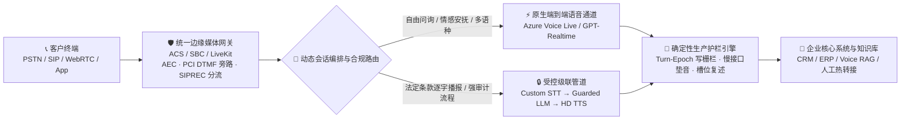

# 🎙️ Enterprise Voice & Multimodal AI Lab (`voice-agent-lab`)

**简体中文** | [English](./README.en.md) | [🌐 在线交互式架构门户](https://turbo998.github.io/voice-agent-lab/) | [📑 完整双语资产目录](./docs/asset-catalog.md)

> **面向 AI 解决方案架构师（AI Solution Architect）的企业级实时语音与多模态智能体架构知识库、选型决策矩阵、实测基准与生产级护栏工具箱。**
> 聚焦企业联络中心现代化、全双工低延迟对话、金融/医疗/零售行业合规治理、说话人分离与容量成本精算（FinOps），剔除底层协议比特级噪音，提供可直接用于客户架构评审与售前 PoC 交付的实战资产。


---

## ⚡ 核心交付物速览

| 资产模块 | 核心工程与业务价值 | 入口链接 |
| :--- | :--- | :--- |
| **🌐 交互式架构与售前门户** | 架构栈匹配器、TCO/ROI 精算器、8 项企业生产护栏交互沙盒与中/繁/英切换 | [在线门户 ↗](https://turbo998.github.io/voice-agent-lab/) · [`site/index.html`](./site/index.html) |
| **📽️ 16:9 架构师高管汇报讲义** | 12 页零外部依赖 HTML 演示幻灯片，支持客户高层汇报与架构选型工作坊 | [`site/deck.html`](./site/deck.html) |
| **📊 7-Card 4:5 标准评测报告（双份）** | 《实时语音与多模型路由 7-Card 报告》与《Azure Speech 说话人分离实证 7-Card 报告》 | [`benchmark-cards.html`](./site/benchmark-cards.html) · [`diarization-cards.html`](./site/diarization-benchmark-cards.html) |
| **🏭 出海智能硬件 6 语种语音客服案例** | 25 万 → 75 万台设备全球客服扩容复盘：`$0.08/分钟` 成本、两阶段幂等写入与路由评测 | [`site/case-study.html`](./site/case-study.html) · [中文复盘](./docs/smart-hardware-global-voice-cs-case-study.zh-CN.md) |
| **🏛️ 核心架构白皮书与可运行 PoC** | 参考架构白皮书、12 大场景 ROI 白皮书、竞品 Battlecards、两周 PoC 手册与实测代码 | [查看白皮书与 PoC](#-一核心架构白皮书与可运行-poc中英双语) |
| **🧭 122 篇企业级语音架构选型指南** | 系统覆盖“模型与通道接入”、“生产工程/合规/FinOps”与“重点行业解决方案”三大支柱 | [浏览 122 篇选型指南](#-二122-篇企业级语音架构选型指南中英双语) |
| **🛡️ 确定性生产护栏模块 (TypeScript)** | 零依赖实现打断纪元写栅栏、慢速 ERP 零冷场垫音、高危槽位二次复述与财富双录门控 | [`packages/`](./packages) |

---

## 🎯 企业级实时语音架构一页纸选型矩阵

在客户架构评审中，首要决策是选择 **级联管道（Cascaded）**、**原生端到端语音大模型（Native S2S）** 还是 **混合合规双轨架构（Hybrid Dual-Track）**：

| 决策维度 | 1. 企业级级联管道 (`Streaming ASR → LLM → Streaming TTS`) | 2. 原生端到端语音 (`GPT-Realtime / Voice Live / Gemini Live / Nova Sonic`) | 3. 混合合规双轨架构（企业生产推荐 ⭐） |
| :--- | :--- | :--- | :--- |
| **端到端首字音频延迟 (P50 / P95)** | `750ms – 1,250ms` / `1,600ms` | **`280ms – 450ms` / `680ms`** | 自由对话走 S2S（`<450ms`），法定条款切受控 TTS |
| **情绪韵律感知与自然打断 (Barge-In)** | 依赖独立语义判停模型，副语言情绪特征易丢失 | **原生感知语气、犹豫与停顿，全双工交互最自然** | 兼顾自然对话体验与高危业务动作确定性门控 |
| **文本可审计性与法定逐字播报** | **100% 中间文本可拦截、可正则脱敏、可逐字播报** | 音频随机采样生成，不可单独用于法定免责条款宣读 | **风险揭示/报价强制切换锁定 SSML 播报并双录存证** |
| **长通话（>10 分钟）单分钟成本** | **最低且线性可控**（`$0.04 – $0.08 / min`） | 未裁剪音频上下文时呈二次方增长（`$0.12 – $0.24 / min`） | 结合滑动窗口历史音频摘要裁剪，稳定在 **`$0.07 – $0.11 / min`** |
| **典型适用场景** | 强监管外呼回访、重度专业术语纠错、超大规模标准化 IVR | VIP 礼宾导购、口语陪练、智能座舱多模态伴侣、智能硬件 | **银行财富双录、保险理赔、航司改签、医疗分诊、企业联络中心** |



---

## 📚 一、核心架构白皮书与可运行 PoC（中英双语）

| 资产名称 | 解决方案架构师核心关注点 | 中文版 | English |
| :--- | :--- | :---: | :---: |
| **企业级实时语音参考架构白皮书** | Native S2S、级联与混合双轨三大范式、四层生产拓扑与抗噪防幻觉护栏 | [中文](./docs/solution-architecture.md) | [EN](./docs/solution-architecture.en.md) |
| **行业场景与量化 ROI 白皮书** | 12 大企业高价值语音场景拆解、SLA 验收水位与 40 万分钟/月 TCO 模型 | [中文](./docs/business-scenarios.md) | [EN](./docs/business-scenarios.en.md) |
| **主流语音平台竞品对比 (Battlecards)** | Azure Voice Live 对标 Sierra、Retell/Vapi、ElevenLabs 与 Nova Sonic 选型攻防 | [中文](./docs/competitive-analysis.md) | [EN](./docs/competitive-analysis.en.md) |
| **售前打单与两周 PoC 交付手册** | 五维需求发现问卷、15 分钟现场演示剧本、两周 PoC 里程碑与验收探针 | [中文](./docs/presales-playbook.md) | [EN](./docs/presales-playbook.en.md) |
| **Azure Speech 说话人分离实证 PoC** | 多说话人角色分离与双声道分轨实测报告及 [`experiments/azure-speech-diarization-poc/`](./experiments/azure-speech-diarization-poc/) 复现工程 | [中文](./docs/azure-speech-diarization-poc.md) | [EN](./docs/azure-speech-diarization-poc.en.md) |
| **GPT-Live 全双工语音原型手册** | 实时双向语音 Web 原型（[`experiments/gpt-live/`](./experiments/gpt-live/)）部署与合作伙伴演示指南 | [中文](./docs/gpt-live-partner-demo-handbook.md) | [EN](./docs/gpt-live-partner-demo-handbook.en.md) |
| **出海智能硬件 6 语种语音客服案例** | 25 万 → 75 万台智能硬件多语种语音客服架构演进、多模型路由与成本复盘 | [中文](./docs/smart-hardware-global-voice-cs-case-study.zh-CN.md) | [EN](./docs/smart-hardware-global-voice-cs-case-study.md) |
| **评测红队规范与边缘语音容器指南** | 24 项语音红队评测规范、Azure Speech 本地边缘容器部署与完整资产索引 | [评测规范](./docs/voice-agent-evaluation-rubric.md) | [容器指南](./docs/speech-container-guide.md) |

---

## 🧭 二、122 篇企业级语音架构选型指南（中英双语）

> 完整分类说明亦可参阅 [`docs/asset-catalog.md`](./docs/asset-catalog.md)。

### 3.1 基础架构、模型与语音通道接入（11 篇）
1. **级联架构（ASR→LLM→TTS）vs 原生端到端语音（Native S2S）选型**：[中文](./docs/cascaded-vs-s2s-semantic-turn-faq.md) | [EN](./docs/cascaded-vs-s2s-semantic-turn-faq.en.md)
2. **主流原生 S2S 多模态语音模型横评（GPT-Realtime / Azure Voice Live / Gemini Live / Nova Sonic）**：[中文](./docs/voice-native-s2s-models-gpt-live-realtime-gemini-live-nova-sonic-selection-faq.md) | [EN](./docs/voice-native-s2s-models-gpt-live-realtime-gemini-live-nova-sonic-selection-faq.en.md)
3. **实时语音编排框架对比（LiveKit Agents vs Pipecat vs ACS vs Retell / Vapi）**：[中文](./docs/voice-orchestration-framework-livekit-pipecat-acs-retell-vapi-selection-faq.md) | [EN](./docs/voice-orchestration-framework-livekit-pipecat-acs-retell-vapi-selection-faq.en.md)
4. **Microsoft Copilot Studio / D365 Contact Center vs Azure AI Foundry + ACS 选型**：[中文](./docs/microsoft-copilot-studio-d365-vs-azure-foundry-voice-selection-faq.md) | [EN](./docs/microsoft-copilot-studio-d365-vs-azure-foundry-voice-selection-faq.en.md)
5. **全球主流云联络中心与 AI 语音平台选型（D365 Contact Center vs Amazon Connect vs Genesys vs Google CES vs Sierra）**：[中文](./docs/cloud-ccaas-d365-amazon-connect-genesys-google-sierra-selection-faq.md) | [EN](./docs/cloud-ccaas-d365-amazon-connect-genesys-google-sierra-selection-faq.en.md)
6. **流式语音识别（STT）、低延迟合成（TTS）、声音克隆与数字人选型**：[中文](./docs/voice-stt-tts-cloning-avatar-azure-elevenlabs-deepgram-opensource-selection-faq.md) | [EN](./docs/voice-stt-tts-cloning-avatar-azure-elevenlabs-deepgram-opensource-selection-faq.en.md)
7. **WebRTC vs WebSocket vs SIP Trunking / ACS 语音接入架构选型**：[中文](./docs/webrtc-vs-websocket-vs-sip-ingress-selection-faq.md) | [EN](./docs/webrtc-vs-websocket-vs-sip-ingress-selection-faq.en.md)
8. **企业存量呼叫中心 PBX & CCaaS 集成（Genesys / Cisco / Avaya / Connect / Teams Phone）**：[中文](./docs/enterprise-pbx-ccaas-genesys-cisco-avaya-teams-voice-integration-selection-faq.md) | [EN](./docs/enterprise-pbx-ccaas-genesys-cisco-avaya-teams-voice-integration-selection-faq.en.md)
9. **全双工打断（Barge-In）、语义句末检测（Semantic EOU）与回声串音抑制架构**：[中文](./docs/enterprise-voice-barge-in-semantic-turn-detection-aec-selection-faq.md) | [EN](./docs/enterprise-voice-barge-in-semantic-turn-detection-aec-selection-faq.en.md)
10. **多人同场流式说话人分离（Speaker Diarization）与声纹绑定工具鉴权**：[中文](./docs/voice-multiparty-diarization-role-isolation-faq.md) | [EN](./docs/voice-multiparty-diarization-role-isolation-faq.en.md)
11. **句内跨语种混说（中英粤 Code-Switching）与方言路由架构**：[中文](./docs/voice-multilingual-codeswitch-dialect-faq.md) | [EN](./docs/voice-multilingual-codeswitch-dialect-faq.en.md)

### 3.2 生产工程、安全合规、高可用与 FinOps 容量规划（12 篇）
12. **语音原生 RAG、同音字纠偏检索与 MCP 工具零信任安全边界**：[中文](./docs/enterprise-voice-rag-knowledge-graph-mcp-tool-security-selection-faq.md) | [EN](./docs/enterprise-voice-rag-knowledge-graph-mcp-tool-security-selection-faq.en.md)
13. **慢速 ERP/CRM 异步工具集成、零冷场垫音节拍器与 Turn-Epoch 事务隔离**：[中文](./docs/enterprise-voice-async-erp-crm-integration-zero-dead-air-selection-faq.md) | [EN](./docs/enterprise-voice-async-erp-crm-integration-zero-dead-air-selection-faq.en.md)
14. **企业语音 AI 成本建模：Azure PTU vs PayGo 容量精算与音频上下文裁剪 FinOps**：[中文](./docs/enterprise-voice-ai-tco-ptu-capacity-finops-selection-faq.md) | [EN](./docs/enterprise-voice-ai-tco-ptu-capacity-finops-selection-faq.en.md)
15. **通话中途跨区域容灾切换（Mid-Call Failover）与无感会话恢复架构**：[中文](./docs/voice-midcall-failover-session-recovery-faq.md) | [EN](./docs/voice-midcall-failover-session-recovery-faq.en.md)
16. **离线边缘 Speech Container 容器部署与端云协同降级逃生架构**：[中文](./docs/voice-edge-cloud-quantized-container-failover-faq.md) | [EN](./docs/voice-edge-cloud-quantized-container-failover-faq.en.md)
17. **人工坐席热转接（Warm Transfer）与主管耳语（Whisper）无感交接架构**：[中文](./docs/warm-transfer-whisper-handoff-faq.md) | [EN](./docs/warm-transfer-whisper-handoff-faq.en.md)
18. **多智能体语音协同（Multi-Agent Voice Swarm）与防死循环路由架构**：[中文](./docs/enterprise-multi-agent-voice-swarm-supervisor-whisper-selection-faq.md) | [EN](./docs/enterprise-multi-agent-voice-swarm-supervisor-whisper-selection-faq.en.md)
19. **PCI-DSS v4.0 双流 DTMF 支付按键旁路与收单合规隔离**：[中文](./docs/voice-pci-dtmf-scope-faq.md) | [EN](./docs/voice-pci-dtmf-scope-faq.en.md)
20. **双轨 SIPREC 合规录音与实时敏感信息（PII）声学脱敏架构**：[中文](./docs/siprec-pii-audio-redaction-faq.md) | [EN](./docs/siprec-pii-audio-redaction-faq.en.md)
21. **声纹反深伪活体检测（Anti-Deepfake）与全球语音隐私合规（GDPR / BIPA / PIPL）**：[中文](./docs/enterprise-voice-biometrics-privacy-compliance-selection-faq.md) | [EN](./docs/enterprise-voice-biometrics-privacy-compliance-selection-faq.en.md)
22. **企业语音智能体评测体系、OpenTelemetry 全链路延迟瀑布与灰度发布**：[中文](./docs/enterprise-voice-agent-evaluation-observability-redteaming-selection-faq.md) | [EN](./docs/enterprise-voice-agent-evaluation-observability-redteaming-selection-faq.en.md)
23. **话后自动化全量质检（Post-Call QA）与口头承诺 vs CRM 工单对账**：[中文](./docs/voice-postcall-promise-ticket-reconciliation-qa-faq.md) | [EN](./docs/voice-postcall-promise-ticket-reconciliation-qa-faq.en.md)

### 3.3 高价值企业行业解决方案蓝图（77 篇）
24. **企业联络中心 AI Copilot：一线智能分流、人机热交接与实时坐席辅助**：[中文](./docs/contact-center-ai-copilot-tier1-deflection-agent-assist-selection-faq.md) | [EN](./docs/contact-center-ai-copilot-tier1-deflection-agent-assist-selection-faq.en.md)
25. **运营商 5G 新通话与多模态可视化 IVR（Visual IVR）现代化改造**：[中文](./docs/telecom-5g-new-calling-visual-ivr-modernization-selection-faq.md) | [EN](./docs/telecom-5g-new-calling-visual-ivr-modernization-selection-faq.en.md)
26. **银行财富管理智能双录（Dual-Recording）、适当性核验与保险理赔语音方案**：[中文](./docs/bfsi-wealth-dual-recording-claims-compliant-outbound-voice-selection-faq.md) | [EN](./docs/bfsi-wealth-dual-recording-claims-compliant-outbound-voice-selection-faq.en.md)
27. **对公银行财资双人复核（Maker-Checker）、防 CEO 深伪电诈与交易台合规语音**：[中文](./docs/corporate-banking-treasury-maker-checker-trading-desk-voice-selection-faq.md) | [EN](./docs/corporate-banking-treasury-maker-checker-trading-desk-voice-selection-faq.en.md)
28. **医疗院前智能分诊、诊室环境病历生成（Ambient Scribe）与慢病随访方案**：[中文](./docs/healthcare-clinical-triage-chronic-followup-ambient-scribe-voice-selection-faq.md) | [EN](./docs/healthcare-clinical-triage-chronic-followup-ambient-scribe-voice-selection-faq.en.md)
29. **连锁药房处方续配、相似药名防混淆与医保事前授权（Prior Auth）语音方案**：[中文](./docs/retail-pharmacy-rx-refill-pbm-prior-authorization-voice-selection-faq.md) | [EN](./docs/retail-pharmacy-rx-refill-pbm-prior-authorization-voice-selection-faq.en.md)
30. **连锁餐饮得来速（QSR Drive-Thru）与智慧零售门店抗噪语音点单方案**：[中文](./docs/qsr-drivethru-smart-restaurant-retail-voice-ordering-selection-faq.md) | [EN](./docs/qsr-drivethru-smart-restaurant-retail-voice-ordering-selection-faq.en.md)
31. **品牌电商展厅导购与实时语音数字人（Voice + Avatar）交互方案**：[中文](./docs/ecommerce-livestream-showroom-voice-avatar-digital-human-selection-faq.md) | [EN](./docs/ecommerce-livestream-showroom-voice-avatar-digital-human-selection-faq.en.md)
32. **航司大面积航延改签（IRROPS）与连锁酒店多语种 AI 礼宾直连 PMS 方案**：[中文](./docs/travel-airline-irrops-hotel-pms-multilingual-voice-concierge-selection-faq.md) | [EN](./docs/travel-airline-irrops-hotel-pms-multilingual-voice-concierge-selection-faq.en.md)
33. **智能汽车座舱多音区多模态语音助手与车载智能硬件服务方案**：[中文](./docs/in-vehicle-cockpit-smart-hardware-multimodal-voice-assistant-selection-faq.md) | [EN](./docs/in-vehicle-cockpit-smart-hardware-multimodal-voice-assistant-selection-faq.en.md)
34. **AI 销售实战对练（Sales Roleplay）、模拟面试与企业话术教练方案**：[中文](./docs/ai-sales-roleplay-mock-interview-language-coach-selection-faq.md) | [EN](./docs/ai-sales-roleplay-mock-interview-language-coach-selection-faq.en.md)
35. **企业合规智能外呼（Outbound SDR）、答录机检测（AMD）与防骚扰治理方案**：[中文](./docs/enterprise-outbound-voice-sales-lead-qualification-selection-faq.md) | [EN](./docs/enterprise-outbound-voice-sales-lead-qualification-selection-faq.en.md)
36. **跨国会议实时多语种同声传译与结构化纪要行动项提取方案**：[中文](./docs/enterprise-multilingual-simultaneous-interpretation-meeting-minutes-selection-faq.md) | [EN](./docs/enterprise-multilingual-simultaneous-interpretation-meeting-minutes-selection-faq.en.md)
37. **企业内部 IT 服务台（ITSM）与 HR 员工自助语音 Copilot 方案**：[中文](./docs/enterprise-it-helpdesk-hr-employee-voice-copilot-selection-faq.md) | [EN](./docs/enterprise-it-helpdesk-hr-employee-voice-copilot-selection-faq.en.md)
38. **政务服务便民热线（12345 / 311）、公用事业停水停电风暴分流与燃气泄漏 0ms 抢占方案**：[中文](./docs/government-12345-hotline-utility-outage-emergency-dispatch-voice-selection-faq.md) | [EN](./docs/government-12345-hotline-utility-outage-emergency-dispatch-voice-selection-faq.en.md)
39. **企业大规模校招与蓝领批量 AI 语音面试官（STAR 追问）、防提词器作弊与公平性审计方案**：[中文](./docs/enterprise-ai-voice-interviewer-bulk-hiring-fairness-audit-selection-faq.md) | [EN](./docs/enterprise-ai-voice-interviewer-bulk-hiring-fairness-audit-selection-faq.en.md)
40. **财富管理理财师、保险代理人与医药代表（MSL）线下拜访随身语音 Copilot 方案**：[中文](./docs/field-wealth-advisor-insurance-pharma-inperson-voice-copilot-selection-faq.md) | [EN](./docs/field-wealth-advisor-insurance-pharma-inperson-voice-copilot-selection-faq.en.md)
41. **跨境电商全球 20 语种售后客服、国际快递末端派送与海运清关/电放提单语音方案**：[中文](./docs/cross-border-ecommerce-global-logistics-delivery-customs-voice-selection-faq.md) | [EN](./docs/cross-border-ecommerce-global-logistics-delivery-customs-voice-selection-faq.en.md)
42. **K12 与高等院校 1对1 苏格拉底启发式口语/数理家教、校园 FERPA 隐私与无障碍包容方案**：[中文](./docs/education-socratic-voice-tutor-campus-privacy-accessibility-selection-faq.md) | [EN](./docs/education-socratic-voice-tutor-campus-privacy-accessibility-selection-faq.en.md)
43. **电信运营商与宽带 ISP：万户光纤断网 12秒拦截、光猫看图（TR-069）自愈与防 SIM-Swap 方案**：[中文](./docs/telecom-isp-broadband-outage-router-vision-simswap-voice-selection-faq.md) | [EN](./docs/telecom-isp-broadband-outage-router-vision-simswap-voice-selection-faq.en.md)
44. **寿险重疾智能核保回访（反弃权零承诺锁）、养老金生存认证与巨灾查勘定损 Copilot 方案**：[中文](./docs/insurance-underwriting-pension-annuity-adjuster-voice-selection-faq.md) | [EN](./docs/insurance-underwriting-pension-annuity-adjuster-voice-selection-faq.en.md)
45. **新能源超充站 15秒远程自愈（OCPP 防拉弧锁）、虚拟电厂（VPP）负荷邀约与光储运维方案**：[中文](./docs/energy-virtual-power-plant-ev-charging-station-voice-selection-faq.md) | [EN](./docs/energy-virtual-power-plant-ev-charging-station-voice-selection-faq.en.md)
46. **快消品巡店车销（FMCG DSD）、餐饮后厨 B2B 方言补货与智能冰柜 8秒争议秒退方案**：[中文](./docs/fmcg-dsd-route-sales-b2b-wholesale-vending-voice-selection-faq.md) | [EN](./docs/fmcg-dsd-route-sales-b2b-wholesale-vending-voice-selection-faq.en.md)
47. **大型商业综合体智慧停车道闸 10秒脱困、地标级寻店/找车导览与儿童走失 Code Adam 安防方案**：[中文](./docs/smart-mall-parking-gate-wayfinding-retail-concierge-voice-selection-faq.md) | [EN](./docs/smart-mall-parking-gate-wayfinding-retail-concierge-voice-selection-faq.en.md)
48. **短剧/影视出海多语种 AI 译制配音（等时唇形对齐 Isochrony）、多角色有声书与企业播客方案**：[中文](./docs/media-video-dubbing-audiobook-podcast-voice-localization-selection-faq.md) | [EN](./docs/media-video-dubbing-audiobook-podcast-voice-localization-selection-faq.en.md)
49. **大型文旅景区、主题乐园排队动态调度、博物馆亚米级（UWB/BLE）多语种伴游与场馆语音方案**：[中文](./docs/cultural-tourism-theme-park-museum-voice-concierge-selection-faq.md) | [EN](./docs/cultural-tourism-theme-park-museum-voice-concierge-selection-faq.en.md)
50. **商业地产、智慧物业管家（电梯困人 SOS 应急 / 无人岗亭抬杆 / 报修派单）与房产 VR 语音导购方案**：[中文](./docs/real-estate-smart-property-elevator-emergency-voice-selection-faq.md) | [EN](./docs/real-estate-smart-property-elevator-emergency-voice-selection-faq.en.md)
51. **律所 24×7 案源初筛与利益冲突检索（ABA Rule 1.18）、司法庭审多声道笔录与远程视频公证（RON）方案**：[中文](./docs/legal-court-transcription-law-firm-intake-notary-voice-selection-faq.md) | [EN](./docs/legal-court-transcription-law-firm-intake-notary-voice-selection-faq.en.md)
52. **车企紧急呼叫救援（NG-eCall / GB 45672 AECS 碰撞触发）、新能源道路救援与 4S 店售后 DMS 语音方案**：[中文](./docs/automotive-ecall-roadside-rescue-dealer-aftersales-voice-selection-faq.md) | [EN](./docs/automotive-ecall-roadside-rescue-dealer-aftersales-voice-selection-faq.en.md)
53. **智慧养老居家看护（卫浴零镜头毫米波/声学防跌倒）、适老化老年耳聋补偿（Presbycusis EQ）与全屋 Matter 方案**：[中文](./docs/smart-home-elderly-care-ambient-acoustic-guardian-selection-faq.md) | [EN](./docs/smart-home-elderly-care-ambient-acoustic-guardian-selection-faq.en.md)
54. **三甲智慧医院住院床旁呼叫三级分流（Smart Nurse Call）、手术室无菌控屏与 WHO 安全核查（纱布清点锁）方案**：[中文](./docs/smart-hospital-inpatient-nurse-call-surgical-or-voice-selection-faq.md) | [EN](./docs/smart-hospital-inpatient-nurse-call-surgical-or-voice-selection-faq.en.md)
55. **民航万米高空客舱乘务员与 MedLink 机上急救、豪华邮轮零卫星带宽船载礼宾与高铁静音车厢/极限换乘方案**：[中文](./docs/aviation-inflight-cabin-cruise-ship-highspeed-rail-voice-selection-faq.md) | [EN](./docs/aviation-inflight-cabin-cruise-ship-highspeed-rail-voice-selection-faq.en.md)
56. **游戏实时语音 NPC（85/15 战术语音树缓存）、AI 毛绒陪伴玩具与未成年人保护合规（COPPA 零声纹留存）方案**：[中文](./docs/gaming-voice-npc-edtech-companion-minor-safety-selection-faq.md) | [EN](./docs/gaming-voice-npc-edtech-companion-minor-safety-selection-faq.en.md)
57. **情感韵律安抚（0.88x–0.94x 降速降调）、EU AI Act 职场情绪识别红线与哭泣来电 1800ms 判停展宽方案**：[中文](./docs/voice-affective-prosody-emotion-deescalation-faq.md) | [EN](./docs/voice-affective-prosody-emotion-deescalation-faq.en.md)
58. **高危字母/数字编号（航司 PNR / 17位车架号 VIN / 保单号）声学防听错消歧与北约音标分块回读方案**：[中文](./docs/voice-alphanumeric-disambiguation-faq.md) | [EN](./docs/voice-alphanumeric-disambiguation-faq.en.md)
59. **多模态数字人唇音同步（<=45ms 保音弃画）与实时同屏协办（Co-Browsing 隐私遮罩与视口纪元锁）方案**：[中文](./docs/voice-multimodal-avatar-cobrowsing-sync-faq.md) | [EN](./docs/voice-multimodal-avatar-cobrowsing-sync-faq.en.md)
60. **语音智能体金丝雀影子灰度发布（Dry-Run 静音双跑与 <=500ms 回滚）及跨通话长期记忆防投毒方案**：[中文](./docs/voice-canary-shadow-rollout-memory-poisoning-faq.md) | [EN](./docs/voice-canary-shadow-rollout-memory-poisoning-faq.en.md)
61. **无障碍言语障碍自适应（EAA/ADA 口吃 2200ms 判停与 RTT 回退）与紧急呼叫 E911/112 零鉴权位置抢占方案**：[中文](./docs/voice-accessibility-disfluency-e911-pidflo-bridge-faq.md) | [EN](./docs/voice-accessibility-disfluency-e911-pidflo-bridge-faq.en.md)
62. **全渠道语音+手机 App 并发 CAS 乐观锁防重扣、8kHz 抗超声波注入与单通 $2.50 算力钱包防刷爆方案**：[中文](./docs/voice-omnichannel-cas-concurrency-ultrasonic-wallet-guard-faq.md) | [EN](./docs/voice-omnichannel-cas-concurrency-ultrasonic-wallet-guard-faq.en.md)
63. **原生 S2S 情绪传染咆哮镜像抑制（-18 LUFS 响度锁）、句法未完结从句 1350ms 防抢话与 C2PA 双水印方案**：[中文](./docs/voice-s2s-emotional-contagion-lufs-syntactic-incomplete-hold-faq.md) | [EN](./docs/voice-s2s-emotional-contagion-lufs-syntactic-incomplete-hold-faq.en.md)
64. **跨语种实时同传否定极性/剂量数值防反转（Wait-k 双语法树锁）与多租户专属热词 WFST 隔离方案**：[中文](./docs/voice-realtime-interpreter-polarity-hotword-isolation-faq.md) | [EN](./docs/voice-realtime-interpreter-polarity-hotword-isolation-faq.en.md)
65. **企业统一通信（Teams Phone / Zoom Phone / Webex Calling）接入 AI 语音智能体与 Graph Presence 转接预检方案**：[中文](./docs/teams-phone-zoom-phone-webex-calling-enterprise-voice-agent-selection-faq.md) | [EN](./docs/teams-phone-zoom-phone-webex-calling-enterprise-voice-agent-selection-faq.en.md)
66. **社交与超级 App 嵌入式语音通话（WhatsApp Business Calling vs 微信小程序实时语音 vs 原生 WebRTC）方案**：[中文](./docs/whatsapp-wechat-business-calling-inapp-webrtc-voice-selection-faq.md) | [EN](./docs/whatsapp-wechat-business-calling-inapp-webrtc-voice-selection-faq.en.md)
67. **主流企业 CRM 与工单桌面（Dynamics 365 CIF v2 vs Salesforce SCV vs ServiceNow vs Zendesk）语音弹屏与写回方案**：[中文](./docs/voice-agent-crm-ctis-salesforce-service-now-dynamics-integration-selection-faq.md) | [EN](./docs/voice-agent-crm-ctis-salesforce-service-now-dynamics-integration-selection-faq.en.md)
68. **企业自建开源语音模型（Faster-Whisper / SenseVoice + CosyVoice 2 / Fish Speech / Kokoro）GPU 并发与云端 TCO 临界点方案**：[中文](./docs/open-source-local-tts-stt-cosyvoice-fishspeech-kokoro-whisper-vllm-selection-faq.md) | [EN](./docs/open-source-local-tts-stt-cosyvoice-fishspeech-kokoro-whisper-vllm-selection-faq.en.md)
69. **实时语音大模型口语化提示词工程（Voice Prompt）、防朗读 Markdown/URL 清洗器与确定性 SSML 韵律控制方案**：[中文](./docs/enterprise-voice-prompt-engineering-persona-spoken-style-ssml-selection-faq.md) | [EN](./docs/enterprise-voice-prompt-engineering-persona-spoken-style-ssml-selection-faq.en.md)
70. **顶奢品牌与高端百货黑卡 VIP（VIC）私享语音礼宾、稀缺配额防黄牛锁与私人沙龙四联预约方案**：[中文](./docs/retail-loyalty-vip-concierge-luxury-clienteling-voice-selection-faq.md) | [EN](./docs/retail-loyalty-vip-concierge-luxury-clienteling-voice-selection-faq.en.md)
71. **企业财务共享中心（FSSC 报销审单/应付对账）、全球发薪（Payroll 防改卡锁）与财税事务所（CPA）语音方案**：[中文](./docs/wealth-tax-cpa-accounting-payroll-audit-voice-copilot-selection-faq.md) | [EN](./docs/wealth-tax-cpa-accounting-payroll-audit-voice-copilot-selection-faq.en.md)
72. **智能运动穿戴（骨传导耳机/手表 AI 私教）、喘息防误打断、心率超限 0ms 保护与居家骨科术后康复方案**：[中文](./docs/sports-fitness-wearable-coach-rehab-pt-voice-selection-faq.md) | [EN](./docs/sports-fitness-wearable-coach-rehab-pt-voice-selection-faq.en.md)
73. **零售银行按揭/消贷面签预审（LOS）与早期逾期合规提醒（FDCPA 7-in-7 / RPC 本人核身锁 / 困难重组）方案**：[中文](./docs/retail-banking-mortgage-loan-origination-collections-fdCPA-voice-selection-faq.md) | [EN](./docs/retail-banking-mortgage-loan-origination-collections-fdCPA-voice-selection-faq.en.md)
74. **连锁宠物医院 24×7 夜间中毒急诊分诊（mg/kg 毒理精算与催吐禁忌锁）、抗犬吠诊室病历与彩虹桥随访方案**：[中文](./docs/veterinary-clinic-pet-hospital-triage-agro-livestock-voice-selection-faq.md) | [EN](./docs/veterinary-clinic-pet-hospital-triage-agro-livestock-voice-selection-faq.en.md)
75. **智能白电与暖通空调（HVAC/热泵/燃气热水器）80KB 看图听音自愈、免工具防拆安全锁与带件一次修复（91% FTF）方案**：[中文](./docs/home-appliance-hvac-water-heater-aftersales-vision-repair-voice-selection-faq.md) | [EN](./docs/home-appliance-hvac-water-heater-aftersales-vision-repair-voice-selection-faq.en.md)
76. **国际大型展会与峰会（进博会/广交会/CES/MWC）80KB 胸卡名片拍照 + 20秒语音 BANT 速记、断网缓存与 2h 跟进方案**：[中文](./docs/conference-exhibition-trade-show-lead-capture-badge-scan-voice-selection-faq.md) | [EN](./docs/conference-exhibition-trade-show-lead-capture-badge-scan-voice-selection-faq.en.md)
77. **B2B SaaS 客户成功首周激活同屏领航、退订实时语音挽留（防羊毛党折扣锁 & FTC Click-to-Cancel 合规）方案**：[中文](./docs/saas-customer-success-onboarding-churn-save-renewal-voice-selection-faq.md) | [EN](./docs/saas-customer-success-onboarding-churn-save-renewal-voice-selection-faq.en.md)
78. **创新药企临床试验受试者入排初筛（I/E Criteria）、eCOA/ePRO 量表零改写逐字锁（21 CFR Part 11）与药物警戒 SAE 24h 直报方案**：[中文](./docs/clinical-trial-patient-recruitment-ecoa-pharmacovigilance-voice-selection-faq.md) | [EN](./docs/clinical-trial-patient-recruitment-ecoa-pharmacovigilance-voice-selection-faq.en.md)
79. **连锁口腔（DSO）与眼科门诊多椅位联锁排班、无菌语音牙周探诊录入（168点位）及术前抗凝药/停戴镜与术后急症分诊方案**：[中文](./docs/dental-ophthalmology-aesthetic-clinic-scheduling-voice-selection-faq.md) | [EN](./docs/dental-ophthalmology-aesthetic-clinic-scheduling-voice-selection-faq.en.md)
80. **企业实时语音全链路延迟极限优化（P50 TTFA 从 1,450ms 压降至 320ms：180ms 语义 EOU、只读推测预取与首 4 词微切块 TTS）方案**：[中文](./docs/voice-agent-latency-optimization-ttfa-300ms-engineering-selection-faq.md) | [EN](./docs/voice-agent-latency-optimization-ttfa-300ms-engineering-selection-faq.en.md)
81. **公益慈善基金会、高校校友募捐（Phonathon）、脆弱长者 0ms 止捐伦理保护锁与企业 1:1 雇主配捐翻倍方案**：[中文](./docs/nonprofit-charity-alumni-fundraising-donor-voice-selection-faq.md) | [EN](./docs/nonprofit-charity-alumni-fundraising-donor-voice-selection-faq.en.md)
82. **智慧港口集装箱码头闸口（ISO 6346 第11位校验码）、危化箱（IMDG）专用堆场隔离与跨境报关行 HS 税则归类方案**：[中文](./docs/smart-port-container-terminal-customs-clearance-voice-selection-faq.md) | [EN](./docs/smart-port-container-terminal-customs-clearance-voice-selection-faq.en.md)
83. **全球连锁餐饮（QSR）、现制茶饮咖啡与商超门店后厨 HACCP 食安测温强制报废锁、-20°C 冷库离线语音盘点与交接班方案**：[中文](./docs/retail-qsr-store-manager-haccp-food-safety-voice-selection-faq.md) | [EN](./docs/retail-qsr-store-manager-haccp-food-safety-voice-selection-faq.en.md)
84. **居家安宁疗护（Hospice 24×7 爆发痛分诊）、生命礼仪（FTC 透明报价与零加售锁）及政务银行“身后一件事”免本人核身方案**：[中文](./docs/hospice-palliative-care-bereavement-estate-voice-selection-faq.md) | [EN](./docs/hospice-palliative-care-bereavement-estate-voice-selection-faq.en.md)
85. **万人体育场馆与大型演唱会（VIP 包厢语音点餐、比赛记分牌断酒令硬锁、105dB 主扩抵消与 8 万人散场防踩踏分流）方案**：[中文](./docs/sports-stadium-concert-venue-vip-ticketing-voice-selection-faq.md) | [EN](./docs/sports-stadium-concert-venue-vip-ticketing-voice-selection-faq.en.md)
86. **智慧农业农艺师田间语音问诊、农药安全间隔期（PHI 采收红线锁）、禁限用农药拦截与粮库收粮水分扣重透明播报方案**：[中文](./docs/smart-agriculture-agronomist-pesticide-phi-grain-voice-selection-faq.md) | [EN](./docs/smart-agriculture-agronomist-pesticide-phi-grain-voice-selection-faq.en.md)
87. **智慧工地与大型工程总包（EPC）智能安全帽语音巡检、受限空间/动火作业许可（PTW/LOTO）硬锁与 Procore/BIM 质量整改方案**：[中文](./docs/smart-construction-jobsite-bim-osha-safety-voice-selection-faq.md) | [EN](./docs/smart-construction-jobsite-bim-osha-safety-voice-selection-faq.en.md)
88. **血液中心献血健康征询（GB 18467/AABB 暂缓锁）、Rh阴性熊猫血应急招募、献血后回告 0ms 血袋冻结与器官移植冷缺血（CIT）协同方案**：[中文](./docs/blood-center-donor-screening-organ-transplant-voice-selection-faq.md) | [EN](./docs/blood-center-donor-screening-organ-transplant-voice-selection-faq.en.md)
89. **民航机务维修（MRO）按机尾号（Tail/MSN）精准查 AMM/MEL、必检项（RII）双人独立声纹互检与关舱前工具零遗留（FOD）方案**：[中文](./docs/aviation-mro-aircraft-maintenance-amm-fod-voice-selection-faq.md) | [EN](./docs/aviation-mro-aircraft-maintenance-amm-fod-voice-selection-faq.en.md)
90. **幼儿园与 K-12 校车防遗忘空车巡检（车尾物理按钮+雷达四重锁）、放学接送抚养权限制令拦截与校医传染病聚类预警方案**：[中文](./docs/k12-school-bus-child-safety-authorized-pickup-voice-selection-faq.md) | [EN](./docs/k12-school-bus-child-safety-authorized-pickup-voice-selection-faq.en.md)
91. **城市水务与燃气公用事业（燃气臭味 0ms 零鉴权撤离锁、煮沸饮水令广播、维生医疗家庭禁停锁与燃气人在表前安全复气）方案**：[中文](./docs/municipal-water-gas-utility-boil-advisory-life-support-voice-selection-faq.md) | [EN](./docs/municipal-water-gas-utility-boil-advisory-life-support-voice-selection-faq.en.md)
92. **研发实验室免摘手套电子实验记录（ELN/LIMS）、危化品 SDS 禁忌混配防爆锁与专利交底书（Patent Novelty Bar 抢注）方案**：[中文](./docs/rd-wet-lab-eln-sds-safety-patent-disclosure-voice-selection-faq.md) | [EN](./docs/rd-wet-lab-eln-sds-safety-patent-disclosure-voice-selection-faq.en.md)
93. **大型综合度假村（Integrated Resort）多语种 VIP 礼宾、责任关怀自我隔离（Self-Exclusion）0ms 冻结锁与反洗钱（Title-31 AML 静默 SAR）方案**：[中文](./docs/integrated-resort-vip-concierge-responsible-gaming-aml-voice-selection-faq.md) | [EN](./docs/integrated-resort-vip-concierge-responsible-gaming-aml-voice-selection-faq.en.md)
94. **企业实时语音智能体 CI/CD 自动化回归测试（Coval/Hamming vs 自建合成呼叫器、Round-Trip TTS 逆向校验与硬发版门禁）方案**：[中文](./docs/enterprise-voice-agent-cicd-automated-regression-testing-selection-faq.md) | [EN](./docs/enterprise-voice-agent-cicd-automated-regression-testing-selection-faq.en.md)
95. **连锁药房与 PBM 处方续方（ISMP LASA 同音高危药三元消歧锁、麻精管制药 Schedule II 禁续锁与儿科液体药体重浓度双核）方案**：[中文](./docs/retail-pharmacy-pbm-prescription-refill-lasa-voice-selection-faq.md) | [EN](./docs/retail-pharmacy-pbm-prescription-refill-lasa-voice-selection-faq.en.md)
96. **地下矿山、油气钻井与石化防爆区（ATEX/MA 本安离线语音、爆破警戒区 UWB 清零+瓦斯三人锁与 H2S 逆风高处逃生）方案**：[中文](./docs/mining-oilfield-atex-intrinsically-safe-blast-voice-selection-faq.md) | [EN](./docs/mining-oilfield-atex-intrinsically-safe-blast-voice-selection-faq.en.md)
97. **五星级酒店婚宴与万人会展宴会（二级配方隐性过敏原紫标专餐锁、BEO 72小时保底桌数硬锁与现场起菜联锁）方案**：[中文](./docs/luxury-hotel-wedding-mice-banquet-allergen-voice-selection-faq.md) | [EN](./docs/luxury-hotel-wedding-mice-banquet-allergen-voice-selection-faq.en.md)
98. **生物医药冷链与 CAR-T 细胞基因治疗特种物流（唯一身份链 COI 双人声纹锁、-196°C 液氮罐防倾倒强呼与超温 TOR/QP 隔离）方案**：[中文](./docs/biopharma-cold-chain-cart-cell-therapy-logistics-voice-selection-faq.md) | [EN](./docs/biopharma-cold-chain-cart-cell-therapy-logistics-voice-selection-faq.en.md)
99. **城市防汛抗台、山火与地震应急疏散（暴雨严禁下地库挪车与垂直避险锁、失能老人上门背负派单与避难所容量负载均衡）方案**：[中文](./docs/municipal-disaster-typhoon-wildfire-evacuation-voice-selection-faq.md) | [EN](./docs/municipal-disaster-typhoon-wildfire-evacuation-voice-selection-faq.en.md)
100. **企业实时语音与多模态 AI 架构师百景决策总纲（SA-MASTER-100：100大场景全景导航、三大范式分水岭与生产上线十道生死门禁）**：[中文](./docs/enterprise-voice-ai-100-scenario-architect-master-playbook-selection-faq.md) | [EN](./docs/enterprise-voice-ai-100-scenario-architect-master-playbook-selection-faq.en.md)
101. **2026 实时语音与多模态前沿突破（System-1/System-2 快慢双脑语音推理、端侧 NPU <=3B 协同与实时视频流关键帧门控）方案**：[中文](./docs/voice-multimodal-2026-frontier-audio-reasoning-ondevice-npu-live-vision-selection-faq.md) | [EN](./docs/voice-multimodal-2026-frontier-audio-reasoning-ondevice-npu-live-vision-selection-faq.en.md)
102. **半导体晶圆厂（ISO 无尘室 FOUP 批次防报废锁）与汽车总装线（Voice Andon 0ms 暗灯升级 & IATF 16949 扭矩硬锁）方案**：[中文](./docs/smart-manufacturing-semiconductor-fab-automotive-jit-andon-voice-selection-faq.md) | [EN](./docs/smart-manufacturing-semiconductor-fab-automotive-jit-andon-voice-selection-faq.en.md)
103. **商业银行国际结算、信用证（UCP 600）与跨境汇款（SWIFT gpi 追踪、OFAC 反通风报信锁与防 BEC 变造 IBAN 独立回拨）方案**：[中文](./docs/cross-border-trade-finance-swift-gpi-sanctions-lc-voice-selection-faq.md) | [EN](./docs/cross-border-trade-finance-swift-gpi-sanctions-lc-voice-selection-faq.en.md)
104. **航空货运（IATA DGR 独立锂电池 UN3480 客机腹舱禁运锁）与干线重卡车队（连续驾驶 4小时防疲劳强制休整）方案**：[中文](./docs/air-cargo-iata-dgr-lithium-hazmat-heavy-truck-fleet-voice-selection-faq.md) | [EN](./docs/air-cargo-iata-dgr-lithium-hazmat-heavy-truck-fleet-voice-selection-faq.en.md)
105. **医疗美容与皮肤科（玻尿酸血管栓塞黄金 90分钟防失明 0ms 抢占锁、三类药械 UDI 扫码当面验真与医疗广告法合规）方案**：[中文](./docs/medical-aesthetic-dermatology-anti-counterfeit-vascular-occlusion-voice-selection-faq.md) | [EN](./docs/medical-aesthetic-dermatology-anti-counterfeit-vascular-occlusion-voice-selection-faq.en.md)
106. **跨国药企医学信息问询（MedInfo / MIRF 超说明书提问商业 CRM 0ms 防火墙、执业医师 HCP 核身锁与药品质检 PQC 批号捕获）方案**：[中文](./docs/pharma-medical-information-mirf-offlabel-compliance-voice-selection-faq.md) | [EN](./docs/pharma-medical-information-mirf-offlabel-compliance-voice-selection-faq.en.md)
107. **超大规模智算中心（AIDC 万卡液冷 CDU 漏液 0ms 关阀保训练锁、10kV 高压配电双人唱票复诵五防互锁与 NOC 告警风暴收敛）方案**：[中文](./docs/aidc-datacenter-noc-liquid-cooling-switchgear-voice-copilot-selection-faq.md) | [EN](./docs/aidc-datacenter-noc-liquid-cooling-switchgear-voice-copilot-selection-faq.en.md)
108. **大型仓储物流与生鲜前置仓（Pick-by-Voice 储位 2位校验码防错拣锁、收货月台冷链 >-12°C 拒收硬锁与缺货零过敏原替代）方案**：[中文](./docs/warehouse-fulfillment-pick-by-voice-cold-chain-receiving-selection-faq.md) | [EN](./docs/warehouse-fulfillment-pick-by-voice-cold-chain-receiving-selection-faq.en.md)
109. **跨国企业主权云与数据跨境合规（PIPL/GDPR 境内媒体硬锚定、跨境伪名化脱敏协同与零数据留存 ZDR）方案**：[中文](./docs/sovereign-cloud-cross-border-data-residency-gdpr-pipl-voice-selection-faq.md) | [EN](./docs/sovereign-cloud-cross-border-data-residency-gdpr-pipl-voice-selection-faq.en.md)
110. **城市轨道交通（地铁 OCC 调度中心与 GoA4 全自动无人驾驶：屏蔽门 PSD 防夹 0ms 扣车锁、行调命令逐字复诵与三级大客流限流）方案**：[中文](./docs/urban-rail-metro-occ-dispatch-platform-screen-door-voice-selection-faq.md) | [EN](./docs/urban-rail-metro-occ-dispatch-platform-screen-door-voice-selection-faq.en.md)
111. **车险与企业财产险第一现场报案（FNOL 高速撤离与涉水禁打火 0ms 抢占、WebRTC 四角+VIN 一镜到底防扩损与代位求偿锁）方案**：[中文](./docs/auto-property-insurance-fnol-video-claims-subrogation-fraud-voice-selection-faq.md) | [EN](./docs/auto-property-insurance-fnol-video-claims-subrogation-fraud-voice-selection-faq.en.md)
112. **私人银行与超高净值家族办公室（UHNW MNPI 限制名单 0ms 中国墙隔离、瑞士/新加坡保密代号核身与夜间大宗交易五要素复诵）方案**：[中文](./docs/private-banking-family-office-uhnw-mnpi-codename-voice-selection-faq.md) | [EN](./docs/private-banking-family-office-uhnw-mnpi-codename-voice-selection-faq.en.md)
113. **企业安全运营中心（SOC / SecOps 防黑客语音社工钓鱼 Vishing 0ms 禁口头重置 MFA 锁、勒索软件分级隔离与纯客观纪要）方案**：[中文](./docs/enterprise-soc-secops-ransomware-containment-anti-vishing-voice-selection-faq.md) | [EN](./docs/enterprise-soc-secops-ransomware-containment-anti-vishing-voice-selection-faq.en.md)
114. **海上风电（120米机舱主轴锁销互锁与 <12m/s 进轮毂锁）、特高压换流站与电网调度（设备双重名称逐字复诵与黑启动）方案**：[中文](./docs/offshore-wind-uhv-substation-grid-dispatch-blackstart-voice-selection-faq.md) | [EN](./docs/offshore-wind-uhv-substation-grid-dispatch-blackstart-voice-selection-faq.en.md)
115. **跨国企业全球人才流动（Global Mobility）、名义雇主（EOR）与签证税务合规（旅游签办公禁令、H-1B 跨州 LCA 前置锁与常设机构 PE 税险）方案**：[中文](./docs/global-mobility-eor-visa-compliance-permanent-establishment-voice-selection-faq.md) | [EN](./docs/global-mobility-eor-visa-compliance-permanent-establishment-voice-selection-faq.en.md)
116. **企业实时语音大模型选型基准评测工程（告别静态 WER：8kHz 高危槽位精确率、全双工打断停音 <=200ms、15分钟长通话裁剪成本与 7-Card 报告）方案**：[中文](./docs/enterprise-voice-benchmark-harness-duplex-wer-tool-eval-selection-faq.md) | [EN](./docs/enterprise-voice-benchmark-harness-duplex-wer-tool-eval-selection-faq.en.md)
117. **商业航天火箭发射场（24路指显语音网 <80ms Hold 抢占锁）、低轨卫星星座测控（高危遥控双签）与地面站高功放净空互锁方案**：[中文](./docs/aerospace-launch-range-satellite-ttc-ground-station-voice-selection-faq.md) | [EN](./docs/aerospace-launch-range-satellite-ttc-ground-station-voice-selection-faq.en.md)
118. **远洋商船驾驶台（IMO SMCP 舵令复诵与 NMEA 实测舵角防打反舵锁）、港口交管（VTS 碰撞抢占）与修造船厂（压载舱测氧与干船坞注水锁）方案**：[中文](./docs/maritime-vessel-bridge-smcp-helm-readback-vts-shipyard-voice-selection-faq.md) | [EN](./docs/maritime-vessel-bridge-smcp-helm-readback-vts-shipyard-voice-selection-faq.en.md)
119. **顶级艺术品拍卖行（电话委托竞拍保证金授信上限 0ms 熔断锁、看台 Active Lot 防串单互锁与阶梯买家佣金精算）方案**：[中文](./docs/fine-art-auction-telephone-bidding-paddle-ceiling-lock-voice-selection-faq.md) | [EN](./docs/fine-art-auction-telephone-bidding-paddle-ceiling-lock-voice-selection-faq.en.md)
120. **乳制品、精酿啤酒与无菌饮料工厂（CIP 火碱防混罐与防吸瘪死锁、回流电导率 <=15 μS/cm 零残留核验与 UHT 失温回流）方案**：[中文](./docs/food-beverage-dairy-brewery-cip-caustic-interlock-voice-selection-faq.md) | [EN](./docs/food-beverage-dairy-brewery-cip-caustic-interlock-voice-selection-faq.en.md)
121. **公共资源交易中心与央国企招投标评标室（评委倾向性拉票 0ms 声光告警、双盲暗标 250ms 变声消音与畸高畸低分强制说理锁）方案**：[中文](./docs/public-procurement-tender-bid-evaluation-anti-collusion-voice-selection-faq.md) | [EN](./docs/public-procurement-tender-bid-evaluation-anti-collusion-voice-selection-faq.en.md)
122. **企业实时语音智能体接入 MCP 与核心业务系统（CRM/ERP 两阶段 Draft-Commit 预提交、防重扣幂等键与打断 Saga 事务回滚）方案**：[中文](./docs/enterprise-voice-mcp-tool-two-phase-commit-saga-idempotency-selection-faq.md) | [EN](./docs/enterprise-voice-mcp-tool-two-phase-commit-saga-idempotency-selection-faq.en.md)
123. **企业智能客服联络中心（CCaaS）现代化升级深度横评（Azure ACS + GPT-Realtime vs. Amazon Connect + Nova Sonic vs. Genesys/Twilio、规避 AudioHook 过路税与阶梯 TCO）方案**：[中文](./docs/ccaas-acs-gpt-realtime-vs-amazon-connect-genesys-twilio-tco-selection-faq.md) | [EN](./docs/ccaas-acs-gpt-realtime-vs-amazon-connect-genesys-twilio-tco-selection-faq.en.md)
124. **联络中心人工坐席实时辅助 Copilot（Real-Time Agent Assist：双声道物理分轨零串音、`<300ms` 三行微卡片与挂机 `3 秒` 自动工单小结缩短 `80%` ACW）方案**：[中文](./docs/contact-center-realtime-agent-assist-copilot-acw-summarization-selection-faq.md) | [EN](./docs/contact-center-realtime-agent-assist-copilot-acw-summarization-selection-faq.en.md)
125. **医疗健康患者智能预约挂号、诊前症状导诊与出院随访语音助手（HL7 FHIR 号源锁、红旗急症 `0ms` 护士抢占与爽约率压降 `42%`）方案**：[中文](./docs/healthcare-patient-appointment-scheduling-triage-discharge-followup-voice-selection-faq.md) | [EN](./docs/healthcare-patient-appointment-scheduling-triage-discharge-followup-voice-selection-faq.en.md)
126. **零售与电商全渠道智能语音客服（来电 `0 秒` 免报单号预加载 WISMO、退货转免费上门换码留存 `38%` GMV、防羊毛党闪退锁与大促 `10x` 洪峰弹性）方案**：[中文](./docs/retail-ecommerce-wismo-order-tracking-returns-rma-voice-selection-faq.md) | [EN](./docs/retail-ecommerce-wismo-order-tracking-returns-rma-voice-selection-faq.en.md)
127. **零售银行与信用卡中心实时语音客服（盗刷丢卡 `0ms` 保护性锁卡、Ethoca/Visa CE 3.0 商户穿透化解 `48.5%` 乌龙拒付、Reg E 采证与账单分期 APR 强披露）方案**：[中文](./docs/retail-banking-credit-card-fraud-lock-dispute-chargeback-voice-selection-faq.md) | [EN](./docs/retail-banking-credit-card-fraud-lock-dispute-chargeback-voice-selection-faq.en.md)
128. **2026 企业级流式语音识别（Streaming STT）深度横评（Azure AI Speech vs. Deepgram Nova-3 vs. GPT-4o-Transcribe / Whisper vs. 开源 FunASR Paraformer）方案**：[中文](./docs/streaming-stt-azure-speech-deepgram-nova3-gpt4o-transcribe-paraformer-selection-faq.md) | [EN](./docs/streaming-stt-azure-speech-deepgram-nova3-gpt4o-transcribe-paraformer-selection-faq.en.md)
129. **2026 企业级流式语音合成与声音克隆（Streaming TTS）深度横评（Azure Neural HD / CNV vs. ElevenLabs Flash v2.5 vs. Cartesia Sonic-2 vs. CosyVoice 2）方案**：[中文](./docs/streaming-tts-voice-cloning-azure-neural-hd-elevenlabs-cartesia-cosyvoice-selection-faq.md) | [EN](./docs/streaming-tts-voice-cloning-azure-neural-hd-elevenlabs-cartesia-cosyvoice-selection-faq.en.md)
130. **企业级语音知识库检索（Voice RAG）超低延迟与高准确度优化实战（`<120ms` 流式 Partial 投机预检索、同音错字拼音混合索引与口语摘要卡）方案**：[中文](./docs/enterprise-voice-rag-low-latency-phonetic-hybrid-search-selection-faq.md) | [EN](./docs/enterprise-voice-rag-low-latency-phonetic-hybrid-search-selection-faq.en.md)
131. **企业智能语音外呼营销、留资 15 秒极速回访（AI SDR）与全球外呼合规（TCPA/工信部防骚扰、`<180ms` AMD 信箱识别与 `0ms` 退订锁）方案**：[中文](./docs/enterprise-outbound-voice-sales-sdr-amd-tcpa-compliance-selection-faq.md) | [EN](./docs/enterprise-outbound-voice-sales-sdr-amd-tcpa-compliance-selection-faq.en.md)
132. **汽车主机厂（OEM）与 4S 经销商集团售后维保预约、VIN 召回联动与道路救援语音客服（DMS 工位/配件/代步车四维原子锁与高速抛锚 `0ms` 抢占）方案**：[中文](./docs/automotive-dealership-service-scheduling-vin-recall-roadside-voice-selection-faq.md) | [EN](./docs/automotive-dealership-service-scheduling-vin-recall-roadside-voice-selection-faq.en.md)
133. **企业内部 IT 服务台（IT Helpdesk）智能语音 Copilot（ServiceNow P1 全局故障 `0 秒` 广播拦截、Entra ID 防钓鱼数字匹配解锁与 Intune 终端自愈）方案**：[中文](./docs/enterprise-it-helpdesk-servicenow-password-reset-voice-copilot-selection-faq.md) | [EN](./docs/enterprise-it-helpdesk-servicenow-password-reset-voice-copilot-selection-faq.en.md)
134. **跨国企业实时多语种会议同传、个人原声保留（Personal Voice）与结构化纪要（日/德语 SOV 防翻反窗口、万/亿数字量级锁与待办自动派单）方案**：[中文](./docs/multinational-live-meeting-simultaneous-interpretation-action-items-selection-faq.md) | [EN](./docs/multinational-live-meeting-simultaneous-interpretation-action-items-selection-faq.en.md)
135. **线下展厅、银行 VTM、机场问询与电商直播实时语音数字人（Azure Speech Avatar vs. HeyGen vs. 端侧 3D Viseme、`<=1.5m` 视线唤醒锁与成本降 `88%`）方案**：[中文](./docs/interactive-digital-human-avatar-retail-kiosk-livestream-voice-selection-faq.md) | [EN](./docs/interactive-digital-human-avatar-retail-kiosk-livestream-voice-selection-faq.en.md)
136. **企业 AI 金牌销售对练、医药代表合规拜访与客服上岗模拟陪练平台（GPT-Realtime 刁钻客户压测、防“讨好放水”异议锁与一票否决评分卡）方案**：[中文](./docs/enterprise-ai-sales-roleplay-coaching-pharma-compliance-simulator-selection-faq.md) | [EN](./docs/enterprise-ai-sales-roleplay-coaching-pharma-compliance-simulator-selection-faq.en.md)
137. **民航航司大面积航班延误取消（IRROPS）极速改签与连锁酒店高卡礼宾语音客服（GDS/中航信先锁新座再退旧票原子锁、非自愿免差价与 `50x` 台风洪峰）方案**：[中文](./docs/airline-irrops-flight-disruption-rebooking-hotel-concierge-voice-selection-faq.md) | [EN](./docs/airline-irrops-flight-disruption-rebooking-hotel-concierge-voice-selection-faq.en.md)
138. **原生端到端语音大模型（Native S2S）vs. 级联架构（STT+LLM+TTS）vs. 80/20 混合双轨：分钟级 TCO 拐点精算器、长通话平方级计费陷阱与选型总表**：[中文](./docs/native-s2s-vs-cascaded-hybrid-per-minute-tco-inflection-calculator-selection-faq.md) | [EN](./docs/native-s2s-vs-cascaded-hybrid-per-minute-tco-inflection-calculator-selection-faq.en.md)
139. **实时语音智能体编排框架深度横评与高并发工程实战（LiveKit Agents vs. Pipecat vs. Azure ACS、Python GIL 独立子进程防卡顿与 K8s 零掉线缩容）方案**：[中文](./docs/realtime-voice-orchestration-livekit-agents-pipecat-acs-worker-scaling-selection-faq.md) | [EN](./docs/realtime-voice-orchestration-livekit-agents-pipecat-acs-worker-scaling-selection-faq.en.md)
140. **全球连锁快餐（QSR）得来速车道、现制咖啡茶饮与电话语音点单（85dB 引擎降噪、POS 实时估清 `86 List` 硬锁、复杂加料修改树与客单价提升 `+14.2%`）方案**：[中文](./docs/qsr-drive-thru-coffee-voice-ordering-pos-modifier-upsell-selection-faq.md) | [EN](./docs/qsr-drive-thru-coffee-voice-ordering-pos-modifier-upsell-selection-faq.en.md)
141. **寿险与健康险智能电话核保（Tele-Underwriting）、续期 60 天宽限期挽回与温情理赔语音助手（慕再/瑞再动态追问树、双录免责锁与 `13` 个月继续率提升 `+6.8%`）方案**：[中文](./docs/life-health-insurance-tele-underwriting-renewal-claims-voice-selection-faq.md) | [EN](./docs/life-health-insurance-tele-underwriting-renewal-claims-voice-selection-faq.en.md)
142. **智能汽车座舱（In-Cabin Cockpit）多模态语音助手（四/六音区声源权限隔离、行车 `Speed>0` CAN 总线禁关大灯安全锁与高通 8295 隧道断网端云协同）方案**：[中文](./docs/automotive-incabin-multimodal-cockpit-edge-cloud-voice-selection-faq.md) | [EN](./docs/automotive-incabin-multimodal-cockpit-edge-cloud-voice-selection-faq.en.md)
143. **全托管商业语音智能体平台（Vapi vs. Retell AI vs. Bland AI vs. ElevenLabs）vs. 企业自建编排（Azure ACS + LiveKit / Pipecat：五层叠加平台税拆解、BYOC 破局与月呼 8万分钟 TCO 拐点）方案**：[中文](./docs/managed-voice-platforms-vapi-retell-bland-elevenlabs-vs-azure-acs-livekit-tco-selection-faq.md) | [EN](./docs/managed-voice-platforms-vapi-retell-bland-elevenlabs-vs-azure-acs-livekit-tco-selection-faq.en.md)
144. **智能联络中心“AI 一线接待 → 复杂问题带上下文无缝转人工”端到端架构（终结客户重复叙述、3秒 4槽位结构化弹屏卡、6秒坐席耳语与 >180s 虚拟排队回呼）方案**：[中文](./docs/contact-center-warm-transfer-context-packet-sip-uui-agent-whisper-selection-faq.md) | [EN](./docs/contact-center-warm-transfer-context-packet-sip-uui-agent-whisper-selection-faq.en.md)
145. **证券券商、公募基金与财富管理 AI 语音投顾（持仓异动 80ms 归因、C1-C5 适当性越级认购硬拦截、严禁承诺保本保收益锁与开盘 25x 洪峰）方案**：[中文](./docs/wealth-management-robo-advisor-portfolio-rebalance-sec-mifid-suitability-voice-selection-faq.md) | [EN](./docs/wealth-management-robo-advisor-portfolio-rebalance-sec-mifid-suitability-voice-selection-faq.en.md)
146. **大型跨国企业商旅预订（TMC / SAP Concur / 携程商旅）与差旅报销语音助手（机场 22秒改签、职级差标硬锁、历史退票余额优先抵扣与水单拍票剥离报销）方案**：[中文](./docs/corporate-travel-tmc-concur-expense-audit-policy-exception-voice-copilot-selection-faq.md) | [EN](./docs/corporate-travel-tmc-concur-expense-audit-policy-exception-voice-copilot-selection-faq.en.md)
147. **品牌电商 24×7 实时互动直播间与私域导购数字人（弹幕高意向提问 `<600ms` 句末插播、《广告法》极限词 `0ms` 截断、售罄秒切品与每小时 $1.80 本地驱动）方案**：[中文](./docs/ecommerce-livestream-24x7-ai-anchor-tiktok-douyin-ads-compliance-voice-selection-faq.md) | [EN](./docs/ecommerce-livestream-24x7-ai-anchor-tiktok-douyin-ads-compliance-voice-selection-faq.en.md)
148. **AI 智能眼镜（Smart Glasses / AR 头显）与随身穿戴多模态语音助手（指代触发 `<50KB` 第一视角抽帧省电、正面隐私灯防遮挡锁与 `<45dB` 电梯防漏音）方案**：[中文](./docs/smart-glasses-ar-headset-wearable-multimodal-voice-assistant-selection-faq.md) | [EN](./docs/smart-glasses-ar-headset-wearable-multimodal-voice-assistant-selection-faq.en.md)
149. **大型企业全球 HR 员工共享中心（HRSSC）、年度商业医保选计划（Open Enrollment）与入职发薪语音 Copilot（工资条 Diff 15秒释疑、家庭医保精算零病史留存与敏感举报 0ms 隔离）方案**：[中文](./docs/enterprise-hr-payroll-benefits-open-enrollment-onboarding-voice-copilot-selection-faq.md) | [EN](./docs/enterprise-hr-payroll-benefits-open-enrollment-onboarding-voice-copilot-selection-faq.en.md)
150. **消费电子、PC 电脑与智能家居（IoT）全球 25 语种售后技术支持语音智能体（看图查接线压降 54% 假故障返修 NFF、锂电池鼓包 `0ms` 禁寄普通快递锁与防骗保 RMA）方案**：[中文](./docs/consumer-electronics-pc-smartphone-iot-diagnostic-warranty-rma-voice-selection-faq.md) | [EN](./docs/consumer-electronics-pc-smartphone-iot-diagnostic-warranty-rma-voice-selection-faq.en.md)
151. **企业实时语音智能体安全防御与权限治理架构（OWASP Agentic：防声学/备注间接提示词注入、单通 `<=$50` 退款确定性防火墙与防 +882 国际高价号盗打）方案**：[中文](./docs/enterprise-voice-agent-security-prompt-injection-jailbreak-tool-privilege-selection-faq.md) | [EN](./docs/enterprise-voice-agent-security-prompt-injection-jailbreak-tool-privilege-selection-faq.en.md)
152. **干线物流车队、冷链重卡与同城货运智能语音调度官（ELD/北斗疲劳驾驶工时硬互锁、油卡 GPS `<=300m` 防盗刷解封与收货月台压车追偿）方案**：[中文](./docs/commercial-fleet-trucking-eld-hos-dispatch-cold-chain-fuel-fraud-voice-selection-faq.md) | [EN](./docs/commercial-fleet-trucking-eld-hos-dispatch-cold-chain-fuel-fraud-voice-selection-faq.en.md)
153. **连锁长租公寓、住宅物业招租（Multifamily Leasing）与写字楼招商 24×7 语音礼宾（公平住房法 FHA 反歧视锁、自助看房证件活体+150m 门禁核身与 Yardi 净月租）方案**：[中文](./docs/commercial-real-estate-residential-leasing-showing-fair-housing-voice-concierge-selection-faq.md) | [EN](./docs/commercial-real-estate-residential-leasing-showing-fair-housing-voice-concierge-selection-faq.en.md)
154. **新能源汽车与豪华车品牌“线上留资 → 上门试驾预约 → 置换估价与汽车金融（F&I）”全链路语音智能体（15秒配置器上下文首呼、旧车条件区间估价锁与真实年化 APR 强披露）方案**：[中文](./docs/luxury-automotive-test-drive-financing-fni-tradein-appraisal-voice-concierge-selection-faq.md) | [EN](./docs/luxury-automotive-test-drive-financing-fni-tradein-appraisal-voice-concierge-selection-faq.en.md)
155. **连锁家政与家庭上门工程服务（水电管道抢修 / 白蚁消杀 / 屋顶修缮 / ServiceTitan）24×7 语音派工（爆管 `0ms` 关总阀自救、拍图透明价目表防坐地起价与社区顺路拼单）方案**：[中文](./docs/franchise-home-services-plumbing-pest-roofing-field-dispatch-estimate-voice-selection-faq.md) | [EN](./docs/franchise-home-services-plumbing-pest-roofing-field-dispatch-estimate-voice-selection-faq.en.md)
156. **国际货代（Freight Forwarding）、海运整柜/拼箱（FCL/LCL）与空运订舱 24×7 语音询价与跟单台（目的港滞港滞箱费 D&D 72h 催提、带电危品 MSDS 订舱硬锁与甩柜 15秒改配）方案**：[中文](./docs/global-freight-forwarding-air-ocean-charter-demurrage-customs-voice-desk-selection-faq.md) | [EN](./docs/global-freight-forwarding-air-ocean-charter-demurrage-customs-voice-desk-selection-faq.en.md)
157. **商业收单机构（Merchant Acquiring / Toast / Square / 银联商务）与餐饮零售 POS 收银机 24×7 商户语音支持（晚高峰断网 30秒切 4G/离线收单、T+1 日切差额 15秒拆解与禁改结算卡锁）方案**：[中文](./docs/pos-merchant-acquiring-payment-terminal-settlement-chargeback-voice-support-selection-faq.md) | [EN](./docs/pos-merchant-acquiring-payment-terminal-settlement-chargeback-voice-support-selection-faq.en.md)
158. **大型企业 B2B 应收账款管理（AR / Order-to-Cash）、对公发票争议剥离与付款承诺（PTP）语音智能体（通话内 5秒补发 PO/POD 签收单、争议发票免停供锁与 DSO 缩短 8.5天）方案**：[中文](./docs/enterprise-b2b-collections-ar-invoice-dispute-promise-to-pay-voice-selection-faq.md) | [EN](./docs/enterprise-b2b-collections-ar-invoice-dispute-promise-to-pay-voice-selection-faq.en.md)
159. **流媒体视频（OTT）、宽带运营商与订阅制消费品退订挽留（Save Desk）语音智能体（FTC Click-to-Cancel 最多 1轮挽留锁、暂停订阅 Pause 替代销户与 365天防薅羊毛锁）方案**：[中文](./docs/subscription-media-ott-broadband-retention-save-desk-ftc-click-to-cancel-voice-selection-faq.md) | [EN](./docs/subscription-media-ott-broadband-retention-save-desk-ftc-click-to-cancel-voice-selection-faq.en.md)
160. **高星级酒店与度假村客房内 AI 语音管家（Opera PMS `Stay_ID` 退房 0ms 清空隐私记忆锁、送物机器人直派、客房送餐挂账核身与防外线套取房号）方案**：[中文](./docs/hotel-resort-inroom-concierge-housekeeping-room-service-pms-voice-assistant-selection-faq.md) | [EN](./docs/hotel-resort-inroom-concierge-housekeeping-room-service-pms-voice-assistant-selection-faq.en.md)
161. **家用医疗器械（动态血糖仪 CGM / 呼吸机 CPAP / 助听器）患者首月激活与依从性语音教练（前14天弃用压降 48%、危急血糖 `0ms` 临床抢占、禁改剂量锁与 FDA MDR 捕获）方案**：[中文](./docs/medical-device-cgm-cpap-hearing-aid-patient-onboarding-adherence-voice-coach-selection-faq.md) | [EN](./docs/medical-device-cgm-cpap-hearing-aid-patient-onboarding-adherence-voice-coach-selection-faq.en.md)
162. **连锁美发沙龙、高端 SPA 水疗与普拉提工作室（Zenoti / Mindbody）24×7 语音预约管家（技师+房间双资源联锁、染烫 45m 空档穿插排班、48h 过敏皮试锁与防爽约定金）方案**：[中文](./docs/beauty-hair-salon-spa-fitness-studio-membership-booking-noshow-voice-concierge-selection-faq.md) | [EN](./docs/beauty-hair-salon-spa-fitness-studio-membership-booking-noshow-voice-concierge-selection-faq.en.md)

---

## 🗂️ 三、仓库目录结构与本地验证

```text
voice-agent-lab/
├── site/                                 # 交互式架构门户、16:9 演示讲义、7-Card 评测报告与案例专页
│   ├── index.html & app.js               # 主门户（架构选型匹配、ROI 计算器、8 项企业护栏交互沙盒）
│   ├── deck.html                         # 12 页 16:9 架构师高管演示幻灯片
│   ├── benchmark-cards.html              # 实时语音与多模型路由 7-Card 4:5 视觉评测报告
│   ├── diarization-benchmark-cards.html  # Azure Speech 说话人分离 7-Card 实测报告
│   └── case-study.html                   # 智能硬件出海 6 语种 AI 语音客服深度案例
├── docs/                                 # 中英双语核心架构白皮书、资产目录与 100 篇企业级选型指南
├── assets/svg/                           # 配套架构全景与专题可视化信息图 (SVG)
├── experiments/                          # 可复现工程原型（Azure Speech 说话人分离 PoC & GPT-Live 原型）
├── packages/                             # 零外部依赖确定性生产护栏 TypeScript 模块
│   ├── duplex-core/                      # 全双工轮次纪元栅栏与慢速 API 零冷场垫音状态机
│   └── business-core/                    # 高危槽位复述确认、热转接摘要打包与财富双录合规门控
├── scripts/                              # 公开仓库隐私与敏感信息扫描脚本
└── tests/                                # 护栏逻辑、双语文档对称性、链接完整性与门户回归测试
```

### 本地快速验证

```bash
npm install
npm test              # 运行企业级护栏单元测试、双语资产对称性与站内链接完整性校验
npm run typecheck     # TypeScript 严格类型检查
npm run build         # 编译确定性护栏模块
npm run check:public  # 公开仓库隐私与敏感信息扫描
```

本地预览交互式架构门户：直接用浏览器打开 `site/index.html`，或运行 `npx serve site`。
