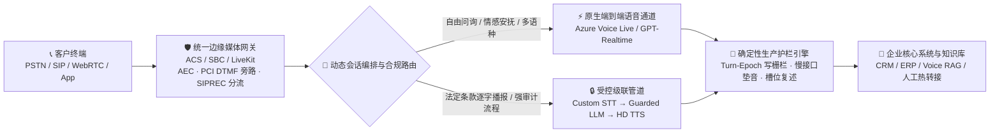

# 🎙️ Enterprise Voice & Multimodal AI Lab (`voice-agent-lab`)

**简体中文** | [English](./README.en.md) | [🌐 在线交互式架构门户](https://turbo998.github.io/voice-agent-lab/) | [📑 完整双语资产目录](./docs/asset-catalog.md)

> **面向 AI 解决方案架构师（AI Solution Architect）的企业级实时语音与多模态智能体架构知识库、选型决策矩阵、实测基准与生产级护栏工具箱。**
> 聚焦企业联络中心现代化、全双工低延迟对话、金融/医疗/零售行业合规治理、说话人分离与容量成本精算（FinOps），剔除底层协议比特级噪音，提供可直接用于客户架构评审与售前 PoC 交付的实战资产。


---

## ⚡ 核心交付物速览

| 资产模块 | 核心工程与业务价值 | 入口链接 |
| :--- | :--- | :--- |
| **🌐 交互式架构与售前门户** | 架构栈匹配器、TCO/ROI 精算器、8 项企业生产护栏交互沙盒与中/繁/英切换 | [在线门户 ↗](https://turbo998.github.io/voice-agent-lab/) · [`site/index.html`](./site/index.html) |
| **📽️ 16:9 架构师高管汇报讲义** | 12 页零外部依赖 HTML 演示幻灯片，支持客户高层汇报与架构选型工作坊 | [`site/deck.html`](./site/deck.html) |
| **📊 7-Card 4:5 标准评测报告（双份）** | 《实时语音与多模型路由 7-Card 报告》与《Azure Speech 说话人分离实证 7-Card 报告》 | [`benchmark-cards.html`](./site/benchmark-cards.html) · [`diarization-cards.html`](./site/diarization-benchmark-cards.html) |
| **🏭 出海智能硬件 6 语种语音客服案例** | 25 万 → 75 万台设备全球客服扩容复盘：`$0.08/分钟` 成本、两阶段幂等写入与路由评测 | [`site/case-study.html`](./site/case-study.html) · [中文复盘](./docs/smart-hardware-global-voice-cs-case-study.zh-CN.md) |
| **🏛️ 核心架构白皮书与可运行 PoC** | 参考架构白皮书、12 大场景 ROI 白皮书、竞品 Battlecards、两周 PoC 手册与实测代码 | [查看白皮书与 PoC](#-一核心架构白皮书与可运行-poc中英双语) |
| **🧭 58 篇企业级语音架构选型指南** | 系统覆盖“模型与通道接入”、“生产工程/合规/FinOps”与“重点行业解决方案”三大支柱 | [浏览 58 篇选型指南](#-二58-篇企业级语音架构选型指南中英双语) |
| **🛡️ 确定性生产护栏模块 (TypeScript)** | 零依赖实现打断纪元写栅栏、慢速 ERP 零冷场垫音、高危槽位二次复述与财富双录门控 | [`packages/`](./packages) |

---

## 🎯 企业级实时语音架构一页纸选型矩阵

在客户架构评审中，首要决策是选择 **级联管道（Cascaded）**、**原生端到端语音大模型（Native S2S）** 还是 **混合合规双轨架构（Hybrid Dual-Track）**：

| 决策维度 | 1. 企业级级联管道 (`Streaming ASR → LLM → Streaming TTS`) | 2. 原生端到端语音 (`GPT-Realtime / Voice Live / Gemini Live / Nova Sonic`) | 3. 混合合规双轨架构（企业生产推荐 ⭐） |
| :--- | :--- | :--- | :--- |
| **端到端首字音频延迟 (P50 / P95)** | `750ms – 1,250ms` / `1,600ms` | **`280ms – 450ms` / `680ms`** | 自由对话走 S2S（`<450ms`），法定条款切受控 TTS |
| **情绪韵律感知与自然打断 (Barge-In)** | 依赖独立语义判停模型，副语言情绪特征易丢失 | **原生感知语气、犹豫与停顿，全双工交互最自然** | 兼顾自然对话体验与高危业务动作确定性门控 |
| **文本可审计性与法定逐字播报** | **100% 中间文本可拦截、可正则脱敏、可逐字播报** | 音频随机采样生成，不可单独用于法定免责条款宣读 | **风险揭示/报价强制切换锁定 SSML 播报并双录存证** |
| **长通话（>10 分钟）单分钟成本** | **最低且线性可控**（`$0.04 – $0.08 / min`） | 未裁剪音频上下文时呈二次方增长（`$0.12 – $0.24 / min`） | 结合滑动窗口历史音频摘要裁剪，稳定在 **`$0.07 – $0.11 / min`** |
| **典型适用场景** | 强监管外呼回访、重度专业术语纠错、超大规模标准化 IVR | VIP 礼宾导购、口语陪练、智能座舱多模态伴侣、智能硬件 | **银行财富双录、保险理赔、航司改签、医疗分诊、企业联络中心** |



---

## 📚 一、核心架构白皮书与可运行 PoC（中英双语）

| 资产名称 | 解决方案架构师核心关注点 | 中文版 | English |
| :--- | :--- | :---: | :---: |
| **企业级实时语音参考架构白皮书** | Native S2S、级联与混合双轨三大范式、四层生产拓扑与抗噪防幻觉护栏 | [中文](./docs/solution-architecture.md) | [EN](./docs/solution-architecture.en.md) |
| **行业场景与量化 ROI 白皮书** | 12 大企业高价值语音场景拆解、SLA 验收水位与 40 万分钟/月 TCO 模型 | [中文](./docs/business-scenarios.md) | [EN](./docs/business-scenarios.en.md) |
| **主流语音平台竞品对比 (Battlecards)** | Azure Voice Live 对标 Sierra、Retell/Vapi、ElevenLabs 与 Nova Sonic 选型攻防 | [中文](./docs/competitive-analysis.md) | [EN](./docs/competitive-analysis.en.md) |
| **售前打单与两周 PoC 交付手册** | 五维需求发现问卷、15 分钟现场演示剧本、两周 PoC 里程碑与验收探针 | [中文](./docs/presales-playbook.md) | [EN](./docs/presales-playbook.en.md) |
| **Azure Speech 说话人分离实证 PoC** | 多说话人角色分离与双声道分轨实测报告及 [`experiments/azure-speech-diarization-poc/`](./experiments/azure-speech-diarization-poc/) 复现工程 | [中文](./docs/azure-speech-diarization-poc.md) | [EN](./docs/azure-speech-diarization-poc.en.md) |
| **GPT-Live 全双工语音原型手册** | 实时双向语音 Web 原型（[`experiments/gpt-live/`](./experiments/gpt-live/)）部署与合作伙伴演示指南 | [中文](./docs/gpt-live-partner-demo-handbook.md) | [EN](./docs/gpt-live-partner-demo-handbook.en.md) |
| **出海智能硬件 6 语种语音客服案例** | 25 万 → 75 万台智能硬件多语种语音客服架构演进、多模型路由与成本复盘 | [中文](./docs/smart-hardware-global-voice-cs-case-study.zh-CN.md) | [EN](./docs/smart-hardware-global-voice-cs-case-study.md) |
| **评测红队规范与边缘语音容器指南** | 24 项语音红队评测规范、Azure Speech 本地边缘容器部署与完整资产索引 | [评测规范](./docs/voice-agent-evaluation-rubric.md) | [容器指南](./docs/speech-container-guide.md) |

---

## 🧭 二、58 篇企业级语音架构选型指南（中英双语）

> 完整分类说明亦可参阅 [`docs/asset-catalog.md`](./docs/asset-catalog.md)。

### 3.1 基础架构、模型与语音通道接入（11 篇）
1. **级联架构（ASR→LLM→TTS）vs 原生端到端语音（Native S2S）选型**：[中文](./docs/cascaded-vs-s2s-semantic-turn-faq.md) | [EN](./docs/cascaded-vs-s2s-semantic-turn-faq.en.md)
2. **主流原生 S2S 多模态语音模型横评（GPT-Realtime / Azure Voice Live / Gemini Live / Nova Sonic）**：[中文](./docs/voice-native-s2s-models-gpt-live-realtime-gemini-live-nova-sonic-selection-faq.md) | [EN](./docs/voice-native-s2s-models-gpt-live-realtime-gemini-live-nova-sonic-selection-faq.en.md)
3. **实时语音编排框架对比（LiveKit Agents vs Pipecat vs ACS vs Retell / Vapi）**：[中文](./docs/voice-orchestration-framework-livekit-pipecat-acs-retell-vapi-selection-faq.md) | [EN](./docs/voice-orchestration-framework-livekit-pipecat-acs-retell-vapi-selection-faq.en.md)
4. **Microsoft Copilot Studio / D365 Contact Center vs Azure AI Foundry + ACS 选型**：[中文](./docs/microsoft-copilot-studio-d365-vs-azure-foundry-voice-selection-faq.md) | [EN](./docs/microsoft-copilot-studio-d365-vs-azure-foundry-voice-selection-faq.en.md)
5. **全球主流云联络中心与 AI 语音平台选型（D365 Contact Center vs Amazon Connect vs Genesys vs Google CES vs Sierra）**：[中文](./docs/cloud-ccaas-d365-amazon-connect-genesys-google-sierra-selection-faq.md) | [EN](./docs/cloud-ccaas-d365-amazon-connect-genesys-google-sierra-selection-faq.en.md)
6. **流式语音识别（STT）、低延迟合成（TTS）、声音克隆与数字人选型**：[中文](./docs/voice-stt-tts-cloning-avatar-azure-elevenlabs-deepgram-opensource-selection-faq.md) | [EN](./docs/voice-stt-tts-cloning-avatar-azure-elevenlabs-deepgram-opensource-selection-faq.en.md)
7. **WebRTC vs WebSocket vs SIP Trunking / ACS 语音接入架构选型**：[中文](./docs/webrtc-vs-websocket-vs-sip-ingress-selection-faq.md) | [EN](./docs/webrtc-vs-websocket-vs-sip-ingress-selection-faq.en.md)
8. **企业存量呼叫中心 PBX & CCaaS 集成（Genesys / Cisco / Avaya / Connect / Teams Phone）**：[中文](./docs/enterprise-pbx-ccaas-genesys-cisco-avaya-teams-voice-integration-selection-faq.md) | [EN](./docs/enterprise-pbx-ccaas-genesys-cisco-avaya-teams-voice-integration-selection-faq.en.md)
9. **全双工打断（Barge-In）、语义句末检测（Semantic EOU）与回声串音抑制架构**：[中文](./docs/enterprise-voice-barge-in-semantic-turn-detection-aec-selection-faq.md) | [EN](./docs/enterprise-voice-barge-in-semantic-turn-detection-aec-selection-faq.en.md)
10. **多人同场流式说话人分离（Speaker Diarization）与声纹绑定工具鉴权**：[中文](./docs/voice-multiparty-diarization-role-isolation-faq.md) | [EN](./docs/voice-multiparty-diarization-role-isolation-faq.en.md)
11. **句内跨语种混说（中英粤 Code-Switching）与方言路由架构**：[中文](./docs/voice-multilingual-codeswitch-dialect-faq.md) | [EN](./docs/voice-multilingual-codeswitch-dialect-faq.en.md)

### 3.2 生产工程、安全合规、高可用与 FinOps 容量规划（12 篇）
12. **语音原生 RAG、同音字纠偏检索与 MCP 工具零信任安全边界**：[中文](./docs/enterprise-voice-rag-knowledge-graph-mcp-tool-security-selection-faq.md) | [EN](./docs/enterprise-voice-rag-knowledge-graph-mcp-tool-security-selection-faq.en.md)
13. **慢速 ERP/CRM 异步工具集成、零冷场垫音节拍器与 Turn-Epoch 事务隔离**：[中文](./docs/enterprise-voice-async-erp-crm-integration-zero-dead-air-selection-faq.md) | [EN](./docs/enterprise-voice-async-erp-crm-integration-zero-dead-air-selection-faq.en.md)
14. **企业语音 AI 成本建模：Azure PTU vs PayGo 容量精算与音频上下文裁剪 FinOps**：[中文](./docs/enterprise-voice-ai-tco-ptu-capacity-finops-selection-faq.md) | [EN](./docs/enterprise-voice-ai-tco-ptu-capacity-finops-selection-faq.en.md)
15. **通话中途跨区域容灾切换（Mid-Call Failover）与无感会话恢复架构**：[中文](./docs/voice-midcall-failover-session-recovery-faq.md) | [EN](./docs/voice-midcall-failover-session-recovery-faq.en.md)
16. **离线边缘 Speech Container 容器部署与端云协同降级逃生架构**：[中文](./docs/voice-edge-cloud-quantized-container-failover-faq.md) | [EN](./docs/voice-edge-cloud-quantized-container-failover-faq.en.md)
17. **人工坐席热转接（Warm Transfer）与主管耳语（Whisper）无感交接架构**：[中文](./docs/warm-transfer-whisper-handoff-faq.md) | [EN](./docs/warm-transfer-whisper-handoff-faq.en.md)
18. **多智能体语音协同（Multi-Agent Voice Swarm）与防死循环路由架构**：[中文](./docs/enterprise-multi-agent-voice-swarm-supervisor-whisper-selection-faq.md) | [EN](./docs/enterprise-multi-agent-voice-swarm-supervisor-whisper-selection-faq.en.md)
19. **PCI-DSS v4.0 双流 DTMF 支付按键旁路与收单合规隔离**：[中文](./docs/voice-pci-dtmf-scope-faq.md) | [EN](./docs/voice-pci-dtmf-scope-faq.en.md)
20. **双轨 SIPREC 合规录音与实时敏感信息（PII）声学脱敏架构**：[中文](./docs/siprec-pii-audio-redaction-faq.md) | [EN](./docs/siprec-pii-audio-redaction-faq.en.md)
21. **声纹反深伪活体检测（Anti-Deepfake）与全球语音隐私合规（GDPR / BIPA / PIPL）**：[中文](./docs/enterprise-voice-biometrics-privacy-compliance-selection-faq.md) | [EN](./docs/enterprise-voice-biometrics-privacy-compliance-selection-faq.en.md)
22. **企业语音智能体评测体系、OpenTelemetry 全链路延迟瀑布与灰度发布**：[中文](./docs/enterprise-voice-agent-evaluation-observability-redteaming-selection-faq.md) | [EN](./docs/enterprise-voice-agent-evaluation-observability-redteaming-selection-faq.en.md)
23. **话后自动化全量质检（Post-Call QA）与口头承诺 vs CRM 工单对账**：[中文](./docs/voice-postcall-promise-ticket-reconciliation-qa-faq.md) | [EN](./docs/voice-postcall-promise-ticket-reconciliation-qa-faq.en.md)

### 3.3 高价值企业行业解决方案蓝图（35 篇）
24. **企业联络中心 AI Copilot：一线智能分流、人机热交接与实时坐席辅助**：[中文](./docs/contact-center-ai-copilot-tier1-deflection-agent-assist-selection-faq.md) | [EN](./docs/contact-center-ai-copilot-tier1-deflection-agent-assist-selection-faq.en.md)
25. **运营商 5G 新通话与多模态可视化 IVR（Visual IVR）现代化改造**：[中文](./docs/telecom-5g-new-calling-visual-ivr-modernization-selection-faq.md) | [EN](./docs/telecom-5g-new-calling-visual-ivr-modernization-selection-faq.en.md)
26. **银行财富管理智能双录（Dual-Recording）、适当性核验与保险理赔语音方案**：[中文](./docs/bfsi-wealth-dual-recording-claims-compliant-outbound-voice-selection-faq.md) | [EN](./docs/bfsi-wealth-dual-recording-claims-compliant-outbound-voice-selection-faq.en.md)
27. **对公银行财资双人复核（Maker-Checker）、防 CEO 深伪电诈与交易台合规语音**：[中文](./docs/corporate-banking-treasury-maker-checker-trading-desk-voice-selection-faq.md) | [EN](./docs/corporate-banking-treasury-maker-checker-trading-desk-voice-selection-faq.en.md)
28. **医疗院前智能分诊、诊室环境病历生成（Ambient Scribe）与慢病随访方案**：[中文](./docs/healthcare-clinical-triage-chronic-followup-ambient-scribe-voice-selection-faq.md) | [EN](./docs/healthcare-clinical-triage-chronic-followup-ambient-scribe-voice-selection-faq.en.md)
29. **连锁药房处方续配、相似药名防混淆与医保事前授权（Prior Auth）语音方案**：[中文](./docs/retail-pharmacy-rx-refill-pbm-prior-authorization-voice-selection-faq.md) | [EN](./docs/retail-pharmacy-rx-refill-pbm-prior-authorization-voice-selection-faq.en.md)
30. **连锁餐饮得来速（QSR Drive-Thru）与智慧零售门店抗噪语音点单方案**：[中文](./docs/qsr-drivethru-smart-restaurant-retail-voice-ordering-selection-faq.md) | [EN](./docs/qsr-drivethru-smart-restaurant-retail-voice-ordering-selection-faq.en.md)
31. **品牌电商展厅导购与实时语音数字人（Voice + Avatar）交互方案**：[中文](./docs/ecommerce-livestream-showroom-voice-avatar-digital-human-selection-faq.md) | [EN](./docs/ecommerce-livestream-showroom-voice-avatar-digital-human-selection-faq.en.md)
32. **航司大面积航延改签（IRROPS）与连锁酒店多语种 AI 礼宾直连 PMS 方案**：[中文](./docs/travel-airline-irrops-hotel-pms-multilingual-voice-concierge-selection-faq.md) | [EN](./docs/travel-airline-irrops-hotel-pms-multilingual-voice-concierge-selection-faq.en.md)
33. **智能汽车座舱多音区多模态语音助手与车载智能硬件服务方案**：[中文](./docs/in-vehicle-cockpit-smart-hardware-multimodal-voice-assistant-selection-faq.md) | [EN](./docs/in-vehicle-cockpit-smart-hardware-multimodal-voice-assistant-selection-faq.en.md)
34. **AI 销售实战对练（Sales Roleplay）、模拟面试与企业话术教练方案**：[中文](./docs/ai-sales-roleplay-mock-interview-language-coach-selection-faq.md) | [EN](./docs/ai-sales-roleplay-mock-interview-language-coach-selection-faq.en.md)
35. **企业合规智能外呼（Outbound SDR）、答录机检测（AMD）与防骚扰治理方案**：[中文](./docs/enterprise-outbound-voice-sales-lead-qualification-selection-faq.md) | [EN](./docs/enterprise-outbound-voice-sales-lead-qualification-selection-faq.en.md)
36. **跨国会议实时多语种同声传译与结构化纪要行动项提取方案**：[中文](./docs/enterprise-multilingual-simultaneous-interpretation-meeting-minutes-selection-faq.md) | [EN](./docs/enterprise-multilingual-simultaneous-interpretation-meeting-minutes-selection-faq.en.md)
37. **企业内部 IT 服务台（ITSM）与 HR 员工自助语音 Copilot 方案**：[中文](./docs/enterprise-it-helpdesk-hr-employee-voice-copilot-selection-faq.md) | [EN](./docs/enterprise-it-helpdesk-hr-employee-voice-copilot-selection-faq.en.md)
38. **政务服务便民热线（12345 / 311）、公用事业停水停电风暴分流与燃气泄漏 0ms 抢占方案**：[中文](./docs/government-12345-hotline-utility-outage-emergency-dispatch-voice-selection-faq.md) | [EN](./docs/government-12345-hotline-utility-outage-emergency-dispatch-voice-selection-faq.en.md)
39. **企业大规模校招与蓝领批量 AI 语音面试官（STAR 追问）、防提词器作弊与公平性审计方案**：[中文](./docs/enterprise-ai-voice-interviewer-bulk-hiring-fairness-audit-selection-faq.md) | [EN](./docs/enterprise-ai-voice-interviewer-bulk-hiring-fairness-audit-selection-faq.en.md)
40. **财富管理理财师、保险代理人与医药代表（MSL）线下拜访随身语音 Copilot 方案**：[中文](./docs/field-wealth-advisor-insurance-pharma-inperson-voice-copilot-selection-faq.md) | [EN](./docs/field-wealth-advisor-insurance-pharma-inperson-voice-copilot-selection-faq.en.md)
41. **跨境电商全球 20 语种售后客服、国际快递末端派送与海运清关/电放提单语音方案**：[中文](./docs/cross-border-ecommerce-global-logistics-delivery-customs-voice-selection-faq.md) | [EN](./docs/cross-border-ecommerce-global-logistics-delivery-customs-voice-selection-faq.en.md)
42. **K12 与高等院校 1对1 苏格拉底启发式口语/数理家教、校园 FERPA 隐私与无障碍包容方案**：[中文](./docs/education-socratic-voice-tutor-campus-privacy-accessibility-selection-faq.md) | [EN](./docs/education-socratic-voice-tutor-campus-privacy-accessibility-selection-faq.en.md)
43. **电信运营商与宽带 ISP：万户光纤断网 12秒拦截、光猫看图（TR-069）自愈与防 SIM-Swap 方案**：[中文](./docs/telecom-isp-broadband-outage-router-vision-simswap-voice-selection-faq.md) | [EN](./docs/telecom-isp-broadband-outage-router-vision-simswap-voice-selection-faq.en.md)
44. **寿险重疾智能核保回访（反弃权零承诺锁）、养老金生存认证与巨灾查勘定损 Copilot 方案**：[中文](./docs/insurance-underwriting-pension-annuity-adjuster-voice-selection-faq.md) | [EN](./docs/insurance-underwriting-pension-annuity-adjuster-voice-selection-faq.en.md)
45. **新能源超充站 15秒远程自愈（OCPP 防拉弧锁）、虚拟电厂（VPP）负荷邀约与光储运维方案**：[中文](./docs/energy-virtual-power-plant-ev-charging-station-voice-selection-faq.md) | [EN](./docs/energy-virtual-power-plant-ev-charging-station-voice-selection-faq.en.md)
46. **快消品巡店车销（FMCG DSD）、餐饮后厨 B2B 方言补货与智能冰柜 8秒争议秒退方案**：[中文](./docs/fmcg-dsd-route-sales-b2b-wholesale-vending-voice-selection-faq.md) | [EN](./docs/fmcg-dsd-route-sales-b2b-wholesale-vending-voice-selection-faq.en.md)
47. **大型商业综合体智慧停车道闸 10秒脱困、地标级寻店/找车导览与儿童走失 Code Adam 安防方案**：[中文](./docs/smart-mall-parking-gate-wayfinding-retail-concierge-voice-selection-faq.md) | [EN](./docs/smart-mall-parking-gate-wayfinding-retail-concierge-voice-selection-faq.en.md)
48. **短剧/影视出海多语种 AI 译制配音（等时唇形对齐 Isochrony）、多角色有声书与企业播客方案**：[中文](./docs/media-video-dubbing-audiobook-podcast-voice-localization-selection-faq.md) | [EN](./docs/media-video-dubbing-audiobook-podcast-voice-localization-selection-faq.en.md)
49. **大型文旅景区、主题乐园排队动态调度、博物馆亚米级（UWB/BLE）多语种伴游与场馆语音方案**：[中文](./docs/cultural-tourism-theme-park-museum-voice-concierge-selection-faq.md) | [EN](./docs/cultural-tourism-theme-park-museum-voice-concierge-selection-faq.en.md)
50. **商业地产、智慧物业管家（电梯困人 SOS 应急 / 无人岗亭抬杆 / 报修派单）与房产 VR 语音导购方案**：[中文](./docs/real-estate-smart-property-elevator-emergency-voice-selection-faq.md) | [EN](./docs/real-estate-smart-property-elevator-emergency-voice-selection-faq.en.md)
51. **律所 24×7 案源初筛与利益冲突检索（ABA Rule 1.18）、司法庭审多声道笔录与远程视频公证（RON）方案**：[中文](./docs/legal-court-transcription-law-firm-intake-notary-voice-selection-faq.md) | [EN](./docs/legal-court-transcription-law-firm-intake-notary-voice-selection-faq.en.md)
52. **车企紧急呼叫救援（NG-eCall / GB 45672 AECS 碰撞触发）、新能源道路救援与 4S 店售后 DMS 语音方案**：[中文](./docs/automotive-ecall-roadside-rescue-dealer-aftersales-voice-selection-faq.md) | [EN](./docs/automotive-ecall-roadside-rescue-dealer-aftersales-voice-selection-faq.en.md)
53. **智慧养老居家看护（卫浴零镜头毫米波/声学防跌倒）、适老化老年耳聋补偿（Presbycusis EQ）与全屋 Matter 方案**：[中文](./docs/smart-home-elderly-care-ambient-acoustic-guardian-selection-faq.md) | [EN](./docs/smart-home-elderly-care-ambient-acoustic-guardian-selection-faq.en.md)
54. **三甲智慧医院住院床旁呼叫三级分流（Smart Nurse Call）、手术室无菌控屏与 WHO 安全核查（纱布清点锁）方案**：[中文](./docs/smart-hospital-inpatient-nurse-call-surgical-or-voice-selection-faq.md) | [EN](./docs/smart-hospital-inpatient-nurse-call-surgical-or-voice-selection-faq.en.md)
55. **民航万米高空客舱乘务员与 MedLink 机上急救、豪华邮轮零卫星带宽船载礼宾与高铁静音车厢/极限换乘方案**：[中文](./docs/aviation-inflight-cabin-cruise-ship-highspeed-rail-voice-selection-faq.md) | [EN](./docs/aviation-inflight-cabin-cruise-ship-highspeed-rail-voice-selection-faq.en.md)
56. **游戏实时语音 NPC（85/15 战术语音树缓存）、AI 毛绒陪伴玩具与未成年人保护合规（COPPA 零声纹留存）方案**：[中文](./docs/gaming-voice-npc-edtech-companion-minor-safety-selection-faq.md) | [EN](./docs/gaming-voice-npc-edtech-companion-minor-safety-selection-faq.en.md)
57. **情感韵律安抚（0.88x–0.94x 降速降调）、EU AI Act 职场情绪识别红线与哭泣来电 1800ms 判停展宽方案**：[中文](./docs/voice-affective-prosody-emotion-deescalation-faq.md) | [EN](./docs/voice-affective-prosody-emotion-deescalation-faq.en.md)
58. **高危字母/数字编号（航司 PNR / 17位车架号 VIN / 保单号）声学防听错消歧与北约音标分块回读方案**：[中文](./docs/voice-alphanumeric-disambiguation-faq.md) | [EN](./docs/voice-alphanumeric-disambiguation-faq.en.md)

---

## 🗂️ 三、仓库目录结构与本地验证

```text
voice-agent-lab/
├── site/                                 # 交互式架构门户、16:9 演示讲义、7-Card 评测报告与案例专页
│   ├── index.html & app.js               # 主门户（架构选型匹配、ROI 计算器、8 项企业护栏交互沙盒）
│   ├── deck.html                         # 12 页 16:9 架构师高管演示幻灯片
│   ├── benchmark-cards.html              # 实时语音与多模型路由 7-Card 4:5 视觉评测报告
│   ├── diarization-benchmark-cards.html  # Azure Speech 说话人分离 7-Card 实测报告
│   └── case-study.html                   # 智能硬件出海 6 语种 AI 语音客服深度案例
├── docs/                                 # 中英双语核心架构白皮书、资产目录与 36 篇企业级选型指南
├── assets/svg/                           # 配套架构全景与专题可视化信息图 (SVG)
├── experiments/                          # 可复现工程原型（Azure Speech 说话人分离 PoC & GPT-Live 原型）
├── packages/                             # 零外部依赖确定性生产护栏 TypeScript 模块
│   ├── duplex-core/                      # 全双工轮次纪元栅栏与慢速 API 零冷场垫音状态机
│   └── business-core/                    # 高危槽位复述确认、热转接摘要打包与财富双录合规门控
├── scripts/                              # 公开仓库隐私与敏感信息扫描脚本
└── tests/                                # 护栏逻辑、双语文档对称性、链接完整性与门户回归测试
```

### 本地快速验证

```bash
npm install
npm test              # 运行企业级护栏单元测试、双语资产对称性与站内链接完整性校验
npm run typecheck     # TypeScript 严格类型检查
npm run build         # 编译确定性护栏模块
npm run check:public  # 公开仓库隐私与敏感信息扫描
```

本地预览交互式架构门户：直接用浏览器打开 `site/index.html`，或运行 `npx serve site`。
