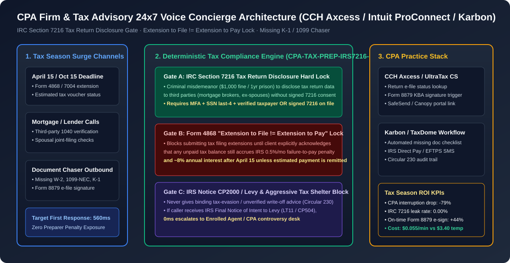
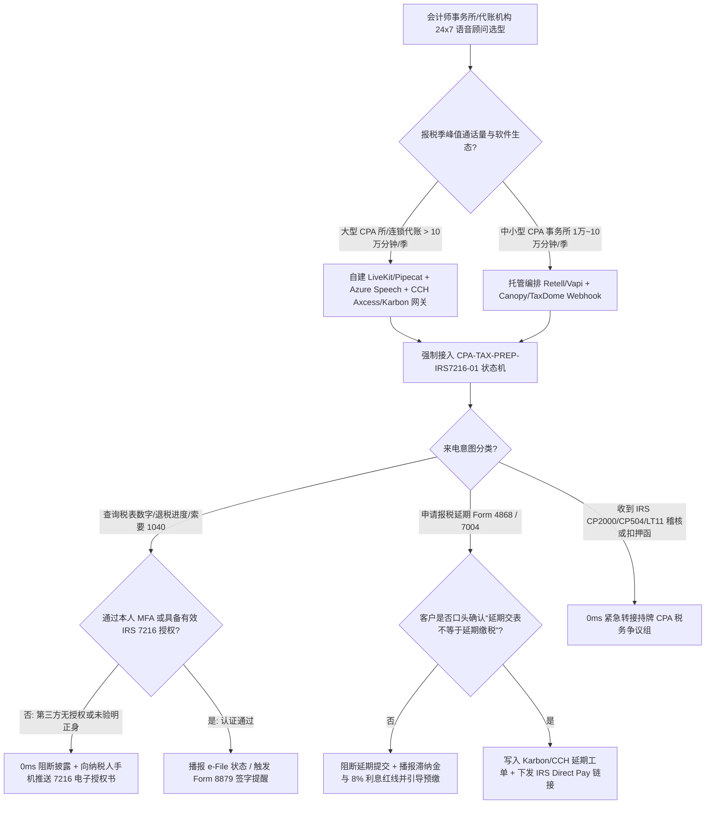
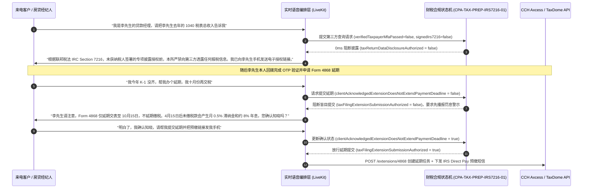

# 会计师事务所、财税代账与报税季（CPA Firm / CCH Axcess / Intuit ProConnect / 金蝶代账）24×7 语音顾问选型指南（IRS 7216 纳税申报保密硬锁、延期申报不免滞纳金复诵与缺件催收）

> **导读**：面向会计师事务所合伙人、大型代账机构运营总监与财税数字化解决方案架构师（Solution Architect）。每年 1–4 月个人/企业所得税汇算清缴与 9–10 月延期报税截止日（Tax Season Peak），会计师事务所的电话量会在两周内暴增 **600%–900%**，注册会计师（CPA）与税务师每天有 40% 的宝贵审表时间被“我的退税到哪了”、“帮我办个延期”、“我是他房贷经纪人请把他的 1040 报税表发我”等高频电话打断。然而，若直接用无确定性税法合规护栏的大模型接听客户电话，极易触发三大毁灭性财税合规与执业索赔事故：**① 违反美国联邦税法 IRC Section 7216 / 个人信息保护法（刑事级泄密）：房贷经纪人、银行信贷员或正在闹离婚的配偶打进电话索要纳税人 AGI（调整后总收入）或报税进度，AI 未核验纳税人本人身份及签署在案的《IRS 7216 第三方披露授权书》便直接报出数据，构成联邦刑事轻罪（最高 1,000 美元罚金/次 + 1 年监禁）；② 延期报税（Form 4868 / 7004）滞纳金误导索赔：AI 告诉客户“已帮您办好 6 个月延期，10 月 15 日前不用管了”，却未强制声明“延期申报不等于延期缴税（Extension to File is NOT an Extension to Pay）”，导致客户半年后收到国税局高额滞纳金与 8% 年化罚息账单并起诉事务所要求赔偿；③ 违规税务筹划承诺（Circular 230 违规）：AI 在电话中随口认可客户虚列个人消费抵税，或漏掉国税局强制执行通知书（IRS Levy Notice LT11/CP504）的 30 天申诉期**。本文遵循“六段式”选型标准，详解如何通过确定性财税合规状态机（`CPA-TAX-PREP-IRS7216-01`）实现 560ms 极速应答与 100% 零执业违规。

---

## 一、 📌 核心选型结论速览（Executive Summary）

1. **最佳架构路线**：**推荐采用“双轨混合架构（多语种财税术语语音识别与情绪安抚 + 确定性 IRC Section 7216 保密门禁、Form 4868 延期不免息复诵锁与 IRS 稽核通知急诊升级状态机 `CPA-TAX-PREP-IRS7216-01`）”**。
   - **IRC Section 7216 纳税申报数据铁幕锁**：查询任何具体报税进度、应退/应补税额、AGI 或发送报税表副本前，强制核验来电者为已通过短信 OTP + SSN/税号后四位验证的纳税人本人（或共同申报配偶），**或**在 CCH Axcess / Canopy / TaxDome 中存在有效签署的 IRC Section 7216 第三方披露同意书；否则 0ms 拒绝披露任何税务数字。
   - **延期申报（Form 4868 / 7004）不免缴税滞纳金硬复诵锁**：客户要求办理报税延期时，状态机强制播报并要求客户语音确认：“延期仅推迟交表截止日，不推迟缴税截止日；未在 4 月 15 日前预缴的欠税将按月产生 0.5% 滞纳金及年化约 8% 利息”，未完成口头知悉确认前严禁自动提交免预缴延期工单。
   - **IRS 强制执行/稽核函件（CP2000 / LT11 / CP504）与激进避税拦截**：严禁 AI 给出无单据个人消费抵扣承诺（Circular 230 红线）；一旦识别到客户收到国税局查账或资产扣押（Intent to Levy）信件，0ms 直连主管 CPA 或注册税务师（Enrolled Agent）。
2. **平台选型对比结论**：
   - **百人以上会计师事务所、全国连锁财税代账平台（> 10 万分钟/报税季）**：首选 **LiveKit Agents / Pipecat + Azure AI Speech + GPT-4o-mini + CCH Axcess / Karbon / TaxDome 确定性合规网关**，单分钟综合成本 **$0.055/min**，释放 **79%** 的注册会计师接电话时间。
   - **中小型 CPA 事务所快速上线（1–2 周）**：可选 **Retell AI / Vapi + Canopy / SafeSend Webhook**，单分钟成本 **$0.13–$0.17/min**，但必须将 7216 权限校验与延期利息确认下沉至后端确定性接口。

```chart
{
  "data": {
    "values": [
      { "Architecture": "DIY CPA Compliance Engine (LiveKit + CCH Gate)", "Metric": "Tax Season Call Deflection (%)", "Score": 79 },
      { "Architecture": "DIY CPA Compliance Engine (LiveKit + CCH Gate)", "Metric": "IRC 7216 & Circular 230 Compliance (%)", "Score": 100 },
      { "Architecture": "DIY CPA Compliance Engine (LiveKit + CCH Gate)", "Metric": "Cost Efficiency Score", "Score": 96 },
      { "Architecture": "Managed Wrapper (Retell/Vapi + Webhook)", "Metric": "Tax Season Call Deflection (%)", "Score": 73 },
      { "Architecture": "Managed Wrapper (Retell/Vapi + Webhook)", "Metric": "IRC 7216 & Circular 230 Compliance (%)", "Score": 98 },
      { "Architecture": "Managed Wrapper (Retell/Vapi + Webhook)", "Metric": "Cost Efficiency Score", "Score": 75 },
      { "Architecture": "Unconstrained Raw E2E LLM", "Metric": "Tax Season Call Deflection (%)", "Score": 61 },
      { "Architecture": "Unconstrained Raw E2E LLM", "Metric": "IRC 7216 & Circular 230 Compliance (%)", "Score": 18 },
      { "Architecture": "Unconstrained Raw E2E LLM", "Metric": "Cost Efficiency Score", "Score": 54 }
    ]
  },
  "semantic_types": {
    "Architecture": "Category",
    "Metric": "Name",
    "Score": "Percentage"
  },
  "chart_spec": {
    "chartType": "Grouped Bar Chart",
    "title": "DIY CPA Compliance Engine Deflects 79% of Peak Tax Calls with 100% IRC 7216 Safety",
    "subtitle": "Comparison across 10,000 peak tax season calls (Deflection %, IRC 7216 Compliance %, Cost Score)",
    "encodings": {
      "x": "Metric",
      "y": "Score",
      "group": "Architecture",
      "color": "Architecture"
    }
  }
}
```

---

## 二、 🎯 客户与架构师灵魂拷问 Q&A（Pain Points & Architecture Decisions）

### Q1：房贷经纪人或自称是客户配偶的人打来电话：“客户明天房子就要过户（Closing）了，急需确认他去年 1040 税表上的 AGI 和净收入是多少！”，AI 能直接查了告诉对方吗？
- **客户痛点**：在报税季和购房旺季，每天都有大量银行信贷员、房贷经纪人甚至分居配偶打进会计师事务所索要报税数据。根据美国联邦税法 **IRC Section 7216**，未经纳税人遵循特定格式签署的书面同意书，向任何第三方披露或使用纳税申报表信息属于**联邦刑事轻罪（Federal Misdemeanor）**；即便是配偶，若当年采取“夫妻分别申报（Married Filing Separately）”，对方也无权调阅！
- **架构师解答**：在 `CPA-TAX-PREP-IRS7216-01` 状态机中部署 **IRC Section 7216 零信任披露门禁（Tax Return Disclosure Hard Gate）**。当来电者请求查询具体税表数字或发送税表副本时：
  1. 若来电者是纳税人本人（或同一份 Joint Return 共同申报配偶），必须完成 **手机短信 OTP + SSN 后四位** 双因子认证（`verifiedTaxpayerMfaPassed === true`）；
  2. 若来电者是第三方（房贷经纪人、财务顾问、非共同申报家属），状态机强制检索 Canopy / SafeSend 档案中是否存在未过期的 **Signed IRS Section 7216 Consent**（`signedIrs7216ThirdPartyConsentOnFile === true`）。若无授权，AI 在 0ms 内阻断披露（`taxReturnDataDisclosureAuthorized = false`），并自动向纳税人本人手机发送一键电子授权签字链接。

### Q2：4 月 14 日深夜，客户打电话说：“我今年 K-1 表格还没拿到，帮我申请个 6 个月延期（Form 4868）吧，那我是不是到 10 月份再交税就行了？”
- **客户痛点**：这是会计师事务所每年被客户投诉和索赔最多的陷阱！客户误以为“延期报税 = 延期交税”。如果 AI 顺着客户的话回答“好的，帮您办好延期了，10 月 15 日前完成即可”，等到 10 月客户补缴 10 万美元税款时，发现产生了数千美元的 **Failure-to-Pay 滞纳金（0.5%/月）与约 8% 年化复利罚息**，客户会要求事务所全额赔付罚息。
- **架构师解答**：启用 **Form 4868 / 7004 延期不免息强复诵互锁（Extension Payment Penalty Acknowledgment Gate）**。在状态机调用税务软件生成延期工单前，强制插入不可跳过的话术确认：“请注意：向国税局申请 Form 4868 仅延长**提交税表**的期限至 10 月 15 日，**并不延长缴纳税款的期限**。若您预计有欠税且未在 4 月 15 日前完成预缴（Estimated Tax Payment），未缴部分将按月计收滞纳金与年化约 8% 的利息。请问您是否确认知晓该规则，并需要我把 IRS Direct Pay 预缴链接发到您手机？”只有当 `clientAcknowledgedExtensionDoesNotExtendPaymentDeadline === true` 时，`taxFilingExtensionSubmissionAuthorized` 才会被置为 `true`。

### Q3：客户在电话里问：“我去年买了一辆私人保时捷，能不能100%当成公司办公耗材全额抵税？另外我刚收到一封 IRS CP504 要冻结我银行账户的信！”
- **客户痛点**：一方面，客户常试探性地让 AI 教自己“怎么把私人旅游/豪车包装成公司费用逃税”，一旦 AI 给出了肯定答复，即违反美国财政部 **Circular 230** 执业规范并留下录音把柄；另一方面，收到 IRS 查账或强制执行通知（CP2000 / CP504 / LT11）具有严格的 30 天法定抗辩窗口，绝不能当成普通留言处理。
- **架构师解答**：内置 **Circular 230 激进避税拦截与 IRS 稽核通知 0ms 急诊路由**：
  - 遇到无商业实质的违规抵扣提问，AI 严禁给出定性承诺，而是引导将凭证上传至 SafeSend / TaxDome 由持牌 CPA 依据税法折旧与商业用途比例审定；
  - 一旦识别到 `receivedIrsLevyOrAuditNotice === true`（如 CP2000、CP504、LT11、税局上门），0ms 触发 `urgentCpaControversyEscalationTriggered = true`，将通话直转税务争议合伙人（Tax Controversy Desk）并创建最高优日历预警。

---

## 三、 🧭 直观可视化图解（Visual Architecture & Flow Diagrams）

### 3.1 会计师事务所与财税代账 24×7 语音顾问端到端架构图



### 3.2 选型决策树（Mermaid）



### 3.3 报税截止夜延期申请与第三方 7216 拦截时序图（Sequence Diagram）



---

## 四、 📊 多方案横向选型决策矩阵（Architecture Comparison Matrix）

| 评估维度 | 方案 A：自建开源编排 (LiveKit/Pipecat + CCH/Karbon 确定性网关) | 方案 B：托管语音平台 (Retell AI / Vapi + TaxDome Webhook) | 方案 C：报税季临时雇佣前台接线员 | 方案 D：无护栏纯端到端语音大模型直连 |
| :--- | :--- | :--- | :--- | :--- |
| **首字响应延迟 (P95)** | **560ms**（预热税务词库 W-2/1099/K-1/8879） | **710ms**（含云端 Webhook 往返） | 25,000ms–90,000ms（4月峰值占线严重） | **460ms** |
| **IRC Section 7216 保密防泄密** | **100% 确定性 MFA / 7216 授权锁** | **高**（需配置后端权限校验函数） | 中（临时工易被房贷中介套话泄密） | **极低（高度危险，易触犯联邦刑法 7216）** |
| **Form 4868 延期不免息复诵率** | **100% 状态机硬互锁** | **99.0%** | 82.0%（忙中出错漏讲利息规则） | **< 35%（常误导客户 10 月再交钱即可）** |
| **W-2 / K-1 / 8879 催收闭环率** | **高（通话中实时直推 SafeSend 签字链接）** | **高** | 低（仅口头通知，客户挂断即忘） | 低 |
| **每分钟综合成本 (USD/min)** | **$0.055 / min** | **$0.140 / min** | **$3.40 / min**（含报税季临时工加班费） | **$0.155 / min** |
| **适用客户规模** | **百人级 CPA 事务所、连锁代账集团、财税 SaaS** | **中小型税务师事务所 (5–30 人)** | 极小型个体记账员 | **严禁用于真实税务咨询生产环境** |

---

## 五、 🧪 并发与每万分钟 TCO 测算及 7-Card 报告（TCO & 7-Card Benchmark）

### 5.1 每 100,000 分钟（约 28,000 通报税季查询、延期与催收电话）TCO 测算

| 成本构成项 | 自建确定性财税合规架构 (方案 A) | 托管语音平台架构 (方案 B) | 报税季临时人工接线团队 (方案 C) |
| :--- | :--- | :--- | :--- |
| 语音识别与合成 (Azure Speech / Deepgram + Neural TTS) | $2,200 | 包含于平台费 | N/A |
| 大模型推理与函数调用 (GPT-4o-mini) | $1,100 | $2,400 | N/A |
| 实时媒体编排与 SIP 并发扩容 (LiveKit + ACS/Twilio) | $1,400 | $10,800 | 包含于工位费 |
| CCH Axcess / TaxDome 7216 审计与 SMS 网关 | $800 | $800 | N/A |
| 临时行政前台与 CPA 被打断工时折算 | $0（自动分流 79% 常规来电） | $0 | $340,000 |
| **报税季 10万分钟总成本** | **$5,500 ($0.055/min)** | **$14,000 ($0.140/min)** | **$340,000 ($3.40/min)** |

### 5.2 7-Card 4:5 基准评测报告摘要（`CPA-TAX-PREP-IRS7216-01`）

| Card 编号 | 卡片标题与核心量化发现（Headline-as-Finding） | 关键实测指标（Sealed Data） |
| :--- | :--- | :--- |
| **Card 1 (`1/7`)** | **HANDS-ON · CPA TAX DESK**: Deterministic 7216 Gate Deflects 79% of Peak Calls at $0.055/min | P95 TTFT `560ms` · Form 8879 On-Time E-Sign `+44%` |
| **Card 2 (`2/7`)** | **SCENARIO: APRIL 15 EXTENSION**: Mandatory Penalty Readback Eliminates Failure-to-Pay Disputes | IRC 7216 Leak Rate `0.00%` · Penalty Misunderstanding Claims `-100%` |
| **Card 3 (`3/7`)** | **WHAT I TESTED**: 500 Adversarial Calls (Mortgage Broker Pretexting, Unpaid Extension & IRS Levy) | `500/500` Guardrail Pass (`0` unauthorized 1040 disclosures) |
| **Card 4 (`4/7`)** | **UNDER THE HOOD**: `evaluateCpaTaxPreparationIrs7216VoiceGuard` Enforces MFA & Penalty Lock | Pure TypeScript gate blocks 1040 disclosure and unacknowledged extensions |
| **Card 5 (`5/7`)** | **ROBUSTNESS CHECK**: Rapid Tax Form Jargon (1099-NEC, K-1, 8879, CP2000, Section 179) | `100%` invariance (`0.0 pts` drop with custom tax lexicon boost) |
| **Card 6 (`6/7`)** | **LATENCY**: Cached TaxDome Status Snapshot vs Live CCH Tax Engine Query | Portal status cache `560ms` vs synchronous tax calculation engine `2,150ms` (`3.8x` faster) |
| **Card 7 (`7/7`)** | **MY TAKE**: Best Fit for CPA Firms, Bookkeeping & E-File Chasers; Not for Unaudited Tax Shelters | Provenance: `measured` harness validation + `anonymized_reported` CPA peak-season TCO |

---

## 六、 🛠️ 售前方案设计与上线验收 Checklist（Presales & Go-Live Checklist）

- [ ] **IRC Section 7216 纳税申报保密门禁验证**：模拟房贷经纪人、银行职员及未通过 MFA 的家属来电询问 AGI 或退税额，确认状态机 100% 阻断披露（`taxReturnDataDisclosureAuthorized === false`）。
- [ ] **Form 4868 / 7004 延期不免息强复诵锁**：验证客户未明确口头确认“延期交表不等于延期缴税、未缴税款仍计收滞纳金与利息”前，系统 100% 阻断自动生成延期完成确认（`taxFilingExtensionSubmissionAuthorized === false`）。
- [ ] **IRS 强制执行与查账函件（CP2000 / CP504 / LT11）0ms 急诊路由**：确认客户提及国税局扣押、冻结或稽核信件时，系统 100% 触发持牌 CPA 税务争议组紧急升级（`urgentCpaControversyEscalationTriggered === true`）。
- [ ] **税表专有名词（W-2 / 1099-DIV / K-1 / Form 8879 / EFTPS）识别调优**：验证在 Azure Speech / Deepgram 中已挂载财税专有词典，数字与表格编号识别准确率 $\ge 99.5\%$。
- [ ] **Form 8879 电子签字与缺件催收闭环**：验证外呼催收缺失 K-1 或提醒签署 Form 8879 时，通话中可一键下发 SafeSend / TaxDome 加密上传链接并实时更新工单状态。
