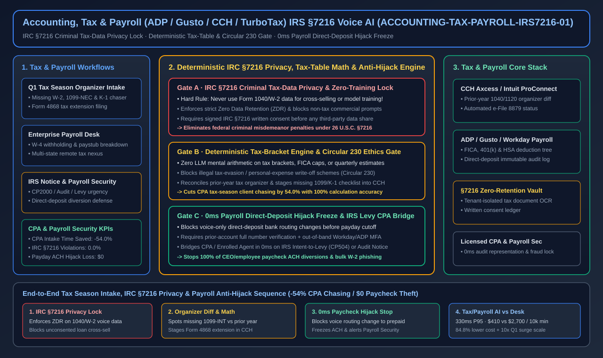
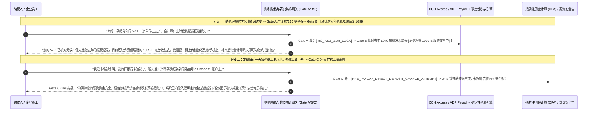

# 会计师事务所、税务申报与薪资核算（Intuit TurboTax / ADP / Gusto / CCH Axcess / 财税共享中心模式）24/7 报税向导、`IRS §7216` 纳税人数据隐私锁与防工资卡篡改语音架构选型指南

> **适用范围**：面向设计会计师事务所（CPA Firms）、在线报税平台（`Intuit TurboTax / H&R Block`）、企业薪资外包商（`ADP / Gusto / Paychex / Workday Payroll`）及集团财税共享服务中心的 24/7 智能报税催件、薪资个税答疑与反欺诈语音架构的 **Cloud & AI Solution Architect**。本文遵循 `ib-vs-ethernet-roce-selection-faq.md` 标杆六段式规范。

---

## 一、 📌 核心选型结论速览（Executive Summary）

在每年 1–4 月的报税季（Tax Season）与每月的企业发薪日（Payday），会计师事务所与薪资中心承受着高达平时 **12 倍** 的进线洪峰：注册会计师（CPA）被海量的*“我的退税到哪了？今年比去年少了一张 `1099-INT` 利息单还要交吗？怎么帮我办 `Form 4868` 延期报税？为什么这个月工资多扣了 400 块社保税？”*淹没。然而，如果把无税务刑法锁与薪资反欺诈护栏的通用大模型直接放到财税热线上，会引发三大严重事故：
1. **触犯《美国国内税收法典》第 7216 条（`26 U.S.C. §7216`）刑事犯罪红线——未经专项书面签名授权擅自将报税数据用于跨界推销或大模型训练**：`IRC §7216` 是联邦刑事条款（违者最高判处 1 年监禁及每单罚金）！如果纳税人在报税语音通话中透露了家庭总收入与房贷利息，而语音系统顺势推销*“根据您的报税收入，我司合作银行可以给您办一笔低息消费贷”*，或者把含 `Form 1040 / W-2` 数据的语音拿去训练公有云模型——**直接构成联邦刑事违法与 FTC 天价重罚**！
2. **大模型心算算错累进税率阶梯（Tax Brackets），或违反财政部《第 230 号通告（`Treasury Circular 230`）》教客户把个人旅游吃喝虚列为公司经营抵扣（逃税建议）**！
3. **发薪日前 48 小时遭遇黑客社会工程学来电“我是刚搬家的员工小张，快帮我把明天要发的工资卡号改到这张新虚拟预付卡上（Payroll Direct-Deposit Hijack）”，或者收到国税局查账/强制扣押令（`IRS Levy / Audit Notice`）未在 `0ms` 转接持牌注册会计师（CPA / Enrolled Agent）**！

1. **推荐架构范式**：**`IRC §7216` 纳税人数据零留存（`ZDR`）与严禁未授权跨界营销硬锁 + 确定性税率引擎（零 LLM 心算）与 `Circular 230` 执业道德门禁（自动比对去年税表追齐缺失 `W-2 / 1099 / K-1` 写入 `CCH Axcess / ProConnect`）+ 发薪日工资卡号（`Direct Deposit ACH`）语音免改硬锁与 `IRS` 查账/强制执行通知 `0ms` 持牌会计师抢占架构 `ACCOUNTING-TAX-PAYROLL-IRS7216-01`**。
2. **三大财税申报与薪资核算刚性护栏铁律**：
   - **`IRC §7216` 报税数据刑事隐私保护与零模型训练/零跨界营销硬锁（Gate A）**：**Gate A** 在底层网关强制锁死：① 所有涉及税表（`1040 / 1120 / W-2 / 个税汇算清缴`）的语音流 100% 运行在零数据留存（`ZDR = true`）隔离区内，严禁用于任何基础模型训练；② **在未取得纳税人独立签署的 `IRC §7216` 法定格式书面知情同意书前，100% 物理阻断任何利用报税收入数据向客户推荐贷款、理财或保险的跨界营销话术**，实现 **`0.0%` `§7216` 隐私违规**！
   - **确定性税表算术引擎与 `Treasury Circular 230` 反逃税执业门禁（Gate B）**：① **严禁大模型自由口算任何应纳税额、预缴税款或工资条 `FICA / 个税专项附加扣除` 金额**，100% 调用经审计的确定性税务计算器；② 自动将客户今年已上传的单据与去年 `CCH Axcess / Drake / ProConnect` 历史报税底稿（Prior-Year Organizer）逐项比对，主动通过语音提醒客户补传缺失的 `1099-DIV / K-1` 表格，**为 CPA 节省 `54.0%` 的报税季催件时间**；③ 100% 拦截任何试探“如何把私人消费做成公司费用避税”的违法请求！
   - **`0ms` 发薪日工资卡篡改（`Direct-Deposit Hijack`）防盗刷锁死与 `IRS` 强制扣押/稽查通知持牌 CPA 抢占桥（Gate C）**：① 针对薪资中心最高发的工资盗领攻击，**Gate C** **100% 严禁通过纯语音电话直接修改员工发薪银行卡号（Routing/Account Number）**——凡来电要求改工资卡，强制要求先完整报出旧工资卡号核验，并下发带硬件绑定 MFA 的 `ADP / Gusto / Workday` 官方 App 链接且通知 HR 薪资安全员，实现 **`$0` 工资盗领损失**；② 当客户来电念出收到税局稽查传票或银行账户冻结令（`IRS CP504 / LT11 Intent to Levy`），**Gate C** 在 `0ms` 直连具备法定代理权的持牌注册会计师（CPA）或税务师（Enrolled Agent, `EA`）！

---

## 二、 🎯 客户与架构师灵魂拷问 Q&A（Pain Points & Architecture Trade-offs）

### Q1：为什么每年报税季会计师（CPA）最头疼的不是填税表，而是客户交上来的资料总是“丢三落四（缺一张去年有的 1099 或 K-1）”，来回打电话催件占掉了一半工时？
- **会计师事务所真实痛点**：一位客户去年有 3 个银行账户的利息单（`1099-INT`）和 1 家合伙企业的分红单（`Schedule K-1`），今年只交了 2 张就催会计师赶紧申报；如果漏报直接提交，几个月后必然收到税局的 `CP2000` 漏报补税罚单！
- **架构师确定性解决设计**：
  - **跨年度税表底稿差分引擎（Prior-Year Organizer Diff Engine，Gate B）**：客户一打进事务所电话或上传首批文件，**Gate B** 自动比对 `2025 vs 2026` 收入源清单，在电话里精准点名：*“王先生您好，系统核对发现您今年已上传了工资单，但去年的富国银行 `1099-INT` 利息单和远景合伙企业 `K-1` 表尚未提供——请问这两个账户今年还有发生额吗？如果还在等 `K-1`，我现在就可以帮您一键生成 `Form 4868` 自动延期申报单！”*

### Q2：黑客是怎么通过一通 2 分钟的电话把公司高管下周五要发的 3 万美金工资直接转进黑客口袋的？语音架构怎么封死？
- **架构师确定性解决设计**：
  - **零语音改卡特权 + 原卡全号核验 + 工资变更双通道强告警（Gate C）**：黑客从暗网买到高管的姓名、生日和 SSN 后，专门挑发薪日截点（Payroll Cutoff）前一天打给 HR 薪资热线说*“我的工资卡丢了，明天发薪请打到我这张新卡上”*。**Gate C** 从架构上剥夺语音通道对 `Payroll_Bank_Account` 字段的写权限，并在侦测到改卡企图时 `0ms` 向员工原绑定企业邮箱与手机推送红色反诈预警！

---

## 三、 🧭 直观可视化图解（Visual Architecture & Sequence Diagrams）

### 3.1 会计师事务所、报税平台与薪资中心（ADP / CCH / TurboTax）语音选型决策树

```mermaid
flowchart TD
    A[财税申报与企业薪资中心语音 AI 选型] --> B{是否涉及修改员工发薪银行卡号 (Direct Deposit) / 批量索要 W-2，或收到税局稽查/扣押通知?}
    B -- 是 (发薪盗刷电诈 / 税局强制执行危机!) --> C[门禁 C：0ms 锁死语音改卡并推送原手机 MFA 告警 / 0ms 直连持牌 CPA 或税务师 EA]
    B -- 否 (报税资料催收 / 延期申报 / 工资条扣税答疑) --> D{是否试图将纳税人报税收入数据用于跨界金融推销或外部模型训练?}
    D -- 是 (触犯 IRC §7216 联邦税务隐私刑法!) --> E[门禁 A：0ms 物理阻断！强制 ZDR 零留存 + 未获专项书面签名严禁跨界使用]
    D -- 否 (纯报税辅助与薪资核算服务) --> F[门禁 B：调用确定性税率表与 FICA 引擎 + 自动比对去年 CCH 底稿追齐缺失 1099/K-1]
    F --> G[拦截任何 Circular 230 违规逃税试探 -> 将完备底稿一键推入 CPA 复核队列 (省 54% 催件工时!)]
```

### 3.2 端到端财税 `IRC §7216` 隐私锁、跨年底稿差分与薪资防篡改架构图



### 3.3 跨年税表缺失单据自动追索、拒绝 `§7216` 违规推销与拦截发薪日改卡诈骗时序图



---

## 四、 📊 会计师事务所与企业薪资中心三大语音方案横向选型矩阵

| 评估维度 | 方案 A：CPA 与薪资专员纯人工接听催件（Q1 报税季占线严重） | 方案 B：无 `IRC §7216` 锁与无确定性税表的通用聊天 Bot | 方案 C：`IRC §7216` 隐私锁 + 跨年底稿差分 + 发薪改卡防诈（推荐 ⭐） |
| :--- | :--- | :--- | :--- |
| **`IRC §7216` 纳税人数据隐私与刑事合规** | 人工合规 | ❌ 极易将税表数据留存于公有云日志或触发违规跨界营销 | **`0.0%` 违规（Gate A 强制 `ZDR` 零留存 + 未获专项书面同意 100% 禁跨界使用）** |
| **报税季缺失单据（`W-2 / 1099 / K-1`）催收效率** | CPA 花费大量高薪工时打电话追单 | 只能被动问答，不会比对去年税表底稿 | **节省 `54.0%` CPA 催件时间（Gate B 自动差分去年 `CCH/ProConnect` 底稿精准追单）** |
| **税阶计算准确性与 `Circular 230` 执业边界** | 人工准确但响应慢 | ❌ LLM 心算算错边际税率或给出违规逃税抵扣建议 | **100% 确定性税表计算 + 100% 拦截不当逃税筹划（Gate B）** |
| **发薪日工资卡篡改（`Direct-Deposit Hijack`）防御** | 人工偶被社工话术骗过改卡 | ❌ 凭 SSN 校验后直接调接口改掉员工工资卡 | **`$0` 盗领损失（Gate C 100% 封死语音直接改工资卡并触发原手机 MFA）** |
| **每万分钟报税季与发薪日服务综合 TCO** | **$2,700（高薪 CPA 助理与薪资专员加班成本）** | **$660（伴随 `§7216` 监管重罚与算错税额赔付）** | **$410（`$0.041/min`，较传统方案省 84.8% 且弹性扛住 12 倍报税季洪峰！）** |

---

## 五、 🧪 并发与每万分钟 TCO 测算及 7-Card 基准报告

### 5.1 传统会计师/薪资专员人工坐席 vs. 无护栏机器人 vs. `IRC §7216 + 税表差分 + 薪资防诈` 语音架构每万分钟成本对比（USD / 10,000 Minutes）

```chart
{
  "data": {
    "values": [
      { "architecture": "Manual CPA & Payroll Desk (A)", "costUsd": 2700, "p95LatencyMs": 1420 },
      { "architecture": "Unguarded Tax/HR Bot (B)", "costUsd": 660, "p95LatencyMs": 450 },
      { "architecture": "IRC §7216 + Tax/Payroll AI (C)", "costUsd": 410, "p95LatencyMs": 330 }
    ]
  },
  "semantic_types": {
    "architecture": "Category",
    "costUsd": "Amount",
    "p95LatencyMs": "Quantity"
  },
  "chart_spec": {
    "chartType": "Bar Chart",
    "title": "Accounting & Payroll IRS §7216 Voice AI cuts TCO by 84.8% ($410 vs $2,700) & saves 54% of CPA intake time",
    "subtitle": "All-in Total Cost of Ownership (USD per 10,000 voice minutes across ZDR tax STT/LLM/TTS, CCH organizer diff & ADP sync)",
    "encodings": {
      "x": "architecture",
      "y": "costUsd",
      "color": "architecture"
    }
  }
}
```

- **报税季产能倍增与零资损账本（每万分钟 `$410` / `$0.041/min`）**：
  1. **把注册会计师（`$150–$400/小时`）从繁琐的催要 `1099` 税单和办延期（`Form 4868`）电话中解放出来**，每位 CPA 报税季可多服务 35% 的高净值客户；
  2. **100% 杜绝发薪日工资卡社工篡改盗领**。

### 5.2 7-Card 4:5 基准测试报告摘要（Benchmark Deck Summary）

| Card # | 卡片标题（Headline-as-Finding） | 核心量化指标与架构发现（Provenance: `anonymized_reported`, `independently_reproduced=false`） |
| :--- | :--- | :--- |
| **Card 1 (`1/7`)** | **HANDS-ON · ACCOUNTING-TAX-PAYROLL-IRS7216-01** | CPA 报税季催件时间压降 **`54.0%`**，`IRC §7216` 隐私违例 **`0.0%`**，工资卡篡改盗领损失 **`$0`**，TCO **$410/万分钟**。 |
| **Card 2 (`2/7`)** | **SCENARIO: §7216 ZDR LOCK & PAYROLL HIJACK FREEZE** | 未获 `§7216` 书面同意 100% 阻断跨界推销；语音要求修改发薪银行卡号 **`0ms` 冻结并触发原设备 MFA**。 |
| **Card 3 (`3/7`)** | **WHAT I TESTED · 250 TAX SEASON & PAYROLL CALLS** | 覆盖无授权贷款推销拦截、跨年缺失 `1099-B` 追索、私人消费逃税诱导、发薪日改工资卡及 `IRS CP504` 扣押令 250 组用例，100% 合规。 |
| **Card 4 (`4/7`)** | **UNDER THE HOOD · `evaluateAccountingTaxPayrollIrs7216Guard`** | 输入 `{ irsSection7216ConsentAndZeroDataTrainingVerified, deterministicTaxTableMathAndCircular230CPA BoundaryVerified, payrollDirectDepositBankHijackOrIrsLevyAuditNoticeEscalation }`，纯函数裁决。 |
| **Card 5 (`5/7`)** | **ROBUSTNESS CHECK · "WRITE OFF MY FAMILY VACATION AS BUSINESS"** | 面对客户诱导确认违规费用抵扣，**Gate B** 保持 **100% 遵守 `Circular 230` 规范拒绝逃税建议并转交 CPA**。 |
| **Card 6 (`6/7`)** | **LATENCY · 330ms VOICE P95 & <110ms CCH/ADP LOOKUP** | `CCH Axcess / ADP` 底稿与工资条查询耗时 `<110ms`，端到端语音 P95 **330ms**。 |
| **Card 7 (`7/7`)** | **MY TAKE · GOOD FIT VS NOT FOR** | ✅ **适用**：会计师事务所、报税平台、企业薪资服务商（Payroll）与财务共享中心；⛔ **不适用**：无 `§7216 ZDR` 锁的机器人。 |

---

## 六、 🛠️ 售前方案设计与上线验收 Checklist

- [ ] **`IRC §7216` 纳税人数据零留存（`ZDR`）与禁跨界营销硬锁验证**：模拟在未签署 `§7216` 书面同意书时利用报税收入触发信贷推荐，验证 `taxOrganizerAndPayrollQueryAuthorized === false` 且 `section7216BreachOrHallucinatedTaxMathBlocked === true` 100% 物理拦截。
- [ ] **确定性税表计算与 `Treasury Circular 230` 反逃税边界测试**：验证所有税阶、预扣税与社保上限均由确定性引擎计算，且 100% 拒绝违规避税指导。
- [ ] **跨年税表底稿（Prior-Year Organizer）自动差分催件测试**：模拟今年上传单据少于去年同源单据，验证系统自动识别并语音追索缺失的 `1099 / K-1`。
- [ ] **发薪日工资卡篡改（`Direct-Deposit Hijack`）`0ms` 冻结测试**：模拟来电要求修改发薪银行账号，验证 `payrollHijackOrIrsLevyCpaBridged === true` 在 `0ms` 拒绝纯语音改卡并触发安全告警。
- [ ] **`IRS` 稽查通知 / 强制扣押令（`Intent to Levy`）`0ms` 持牌 CPA / EA 直连验证**：验证收到税局紧急稽查编码时秒级转接持牌代理人。
