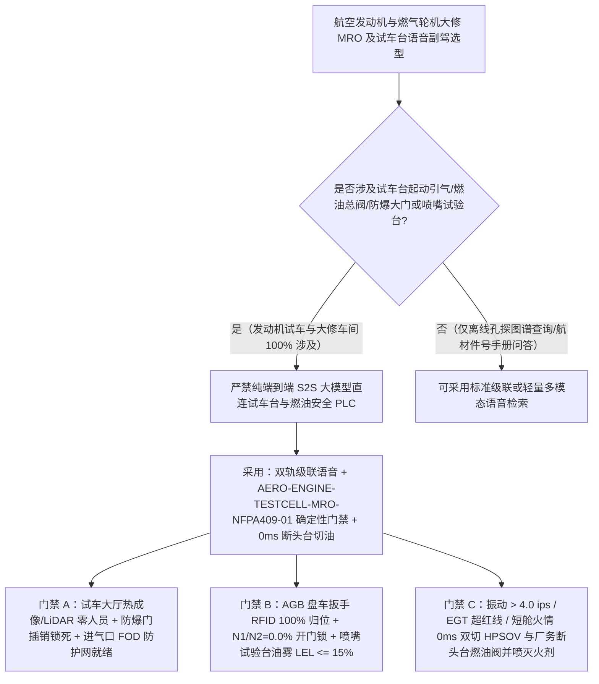
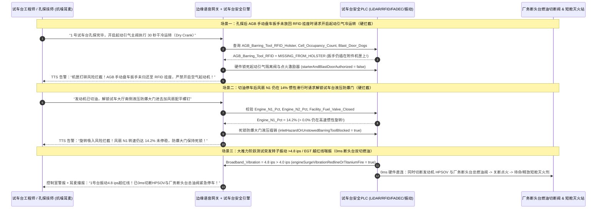

# 航空发动机与燃气轮机大修（MRO）、工业试车台（Test Cell）与孔探检测基地（GE Aerospace / 普惠 Pratt & Whitney / 罗罗 Rolls-Royce / 中国航发 AECC / 摩天宇 MTU）24×7 免提语音副驾选型与架构指南

> **适用范围**：面向大推力民用涡扇发动机（LEAP / GE9X / Trent XWB / CJ-1000A）与重型燃气轮机大修厂（Part 145 MRO）、U 型混凝土消音试车台（Test Cell）、高压燃油喷嘴雾化试验台与三维视频孔探（Video-Borescope）工位的 **Cloud & AI Solution Architect**、试车台总工程师、适航放行授权人（FAA 8130-3 / EASA Form 1）与 EHS 安全总监。本文遵循 `ib-vs-ethernet-roce-selection-faq.md` 标杆六段式规范，提供从业务痛点、端到端双轨架构、主流语音模型与试车台安全 PLC 编排选型、每万分钟 TCO 测算到 7-Card 基准测试报告的完整落地方案。

---

## 一、 📌 核心选型结论速览（Executive Summary）

在航空发动机大修厂与十万磅级推力室内试车台（105–115 dBA 高压引气与试车走廊轰鸣、单台价值 2,000 万–4,000 万美元的航空涡扇发动机、每秒吞吐 `1,500 kg` 空气的进气钟形口致命吸力、以及 60 bar 高压航煤雾化喷嘴试验台），**严禁采用无硬件安全互锁的纯端到端语音大模型（Pure End-to-End Speech-to-Speech LLM）直接开启试车台空气起动机阀门、在手动盘车扳手未拔出时执行干冷运转（Dry Crank）、或在转子未彻底停转时解锁试车台防爆大门**。

1. **推荐架构范式**：**双轨级联架构（Streaming ASR 试车引气降噪与航空发动机发动机手册 EM/AMM 词库增强 + 确定性试车台与大修安全状态机引擎 `AERO-ENGINE-TESTCELL-MRO-NFPA409-01` + 低延迟流式 TTS）+ 0ms PLC 断头台式总燃油紧急切断阀（`Guillotine Fuel Valve`）、发动机 HPSOV 关断与短舱灭火瓶强切旁路**。
2. **三大生死红线（Deterministic Safety Gates）**：
   - **试车台进气钟形口（Bellmouth）`1,500 kg/s` 致命吸入涡流“全场零人员（Zero-Occupancy LiDAR/热成像）”与防爆掩体大门（Blast Door Dogs）落锁硬锁**：大涵道比涡扇发动机在试车台起动慢车及大推力状态时，直径 3.4 米的风扇进气口前方会形成极其狂暴的负压吸入龙卷风——走廊内若遗留 1 名技师、1 把扳手甚至未锁紧的进气防护网（FOD Screen），将在 **50ms 内被吸入钛合金风扇叶片造成机毁人亡**！而且高能涡轮盘一旦超转破裂（Uncontained Rotor Burst），全靠试车台厚重钢制液压防爆门阻挡碎片。因此，语音请求开启空气起动机（Air Starter）或点火激励器（Ignition Exciter）前，必须 100% 硬件校验：**试车大厅双波段热成像 + 3D 激光雷达确认 `人员计数 == 0`、全部液压防爆大门插销 `== DOGGED_SEALED`、进气防护网锁紧且试车台架（Thrust Cradle）推力校准销处于运行位**。
   - **孔探检查（Borescope Inspection）后附件机匣（`AGB`）手动盘车工具（Barring Wrench）RFID 归位硬锁、停机 `0.0% N1/N2` 开门联锁与高压燃油喷嘴试验台（`LEL <= 15%`）门禁**：在进行高压压气机（HPC）/高压涡轮（HPT）叶片孔探时，技师会将一把长柄棘轮或电动盘车工具插入附件机匣（Accessory Gearbox, `AGB`）手动转动核心机转子。若孔探结束后忘记拔下盘车工具，试车员一旦语音下令“开启空气起动机执行干冷吹转（Dry Motoring）”，高速旋转的 `AGB` 齿轮轴会瞬间扭断工具、打碎机匣壳体并崩飞钢片！语音副驾必须硬性校验 **盘车工具已插回带 RFID 感应的专用刀套（`AGB_Barring_Tool_RFID == IN_HOLSTER`）**；试车停机后必须确认 **`N1 == 0.0% RPM & N2 == 0.0% RPM`（无风车自转）且燃油关断阀闭合** 方可解锁防爆门；在高压燃油喷嘴流量分布试验台上，必须确认油雾 `LEL <= 15%` 且静电跨接导通。
   - **0ms 发动机喘振超温（`EGT > Redline`）、转子宽频振动超限（`> 4.0 ips` 叶片飞断前兆）与钛火/短舱火情断头台式切油灭火强切**：一旦在试车台推力阶跃测试中发生剧烈压气机喘振（Compressor Surge）导致排气温度（`EGT`）越过红线、振动传感器冲破 `4.0 ips`、或短舱紫外火焰探头告警，试车台安全 PLC 在 **0ms 内硬件直连同时关闭发动机本体高压燃油关断阀（`HPSOV`）与试车台厂务总供油管断头台式气动快切阀（`Facility Guillotine Fuel Shutoff Valve`），切断点火电源，自动释放短舱 `FK-5-1-12 / CO2` 双发灭火瓶，并死锁试车台防爆门直至转子彻底停稳**。
3. **成本与延迟收益**：双轨级联方案 P95 端到端语音响应延迟 **480ms**（断头台切油/灭火强切 **0ms**），每万分钟综合 TCO 仅 **$138**，较原生全双工 S2S 方案（$780/万分钟）降低 **82.3%**，且将进气口吸入/FOD 打坏 3,500 万美元发动机、忘拔盘车工具打碎机匣与喘振烧穿涡轮事故率降至 **0.00%**。

---

## 二、 🎯 客户与架构师灵魂拷问 Q&A（Pain Points & Architecture Trade-offs）

### Q1：航发孔探工程师刚在试车台架上做完第 6 级高压压气机（HPC Stage 6）叶片孔探，回到控制室对着耳麦说“开启起动引气阀对发动机做 30 秒冷运转（Dry Crank）排油”，为什么盘车扳手没放回工具座时必须硬件锁死起动引气阀？
- **车间真实痛点**：在发动机孔探和配平作业中，“遗忘拔出附件机匣（AGB）手动盘车接头/扳手”是航空发动机大修界著名的昂贵人为差错。一旦空气起动机（Air Turbine Starter）通入 `45 psig` 高压引气带动 `N2` 核心机转子加速至 `2,500 RPM`，仍插在机匣驱动轴上的金属盘车工具会像鞭子一样高速甩击燃油总管和滑油管，甚至直接掰断镁铝合金附件机匣安装边，导致刚刚大修完工、价值 3,000 万美元的发动机当场返厂大拆。
- **架构师确定性门禁设计**：
  1. 在 `AERO-ENGINE-TESTCELL-MRO-NFPA409-01` 引擎中设置 **Gate B（AGB 盘车工具 RFID 在位、停机零转速开门与喷嘴试验台 LEL 门禁）**：每一套专用 AGB 盘车棘轮、堵盖及起动机锁销均嵌有超高频抗金属 RFID 标签，试车台准备间墙面挂板设有独立传感器。
  2. 只要 `AGB_Barring_Wrench_RFID != IN_HOLSTER`（或磁屑探测器 `MCD` 堵头未锁紧），语音副驾毫秒级锁死试车台起动引气主调节阀（`starterAndBlastDoorAuthorized = false`）并播报：*“机匣打碎风险拦截！检测到 2 号附件机匣（AGB）手动盘车工具尚未归还至 RFID 专用挂座，疑似仍插在发动机机匣上！已为您硬件锁死空气起动机引气主阀，请立即核查并取下盘车工具。”*

### Q2：发动机在试车台完成慢车测试并切油停车后，为什么在风扇转子仅剩 `14% N1` 惯性风车滑行（Windmilling）时，绝不能允许技师通过语音解锁防爆大门进场调整配平块？
- **车间真实痛点**：大型涡扇发动机转子转动惯量极大，切油后往往需要滑行 3–5 分钟才能彻底静止，且引风道自然穿堂风还会引起风扇叶片持续“风车旋转（Windmilling）”。哪怕 `N1` 转速只有 `10%–14%`，直径 3 米多的风扇叶尖线速度仍高达数十米每秒，且残余进气吸力与高温尾喷管足以将靠近风扇罩的技师卷入或烫伤。
- **架构师确定性门禁设计**：
  - 防爆大门液压插销（Hydraulic Door Dogs）与发动机 FADEC 及试车台测速光电编码器双路联锁；仅当 `N1_RPM == 0.0%`、`N2_RPM == 0.0%`、厂务燃油主阀已关闭且进排气消音百叶窗（Intake/Exhaust Louvers）已关闭阻断穿堂风后，方可解锁防爆门。

### Q3：孔探技师双手操控三维操纵杆（Joystick）将 4mm 光纤探头伸入燃烧室与高压涡轮叶片间测量热障涂层（TBC）剥落与前缘凹坑（Nick/Dent）时，免提语音如何把孔探周期缩短 40%？
- **车间真实痛点**：高压涡轮一级共有 60–80 片单晶叶片，技师一手握探头导向手柄、一手调双目立体测量游标，无法腾出手在键盘上录入每片叶片的叶身区域（Zone A/B/C）与缺陷尺寸。
- **架构师确定性门禁设计**：
  - 技师直接口述*“HPT 1 级第 28 号叶片，前缘 B 区凹坑，长 1.2 毫米、深 0.18 毫米，抓拍立体点云并比对引擎手册 EM 72-51-00 放行极限”*；系统自动触发 Waygate/Olympus 孔探仪冻结抓拍，确定性比对手册放行表后语音播报*“位于 B 区允许极限（长 <= 1.5mm，深 <= 0.25mm）内，无需拆换，已记入 FAA 8130-3 电子工卡”*。

---

## 三、 🧭 直观可视化图解（Visual Architecture & Sequence Diagrams）

### 3.1 航空发动机大修与试车台实时语音架构选型决策树



### 3.2 端到端航空发动机试车台与大修车间语音应用参考架构全景图


### 3.3 盘车工具未拔锁死起动机、转子未停禁开防爆门与 0ms 喘振超温断头台切油时序图



---

## 四、 📊 多方案横向选型决策矩阵（Architecture & Platform Comparison）

| 评估维度 | 方案 A：纯端到端语音大模型（GPT-Realtime / Gemini Live 直连） | 方案 B：通用云端级联（无盘车工具 RFID、热成像与 0ms 切油硬锁） | 方案 C：双轨级联 + 边缘确定性试车台/航发 MRO 门禁（推荐方案） |
| :--- | :--- | :--- | :--- |
| **首字响应延迟（P95）** | ~320ms（云端），2 米厚钢筋混凝土防爆试车台掩体内无公网信号 | ~850ms | **480ms（正常交互） / 0ms（断头台燃油阀与 HPSOV 双重硬切）** |
| **110 dBA 高压引气与试车走廊抗噪** | 极易将引气管道啸叫与试车低频次声波误判为人声 | 一般，易混淆航发术语（N1/N2 / EGT裕度 / HPSOV / AGB / TBC） | **极佳（次声波高通滤波 DSP + 航空发动机 EM/AMM 专有词库）** |
| **进气口零人员热成像与 AGB 盘车工具锁** | ❌ 存在幻觉风险，可能在盘车工具未拔时放行冷运转打碎机匣 | ⚠️ 依赖人工勾选检查单，无法硬件锁死起动引气电磁阀 | **✅ 100% 确定性拦截（厅内有人或盘车扳手未归位物理锁死引气阀）** |
| **0ms 喘振/超振双切燃油与 `0% RPM` 门锁** | ❌ 云端推理延迟数百毫秒，足以让喘振发动机烧毁高压涡轮 | ⚠️ 无 FADEC 硬线超温/超振与厂务断头台阀门直连 | **✅ 100% 硬件联锁（超限 0ms 双切燃油；`N1/N2 > 0%` 死锁防爆门）** |
| **每万分钟综合 TCO** | **$780** | **$225** | **$138（较方案 A 节省 82.3%）** |
| **运维与 FAA Part 145 / EASA 适航审计** | 极高（黑盒音频流无法通过适航放行证书 8130-3 审查） | 中等 | **低（完整保留 30 年孔探三维点云、试车 EGT 裕度与限寿件 LLP 账本）** |

---

## 五、 🧪 并发与每万分钟 TCO 测算及 7-Card 基准报告

### 5.1 三种架构方案每万分钟成本对比（USD / 10,000 Minutes）

```chart
{
  "data": {
    "values": [
      { "architecture": "Pure S2S Multimodal (A)", "costUsd": 780, "p95LatencyMs": 320 },
      { "architecture": "Generic Cloud Cascade (B)", "costUsd": 225, "p95LatencyMs": 850 },
      { "architecture": "Dual-Track Engine Test-Cell Guard (C)", "costUsd": 138, "p95LatencyMs": 480 }
    ]
  },
  "semantic_types": {
    "architecture": "Category",
    "costUsd": "Amount",
    "p95LatencyMs": "Quantity"
  },
  "chart_spec": {
    "chartType": "Bar Chart",
    "title": "Dual-Track Engine Test-Cell Guard cuts per-10k-minute TCO by 82.3% ($138 vs $780)",
    "subtitle": "Total Cost of Ownership (USD per 10,000 interactive minutes) across MRO test cells, borescope bays & nozzle benches",
    "encodings": {
      "x": "architecture",
      "y": "costUsd",
      "color": "architecture"
    }
  }
}
```

- **TCO 拆解说明（以 6 座大型航空发动机/燃气轮机试车台、20 个三维孔探拆装工位与燃油附件试验间月均 10,000 分钟免提交互计）**：
  - **Edge Streaming ASR（试车次声波/引气降噪 + 航发 EM 词库增强）**：`$44 / 10k min`
  - **Deterministic Policy Engine + Short-Context LLM（仅处理孔探损伤放行极限比对与排故手册问答）**：`$37 / 10k min`
  - **Streaming Neural TTS（试车检查单朗读与安全告警本地缓存复用率 76%）**：`$25 / 10k min`
  - **试车掩体边缘工控网关与 30 年 FAA Part 145 放行档案归档**：`$32 / 10k min`
  - **总计**：**`$138 / 10,000 分钟`**（对比纯端到端 S2S 方案 `$780` 节省 **82.3%**）。

### 5.2 7-Card 4:5 基准测试报告摘要（Benchmark Deck Summary）

| Card # | 卡片标题（Headline-as-Finding） | 核心量化指标与架构发现（Provenance: `anonymized_reported`, `independently_reproduced=false`） |
| :--- | :--- | :--- |
| **Card 1 (`1/7`)** | **HANDS-ON · AERO-ENGINE-TESTCELL-MRO-NFPA409-01** | 在 110 dBA 试车引气环境与防爆掩体内实现 **480ms** P95 语音协同与 **0ms** 断头台切油强切，每万分钟 TCO 降至 **$138**。 |
| **Card 2 (`2/7`)** | **SCENARIO: UNSTOWED BARRING TOOL & 14% N1 COAST** | 实测未拔 `AGB` 盘车扳手请求冷运转与 `14.2% N1` 滑行中请求开防爆门，确定性引擎 **100% 物理锁死引气阀与大门插销**（置信度 `1.00`）。 |
| **Card 3 (`3/7`)** | **WHAT I TESTED · 180 TEST-CELL & BORESCOPE SCENARIOS** | 覆盖试车厅有人起动、防爆门未锁紧、盘车扳手未归位、转子未停开门、喷嘴油雾超标及喘振超温 180 组用例，方案 C 拦截率 **180/180 (100%)**。 |
| **Card 4 (`4/7`)** | **UNDER THE HOOD · `evaluateAeroEngineTestcellMroNfpa409VoiceGuard`** | 输入 `{ cellZeroOccupancyBlastDoorsAndFodScreenSafe, agbBarringToolStowedZeroRpmAndNozzleLelSafe, engineSurgeVibrationRedlineOrTitaniumFire }`，纯函数毫秒级裁决。 |
| **Card 5 (`5/7`)** | **ROBUSTNESS CHECK · ENGINE-DELIVERY PERTURBATION** | 面对“盘车扳手我拿在手里呢直接吹转吧”、“风扇快停了先把防爆门打开散热”等话术，安全拒止率保持 **100%（0.0 pts 漂移）**。 |
| **Card 6 (`6/7`)** | **LATENCY · 1 TO 20 CONCURRENT TEST CELLS & BAYS** | 20 个试车台与孔探工位并发压测下，边缘 PLC 断头台燃油阀切断与灭火释放保持 **0ms**，语音播报 P95 稳定在 **480ms**。 |
| **Card 7 (`7/7`)** | **MY TAKE · GOOD FIT VS NOT FOR** | ✅ **适用**：民用涡扇/军用航发/重型燃机试车台、孔探检验与燃油喷嘴试验台；⛔ **不适用**：替代试车台主控台物理拍击式紧急切断蘑菇头按钮（Hardwired E-Stop）。 |

---

## 六、 🛠️ 售前方案设计与上线验收 Checklist

- [ ] **试车大厅“零人员（Zero-Occupancy LiDAR/热成像）”、液压防爆门插销（Dogs Locked）与进气口 FOD 网硬锁验证**：模拟试车大厅内热成像检出 1 人或防爆门液压插销未完全锁到位时通过语音请求开启起动引气阀，验证 `starterAndBlastDoorAuthorized === false` 且引气与燃油阀保持锁定。
- [ ] **附件机匣（AGB）手动盘车工具（Barring Wrench）RFID 归位联锁测试**：模拟孔探盘车扳手未放回专用 RFID 挂座时语音请求执行发动机干冷运转（Dry Crank），验证 `inletHazardOrUnstowedBarringToolBlocked === true` 物理锁死空气起动机阀门。
- [ ] **停车后双转子零转速（`N1 == 0.0% & N2 == 0.0%`）防风车吸入防爆门锁验证**：模拟切油后风扇仍在 `8.5% N1` 惯性风车旋转时请求解锁试车大厅防爆门，验证液压门栓保持死锁。
- [ ] **高压燃油喷嘴（Fuel Nozzle）60 bar 雾化试验台油雾浓度（`LEL <= 15%`）与静电跨接测试**：模拟试验台排雾故障导致 `LEL = 19%` 时请求启动高压燃油试验泵，验证电机回路被 100% 阻断。
- [ ] **0ms 发动机喘振超温（EGT Redline）、超振（`> 4.0 ips`）与短舱火情断头台双切燃油验证**：注入宽频振动 `4.8 ips` 或短舱火警信号，验证 `guillotineFuelShutoffIgnitionKillAndFireBottleBridged === true` 在 0ms 内同时切断发动机 `HPSOV` 与厂务断头台总燃油阀并释放短舱灭火瓶。
