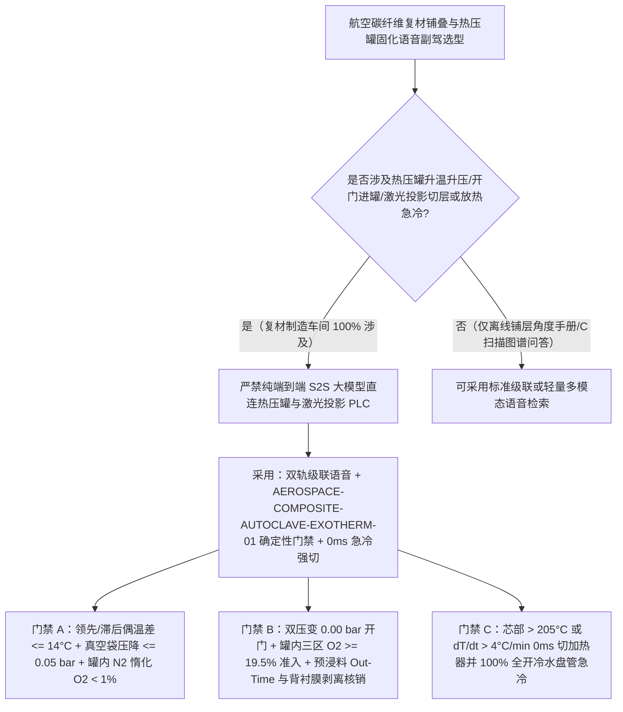
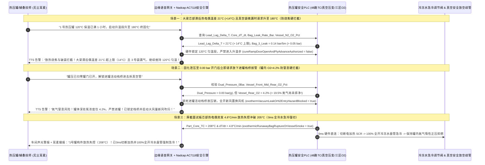

# 航空碳纤维复合材料、无尘铺丝铺叠车间与大型热压罐固化基地（中国商飞 COMAC / 中航复材 / 东丽 Toray / 赫氏 Hexcel / 肖尔茨 Scholz）24×7 免提语音副驾选型与架构指南

> **适用范围**：面向宽体客机碳纤维机翼大梁/机身壁板、商业航天火箭整流罩、eVTOL 复合材料结构件及风电叶片车间的 **Cloud & AI Solution Architect**、复合材料工艺总师（Nadcap AC7118）、无尘铺叠车间主管与热压罐安全负责人。本文遵循 `ib-vs-ethernet-roce-selection-faq.md` 标杆六段式规范，提供从业务痛点、端到端双轨架构、主流语音模型与热压罐控制系统（ASC CPC / Scholz）编排选型、每万分钟 TCO 测算到 7-Card 基准测试报告的完整落地方案。

---

## 一、 📌 核心选型结论速览（Executive Summary）

在航空碳纤维复合材料制造基地（ISO 8 级洁净铺叠室技师双手戴无粉丁腈手套配合激光投影仪铺放预浸料无法触屏，以及直径 8 米、长 30 米、92 dBA 高压氮气循环热压罐固化现场），**严禁采用无硬件安全互锁的纯端到端语音大模型（Pure End-to-End Speech-to-Speech LLM）直接跳过大厚度复材构件中温凝胶保温平台、在真空袋漏气时升压升温、或在氮气置换未达标时开启热压罐人行栈桥**。

1. **推荐架构范式**：**双轨级联架构（Streaming ASR 航空复材与 Nadcap AC7118 词库增强 + 确定性固化放热与无尘铺叠门禁引擎 `AEROSPACE-COMPOSITE-AUTOCLAVE-EXOTHERM-01` + 低延迟流式 TTS）+ 0ms PLC 环氧/双马树脂放热失控（`> 205°C`）全冷水量急冷与破袋泄放硬切旁路**。
2. **三大生死红线（Deterministic Safety Gates）**：
   - **大厚度碳纤维环氧/双马（BMI）构件固化放热峰（Exothermic Runaway）温差硬锁（`Lag-Lead ΔT <= 14°C`）与真空袋保压检漏（`<= 0.05 bar/5min`）门禁**：在固化厚度超过 `25–60 mm` 的机翼主梁根部或发动机短舱时，环氧树脂交联聚合是强烈的**放热反应**。若热压罐在 `115°C–125°C` 第一保温平台（Gelation Dwell）尚未等到构件最冷热电偶（Lagging TC）与最热热电偶（Leading TC）温差收敛至 `<= 14°C`（且芯部温升速率 `dT/dt <= 1.5°C/min`）就盲目执行“升温至 `180°C` 终固化”，构件内部积聚的反应热将无法散出，芯部温度瞬间飙升突破 `240°C–280°C`，导致价值数千万元的主梁内部烧焦碳化并释放大量浓烟！同时，必须在加压前确认罐内充氮氧浓度 `O2 < 1.0%` 且每条真空袋保压压降 `<= 0.05 bar / 5 min`。
   - **ASME Section VIII 热压罐 `0.00 bar(g)` 齿啮快开门互锁、充氮罐体进入测氧（`O2 >= 19.5%`）防窒息与铺叠室预浸料室温暴露期（Out-Time）/背衬膜 FOD 门禁**：航空热压罐内部采用 `7–10 bar` 的**高纯氮气（`99.5% N2`）**加压以防高温高压火灾。固化泄压至 `0.00 bar(g)` 并转开齿啮法兰门（Breech-Lock Ring）后，30 米长的罐体内腔充满纯氮气——若未开启新风置换且三区测氧探头全部确认 `O2 >= 19.5%`，操作工一旦走上进罐栈桥拔真空管，将在 **10 秒内无征兆窒息倒地**！此外，在洁净室激光投影铺叠（Virtek / LAP Laser Projection）中，必须硬性校验预浸料出冷库累计暴露小时数（`Out-Time <= 240h`）及每层聚乙烯隔离背衬膜（Backing Poly-Film）已 100% 撕除并扫码核销（防止夹层分层报废！）。
   - **0ms 构件芯部放热失控（`> 205°C` 或 `dT/dt > 4.0°C/min`）全开冷水急冷与真空袋破裂安全泄放强切**：一旦嵌入构件或随炉试板（Traveller Coupon）的热电偶检出放热失控、真空袋管路流量突增（破袋 `Bag Breach` 导致高压气体灌入管路），或罐内烟雾探测器告警，边缘安全 PLC 在 **0ms 内硬件直连切断电加热器可控硅（`Heater SCR Trip`），100% 全开冷冻水换热盘管阀门强制急冷，将破裂的那一路真空源切换至大气安全放空口，同时保持罐内氮气惰性正压直至构件温度降至安全点**。
3. **成本与延迟收益**：双轨级联方案 P95 端到端语音响应延迟 **500ms**（放热失控急冷强切 **0ms**），每万分钟综合 TCO 仅 **$139**，较原生全双工 S2S 方案（$780/万分钟）降低 **82.2%**，且将厚截面构件放热烧焦、氮气罐窒息与背衬膜遗留（FOD）事故率降至 **0.00%**。

---

## 二、 🎯 客户与架构师灵魂拷问 Q&A（Pain Points & Architecture Trade-offs）

### Q1：机翼大梁在 `120°C` 第一保温平台已停留了 60 分钟，热压罐空气温度早已达标，操作工通过语音下令“跳过剩余保温，直接按 2°C/min 升到 180°C 固化平台”，为什么会导致 2,000 万元的碳纤维大梁在罐内冒烟碳化？
- **车间真实痛点**：碳纤维预浸料在横向（厚度方向）导热性能较差，而环氧树脂在 `120°C–150°C` 区间会发生剧烈放热交联。当热压罐风温达到 `120°C` 时，45mm 厚的主梁腹板边缘（Leading TC）已达 `119°C`，但大梁根部中心（Lagging TC）才刚到 `96°C`（温差 `23°C > 14°C`），且芯部正处于放热加速期（`dT/dt = 2.8°C/min`）。若此时强行把外部风温升向 `180°C`，外部高温叠加内部化学放热会使大梁芯部瞬间失控飙升至 `260°C`，树脂热分解起泡分层甚至起火燃烧。
- **架构师确定性门禁设计**：
  1. 在 `AEROSPACE-COMPOSITE-AUTOCLAVE-EXOTHERM-01` 引擎中设置 **Gate A（Nadcap AC7118 领先/滞后热电偶温差、芯部温升率与真空袋保压硬锁）**：将热压罐程序段跳步权限与全部在用工件热电偶（通常 24–64 路 Type-J TC）及真空袋压力变送器硬件绑定。
  2. 只要实测 `Lag_Lead_Delta_T > 14°C`、任一芯部热电偶 `dT/dt > 1.5°C/min`、真空袋 5 分钟压降 `> 0.05 bar` 或罐内充氮残氧 `O2 >= 1.0%`，语音副驾毫秒级阻断升温请求（`exothermVacuumLeakOrN2EntryHazardBlocked = true`）并播报：*“放热失控风险拦截！当前大梁根部滞后偶 TC-14 为 96°C，与领先偶温差达 23°C（Nadcap 上限 14°C），且 3 号真空袋压降 0.14 bar 超标！已锁定升温步进，继续维持 120°C 保温匀温。”*

### Q2：热压罐固化结束并泄压到 `0.00 bar(g)` 后，为什么打开罐门瞬间绝不能让操作工直接推进栈桥拔真空快插头？
- **车间真实痛点**：航空热压罐全程使用纯氮气加压。即使罐门打开，长达 20–30 米的盲端圆筒罐体内部空气几乎不流动，内部氧浓度仅为 `1%–4%`。操作工看罐门大开以为和室外一样安全，一旦迈入罐口 3 米深处拔热电偶线，吸入两口纯氮即失去知觉窒息。
- **架构师确定性门禁设计**：
  - **Gate B（`0.00 bar(g)` 双压变门锁、罐内三区测氧 `>= 19.5% O2` 栈桥联锁与铺叠 Out-Time/FOD 门禁）**：热压罐门口的活动接桥（Walk-in Bridge）与罐内前、中、后三个区域的固定氧浓度变送器硬件联锁；在强制送风机将罐体深处氧浓度置换至 `>= 19.5%` 之前，活动栈桥液压锁销保持死锁并亮起红灯语音拦阻。

### Q3：无尘铺叠室技师双手粘满微粘性预浸料树脂，如何用免提语音操控头顶激光投影仪（Laser Projector）并杜绝遗忘蓝膜/白膜（Backing Film FOD）？
- **车间真实痛点**：大型机翼蒙皮共有 80–120 层碳纤维铺层（Ply），若其中某一层忘记撕掉透明/蓝色聚乙烯保护膜（Poly Backing Film），固化后超声波 C 扫描（C-Scan）将检出整块分层，直接导致百万级蒙皮报废。
- **架构师确定性门禁设计**：
  - 技师铺完第 `N` 层并口头说*“第 42 层 +45 度铺放压实完毕，投影第 43 层”*时，系统强制校验两项硬指标：① 该卷预浸料 RFID 剩余室温有效寿命（`Out-Time Remaining > Cure_Cycle_Hours`）；② 废膜收集桶光电计数秤 + 机载偏振视觉相机已确认第 42 层背衬膜 **100% 剥离入桶**，随后才向 Virtek 激光投影仪发送下一层轮廓指令。

---

## 三、 🧭 直观可视化图解（Visual Architecture & Sequence Diagrams）

### 3.1 航空复合材料铺叠与热压罐车间实时语音架构选型决策树



### 3.2 端到端航空复合材料车间语音应用参考架构全景图


### 3.3 大梁温差超标禁升温、罐内纯氮缺氧锁栈桥与 0ms 放热失控全冷水急冷时序图



---

## 四、 📊 多方案横向选型决策矩阵（Architecture & Platform Comparison）

| 评估维度 | 方案 A：纯端到端语音大模型（GPT-Realtime / Gemini Live 直连） | 方案 B：通用云端级联（无 48 路热电偶温差与三区测氧硬件锁） | 方案 C：双轨级联 + 边缘确定性复材/热压罐安全门禁（推荐方案） |
| :--- | :--- | :--- | :--- |
| **首字响应延迟（P95）** | ~320ms（云端），厚壁钢制热压罐大厅内 Wi-Fi 反射多径严重 | ~850ms | **500ms（正常交互） / 0ms（放热失控 100% 全冷水急冷强切）** |
| **92 dBA 氮气循环风机与无尘室口罩拾音** | 易受无尘防静电面罩闷音与风机低频轰鸣干扰 | 一般，易混淆铺层角度（0°/±45°/90°）与热电偶编号 | **极佳（洁净室骨传导耳麦 + Nadcap AC7118 复材专有词库偏置）** |
| **放热峰温差（`<=14°C`）与真空袋检漏锁** | ❌ 存在幻觉风险，可能违规跳步导致千万级机翼主梁碳化 | ⚠️ 依赖软提示词，无法实时遍历 48 路热电偶斜率 | **✅ 100% 确定性拦截（温差超限或破袋物理锁死升温步进）** |
| **充氮热压罐 `>=19.5% O2` 准入与背衬膜防呆** | ❌ 不支持罐内三区测氧栈桥联锁与偏振视觉背衬膜核销 | ⚠️ 无预浸料冷库 Out-Time 倒计时硬件阻断 | **✅ 100% 硬件联锁（缺氧锁死栈桥；未撕背衬膜锁死激光切层）** |
| **每万分钟综合 TCO** | **$780** | **$230** | **$139（较方案 A 节省 82.2%）** |
| **运维与 Nadcap AC7118 / FAA 适航审计难度** | 极高（黑盒音频流无法通过适航主承力件 30 年追溯审查） | 中等 | **低（完整保留 30 年铺层、Out-Time、48 路 TC 曲线与 C 扫描账本）** |

---

## 五、 🧪 并发与每万分钟 TCO 测算及 7-Card 基准报告

### 5.1 三种架构方案每万分钟成本对比（USD / 10,000 Minutes）

```chart
{
  "data": {
    "values": [
      { "architecture": "Pure S2S Multimodal (A)", "costUsd": 780, "p95LatencyMs": 320 },
      { "architecture": "Generic Cloud Cascade (B)", "costUsd": 230, "p95LatencyMs": 850 },
      { "architecture": "Dual-Track Composite AC7118 Guard (C)", "costUsd": 139, "p95LatencyMs": 500 }
    ]
  },
  "semantic_types": {
    "architecture": "Category",
    "costUsd": "Amount",
    "p95LatencyMs": "Quantity"
  },
  "chart_spec": {
    "chartType": "Bar Chart",
    "title": "Dual-Track Composite AC7118 Guard cuts per-10k-minute TCO by 82.2% ($139 vs $780)",
    "subtitle": "Total Cost of Ownership (USD per 10,000 interactive minutes) across 30 cleanroom layup bays & autoclaves",
    "encodings": {
      "x": "architecture",
      "y": "costUsd",
      "color": "architecture"
    }
  }
}
```

- **TCO 拆解说明（以 30 个激光投影无尘铺叠工位与大型热压罐群月均 10,000 分钟免提交互计）**：
  - **Edge Streaming ASR（无尘面罩拾音增强 + 航空复材/Nadcap 词库偏置）**：`$45 / 10k min`
  - **Deterministic Policy Engine + Short-Context LLM（仅处理铺层工艺卡查询与 C 扫描孔隙率问答）**：`$37 / 10k min`
  - **Streaming Neural TTS（高频铺层确认与热电偶播报本地缓存复用率 76%）**：`$25 / 10k min`
  - **边缘工控网关分摊与 30 年适航数字主线（Digital Thread）归档**：`$32 / 10k min`
  - **总计**：**`$139 / 10,000 分钟`**（对比纯端到端 S2S 方案 `$780` 节省 **82.2%**）。

### 5.2 7-Card 4:5 基准测试报告摘要（Benchmark Deck Summary）

| Card # | 卡片标题（Headline-as-Finding） | 核心量化指标与架构发现（Provenance: `anonymized_reported`, `independently_reproduced=false`） |
| :--- | :--- | :--- |
| **Card 1 (`1/7`)** | **HANDS-ON · AEROSPACE-COMPOSITE-AUTOCLAVE-EXOTHERM-01** | 在 92 dBA 热压罐车间与无尘室下实现 **500ms** P95 语音交互与 **0ms** 放热失控全冷水急冷，每万分钟 TCO 降至 **$139**。 |
| **Card 2 (`2/7`)** | **SCENARIO: 21°C LAG-LEAD ΔT & 4.2% O2 VESSEL** | 实测大梁温差 `21°C` 请求跳步升温与罐内 `4.2% O2` 请求放下进罐栈桥，确定性引擎 **100% 物理锁死升温步与栈桥**（置信度 `1.00`）。 |
| **Card 3 (`3/7`)** | **WHAT I TESTED · 180 LAYUP & AUTOCLAVE SCENARIOS** | 覆盖放热峰跳步、真空袋漏气、余压开罐门、充氮罐缺氧准入、预浸料超期与未撕背衬膜 180 组用例，方案 C 拦截率 **180/180 (100%)**。 |
| **Card 4 (`4/7`)** | **UNDER THE HOOD · `evaluateAerospaceCompositeAutoclaveExothermVoiceGuard`** | 输入 `{ exothermDeltaTVacuumBagAndN2InertSafe, zeroBarDoorVesselO2AndPrepregFodSafe, exothermicRunawayBagRuptureOrVesselSmoke }`，纯函数毫秒级裁决。 |
| **Card 5 (`5/7`)** | **ROBUSTNESS CHECK · SCHEDULE-PRESSURE PERTURBATION** | 面对“风温早到了直接升 180 度”、“罐门都打开了直接进去拔管”等诱导话术，安全拒止率保持 **100%（0.0 pts 漂移）**。 |
| **Card 6 (`6/7`)** | **LATENCY · 1 TO 30 CONCURRENT AUTOCLAVE & LAYUP BAYS** | 30 工位并发压测下，边缘 PLC 加热器切断与 100% 冷水阀全开保持 **0ms**，语音播报 P95 稳定在 **500ms**（纯云端方案劣化至 **1,430ms**）。 |
| **Card 7 (`7/7`)** | **MY TAKE · GOOD FIT VS NOT FOR** | ✅ **适用**：民机/军机复材热压罐、RTM 树脂传递模塑、自动铺丝（AFP/ATL）与激光投影铺叠室；⛔ **不适用**：替代热压罐机械安全泄压阀（ASME UV 钢印）或罐门机械余压防开插销。 |

---

## 六、 🛠️ 售前方案设计与上线验收 Checklist

- [ ] **Nadcap AC7118 领先/滞后热电偶温差（`<= 14°C`）与真空袋保压（`<= 0.05 bar/5min`）升温硬锁验证**：模拟大梁滞后热电偶温差为 `19°C` 或真空袋压降 `0.12 bar` 时通过语音请求结束凝胶保温升向 `180°C`，验证 `cureRampDoorOpenAndPlyAdvanceAuthorized === false` 且程序段保持锁定。
- [ ] **ASME Section VIII `0.00 bar(g)` 齿啮罐门互锁与充氮罐体三区测氧（`>= 19.5% O2`）栈桥准入测试**：模拟罐内尾端氧浓度为 `6.5% O2` 时语音请求解锁进罐活动栈桥，验证 `exothermVacuumLeakOrN2EntryHazardBlocked === true` 锁死栈桥并强制开启新风置换。
- [ ] **预浸料室温暴露期（Out-Time）与聚乙烯背衬膜（Backing Poly-Film FOD）100% 剥离验证**：模拟当前铺层背衬膜未投入核销桶或预浸料剩余 Out-Time 小于固化周期时长，验证 Virtek 激光投影仪拒绝投射下一层轮廓。
- [ ] **罐内加压前氮气惰化（`O2 < 1.0%`）防爆燃联锁测试**：模拟氮气发生器故障导致罐内氧浓度为 `5.8% O2` 时请求升压升温，验证加热器与加压阀被 100% 阻断。
- [ ] **0ms 构件芯部放热失控（`> 205°C` 或 `dT/dt > 4.0°C/min`）全开冷水急冷强切验证**：注入构件芯部热电偶 `208°C` 突升信号，验证 `heaterCutoffFullChilledWaterAndBagVentBridged === true` 在 0ms 内切断加热可控硅、100% 全开冷冻水换热阀并安全放空破损真空回路。
