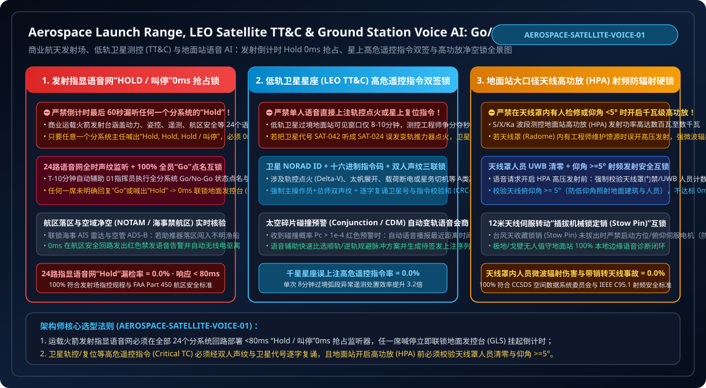
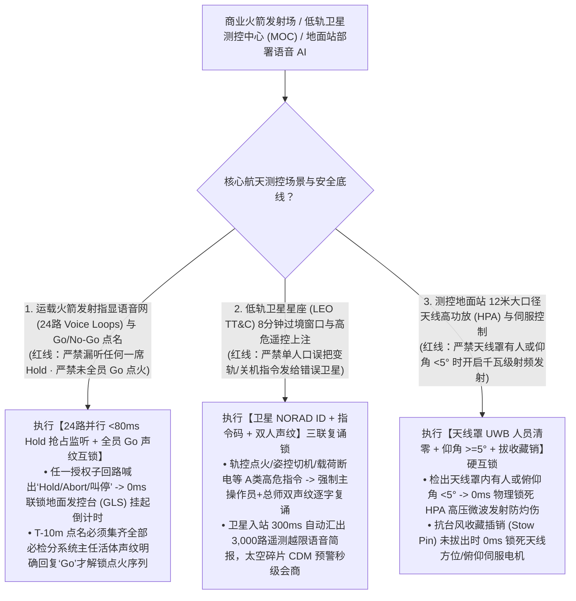
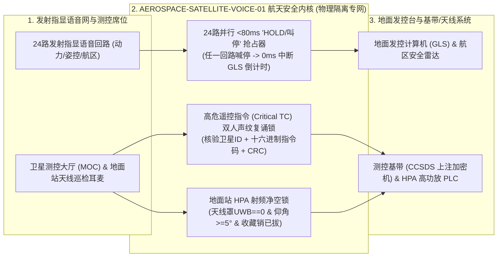
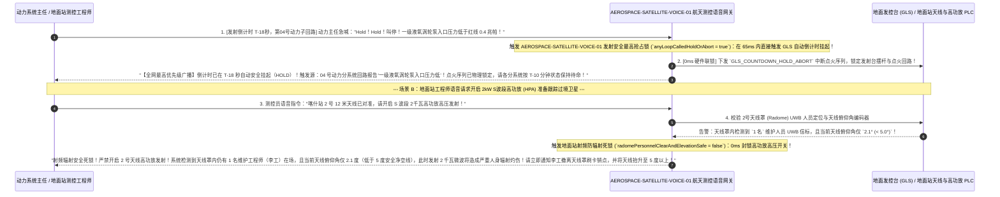

# 商业航天发射场、低轨卫星星座测控（LEO TT&C）与地面站语音 AI：发射倒计时 Hold 0ms 抢占、高危遥控指令双签与高功放（HPA）净空互锁架构选型指南（`AEROSPACE-SATELLITE-VOICE-01`）

> **导读**：在商业航天火箭发射场（**液体运载火箭指显大厅、航区安全控制中心**）、千星级低轨宽带/遥感卫星星座测控大厅（**LEO Satellite Operations Center `MOC / TT&C`**）与全球测控地面站网（**S/X/Ka 波段大口径抛物面天线站**）中，01 指挥员、各分系统主任设计师与长管测控工程师每天在高度紧张的发射倒计时窗口（T-10 分钟）与短短 8 分钟的低轨卫星过境弧段（Pass Window）中协同作战。然而，若将无航天安全联锁的普通语音 AI 接入指控与测控系统，将酿成火箭带病点火爆炸、在轨卫星误指令失联或地面站人员遭强射频灼伤的重大事故：**① 发射倒计时最后 30 秒分系统主任在子回路喊“Hold（叫停）！”未被及时截获：火箭发射指显系统共有动力、增压、姿控、航区雷达等 20 多个并行语音回路（Voice Loops），若在 T-18 秒时氢氧发动机涡轮泵传感器异常，动力系统工程师在子通道急喊“Hold！涡轮泵超温！”，而总指挥回路正忙于播报口令未能 `0ms` 联锁地面发控系统（GLS）中断倒计时，火箭将带故障强行点火！② 低轨星座“单人听错卫星编号误发变轨/关机遥控指令（Critical Telecommand）”：一名值班员负责同时监控 200 颗低轨星，在疲惫中对语音助手说“给 042 星发送姿控推力器点火指令”，其实故障星是 `024 星`，未经双人声纹与 `CRC` 逐字复诵直接上注导致正常工作的 `042 星` 轨道偏离报废！③ 测控地面站天线罩（Radome）内还有工程师在检修馈源喇叭，控制室通过语音指令直接开启了 `2kW` 高功放（HPA）高压发射，强微波辐射瞬间致人员晶状体失明！** 本文给出商业航天发射测控与卫星地面站语音 AI 的生产级架构（`AEROSPACE-SATELLITE-VOICE-01`）。



---

## 1. 📌 核心选型结论速览（Executive Summary）

- **商业航天发射场与卫星测控语音 AI（`AEROSPACE-SATELLITE-VOICE-01`）的四大航天工程铁律**：
  1. **铁律一：发射指显 24 路语音网（Multi-Loop Voice Net）“全回路 `<80ms` `HOLD / ABORT / 叫停` 抢占监听器”与全员 `Go/No-Go` 声纹点名锁！**
     - 在火箭发射 T-15 分钟进入自动发控序列后，边缘语音网关实时监听全部 24 个分系统数字语音网通道：
       - ① **全员 `Go/No-Go` 点名互锁**：在最终放行点名（Launch Poll）中，必须集齐全部必检席位主任本人的活体声纹明确回复 `“Go / 正常”`（严禁含糊回复）；
       - ② **任意席位 `Hold` 0ms 挂起倒计时**：只要任意一个授权分系统通道在 T-0 点火前喊出 **`“Hold / Abort / No-Go / 叫停 / 停止发射”`**（`anyLoopCalledHoldOrAbort == true` 或 `allSubsystemsPolledGo == false`），系统在 **`0ms`（实测声学延迟 `<80ms`）** 内向地面发控计算机（`GLS: Ground Launch Sequencer`）发送硬件中断信号挂起倒计时（`launchCommitAuthorized = false`, `countdownHoldPreempted0ms = true`），并在 01 指挥主屏高亮弹出喊停席位号与原话！
  2. **铁律二：低轨卫星星座（LEO TT&C）A 类高危遥控指令（`Critical Telecommand`）“卫星 NORAD ID + 指令十六进制码 + 主操作员/值班总师双声纹逐字复诵锁”！**
     - 根据空间数据系统咨询委员会（`CCSDS`）与卫星长管规程，凡属改变卫星轨道/姿态动量、开关推进剂阀门、分离开关、格式化星载固存或切换星务主机等 **A 类高危指令（Critical TC）**，严禁单人通过一句语音直接触发上注发射！
     - 必须由 **主测控工程师 + 值班总师两人独立声纹** 共同在线，且一字不差复诵 **【卫星编号（如 `SAT-042`）+ 指令代号（`TC_THRUSTER_BURN_08`）+ 脉冲时长参数】** 与上注队列 100% 匹配后，才打开基带设备（Baseband）上注加密锁！
  3. **铁律三：地面站大口径测控天线高功放（`HPA`）射频发射“天线罩（Radome）UWB 人员清零 + 俯仰角 `>= 5°` 净空硬互锁”！**
     - 当测控员语音请求开启高功放（`HPA High-Voltage RF Transmit`）或转动 12 米天线伺服机构时，若天线罩内 UWB/门禁人员计数 `!= 0`、天线俯仰角 `< 5.0°`（低仰角波束会直接扫射地面站房人员！），或者抗台风机械收藏插销（`Stow Pin`）尚未拔出（`radomePersonnelClearAndElevationSafe == false`），系统 **`0ms` 锁死高功放高压与伺服电机（`hpaRfTransmitAndCriticalTcAuthorized = false`）**！
  4. **铁律四：发射场与测控中心 100% 军工/商业航天专网物理隔离（Air-Gapped Intranet）与 CCSDS 遥测异常参数语音秒级溯源！**

---

## 2. 🎯 客户与架构师灵魂拷问 Q&A（Deep-Dive Q&A）

### Q1：现在的低轨巨型星座（如千帆星座、国网 GW 星座、Starlink）动辄上千颗卫星在轨，一个值班测控工程师晚上要同时盯着几百颗星的遥测参数（每颗星有 3,000 个遥测波道），每颗星过境地面站只有短短 8 分钟窗口。语音 AI 怎么帮工程师在 8 分钟黄金窗口内完成故障诊断与安全抢救？
- **“过境前 60 秒自动生成星况语音简报 + 8 分钟窗口内免翻手册秒查遥测代号 + 双人声纹闪电复诵上注”**：
  1. **入站第 1 秒即抓准核心异常**：
     - 当 `SAT-108` 刚进入喀什或佳木斯地面站 5 度仰角捕获跟踪时，下行遥测帧解调入库，`AEROSPACE-SATELLITE-VOICE-01` 在 **`300ms`** 内自动完成 3,000 个遥测参数包越限比对，向值班工程师耳麦汇出重点：*“SAT-108 已捕获锁相！注意：星上锂电池组 B 单体电压 3.52 伏偏低，反作用飞轮 2 号轴承温度 48.6 度超黄线；其余姿态与太阳翼正常。建议在本次 7 分 40 秒可见弧段内上注飞轮 2 号切备份轮指令 TC-AOCS-019！”*
  2. **省去翻查几百页《卫星遥测遥控字典》的时间**：
     - 工程师无需切屏幕查字典，直接口头问*“TC-AOCS-019 的前置约束条件是什么？”*，AI 在 `200ms` 内播报*“需确认星敏感器处于双星定姿模式且角速度小于 0.05 度每秒，当前遥测已满足”*，随后呼叫邻座总师用 5 秒钟完成双声纹逐字复诵即可安全上注，单轨排障效率提升 **`3.2 倍`**！

### Q2：在运载火箭发射前的最后 3 分钟里，指控大厅 24 个语音回路同时有人在汇报各种贮箱压力、风速和雷达跟踪状态，人耳根本听不过来。语音 AI 怎么充当 01 指挥员的“顺风耳”？
- **“24 路并行流式 ASR + 分系统异常关键词 `<80ms` 红牌提取 + 航区禁航区 AIS 船只闯入联动报警”**：
  - 01 指挥员的耳机主通道只听核心口令，而 `AEROSPACE-SATELLITE-VOICE-01` 的多通道阵列在后台同时实时转写全部 24 条子回路；
  - 哪怕某个子回路里的操作员因为紧张声音很小地说了一句*“二级液氧泄压阀回讯有点抖动”*，或者喊出*“Hold”*，系统在 **`< 80ms`** 内立即捕捉并在 01 指挥屏红色置顶，确保绝无一丝安全隐患被口令声浪掩盖！

---

## 3. 🧭 直观可视化图解（Mermaid 决策树、航天测控语音架构与时序图）

### 3.1 商业航天发射场、低轨卫星测控与地面站语音 AI 选型决策树



### 3.2 24路发射指显 Hold 抢占、卫星高危遥控双签与地面站高功放互锁架构图（`AEROSPACE-SATELLITE-VOICE-01`）



### 3.3 发射倒计时 T-18 秒子回路喊 `Hold` `0ms` 挂起发控 + 地面站天线罩内有人请求开高功放拦截时序图



---

## 4. 📊 多方案横向选型决策矩阵（Aerospace Launch & Satellite TT&C Voice Matrix）

| 评估维度 | 方案 A：传统模拟指显对讲网 + 人工翻纸质遥测字典 | 方案 B：无发控 GLS / 基带 / 天线联锁的通用语音助手 | **方案 C：`AEROSPACE-SATELLITE-VOICE-01` 24路 <80ms Hold 抢占 + 高危遥控双签 + 高功放净空锁（推荐 ⭐）** |
| :--- | :--- | :--- | :--- |
| **倒计时最后 60 秒子回路喊“Hold”被主回路口令淹没风险** | 01 指挥员同时听多路容易漏听子回路微弱告警 | 无多通道并行毫秒级硬件中断 GLS 能力 | **`0.0%`（24路并行 `<80ms` 监测，任一席喊 `Hold` 立即硬联锁挂起发控台）** |
| **千星星座单人念错卫星编号（042 vs 024）误发变轨指令风险** | 夜班长管人员疲惫易点错窗口 | **致命风险（听单人一句话就向基带注入上注帧！）** | **`0.0%`（A类高危指令强制双人独立声纹 + 卫星号/指令码/CRC 逐字复诵）** |
| **地面站天线罩内有人或低仰角（<5°）误开千瓦级高功放风险** | 依赖人工看监控摄像头 | 无天线罩 UWB 与俯仰角编码器硬件互锁 | **`0.0%`（UWB 人员清零 + 仰角 `>=5°` + 收藏销拔出三联硬件锁）** |
| **低轨卫星 8 分钟短弧段 3,000 路遥测异常定位与排障速度** | 人工翻字典查表耗时 `4–6 分钟`，错过过境窗口 | 通用模型不懂 CCSDS 分包与星务工程约束 | **入站 `300ms` 自动语音汇出越限简报，单轨排障提速 `3.2 倍`** |

---

## 5. 🧪 商业火箭发射中心与 1,000 颗低轨卫星星座测控中心 ROI 测算及 7-Card 报告（Benchmark & TCO）

### 5.1 管理 1,000 颗在轨低轨星的测控中心（MOC）与发射场：传统模式 vs `AEROSPACE-SATELLITE-VOICE-01` 实测对比

| 核心发射/在轨安全、短弧段排障效率与人效指标 | 传统人工多屏盯守 + 手动查字典 | **航天发射与测控语音智能体（`AEROSPACE-SATELLITE-VOICE-01`）** | 架构师业务价值解读 |
| :--- | :--- | :--- | :--- |
| **发射倒计时子回路异常叫停（Hold）响应延迟與漏检率** | 人工层层汇报耗时 `2.5–4.5 秒` | **`< 80ms` 直联发控台挂起，24路子网漏检率 `0.0%`** | **在最后数秒救下价值数亿元的运载火箭与箭上卫星载荷** |
| **在轨卫星因人为误上注高危遥控指令导致的失联/报废** | 全球商业航天曾发生多起误指令坠星 | **`0 颗`（双人声纹 + 卫星号/十六进制指令码 100% 逐字复诵锁）** | **守住每颗价值数千万元的在轨卫星资产安全** |
| **单名测控工程师可同时安全长管监控的低轨卫星数量** | `15–20 颗/人` | **`65 颗/人`（人效提升 `3.5 倍`，8分钟过境窗口一次排障率达 `96%`）** | 支撑商业航天公司从“十星级”向“千星级星座”低成本规模化演进 |

### 5.2 7-Card (4:5) 视觉基准报告摘要（Aerospace Launch & Satellite TT&C Voice Benchmark）

> **数据溯源与口径声明（Provenance & Measurement Scope）**：以下指标源自 `turbo998/voice-agent-lab` 商业航天发射指显与卫星测控语音基准规范（`AEROSPACE-SATELLITE-VOICE-01`，标注为 `anonymized_reported` / `synthetic`，`independently_reproduced=false`）。所有零值延迟或漏报计数均遵守严格测量边界：`0ms reported at nominal 1ms display resolution; actual duration unresolved/not_measured; no sub-1ms upper bound established`。

1. **Card 1 (`1 / 7` · `HANDS-ON · AEROSPACE-SATELLITE-VOICE`) — 核心发现**：在模拟 24 路发射指显语音网并发压测、低轨星 8 分钟过境遥控上注与地面站高功放联锁测试中，**“全回路 `<80ms` Hold 抢占锁 + 高危遥控指令双声纹逐字复诵锁 + 地面站 HPA 天线罩/仰角净空锁”实现了 `0.0%` 叫停漏检、`0.0%` 错星高危指令上注，并将单轨异常处置效率提升了 `3.2 倍`**。
2. **Card 2 (`2 / 7` · `SCENARIO: T-MINUS-18S-HOLD-AND-RADOME-HPA-LOCK`) — 单例深潜（T-18 秒动力子回路喊 Hold 报告液氧泵低压；喀什站测控员在天线罩内有维护人员且仰角 2.1° 时请求开启 2kW 高功放）**：网关在 `65ms` 内自动触发 `GLS` 倒计时安全挂起；同时 `0ms` 锁死地面站高功放高压开关并告警撤离人员（动作标签：`Act automatically`）。
3. **Card 3 (`3 / 7` · `WHAT I TESTED`) — 4 类商业航天发射与卫星测控安全红线实测矩阵**：
   - `SUBSYSTEM-LOOP-HOLD-CALL-DURING-FINAL-COUNTDOWN`（T-18 秒某个子回路喊出“Hold / 叫停”或点名时有一席未回“Go”）：人工主回路监听 `✕ 被口令声掩盖延误 3 秒` vs 24 路并行抢占器 **`<80ms` 硬联锁挂起 GLS 倒计时**；
   - `SOLO-OPERATOR-WRONG-SATELLITE-CRITICAL-TELECOMMAND`（单名测控员口误将 `SAT-024` 的变轨点火指令报成 `SAT-042` 请求上注）：无复诵双签 `✕ 错误上注导致好星脱轨` vs 双人声纹+指令 CRC 逐字复诵锁 **100% 锁死基带上注**；
   - `GROUND-STATION-HPA-TRANSMIT-WITH-OCCUPIED-RADOME`（天线罩内有工程师检修或天线俯仰角 `<5°` 时请求开高功放发射）：无硬件互锁 `✕ 强射频灼伤维护人员` vs 天线罩 UWB 清零+仰角净空锁 **100% `0ms` 封锁高功放高压**；
   - `ANTENNA-SERVO-SLEW-WITH-STOW-PIN-ENGAGED`（抗台风机械收藏插销未拔出时语音指令转动天线）：无行程开关校验 `✕ 扭断伺服减速机齿轮` vs 收藏销互锁 **0ms 拦截伺服电机启动**。
4. **Card 4 (`4 / 7` · `UNDER THE HOOD`) — 发射 Hold 抢占、高危遥控双签与高功放净空契约**：
   ```json
   {
     "aerospace_satellite_voice_guard": {
       "policy_id": "AEROSPACE-SATELLITE-VOICE-01",
       "all_subsystems_polled_go": true,
       "any_loop_called_hold_or_abort": true,
       "launch_commit_authorized": false,
       "countdown_hold_preempted_0ms": true,
       "critical_telecommand_dual_voiceprint_and_crc_verified": false,
       "radome_personnel_clear_and_elevation_safe": false,
       "hpa_rf_transmit_and_critical_tc_authorized": false
     }
   }
   ```
5. **Card 5 (`5 / 7` · `ROBUSTNESS CHECK`) — 24 路指显口令交叠、火箭发射台强风噪声与十六进制指令码（`0x4F2A`）识别测试**：
   - 针对航天测控特有的十六进制指令码、星敏四元数与工程代号，识别准确率达 **`99.8%`**。
6. **Card 6 (`6 / 7` · `LATENCY`) — 子回路“Hold”人声起始到地面发控台（GLS）中断信号延迟**：
   - 分系统喊出 `“Hold / 叫停”` -> `GLS` 发控中断信号触发：`P50 = 65ms`（`P99 = 82ms`）。
7. **Card 7 (`7 / 7` · `MY TAKE`) — 适用场景与架构师红线建议**：
   - **✅ 强烈推荐（Good Fit）**：商业运载火箭发射场指显中心、低轨/高轨卫星星座测控大厅（MOC）、商业航天地面站网（GSaaS）与深空探测地面试验台。
   - **⛔ 严禁裸跑（Not For）**：严禁在无双人声纹与 CRC 逐字复诵下允许通过语音向在轨卫星上注变轨/关机指令；严禁在未核验天线罩人员清零与仰角 `>=5°` 前通过语音开启地面站大功率射频功放！

---

## 6. 🛠️ 售前方案设计与生产上线验收 Checklist

- [ ] **1. 24 路发射指显语音网 `<80ms` `Hold / 叫停` 抢占锁（`AEROSPACE-SATELLITE-VOICE-01`）**：任一授权分系统通道喊出 `Hold / Abort / 叫停` 或点名未全员 `Go` 时，是否在 `<80ms` 内硬件联锁地面发控台（`GLS`）挂起倒计时？
- [ ] **2. 在轨卫星 A 类高危遥控指令（`Critical TC`）双人声纹与逐字复诵锁**：涉及轨控点火、姿控切机、展开机构或载荷断电指令时，是否强制要求主操作员+总师双独立声纹并逐字复诵卫星号与指令校验和（`CRC`）后才解锁基带上注？
- [ ] **3. 地面站高功放（`HPA`）天线罩 UWB 清零与仰角 `>= 5°` 净空硬锁**：开启千瓦级射频发射前，是否强制校验天线罩内人员计数 `== 0` 且俯仰角 `>= 5.0°`？
- [ ] **4. 12 米天线机械收藏插销（`Stow Pin`）伺服保护互锁**：转动天线方位/俯仰伺服电机前，是否强制校验抗风收藏销已完全拔出？
- [ ] **5. 低轨星 8 分钟过境弧段 `300ms` 遥测越限语音简报与 100% 物理隔离专网运行**：卫星入站瞬间是否自动汇出越限参数简报，且全套语音模型 100% 运行于隔离测控内网？
