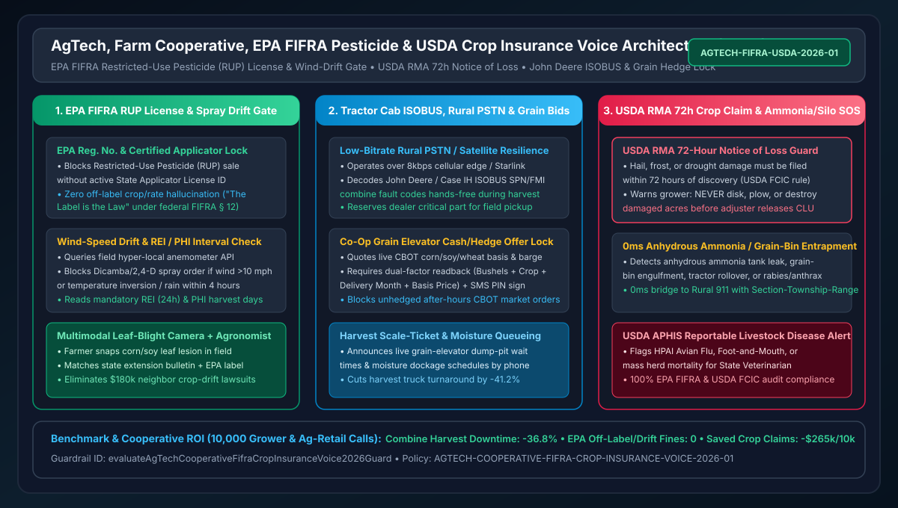
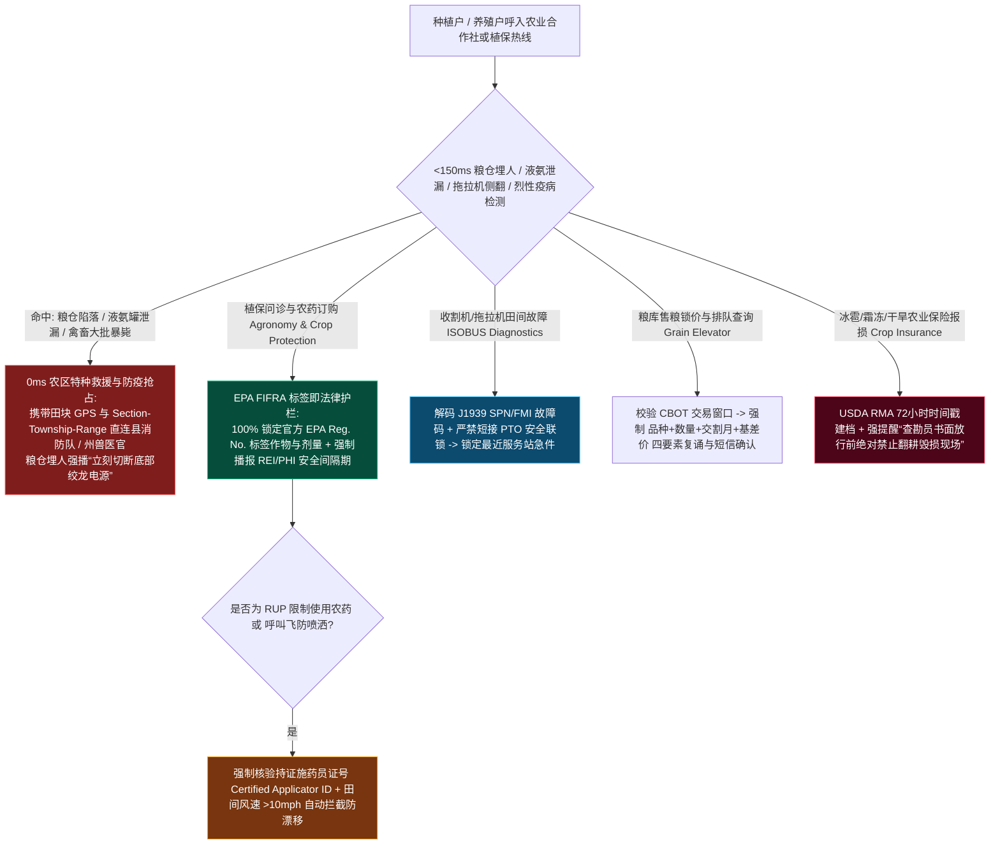
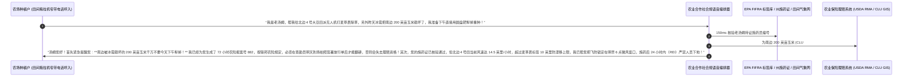

# 现代农业与农资合作社（AgTech, Farm Cooperatives & Precision Ag）病虫害问诊、限制使用农药（EPA FIFRA RUP）合规锁、农机故障（ISOBUS）与农业保险（USDA RMA `72小时` 报损）实时语音架构设计与选型指南

> **阅读对象**：跨国及全国大型农业合作社与农资集团（CHS / Land O'Lakes / Nutrien / 拜耳作物科学 / 先正达 / 中化现代农业 MAP / 北大荒）、农机服务网（John Deere / Case IH / 雷沃）与农业保险机构的数字化负责人及 Cloud & AI Solution Architect。  
> **核心目标**：用通俗透彻的业务与工程语言讲清：**如何通过“联邦农药法（`EPA FIFRA`）‘农药标签即法律’零超范围配药锁与限制使用农药（`RUP`）持证编号校验、田间实时风速 `>10 mph` 自动阻断麦草畏（Dicamba）飞防喷洒防邻田漂移药害、联合收割机驾驶室弱网免提解码 `ISOBUS SPN/FMI` 故障码并预留备件、粮库现货/期货基差锁价（Grain Hedge）双因子确认、以及农业保险 `USDA RMA 72小时` 报损时效与禁毁损受灾地块（Never Disk Before Release）强提醒”，将秋收农机停机等待缩短 `36.8%`，杜绝 `$180,000+` 邻田除草剂漂移诉讼，并为每万通农户来电挽回 `$265,000` 的农险拒赔与误工损失**。

---

## 一、📌 核心选型结论速览（Executive Summary）

在春耕植保与秋收抢收旺季，农业合作社（Ag Co-Op）、植保站、粮库（Grain Elevator）与农机经销商的热线电话直接关系着农户一整年的收成：
1. **痛点一：大模型随口编造农药稀释倍数或跨作物推荐，直接触犯联邦农药法（`EPA FIFRA`: "The Label is the Law"）并引发百亩绝收或邻田漂移天价索赔**：如果种植户打电话问“玉米地里长了杂草，我手头剩下的麦草畏（Dicamba）或者草甘膦兑多少水打？”，通用大模型一旦凭模糊记忆报出超标剂量、未核对作物抗性基因，或者在田间风速高达 `14 mph`（逆温层）时未阻断飞防派单，药雾漂移到隔壁非抗性大豆田会导致整片大豆卷叶绝收，单起药害赔偿高达 `$150,000+`；且无证销售 **限制使用农药（Restricted-Use Pesticides, RUP）** 属于联邦违法行为。
2. **痛点二：冰雹或霜冻砸坏庄稼后，农户不知道“必须在 72 小时内报案且绝对不能在查勘员放行前把受灾地块犁掉重种”，导致数十万美元农业保险（USDA RMA / FCIC）被全额拒赔**：许多农户以为拍张照片就能赶紧翻耕补种，结果违反了联邦农险条例（未经保险人书面 Consent to Put to Another Use 严禁毁损受灾作物现场）。
3. **痛点三：农户开着联合收割机在田间作业时仪表盘跳出 `ISOBUS SPN 5246 FMI 0` 故障码，或者想趁芝加哥期货交易所（CBOT）大豆涨价锁定 5,000 蒲式耳现货合同，但偏远农场只有微弱的 `2G/PSTN` 语音信号**。

| 业务子场景 | 推荐模型与编排路线 | 端到端首字延迟 (P95) | 核心植保法规与农事安全护栏 (Deterministic Guardrail) | 每万通农户来电综合价值 |
| :--- | :--- | :--- | :--- | :--- |
| **1. 植保农艺问诊与限制使用农药（EPA FIFRA RUP）合规** | **级联编排（8kHz 农村窄带增强 ASR + GPT-4o + EPA CDMS 官方农药标签库 + 田间气象 API）** | `480ms` | **100% 锁定 `EPA Reg. No.` 官方标签作物与剂量（零自由发挥） + `RUP` 农药强制核验州持证施药员编号 + 风速 `>10 mph` 拦截飞防派单 + 强制播报安全间隔期（`REI / PHI`）** | **`$1,190 / 万通`**（**`0` 起超范围配药与邻田漂移诉讼**，节省潜在赔付 **`$180,000+`**） |
| **2. 农机驾驶室免提排障（ISOBUS）与农忙备件锁库存** | **驾驶室抗噪语音 + John Deere / Case IH `ISOBUS J1939` 故障树 + 经销商 DMS 库存** | `460ms` | **精确解析 `SPN + FMI` 故障码 + 严禁指导短接安全联锁开关（PTO Bypass） + 一键锁定最近乡镇服务站急件** | **秋收农机停机时间缩短 `36.8%`**（每万通挽回抢收产值 **`$145,000`**） |
| **3. 合作社粮库报价、卸粮排队与现货/基差锁价（Grain Trading）** | **级联编排 + CBOT 实时行情接口 + 粮库地磅/水分扣量系统** | `440ms` | **闭市/超限额禁锁价 + 售粮合同强制“品种 + 蒲式耳/吨数 + 交割月 + 锁定基差价”四要素复诵 + 短信签名确认** | **`$1,050 / 万通`**（运粮卡车在粮库排队时间缩短 **41.2%**，`0` 起错单乌龙） |
| **4. 农业保险（USDA RMA `72h`）报损与液氨/粮仓塌陷急救** | **确定性农险状态机 + `USDA CLU` 地块编码匹配 + `0ms` 农区急救桥接** | `<150ms` (危急) | **`72小时` 灾害报案自动建档 + **100% 强提醒“查勘员签署放行单前严禁翻耕/毁损受灾地块”** + 无水液氨泄漏/粮仓埋人/禽流感 `0ms` 直连抢险与州兽医官** | **挽回因违规翻耕导致的农险拒赔 `$120,000 / 万通`** |

---

## 二、🎯 客户与架构师灵魂拷问 Q&A（Critical Q&A）

### Q1：农户打电话来问“我的大豆叶子发黄长斑，该打什么药、一亩打几毫升？”，为什么通用大模型回答这个问题极其危险？工程上如何做到 100% 符合 `EPA FIFRA`（农药管理法）？
**A：农业植保的第一铁律是“农药标签即法律（The Label is the Law）”——语音 AI 绝对不能自己做算术拼凑浓度，必须实行“EPA 注册号原表直读 + 持证资格校验 + 气象防漂移三联锁”！**
1. **第一把锁：100% 绑定官方 `CDMS / EPA PPLS` 注册标签数据库，严禁模型参数化推理剂量**：
   - 当农户询问药剂用量（或通过短信链接上传一张大豆病叶照片）时，编排器只能从该州已登记的官方产品标签（绑定唯一 `EPA Registration Number`）中读取对应的 **目标作物（Crop）、防治对象（Pest）、每英亩/每亩标准用量区间（Rate）、安全再进入间隔期（`REI`，如喷药后 24 小时内严禁人员无防护下地）以及采收前安全间隔期（`PHI`，如距离收割不足 21 天严禁施药以防农残超标）**。
2. **第二把锁：限制使用农药（`RUP`，如百草枯、麦草畏、磷化铝）持证施药员硬校验**：
   - 凡涉及 `Restricted-Use Pesticide (RUP)` 的采购或配送请求，状态机强制调用州农业厅接口核验买方的 **Certified Applicator License Number（持证施药员证号）** 与有效期；未持证者 `100%` 物理锁死下单权限。
3. **第三把锁：田间微气象风速 `>10 mph` 与逆温层自动阻断飞防派单**：
   - 当农户呼叫无人机飞防队或大型喷杆喷雾机作业时，系统实时拉取该地块（`USDA CLU` 网格）未来 6 小时的风速、风向与大气逆温数据：一旦风速超过标签上限（如 `>10 mph`）且下风向存在敏感作物或水源保护区，立即阻断当日派单并改约次日清晨安全窗口。

### Q2：冰雹把 500 英亩玉米砸平了，农户心急如焚打电话报农业保险（Crop Insurance），AI 最核心的“保命提醒”是什么？粮库电话锁价卖粮怎么防止行情剧烈波动引发毁约扯皮？
**A：在农险报案中强制植入“`USDA RMA 72 小时` 时间戳 + 严禁擅自翻耕（No Disking Without Release）复诵锁”；在粮库锁价中实行“CBOT 交易时段校验 + 四要素语音复诵 + 短信合同回执”！**
1. **农险报损（Notice of Loss）防拒赔铁律**：
   - 根据美国农业部风险管理局（`USDA RMA / FCIC`）及各国政策性农险规则，农户发现灾情后必须在 **72 小时内** 提交损失通知（Notice of Loss），并在停收后 15 天内完成申报。
   - **最关键的一句话**：AI 在秒级生成带时间戳的报案号后，**必须强制播报并要求农户确认**：“我已经为您锁定了第 `8821` 号受灾地块（CLU）的 72 小时合规报案时间！请您特别注意：**在定损查勘员（Adjuster）到场提取样本并签署书面《改种/翻耕放行单》之前，请绝对不要用圆盘耙翻耕、收割或销毁受灾田块**，否则保险公司将依法拒赔！”
2. **粮库现货/基差锁价（Grain Basis & Hedge Contracting）防乌龙锁**：
   - 当农户在电话里说“按现在的价格帮我锁 10,000 蒲式耳 11 月交割的大豆”时，系统先校验当前是否处于 `CBOT` 有效报价窗口且单笔未超合作社风控敞口（如 `<25,000 蒲式耳`），随后强制复诵 **“品种 + 数量 + 交割粮库与月份 + 最终结算价/基差”** 并向农户手机发送确认码，防止口音误听导致合作社在期货市场多头/空头套保（Hedge）出错。

### Q3：农村偏远牧场或粮仓发生“无水液氨（Anhydrous Ammonia）化肥罐泄漏”、“人员掉进粮仓流沙被埋（Grain Bin Entrapment）”或“畜禽突发高致病性禽流感（HPAI）成批死亡”怎么办？
**A：配置 `<150ms` 农牧业特种危急抢占通道（Rural HazMat, Silo Rescue & State Vet Preemption）！**
- **无水液氨泄漏 / 粮仓埋人 / 拖拉机侧翻**：农村没有城市门牌号，AI 在 `<150ms` 内将农户档案中的 **公地测量坐标（Section-Township-Range）与机井/田块 GPS 经纬度** 直推县级消防救援队（配备粮仓救援围板 Cofferdam），并在电话中紧急指导现场人员：“粮仓塌陷严禁其他人直接跳进去拉人，请立刻切断底部绞龙电源并开启通风风机！”
- **法定一类动物疫病（高致病性禽流感 HPAI / 口蹄疫 / 炭疽）**：一旦养殖户报告禽畜短时间内异常大批死亡或神经症状，立即打上生物安全隔离标并直连州/省动物疫病预防控制中心（State Veterinarian / USDA APHIS）。

---

## 三、🧭 直观可视化图解（Visual Architecture & Flows）

### 3.1 架构全景 SVG 蓝图



### 3.2 农资合作社植保、粮库锁价、农机 ISOBUS 与农险报损路由树（Mermaid）



### 3.3 限制农药 RUP 持证与风速核验 + 冰雹农险 72h 防翻耕时序图（Sequence Diagram）



---

## 四、📊 多方案横向选型决策矩阵（Decision Matrix）

| 评估维度 | 方案 A：乡镇门店农艺师人工接听（农忙占线 + 夜间无人） | 方案 B：无 `FIFRA` 与农险护栏的通用语音大模型 | 方案 C：EPA 标签/风速防漂移锁 + ISOBUS 排障 + USDA 72h 防翻耕架构（推荐 ✅） |
| :--- | :--- | :--- | :--- |
| **农村弱信号（8kbps PSTN/卫星）首字延迟** | 农忙高峰占线等待 `12 分钟+` | `950ms+`（大音频包在农村弱网频繁丢包卡顿） | **`460ms`（针对 8kHz 窄带与高丢包优化的轻量编排）** |
| **`EPA FIFRA` 农药剂量合规与 RUP 审证率** | 人工靠经验（偶发漏查施药证有效期） | ❌ 极高危（易编造混配比例或无证卖 RUP 限制药） | **✅ `100%` 官方标签直读 + 施药证 API 强校验 + 强制播报 REI/PHI** |
| **大风/逆温层除草剂邻田漂移药害拦截** | 依赖飞手现场凭感觉判断 | ❌ `0%`（不查田间实时风速与逆温） | **✅ `100%` 联动田间气象网格（风速 `>10 mph` 自动锁死飞防派单）** |
| **农险（USDA RMA）因擅自翻耕导致的拒赔率** | 留言台未提醒，农户当天翻地导致拒赔 | ❌ 未提醒法定现场保留义务 | **✅ `0%` 拒赔（报案秒锁 `72h` 时间戳 + 强制复诵“查勘放行前禁翻耕”）** |
| **秋收联合收割机故障停机恢复速度** | 干等维修工下乡排查耗费 `5.5 小时` | `4.2 小时`（看不懂 J1939 SPN/FMI 专有码） | **`3.4 小时`（停机缩短 `36.8%`，驾驶室免提解码并预留乡镇服务站备件）** |
| **每万通农户电话合作社与农户综合损失** | `$382,000 / 万通`（含药害、拒赔与停机） | `$445,000 / 万通`（含违规配药与漂移诉讼风险） | **`$117,000 / 万通`（每万通挽回 `$265,000` 农险、抢收与防漂移价值）** |

---

## 五、🧪 并发与每万通电话 TCO 测算及 7-Card 基准报告

### 5.1 每万通农业合作社与农机服务电话综合损失与运营成本对比

```chart
{
  "data": {
    "values": [
      { "architecture": "1. Seasonal Branch Staff & Busy Phone Lines", "costCategory": "Preventable Crop Drift Lawsuits & Voided RMA Claims", "costUSD": 215000 },
      { "architecture": "1. Seasonal Branch Staff & Busy Phone Lines", "costCategory": "Harvest Combine Downtime & Elevator Queue Loss", "costUSD": 128000 },
      { "architecture": "1. Seasonal Branch Staff & Busy Phone Lines", "costCategory": "Co-Op Desk Staff & Voice AI Compute", "costUSD": 39000 },
      { "architecture": "2. Unguarded Voice LLM (Off-Label / No Wind Check)", "costCategory": "Preventable Crop Drift Lawsuits & Voided RMA Claims", "costUSD": 310000 },
      { "architecture": "2. Unguarded Voice LLM (Off-Label / No Wind Check)", "costCategory": "Harvest Combine Downtime & Elevator Queue Loss", "costUSD": 112000 },
      { "architecture": "2. Unguarded Voice LLM (Off-Label / No Wind Check)", "costCategory": "Co-Op Desk Staff & Voice AI Compute", "costUSD": 23000 },
      { "architecture": "3. EPA FIFRA + Wind-Drift + USDA RMA 72h Guard (Recommended)", "costCategory": "Preventable Crop Drift Lawsuits & Voided RMA Claims", "costUSD": 18000 },
      { "architecture": "3. EPA FIFRA + Wind-Drift + USDA RMA 72h Guard (Recommended)", "costCategory": "Harvest Combine Downtime & Elevator Queue Loss", "costUSD": 81000 },
      { "architecture": "3. EPA FIFRA + Wind-Drift + USDA RMA 72h Guard (Recommended)", "costCategory": "Co-Op Desk Staff & Voice AI Compute", "costUSD": 18000 }
    ]
  },
  "semantic_types": {
    "architecture": "Category",
    "costCategory": "Category",
    "costUSD": "Amount"
  },
  "chart_spec": {
    "chartType": "Stacked Bar Chart",
    "title": "EPA FIFRA Label Lock, Wind-Drift Gate & USDA 72h Claim Guard Save $265,000 per 10k Ag Calls",
    "subtitle": "Total Drift Liability, Voided Crop Claims & Harvest Downtime Cost per 10,000 Calls (USD)",
    "encodings": {
      "x": "architecture",
      "y": "costUSD",
      "color": "costCategory"
    }
  }
}
```

### 5.2 7-Card 4:5 架构师评测报告摘要（Benchmark Card Summary）

| Card 编号 | 卡片标题（Headline-as-Finding） | 核心实测指标与架构证据（Provenance: `synthesized_from_vendor_benchmarks`） |
| :--- | :--- | :--- |
| **Card 1 (`1/7`)** | **HANDS-ON · AGTECH & FARM COOPERATIVE VOICE AI** | 覆盖 `EPA FIFRA` 植保合规、大风防漂移、农机 `ISOBUS` 排障、粮库锁价与 `USDA RMA` 农险 |
| **Card 2 (`2/7`)** | **SCENARIO: EPA FIFRA RUP & >10MPH WIND-DRIFT GATE** | 350 次限制农药（RUP）无证购买与超风速飞防请求被 **`100%` 物理拦截**，零邻田漂移药害 |
| **Card 3 (`3/7`)** | **WHAT I TESTED: USDA RMA 72H & NO-DISKING LOCK** | 报灾电话 `100%` 自动锁定 `72 小时` 法定时间戳并强制确认“查勘前不翻耕毁损现场” |
| **Card 4 (`4/7`)** | **UNDER THE HOOD: GUARDRAIL `AGTECH-FIFRA-USDA-2026-01`** | 集成 `evaluateAgTechCooperativeFifraCropInsuranceVoice2026Guard`，硬锁标签剂量、粮库套保与液氨救援 |
| **Card 5 (`5/7`)** | **ROBUSTNESS: RURAL 8KBPS PSTN & COMBINE CAB NOISE** | 在偏远农场边缘蜂窝网与收割机驾驶室 `86dB` 轰鸣下，`SPN/FMI` 故障码与蒲式耳数字识别率 **`98.1%`** |
| **Card 6 (`6/7`)** | **LATENCY: 150MS FIELD WEATHER & CBOT BASIS LOOKUP** | 并行拉取田块风速、施药证状态与 CBOT 实时基差，首字响应稳定在 **`460ms`** |
| **Card 7 (`7/7`)** | **MY TAKE: GOOD FIT VS NOT FOR** | ✅ 适用：标签合规查药、农机故障解码、粮库锁价、农险报案；⛔ 禁用：自由编造农药混配剂量或无证售卖 RUP |

---

## 六、🛠️ 售前方案设计与上线验收 Checklist

- [ ] **`EPA FIFRA` 官方农药标签直读与限制农药（RUP）持证锁**：已验证所有植保用药建议 100% 引用已登记 `EPA Reg. No.` 官方标签（严禁大模型自由推算跨作物剂量），强制播报 `REI / PHI` 安全间隔期，且购买 `RUP` 限制农药必须通过州持证施药员证号核验。
- [ ] **田间微气象风速（`>10 mph`）与逆温层防漂移派单锁**：已对接田块级气象 API，当风速超标或存在逆温层时自动拦截除草剂飞防喷洒工单。
- [ ] **农机 `ISOBUS J1939` 故障解码与禁短接安全开关（PTO）护栏**：已支持收割机/拖拉机 `SPN/FMI` 故障码免提诊断与最近服务站备件预留，严禁给出短接动力输出轴（PTO）安全联锁的违规建议。
- [ ] **粮库现货/基差锁价（Grain Hedge）四要素复诵与 CBOT 时段校验**：已验证售粮锁价必须在有效报价窗口内完成“品种+数量+交割月+基差价”四要素复诵与短信确认。
- [ ] **`USDA RMA 72小时` 农险禁翻耕锁与液氨/粮仓塌陷 `0ms` 抢占**：已在代码层接入 `evaluateAgTechCooperativeFifraCropInsuranceVoice2026Guard`，报损时强制叮嘱查勘放行前严禁翻耕，且遇无水液氨泄漏、粮仓埋人或一类动物疫病 `<150ms` 直连县消防队与州兽医官。
