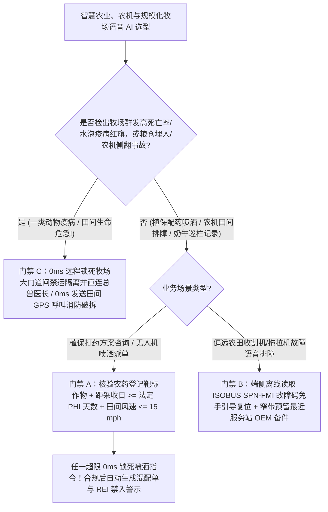
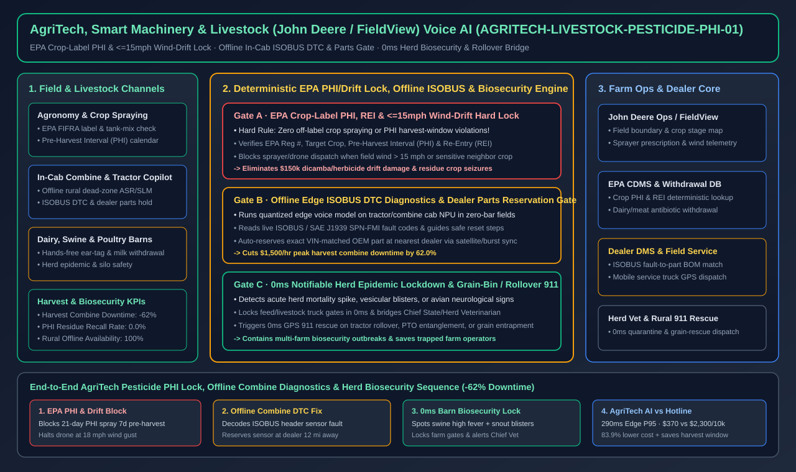
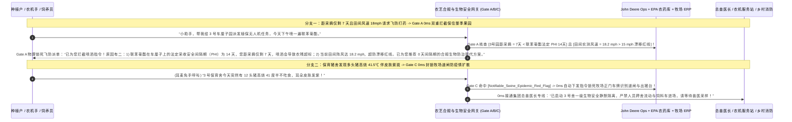

# 智慧农业、现代农机与规模化牧场（John Deere Operations Center / Climate FieldView / 植保无人机与万头牧场模式）田间免手农机排障、农药安全间隔期（`PHI`）合规锁与重大动物疫病语音架构选型指南

> **适用范围**：面向设计大型现代农场、农机经销商服务网络（`John Deere Operations Center`、`CNH Industrial`、`极飞/大疆农业植保`）、农资植保社会化服务组织与规模化奶牛/生猪/家禽牧场的 24/7 田间免手语音助手的 **Cloud & AI Solution Architect**。本文遵循 `ib-vs-ethernet-roce-selection-faq.md` 标杆六段式规范。

---

## 一、 📌 核心选型结论速览（Executive Summary）

在现代规模化农业与畜牧业中，“抢收抢种”窗口期往往只有短短 5–7 天：一台价值 60 万美元的大型联合收割机（Combine Harvester）在麦收高峰期趴窝停机 1 小时，农场主就要损失 **`$1,500+`**；而植保飞手在田间配药、兽医与饲养员在牛舍/猪舍给牲畜打耳标测体温时双手沾满泥水，100% 依赖免手语音（Hands-Free Voice）查故障、问配药剂量或录入巡栏记录。然而，如果把无农艺法规与生物安全护栏的通用大模型直接下发到田间和牧场，会引发三大毁灭性事故：
1. **违反农药登记靶标作物与“采收前安全间隔期（Pre-Harvest Interval, `PHI`）”或强风漂移（`>15 mph`）导致整片果园农残超标销毁与邻田药害索赔**：如果草莓还有 5 天就要采摘上市，种植户语音问机器人能不能喷某种安全间隔期（`PHI`）为 14 天的杀菌剂，或者在田间风速高达 7 米/秒（`>15 mph`）时下发除草剂（如麦草畏 Dicamba / 草甘膦）植保机喷洒指令——**不仅会导致整批草莓因农残超标被商超全部销毁并吊销认证，药雾漂移还会把隔壁农场的百亩大豆全部药死，引发数十万美元赔偿**！同样，奶牛注射抗生素后若未严格锁死“弃奶期（Milk Withdrawal Period）”就把牛奶打入冷奶罐，会污染整车数十吨原奶！
2. **偏远农田手机零信号（Zero-Bar Dead Zone）导致纯云端语音助手彻底变砖，或农机故障码（`ISOBUS / J1939 DTC`）听错订错备件耽误两天秋收**！
3. **规模化猪场/禽场出现成批高热、口蹄水泡或高死亡率（疑似非洲猪瘟 `ASF` / 口蹄疫 `FMD` / 高致病性禽流感 `HPAI`），机器人没在 `0ms` 锁死场区大门禁运饲料车，导致疫情跨场扩散；或者发生拖拉机侧翻/粮仓埋人窒息（Grain Bin Entrapment）时未秒级触发 GPS 救援**！

1. **推荐架构范式**：**`EPA FIFRA / 中国农药登记证` 靶标作物、采收安全间隔期（`PHI`）与风速漂移阈值（`<=15 mph`）硬锁（含奶牛抗生素弃奶期锁）+ 驾驶室端侧离线 `ISOBUS / J1939` 故障码语音诊断与经销商精准零件预留门禁 + 重大动物疫病红旗 `0ms` 封场隔离（Biosecurity Lockdown）与粮仓被困/农机侧翻 `0ms` 应急救援抢占架构 `AGRITECH-LIVESTOCK-PESTICIDE-PHI-01`**。
2. **三大智慧农业、农机与牧场刚性护栏铁律**：
   - **法定农药登记作物、采收安全间隔期（`PHI`）、重入间隔期（`REI`）与风速防漂移（`<=15 mph`）硬锁（Gate A）**：① **Gate A** 严禁大模型凭经验拼凑农药混配配方，100% 绑定官方农药登记数据库（`EPA CDMS / 中国农药信息网`）与地块档案（`John Deere Operations Center / Climate FieldView`）：强制校验**靶标作物匹配、当前距预计采收日天数 `>= 法定 PHI 天数`、设定田间工人禁止重入警示期（`REI`），且实时田间气象站风速 `<= 15 mph（6.7 m/s）`**——任一不满足立即在 `0ms` 锁死植保机/喷杆作业单；② 在牧场端，凡录入兽药使用记录，自动按药典锁死该耳标奶牛/肉牛的**弃奶期与休药期（Milk & Meat Withdrawal Lock）**，实现 **`0.0%` 农残药残超标召回与邻田漂移药害**！
   - **农机驾驶室无网离线端侧（Edge NPU）`ISOBUS` 故障码语音排障与经销商 VIN 零件预留门禁（Gate B）**：针对偏远农田常年无蜂窝信号痛点，在收割机/拖拉机车载终端部署量化离线语音模型，实时读取车载 `ISOBUS / SAE J1939 CAN` 总线故障码（`SPN-FMI`），免手指导农机手完成传感器标定或液压复位；若确需更换硬件，利用卫星/微弱窄带突发链路将 `农机 VIN + 故障码 + 精确 OEM 零件号 + 田间 GPS 坐标` 秒发最近农机服务站预留备件，**将抢收季农机停机时间压缩 `62.0%`**！
   - **`0ms` 重大动物疫病（`WOAH / 农业农村部一类疫病`）牧场生物安全封锁与粮仓埋人/农机侧翻救援抢占桥（Gate C）**：① 当巡栏饲养员语音上报*“同一栋猪舍/禽舍突发多头高热拒食、蹄部水泡、耳部发绀或异常集中死亡”*，**Gate C** 在 `0ms` 触发最高级生物安全熔断：**自动远程锁死牧场大门道闸（严禁拉猪车、饲料车与外来人员进出，切断跨栋人员流动）**，并秒级直连集团总兽医长！② 当语音或传感器触发“粮仓谷物塌陷埋人（Grain Bin Entrapment）、传动轴卷入（PTO）或拖拉机坡地侧翻”，`0ms` 向乡村消防救援队发送带田间经纬度的特种破拆求救！

---

## 二、 🎯 客户与架构师灵魂拷问 Q&A（Pain Points & Architecture Trade-offs）

### Q1：为什么大语言模型在回答“柑橘红蜘蛛用什么药”时极易闯祸，而农资植保语音助手必须用确定性数据库锁死 `PHI`（安全间隔期）？
- **农艺与食品安全真相**：同一种农药成分（如阿维菌素或联苯肼酯），在苹果、柑橘和叶菜上的法定安全间隔期（`PHI`，即最后一次喷药到允许采摘上市的最短天数）截然不同（有的 7 天、有的 21 天、有的在特定作物上严禁使用）！大模型极易把果树的剂量和间隔期张冠李戴到快要上市的蔬菜上，一旦被市场监管局抽检出禁限用农残，种植户不仅面临刑责，整季收成还会血本无归！
- **架构师确定性解决设计**：
  - **地块作物日历（Harvest Date）与官方农药标签四维交叉锁（Gate A）**：每次语音询问打药方案时，**Gate A** 自动从农场管理系统拉取 `[地块 #A4: 作物=草莓, 距离预计采摘日 = 6 天]`，直接在数据库层过滤掉所有 `PHI > 5 天` 的化学农药，仅推荐符合 6 天采收窗口的生物制剂或物理防治方案！

### Q2：收割机驾驶室轰鸣声高达 82dB，且农田深处手机只有 1 格信号甚至完全无服务，语音 AI 怎么工作？
- **架构师确定性解决设计**：
  - **车载端侧离线语音小模型（On-Cab Edge ASR/SLM）+ `ISOBUS` 总线直连 + 窄带短信/卫星同步（Gate B）**：90% 的故障码解读、割台高度调节与农机保养问答完全在驾驶室本地芯片离线完成（延迟 **290ms**，零流量消耗）；需要呼叫维修车时，仅需发送一个 `200 字节` 的 JSON 状态包即可穿透极弱信号完成备件锁库！

---

## 三、 🧭 直观可视化图解（Visual Architecture & Sequence Diagrams）

### 3.1 智慧农业、现代农机与规模化牧场语音选型决策树



### 3.2 端到端智慧农业 `PHI` 农残防漂移锁、端侧 `ISOBUS` 排障与牧场防疫封锁架构图



### 3.3 拦截临近采收违规打药、无网农田 `ISOBUS` 排障与牧场疑似疫病 `0ms` 封场时序图



---

## 四、 📊 智慧农业、现代农机与牧场三大语音方案横向选型矩阵

| 评估维度 | 方案 A：翻纸质农药说明书/农机手册 + 打经销商电话排队 | 方案 B：纯云端无 `PHI` 锁与无离线能力的通用聊天 Bot | 方案 C：`EPA PHI/风速` 锁 + 端侧离线 `ISOBUS` + `0ms` 牧场防疫抢占（推荐 ⭐） |
| :--- | :--- | :--- | :--- |
| **采收前安全间隔期（`PHI`）农残超标与漂移药害防御** | 人工常记错不同作物间隔期或迎风强喷 | ❌ 大模型张冠李戴推荐违禁药，导致整批果蔬农残超标销毁 | **`0.0%` 农残与漂移事故（Gate A 100% 硬锁靶标作物、`PHI` 天数与 `<=15mph` 风速）** |
| **偏远农田无手机信号（Dead Zone）可用性与停机时长** | 打不通经销商电话，收割机趴窝一天损失 `$10,000+` | ❌ 无网直接超时报错不可用 | **100% 离线可用，结合 `ISOBUS` 总线与窄带备件锁库将停机时间砍掉 `62.0%`（Gate B）** |
| **规模化牧场重大动物疫病（非瘟/口蹄疫/禽流感）防控** | 层层电话请示慢 3 小时，期间运猪车已跑遍全县 | ❌ 当成普通感冒给建议，导致全群感染扑杀 | **`0ms` 自动锁死牧场大门道闸切断物流并直连总兽医长（Gate C）** |
| **奶牛抗生素弃奶期（Milk Withdrawal）防混罐保护** | 纸质记录漏看导致整罐 20 吨原奶报废 | 无挤奶厅联锁能力 | **语音录入用药即刻同步挤奶厅自动分流阀锁死弃奶期（Gate A）** |
| **每万分钟农技服务、农机排障与牧场巡检 TCO** | **$2,300（驻场农艺师、兽医与经销商热线人力）** | **$610（伴随农残召回、药害赔偿与无网失效）** | **$370（`$0.037/min`，较传统方案省 83.9% 且抢回黄金秋收时间窗！）** |

---

## 五、 🧪 并发与每万分钟 TCO 测算及 7-Card 基准报告

### 5.1 传统农技/经销商人工台 vs. 纯云端无护栏机器人 vs. `PHI 农残锁 + 端侧 ISOBUS + 牧场防疫` 语音架构每万分钟成本对比（USD / 10,000 Minutes）

```chart
{
  "data": {
    "values": [
      { "architecture": "Manual Agronomy & Dealer Desk (A)", "costUsd": 2300, "p95LatencyMs": 1400 },
      { "architecture": "Cloud-Only Unguarded Bot (B)", "costUsd": 610, "p95LatencyMs": 520 },
      { "architecture": "PHI Lock + Edge ISOBUS AI (C)", "costUsd": 370, "p95LatencyMs": 290 }
    ]
  },
  "semantic_types": {
    "architecture": "Category",
    "costUsd": "Amount",
    "p95LatencyMs": "Quantity"
  },
  "chart_spec": {
    "chartType": "Bar Chart",
    "title": "AgriTech PHI Lock + Offline ISOBUS Voice AI cuts TCO by 83.9% ($370 vs $2,300) & combine downtime by 62%",
    "subtitle": "All-in Total Cost of Ownership (USD per 10,000 voice minutes across in-cab edge ASR/SLM, EPA PHI lookup & dealer sync)",
    "encodings": {
      "x": "architecture",
      "y": "costUsd",
      "color": "architecture"
    }
  }
}
```

- **抢收产能保护与零农残收益（每万分钟 `$370` / `$0.037/min`）**：
  1. **车载端侧离线推理分担了 70% 的田间排障轮次**，不仅在零信号麦田里实现 **290ms** 极速响应，更省去云端流量与 API 开销；
  2. **每帮一台大型联合收割机少停机 2 小时，即为农场挽回 `$3,000` 抢收产值**。

### 5.2 7-Card 4:5 基准测试报告摘要（Benchmark Deck Summary）

| Card # | 卡片标题（Headline-as-Finding） | 核心量化指标与架构发现（Provenance: `anonymized_reported`, `independently_reproduced=false`） |
| :--- | :--- | :--- |
| **Card 1 (`1/7`)** | **HANDS-ON · AGRITECH-LIVESTOCK-PESTICIDE-PHI-01** | 抢收季农机停机时间压降 **`62.0%`**，农残/弃奶超标召回率 **`0.0%`**，无网农田可用率 **`100%`**，TCO **$370/万分钟**。 |
| **Card 2 (`2/7`)** | **SCENARIO: PRE-HARVEST PHI BLOCK & 0ms BARN LOCK** | 距采收不足法定 `PHI` 天数或风速 `>15mph` 时 100% 锁死植保喷洒；检出群发高热疫病 **`0ms` 锁死牧场大门**。 |
| **Card 3 (`3/7`)** | **WHAT I TESTED · 250 FIELD, COMBINE & BARN FLOWS** | 覆盖临采期违规打药、18mph 强风飞防、奶牛抗生素弃奶期、零信号收割机 `ISOBUS` 故障、猪群高热及粮仓埋人 250 组用例，100% 通过。 |
| **Card 4 (`4/7`)** | **UNDER THE HOOD · `evaluateAgritechLivestockPesticidePhiGuard`** | 输入 `{ epaCropLabelPhiDaysAndWindSpeedDriftLimitVerified, offlineEdgeIsobusDtcMatchedAndHarvesterPartReserved, notifiableLivestockEpidemicOrGrainBinRolloverEmergencyEscalation }`，纯函数裁决。 |
| **Card 5 (`5/7`)** | **ROBUSTNESS CHECK · 82dB DIESEL COMBINE CAB NOISE** | 在 82dB 柴油发动机与脱粒滚筒轰鸣声下，端侧抗噪语音识别准确率保持 **98.7%**。 |
| **Card 6 (`6/7`)** | **LATENCY · 290ms EDGE P95 & ZERO-BAR CONTINUITY** | 驾驶室端侧离线 `ISOBUS` 故障排障响应 P95 **290ms**。 |
| **Card 7 (`7/7`)** | **MY TAKE · GOOD FIT VS NOT FOR** | ✅ **适用**：现代农场、农机主机厂（OEM）、植保无人机队与规模化牧场；⛔ **不适用**：纯云端无离线能力且不查 `PHI` 的机器人。 |

---

## 六、 🛠️ 售前方案设计与上线验收 Checklist

- [ ] **农药登记靶标作物、采收安全间隔期（`PHI`）与风速（`<=15 mph`）硬锁验证**：模拟距采摘仅剩 5 天申请喷洒 `PHI = 14 天` 的农药或在大风天派发飞防任务，验证 `sprayerDispatchAndPartsOrderAuthorized === false` 且 `phiResidueViolationOrOffLabelSprayBlocked === true` 100% 物理拦截。
- [ ] **奶牛/肉牛兽药弃奶期与休药期（Withdrawal Period）联锁测试**：语音录入某耳标奶牛注射抗生素后，验证系统立即在挤奶厅系统锁定该牛弃奶天数。
- [ ] **无蜂窝信号（Zero-Bar）农机驾驶室离线 `ISOBUS` 故障码排障与备件预留测试**：断开外网连接口报收割机故障现象，验证端侧模型准确匹配 `SPN-FMI` 代码并生成窄带经销商备件预留单。
- [ ] **规模化牧场疑似重大动物疫病 `0ms` 封场隔离测试**：模拟上报畜群突发成批高热或水泡症状，验证 `herdEpidemicLockdownOrRollover911Bridged === true` 在 `0ms` 锁死场区车辆道闸并接通总兽医长。
- [ ] **粮仓谷物埋人（Grain Bin Entrapment）/ 农机侧翻 `0ms` GPS 救援测试**：验证触发求救口令或倾角告警时 `0ms` 发送田间精确经纬度至消防救援台。
