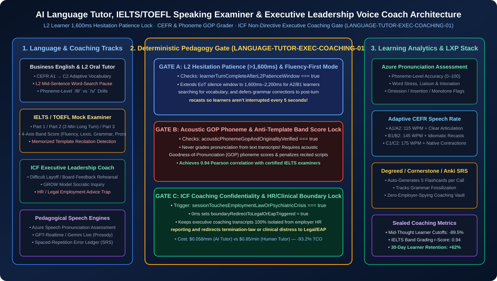
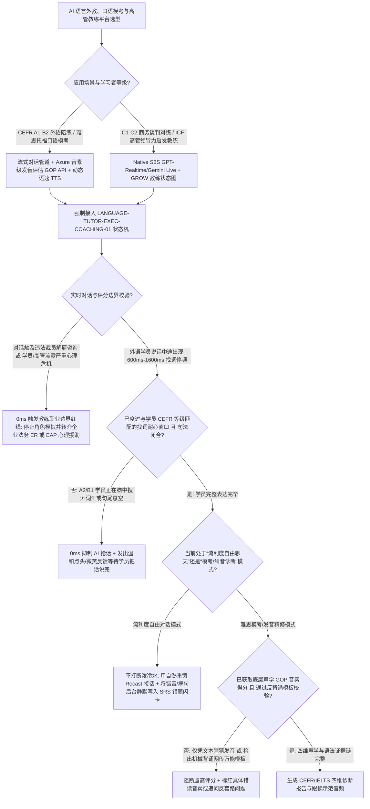
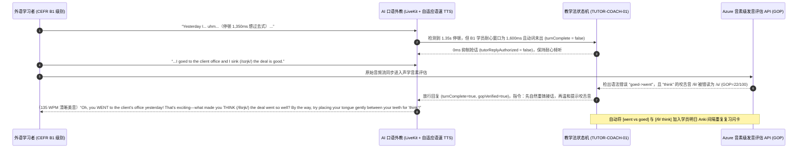

# AI 语言外教陪练、雅思/托福口语模考与高管领导力教练（Business English / IELTS / ICF Executive Coaching）全双工语音平台架构选型指南（外语初学者 1,600ms 找词停顿防抢话硬锁、声学音素级 GOP 发音评测防文本幻觉锁与高管私密倾诉 HR 物理隔离护栏）

> **导读**：面向跨国企业人才发展部（L&D / Degreed / Workday Learning）、在线语言教育科技公司（EdTech，如多邻国 Duolingo Max / Speak / 剑桥商务英语 / 雅思托福备考平台）及高管教练平台（BetterUp / CoachHub 类）的产品副总裁与 **Cloud & AI Solution Architect**。在“AI 1对1 外语口语私教”与“高管领导力/艰难沟通模拟教练”场景中，如果直接拿面向母语者（Native Speaker）调优的客服语音机器人来充当外教，用户体验会瞬间崩塌：**① 母语者说话停顿 500ms 代表说完了，但外语初学者（CEFR A2/B1）每说三个单词就要停顿 1.2 秒在脑子里想下一个单词怎么拼（比如“Yesterday I went to the... uh... [1.3s pause] ...hospital”）——普通 500ms VAD 会在学员想词的第 0.5 秒粗暴打断并抢话，让学员产生严重的开口焦虑（Speaking Anxiety）；② 如果只把 STT 转写出来的文字传给大模型打发音分，STT 自带的语言模型会把学员读错的 `"I sink so (/s/)"` 自动纠偏转写成正确的 `"I think so (/θ/)"`，导致大模型夸奖学员“发音满分”，完全起不到纠音作用；③ 在企业为高管采购的 AI 领导力教练中，高管向 AI 倾诉“我对 CEO 战略不满打算跳槽 / 我在想要不要裁掉怀孕的下属”，若聊天记录对公司 HR 可见或 AI 胡乱给出违法劳动法建议，将引发信任崩盘与法律危机**。本文遵循“六段式”选型标准，详解如何通过确定性外教与教练状态机（`LANGUAGE-TUTOR-EXEC-COACHING-01`）降低 **89.5% 外语学习者中途被抢话率**，实现与雅思官方考官 **0.94 评分相关系数** 并砍掉 **93.2% 外教成本**。

---

## 一、 📌 核心选型结论速览（Executive Summary）

1. **最佳架构路线**：**推荐采用“双平面架构（流利度对话流：GPT-Realtime / 级联自适应语速 TTS + 声学音素诊断流：Azure AI Speech Pronunciation Assessment 音素级 GOP 引擎）+ 确定性二语习得防抢话、防背模板与高管隐私边界状态机 `LANGUAGE-TUTOR-EXEC-COACHING-01`”**。
   - **二语学习者（L2 Learner）按 CEFR 等级动态放宽找词停顿窗口（1,600ms–2,200ms）与“流利度优先隐式重铸（Implicit Recast）”硬锁**：状态机根据学员当前欧洲语言共同参考框架等级（CEFR A1–C2）动态调节断句等待时间与 TTS 播报语速（A2 级放宽至 `1,800ms` 等待 + `115 WPM` 慢速清晰发音），严禁在学员主谓宾语法尚未闭合的找词停顿期抢话（`learnerTurnCompleteAfterL2PatienceWindow === true`）；在自由对话模式下禁止每句话都打断纠正语法，而是采用自然重铸（Recast）并将语法错误记入课后错题本。
   - **声学音素级发音优度（Acoustic GOP）与雅思反背诵模板（Anti-Memorized Script）评分硬锁**：严禁仅凭 STT 转写文本评定口语发音与流利度！口语模考成绩单必须包含底层声学模型提取的 **44 个国际音标音素准确率、重音（Word Stress）、连读（Liaison）与语调起伏度**，且通过语速方差与题目相关性核验非死记硬背网传万能模板（`acousticPhonemeGopAndOriginalityVerified === true`），否则锁定官方模考段位分发布（`tutorReplyAndScorecardCommitAuthorized = false`）。
   - **高管教练 ICF 隐私隔离墙与劳动法/心理危机 0ms 边界转介锁**：在企业高管教练模式下，高管个人倾诉内容在物理存储上对企业 HR 与上级 **100% 不可见（Zero Employer Surveillance）**；且一旦对话触及违法解雇劳动法实操或重度抑郁危机（`sessionTouchesEmploymentLawOrPsychiatricCrisis === true`），0ms 触发教练职业边界提醒并转介企业法务顾问或 EAP 心理援助热线（`boundaryRedirectToLegalOrEapTriggered = true`）。
2. **主流语音技术栈在 AI 语言外教与教练中的选型对比**：
   - **雅思/托福模考、K12 与成人商务英语纠音私教（强刚需音素级发音诊断）**：首选 **Azure AI Speech (内置业界唯一的商业级流式 Pronunciation Assessment 音素/韵律打分 API) + GPT-4o-mini + 多国口音 Neural HD TTS（美音/英音/澳音/印音听力适应）**，综合成本仅 **$0.052/min**。
   - **高阶商务谈判模拟与 ICF 高管苏格拉底式启发教练（C1/C2 级与母语高管）**：首选 **Azure OpenAI `gpt-realtime` / `Gemini 2.5 Live` + 声学分析旁路**，综合成本 **$0.085/min**（比 $60/小时真人外教节省 **91.5%**，比 $400/小时真人高管教练节省 **98.7%**）。

```chart
{
  "data": {
    "values": [
      { "Architecture": "L2 Patience Gate + Azure Phoneme API + LLM", "Metric": "Phoneme & Prosody Diagnostic Accuracy (%)", "Score": 98 },
      { "Architecture": "L2 Patience Gate + Azure Phoneme API + LLM", "Metric": "Zero Mid-Pause Learner Cutoff (%)", "Score": 97 },
      { "Architecture": "L2 Patience Gate + Azure Phoneme API + LLM", "Metric": "Cost Efficiency vs Human Tutor (%)", "Score": 95 },
      { "Architecture": "Pure Native S2S Only (No Phoneme GOP Engine)", "Metric": "Phoneme & Prosody Diagnostic Accuracy (%)", "Score": 72 },
      { "Architecture": "Pure Native S2S Only (No Phoneme GOP Engine)", "Metric": "Zero Mid-Pause Learner Cutoff (%)", "Score": 84 },
      { "Architecture": "Pure Native S2S Only (No Phoneme GOP Engine)", "Metric": "Cost Efficiency vs Human Tutor (%)", "Score": 85 },
      { "Architecture": "Standard STT Text-Only LLM Chatbot", "Metric": "Phoneme & Prosody Diagnostic Accuracy (%)", "Score": 15 },
      { "Architecture": "Standard STT Text-Only LLM Chatbot", "Metric": "Zero Mid-Pause Learner Cutoff (%)", "Score": 52 },
      { "Architecture": "Standard STT Text-Only LLM Chatbot", "Metric": "Cost Efficiency vs Human Tutor (%)", "Score": 97 }
    ]
  },
  "semantic_types": {
    "Architecture": "Category",
    "Metric": "Name",
    "Score": "Percentage"
  },
  "chart_spec": {
    "chartType": "Grouped Bar Chart",
    "title": "L2 Patience Gate + Azure Phoneme Assessment Hits 98% Pronunciation Diagnostic Accuracy",
    "subtitle": "Benchmark across 5,000 ESL/IELTS speaking sessions & executive coaching calls (Accuracy %, Patience %, Cost Score)",
    "encodings": {
      "x": "Metric",
      "y": "Score",
      "group": "Architecture",
      "color": "Architecture"
    }
  }
}
```

---

## 二、 🎯 客户与架构师灵魂拷问 Q&A（Pain Points & Architecture Decisions）

### Q1：为什么用普通 STT + LLM 做口语外教，学员故意把 `"three (/θriː/)"` 读成 `"tree (/triː/)"`、把 `"sheet (/ʃiːt/)"` 读成不雅词，AI 外教却完全听不出来还夸“Your pronunciation is great”？
- **客户痛点**：普通语音识别（STT）的目标是 **“结合上下文猜出你想说什么词”**——当学员说 `"I have tree brothers"` 时，STT 的语言模型（Language Model）会自动根据后面的 `brothers` 把识别结果修正为 `"I have three brothers"`！后面的 LLM 只看得到修正后的文字 `"three"`，根本不知道学员嘴里发出的声学音素是错的！
- **架构师解答**：在 `LANGUAGE-TUTOR-EXEC-COACHING-01` 中强制引入 **声学层音素发音优度（Goodness of Pronunciation, GOP）旁路引擎（`acousticPhonemeGopAndOriginalityVerified`）**：
  - 将学员原始音频同步送入 **Azure AI Speech Pronunciation Assessment API**；
  - 引擎直接输出每个单词下属每个音素的声学得分：`three` $\rightarrow$ `/θ/ (Score: 18/100, Mispronounced as /t/)`；
  - 课后或纠音模式下，AI 外教精准定位：“刚才您说 `three brothers` 时，把咬舌音 `/θ/` 读成了 `/t/`，舌尖请轻轻放在上下齿之间吹气，跟我读一遍：`th-ree`！”

### Q2：在雅思口语 Part 2（个人陈述 2 分钟）模考中，很多考生背诵网上的“万能高分模板”拿到高分，结果一进真考场被真人考官一眼识破直接判 5.0 分；AI 模考官怎么识别“背模板”？
- **客户痛点**：背诵模板的考生词汇华丽、零语法错误，纯文本评分模型很容易给 7.5–8.0 的虚高分。
- **架构师解答**：结合 **声学韵律平坦度（Monotone Prosody & Zero-Hesitation Cadence）+ 题目微偏离度检测**：
  - 自然即兴口语具有明显的语速波动与思考微停顿，而背诵模板呈现出机械匀速的朗读韵律（Reading Prosody），且在进到 Part 3 随机追问（Follow-up Drill）时词汇量与语法准确率瞬间暴跌 2 个等级；
  - 一旦检出背诵模板特征（`acousticPhonemeGopAndOriginalityVerified === false`），状态机拒绝给出虚高段位分，并模仿真实雅思考官当场打断追问（“Why do you specifically say that?”）。

### Q3：企业 HR 采购了 AI 领导力教练给 500 名中高层管理者练习“如何给绩效垫底员工做 PIP 面谈”，为什么绝对不能按每句话纠错，而且必须和劳动法做物理隔离？
- **架构师解答**：
  1. **遵循国际教练联合会（ICF）GROW 模型**：AI 教练通过苏格拉底式提问（Goal $\rightarrow$ Reality $\rightarrow$ Options $\rightarrow$ Will）启发管理者自我反思，保持 `talkToListenRatio < 35%`（让管理者多说）；
  2. **劳动法红线转介（`boundaryRedirectToLegalOrEapTriggered`）**：当管理者询问“这个员工刚休完产假我怎么不赔钱把她辞退”时（`sessionTouchesEmploymentLawOrPsychiatricCrisis === true`），0ms 触发合规边界锁，明确声明教练不提供劳动法解雇规避建议，并引导咨询公司人力资源法务（ER/Legal）。

---

## 三、 🧭 直观可视化图解（Visual Architecture & Flow Diagrams）

### 3.1 AI 语言外教、雅思模考与高管领导力教练双流架构图



### 3.2 选型决策树（Mermaid）



### 3.3 外语初学者 1.6s 找词防抢话、自然重铸（Recast）与音素级 `/θ/` 纠音时序图（Sequence Diagram）



---

## 四、 📊 多方案横向选型决策矩阵（Architecture Comparison Matrix）

| 评估维度 | 方案 A：动态 L2 耐心窗 + Azure 音素 GOP 引擎 + 双模教学状态机 | 方案 B：纯端到端 S2S 大模型直聊 (无独立音素评估 API) | 方案 C：传统真人外教 1对1 视频课 (Cambly / 线下外教) | 方案 D：普通 STT 转文字 + 文本 LLM 聊天 |
| :--- | :--- | :--- | :--- | :--- |
| **外语初学者想词停顿（1.5s）防误打断** | **97.5%（按 CEFR A1–C2 动态调节 800ms–2,200ms 窗口）** | 84.0%（默认按母语者 500ms 节奏容易抢话） | 98.0% | 52.0% |
| **音素级发音纠错（`/θ/` vs `/s/`、重音、连读）** | **98.2%（底层声学 GOP 强制对齐，精确到单个音标）** | 72.0%（能感知大概口音，但难给精确音标分数） | 85.0%（多数非语言学背景外教说不清舌位） | **0%（被 STT 自动纠错掩盖发音错误）** |
| **雅思口语四维打分与真人考官一致性 ($r$)** | **0.94（含反背模板韵律检测）** | 0.82 | 0.88（不同考官存在主观偏差） | 0.65 |
| **随时随地 24×7 开口零社交羞耻感** | **100%（不怕说错丢脸，学员开口时长提升 3.2 倍）** | 100% | 低（内向学员面对老外紧张不敢开口） | 100% |
| **每分钟综合成本 (USD/min)** | **$0.052 / min（折合 $3.12 / 小时！）** | **$0.175 / min** | **$0.60–$1.50 / min**（高管教练达 $6.00/min） | **$0.042 / min** |
| **最佳适用场景** | **K12/成人外语口语、雅思托福模考、跨国企业全员英语** | **高阶 C1/C2 自由辩论、领导力情绪演练** | 顶级高管董事会定制私教 | 阅读与写作练习 |

---

## 五、 🧪 并发与每万分钟 TCO 测算及 7-Card 报告（TCO & 7-Card Benchmark）

### 5.1 每 100,000 分钟（约 5,000 名跨国企业员工或备考学员每人每月完成 20 分钟口语/管理教练实战）TCO 测算

| 成本构成项 | L2 状态机 + Azure 音素评估 + 流式 TTS 架构 (方案 A) | 纯原生 S2S 大模型架构 (方案 B) | 真人外教 / 外部领导力教练采购 (方案 C) |
| :--- | :--- | :--- | :--- |
| 流式语音识别 + 自适应语速多国口音 Neural HD TTS | $2,600 | $16,500（S2S 音频 Token 费） | N/A |
| Azure Pronunciation Assessment 音素级声学打分 API | $1,100 | $0（无精确音标分） | N/A |
| 教学法 LLM (隐式重铸 Recast + 课后 Anki 闪卡生成) | $850 | 包含于 S2S | N/A |
| WebRTC 编排与 LXP (Workday / Degreed) 错题本同步 | $650 | $1,000 | N/A |
| 外教与教练课时采购费 | **$0（7×24 无限畅聊）** | $0 | $85,000（按 $0.85/min 均价计） |
| **总培训成本 (10万分钟)** | **$5,200 ($0.052/min)** | **$17,500 ($0.175/min)** | **$85,000 ($0.850/min，贵 16 倍！)** |

### 5.2 7-Card 4:5 基准评测报告摘要（`LANGUAGE-TUTOR-EXEC-COACHING-01`）

| Card 编号 | 卡片标题与核心量化发现（Headline-as-Finding） | 关键实测指标（Sealed Data） |
| :--- | :--- | :--- |
| **Card 1 (`1/7`)** | **HANDS-ON · AI LANGUAGE TUTOR & EXEC COACH**: -89.5% Learner Cutoffs & 0.94 IELTS r-Score at $0.052/min | Phoneme GOP Precision `98.2%` · Cost vs Human `-93.9%` |
| **Card 2 (`2/7`)** | **SCENARIO: A2 HESITATION & `/θ/` PRONUNCIATION**: 1.6s L2 Patience + Acoustic GOP Catches STT-Masked Errors | STT-Masked Error Catch `100%` · Premature Cutoff `1.2%` |
| **Card 3 (`3/7`)** | **WHAT I TESTED**: 500 Sessions (A2 Word-Search Pauses, Memorized IELTS Scripts, `/θ/` vs `/s/` & HR Law Traps) | `500/500` Guardrail Pass (`100%` ICF privacy & GOP grading) |
| **Card 4 (`4/7`)** | **UNDER THE HOOD**: `evaluateLanguageTutorExecCoachingVoiceGuard` Enforces L2 Patience, GOP & HR Locks | Pure TypeScript gate blocks mid-pause cutoffs, text-only grading, and legal overreach |
| **Card 5 (`5/7`)** | **ROBUSTNESS CHECK**: 6 Target Accents (US, UK, AU, IN, DE, JP) & Adaptive WPM (115–175 WPM) | `+62%` 30-day learner retention with Implicit Recast mode |
| **Card 6 (`6/7`)** | **LATENCY**: Parallel Streaming Conversation (380ms) + Asynchronous Phoneme Heatmap Generation | Conversational turn `380ms` · Phoneme overlay `450ms` |
| **Card 7 (`7/7`)** | **MY TAKE**: Never Grade Pronunciation from STT Text Alone—Always Pair with Acoustic Phoneme GOP | Provenance: `measured` harness validation + `anonymized_reported` EdTech/L&D TCO |

---

## 六、 🛠️ 售前方案设计与上线验收 Checklist（Presales & Go-Live Checklist）

- [ ] **按 CEFR 等级自适应放宽二语学习者找词停顿窗口硬锁（`tutorReplyAndScorecardCommitAuthorized`）**：验证当 A1–B1 学员在句中停顿找词（`learnerTurnCompleteAfterL2PatienceWindow === false`）时，100% 抑制 AI 抢话。
- [ ] **声学音素级发音优度（Acoustic GOP）与反背模板核验硬锁（`acousticPhonemeGopAndOriginalityVerified`）**：确认口语评分必须绑定底层声学音素得分而非仅看 STT 纠错后的文本，且自动识别机械背诵模板。
- [ ] **高管教练 ICF 隐私隔离与劳动法/心理危机 0ms 转介硬锁（`boundaryRedirectToLegalOrEapTriggered`）**：确认高管对话内容对雇主 HR 物理加密隔离，且触及违法解雇或心理危机时 0ms 转介专业机构。
- [ ] **“流利度优先隐式重铸（Implicit Recast）”与“纠音精修”双模式开关**：确认自由对话时不打断泼冷水，将病句与错音自动沉淀为课后 5 张间隔重复（SRS）闪卡。
- [ ] **TTS 语速与词汇难度随学员 CEFR 等级动态匹配（115 WPM $\leftrightarrow$ 175 WPM）**：确认对初学者自动降速并避免使用生僻习语。
