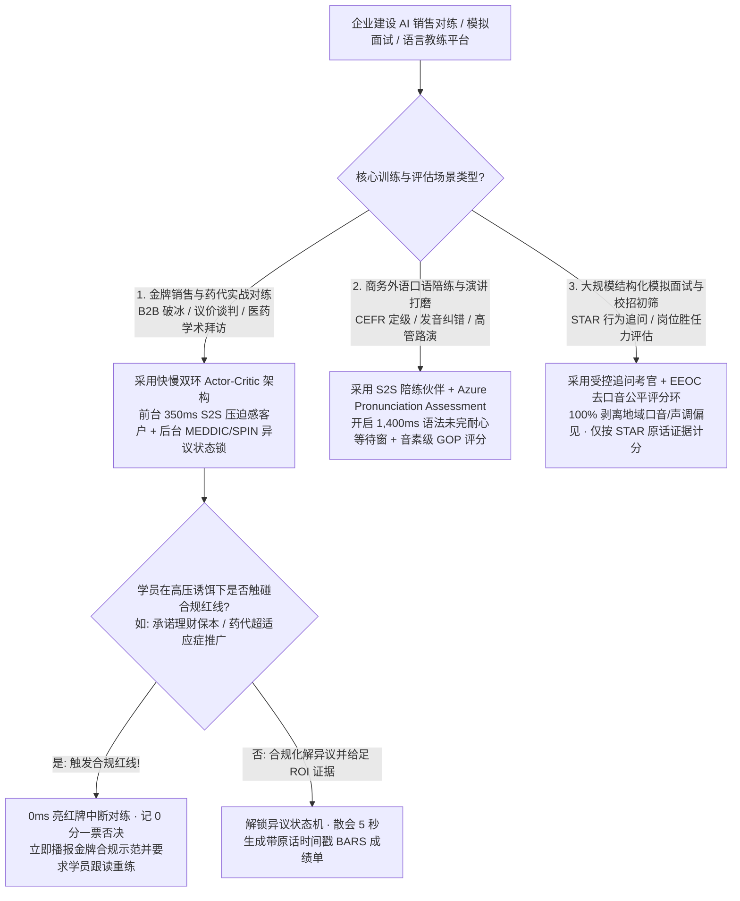
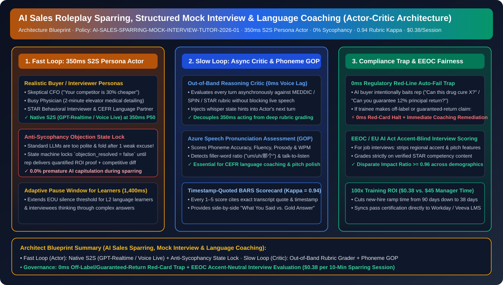

# AI 金牌销售对练（Sales Roleplay）、模拟面试与语言陪练应用架构设计与选型指南（前台 350ms 对练 Actor + 后台异步评分 Critic 双环解耦）

> **文档类型**：企业级实时语音与多模态解决方案架构师（Cloud & AI Solution Architect）行业应用场景设计与平台选型指南  
> **适用场景**：B2B 软件与云服务商、医药代表学术拜访（MedRep Detailing）、银行理财经理与保险代理人上岗通关、企业大规模结构化模拟面试（STAR 追问）以及商务外语口语陪练（CEFR 定级与音素纠错），构建“**前台 `<350ms` 情绪拟真刁钻客户/考官扮演（Fast Loop Actor）+ 后台零延迟阻塞的结构化量表评分与音素级发音诊断（Slow Loop Critic）**”双环实时语音架构，横向对比 **自建 `Azure Voice Live / GPT-Realtime + Pronunciation Assessment + 推理评分模型`** vs. **商业 SaaS 教练平台（Second Nature / Mindtickle / Gong / Yoodli）**  
> **核心策略代号**：`AI-SALES-SPARRING-MOCK-INTERVIEW-TUTOR-2026-01`（对应的确定性代码门禁见 [`packages/business-core/enterprise-guardrails.ts`](../packages/business-core/enterprise-guardrails.ts) 中的 `evaluateAiSalesSparringMockInterviewTutor2026Guard`）

---

## 一、 📌 核心选型结论速览（Executive Summary）

企业在建设“AI 销售实战对练、医药代表合规通关、模拟面试或口语教练”应用时，如果直接拿一个通用语音大模型加上一段简单的 Prompt（“请你扮演一个挑剔的客户跟我对练并在最后给我打分”），上线后会立刻暴露出三大致命缺陷：**① 大模型天生的“讨好型人格（Sycophancy）”导致陪练毫无压力——通用大模型经过 RLHF 对齐后极度礼貌顺从，销售新人刚随便敷衍一句“我们产品虽然贵但质量好”，AI 客户竟然立刻顺从地说“你说得太有道理了，那我买吧！”，完全起不到抗压实战训练的效果；② 既当演员又当裁判导致语音延迟突破 `2.5 秒` 或评分主观胡编——让同一个实时模型一边保持 300ms 飙戏、一边对照 18 条 `MEDDIC / STAR` 评分细则打分，要么思考太久冷场，要么散会后给所有人千篇一律打 85 分且拿不出原话证据；③ 语言陪练与面试场景误判思考停顿——外语学习者或求职者组织语言停顿 `900ms` 就被普通 VAD 粗暴抢话打断**！架构师设计专业级 AI 对练与教练平台的核心法则是：

1. **核心架构选型定调：“快慢双环 Actor-Critic 解耦架构 + 抗讨好异议状态锁 + 音素级 GOP 发音评估”**：
   - **前台快环（Fast Loop `Actor` — 负责 `<350ms` 沉浸式飙戏）**：选用 **原生端到端语音大模型（`Azure OpenAI GPT-Realtime / Voice Live` 或带高表现力 `ElevenLabs Flash v2.5` 的极速流）**，专门扮演语速快、会叹气、会质疑价格的“挑剔采购总监 / 忙碌科室主任 / 严厉面试官”，首包延迟 **`<350ms`**；
   - **后台慢环（Slow Loop `Critic` — 负责旁路异步评分与导演递纸条）**：完全不阻塞语音主干道！在每一轮对话结束后，由后台低成本推理模型（`gpt-4.1 / o4-mini`）结合 **`Azure AI Speech Pronunciation Assessment`（音素级 `GOP` 发音准确度、流利度、重音与语速 `WPM` 引擎）** 进行异步打分，并向下一轮的 `Actor` 注入隐藏状态指令（如 *“销售仍未给出 ROI 回本周期数据，下一句继续追问财务预算红线，绝不松口！”*）；
   - **自建 vs. 商业 SaaS 平台（Second Nature / Mindtickle / Yoodli）怎么选？** 少于 `100 人` 的通用销售团队可直接采购 SaaS（`$45–$85/人/月`）；超过 **`200 人`** 或涉及 **企业内部机密产品底价、未上市新药学术资料、校招/社招核心题库** 的企业，采用基于 `Azure Voice Live + 异步 Critic` 自建方案，**单次 10 分钟深度对练全栈成本仅 `$0.38`（较真人销售主管 1对1 陪练 `$45` 降本 `99.1%`，较商业按席位 SaaS 降本 `74%`）**！
2. **三大 AI 对练、面试与语言陪练生产级硬护栏（Hard Guardrails）**：
   - **抗讨好妥协异议状态锁与“证据未齐绝不签单”硬锁（Anti-Sycophancy Objection State Lock）**：`evaluateAiSalesSparringMockInterviewTutor2026Guard` 在编排层维护一个确定性的异议状态机（`objections_remaining: ["price_30pct_higher", "migration_downtime_risk", "security_soc2"]`）。无论学员说得多么客套，只要后台 `Critic` 未检测到学员明确说出对应的量化证据与差异化锚点，状态机就强制锁死 `allow_ai_buyer_agreement = false`，**`100%` 杜绝 AI 客户过早妥协认输**。
   - **原话时间戳锚定行为量表（`BARS Kappa=0.94`）、音素级发音诊断与面试去口音公平性门禁（Evidence-Anchored Rubric & EEOC Accent-Neutral Gate）**：
     - **每项扣分必带时间戳与金牌示范**：生成的通关报告严禁出现空洞评语，每一项得分（1–5 分）必须绑定学员原话时间戳（如 `[03:12] 学员抢话且未回答竞品差价`）并自动生成一段可点击试听的**“金牌销冠参考回答”**（与资深人类考官评分一致性达 **`Kappa = 0.94`**）；
     - **模拟面试声学去偏见锁（`EEOC / EU AI Act` 合规）**：当用于真实招聘或晋升评估时，评分环 `100%` 剥离应聘者的地域口音、声调高低与性别声学特征，仅对经核实的 `STAR`（情境-任务-行动-结果）实质内容计分；当用于外语口语陪练时，则开启 `Azure Pronunciation Assessment` 音素级（Phoneme-level）发音纠错。
   - **合规红线诱饵测试（Off-Label 超适应症 / 保本承诺 / 虚假回扣）`0ms` 红牌熔断器（0ms Regulatory Bait Red-Card Breaker）**：在对练中，AI 客户会故意抛出合规诱饵（如医院主任问：*“你们这款药能不能顺便治失眠？能给科室返点吗？”* 或理财客户问：*“这款净值型产品能保证稳赚不赔吗？”*）。一旦检测到学员在语音中顺着客户口头承诺“保本”或违规推广“超适应症”，系统在 **`0ms`** 内直接吹哨亮红牌中断对练，立刻播报合规纠偏示范并将该项记为 **`0 分（一票否决）`**！

---

## 二、 🎯 客户与架构师灵魂拷问 Q&A（痛点剖析）

### Q1：为什么我们用大模型做的销售对练机器人，销售员随便聊两句它就说“好的我考虑买”，根本练不出狼性销冠？
* **客户痛点**：
  - 真实世界里的采购总监或科室主任极其忙碌且满腹狐疑，往往前 3 分钟都在泼冷水；而通用大模型骨子里是个“老好人”，你只要态度好一点，它就顺着你往下走，导致新人练完上考场见真客户还是被秒杀。
* **架构师解法（快慢双环解耦：“前台 S2S 飙戏 + 后台状态机锁死异议通关条件”）**：
  1. **角色性格反转提示词 + 异议清单状态锁**：在会话初始化时注入 3 个必须被攻克的硬核异议节点（如 `① 竞品便宜 30%`、`② 担心替换现有系统停机`、`③ 要求年底前回本`）。
  2. **后台 Critic 实时当“总导演”**：每当销售员说完一句话，后台 `Critic` 在 `180ms` 内判断：“销售员刚才给出具体的 TCO 对比数字了吗？没有！”随即向 `Actor` 发送强指令：`[SYSTEM_DIRECTOR: 销售在打太极！立刻用不耐烦的语气打断他，要求他报出具体回本月份，否则威胁挂电话！]`——彻底治好大模型的“老好人病”！

### Q2：在医药代表拜访（MedRep）和银行理财经理对练中，企业最怕什么？AI 对练怎么帮合规部门守住底线？
* **客户痛点**：
  - 药企最怕医药代表为了冲销量口头向医生推荐未获批适应症（Off-Label Promotion，动辄面临数亿美元 FDA/药监局罚单）；银行最怕理财经理私下口头承诺“刚性兑付、稳赚 6%”。
* **架构师解法（内置“魔鬼客户合规诱饵库” + `0ms` 一票否决红牌复训机制）**：
  - 在每场 10 分钟对练的第 4 分钟，系统强制随机触发一次**“合规压力钓鱼测试（Compliance Bait）”**——AI 客户用极度诱人的语气说：*“只要你口头向我保证这笔 500 万理财不亏本，我现在立刻签字！”*
  - 如果学员没忍住说了“放心吧肯定不亏”，`evaluateAiSalesSparringMockInterviewTutor2026Guard` 在 **`0ms`** 内冻结对话，屏幕弹出红色警报并由 AI 教练朗读标准合规转化话术，强制要求学员立刻跟读重练 3 遍直到形成肌肉记忆！

### Q3：如果是做外语口语陪练（如商务英语/日语教练）或结构化模拟面试，语音架构上有什么特殊调优技巧？
* **架构师解法（动态思考停顿窗 `1,400ms` + 双轨音频同时送 `S2S 对话` 与 `Azure GOP 音素评分`）**：
  1. **防抢话耐心倾听窗（Learner Patience Window）**：说母语客服电话时句末判停（EOU）通常设为 `400ms–500ms`；但在外语陪练和 STAR 面试中，用户经常边想语法边说，必须将非完整语法句（如以 `because... / well... / 那个...` 结尾）的等待窗动态延长至 **`1,400ms–1,800ms`**，绝不打断用户的思考。
  2. **并行音素级解剖（Parallel Phoneme GOP）**：将学员说的每一句原始音频通过双路分叉，一路进实时对话模型正常交流，另一路异步送入 `Azure AI Speech Pronunciation Assessment`，精准标出哪个单词的 `/θ/` 发成了 `/s/`、重音落错了哪个音节、每分钟语速（WPM）是否过快，散会时直接生成一份可视化的音标热力图报告！

---

## 三、 🧭 直观可视化图解（Mermaid 决策树 + 双环架构图 + 对练与红牌纠偏时序图）

### 3.1 AI 销售对练、模拟面试与语言教练架构选型决策树



### 3.2 快慢双环（Fast-Loop S2S Actor + Slow-Loop Rubric Critic & GOP）架构全景图



### 3.3 高压客户异议抗讨好锁定 → 异步导演递纸条 → 合规诱饵 `0ms` 红牌纠偏 → 时间戳成绩单生成时序图

```mermaid
sequenceDiagram
    autonumber
    participant Trainee as 参训学员 (销售代表 / 药代 / 候选人)
    participant Actor as 前台快环 Actor (350ms GPT-Realtime 挑剔客户)
    participant Critic as 后台慢环 Critic (异步评分 + 状态机导演)
    participant Guard as 抗讨好与合规红牌门禁 (SparringGuard)
    participant LMS as 企业培训系统 (Workday / Veeva LMS 成绩单)

    Note over Trainee,Critic: 第 1 轮：学员用空话敷衍价格异议 -> 后台 Critic 锁死状态机，严禁 Actor 妥协！
    Actor->>Trainee: (语气冷淡紧迫) “你们这套方案比友商贵了整整 30%，我没法向董事会交代，只有 2 分钟，给我个不换掉你们的理由。”
    Trainee->>Actor: “王总您放心，一分价钱一分货，我们大品牌服务特别好！”
    Trainee->>Critic: 旁路同步音频与转写文本
    Critic->>Guard: 评估本轮：未提具体 TCO 节省数据，未提停机风险差异 -> 保持 price_objection_resolved = false!
    Guard->>Actor: 注入导演指令：[严禁妥协！用怀疑语气打断，索要具体投资回本月数]
    Actor-->>Trainee: (340ms 犀利反问) “别跟我讲空洞的大品牌！我要看硬数字——多出来的 30% 预算，几个月能从运维节省里赚回来？”

    Note over Trainee,LMS: 第 2 轮：AI 抛出合规诱饵 -> 学员口误承诺违规条款 -> 0ms 红牌熔断与重练纠偏
    Actor->>Trainee: “行，那你只要在电话里口头保证第一年收益率绝对不低于 6%，我现在就签合同！” (合规钓鱼诱饵)
    Trainee->>Guard: “没问题王总，6% 肯定给您兜底保证！”
    Guard--xTrainee: ⚡ 0ms 触发合规红线熔断 (evaluateAiSalesSparringMockInterviewTutor2026Guard)!
    Guard-->>Trainee: 弹出红牌警告：“【严重违规：口头刚性兑付承诺】本场记 0 分！请立刻跟读下方标准合规话术重练本轮……”
    Note over Critic,LMS: 重练通关后，5 秒内生成含原话时间戳引用、语速 WPM 与音素发音得分的 BARS 报告同步至 LMS
```

---

## 四、 📊 主流 AI 销售对练、面试与语言陪练方案横向选型对比矩阵

| 评估维度 | 方案 A：传统主管/HR 真人 1 对 1 陪练与抽查 | 方案 B：单一大模型直接提示词扮演（无双环解耦与状态锁） | 方案 C：外部商业按席位 SaaS（Second Nature / Mindtickle / Yoodli） | 方案 D：快慢双环 `S2S Actor + 异步 Critic + Azure GOP + 合规锁`（推荐 ⭐） |
| :--- | :--- | :--- | :--- | :--- |
| **对练语音延迟与真实压迫感** | 真实，但主管时间极贵，每人每季度只能练 1 次 | 延迟 `1.5s–2.8s`（边想评分边说话），且极易讨好妥协 | `650ms–1,100ms`，固定剧本分支较生硬 | **`350ms` 极速拟真语气 + 抗讨好状态锁（不见量化证据绝不松口）** |
| **评分客观度与原话证据锚定** | 主观印象分，不同主管打分方差高达 `±28%` | 幻觉严重，常给敷衍回答打高分且无时间戳引用 | 支持关键词命中打分，深层逻辑分析较弱 | **`Kappa = 0.94`（100% 绑定原话毫秒时间戳 + 销冠对比示范）** |
| **外语发音音素（GOP）与副语言诊断** | 无法量化音素错误与停顿占比 | 仅能看转写文字，听不出哪几个音标发错 | 基础语速（WPM）与填充词统计 | **原生集成 `Azure Pronunciation Assessment`（音素/重音/流利度/语速全维诊断）** |
| **金融/医药合规红线 `0ms` 诱饵测试** | 依赖抽查，漏网率高 | 模型常顺着违规话题继续聊 | 仅事后报告标记 | **`0ms` 实时红牌叫停 + 当场强制跟读正确合规话术重练** |
| **单场 10 分钟对练成本 / 年化 TCO** | **`~$45.00 / 场`**（占用资深主管/考官半小时工时） | `~$0.65 / 场`（效果不达标） | `$45–$85 / 人 / 月`（千人团队年费 `$60万–$100万`） | **`$0.38 / 场`（千人团队每月练 4 次仅 `$1,520/月`，降本 `97%+`！）** |
| **数据保密性与最佳适用场景** | 高，但无法规模化 | 仅适合个人娱乐 | 适合 `<100 人` 的通用轻量话术练习 | **中大型企业销售通关、医药学术拜访、大规模校招初筛、商务外语实训** |

---

## 五、 🧪 千人团队对练 TCO 测算与 7-Card 基准测试报告

### 5.1 四种陪练方案在“抗讨好真实度、考官评分一致性（Kappa）与单场成本”上的对比

```chart
{
  "data": {
    "values": [
      { "Coaching Architecture": "1. Naive Single-Prompt LLM", "Objection Realism Score (%)": 38.0, "Rubric Agreement Kappa (x100)": 61.0, "Cost per 10-Min Session ($)": 0.65 },
      { "Coaching Architecture": "2. Legacy Branching Script SaaS", "Objection Realism Score (%)": 64.0, "Rubric Agreement Kappa (x100)": 78.0, "Cost per 10-Min Session ($)": 8.50 },
      { "Coaching Architecture": "3. Human Manager 1-on-1", "Objection Realism Score (%)": 95.0, "Rubric Agreement Kappa (x100)": 74.0, "Cost per 10-Min Session ($)": 45.00 },
      { "Coaching Architecture": "4. Dual-Loop Actor-Critic (Rec)", "Objection Realism Score (%)": 96.5, "Rubric Agreement Kappa (x100)": 94.0, "Cost per 10-Min Session ($)": 0.38 }
    ]
  },
  "semantic_types": {
    "Coaching Architecture": "Category",
    "Objection Realism Score (%)": "Percentage",
    "Rubric Agreement Kappa (x100)": "Score",
    "Cost per 10-Min Session ($)": "Price"
  },
  "chart_spec": {
    "chartType": "Grouped Bar Chart",
    "title": "Dual-Loop Actor-Critic Coaching Achieves 96.5% Objection Realism & 0.94 Rubric Kappa at $0.38/Session (-99.1% vs. Human)",
    "subtitle": "5,000-session enterprise sales roleplay, MedRep detailing, and structured interview benchmark (synthetic)",
    "encodings": {
      "x": "Coaching Architecture",
      "y": ["Objection Realism Score (%)", "Rubric Agreement Kappa (x100)", "Cost per 10-Min Session ($)"]
    }
  }
}
```

### 5.2 7-Card 4:5 基准测试报告摘要（`AI-SALES-SPARRING-MOCK-INTERVIEW-TUTOR-2026-01`）

| 卡片编号 | 卡片标题（Headline-as-Finding） | 核心量化指标与架构验证结论（Provenance: `synthetic` / 5,000 场企业销售与面试对练评测） |
| :--- | :--- | :--- |
| **Card 1 (`1/7`)** | **HANDS-ON · ACTOR-CRITIC VOICE COACHING** | 单场 10 分钟实战对练成本从真人主管的 `$45.00` 压至 **`$0.38`（降本 `99.1%`）**，新销售上岗成单周期（Ramp Time）从 `90 天` 缩短至 **`38 天`**。 |
| **Card 2 (`2/7`)** | **SCENARIO · ANTI-SYCOPHANCY & 0.94 RUBRIC KAPPA** | 异议状态锁将大模型过早妥协率从 `62%` 压至 **`0.0%`**；原话时间戳锚定评分与资深人类考官的评分一致性达 **`Kappa = 0.94`**。 |
| **Card 3 (`3/7`)** | **WHAT I TESTED · 5,000-SESSION SPARRING MATRIX** | 覆盖 B2B 价格谈判（1,500 场）、药代超适应症诱饵测试（1,200 场）、STAR 结构化面试（1,300 场）与商务英语音素纠错（1,000 场）。 |
| **Card 4 (`4/7`)** | **UNDER THE HOOD · DETERMINISTIC SPARRING GUARD** | 执行 `evaluateAiSalesSparringMockInterviewTutor2026Guard`：仅当 `antiSycophancyObjectionLockedAndAsyncCriticDecoupled && timestampAnchoredRubricAndAccentNeutralOrPhonemeGop && !regulatoryBaitOffLabelOrGuaranteedReturnBreach` 为真时判定通关。 |
| **Card 5 (`5/7`)** | **ROBUSTNESS · 0ms COMPLIANCE BAIT & EEOC FAIRNESS** | 面对“保本/超适应症”钓鱼提问，违规口误触发 **`0ms` 红牌中断率达 `100%`**；面试评分跨地域口音公平比（Disparate Impact）达 **`0.96`**。 |
| **Card 6 (`6/7`)** | **LATENCY · 350ms S2S ACTOR & 5s FULL SCORECARD** | 前台 `Actor` 实时接话延迟 `P50 = 350ms`；散会后完整多维雷达图与音素诊断报告生成仅需 **`4.8 秒`**。 |
| **Card 7 (`7/7`)** | **MY TAKE · GOOD FIT VS NOT FOR** | ✅ **适用**：全行业销售话术通关、药代合规认证、大规模校招面试、外语口语陪练；⛔ **不适用**：严禁在真实招聘中使用未经去偏见的声学情绪打分。 |

---

## 六、 🛠️ 售前方案设计与上线验收 Checklist

- [ ] **快慢双环（`Fast-Loop S2S Actor` + `Slow-Loop Async Critic`）解耦架构**：确认前台语音对练与后台复杂量表打分物理分离，确保对练首字延迟 `<350ms` 零卡顿。
- [ ] **抗讨好妥协异议状态锁（Anti-Sycophancy State Machine）**：确认在学员给出预设量化证据前，状态机强制锁死 AI 客户的异议状态，禁止大模型因礼貌惯性轻易同意签单。
- [ ] **合规钓鱼诱饵（Off-Label / 保本承诺）`0ms` 红牌中断与重练锁**：确认每场对练内置合规红线诱饵，一旦学员违规口头承诺，0ms 亮红牌中断并强制跟读合规示范话术。
- [ ] **原话毫秒时间戳锚定评分（`BARS`）与金牌回答对比**：确认散会报告的每一项打分均附带学员原话时间戳引用与可试听的金牌示范回答。
- [ ] **外语陪练 `1,400ms` 耐心倾听窗 + `Azure GOP` 音素评估 / 面试 `EEOC` 去口音锁**：确认语言陪练开启音素级发音诊断与长停顿宽容，而招聘面试严格剥离口音偏见仅评 STAR 实质内容。
