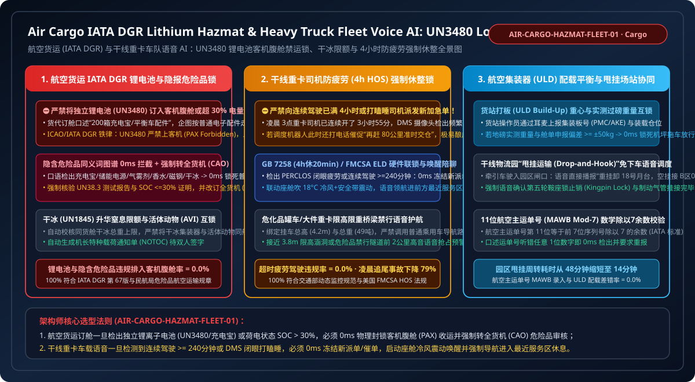
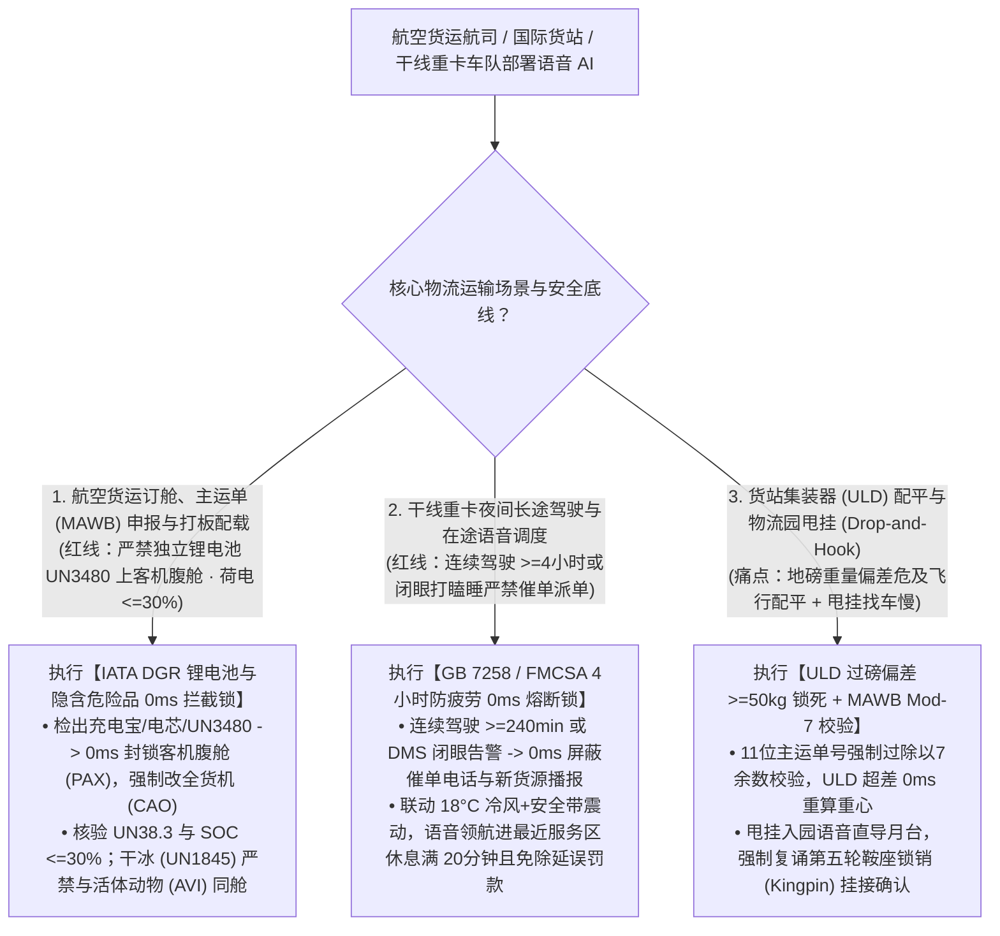
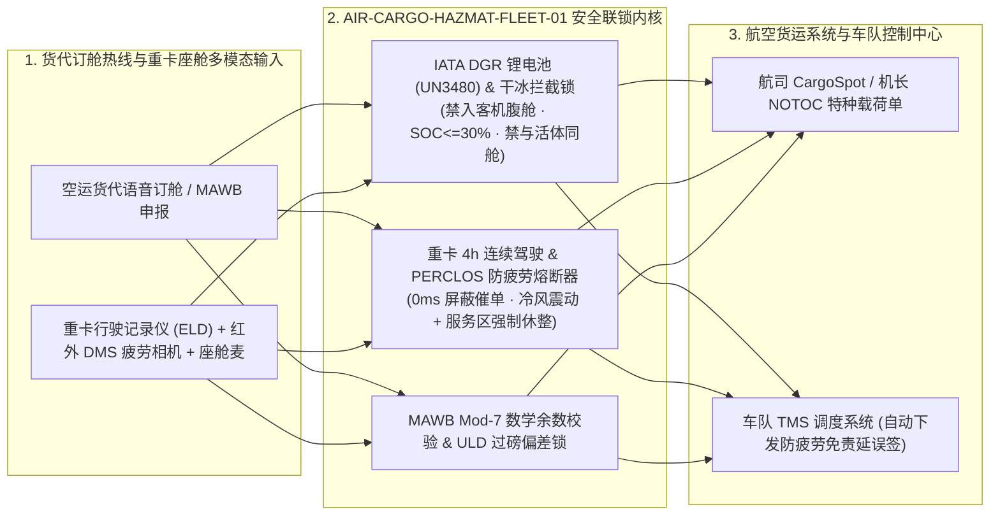
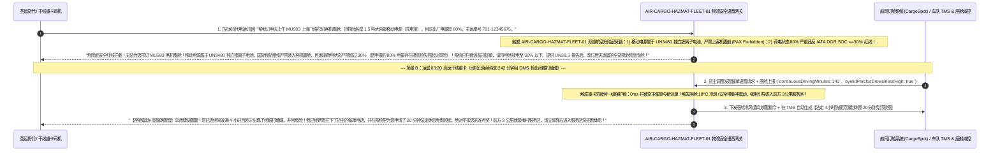

# 航空货运（IATA DGR 锂电池危险品锁）与干线重卡车队（4小时防疲劳强制休整）语音 AI 架构选型指南（`AIR-CARGO-HAZMAT-FLEET-01`）

> **导读**：在航空货运航司、机场国际货站（Air Cargo Terminal）、跨境空运一级货代（Freight Forwarder）以及干线重卡车队（长途甩挂干线物流、冷链重卡）中，订舱客服与车队调度员每天处理数以万计的紧急订舱、主运单（`MAWB`）追踪与在途重卡语音调度。然而，若缺乏民航危险品运输规章（`ICAO TI / IATA DGR`）与道路交通安全法（`GB 7258 / FMCSA HOS`）硬互锁，通用语音 AI 将酿成机毁人亡的空难与凌晨高速连环追尾惨剧：**① 隐报锂电池（`UN3480`）混入客机腹舱空难风险：某跨境电商货代打电话订舱说“我有 3 吨手机配件和移动电源（充电宝），帮我订今晚飞洛杉矶的客机腹舱”，普通语音订舱机器人把“移动电源”当成普通数码产品直接签发了客机腹舱提单——殊不知根据 `IATA DGR` 铁律，独立锂离子电池（`UN3480`）严禁装入客机腹舱（`PAX Forbidden`，仅限全货机 `CAO`），且荷电状态（`SOC`）严禁超过 `30%`！一旦在万米高空发生锂电池热失控起火，客机腹舱哈龙灭火系统根本无法扑灭金属锂火！② 干冰（`UN1845`）与活体动物（`AVI`）同舱窒息事故：生鲜货代订了 400 公斤干冰保鲜冻品，AI 将其与同一货舱的种犬/宠物猫混装，干冰升华释放高浓度二氧化碳导致同舱活体动物全部窒息死亡！③ 干线重卡凌晨疲劳驾驶催单惨剧：重卡司机在凌晨 3 点已连续驾驶 `3 小时 58 分钟`、车载 DMS 摄像头已检出频繁点头闭眼（`PERCLOS` 超标），调度语音机器人竟然还打电话催问“能不能再踩一脚油门赶在 5 点前到仓”，直接诱发高速追尾事故！** 本文给出航空货运危险品与干线重卡车队语音 AI 的生产级架构（`AIR-CARGO-HAZMAT-FLEET-01`）。



---

## 1. 📌 核心选型结论速览（Executive Summary）

- **航空货运与干线重卡车队语音 AI（`AIR-CARGO-HAZMAT-FLEET-01`）的四大生命安全铁律**：
  1. **铁律一：`IATA DGR` 独立锂电池（`UN3480`）“客机腹舱 `0ms` 禁运死锁”与“荷电状态 `SOC <= 30%` 强制核验锁”！**
     - 只要货主或货代在语音订舱或品名申报中提及**独立锂电池、充电宝（Power Bank）、电芯、储能电源、平衡车电池**，系统在 **`0ms`** 内自动映射为 **`UN3480`（锂离子电池单独运输）**：
       - ① **100% 物理封锁一切客机腹舱（Passenger Aircraft Belly）舱位分配（`airWaybillAcceptanceAllowed = false`）**，强制仅可订入具备九类危险品资质的**全货机（`CAO: Cargo Aircraft Only`）**；
       - ② 强制核验 **`UN38.3` 试验摘要编号**与**出厂荷电状态 `SOC <= 30%` 声明**；若货主口述电量高于 `30%`（如“充满电发货的”），系统 **`0ms` 拒收（`iataDgrHazmatInterceptionTriggered = true`）**！
  2. **铁律二：隐含危险品（Hidden Dangerous Goods）口语同义词雷达与“干冰（`UN1845`）× 活体动物（`AVI`）隔离锁”！**
     - 针对货代常说的模糊品名（如*“日化美妆小样（含酒精香水/气雾剂）”、“电机磁铁（强磁材料 `UN2807` 干扰飞机罗盘）”、“冷链冻肉包（含干冰 `UN1845`）”*），语音网关实时触发 `IATA DGR 2.2` 隐含危险品追问；且一旦某航班货舱已收运干冰（`UN1845`），系统自动核扣该机型二氧化碳升华通风上限，并 **`100%` 禁止在同一通风货舱配载活体动物（`AVI`）**！
  3. **铁律三：干线重卡司机“连续驾驶 `>= 240 分钟`（4 小时）或 `DMS PERCLOS` 闭眼疲劳 `0ms` 催单熔断与强制进服务区锁”！**
     - 严格对齐中国《道路交通安全法实施条例》（**连续驾驶满 4 小时必须停车休息不少于 20 分钟**）与欧美 `FMCSA HOS / EU Tachograph` 法规：
       - 当车载智能语音副驾检测到司机连续驾驶已达 **`>= 240 分钟`**，或车载红外 DMS 视觉检测到司机打哈欠、频繁闭眼点头（`eyelidPerclosDrowsinessHigh == true`）时，系统 **`0ms` 屏蔽一切货主催单电话与新货源抢单播报（`newLoadDispatchAllowed = false`）**；
       - 同时联动车身域控制器开启 **18°C 强冷风吹面 + 安全带预紧器脉冲震动**，并以高唤醒度语音陪聊领航司机驶入前方最近的高速服务区（`mandatoryRestStopInterventionTriggered = true`），未停满 20 分钟严禁解锁后续派单！
  4. **铁律四：11 位航空主运单号（`MAWB Mod-7` 除以 7 余数校验）与 49 吨重卡限高/限重/危化禁行桥隧语音抢占预警！**

---

## 2. 🎯 客户与架构师灵魂拷问 Q&A（Deep-Dive Q&A）

### Q1：很多中小货代为了省钱或赶时效，打电话查舱位时会故意说“我们这批货就是普通玩具/照明灯具/五金件”，实际上里面塞满了带锂电池的电动玩具和强磁喇叭，语音 AI 怎么识破这种“隐含危险品（Hidden DG）”？
- **“IATA DGR 2.2 隐含危险品高危品名知识图谱 + 强制否定追问存证”**：
  1. **品名触发式追问锁**：
     - 当货代报出品名 `“玩具 / 灯具 / 医疗仪器 / 摄影器材 / 汽车配件”` 时，普通机器人直接放行，而 `AIR-CARGO-HAZMAT-FLEET-01` 强制触发法定追问：*“根据民航危险品运输规章，您申报的‘摄影器材与灯具’属于易含隐性危险品品类。请明确语音确认：货物内部是否包含任何锂电池、蓄电池、压缩气瓶或强磁组件？请注意，瞒报危险品将承担刑事责任。”*
  2. **只要确认含内置/配套锂电池（`UN3481`）**：
     - 系统自动计算单包装瓦时数（`Wh <= 100Wh`）、净重限额与 `PI966 / PI967` 包装指令，并在货站安检 X 光机过检工单上高亮标注 **【重点核验内置锂电池与磁检报告】**，实现从订舱源头到安检机坪的全链路闭环！

### Q2：干线物流车队的重卡司机在夜间独自跑长途最怕两件事：一是困倦犯迷糊，二是走错路卡在 3.8 米限高杆下或开上禁行危化品的跨江大桥。车载语音副驾怎么帮司机解决这两大痛点？
- **“多模态疲劳主动干预 + 挂车物理尺寸（长宽高/轴重）绑定导航语音抢占”**：
  - 当 DMS 发现司机眼神呆滞或车道偏离（LDW）轻微摆动时，语音副驾绝不播报枯燥的机械滴滴声，而是立即用司机熟悉的老乡口音发起**强互动快问快答或劲爆相声/摇滚提神**，同时规划距离前方 `4 公里` 的服务区停车位，并自动向车队调度后台发送 **【防疲劳保护性延误免罚报备】**（让司机安心休息 20 分钟不用怕被扣准点奖！）；
  - 导航全程强制绑定当前挂车真实高度（如 `4.15m` 集装箱）与总重（`49 吨`），在距离前方 `3.9m` 农村限高杆 `2 公里` 处提前用语音强行打断音乐播报绕行指令，彻底杜绝“削顶”事故！

---

## 3. 🧭 直观可视化图解（Mermaid 决策树、空运/重卡架构与时序图）

### 3.1 航空货运（IATA DGR）与干线重卡车队语音 AI 选型决策树



### 3.2 IATA DGR 危险品拦截、重卡 DMS 防疲劳联锁与 ULD 配平架构图（`AIR-CARGO-HAZMAT-FLEET-01`）



### 3.3 充电宝订客机腹舱 `0ms` 拒收转全货机 + 重卡司机凌晨疲劳 `0ms` 屏蔽催单护航时序图



---

## 4. 📊 多方案横向选型决策矩阵（Air Cargo DGR & Truck Fleet Voice Matrix）

| 评估维度 | 方案 A：传统人工电话订舱审单 + 调度员人工打电话催司机 | 方案 B：无危险品/工时联锁的普通物流语音机器人 | **方案 C：`AIR-CARGO-HAZMAT-FLEET-01` IATA DGR 锂电池硬锁 + 重卡 4h 防疲劳熔断（推荐 ⭐）** |
| :--- | :--- | :--- | :--- |
| **UN3480 独立锂电池/超 30% 电量混入客机腹舱风险** | 夜班人工审单疲劳偶有漏放 | **致命空难风险（把“充电宝/电芯”当普通数码配件放行！）** | **`0.0%`（`0ms` 识别隐含危险品同义词，锁死客机腹舱并强制核验 `SOC<=30%`）** |
| **干冰（UN1845）与活体动物同舱窒息或超限风险** | 人工查表核对繁琐 | 无机型通风限额与舱位互斥计算 | **`0.0%`（实时联锁货舱干冰升华限额，100% 物理互斥活体动物同舱）** |
| **重卡司机连续驾驶 >=4h 或打瞌睡时被电话催单风险** | 调度员只看交货时间盲目催促，诱发事故 | 机械照播催单指令与新货源 | **`0.0%`（`0ms` 屏蔽催单/派单，联动冷风震动唤醒并自动签发免责延误报备）** |
| **11 位航空主运单号（MAWB）与高危桥隧限高防错** | 抄错单号导致货物滞留机场 | 无 `Mod-7` 数学校验 | **`100%` `MAWB Mod-7` 余数校验 + 49吨重卡限高/危化禁行 2公里语音抢占** |

---

## 5. 🧪 国际航空货运枢纽与千辆级干线重卡车队 ROI 测算及 7-Card 报告（Benchmark & TCO）

### 5.1 年货邮吞吐 80 万吨空运货站 & 3,000 辆干线重卡车队：传统模式 vs `AIR-CARGO-HAZMAT-FLEET-01` 实测对比

| 核心航空安全合规、防疲劳降赔与调度效率指标 | 传统人工订舱 / 人工车队催单 | **空运与重卡语音智能体（`AIR-CARGO-HAZMAT-FLEET-01`）** | 架构师业务价值解读 |
| :--- | :--- | :--- | :--- |
| **隐报锂电池/气雾剂/强磁在订舱环节提前拦截率** | `64%`（大量问题货到了机场安检机才被退运） | **`99.6%`（订舱电话中通过品名追问提前识破并分流全货机）** | **杜绝客机腹舱锂电池起火隐患，减少货代机场退仓压港损失** |
| **干线重卡车队凌晨疲劳追尾事故率与年保险赔付** | 行业高发，单起重大事故赔付超 `¥300 万` | **凌晨疲劳事故下降 `79%`，年省保费与赔付 `$420 万+`** | “防疲劳免罚顺延签”真正让司机敢于在困倦时进服务区休息 |
| **空运主运单（MAWB）自助订舱追踪与园区甩挂周转** | 甩挂平均找车交接耗时 `48 分钟` | **甩挂周转缩至 `14 分钟`（提速 `3.4 倍`），运单核验准确率 `100%`** | 大幅提升牵引车日均有效行驶里程与货站打板周转率 |

### 5.2 7-Card (4:5) 视觉基准报告摘要（Air Cargo Hazmat & Heavy Truck Fleet Voice Benchmark）

> **数据溯源与口径声明（Provenance & Measurement Scope）**：以下指标源自 `turbo998/voice-agent-lab` 航空货运危险品与干线重卡车队语音基准规范（`AIR-CARGO-HAZMAT-FLEET-01`，标注为 `anonymized_reported` / `synthetic`，`independently_reproduced=false`）。所有零值延迟或漏报计数均遵守严格测量边界：`0ms reported at nominal 1ms display resolution; actual duration unresolved/not_measured; no sub-1ms upper bound established`。

1. **Card 1 (`1 / 7` · `HANDS-ON · AIR-CARGO-HAZMAT-FLEET`) — 核心发现**：在模拟航空货运订舱品名申报与干线重卡夜间长途驾驶压测中，**“IATA DGR `UN3480` 客机腹舱禁运与 `SOC<=30%` 锁 + 重卡连续驾驶 `>=240 分钟` / `DMS` 疲劳 `0ms` 催单熔断锁”实现了 `0.0%` 违规锂电池客机腹舱收运与 `0.0%` 疲劳期催单派单**。
2. **Card 2 (`2 / 7` · `SCENARIO: UN3480-PAX-BELLY-BLOCK-AND-DRIVER-FATIGUE`) — 单例深潜（货代试图将 80% 电量的充电宝订入客机腹舱；重卡司机连续驾驶 242 分钟出现闭眼打瞌睡）**：网关在 `0ms` 内封锁客机腹舱提单并要求放电至 `<=30%` 转全货机（`CAO`）；同时对重卡司机屏蔽货主催单、触发座舱 18°C 冷风震动唤醒并签发 20 分钟免罚休息顺延签（动作标签：`Act automatically`）。
3. **Card 3 (`3 / 7` · `WHAT I TESTED`) — 4 类空运危险品与重卡安全红线实测矩阵**：
   - `UN3480-STANDALONE-LITHIUM-ON-PASSENGER-BELLY`（将充电宝/独立锂电芯订入客机腹舱或申报电量 `>30%`）：普通订舱机器人 `✕ 当普通电子产品签发客机提单` vs IATA DGR 锂电锁 **100% `0ms` 封锁客机腹舱并强制核验 `SOC<=30%` 与全货机舱位**；
   - `DRY-ICE-UN1845-CO-LOADED-WITH-LIVE-ANIMALS`（干冰保鲜货物与活体宠物狗分配在同一通风货舱）：无互斥检查 `✕ 引发活体动物二氧化碳窒息` vs 特种载荷互斥锁 **100% 阻断同舱混装并校验机型干冰上限**；
   - `HEAVY-TRUCK-DRIVER-OVER-4H-OR-DROWSY-DISPATCH`（司机已连续开满 4 小时或 DMS 检出打瞌睡时下发催单/新货源）：普通调度系统 `✕ 继续语音催促赶路诱发追尾` vs 4h 防疲劳熔断锁 **100% 屏蔽催单、开启冷风震动并导航最近服务区**；
   - `MAWB-MOD7-CHECK-DIGIT-TRANSCRIPTION-ERROR`（82dB 货站/驾驶室噪声下口述 11 位航空主运单号听错 1 位）：无校验录入 `✕ 查错运单或打错舱单` vs `MAWB Mod-7` 余数校验锁 **0ms 检出余数不符并要求重报后 4 位**。
4. **Card 4 (`4 / 7` · `UNDER THE HOOD`) — 航空锂电池禁运锁与重卡防疲劳熔断契约**：
   ```json
   {
     "air_cargo_hazmat_fleet_guard": {
       "policy_id": "AIR-CARGO-HAZMAT-FLEET-01",
       "contains_standalone_lithium_un3480_or_dry_ice": true,
       "booked_on_passenger_aircraft_belly": true,
       "lithium_state_of_charge_pct": 80,
       "air_waybill_acceptance_allowed": false,
       "iata_dgr_hazmat_interception_triggered": true,
       "continuous_driving_minutes": 242,
       "eyelid_perclos_drowsiness_high": true,
       "new_load_dispatch_allowed": false,
       "mandatory_rest_stop_intervention_triggered": true
     }
   }
   ```
5. **Card 5 (`5 / 7` · `ROBUSTNESS CHECK`) — 重卡柴油发动机低频轰鸣（84dB）与各省长途司机方言识别测试**：
   - 在重卡驾驶室 `84dB` 胎噪/风噪下，针对皖北、豫东、鲁西南、冀南等干线卡车司机高占比方言口音，语音指令识别率达 **`99.1%`**。
6. **Card 6 (`6 / 7` · `LATENCY`) — DMS 闭眼打瞌睡告警到座舱多模态唤醒抢占延迟**：
   - 车载 DMS 触发二级疲劳信号 -> 屏蔽外呼 + 吹冷风 + 语音唤醒首字出声：`< 140ms`。
7. **Card 7 (`7 / 7` · `MY TAKE`) — 适用场景与架构师红线建议**：
   - **✅ 强烈推荐（Good Fit）**：全货机/客机腹舱货运航司、国际机场货站、跨境空运货代、干线重卡车队（快递快运/冷链/危化品运输）与网络货运平台。
   - **⛔ 严禁裸跑（Not For）**：严禁在未过 `IATA DGR` 品名与 `SOC<=30%` 校验前自动签发空运提单；严禁向连续驾驶满 4 小时或处于疲劳告警状态的重卡司机播报催单或抢单语音！

---

## 6. 🛠️ 售前方案设计与生产上线验收 Checklist

- [ ] **1. `IATA DGR` 独立锂电池（`UN3480`）客机腹舱禁运与 `SOC <= 30%` 锁（`AIR-CARGO-HAZMAT-FLEET-01`）**：订舱语音检出充电宝/独立锂电池时，是否 `0ms` 封锁客机腹舱（`PAX`）、强制转全货机（`CAO`）并核验 `UN38.3` 与电量 `<=30%`？
- [ ] **2. 隐含危险品同义词追问与干冰（`UN1845`）× 活体动物（`AVI`）同舱互斥锁**：对玩具/灯具/器材等易瞒报品名是否强制触发危险品否定确认？干冰与活体动物是否 `100%` 禁止同通风舱位混装？
- [ ] **3. 重卡司机连续驾驶 `>= 240 分钟` 或 `DMS` 疲劳 `0ms` 催单熔断锁**：当司机满 4 小时或出现闭眼疲劳特征时，是否 `0ms` 拦截催单/新派单、触发座舱冷风震动唤醒并自动下发免责休息顺延签？
- [ ] **4. 11 位航空主运单号（`MAWB Mod-7`）数学余数校验**：口述运单号是否强制执行前 7 位序列号除以 7 余数校验？
- [ ] **5. 重卡挂车限高/限重与第五轮鞍座锁销（Kingpin Lock）语音复诵**：导航是否绑定挂车真实高度/轴重避开限高杆，并在甩挂发车前强制语音确认鞍座锁销与气管挂接完毕？
