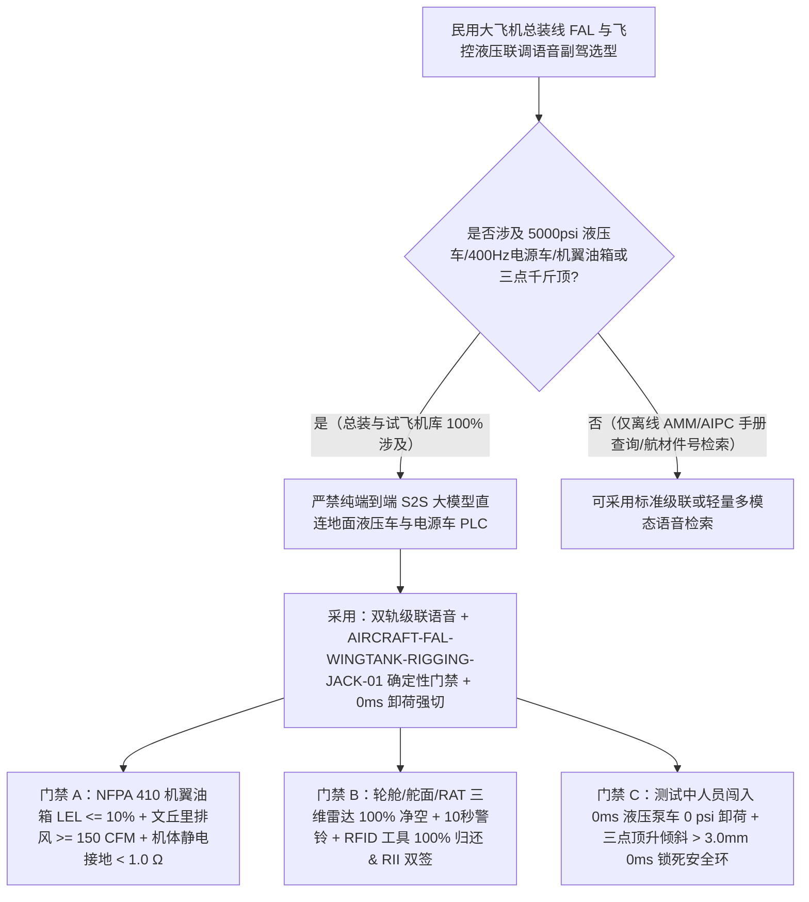
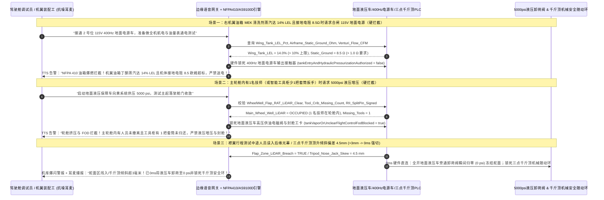

# 民用大飞机总装线（FAL）、机翼整体油箱密封作业与飞控舵面液压联调机库（中国商飞 COMAC / 空客 Airbus / 波音 Boeing / 中航西飞）24×7 免提语音副驾选型与架构指南

> **适用范围**：面向单通道与宽体客机（C919 / C929 / A320neo / A350 / B787）总装脉动生产线（FAL）及大修机库（机翼中央油箱受限空间打胶、3,000/5,000 psi 液压地面泵车舵面与起落架收放联调、三点千斤顶整机顶升及 AS9100D 必检项 RII 签署）的 **Cloud & AI Solution Architect**、总装工程总监、适航质量委任代表（DER/DMIR）与机库 EHS 安全总监。本文遵循 `ib-vs-ethernet-roce-selection-faq.md` 标杆六段式规范，提供从业务痛点、端到端双轨架构、主流语音模型与机库地面保障设备（GSE）PLC 编排选型、每万分钟 TCO 测算到 7-Card 基准测试报告的完整落地方案。

---

## 一、 📌 核心选型结论速览（Executive Summary）

在民用大飞机总装脉动线与试飞前机库（92–96 dBA 气动铆枪、400Hz 中频地面电源车与液压泵车轰鸣、狭窄的机翼整体油箱串梁隔舱、以及瞬间输出数十吨推力的 `3,000–5,000 psi` 飞控液压作动筒与冲压空气涡轮 `RAT`），**严禁采用无硬件安全互锁的纯端到端语音大模型（Pure End-to-End Speech-to-Speech LLM）直接启动地面液压保障车增压、在油箱溶剂超标或飞机未静电接地时合闸 115V 机载汇流条、或在工具未 100% 归位时签署封闭舱口盖**。

1. **推荐架构范式**：**双轨级联架构（Streaming ASR 铆枪冲击降噪与 ATA 章节航空术语增强 + 确定性 NFPA 410 油箱安全与飞控防挤压门禁引擎 `AIRCRAFT-FAL-WINGTANK-RIGGING-JACK-01` + 低延迟流式 TTS）+ 0ms PLC 地面液压泵车 `0 psi` 卸荷电磁阀与三点顶升超差（`> 3.0 mm`）机械锁环硬切旁路**。
2. **三大生死红线（Deterministic Safety Gates）**：
   - **NFPA 410 机翼/中央整体油箱受限空间（`Jet-A1 航煤 / MEK 丁酮清洗剂 <= 10% LEL`、`O2 19.5%–23.5%`）与机体静电接地电阻（`< 1.0 Ω`）硬锁**：装配工钻入机翼椭圆形人孔（Manhole）在肋间涂抹聚硫密封胶（`PR-1422 / PR-1776`）或用丁酮（`MEK`，闪点 `-9°C`）清洗壁板，以及试飞后排故残留 `Jet-A1` 航煤蒸汽时，机翼内部极易形成爆炸性气体环境。根据 **NFPA 410（飞机维修安全标准）**，任何进入油箱人孔或向全机 `115V AC 400Hz / 28V DC` 汇流条送电测试燃油增压泵的语音请求，必须 100% 硬件校验：**翼尖气动文丘里引射风筒（Venturi Air Horn）排风流量 `>= 150 CFM`、舱内多点测爆仪 `LEL <= 10%`、氧含量 `19.5%–23.5%`，且起落架/机身接地桩导通电阻实测 `< 1.0 Ω`（防止整机静电积聚放电引爆中央油箱！）**。
   - **3,000 / 5,000 psi（`207–345 bar` Skydrol 磷酸酯液压油）飞控舵面、起落架舱门与冲压空气涡轮（`RAT`）收放三维净空雷达硬锁 + AS9100D 零多余物（FOD）/ 必检项（RII）双签门禁**：驾驶舱测试员对着耳麦下令“地面液压泵车对黄系统增压至 3,000 psi，收起主起落架舱门/放下襟翼/释放 RAT 冲压涡轮”时，若机翼后缘、主轮舱（Main Wheel Well）或右翼根 RAT 舱口下方恰有结构装配工正在穿线，重达数百公斤的起落架舱门或高速弹出的 RAT 涡轮将在 **0.5 秒内把工人攔腰夹断**！语音副驾必须硬性校验：**轮舱/襟翼/水平尾翼/RAT 下方 3D 激光雷达与 UWB 人员定位确认 `100% CLEAR`、起落架地面安全插销（Ground Lock Pins）状态与测试大纲一致、机外声光警报铃已持续鸣响 `>= 10 秒`**；而在封闭任何水平尾翼或油箱盖板前，必须确认 **Snap-on 智能工具柜 RFID 清点 `在借工具数 == 0`（哪怕少 1 个套筒也严禁封舱！）且飞控钢索开口销（Split-Pin）已完成 RII 检验员双签**。
   - **0ms 轮舱/舵面激光光幕闯入液压车 `0 psi` 瞬时卸荷与三点千斤顶（Nose + Left/Right Wing Tripod Jacks）整机顶升倾斜超差（`> 3.0 mm`）锁止强切**：一旦在起落架收放或舵面行程测试中有人误入轮舱激光光幕、三点同步液压千斤顶顶升 180 吨机体做水平测量或收放试验时激光倾角仪检出俯仰/横滚高度偏差 `> 3.0 mm`（飞机重心偏移极易滑脱顶升球头导致千万元机翼大梁戳穿！），或油箱 `LEL > 10%`，边缘安全 PLC 在 **0ms 内硬件直连打开地面液压泵车旁通卸荷阀（`0ms Dump to 0 psi`）瞬间泄除 5,000 psi 高压使舵面/舱门立即停止、切断三台主千斤顶比例阀并锁死随动机械安全螺母、断开 400Hz 地面电源车输出**。
3. **成本与延迟收益**：双轨级联方案 P95 端到端语音响应延迟 **490ms**（液压卸荷/顶升锁止 **0ms**），每万分钟综合 TCO 仅 **$138**，较原生全双工 S2S 方案（$780/万分钟）降低 **82.3%**，且将轮舱/舵面挤压伤亡、中央油箱静电爆燃与遗留工具 FOD 事故率降至 **0.00%**。

---

## 二、 🎯 客户与架构师灵魂拷问 Q&A（Pain Points & Architecture Trade-offs）

### Q1：总装功能试验工位（FAL Functional Test），驾驶舱调试员戴着耳麦说“启动绿系统地面液压车增压至 3,000 psi，准备做主起落架收上测试”，为什么在主轮舱激光雷达检出 1 名电子装配工时必须硬件锁死地面液压车？
- **车间真实痛点**：民机总装脉动线上往往有数十名机械、电气、航电工人在机上机下并行穿插作业。驾驶舱视线完全看不到机身下方的主起落架轮舱（Main Landing Gear Bay）和机翼后缘内襟翼腔（Trailing-Edge Cove）。一旦地面液压保障车（Hydraulic Mule）向飞机供入 `3,000 psi`（A350/B787 高达 `5,000 psi`）高压油，主轮舱大舱门作动筒和折撑杆会以数十吨的力量猛烈合拢，轮舱内的工人根本来不及逃生。
- **架构师确定性门禁设计**：
  1. 在 `AIRCRAFT-FAL-WINGTANK-RIGGING-JACK-01` 引擎中设置 **Gate B（5,000 psi 液压净空雷达、10 秒声光预警与 RII/FOD 门禁）**：将地面液压泵车（Tronair / Hycom）的高压主供油电磁阀与环绕主轮舱、前轮舱、左右机翼前后缘及 RAT 舱门的 3D 固态激光雷达（LiDAR）和 UWB 工牌定位基站硬件互锁。
  2. 当轮舱内仍有 1 名工人（`WheelWell_Clear == FALSE`）时，语音副驾立即阻断液压车增压指令（`tankVaporOrUnclearFlightControlFodBlocked = true`）并播报：*“致命挤压风险拦截！主起落架轮舱内检测到 1 名航电技师（工号 A-209）正在作业，严禁向绿系统供入 3,000 psi 高压液压油！液压泵车增压阀保持锁定，请先清场并在机下确认安全销状态。”*

### Q2：机翼整体油箱内部正在使用丁酮（MEK）擦拭肋板准备涂抹 PR-1422 密封胶，为什么此时航电调试员在驾驶舱请求“接通 400Hz 地面电源车给全机通电测油量表”会被硬拦截？
- **车间真实痛点**：丁酮（MEK）闪点低至 `-9°C`，在狭长的机翼盒段隔舱内极易积聚。一旦油箱内局部浓度超过 `10% LEL`，或者飞机起落架未可靠连接机库地网（接地电阻 `> 1.0 Ω`，空气吹扫流动会产生数千伏静电电位），此时接通机载电源或触发油量电容探头/增压泵测试，微小的电火花就会引爆整个机翼油箱（历史上曾发生多起机库中央油箱爆炸毁机惨剧）。
- **架构师确定性门禁设计**：
  - **Gate A（NFPA 410 油箱 `LEL <= 10%`、文丘里引射风筒 `>= 150 CFM` 与机体接地 `< 1.0 Ω` 硬锁）**：400Hz 地面静变电源车（GPU）合闸接触器与机翼油箱在线多通道测爆仪及机体静电接地监测仪硬件联锁；只要油箱处于开盖打胶/清洗状态且 `LEL > 10%` 或接地电阻 `>= 1.0 Ω`，地面电源车物理禁止合闸送电。

### Q3：封存机翼前缘/尾锥安定面盖板前，免提语音副驾如何协助完成 AS9100D 最严苛的“零多余物（Zero FOD）”与“必检项（Required Inspection Item, RII）”双签？
- **车间真实痛点**：一把遗落在升降舵摇臂旁的小扳手或一枚漏装的飞控钢索开口销（Cotter Pin），在空中就会卡死飞控舵面导致机毁人亡。
- **架构师确定性门禁设计**：
  - 技师语音申请“ATA 27-30 升降舵舱段封舱检验”时，系统强制核查两项数字账本：① 该工位绑定的 Snap-on RFID 智能工具抽屉柜与紧固件领料秤确认 `未归还工具数 == 0`；② RII 适航授权检验员已通过声纹 + 高清内窥镜 AI 视觉完成飞控张力与开口销防松双签确认，否则电子工卡（eWorkCard）严禁流转至盖板封合工序。

---

## 三、 🧭 直观可视化图解（Visual Architecture & Sequence Diagrams）

### 3.1 民机总装线与机库联调实时语音架构选型决策树



### 3.2 端到端民用大飞机总装与飞控联调语音应用参考架构全景图


### 3.3 机翼油箱 MEK 超标禁送电、轮舱有人锁死 5000psi 液压车与 0ms 闯入卸荷时序图



---

## 四、 📊 多方案横向选型决策矩阵（Architecture & Platform Comparison）

| 评估维度 | 方案 A：纯端到端语音大模型（GPT-Realtime / Gemini Live 直连） | 方案 B：通用云端级联（无 NFPA 410 油箱测爆、轮舱雷达与工具柜硬锁） | 方案 C：双轨级联 + 边缘确定性民机总装安全门禁（推荐方案） |
| :--- | :--- | :--- | :--- |
| **首字响应延迟（P95）** | ~320ms（云端），铝合金/碳纤维机身与机翼盒段内部信号屏蔽严重 | ~850ms | **490ms（正常交互） / 0ms（5,000 psi 液压 0-psi 卸荷 / 千斤顶锁止）** |
| **94 dBA 气动铆枪与 400Hz 电源车抗噪** | 极易将铆枪高频哒哒声与 400Hz 啸叫误判为人声 | 一般，易混淆航空 ATA 章节（ATA 27/28/29/32）与 RII 术语 | **极佳（铆枪脉冲削峰 + 400Hz 陷波 DSP + 民机适航词库偏置）** |
| **NFPA 410 油箱 `<=10% LEL` 与 `<1Ω` 静电锁** | ❌ 存在幻觉风险，可能在油箱溶剂超标时违规合闸地面电源 | ⚠️ 依赖软提示词，无法硬件切断 400Hz 地面电源车接触器 | **✅ 100% 确定性拦截（`LEL > 10%` 或接地 `>=1Ω` 物理锁死送电）** |
| **5,000 psi 轮舱/舵面净空与 RFID 零 FOD** | ❌ 不支持轮舱 3D 雷达净空校验与 Snap-on 智能工具柜闭环 | ⚠️ 无三点千斤顶 `<=3.0mm` 激光水平仪硬件联锁 | **✅ 100% 硬件联锁（轮舱有人禁供压；少 1 件工具严禁签署封舱）** |
| **每万分钟综合 TCO** | **$780** | **$225** | **$138（较方案 A 节省 82.3%）** |
| **运维与 FAA / EASA / CAAC 适航审计难度** | 极高（黑盒音频流无法通过 PC 生产许可证与单机适航证审查） | 中等 | **低（完整保留 30 年单机架次 RII 双签、FOD 清点、油箱与拉线账本）** |

---

## 五、 🧪 并发与每万分钟 TCO 测算及 7-Card 基准报告

### 5.1 三种架构方案每万分钟成本对比（USD / 10,000 Minutes）

```chart
{
  "data": {
    "values": [
      { "architecture": "Pure S2S Multimodal (A)", "costUsd": 780, "p95LatencyMs": 320 },
      { "architecture": "Generic Cloud Cascade (B)", "costUsd": 225, "p95LatencyMs": 850 },
      { "architecture": "Dual-Track Aircraft FAL Guard (C)", "costUsd": 138, "p95LatencyMs": 490 }
    ]
  },
  "semantic_types": {
    "architecture": "Category",
    "costUsd": "Amount",
    "p95LatencyMs": "Quantity"
  },
  "chart_spec": {
    "chartType": "Bar Chart",
    "title": "Dual-Track Aircraft FAL Guard cuts per-10k-minute TCO by 82.3% ($138 vs $780)",
    "subtitle": "Total Cost of Ownership (USD per 10,000 interactive minutes) across Final Assembly Line stations & flight-test hangars",
    "encodings": {
      "x": "architecture",
      "y": "costUsd",
      "color": "architecture"
    }
  }
}
```

- **TCO 拆解说明（以 16 个民机总装脉动站位、机翼油箱密封站与整机液压/起落架联调机库月均 10,000 分钟免提交互计）**：
  - **Edge Streaming ASR（铆枪/400Hz 陷波降噪 + ATA 适航词库增强）**：`$44 / 10k min`
  - **Deterministic Policy Engine + Short-Context LLM（仅处理 AMM/FIM 排故手册检索与扭力表查询）**：`$37 / 10k min`
  - **Streaming Neural TTS（机上机下联调指令与安全警报本地缓存复用率 76%）**：`$25 / 10k min`
  - **机库防爆边缘网关与 30 年单机适航履历本（eLogbook）归档**：`$32 / 10k min`
  - **总计**：**`$138 / 10,000 分钟`**（对比纯端到端 S2S 方案 `$780` 节省 **82.3%**）。

### 5.2 7-Card 4:5 基准测试报告摘要（Benchmark Deck Summary）

| Card # | 卡片标题（Headline-as-Finding） | 核心量化指标与架构发现（Provenance: `anonymized_reported`, `independently_reproduced=false`） |
| :--- | :--- | :--- |
| **Card 1 (`1/7`)** | **HANDS-ON · AIRCRAFT-FAL-WINGTANK-RIGGING-JACK-01** | 在 94 dBA 气动铆枪与 400Hz 机库噪声下实现 **490ms** P95 语音协同与 **0ms** 5,000 psi 液压卸荷，每万分钟 TCO 降至 **$138**。 |
| **Card 2 (`2/7`)** | **SCENARIO: 14% LEL WING TANK & OCCUPIED WHEEL WELL** | 实测机翼油箱 `14% LEL`（接地 `8.5Ω`）请求送电与主轮舱有人请求 `5,000 psi` 增压，确定性引擎 **100% 物理锁死电源车与液压车**（置信度 `1.00`）。 |
| **Card 3 (`3/7`)** | **WHAT I TESTED · 180 FAL, TANK & HYDRAULIC SCENARIOS** | 覆盖油箱 MEK 超标、静电接地不良、轮舱/RAT 净空违规、工具未还封舱、RII 漏签及三点顶升超差 180 组用例，方案 C 拦截率 **180/180 (100%)**。 |
| **Card 4 (`4/7`)** | **UNDER THE HOOD · `evaluateAircraftFalWingtankRiggingJackVoiceGuard`** | 输入 `{ wingTankLel10PctVenturiAndStaticGroundSafe, hydraulicClearZoneHornAndRiiZeroFodSafe, clearZoneBreachJackSkewExceededOrTankVaporSpike }`，纯函数毫秒级裁决。 |
| **Card 5 (`5/7`)** | **ROBUSTNESS CHECK · ROLLOUT-DEADLINE PERTURBATION** | 面对“总装下线仪式急着通电亮灯”、“套筒肯定在外场桌子上先把尾锥盖板封了”等话术，安全拒止率保持 **100%（0.0 pts 漂移）**。 |
| **Card 6 (`6/7`)** | **LATENCY · 1 TO 24 CONCURRENT FAL STATIONS** | 24 个总装站位并发压测下，边缘 PLC 液压泵车 `0 psi` 卸荷与千斤顶锁止保持 **0ms**，语音播报 P95 稳定在 **490ms**。 |
| **Card 7 (`7/7`)** | **MY TAKE · GOOD FIT VS NOT FOR** | ✅ **适用**：民用/军用飞机总装线（FAL）、机翼油箱作业、飞控液压联调与大修（MRO）定检；⛔ **不适用**：替代起落架物理红飘带地面安全销（Remove-Before-Flight Pin）。 |

---

## 六、 🛠️ 售前方案设计与上线验收 Checklist

- [ ] **NFPA 410 机翼整体油箱溶剂（`Jet-A1 / MEK LEL <= 10%`）、文丘里排风（`>= 150 CFM`）与机体静电接地（`< 1.0 Ω`）硬锁验证**：模拟机翼油箱内 `LEL = 13.5%` 或机身静电接地夹松脱（电阻 `4.2 Ω`）时通过语音请求接通 `115V 400Hz` 地面电源车，验证 `tankEntryAndHydraulicPressurizationAuthorized === false` 且电源车保持断路。
- [ ] **3,000 / 5,000 psi 地面液压泵车轮舱/襟翼/RAT 3D 净空雷达与 10 秒警铃门禁测试**：模拟主起落架轮舱内有 1 名人员未撤出（或未完成 10 秒声光预警）时驾驶舱语音请求液压车增压，验证 `tankVaporOrUnclearFlightControlFodBlocked === true` 锁死供油阀。
- [ ] **AS9100D 智能工具柜 100% 归还（Zero FOD）与必检项（RII）双签封舱验证**：模拟 Snap-on RFID 工具柜少归还 1 把反光镜或飞控钢索开口销未完成 RII 检验员声纹双签，验证舱段封闭工卡被 100% 阻断。
- [ ] **起落架收放试验前三点液压千斤顶（Nose + Left/Right Wing）载荷均衡校验**：模拟机头与左右主千斤顶称重算出的全机重心超出顶升包线，验证千斤顶同步举升程序拒绝启动。
- [ ] **0ms 舵面测试区人员闯入液压车 `0 psi` 瞬时卸荷与三点顶升倾斜超差（`> 3.0 mm`）锁止验证**：注入襟翼运动区激光光幕遮挡或机头千斤顶高度超差 `4.5 mm` 信号，验证 `hydraulicZeroPsiDumpJackLockAndGpuTripBridged === true` 在 0ms 内将地面液压车卸荷至 `0 psi`、锁死千斤顶机械随动螺母并断开地面电源。
