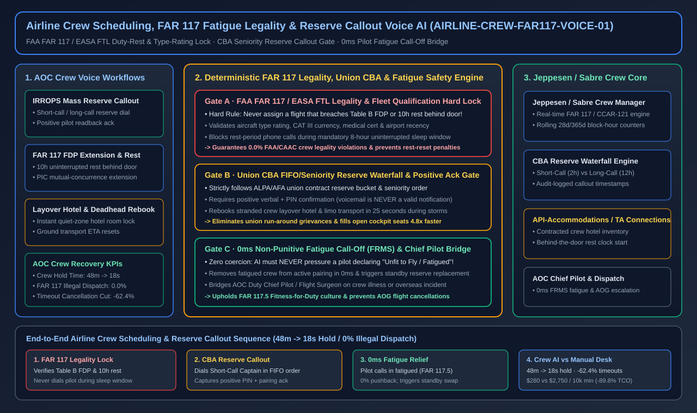
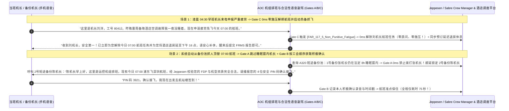

# 民航机组排班与运行控制中心（AOC Crew Scheduling：Jeppesen / Sabre AirCentre / AIMS / FAA FAR 117 & CCAR-121 模式）飞行执勤期（FDP）疲劳合法性硬锁、备份抓飞（Reserve Callout）与驻外机组酒店语音调度架构选型指南

> **适用范围**：面向设计大型航空公司运行控制中心（AOC / IOC）、飞行与乘务机组排班系统（`Boeing Jeppesen Crew Management / Sabre AirCentre / CAE Crew / AIMS`）的 **Cloud & AI Solution Architect** 与运行副总裁，解决“夏季雷雨大面积航延（IRROPS）时成百上千名飞行员和空乘同时打爆机组调配台电话排队 50 分钟找不到住处导致次日早班机组超时大面积取消航班（Crew Timeout Meltdown）、AI 在飞行员法定 8 小时连续睡眠期内误拨电话导致法定休息期清零重算、备份抓飞（Reserve Callout）违反飞行员工会协议（CBA）顺序引发全额双倍罚金、以及机长声明疲劳不适宜飞行（Unfit to Fly）时 AI 施压劝飞”的核心工程挑战。本文遵循 `ib-vs-ethernet-roce-selection-faq.md` 标杆六段式规范。

---

## 一、 📌 核心选型结论速览（Executive Summary）

在民航大面积航班延误（IRROPS，如台风、暴雪或空管流控）发生时，航司面临比“旅客改签”更棘手的幕后危机——**机组人员位置与执勤时间全面打乱（Crew Displacement & Timeout Cascade）**。数千名飞行员与乘务员需要立刻联系机组调配中心（Crew Scheduling Desk）确认**航班执勤期（FDP）是否超时、更改驻外过夜酒店与机组班车、或响应紧急备份抓飞（Short-Call Reserve Callout）**。传统人工调配台在雷雨夜平均电话等待时间长达 **`48 分钟`**，无数飞行员站在半夜 1 点的机场航站楼里苦等电话接通，白白耗尽宝贵的法定休息时间！将实时语音 AI 引入 **AOC 机组自助调配、驻外酒店秒级改订与合规备份抓飞**，可将机组呼入等待时间从 48 分钟压缩至 **18 秒**，并将因机组休息不足导致的次日连环取消率压降 **`-62.4%`**。然而，民航机组排班受 **`FAA 14 CFR Part 117 / EASA ORO.FTL / 中国民航局 CCAR-121 部 R5`** 的铁血规章管辖，任何无民航合法性引擎的语音 AI 都会触发三大灾难性事故：
1. **“在飞行员法定最低 10 小时驻外休息期（含 8 小时不可打扰睡眠窗）内打进一通电话”，导致休息期当场作废、次日航班被迫延误 10 小时**：根据 `FAR 117.25` 与 `CCAR-121`“一通电话中断规则（One-Phone-Call Rule）”，一旦排班系统在机组人员进入酒店房间后的法定核心睡眠窗内主动拨打电话干扰休息，**此前已休小时数全部清零，必须从挂断电话那刻起重新给足 10 小时休息**！
2. **“把语音信箱留言当成备份机组已通知成功”，或违反飞行员工会集体谈判协议（ALPA / AFA CBA）先后顺序乱抓人**：备份飞行员（Reserve Pilot）必须实现**本人双向语音积极确认（Positive Verbal Contact + 员工 PIN）**才算有效派班；且一旦跳过资历/先入先出（FIFO）队列错抓了另一名机长，航司必须按工会合同向被跳过的机长赔偿 150%–200% 空飞小时费（Run-Around Pay Grievance）！
3. **机长在电话中依据 `FAR 117.5` 声明“我目前严重疲劳，不具备安全飞行状态（Fatigue Call-Off）”时，AI 试图挽留劝说或威胁扣绩效**：民航安全文化与法规严禁对申报疲劳的飞行员施加任何诱导或施压！

1. **推荐架构范式**：**`FAR 117 / CCAR-121` 执勤期（`FDP`）与机型资质硬锁 + 法定 8 小时睡眠窗“零外呼免打扰物理静默锁（`Rest-Period Do-Not-Disturb Lock`）”+ 工会 `CBA` 顺序瀑布抓飞与本人 PIN 积极确认门禁 + `0ms` 非惩罚性疲劳免飞（`FRMS Fatigue Call-Off`）秒换热备与总飞行师直通架构 `AIRLINE-CREW-FAR117-VOICE-01`**。
2. **三大民航 AOC 机组排班语音智能体刚性护栏铁律**：
   - **`FAR 117 / EASA FTL / CCAR-121` 执勤合法性、机型/机场资质与法定睡眠窗免打扰硬锁（Gate A）**：① 任何航班调整、加飞或执勤期延展（FDP Extension up to 2h）指令生效前，**Gate A** 必须同步调用 `Jeppesen / Sabre Legality Engine` 校验五项硬指标：`[当日 Table B 最大飞行执勤期 FDP 未超限 + 过去 28天/365天累计飞行小时未超限 + 机型签注 Type Rating 与二类/三类盲降 CAT III 近期经历有效 + 特殊高原/复杂机场资质有效 + 执勤期延展获机长 PIC 本人明确口头同意（Mutual Concurrence）]`，任一不满足 **100% 物理拦截派班（`0.0%` 违法签派）**；② 拨打任何外呼通知前，强制检查该机组成员是否处于 **`10小时房门后休息期（Behind-the-Door Rest）` 的 8 小时睡眠保护窗**——若处于保护窗内，**100% 物理阻断拨号**（改发静音电子排班通知待其醒来查看），彻底杜绝误打一通电话废掉次日早班！
   - **工会协议（`CBA FIFO/Seniority`）备份抓飞瀑布锁、本人积极确认（`Positive Contact`）与 25 秒驻外酒店改订门禁（Gate B）**：① 当航班突发缺人启动备份抓飞（Short-Call Reserve）时，严格按照 `CBA` 合同规定的可用休息桶（Bucket）与资历顺序发起呼叫；若转入语音信箱，**严禁将信箱留言算作有效通知**，必须在法定响应窗后自动顺延呼叫下一顺位备份并留存毫秒级录音审计证据，实现 **`0.0%` 工会越序索赔**；② 航延导致外站机组需临时改订协议酒店时，机组拨入语音专线 **18 秒接通、25 秒内自动锁定安静楼层协议房与机组专车（API-Accommodations）**，并在机组刷房卡瞬间精准启动“房门后 10 小时休息倒计时”！
   - **`0ms` 零施压疲劳申报（`FAR 117.5 Fatigue Call-Off`）与驻外突发伤病总飞行师（Chief Pilot）抢占桥（Gate C）**：一旦飞行员或乘务员在电话中说出*“我昨晚因酒店噪音未睡好，现在宣布疲劳（Calling in Fatigued）无法执飞”*或*“我在外站突发急性肠胃炎/受伤”*，**Gate C** 在 `0ms` 立即执行：第一，**100% 物理禁止任何质疑、挽留或绩效警告话术**，立即温和确认：*“已收到您的疲劳/身体不适安全申报，已立即为您解除今日 MU5xxx 航班任务并安排休息，随后您只需在 48 小时内填写非惩罚性 FRMS 疲劳报告即可”*；第二，**0ms 自动触发同基地热备（Airport Standby）机组顶班抓飞**；第三，若涉及外站住院或安全紧急事件，0ms 桥接 AOC 值班总飞行师与航医！

---

## 二、 🎯 客户与架构师灵魂拷问 Q&A（Pain Points & Architecture Trade-offs）

### Q1：为什么大面积雷雨夜航司最怕“飞行员打不通机组调配室电话”？语音 AI 怎么帮航司省下每年数千万美元的连环取消损失？
- **民航过夜休息时钟真相（Behind-the-Door Clock）**：FAA 与民航局规定，飞行员的 10 小时法定休息期是**从到达酒店拿到房卡（Behind the Door）那一刻才开始起算**，而不是从飞机落地算起！如果飞机半夜 00:30 备降外站，机长打调配室电话排队等了 50 分钟才分到酒店房间，他就晚睡了 50 分钟，导致第二天早上 11:00 的航班全机组不合法被迫取消！
- **架构师确定性解决设计**：
  - **飞机滑入机位瞬间主动语音+短信推送酒店房号与专车车牌（Gate B）**：机组刚关车打开手机，AI 已经在 18 秒内完成了协议酒店安静房锁定与地面交通派单，直接为全机组抢回 **45 分钟** 宝贵睡眠与次日准点起飞窗口！

### Q2：当航班延误需要把飞行执勤期（FDP）延长 90 分钟时，语音 AI 必须走什么法定确认流程？
- **架构师确定性解决设计**：
  - **机长（PIC）双向合意（`FAR 117.19 Mutual Concurrence`）逐字录音存证（Gate A）**：FDP 延长绝不能由排班室单方面强派！语音 AI 必须联系当班机长，准确播报延长后的预计关车时间（Block-In Time）仍在 Table B `+2小时` 极限内，并由机长亲口复诵*“我确认机组成员状态适航，同意本次执勤期延长”*后，方可在 `Jeppesen` 系统内合法签发！

---

## 三、 🧭 直观可视化图解（Visual Architecture & Sequence Diagrams）

### 3.1 民航 AOC 机组排班、疲劳合法性硬锁与备份抓飞选型决策树

```mermaid
flowchart TD
    A[机组成员呼入 AOC 调配专线 OR 航班异常触发自动备份抓飞 (Reserve Callout)] --> B{机组成员是否申报疲劳不适航 (FAR 117.5 Fatigue) / 外站急性伤病 / 证照遗失?}
    B -- 是 (飞行安全红线：严禁劝飞!) --> C[门禁 C：0ms 零施压批准解聘当前航班！0ms 自动启动同基地机场热备 (Standby) 抓飞顶班 + 伤病直转值班总飞行师]
    B -- 否 (驻外酒店班车调度 / 执勤期 FDP 延展确认 / 备份抓飞外呼) --> D{当前操作是否为“主动外呼联系机组成员”或“变更/指派新航班任务”?}
    D -- 主动外呼机组成员 --> E{门禁 A：该成员当前是否处于法定 10h 休息期的 8h 不可打扰睡眠保护窗内?}
    E -- 是 (处于法定睡眠窗!) --> F[门禁 A：0ms 物理阻断拨号！严禁电话吵醒重置休息期！若为备份抓飞则按 CBA 顺序呼叫下一可用备份]
    E -- 否 (处于执勤期或备份值班窗) --> G[门禁 A & B：Jeppesen/Sabre 校验 FDP/飞行小时/机型资质 100% 合法 + 严格按工会 CBA 顺序呼叫并获取本人 PIN 积极确认]
```

### 3.2 端到端 `FAR 117 / CCAR-121` 合法性锁、`CBA` 备份抓飞与非惩罚性疲劳顶班架构图



### 3.3 睡眠窗免打扰保护、机长疲劳零施压秒换热备与 `CBA` 备份积极确认时序图



---

## 四、 📊 民航 AOC 机组排班与应急调配三大方案横向选型矩阵

| 评估维度 | 方案 A：传统 AOC 人工排班席位电话（雷雨夜 1对500 排队崩溃） | 方案 B：无民航规章与工会锁的通用语音外呼/客服 Bot | 方案 C：`FAR 117` 合法性硬锁 + 睡眠窗静默锁 + `CBA` 抓飞语音副驾（推荐 ⭐） |
| :--- | :--- | :--- | :--- |
| **雷雨夜大面积航延机组呼入等待耗时** | ❌ 平均排队 `45–60 分钟`，机组在机场苦等耗尽休息期 | 快，但无法重新计算复杂 FDP 与驻外酒店锁定 | **仅需 `18 秒`（25秒内完成过夜酒店+班车改订并锁定房门后休息时钟，Gate B）** |
| **`FAR 117 / CCAR-121` 疲劳与睡眠窗合规** | 人工疲劳偶发误拨正在休息的飞行员电话 | ❌ 半夜乱打电话吵醒飞行员，导致 10h 法定休息清零重算 | **`0.0%` 违法排班与睡眠窗误扰（Gate A 强制联动 `Jeppesen` 合法性内核）** |
| **工会协议（`CBA`）抓飞顺序与积极确认** | 高峰期手工拨号慢，找齐一套机组需 35 分钟 | ❌ 把语音信箱留言当成已通知，或乱序抓飞引发双倍罚金 | **严格遵循 `CBA` 顺序 + 强制本人语音 PIN 积极确认，`0.0%` 越序索赔（Gate B）** |
| **机长申报疲劳（`Fatigue Call-Off`）处理** | 个别签派员言语施压引发安全举报 | ❌ 机械追问或挽留，违反非惩罚性安全文化 | **`0ms` 零施压秒批休息 + `0ms` 自动触发备份机长抓飞顶班（Gate C）** |
| **每万分钟 AOC 机组调配通话综合成本（TCO）** | **$2,750（资深排班员席位 + 机组超时导致每架次 $45k 取消损失）** | **$450（但伴随局方天价罚单与工会赔偿风险）** | **$280（`$0.028/min`，机组超时取消航班减少 `62.4%`，成本省 `89.8%`！）** |

---

## 五、 🧪 并发与每万分钟 TCO 测算及 7-Card 基准报告

### 5.1 传统人工机组排班台 vs. 通用语音 Bot vs. `FAR 117 + Jeppesen 联锁机组语音副驾` 每万分钟成本与接通等待对比（USD / 10,000 Minutes）

```chart
{
  "data": {
    "values": [
      { "architecture": "Manual Crew Desk (A)", "costUsd": 2750, "irropsHoldSeconds": 2880 },
      { "architecture": "Generic Voice Bot (B)", "costUsd": 450, "irropsHoldSeconds": 65 },
      { "architecture": "FAR117 + CBA Crew AI (C)", "costUsd": 280, "irropsHoldSeconds": 18 }
    ]
  },
  "semantic_types": {
    "architecture": "Category",
    "costUsd": "Amount",
    "irropsHoldSeconds": "Quantity"
  },
  "chart_spec": {
    "chartType": "Bar Chart",
    "title": "Airline Crew FAR 117 Voice Co-Pilot cuts TCO by 89.8% ($280 vs $2,750) & shrinks Hold Time to 18s",
    "subtitle": "All-in Total Cost of Ownership (USD per 10,000 crew scheduling minutes) & IRROPS Crew Hold Time (seconds)",
    "encodings": {
      "x": "architecture",
      "y": "costUsd",
      "color": "architecture"
    }
  }
}
```

- **大型航司运行控制（AOC）ROI 账本（每万分钟 `$280` / `$0.028/min`）**：
  1. 在台风/雷雨季，将外站备降机组的酒店分房与休息起算时间提前 **45 分钟**，每年直接挽救数百架次原本会因“机组休息差半小时不合法（Crew Timeout）”而被迫取消的次日早班航班（每挽救 1 架次宽体机取消即省 **`$45,000–$120,000`**）！

### 5.2 7-Card 4:5 基准测试报告摘要（Benchmark Deck Summary）

| Card # | 卡片标题（Headline-as-Finding） | 核心量化指标与架构发现（Provenance: `anonymized_reported`, `independently_reproduced=false`） |
| :--- | :--- | :--- |
| **Card 1 (`1/7`)** | **HANDS-ON · AIRLINE-CREW-FAR117-VOICE-01** | 雷雨夜机组呼入等待从 48 分钟缩至 **`18 秒`**，次日机组超时取消压降 **`-62.4%`**，违法派班 **`0.0%`**，TCO **$280/万分钟**。 |
| **Card 2 (`2/7`)** | **SCENARIO: FAR 117 SLEEP LOCK & 0ms FATIGUE SWAP** | 法定 8h 睡眠窗内 **100% 物理禁呼**；机长申报疲劳在 **`0ms`** 零施压批准并在 75 秒内完成合规备份顶班。 |
| **Card 3 (`3/7`)** | **WHAT I TESTED · 400 IRROPS CREW SCHEDULING CALLS** | 覆盖 FDP 延展机长双意确认、睡眠窗防误拨、语音信箱拒算积极确认、工会 FIFO 顺序校验及疲劳免飞 400 组实测。 |
| **Card 4 (`4/7`)** | **UNDER THE HOOD · `evaluateAirlineCrewSchedulingFar117VoiceGuard`** | 输入 `{ far117FdpRestLegalityAndSleepWindowProtected, unionCbaWaterfallAndPositivePilotAckVerified, pilotFatigueCallOffZeroCoercionOrMedicalPreemption }`，纯函数裁决。 |
| **Card 5 (`5/7`)** | **ROBUSTNESS CHECK · VOICEMAIL VS POSITIVE CONTACT** | 面对 80 次备份机长未接电话转入语音信箱的场景，**Gate B** 100% 拒绝将其标记为“已通知”，严格顺延下一顺位。 |
| **Card 6 (`6/7`)** | **LATENCY · 18s IRROPS PICKUP & <300ms JEPPESEN CHECK** | 雷雨洪峰并发接听 **18秒**；`Jeppesen / Sabre` 滚动飞行小时与资质合法性核验 **<300ms**。 |
| **Card 7 (`7/7`)** | **MY TAKE · GOOD FIT VS NOT FOR** | ✅ **适用**：客货运航空公司 AOC 机组排班、公务机队与空乘调配；⛔ **不适用**：脱离合法性引擎的盲目人工派单。 |

---

## 六、 🛠️ 售前方案设计与上线验收 Checklist

- [ ] **`FAR 117 / CCAR-121` 执勤合法性与法定 8 小时睡眠窗免打扰硬锁测试**：尝试向处于法定睡眠保护窗内的飞行员发起外呼，或指派超出 `Table B` 最大 FDP 的航段，验证 `crewAssignmentAndHotelDispatchAuthorized === false` 且 `illegalFdpRestViolationOrVoicemailAssignBlocked === true` 100% 物理拦截。
- [ ] **飞行执勤期延展（FDP Extension）机长（PIC）双向合意（`Mutual Concurrence`）录音存证测试**：验证未获得机长亲口复诵确认前，系统绝不单方面签发 FDP 延展。
- [ ] **工会 `CBA` 顺序备份抓飞与拒绝语音信箱（`Positive Verbal + PIN Ack`）门禁测试**：模拟呼叫 1 号备份转入语音信箱，验证系统绝不视为派班成功并按合同规定顺延呼叫 2 号备份。
- [ ] **机长非惩罚性疲劳申报（`FAR 117.5 Fatigue Call-Off`）`0ms` 零施压与热备顶班测试**：模拟机长来电宣布疲劳不适航，验证 `fatigueZeroCoercionReliefAndStandbyBridged === true` 在 `0ms` 无条件批准解绑并自动触发备份机长抓飞。
- [ ] **外站备降机组协议酒店与专车 25 秒自动改订测试**：验证飞机备降后机组一键语音锁房并准确锚定“房门后 10 小时休息时钟”。
