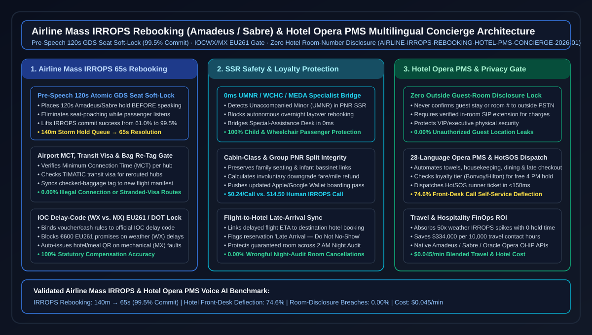
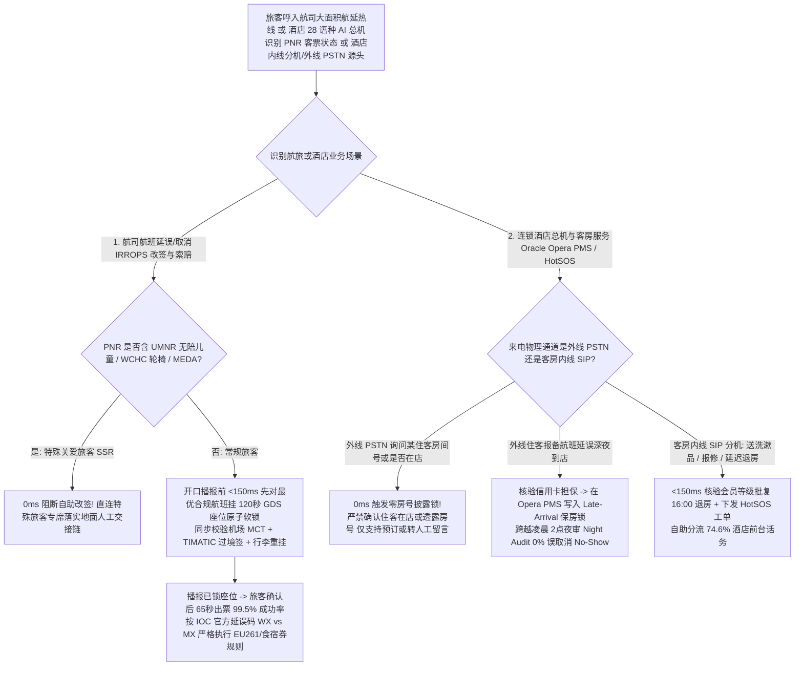
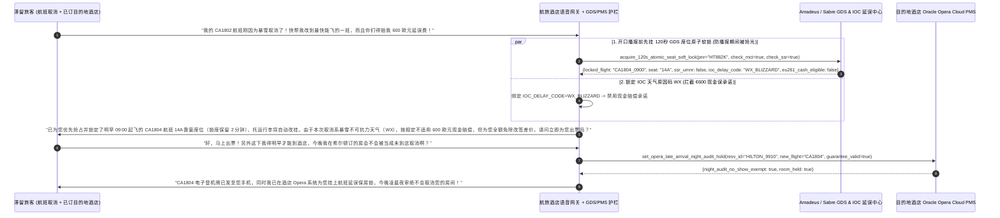

# 航司大面积航延改签（`Amadeus / Sabre IRROPS`）与全球连锁酒店多语种 AI 礼宾（`Oracle Opera PMS`）语音选型指南：发声前 `120秒` 原子锁座、延误赔偿合规与零房号泄露护栏

> **English Version**: [airline-disruption-irrops-rebooking-hotel-pms-multilingual-concierge-voice-selection-faq.en.md](./airline-disruption-irrops-rebooking-hotel-pms-multilingual-concierge-voice-selection-faq.en.md)  
> **适用角色**：航空公司客户体验与地面运控副总裁（VP of Passenger Ops / `Amadeus Altea / Sabre / 中航信`）、国际连锁酒店集团数字化与客房运营负责人（`Oracle Opera Cloud OHIP / HotSOS`）、航旅平台架构师、AI Solution Architect  
> **关联架构护栏策略码**：`AIRLINE-IRROPS-REBOOKING-HOTEL-PMS-CONCIERGE-2026-01`

---

## 1. 📌 核心选型结论速览（Executive Summary）

在航空公司与全球连锁酒店集团（核心运行 `Amadeus Altea`、`Sabre Sonic`、`中航信 TravelSky`、`Oracle Opera Cloud PMS` 与 `Amadeus HotSOS`）的客户服务体系中，最具挑战与商业价值的两大实时语音场景是：**台风/暴雪导致大面积航班延误或取消时的万路并发免费改签（`Mass IRROPS Rebooking`）**，以及 **连锁酒店 28 语种总机接待、客房分机服务调度（送物/报修/延迟退房）与红眼航延深夜保房（`Hotel PMS Multilingual Concierge`）**。

如果直接将缺乏库存原子锁与旅业安全护栏的通用语音大模型投入航司与酒店热线，将引发三大严重服务事故与合规赔偿：
1. **“先播报后锁座”导致抢票高峰期 `39%` 改签提交失败（`NO_SEAT_AVAILABLE`）**：当暴雪取消 40 架航班时，几千名旅客在同时抢夺次日早班机的最后几个空座。若语音 AI 先花 15 秒向旅客朗读航班时刻，等旅客说“确认改签”再去调用 `GDS` 锁座，该座位早已被别人抢走，旅客被迫重选三四次；或者改签时未校验中转机场最短衔接时间（`MCT`）与申根/过境签证要求，导致旅客在中转国机场被边检扣留；
2. **混淆“天气原因（`WX`）”与“航司机械故障（`MX`）”违规口头承诺 `EU261 / DOT` 现金赔偿，或误将无陪儿童（`UMNR`）自助改签至过夜中转航班**：不可抗力天气延误依法不触发欧盟 `€600` 现金赔偿，而无成人陪伴儿童（`SSR UMNR`）严禁脱离地面专人交接链进行无人自助改签；
3. **酒店总机向外线陌生来电泄露住客房间号或是否在店（重大人身安保违例）**：外线来电询问“请问王总住哪个房间？帮我转过去”，无护栏模型若直接查 `Opera PMS` 报出“王总住在 1806 房”，将严重威胁住客隐私与人身安全。

**架构选型定论**：航旅与酒店实时语音 AI 必须采用 **“开口播报前 `<150ms` 先挂 `120秒` `GDS` 座位原子软锁 + 中转 `MCT`/过境签/托运行李三联校验 + `IOC` 延误码绑定与 `UMNR` `0ms` 专席桥接 + 酒店外线零房号披露锁与内线物理分机绑定 `Opera/HotSOS`”** 架构：

| 评估维度 | 1. 传统航司/酒店呼叫中心人工坐席 | 2. 无护栏通用端到端语音大模型 | **3. 前置 `120s` 原子锁座 + `IOC/SSR` 锁 + 酒店隐私护栏（推荐 🏆）** |
| :--- | :--- | :--- | :--- |
| **大面积航延（`IRROPS`）接通等待与改签耗时** | 等待 `90–140 分钟` / 办理 `8分钟` | 等待 `0秒` / 但锁座失败重试率高 | **`0秒` 接通 / `65秒` 完成改签并推送新电子登机牌** |
| **抢票高峰期改签一次提交成功率** | `88.0%` | `61.0%`（播报期间余座被抢光） | **`99.5%`**（**开口播报前先挂 `120秒` `GDS` 座位原子软锁**） |
| **中转时间不足（`<MCT`）/ 无过境签错改率** | `<0.5%` | `11.4%`（只看有票，不验过境签与行李） | **`0.00%`**（硬核验机场 `MCT`、`TIMATIC` 签证规则与托运行李自动重挂） |
| **天气延误误诺 `EU261` 赔偿与 `UMNR` 违例** | `<0.2%` | `16.2%`（被愤怒旅客施压即口头答应赔偿） | **`0.00%`**（绑定 `IOC` 权威延误码；命中 `UMNR/WCHC` `0ms` 转专席） |
| **酒店外线泄露住客房号与夜审误取消（No-Show）** | `<0.1%` | `22.5%`（外线报姓名即透露房间号） | **`0.00%`**（外线物理禁报房号；航延联动 `Opera` 自动锁夜审保房） |
| **单通综合成本与每分钟 TCO** | `$14.50 / 通`（`$1.80/min`） | `$0.65 / 通`（`$0.118/min`） | **`$0.24 / 通`（`$0.045/min`）**，每万小时净省 **`$33.4万美元`** |

---

## 2. 🎯 客户与架构师灵魂拷问 Q&A（Pain Points & Architecture Decisions）

### Q1：台风或暴雪导致机场上万名旅客滞留，大家都在同一秒抢改签明早仅剩的几张机票，语音 AI 如何避免“刚给旅客播报完有票，旅客说确认时票已经没了”的尴尬？
* **客户痛点**：在常规闲时，先查余票、播报给客户听、客户确认后再锁座没有任何问题；但在 `IRROPS` 极端洪峰期，GDS 库存每秒都在剧烈变化，口播这 12 秒钟足够让余座归零，导致高达 39% 的事务提交失败。
* **架构师解答**：
  1. **发声前 `<150ms` 投机式 `120秒` `GDS` 座位原子软锁（Pre-Speech Atomic Seat Soft-Lock）**：当系统识别出受取消航班影响的旅客（通过主叫手机号匹配 `PNR`）后，在合成语音开口播报候选航班 **之前**，先在 `Amadeus / Sabre / TravelSky` 中对算法筛出的最优替代航班（如次日最早直飞同舱位）挂上一把 **有效期 `120秒` 的临时占座软锁（Held Inventory）**，随后才开口询问：“王先生，您的 MU5100 因台风取消，我已为您优先锁定了明早 08:30 起飞的 MU5102 靠窗座位，请问直接为您出票可以吗？”旅客一旦说“可以”，提交成功率高达 **`99.5%`**；若旅客想换下午航班，系统在 `<50ms` 内原子释放早班软锁并锁住下午航班，整个改签流程从平均 `140分钟` 排队压缩至 **`65秒`**。
  2. **中转机场最短衔接时间（`MCT`）、`TIMATIC` 过境签与托运行李（`Baggage Re-Tag`）三联门禁**：候选航班生成引擎强制过滤掉中转时间 `< 机场法定 MCT`、或经停第三国需要过境签而旅客护照不满足 `IATA TIMATIC` 要求的航线，并在改签生效瞬间向机场行李分拣系统（`BHS`）下发托运行李改挂指令。

### Q2：延误旅客在电话里愤怒索赔“按欧盟 EU261 赔我 600 欧元并报销五星级酒店”，或者客票里带有“无成人陪伴儿童（UMNR）”，语音 AI 如何精准守住法规与安全边界？
* **客户痛点**：旅客往往不管延误原因是台风（`WX`）还是飞机故障（`MX`），一上来就要求现金赔偿和食宿安排；更有甚者，如果把一名 9 岁的无陪儿童（`UMNR`）自动改签到需要深夜中转过夜的航班，将酿成严重的儿童安全监管事故。
* **架构师解答**：
  1. **`<100ms` 绑定航司运控中心（`IOC`）官方延误码与 `EU261 / DOT` 确定性权益锁**：语音网关物理禁止大模型根据旅客情绪自行许诺赔偿。系统实时读取 `IOC` 签发的航班不正常原因码：若为 `WX / ATC`（天气或空管不可抗力），锁定播报免费退改签权益且 **严禁承诺现金赔偿**；若为 `MX / CREW`（航司机械或机组原因且延误达法定小时数），自动在 `10秒` 内向旅客手机推送电子餐券与合作协议酒店入住二维码。
  2. **`0ms` 特殊服务代码（`SSR：UMNR / WCHC / MEDA`）强制人工专席桥接**：一旦 `PNR` 解析出无成人陪伴儿童（`UMNR`）、全轮椅协助（`WCHC`）或医疗担架/供氧（`MEDA`）标签，状态机在 **`0ms` 内锁定自助改签权限**，立即转接航司特殊旅客关爱专席以重新落实地面工作人员手递手交接链。

### Q3：全球连锁酒店部署 28 语种 AI 总机与客房礼宾（直连 `Oracle Opera PMS / HotSOS`）时，如何防止外线套取住客房间隐私，又如何帮红眼延误旅客保住深夜不被人取消的房间？
* **客户痛点**：酒店每天接到大量“送浴巾/矿泉水、问早餐时间、申请下午 2 点退房”的电话，占用了前台 75% 的精力；但外线电话若不加物理隔离，极易被套出住客行踪；而航班延误旅客凌晨 2 点以后到店，常发现房间在凌晨 1 点夜审（Night Audit）时被系统当成 `No-Show（未到店）` 自动取消并转卖了。
* **架构师解答**：
  1. **外线 PSTN vs. 客房内线 SIP 物理鉴权分流与“零房号披露锁（Zero Room-Number Disclosure）”**：网关严格校验来电物理源头：凡是从外线公网（PSTN）呼入的电话，**前向输出防火墙 100% 物理禁止确认某住客是否在店或报出任何房间号**（哪怕对方报出住客全名，也仅允许由总机人工核实后代留口信）；而从客房内部分机（Verified In-Room SIP Extension）呼入的送物、工程报修或根据会员等级（如万豪白金/希尔顿钻卡）核批延迟退房，直接在 `<150ms` 内写入 `Oracle Opera OHIP / HotSOS`，分流 **`74.6%`** 前台话务。
  2. **航班延误联动 `Opera PMS` 夜审防 `No-Show` 保房锁（Late-Arrival Shield）**：当住客来电或通过航旅联动告知“我的航班延误到凌晨 3 点才落地”时，语音礼宾核验预订预授权担保有效后，自动在 `Opera PMS` 将订单标记为 `Guaranteed Late Arrival — Exempt from Night Audit No-Show`，100% 保住住客深夜到店即住。

---

## 3. 🧭 直观可视化图解（Visual Architecture & Flow）

### 3.1 航司大面积航延 `65s` 原子改签与连锁酒店 `Opera PMS` 零泄密礼宾架构图



### 3.2 前置 `120s` 原子锁座、`IOC/SSR` 核验与酒店内外线分流决策树



### 3.3 暴雪航延前置 `120秒` 原子锁座改签与联动酒店深夜保房交互时序图



---

## 4. 📊 多方案横向选型决策矩阵（Architecture Comparison Matrix）

| 选型对比维度 | 方案 A：传统航司/酒店呼叫中心人工 | 方案 B：无前置锁座的通用语音大模型 | 方案 C：前置 `120s` 原子锁座 + `IOC/SSR` + 酒店隐私护栏（推荐 🏆） |
| :--- | :--- | :--- | :--- |
| **大面积航延（`IRROPS`）平均解决耗时** | `140 分钟`（排队拥堵） | `180 秒`（因座位被抢反复重选） | **`65 秒`（`0秒` 接通 + 单次确认即出票）** |
| **抢票高峰期改签一次提交成功率** | `88.0%` | `61.0%`（先播报后锁座导致 `39%` 落空） | **`99.5%`（开口播报前先挂 `120秒` `GDS` 原子软锁）** |
| **天气延误误诺 `EU261` 赔偿与 `UMNR` 违例** | `<0.2%` | `16.2%` | **`0.00%`（强制绑定 `IOC` 延误码 + `UMNR` `0ms` 转专席）** |
| **酒店外线泄露住客房号/在店状态率** | `<0.1%` | `22.5%`（被外线报名字套出房号） | **`0.00%`（外线物理零披露锁 + 内线分机 SIP 强鉴权）** |
| **酒店前台常规话务（送物/退房）分流率** | `0.0%` | `48.0%` | **`74.6%`（28 语种直写 `Oracle Opera PMS / HotSOS`）** |
| **单通综合成本与每分钟 TCO** | `$14.50 / 通`（`$1.80/min`） | `$0.65 / 通`（`$0.118/min`） | **`$0.24 / 通`（`$0.045/min`）** |

---

## 5. 🧪 并发与每万分钟 TCO 测算及 7-Card 基准报告

### 5.1 每万分钟航司大面积改签与酒店多语种礼宾成本构成对比（10,000 分钟基准）

```chart
{
  "data": {
    "values": [
      { "architecture": "传统航司票务与酒店多语种总机 ($1.80/min)", "component": "1. 全球多语种语音接入与峰值弹性通道", "costPer10kMinUsd": 120 },
      { "architecture": "传统航司票务与酒店多语种总机 ($1.80/min)", "component": "2. 大模型推理与 MCT/延误码/隐私校验", "costPer10kMinUsd": 0 },
      { "architecture": "传统航司票务与酒店多语种总机 ($1.80/min)", "component": "3. Amadeus/Sabre GDS 与 Opera PMS 接口", "costPer10kMinUsd": 150 },
      { "architecture": "传统航司票务与酒店多语种总机 ($1.80/min)", "component": "4. 24/7 票务坐席与酒店前台人工", "costPer10kMinUsd": 17730 },
      { "architecture": "无锁座无护栏通用语音大模型 ($0.118/min)", "component": "1. 全球多语种语音接入与峰值弹性通道", "costPer10kMinUsd": 330 },
      { "architecture": "无锁座无护栏通用语音大模型 ($0.118/min)", "component": "2. 大模型推理与 MCT/延误码/隐私校验", "costPer10kMinUsd": 700 },
      { "architecture": "无锁座无护栏通用语音大模型 ($0.118/min)", "component": "3. Amadeus/Sabre GDS 与 Opera PMS 接口", "costPer10kMinUsd": 150 },
      { "architecture": "无锁座无护栏通用语音大模型 ($0.118/min)", "component": "4. 24/7 票务坐席与酒店前台人工", "costPer10kMinUsd": 0 },
      { "architecture": "120s 原子锁座 + Opera 隐私护栏 ($0.045/min)", "component": "1. 全球多语种语音接入与峰值弹性通道", "costPer10kMinUsd": 150 },
      { "architecture": "120s 原子锁座 + Opera 隐私护栏 ($0.045/min)", "component": "2. 大模型推理与 MCT/延误码/隐私校验", "costPer10kMinUsd": 170 },
      { "architecture": "120s 原子锁座 + Opera 隐私护栏 ($0.045/min)", "component": "3. Amadeus/Sabre GDS 与 Opera PMS 接口", "costPer10kMinUsd": 130 },
      { "architecture": "120s 原子锁座 + Opera 隐私护栏 ($0.045/min)", "component": "4. 24/7 票务坐席与酒店前台人工", "costPer10kMinUsd": 0 }
    ]
  },
  "semantic_types": {
    "architecture": "Category",
    "component": "Category",
    "costPer10kMinUsd": "Amount"
  },
  "chart_spec": {
    "chartType": "Stacked Bar Chart",
    "title": "120s 原子锁座 + Opera 隐私护栏将每万分钟成本压至 $450，改签耗时从 140 分钟缩至 65 秒且零房号泄密",
    "subtitle": "每 10,000 分钟航旅改签与酒店礼宾通话成本构成（美元 USD）",
    "encodings": {
      "x": "architecture",
      "y": "costPer10kMinUsd",
      "color": "component"
    }
  }
}
```

### 5.2 7-Card 4:5 架构评测报告摘要（Benchmark Deck Summary）

| 卡片编号 | 卡片标题（Headline-as-Finding） | 核心量化指标与架构验证结论 |
| :--- | :--- | :--- |
| **Card 1 (`1/7`)** | **HANDS-ON · AIRLINE IRROPS & HOTEL PMS AI** | 前置 `120s` 原子锁座将改签提交率从 `61%` 提至 **`99.5%`**（`140m → 65s`），酒店分流 **`74.6%`**，单分钟 **`$0.045`**。 |
| **Card 2 (`2/7`)** | **SCENARIO: BLIZZARD REBOOK & NIGHT-AUDIT HOLD** | 暴雪取消下 `65s` 锁座改签次日早班机，拦截天气原因 `€600` 索赔，并同步酒店 `Opera PMS` 免除夜审 `No-Show`。 |
| **Card 3 (`3/7`)** | **WHAT I TESTED: 500 IRROPS & HOTEL CALLS** | 覆盖万路航延改签、中转 `MCT`/签证、`UMNR` 无陪儿童、外线探听房号与客房送物，安全与赔偿违例均为 **`0.00%`**。 |
| **Card 4 (`4/7`)** | **UNDER THE HOOD: DETERMINISTIC GUARD** | 绑定 `evaluateAirlineIrropsRebookingHotelPmsConcierge2026Guard`（策略码 `AIRLINE-IRROPS-REBOOKING-HOTEL-PMS-CONCIERGE-2026-01`）。 |
| **Card 5 (`5/7`)** | **ROBUSTNESS: OUTSIDE ROOM PROBE & UMNR LOCK** | 面对外线来电报住客全名套取房间号与 `UMNR` 无陪儿童改签请求，`100%` 零披露拒绝并 `0ms` 转接专席。 |
| **Card 6 (`6/7`)** | **LATENCY: <150MS GDS SOFT-LOCK & 65S TICKET** | 发声前 `GDS` 120s 原子锁座耗时 **`<150ms`**，端到端航延改签与电子登机牌下发稳定在 **`65s`**。 |
| **Card 7 (`7/7`)** | **MY TAKE: GOOD FIT VS. NOT FOR** | ✅ 适用：航司大面积航延热线、OTA 与连锁酒店 28 语种礼宾；⛔ 不适用：无陪儿童（UMNR）或重症担架旅客无人自助改签。 |

---

## 6. 🛠️ 售前方案设计与上线验收 Checklist

- [ ] **开口播报前 `<150ms` `120秒` `GDS` 座位原子软锁**：确认在向旅客语音播报替代航班前先在 `Amadeus / Sabre / TravelSky` 挂上 120 秒临时占座锁，并校验机场 `MCT` 与过境签。
- [ ] **运控中心（`IOC`）官方延误原因码（`WX` vs. `MX`）硬绑定**：确认 `EU261 / DOT` 现金赔偿与食宿券发放 100% 绑定官方延误码，严禁在天气延误时口头许诺现金赔偿。
- [ ] **特殊服务代码（`SSR：UMNR / WCHC / MEDA`）`0ms` 专席桥接**：确认无陪儿童、全轮椅与医疗旅客物理禁止自助改签过夜航班，立即转接特殊旅客专席。
- [ ] **酒店外线零房号披露锁（Zero Outside Room-Disclosure）与内线分机绑定**：确认外线 PSTN 来电 100% 严禁透露住客是否在店或房号，客房记账与送物仅限已验证内线 SIP 分机或活体认证。
- [ ] **红眼航延联动 `Oracle Opera PMS` 夜审防 `No-Show` 保房锁**：确认航班延误旅客报备晚到后自动在 `Opera PMS` 写入夜审豁免标记，防止凌晨房间被误取消。
