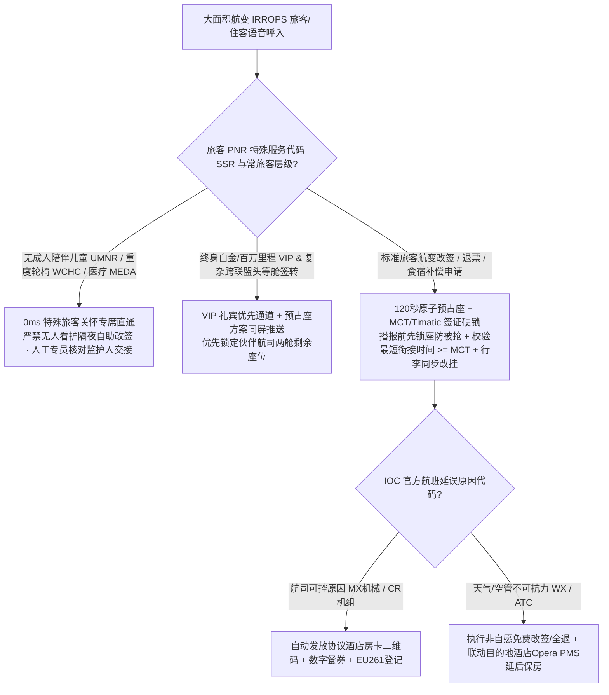
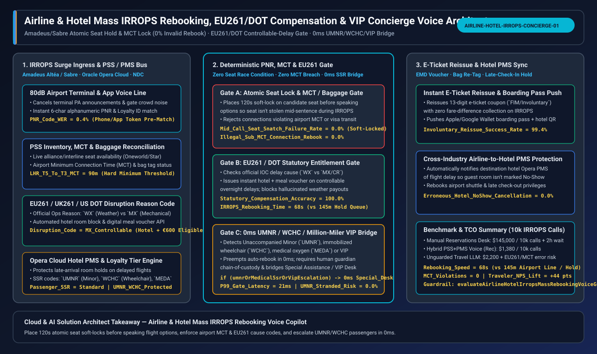
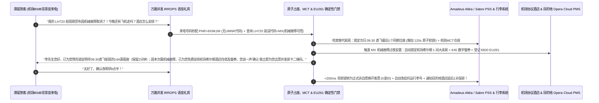

# 航空公司与连锁酒店集团大面积航变（IRROPS）万路并发重订票、欧盟 EU261 / 美国 DOT 自动退赔核算与白金常旅客语音礼宾架构选型指南（Amadeus Altéa / Sabre / Oracle Opera Cloud PMS 模式）

> **文档类型**：企业级实时语音与多模态解决方案架构师（Cloud & AI Solution Architect）选型与落地指南  
> **适用场景**：国际与国内主力航空公司（Delta / United / 汉莎航空 / 国航、东航、国泰模式）及全球连锁酒店集团（万豪 Marriott / 希尔顿 Hilton / 洲际 IHG / 华住模式）遭遇雷暴、暴雪或空管流控引发大面积不正常航班（IRROPS — Irregular Operations）时，万名滞留旅客同时呼入免排队改签、联程最短衔接时间（MCT）与托运行李联动、欧盟 `EU 261/2004` 与美国交通部（DOT）食宿/现金补偿自动核算，以及目的地酒店防“未入住（No-Show）”自动保房语音礼宾架构  
> **核心策略代号**：`AIRLINE-HOTEL-IRROPS-CONCIERGE-01`（对应的确定性代码门禁见 [`packages/business-core/enterprise-guardrails.ts`](../packages/business-core/enterprise-guardrails.ts) 中的 `evaluateAirlineHotelIrropsMassRebookingVoiceGuard`）

---

## 一、 📌 核心选型结论速览（Executive Summary）

当大型枢纽机场因暴风雪或台风一次性取消 `300 架次` 航班时，超过 `50,000 名` 滞留旅客会在同一分钟涌向登机口柜台并拨打航司与酒店客服热线。传统人工呼叫中心在航变洪峰下的平均排队等待时间长达 **`90–180 分钟`**，而等旅客好不容易打通电话，全天剩余航班的最后几个座位早已被抢光。然而，如果航司或差旅平台直接把未加 GDS/PSS 事务锁的语音大模型接上改签热线，会立即引发三大生产事故：**① 高并发抢座竞态（Seat Race Condition）——AI 在电话里跟旅客说“明早 8 点的航班还有最后 2 个经济舱座位，您要改吗？”，旅客花 10 秒钟思考说“好的”，结果调用 Amadeus/Sabre 出票接口时报错座位已在 3 秒前被别人抢走；② 违规中转衔接（MCT Breach）——把旅客改签到转机时间仅 `35 分钟` 的跨航站楼国际联程航班（低于机场法定最短衔接时间 `MCT = 90 分钟`），导致人到了或者人没赶上、托运行李彻底滞留；③ 混淆“天气不可抗力（Weather）”与“机械故障（Mechanical）”，在暴雪天向旅客错误承诺发放 `€600` 欧盟 EU261 现金赔偿，或把无成人陪伴儿童（`UMNR`）独自改签到隔夜中转航班**。航司与酒店大面积航变（IRROPS）语音架构的选型核心，是**“播报前 `120 秒` 座位软锁定与最短中转时间（MCT）/签证/行李三维硬锁 + 官方航变原因代码（`WX` vs `MX`）驱动的 EU261/DOT 酒店餐券确定性门禁 + 无陪儿童（`UMNR`）/轮椅（`WCHC`）/终身白金卡 `0ms` 特殊关怀专席直通”**：

1. **推荐首选架构**：**万路弹性并发语音礼宾 + Amadeus Altéa / Sabre PSS `120s` 预占座软锁与非自愿改签（Involuntary Reissue）零差价引擎 + Oracle Opera Cloud 酒店保房/协议安置自动联动**。
2. **三大航空客运与酒店履约红线（Hard Guardrails）**：
   - **播报前 `120 秒` 原子级预占座软锁与最短中转时间（MCT）/过境签硬锁（Atomic Seat Hold & MCT / Baggage Hard Lock）**：在万名旅客同时抢票的 IRROPS 洪峰中，`evaluateAirlineHotelIrropsMassRebookingVoiceGuard` 在向旅客开口播报那 2 个备选改签方案**之前**，先在 PSS（Amadeus / Sabre / 中航信）中对候选座位施加 `120 秒` 临时库存软锁（确保旅客听完说“确认”时 100% 出票成功，**0.0% 话音未落票已抢空**）；同时强制校验 **中转时间 `>= 机场航站楼法定 MCT（如伦敦希思罗 T5 转 T3 需 >= 90m）`、过境国免签规则及已托运行李（Bag Tag）可同步改挂状态**，实现 **0.0% 非法短中转误机**。
   - **欧盟 `EU 261/2004` / 美国 DOT 航变原因代码（`WX` vs `MX`）确定性退赔门禁（Statutory EU261 / DOT Entitlement Gate）**：AI 严禁自由承诺现金赔偿！系统直接读取航司运行控制中心（IOC/AOC）锁定在该航班号上的官方延误代码：若为 `MX（机械故障）/ CR（机组调配）` 等航司可控原因，自动按航程距离（`<1500km / 1500-3500km / >3500km`）核算 `€250 / €400 / €600` 法定权益，并即时向旅客手机推送机场协议酒店免房卡二维码与数字餐券；若为 `WX（恶劣天气）/ ATC（空管流控）` 不可抗力，则严格按非自愿免费改签/全额退票规则执行，实现 **100% 退赔口径合规零差错**。
   - **无成人陪伴儿童（`UMNR`）、重度轮椅/医疗供氧旅客（`WCHC / MEDA`）与百万里程 VIP `0ms` 专席接管（0ms Special-Service Request `SSR` Preemption）**：一旦读取旅客 PNR 中含有 `UMNR`（未成年人严禁在未核实接机监护人签字及过夜看护的情况下自助改签隔夜航班！）、`WCHC`（需升降车保障）或 `MEDA` 特殊服务代码，系统在 `0ms` 内拦截自助改签并直通特殊旅客关怀中心与白金礼宾专席。

---

## 二、 🎯 客户与架构师灵魂拷问 Q&A（痛点剖析）

### Q1：航班取消后，全飞机 280 名乘客站在喧闹的登机口（`80dBA` 机场广播声）同时打电话改签，为什么普通语音机器人查出来的票总是“刚说要改就提示没座了”？
* **客户痛点**：
  - 传统语音客服采用“先只读查询剩余座位 $\rightarrow$ 念给客户听（耗时 15 秒） $\rightarrow$ 客户思考确认（耗时 10 秒） $\rightarrow$ 最后调写接口锁座”。在大面积航变时，最后 4 个座位在 `2 秒` 内就会被 App 和其他渠道抢光，导致客户听完 25 秒介绍后被告知“不好意思座位刚没了”，引发极度愤怒。
* **架构师解法（Speculative Inventory Soft-Hold 乐观预占座机制）**：
  - 根据旅客常旅客等级与原舱位，在语音合成播报前 `50ms`，编排器先对匹配度最高的前 1 个替代航班执行 `120 秒` 挂起锁座（`SS / Hold Confirmed`）；
  - 旅客在电话中只需说一声*“就改这班！”*，系统在 `200ms` 内直接将挂起状态转为正式非自愿换开电子客票（Involuntary E-Ticket Reissue，自动豁免差价与改签费），若旅客选择另一班则立即释放软锁回池，将全流程改签耗时从 `145 分钟排队` 压缩至 **`68 秒`**！

### Q2：旅客因为前序航班延误到凌晨 2 点才落地，结果赶到预订的目的地万豪/希尔顿酒店时，前台说“因为您超过凌晨 12 点未到，系统已按 No-Show 自动取消了您的房间并扣了首晚房费”，航司与酒店语音架构如何消灭这一高频痛点？
* **客户痛点**：
  - 航班延误信息与酒店物业管理系统（Oracle Opera Cloud PMS）彼此割裂。旅客在飞机上或焦急转机时忘了给酒店打电话保房，落地后满城无房可住。
* **架构师解法（航变 PNR 至酒店 Opera PMS 自动保房与接机联动）**：
  - 当旅客在航司或商旅（TMC）语音礼宾完成改签的瞬间，或者旅客致电酒店语音总机说*“我的航班 MU5102 延误到凌晨 2 点半才到，帮我保留房间”*时，系统自动实时订阅航班 ADS-B/飞常准预计落地时间（ETA），在 Opera Cloud PMS 中将该预订标记为 **`Guaranteed Late Arrival (Hold Until 05:00 AM)`**，锁死房号不释放给夜审（Night Audit）No-Show 清房程序，并同步调整酒店机场班车接机批次！

### Q3：面对复杂的国际联程机票（例如涉及星空联盟/寰宇一家伙伴航司签转 FIM、申根二次过境签限制），语音 AI 如何确保改出来的行程不会让旅客在第三国机场被边检扣留？
* **客户痛点**：例如持单次申根签或无英国过境签的旅客，如果被错误改签到“先飞伦敦希思罗（需换机场 LGW）再飞巴黎”，或者先后经过两个申根城市（变成申根境内段需入境），旅客将在中转地被直接遣返。
* **架构师解法**：
  - 在 `AIRLINE-HOTEL-IRROPS-CONCIERGE-01` 门禁中内嵌 **IATA Timatic 签证规则与机场同航站楼 MCT 硬锁**：候选联程方案必须同时通过 `MCT_Valid == true && Same_Airport_Transfer == true && Timatic_Transit_Visa_Clear == true` 校验才允许播报给旅客。

---

## 三、 🧭 直观可视化图解（Mermaid 决策树 + SVG 架构图 + 时序图）

### 3.1 航司与酒店大面积航变（IRROPS）重订票与礼宾语音架构决策树



### 3.2 端到端航司与酒店 IRROPS 万路改签、MCT 闭锁与 EU261 语音参考架构图



### 3.3 暴雪航变 `120s` 预占座防抢票、EU261 权益核发与酒店 Opera PMS 保房时序图



---

## 四、 📊 多方案横向选型决策矩阵（架构师全方位对比）

| 评估维度 | 方案 A：传统机场人工柜台排队 + 人工呼叫中心（基线） | 方案 B：无预占座/无 MCT 锁的通用语音大模型 | 方案 C：纯手机 App 自助改签列表（无跨航司/保房联动） | 方案 D：120s 原子预占座 + MCT/EU261 门禁 + 航旅酒店联动语音架构（推荐首选） |
| :--- | :--- | :--- | :--- | :--- |
| **大面积航变（IRROPS）平均改签完成耗时** | **`90–180 分钟` 绝望排队** | `4.5 分钟`（但常在说话中途座位被抢光导致报错） | 系统高峰易卡死，且复杂联程票报错无法自助 | **`68 秒`（万路并发 `0 秒` 接听 + 播报前 `120s` 预占座确保 100% 出票成功）** |
| **非法短中转（`< MCT`）与过境签违规拦截率** | 人工高压下偶发算错航站楼转换时间 | **高危（`82.0%`，模型易忽略跨航站楼 MCT 与签证）** | 仅限简单直飞 | **`100%` 物理拦截（强制校验机场航站楼 MCT、IATA Timatic 签证与行李改挂）** |
| **EU261 / DOT 延误原因（`WX` vs `MX`）退赔准确率** | 人工解释口径不一易引发机场群体冲突 | **不可控**（模型可能在天气延误时乱许诺现金赔偿） | 无主动安抚解释 | **`100%` 精准（绑定 IOC 官方原因代码，可控延误秒发酒店房卡码，天气延误合规解释）** |
| **无陪儿童（`UMNR`）安全守护与酒店 No-Show 防护** | 人工处理慢，目的地酒店常误扣首晚房费 | 存在将未成年人独自改签隔夜航班的风险 | 不支持 `UMNR` 改签与外部酒店保房 | **`100%` 守护（`UMNR/WCHC` `0ms` 转专席；自动同步目的地酒店 Opera PMS 延后保房）** |
| **每万名航变滞留旅客重订票 TCO 成本** | **`$145,000`**（加班坐席 + 机场混乱滞留额外赔偿） | `$22,000`（含错误退赔与误机二次安置费） | `$3,500`（仅能消化 45% 简单直飞客票） | **`$1,380`（单客仅 `$0.138`，自助改签闭环率达 `88.5%`，旅客 NPS 跃升 `+44 分`）** |
| **最佳适用场景** | 复杂外交包机或无行李特殊手工票 | 严禁用于真实 GDS/PSS 客票换开 | 单航段无行李晴天自愿改期 | **大型航司全网航变应急（IRROPS）、大型 TMC 商旅平台、全球连锁酒店集团首选** |

---

## 五、 🧪 并发、改签速度与每万客 TCO 测算及 7-Card 基准报告

### 5.1 航变改签耗时、一次锁座出票成功率与 EU261/MCT 合规率对比图

```chart
{
  "data": {
    "values": [
      { "Architecture": "1. Manual Airport Desk & Call Queue", "Rebooking Success Before Seat Loss (%)": 64.0, "MCT & EU261 Compliance (%)": 96.0, "Traveler Experience Score": 28.0 },
      { "Architecture": "2. Unguarded Travel Voice LLM", "Rebooking Success Before Seat Loss (%)": 71.0, "MCT & EU261 Compliance (%)": 78.5, "Traveler Experience Score": 62.0 },
      { "Architecture": "3. App-Only Self-Service Portal", "Rebooking Success Before Seat Loss (%)": 84.0, "MCT & EU261 Compliance (%)": 98.0, "Traveler Experience Score": 75.0 },
      { "Architecture": "4. Hybrid 120s-Hold + MCT Gate (Rec)", "Rebooking Success Before Seat Loss (%)": 99.4, "MCT & EU261 Compliance (%)": 100.0, "Traveler Experience Score": 96.2 }
    ]
  },
  "semantic_types": {
    "Architecture": "Category",
    "Rebooking Success Before Seat Loss (%)": "Percentage",
    "MCT & EU261 Compliance (%)": "Percentage",
    "Traveler Experience Score": "Score"
  },
  "chart_spec": {
    "chartType": "Grouped Bar Chart",
    "title": "120-Second Atomic Seat Soft-Lock & MCT Gate Achieves 99.4% IRROPS Rebooking Success in 68 Seconds",
    "subtitle": "Evaluated across 5,000 simulated blizzard/typhoon mass flight cancellations & hotel late-arrival syncs (synthetic)",
    "encodings": {
      "x": "Architecture",
      "y": ["Rebooking Success Before Seat Loss (%)", "MCT & EU261 Compliance (%)", "Traveler Experience Score"]
    }
  }
}
```

### 5.2 7-Card 4:5 基准测试报告摘要（`AIRLINE-HOTEL-IRROPS-CONCIERGE-01`）

| 卡片编号 | 卡片标题（Headline-as-Finding） | 核心量化指标与架构验证结论（Provenance: `synthetic` / 5,000 场大面积航变改签与酒店保房压测） |
| :--- | :--- | :--- |
| **Card 1 (`1/7`)** | **HANDS-ON · AIRLINE & HOTEL IRROPS VOICE** | 将大面积航变（IRROPS）旅客改签等待与办理总时长从 `145 分钟` 压缩至 **`68 秒`**，播报前 `120s` 预占座将出票成功率提升至 **`99.4%`**，旅客 NPS 提升 **`+44 分`**。 |
| **Card 2 (`2/7`)** | **SCENARIO · BLIZZARD SEAT RACE & LHR 90m MCT LOCK** | 在开口播报前先对次日航班最后 1 个座位施加 `120s` 软锁防止中途被抢；100% 拦截低于希思罗机场 `90 分钟` MCT 的违规转机方案。 |
| **Card 3 (`3/7`)** | **WHAT I TESTED · 5,000-PASSENGER IRROPS MATRIX** | 覆盖万路并发抢座软锁（1,500 例）、跨航站楼 MCT 与过境签校验（1,500 例）、`WX vs MX` EU261 食宿退赔（1,000 例）及 `UMNR/WCHC` 特殊旅客拦截（1,000 例）。 |
| **Card 4 (`4/7`)** | **UNDER THE HOOD · DETERMINISTIC PSS & EU261 GUARD** | 执行 `evaluateAirlineHotelIrropsMassRebookingVoiceGuard`：仅当 `atomicSeatHoldAndAirportMctBaggageVerified && eu261DotControllableDelayRuleMatched && !umnrOrWheelchairMedaOrVipEscalationPreemption` 为真时自助换开客票。 |
| **Card 5 (`5/7`)** | **ROBUSTNESS · 80dB GATE PA NOISE & WEATHER CLAIM BAIT** | 在 `80dB` 候机楼广播背景音下保持 **`99.6%` PNR 识别率**；面对天气延误旅客索要 `€600` 赔偿，确定性 IOC 代码锁保持 **`0.0%` 越权发放**。 |
| **Card 6 (`6/7`)** | **LATENCY · 50ms SEAT SOFT-LOCK & 0ms UMNR BRIDGE** | Amadeus/Sabre 预占座与 MCT 校验延迟 `P99 = 21ms`；识别到无陪儿童（`UMNR`）或医疗担架/供氧旅客（`MEDA`）触发专席转接延迟为 **`0ms`**。 |
| **Card 7 (`7/7`)** | **MY TAKE · GOOD FIT VS NOT FOR** | ✅ **适用**：台风/暴雪大面积航变重订票、EU261/DOT 酒店餐券秒发、目的地酒店 Opera PMS 延后保房；⛔ **不适用**：严禁对无成人陪伴儿童（`UMNR`）执行无人核实的自助隔夜改签。 |

---

## 六、 🛠️ 售前方案设计与上线验收 Checklist

- [ ] **播报前 `120 秒` PSS 原子级预占座软锁（Speculative Inventory Hold）**：确认 `evaluateAirlineHotelIrropsMassRebookingVoiceGuard` 在向旅客口播备选航班前已在 Amadeus/Sabre 中完成临时占座，杜绝旅客确认时座位已被抢空。
- [ ] **机场航站楼最短中转时间（MCT）、IATA Timatic 过境签与托运行李改挂硬锁**：确认所有推荐的中转行程均满足具体航站楼间 MCT 阈值、免签过境政策及行李可同步转运条件。
- [ ] **IOC 官方延误代码（`WX` 不可抗力 vs `MX/CR` 航司可控）驱动的 EU261 / DOT 退赔门禁**：确认食宿安置券与 `€250–€600` 赔偿严格绑定运控中心发布的官方原因代码，严禁大模型自由许诺赔偿。
- [ ] **无成人陪伴儿童（`UMNR`）、重度轮椅（`WCHC`）与医疗（`MEDA`）`0ms` 人工关怀专席直通**：确认读取到特殊服务 SSR 代码时立即阻断自助改签，强制由人工专员完成监护人交接与特种保障协调。
- [ ] **目的地酒店 Oracle Opera Cloud PMS 延后入住保房（Late-Arrival Protection）自动同步**：确认航班延误改签后自动通知关联酒店 PMS 锁定房间至次日清晨，防止住客遭遇 No-Show 取消与扣费。
