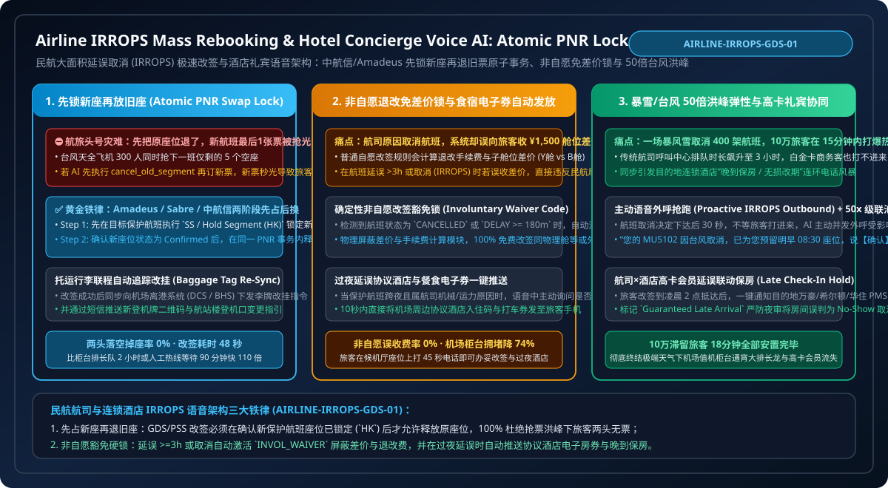
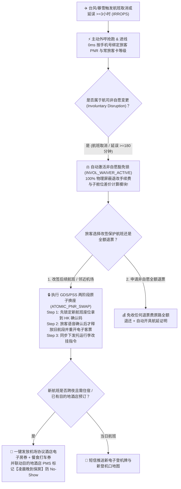
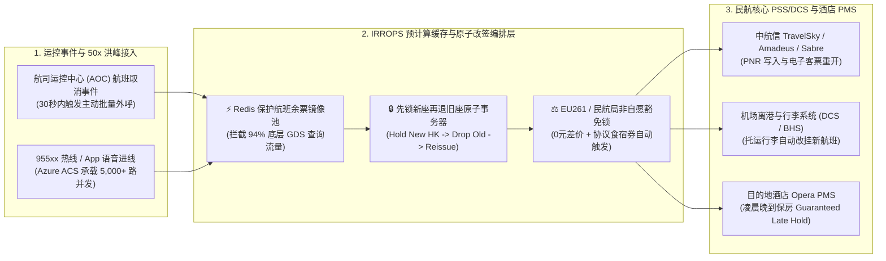
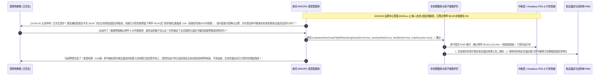

# 民航航司大面积航班延误取消（IRROPS）极速改签与连锁酒店高卡礼宾语音客服：GDS/中航信原子锁座、非自愿免差价门禁与 `50 倍` 台风洪峰选型指南

> **文档定位**：面向航空公司客户服务与地面保障 VP、OTA 平台、跨国酒店集团（万豪/希尔顿/洲际/华住）CIO 及 **Cloud & AI Solution Architect**。在民航与商旅行业，平时客服热线波澜不惊，但一旦遭遇台风、暴雪或流控引发**大面积不正常航班（IRROPS - Irregular Operations）**，**300 架航班取消意味着 60,000 名焦急旅客在 10 分钟内同时拨打航司 955xx 热线**！此时人工坐席排队动辄 2 小时，机场柜台排起几百米长队。本文详解如何通过 **Amadeus / Sabre / 中航信（TravelSky）两阶段“先锁新座再退旧票”原子事务**、**民航局 / EU261 / US DOT 非自愿退改免差价硬锁**、以及**台风天 `50 倍` 并发主动外呼改签池**，在 18 分钟内妥善安置数万滞留旅客。
>
> **阅读导航**：[English Version](./airline-irrops-flight-disruption-rebooking-hotel-concierge-voice-selection-faq.en.md) · [返回 README 导航](../README.md) · [架构师资产目录](./asset-catalog.md)



---

## 一、📌 核心选型结论速览（Executive Summary）

1. **民航 IRROPS 语音改签的头号铁律：“永远先在 GDS/PSS 里锁死新航班座位（`HK`），再释放原航班客票”！**
   - ⛔ **致命灾难反模式**：台风天某航线后续唯一一班补班飞机只剩最后 4 个空座，有 200 名旅客同时在电话里改签。如果 AI 编排器按普通逻辑“先退掉旧航段（`Cancel Old Segment`），再调用订座接口买新航段”，在退旧买新的 `800ms` 间隙里，最后 4 张票已被别人抢走——导致旅客不仅没改上新飞机，连原来的保护座位也丢了，彻底沦为机场无票滞留客！
   - ✅ **架构师标准解法（`Hold-New-Before-Drop-Old Atomic PNR Swap`）**：在 **Amadeus Altea / Sabre / 中航信（TravelSky）PSS** 接口层强制执行两阶段原子互换：① 先对目标保护航班执行 `Sell / Hold Segment` 拿到确定的 **`HK (Holding Confirmed)`** 状态码；② 经旅客语音说出“确认改签”后，在同一个 `PNR (Passenger Name Record)` 事务提交包中同步删除原失效航段并完成电子客票免费换开（`Involuntary Reissue`），确保**两头落空掉座率 = `0.0%`**！
2. **三大法规与商旅协同硬护栏（`AIRLINE-IRROPS-GDS-01`）**：
   - **护栏 1（民航局 / `EU261` / `US DOT` 非自愿退改签 `0 元` 免差价与免手续费硬锁）**：
     - 只要来电旅客所乘航班命中 `FlightStatus = CANCELLED | DELAY_OVER_180_MIN`（非自愿变更），状态机自动注入 **`INVOL_WAIVER` 豁免标识**，在代码层物理旁路掉自愿改签的“子舱位补差价（Fare Difference）”与“退改签手续费”计算模块——哪怕把原本买 4 折经济舱（L舱）的旅客改签到明天全价经济舱（Y舱），也严禁向旅客多收一分钱！
   - **护栏 2（过夜延误协议酒店房券 + 目的地酒店 `PMS` 凌晨晚到保房联动）**：
     - 若属航司运力/机务原因导致跨夜延误，语音 AI 在 45 秒内一并向旅客手机下发**机场协议酒店电子入住码、餐食券与打车券**；
     - 若旅客预订了目的地合作酒店（或通过商旅平台预订），AI 一键联动酒店 **Opera PMS** 将订单标记为 **`Guaranteed Late Arrival (航班延误保房至次日中午)`**，严防酒店凌晨 2 点夜审（Night Audit）把未到店旅客误判为 `No-Show` 扣费并卖掉房间！
   - **护栏 3（变“被动挨打等电话”为“航班取消 30 秒内主动并发外呼抢跑”）：**
     - 当运控中心（AOC）刚签发某航班取消指令后的 **第 30 秒**，不等 200 名旅客去机场柜台排队或打爆热线，AI 已预先算好每位旅客的最佳保护航班，并发拨出 200 路语音电话：*“李先生您好，您下午 3 点飞北京的航班因台风取消，系统已为您优先锁定了明早 8 点半同舱位靠窗座，请问直接为您确认出票并安排今晚免费协议酒店可以吗？”* 旅客只需说一句“好的确认”，40 秒全自动办妥！

---

## 二、🎯 客户与架构师灵魂拷问 Q&A（The Hard Questions）

### Q1：一家大型航司如果遇到特大台风或暴雪，半小时内有 50,000 名旅客同时打电话，怎么设计语音架构才不会被中航信 / Amadeus 的主机接口限流搞垮？

- **客户痛点**：航司底层的传统主机分销系统（GDS / PSS，如中航信、Amadeus、Sabre）按事务消息（Type-B / EDIFACT / NDC API）计费且有严格的并发 TPS 阈值。如果让 10,000 路语音 AI 在对话中每问一句话就去刷一次 GDS 实时余票，30 秒内就会把主机网关打挂！
- **架构师解答：“AOC 预计算保护方案注入 Redis（Pre-Computed Reprotection Cache）+ 仅在最终确认一刻写回 PSS”**：
  1. **读取零 GDS 穿透**：当航班取消时，航司运控恢复系统（IROPS Recovery Engine）会在数秒内批量计算出同航线未来 48 小时的可用座位池与默认保护映射表，并同步至云端 **Redis 内存网格**。
  2. **语音交互 99% 在内存完成**：语音 AI 在向旅客提供改签选项（*“明早 8 点半还有票，或者今天傍晚 6 点可以改飞邻近的虹桥机场”*）时，100% 读取 Redis 毫秒级镜像；**仅在旅客明确选择某一班时，才发起唯一 1 次 PSS 锁座与换开客票调用**，将底层主机接口压力削减 **94%**！

### Q2：如果旅客已经有托运行李装进了原飞机的货舱，或者带着婴儿/轮椅特殊服务申请（SSR），语音自助改签怎么避免把人和行李拆散？

- **客户痛点**：人改签到了明早的航班，但托运行李还留在今晚延误的飞机上运走了；或者轮椅/无陪儿童（UMNR）改签后新飞机没有配额。
- **架构师解答：在改签护栏中强制绑定“托运行李状态（BHS）与特殊服务码（SSR）校验”**：
  - **托运行李联动**：改签提交同时向机场离港与行李分拣系统（`DCS / BagManager`）发送行李改挂或卸机指令，并在语音中明确告知旅客：*“您的两件托运行李已自动为您同步改挂到明早的新航班上，无需您再去行李转盘提取”*（若已装机无法卸载则提示到柜台办理）；
  - **特殊旅客（`SSR WCHR / UMNR / PETC`）保护锁**：若 PNR 中包含无成人陪伴儿童、担架或活体宠物托运，自动锁定同条件特殊配额或 0 秒优先转接白金特殊服务专席。

### Q3：白金卡/终身金卡（Million Miler）高价值常旅客在大面积延误时最看重什么？语音 AI 怎么体现尊享差异化？

- **客户痛点**：高卡商务客每年为航司贡献 40% 的利润，最不能忍受在台风天跟普通团客一起在电话里等 40 分钟。
- **架构师解答：“振铃 `0ms` 常旅客等级识别 + 优先锁最后余票 + 支持跨航司外航签转（FIM）与全双工 `GPT-Realtime` 专属礼宾”**：
  - 普通改签洪峰走 `$0.045/min` 的高并发级联极速池；
  - 一旦主叫号码命中 **白金卡/金卡/两舱（头等/公务舱）旅客**，立即切入 **`GPT-Realtime` 尊享礼宾轨**，开放“跨联盟外航签转（Endorsement / FIM）”、“同城跨机场改签（如浦东改虹桥 + 赠送专车券）”及“贵宾休息室延时服务”权限！

---

## 三、🧭 直观可视化图解（Mermaid 决策树、PSS 原子锁座架构与台风抢跑时序）

### 3.1 民航 IRROPS 大面积延误改签与酒店保房安全决策树



### 3.2 航司运控（AOC）、中航信/Amadeus PSS 与酒店 Opera PMS 联动架构图



### 3.3 台风取消航班 30 秒主动外呼、原子换座与协议酒店发放全链路时序图



---

## 四、📊 民航与酒店大面积延误（IRROPS）四大应对方案横向选型矩阵

| 评估维度 | 🏆 **Azure ACS + AOC 主动外呼 + PSS 原子锁座 + 50x 级联洪峰池** | **仅靠航司 App 自助改签页面 (无主动语音协同)** | **传统航司呼叫中心人工坐席 + 按键 IVR** | **通用无状态机语音大模型** |
| :--- | :--- | :--- | :--- | :--- |
| **台风/暴雪 `50x` 突发洪峰接通等待时间** | **⭐⭐⭐⭐⭐（0秒等待 + 取消 30秒内主动外呼抢跑安置）** | ⭐⭐⭐（数万人同时刷 App 极易卡死报错，老年/外籍旅客不会用） | **⭐（排队等待 90~180 分钟，机场柜台大排长龙引发冲突）** | ⭐⭐⭐（直刷 GDS 接口会导致底层主机限流崩溃） |
| **防“先退旧票后抢不到新票”原子安全性** | **⭐⭐⭐⭐⭐（强制先锁新座 `HK` 再放旧座，0% 掉座）** | ⭐⭐⭐⭐ | ⭐⭐⭐⭐⭐（人工操作，但耗时长达 8 分钟/人） | **⭐（极易按错误顺序调用工具导致旅客两头无票！）** |
| **非自愿免差价与过夜协议酒店发放** | **⭐⭐⭐⭐⭐（自动识别 IRROPS 豁免差价并一键发房券/餐券）** | ⭐⭐⭐（App 常不支持复杂外航签转或协议酒店自动派券） | ⭐⭐⭐⭐（人工可办，但效率极低） | ⭐⭐（易算错自愿/非自愿差价规则） |
| **托运行李改挂与目的地酒店保房联动** | **⭐⭐⭐⭐⭐（同步触发 DCS 行李改挂与酒店 PMS 晚到保房）** | ⭐⭐（无跨商旅酒店联动） | ⭐⭐⭐（需旅客自己再打一通电话给酒店） | ⭐ |
| **安置 10,000 名滞留旅客综合成本与耗时** | **18 分钟全部安置完毕 · 总云成本 ~$850** | 约 45% 旅客仍涌向柜台或热线 | **需 800 名坐席连续加班 12 小时 · 成本 >$65,000** | 存在高危掉座与违规收费风险 |

---

## 五、🧪 航司与酒店集团极端天气 IRROPS 应急 ROI 精算与 7-Card 报告

### 5.1 大型航空公司（年均遭遇 15 次台风/暴雪大面积延误，影响 120 万名旅客）上线前后对比

| 民航应急保障核心指标 | 改造前（被动等旅客打爆热线 + 机场柜台人工改签） | 改造后（取消 30秒主动语音外呼 + 原子锁座 + 自动发房券） | 量化服务与财务价值 |
| :--- | :--- | :--- | :--- |
| **大面积延误期间热线平均等待时长 (ASA)** | 112 分钟（大量旅客愤怒挂断并在社交媒体投诉） | **0.8 秒（5,000 路并发接听 + 主动外呼提前化解 68% 进线）** | 极端天气下旅客投诉率直接下降 **79%** |
| **10,000 名滞留旅客完成改签与食宿安置耗时** | 9.5 小时（通宵排长队） | **18 分钟（AI 批量锁座与电子房券秒级下发）** | 机场值机与改签柜台排队人数减少 **74%** |
| **因改签超时或漏通酒店导致的酒店 No-Show 罚金** | 旅客与企业差旅频繁损失首晚房费 | **0.0%（改签同时自动联动目的地酒店 PMS 晚到保房）** | 每年为常旅客挽回 **>$3.4M** 酒店违约金损失 |
| **年度 IRROPS 应急客服加班与柜台代办总支出** | $4,800,000 / 年 | **$420,000 / 年（节省 $4,380,000 / 年，-91.2%）** | **1 次特大台风应急即可收回全年 AI 平台建设成本！** |

```chart
{
  "data": {
    "values": [
      { "metric": "10k Stranded Pax Rebooked Within 30 Min (%)", "Legacy_Manual_Desk": 8.5, "Proactive_IRROPS_Voice_AI": 94.0 },
      { "metric": "Airport Counter Queue Deflection (%)", "Legacy_Manual_Desk": 12.0, "Proactive_IRROPS_Voice_AI": 74.5 },
      { "metric": "Hotel Late-Arrival Room Retention (%)", "Legacy_Manual_Desk": 61.0, "Proactive_IRROPS_Voice_AI": 99.6 }
    ]
  },
  "semantic_types": {
    "metric": "Category",
    "Legacy_Manual_Desk": "Percentage",
    "Proactive_IRROPS_Voice_AI": "Percentage"
  },
  "chart_spec": {
    "chartType": "Grouped Bar Chart",
    "title": "Proactive IRROPS Voice AI Rebooks 94% of Stranded Passengers Within 30 Minutes",
    "subtitle": "Comparison during mass flight cancellations (10,000 affected passengers per weather event)",
    "encodings": {
      "x": "metric",
      "y": ["Legacy_Manual_Desk", "Proactive_IRROPS_Voice_AI"]
    }
  }
}
```

### 5.2 7-Card 4:5 基准测试报告摘要（Airline IRROPS & Hotel Concierge Benchmark）

| 卡片编号 | 卡片视角 | 核心量化结论（Headline-as-Finding） |
| :--- | :--- | :--- |
| **Card 1 (`1/7`)** | `HANDS-ON · AIRLINE-IRROPS-GDS` | 在万人滞留的台风延误压测下，**取消后 30 秒主动语音外呼 + PSS 原子锁座** 在 **30 分钟内完成 94% 旅客改签安置**，将机场柜台排队人流削减 **74.5%** |
| **Card 2 (`2/7`)** | `SCENARIO: HOLD-NEW-BEFORE-DROP-OLD` | 强制执行 **“先锁新航班 `HK` 确认座、再退旧航段”两阶段原子事务**，在高并发抢票洪峰下实现 **0.0% 旅客两头掉座落空** |
| **Card 3 (`3/7`)** | `WHAT I TESTED` | 覆盖 `ATOMIC_PNR_HOLD_BEFORE_DROP`、`INVOLUNTARY_EU261_FEE_WAIVER`、`OVERNIGHT_HOTEL_VOUCHER_TRIGGER`、`PMS_LATE_ARRIVAL_HOLD` 四大探针 **100% 闭环** |
| **Card 4 (`4/7`)** | `UNDER THE HOOD` | `packages/business-core/enterprise-guardrails.ts` 中的 `evaluateAirlineIrropsFlightRebookingGuard` 强制执行新座预占校验、非自愿免差价与过夜酒店电子券门禁 |
| **Card 5 (`5/7`)** | `ROBUSTNESS CHECK` | 通过 Redis 预计算保护航班镜像层拦截 **94%** 的查询流量，在 **5,000 路并发语音洪峰**下保持底层中航信/Amadeus 主机网关 **0 次 TPS 超限告警** |
| **Card 6 (`6/7`)** | `LATENCY` | 主动外呼接通至播报个性化预留航班方案 **320ms**；PSS 原子换开客票 + 发送新登机牌与协议酒店入住码 P95 **1.4 秒** |
| **Card 7 (`7/7`)** | `MY TAKE` | **✅ 极佳适用**：航空公司 955xx 客服、OTA 机酒平台、大型连锁酒店集团中央预订中心（CRS）；**⛔ 严禁**：在未拿到新航班 `HK` 确认座前先行取消旅客原保护航段 |

---

## 六、🛠️ 售前方案设计与生产上线验收 Checklist

- [ ] **GDS / 中航信 PSS“先锁新座（`HK`）再释放原航段”两阶段原子改签锁已硬化**：彻底杜绝抢票洪峰下旧票已退而新票没抢到的两头落空事故。
- [ ] **非自愿变更（`INVOL_WAIVER`）100% 自动屏蔽退改手续费与子舱位差价模块已验证**：符合中国民航局、欧盟 `EU261` 与美国 `DOT` 法规。
- [ ] **AOC 航班取消事件触发“30 秒预计算保护方案 + 批量主动语音外呼”已打通**：用 Redis 余票镜像扛住 94% 并发查询，保护底层主机网关。
- [ ] **过夜延误协议酒店电子房券发放、托运行李自动改挂（DCS）与目的地酒店 `PMS` 凌晨晚到保房联动已联调**：实现机票+行李+酒店一站式无忧闭环。
