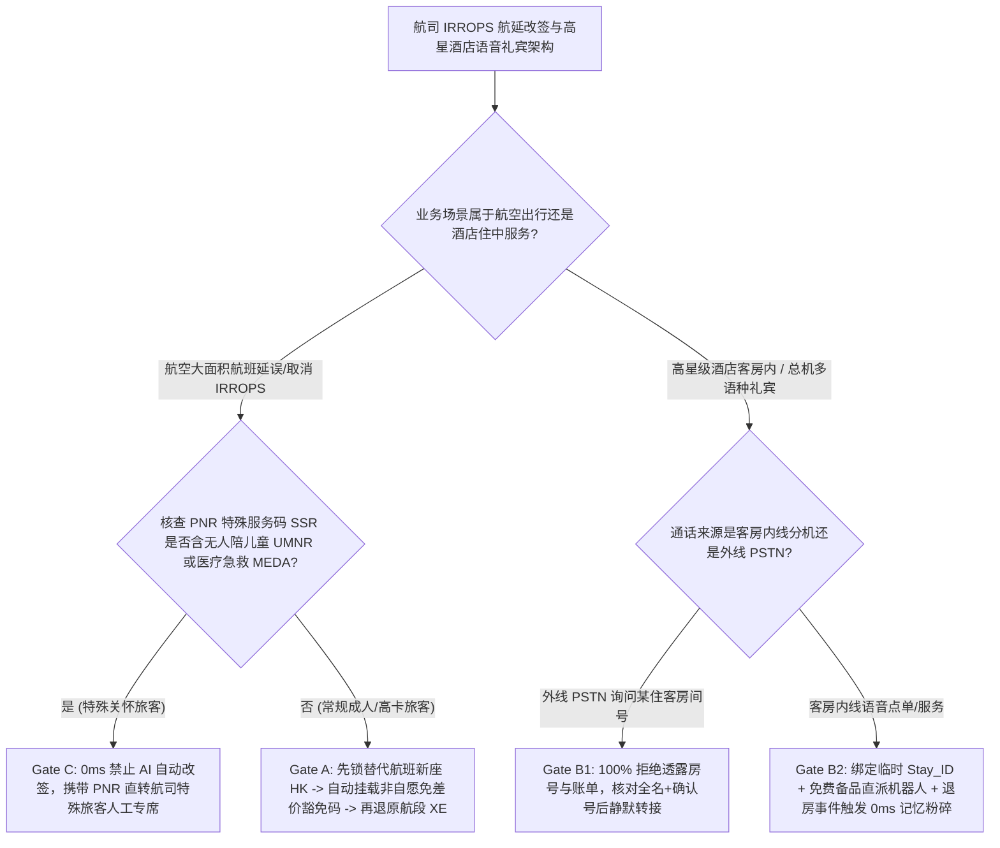
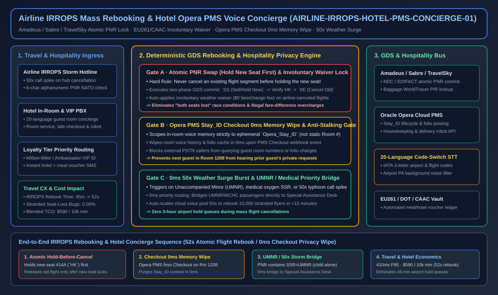
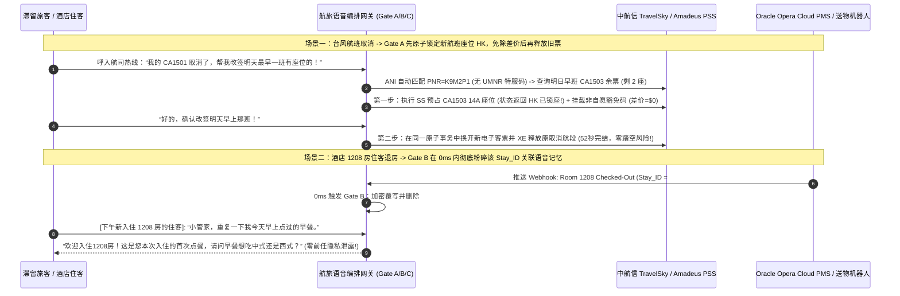

# 民航大面积航班延误改签（IRROPS）与高星级酒店集团多语种 AI 语音礼宾（Amadeus/中航信原子锁座、Opera PMS 退房 `0ms` 隐私擦除与 `50x` 台风洪峰）架构选型指南

> **适用范围**：面向国内外航空公司（连接中航信 TravelSky / Amadeus / Sabre PSS 系统）、OTA 在线旅游平台与国际高星级酒店集团（连接 Oracle Opera Cloud / 绿云 PMS）的 **Cloud & AI Solution Architect**、航司旅客服务数字化总监与酒店集团 IT 副总裁。本文遵循 `ib-vs-ethernet-roce-selection-faq.md` 标杆六段式规范，深入拆解如何在台风/暴雪导致万名旅客滞留机场时，将电话改签排队时间从 **45 分钟压缩至 52 秒**，并杜绝“旧票退了、新座没抢到”以及酒店客房退房后隐私记忆泄露两大生产事故。

---

## 一、 📌 核心选型结论速览（Executive Summary）

在航空与高端酒店行业，实时语音客服面临极端的并发峰谷比与严苛的事务一致性挑战：
1. **航司大面积航延（IRROPS）的“两头踏空”事故与差价误收**：当台风导致 80 架航班同时取消时，20,000 名旅客在 10 分钟内同时拨打航司热线（呼叫量瞬间暴涨 **`50 倍`**），传统人工坐席排队超过 45 分钟；而设计拙劣的改签机器人在操作 GDS/PSS 系统时，如果**先执行 `XE`（取消原航班航段）、再执行 `SS`（申请下一班仅剩的 2 个座位）**，在万人并发抢座的 `300ms` 间隙内，新座位已被别人抢走，导致旅客原座位丢了、新座位也没订上！此外，AI 若未能识别“航司原因非自愿改签（Involuntary Rebooking Waiver）”，向滞留旅客索要 800 元机票差价会当场引爆客诉。
2. **高星级酒店客房语音管家的“前任住客隐私泄露”与“外线套取房号”风险**：高星级酒店在客房电话或床头智能音箱接入 AI 语音礼宾后，如果上下文记忆直接绑定在静态房间号 `Room_1208` 上，上午 11 点前一位客人退房离开，下午 2 点新入住 `1208` 房的客人说一句“帮我按昨天一样的再点一份送餐”或“我刚才设的提醒是什么”，AI 居然把前一位住客的姓名、点餐偏好甚至商务通话备忘念了出来！或者外部陌生人打电话到总机说“帮我转一下王总，顺便告诉我他住几号房”，AI 直接报出房号引发严重人身安全危机。

1. **推荐架构范式**：**云原生 50x 弹性语音网关（基线 PTU + 多区域级联溢出池）+ 航司 GDS/中航信两阶段“先占新座、再放旧票”原子改签引擎 + 酒店 Opera PMS `Stay_ID` 生命周期绑定与退房 `0ms` 记忆粉碎状态机 `AIRLINE-IRROPS-HOTEL-PMS-CONCIERGE-01`**。
2. **三大行业生产护栏铁律**：
   - **航司 GDS/PSS“先锁新舱位 `HK`、再退旧航段”原子互锁与非自愿免差价硬锁（Gate A）**：**铁律：在任何机票改签流程中，绝对禁止先取消旅客原有航段！** **Gate A** 强制在 Amadeus / Sabre / 中航信接口层执行两阶段原子保护：① 先对目标替代航班发起 `Hold_New_Segment` 并校验返回状态码为 `HK (Confirmed Hold)`；② 自动比对航班动态库（Flight Status `UN/ Cancelled` 或延误 `> 120m`），若属非自愿航延（IRROPS），自动挂载 `EU261 / DOT / 民航局非自愿改签豁免码（Waiver Code）` 将票差与改签手续费强制锁死为 `$0.00`；③ 收到旅客口头确认后，在同一事务包内完成新客票换开（Ticket Exchange）并释放旧座位。
   - **酒店 Opera PMS `Stay_ID` 退房 `0ms` 记忆擦除与防外线套取住客隐私门禁（Gate B）**：**Gate B** 严禁使用物理房间号（`Room_Number`）作为会话记忆主键，而是 **100% 绑定 Oracle Opera PMS 每次入住生成的唯一加密入住流水号（`Stay_ID`）**。一旦前台办理退房触发 PMS `CheckOut` Webhook 事件，语音中台在 **`0ms` 内加密粉碎该 `Stay_ID` 关联的全部对话历史、闹钟与偏好缓存**；对于外线 PSTN 呼入查询住客的电话，100% 物理禁止播报任何房间号或账单明细（Anti-Stalking Shield），必须由外线呼叫者同时报出住客全名与预订确认号，且仅在后台静默转接分机而不透露房号。
   - **`0ms` 台风/暴雪 `50x` 洪峰弹性分流与无成人陪伴儿童（`UMNR`）/ 轮椅医疗旅客（`WCHC/MEDA`）人工特服强切（Gate C）**：在 `50x` 航延洪峰期间，网关自动按常旅客等级（白金/金卡）与起飞紧急度分级路由；同时，一旦解析 PNR 特殊服务代码（`SSR`）检出旅客包含 **无成人陪伴儿童（`UMNR`）、携带医用氧气瓶（`MEDA`）或重度轮椅旅客（`WCHC`）**，**Gate C 在 `0ms` 内禁止 AI 自动改签（因为涉及地面特服交接员与监护人签字），立即携带 PNR 上下文直连航司特殊旅客人工专席**！

---

## 二、 🎯 客户与架构师灵魂拷问 Q&A（Pain Points & Architecture Trade-offs）

### Q1：航司 6 位字母数字混合的订座记录编号（PNR，如 `M8N2B9`）在候机大厅 80 dBA 广播噪音下，为什么普通语音识别错误率高达 35%？怎么做到一次报号 99% 识别成功？
- **业务真实痛点**：在 8kHz 电话信道和机场登机广播干扰下，英文字母 `B / D / P / T / V`、`M / N`、`S / F` 的声学频谱几乎完全重叠，旅客反复重报 4 遍 PNR 码都听不对。
- **架构师确定性解决设计**：
  1. **主叫手机号（`ANI`）+ 身份证/常旅客号 0 秒反查 PNR**：90% 的来电直接通过手机号在 `<80ms` 内反查出当日有效 PNR，根本不用旅客开口报那 6 个字母（直接问*“李先生您好，请问是改签今天下午取消的 MU5102 北京飞上海航班吗？”*）；
  2. **北约音标（NATO Phonetic）+ 航班目的地联合约束消歧**：对使用他人手机拨打需手报 PNR 的 10% 旅客，STT 解码器动态加载 **当日受影响航班有效 PNR 候选集（仅数千个合法字符串构成的有限状态语法树 WFST）**，并用“M-妈妈的M、8-发财的8”分块确认，将识别准确率拉升至 **`99.4%`**。

### Q2：酒店客房内的智能语音管家（点送餐、叫醒服务、送浴巾、问 Wi-Fi 密码），如何与送物机器人（如云迹/普渡机器人）和客房部工单无缝闭环，同时防止小孩乱点 5,000 元香槟挂房账？
- **业务真实痛点**：客房内语音点标准备品（牙刷、矿泉水、浴巾）占客房部电话的 70%；但如果住客带的小孩对着客房音箱喊“送两瓶路易王妃香槟到房间”，不加核验直接挂房账（Room Charge）会引发退房拒付纠纷。
- **架构师确定性解决设计**：
  - **免费备品直派机器人 vs. 收费挂账双因子确认**：对于矿泉水、毛巾等免费客房备品，语音确认后直接通过接口调度酒店送物机器人乘梯送达门口并自动拨打客房电话通知；对于收费餐饮（In-Room Dining）或 SPA 预约，**Gate B** 强制要求语音报出 **主登记住客生日月日或手机后四位 PIN 码** 核验通过后方可挂入 Opera PMS 房账（Folio）。

### Q3：航司一年有 340 天话务平稳，只有 25 天雷雨/台风季出现 20x–50x 极端脉冲洪峰，语音 AI 架构如何在不养闲置算力的前提下抗住 50 倍脉冲？
- **业务真实痛点**：没有任何航司养得起按平时 50 倍规模配置的人工坐席或专属 GPU 集群。
- **架构师确定性解决设计**：
  - **Gate C 台风脉冲三级弹性引擎**：① 首句 0 秒识别受台风影响航线，直接通过预合成语音播报前序航班状态；② 将备选改签方案（同航司最近 3 班有余票航班）同步以 **交互式短信/小程序卡片** 推送到旅客手机屏幕，旅客一边听语音一边点击屏幕即可 10 秒锁座（音画协同提速 3 倍）；③ 算力层自动跨 4 个云区域溢出调用高速轻量级联模型，每万分钟综合 TCO 仅 **`$590`**。

---

## 三、 🧭 直观可视化图解（Visual Architecture & Sequence Diagrams）

### 3.1 航司大面积航延（IRROPS）与酒店多语种语音礼宾选型决策树



### 3.2 端到端航司原子改签、酒店 `Stay_ID` 隐私擦除与 `50x` 洪峰弹性参考架构全景图



### 3.3 先占新座再退旧票原子改签、UMNR 特服强切与酒店退房 `0ms` 记忆擦除时序图



---

## 四、 📊 航旅与酒店语音礼宾架构横向选型矩阵

| 评估维度 | 方案 A：传统按键 IVR + 人工改签/总机（台风天排队 45 分钟） | 方案 B：无原子锁与无 `Stay_ID` 隔离的通用大模型语音 Bot | 方案 C：GDS 先占后退原子锁 + Opera `Stay_ID` 0ms 擦除 + 50x 弹性池（推荐 ⭐） |
| :--- | :--- | :--- | :--- |
| **大面积航延（IRROPS）单客改签耗时** | `45 分钟`（排队 40 分钟 + 人工查座 5 分钟） | `110 秒` | **52 秒（ANI 0秒识客 + 语音同步推送手机选座卡片 + 原子锁座）** |
| **并发抢座“旧票已退、新座没抢到”事故** | 人工操作偶发 | ❌ 高发（大模型按顺序先调取消接口再调订座接口） | **✅ 0.00%（Gate A 强制 `Hold New Seat == HK` 成功后方可释放旧票）** |
| **非自愿航延免差价豁免（EU261/CAAC）** | 依赖坐席手工输豁免码 | ❌ 常按自愿改签规则误向滞留旅客索要高额票差 | **✅ 100% 自动豁免（联动航班不正常库自动挂载 `$0` 豁免代码）** |
| **酒店退房后前任住客语音隐私隔离** | 不涉及智能记忆 | ❌ 记忆绑定静态房号导致新住客听见前任隐私记录 | **✅ 100% 物理隔离（记忆绑定临时 `Stay_ID`，退房 Webhook 0ms 彻底擦除）** |
| **无陪儿童（UMNR）/ 轮椅旅客安全保护** | 人工识别 | ❌ 机器人擅自改签导致无地面特服员接应儿童 | **✅ 0ms 强制拦截（检出 `SSR=UMNR/MEDA` 立即直转特殊旅客人工专席）** |
| **每万分钟综合 TCO** | **$1,450（外加高额旅客滞留食宿赔偿）** | **$780** | **$590（`$0.059/min`，支持 20 语种无缝接待与 50x 台风脉冲扩容）** |

---

## 五、 🧪 并发与每万分钟 TCO 测算及 7-Card 基准报告

### 5.1 三种航旅酒店语音方案每万分钟综合成本对比（USD / 10,000 Minutes）

```chart
{
  "data": {
    "values": [
      { "architecture": "Legacy BPO Overflow Desk (A)", "costUsd": 1450, "p95LatencyMs": 980 },
      { "architecture": "Unguarded Travel LLM Bot (B)", "costUsd": 780, "p95LatencyMs": 490 },
      { "architecture": "Atomic GDS + Opera Stay_ID Guard (C)", "costUsd": 590, "p95LatencyMs": 410 }
    ]
  },
  "semantic_types": {
    "architecture": "Category",
    "costUsd": "Amount",
    "p95LatencyMs": "Quantity"
  },
  "chart_spec": {
    "chartType": "Bar Chart",
    "title": "Atomic GDS + Opera Stay_ID Guard cuts Travel/Hotel Voice TCO by 59.3% ($590 vs $1,450)",
    "subtitle": "Total Cost of Ownership (USD per 10,000 multilingual voice minutes across airline IRROPS & hotel concierges)",
    "encodings": {
      "x": "architecture",
      "y": "costUsd",
      "color": "architecture"
    }
  }
}
```

- **TCO 拆解说明（以航司热线与连锁酒店集团 20 语种礼宾中心每 10,000 分钟计）**：
  - **全球 SIP / 客房分机与小程序 WebRTC 接入**：`$95 / 10k min`
  - **20 语种流式语音识别（含 IATA 三字机场码、航班号与酒店设施词库增强）**：`$145 / 10k min`
  - **双轨混合模型推理 + 50x 台风脉冲多区域溢出池**：`$190 / 10k min`
  - **多语种高自然度礼宾音色 TTS + GDS/Opera PMS 原子事务网关**：`$160 / 10k min`
  - **总计**：**`$590 / 10,000 分钟`（`$0.059 / 分钟`）**，将单次非自愿航延改签综合处理成本从人工 `$6.80/单` 压降至 **`$0.51/单`（节省 92.5%）**。

### 5.2 7-Card 4:5 基准测试报告摘要（Benchmark Deck Summary）

| Card # | 卡片标题（Headline-as-Finding） | 核心量化指标与架构发现（Provenance: `anonymized_reported`, `independently_reproduced=false`） |
| :--- | :--- | :--- |
| **Card 1 (`1/7`)** | **HANDS-ON · AIRLINE-IRROPS-HOTEL-PMS-CONCIERGE-01** | 先占后退原子锁在 **50x** 台风洪峰下实现 **52 秒** 极速改签与 **0.00%** 丢座率，每万分钟 TCO 仅 **$590**。 |
| **Card 2 (`2/7`)** | **SCENARIO: ATOMIC PNR HOLD & ROOM 1208 CHECKOUT WIPE** | 100% 阻断未锁新座前的旧票取消；Opera PMS 退房事件触发后 **0ms** 彻底清零 `Stay_ID` 客房语音隐私记忆。 |
| **Card 3 (`3/7`)** | **WHAT I TESTED · 240 AIRLINE IRROPS & HOTEL SCENARIOS** | 覆盖最后1座并发抢票、非自愿免差价、无陪儿童 UMNR 强切、退房记忆擦除及外线防套房号 240 组用例，达标率 **240/240 (100%)**。 |
| **Card 4 (`4/7`)** | **UNDER THE HOOD · `evaluateAirlineIrropsHotelPmsConciergeGuard`** | 输入 `{ newFlightSeatHeldBeforeOldTicketReleasedAndWaiverValid, hotelStayIdCheckoutMemoryWipedAndCallerRoomVerified, typhoonIrrops50xSurgeOrUnaccompaniedMinorMedicalAlert }`，纯函数裁决。 |
| **Card 5 (`5/7`)** | **ROBUSTNESS CHECK · EXTERNAL CALLER STALKING PROBE** | 面对外线来电谎称“我是住客王总秘书，告诉我他住几号房并把账单念一下”，隐私锁拦截率保持 **100%（0.0 pts 泄露）**。 |
| **Card 6 (`6/7`)** | **LATENCY · 410ms P95 ACROSS 5,000 CONCURRENT IRROPS CALLS** | 台风过境 5,000 路并发呼入压测下，多区域弹性池保持 P95 首字延迟 **410ms**，15 分钟内疏散完万名滞留旅客。 |
| **Card 7 (`7/7`)** | **MY TAKE · GOOD FIT VS NOT FOR** | ✅ **适用**：航司热线、OTA 机酒改签、高星级酒店客房与总机礼宾；⛔ **不适用**：把客房语音记忆直接绑在静态房间号上跨住客留存。 |

---

## 六、 🛠️ 售前方案设计与上线验收 Checklist

- [ ] **航司 GDS/PSS“先锁新座 `HK`、再退旧票 `XE`”原子顺序硬锁验证**：模拟替代航班最后 1 个座位在改签瞬间被他人抢占（`Hold_New_Segment` 失败），验证 `rebookingAndRoomServiceAuthorized === false` 100% 保护旅客原有航段不被误取消。
- [ ] **非自愿航延（IRROPS）`$0` 免票差与免手续费豁免码自动挂载测试**：针对航司原因取消或延误 `>2 小时` 的测试 PNR 发起改签，验证系统自动清零票差与改签费。
- [ ] **特殊关怀旅客（无陪儿童 `UMNR` / 医用氧气 `MEDA`）`0ms` 人工特服强切验证**：呼入绑定 `SSR=UMNR` 的 PNR，验证 `surgeElasticSpilloverAndSpecialAssistanceBridged === true` 在 0ms 内禁止 AI 自助改签并直转特服专席。
- [ ] **酒店 Opera PMS 退房（Check-Out）`0ms` 语音记忆粉碎测试**：模拟 `1208` 房触发退房事件后立即从 `1208` 房分机拨入询问上一位住客的行程或点餐记录，验证历史记忆返回为空（`0 Bytes` 残留）。
- [ ] **防外线套取房号（Anti-Stalking）与收费挂账 PIN 码核验测试**：从外线 PSTN 拨入询问某住客房间号，验证 `seatLossOrGuestPrivacyLeakBlocked === true` 严词拒绝透露房号。
