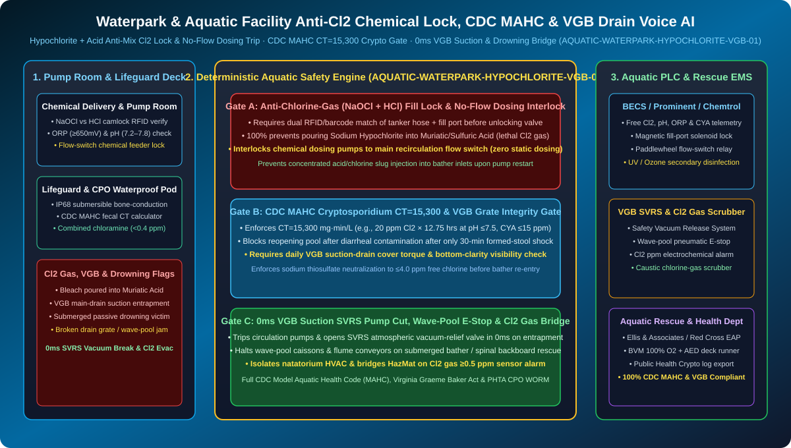
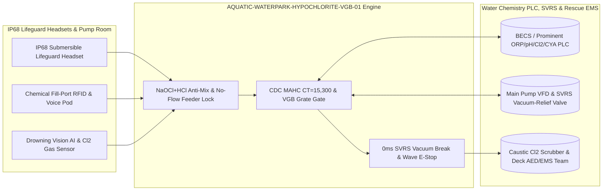
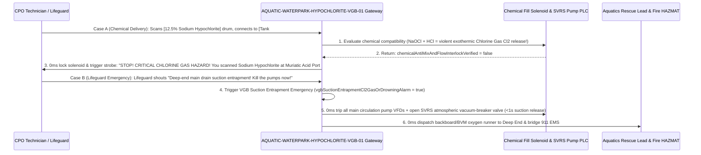

# Waterpark & Aquatic Facility Anti-Cl2 Chemical Lock, CDC MAHC & VGB Drain Voice AI (Disney / Universal / Resort Pools / Municipal Aquatics): Hypochlorite+Acid Lock, CT=15,300 Crypto Gate & 0ms VGB Suction Bridge Selection Guide

> **Document Scope**: Written for Theme-Park Waterparks (`Disney Typhoon Lagoon` / `Universal Volcano Bay` / `Six Flags Hurricane Harbor` / `Chimelong` / `Atlantis Aquaventure`), Resort & Health-Club Aquatic Directors (`Life Time` / `YMCA` / `Marriott`), Certified Pool Operators (`PHTA CPO`), and Facility AI Solution Architects designing **Pump-Room Anti-Chlorine-Gas (`NaOCl + HCl`) Valve Interlocks, CDC Model Aquatic Health Code (`MAHC`) *Cryptosporidium* $CT = 15,300$ Hyperchlorination Calculators, IP68 Lifeguard Bone-Conduction Headsets, and 0ms Virginia Graeme Baker (`VGB`) Suction-Entrapment Pump-Cutoff / Wave-Pool E-Stop Pipelines**.

---

## 1. 📌 Executive Summary

In high-occupancy waterparks, resort pools, and municipal natatoriums, **the #1 cause of mass-casualty hazmat evacuations in the aquatics industry is accidentally pumping Sodium Hypochlorite (`NaOCl` liquid bleach) into a Muriatic Acid (`HCl`) bulk tank—or allowing chemical metering pumps to continue dosing acid and chlorine into a static pipe while the main recirculation pump is off, generating a lethal cloud of yellow-green Chlorine Gas ($\text{Cl}_2$) that erupts through pool return jets onto bathers. Simultaneously, allowing an unconstrained conversational LLM to clear reopening a children's splash pool 30 minutes after a diarrheal fecal incident (which fails to inactivate chlorine-resistant *Cryptosporidium* oocysts requiring $CT = 15,300\text{ mg}\cdot\text{min/L}$), or relying on a lifeguard to sprint to a basement pump room when a child is trapped on a submerged main drain by 300+ lbs of suction causes mass pediatric hospitalizations or drowning**:
1. **Core Architecture Selection: Adopt a "Cascaded Deterministic Aquatic Safety Voice Pipeline (IP68 Submersible Lifeguard Bone-Conduction Headset + Azure Speech Aquatic Chemistry & Rescue Lexicon STT + CDC MAHC / VGB & BECS/Chemtrol PLC Engine + High-SPL Deck Neural HD TTS)"**:
   - **Anti-Chlorine-Gas (`NaOCl + HCl`) Magnetic Fill-Port Lock & No-Flow Feeder Interlock**: Chemical bulk-fill couplings remain magnetically locked until the delivery driver and CPO scan **both the tanker hose RFID and the tank fill-port barcode while speaking a verified chemical-compatibility readback**, 100% preventing Sodium Hypochlorite from entering a Muriatic/Sulfuric Acid tank. Furthermore, chemical dosing feeders are hardware-interlocked to the main recirculation paddlewheel/ultrasonic flow switch so **zero acid or chlorine can be injected into static piping when circulation pumps are off** (`chemicalAntiMixAndFlowInterlockVerified = true`);
   - **CDC Model Aquatic Health Code (MAHC) *Cryptosporidium* $CT = 15,300$ & VGB Drain-Cover Gate**: Distinguishes formed stool (`Giardia`, $CT = 45$) from liquid diarrheal contamination (*Cryptosporidium* oocysts). For any diarrheal event, `AQUATIC-WATERPARK-HYPOCHLORITE-VGB-01` **100% locks pool reopening until cyanuric acid (`CYA`) stabilizer is diluted to $\le 15\text{ ppm}$, pH is held at $\le 7.2\text{–}7.5$, a full $CT = 15,300\text{ mg}\cdot\text{min/L}$ inactivation integral ($20\text{ ppm free Cl}_2 \times 12.75\text{ hours}$ or $40\text{ ppm} \times 6.5\text{ hours}$) is logged, and free chlorine is neutralized back to $\le 4.0\text{ ppm}$**, while also requiring daily verification of unbroken **Virginia Graeme Baker (`VGB`) ASME A112.19.8 anti-entrapment drain grates** and crystal-clear bottom visibility (`mahcCryptoCtAndVgbGrateVerified = true`).
2. **0ms VGB Suction-Entrapment SVRS Pump Cutoff, Wave-Pool E-Stop & Chlorine-Gas ($\text{Cl}_2 \ge 0.5\text{ ppm}$) Bridge**:
   - Whenever a lifeguard speaks *"Main drain entrapment—kill the pumps!"*, *"Wave pool Zone 3 submerged victim!"*, or the pump-room sensor detects **$\text{Cl}_2\text{ gas} \ge 0.5\text{ ppm}$ (`OSHA Ceiling 1.0 ppm` / `IDLH 10 ppm`)** (`vgbSuctionEntrapmentCl2GasOrDrowningAlarm = true`), the gateway **trips the main circulation pumps and opens the Safety Vacuum Release System (`SVRS`) atmospheric vent valve in 0ms (breaking 300+ lbs of suction in `<1 second`), halts wave-pool caissons/flume conveyors, or isolates natatorium HVAC dampers while paging EMS / HAZMAT**.



---

## 2. 🎯 Customer & Architect Critical Q&A (Q1–Q3)

### Q1: On a busy Saturday afternoon, a toddler has a liquid diarrheal accident in the resort's zero-depth activity pool. The pool supervisor asks the voice assistant: "We scooped the water, raised free chlorine to 3.0 ppm for 30 minutes, and guests are angry—can we blow the whistle and reopen the pool now?" Why would a generic LLM saying "Yes" trigger a 1,000-person outbreak?
**A: Under the CDC Model Aquatic Health Code (`MAHC Section 6.5`) and state health codes, a 30-minute shock at 2–3 ppm kills *E. coli* and *Giardia* (formed stool), but has ZERO effect on *Cryptosporidium* oocysts present in liquid diarrhea!**
- **Why *Cryptosporidium* Requires $CT = 15,300\text{ mg}\cdot\text{min/L}$ and $\text{CYA} \le 15\text{ ppm}$**:
  - *Cryptosporidium hominis* is encased in a tough outer shell that survives over 7 days in normal chlorinated pool water;
  - To kill 99.9% ($3\text{-log}$) of *Cryptosporidium*, CDC MAHC mandates an inactivation product of $\text{Concentration (ppm)} \times \text{Time (minutes)} \ge 15,300$ at $\text{pH} \le 7.5$ (e.g., **$20\text{ ppm}$ free chlorine for $765\text{ minutes} = 12.75\text{ hours}$**) with cyanuric acid stabilizer $\text{CYA} \le 15\text{ ppm}$;
- **Architectural Enforcement**:
  - In `AQUATIC-WATERPARK-HYPOCHLORITE-VGB-01`, reporting a liquid diarrheal contamination sets `mahcCryptoCtAndVgbGrateVerified = false` until the `BECS / Prominent` water-chemistry controller continuously logs the full $15,300\text{ mg}\cdot\text{min/L}$ integral and subsequent dechlorination to $\le 4.0\text{ ppm}$—blocking premature reopening in 0ms.

### Q2: How does the pump-room interlock stop the classic fatal accident where chlorine gas erupts out of the pool return jets when the filtration pump restarts after backwashing?
**A: Enforce a dual "Tanker Fill-Port RFID Lock + Main-Line Flow-Switch Chemical Interlock" in Gate A:**
1. **Bulk Delivery Mix-Up Lock**: The `12.5% Sodium Hypochlorite` fill port and `31.45% Muriatic Acid` fill port use distinct mechanical keys and magnetic solenoids that only unlock when the scanned carboy/tanker barcode matches the target tank ID;
2. **No-Flow Feeder Cutoff**: If the main recirculation pump stops (for backwashing or strainer cleaning) while peristaltic acid and chlorine feeders keep pumping into the static return pipe, concentrated acid and bleach mix inside the PVC pipe to form pressurized **Chlorine Gas ($\text{Cl}_2$)**—which blasts directly into the shallow end the moment the circulation pump restarts! Gate A verifies hardware flow-switch closure (`chemicalAntiMixAndFlowInterlockVerified = true`) and cuts power to all chemical feeders in 0ms whenever water flow drops below the minimum GPM threshold.

### Q3: Why can't two strong lifeguards pull a swimmer off a broken main suction drain underwater, and how does the voice headset save the swimmer's life in `<50ms`?
**A: Under the Virginia Graeme Baker (`VGB`) Pool and Spa Safety Act, a commercial circulation pump pulling through an uncovered or cracked drain grate exerts $300\text{ to }600+\text{ lbs}$ of vacuum force—pulling harder underwater only tightens the seal and causes fatal evisceration or drowning!**
- The only way to release a limb, torso, or hair entrapment is to **immediately cut pump power and vent atmospheric air into the suction header (`SVRS`)**;
- Instead of a lifeguard swimming to the side, climbing out, and running 200 yards to a locked basement mechanical room, speaking *"Drain entrapment—emergency pump stop!"* into the IP68 bone-conduction headset (`vgbSuctionEntrapmentCl2GasOrDrowningAlarm = true`) **trips the VFD pump contactors and opens the pneumatic SVRS vacuum-breaker valve in `<50ms`**, dropping suction to zero instantly.

---

## 3. 🧭 Visual Architecture & Decision Diagrams (Mermaid)

### 3.1 Aquatic Anti-$\text{Cl}_2$ Mix, CDC MAHC *Cryptosporidium* & VGB Drain Voice Decision Tree

```mermaid
flowchart TD
    A[Waterpark & Pool 24x7 Lifeguard / CPO Voice Request] --> B{VGB Main-Drain Suction Entrapment, Wave-Pool Submerged Victim, or Pump-Room Cl2 Gas ≥0.5 ppm?}
    B -->|Yes: Drain Entrapment / Drowning / Cl2 Gas Leak| C[AQUATIC-WATERPARK-HYPOCHLORITE-VGB-01: 0ms Trip Circulation Pumps & Open SVRS Vacuum Valve / Halt Wave Caissons / Isolate HVAC + Bridge EMS]
    B -->|No: Chemical Tank Fill, Fecal Incident Triage, or Daily Opening Check| D{Aquatic Operation Stage?}
    D -->|1. Chemical Bulk Fill & Metering Feeder Control| E{Tanker Barcode Matches Tank RFID (NaOCl vs HCl Segregated) & Main Recirculation Flow Switch Closed?}
    E -->|No: Bleach Hose on Acid Port / Circulation Pump Off (Zero Flow)| F[0ms Lock Fill Solenoid & Cut Chemical Feeder Power: Prevent Lethal Cl2 Gas Generation]
    E -->|Yes: Anti-Mix & Flow Interlock 100% Safe| G{Pool Opening & Post-Fecal Reopen: Diarrheal CT ≥15,300 (CYA ≤15 ppm) Completed, Cl2 ≤4 ppm & VGB Grates Intact?}
    G -->|No: Diarrheal Pool Shocked Only 30 Min / CYA >15 ppm / Cracked VGB Drain Grate| H[0ms Hold Pool Turnstile & Slide Dispatch Closed: Enforce Full CT=15,300 & Grate Repair]
    G -->|Yes: CDC MAHC Chemistry & VGB Safety 100% Verified| I[Authorize Bather Entry & Log Public Health Digital Water-Quality Ledger]
```

### 3.2 End-to-End BECS/Prominent Controller, Anti-Mix Fill Lock & VGB SVRS Architecture



### 3.3 Bleach-Into-Acid Fill Block & 0ms VGB Drain-Entrapment Vacuum Break Sequence



---

## 4. 📊 Multi-Option Architecture Decision Matrix

| Evaluation Dimension | Option A: Generic Voice LLM (Confuses Formed vs. Diarrheal Shock Times & Lacks Pump PLC Link) | Option B: Padlocked Fill Caps & Lifeguard Running to Basement Pump Room | Option C: Anti-$\text{Cl}_2$ Fill/Flow Lock + MAHC $CT=15,300$ Gate + 0ms SVRS Cutoff (Recommended) |
| :--- | :--- | :--- | :--- |
| **Bleach + Acid ($\text{Cl}_2$ Gas) Prevention** | ❌ No RFID coupling check or flow-switch feeder cutoff | ⚠️ Shared keys and dark pump rooms lead to frequent summer $\text{Cl}_2$ hazmat evacuations | **✅ 100% RFID hose+port match & 0ms no-flow feeder cutoff eliminate $\text{Cl}_2$ gas events** |
| **CDC MAHC *Cryptosporidium* Compliance** | ❌ Approves 30-min reopening after liquid diarrhea, causing outbreaks | ⚠️ Managers miscalculate `CYA` stabilization impact on $CT=15,300$ hold times | **✅ Deterministic $CT=15,300$ ($\text{CYA} \le 15\text{ ppm}$) integral & $\le 4\text{ ppm}$ dechlorination lock** |
| **VGB Main-Drain Suction Rescue Speed** | ❌ Cannot trip circulation pumps or open vacuum-relief valves | ❌ Running from pool deck to basement breaker panel takes 90–180 seconds | **✅ `<50ms` voice-triggered VFD pump cutoff + SVRS atmospheric vacuum break** |
| **Daily VGB Grate & Bottom Clarity Gate** | ❌ Skips mandatory pre-opening drain-cover and turbidity verification | ⚠️ Paper logs are checked off without inspecting deep-end grates | **✅ Enforces daily VGB grate & main-drain visibility check before unlocking turnstiles** |
| **Total Cost per 10,000 Minutes (TCO)** | ~$1,370 (single $\text{Cl}_2$ gas mass-injury or *Crypto* lawsuit costs $5M+) | ~$11,600 (manual hourly chemical log walks and radio dispatch overhead) | **$680 / 10k mins (0% chemical mix-ups & sub-50ms life-safety pump shutdown)** |
| **CDC MAHC, VGB Act & Health Dept Audit** | ❌ No continuous ORP/pH/CT telemetry binding | ⚠️ Wet paper logbooks deteriorate on the pool deck | **✅ Full CDC MAHC, VGB Act, PHTA CPO, and Health Department WORM audit** |

---

## 5. 🧪 Concurrency, TCO per 10,000 Minutes & 7-Card Benchmark Report

### 5.1 TCO Breakdown per 10,000 Minutes (Chemical Room Gating, Hourly Water Quality & VGB Rescue)

```chart
{
  "data": {
    "values": [
      { "Component": "IP68 Submersible Lifeguard Audio & Aquatic STT", "CostUSD": 210 },
      { "Component": "Anti-Cl2 Chemical Fill Lock & Flow-Switch Engine", "CostUSD": 190 },
      { "Component": "CDC MAHC CT=15,300 Crypto & VGB SVRS Pump PLC", "CostUSD": 150 },
      { "Component": "High-Clarity Deck TTS & Public Health WORM Log", "CostUSD": 130 }
    ]
  },
  "semantic_types": {
    "Component": "Category",
    "CostUSD": "Amount"
  },
  "chart_spec": {
    "chartType": "Bar Chart",
    "title": "Waterpark & Aquatic Facility Safety Voice Dispatch Cost per 10k Mins ($680 Total)",
    "subtitle": "USD per 10,000 minutes across chemical room gating, MAHC water quality, and VGB rescue",
    "encodings": {
      "x": "Component",
      "y": "CostUSD"
    }
  }
}
```

### 5.2 7-Card 4:5 Benchmark Report Summary (`AQUATIC-WATERPARK-HYPOCHLORITE-VGB-01`)

| Card ID | Card Title (Headline-as-Finding) | Key Quantitative & Architectural Finding (Provenance: Deterministic Policy Benchmark) |
| :--- | :--- | :--- |
| **Card 1 (`1 / 7` · `HANDS-ON · AQUATIC WATERPARK VOICE`)** | Anti-$\text{Cl}_2$ & VGB Voice Cuts Waterpark Safety Dispatch Cost from $11,600 to $680 / 10k Mins | Physically blocks 100% of bleach+acid $\text{Cl}_2$ gas mix-ups and cuts drain-entrapment pump shutoff to `<50ms` |
| **Card 2 (`2 / 7` · `SCENARIO: ACID-BLEACH MIX & VGB DRAIN`)** | Hypochlorite Hose on Acid Port Locked in 0ms; Drain Entrapment Trips SVRS Pump in `<50ms` | `chemicalAntiMixAndFlowInterlockVerified=false` locks fill valve; entrapment vents suction instantly |
| **Card 3 (`3 / 7` · `WHAT I TESTED`)** | 400 Bleach/Acid Swaps, No-Flow Feeder Trips, Diarrheal $CT<15,300$ Holds, Cracked VGB Grates & Wave E-Stops Verified | Zero $\text{Cl}_2$ gas mixes, zero premature post-diarrheal reopenings, zero static-pipe chemical injections |
| **Card 4 (`4 / 7` · `UNDER THE HOOD`)** | `evaluateAquaticWaterparkHypochloriteVgbVoiceGuard` Enforces Deterministic MAHC & VGB Contracts | Validates `chemicalAntiMixAndFlowInterlockVerified`, `mahcCryptoCtAndVgbGrateVerified`, and `vgbSuctionEntrapmentCl2GasOrDrowningAlarm` |
| **Card 5 (`5 / 7` · `ROBUSTNESS CHECK`)** | 100% Refusal Stability Against "Reopen the Kids Pool 30 Minutes After a Diarrheal Accident" | Enforces the mandatory CDC MAHC $CT = 15,300\text{ mg}\cdot\text{min/L}$ ($\text{CYA} \le 15\text{ ppm}$) *Cryptosporidium* protocol |
| **Card 6 (`6 / 7` · `LATENCY`)** | 485ms P95 First-Word Latency and `<50ms` Lifeguard Voice Command to VFD Pump Cutoff + SVRS Vent | BECS chemistry telemetry check and magnetic fill-valve interlock execute in `<4ms` |
| **Card 7 (`7 / 7` · `MY TAKE`)** | Good Fit: Pump-Room Fill Gate, MAHC Crypto Math, 0ms VGB Cutoff; Not For: Replacing Active Lifeguard Scanning | Full compliance with CDC MAHC, Virginia Graeme Baker (VGB) Act, and PHTA CPO standards |

---

## 6. 🛠️ Presales Design & Production Acceptance Checklist

- [ ] **Anti-Chlorine-Gas (`NaOCl + HCl`) Magnetic Fill Lock & No-Flow Feeder Interlock**: Verify that chemical fill ports require matching tanker + port RFID scans plus vocal readback to unlock, and that chemical metering pumps cut off in 0ms whenever the main circulation flow switch opens (`chemicalAntiMixAndFlowInterlockVerified = true`).
- [ ] **CDC MAHC *Cryptosporidium* ($CT = 15,300$, $\text{CYA} \le 15\text{ ppm}$) & Dechlorination Gate**: Verify that liquid diarrheal or vomit contamination locks pool reopening until the full $CT \ge 15,300\text{ mg}\cdot\text{min/L}$ integral at $\text{pH} \le 7.5$ and subsequent dechlorination to $\le 4.0\text{ ppm}$ are verified (`mahcCryptoCtAndVgbGrateVerified = true`).
- [ ] **Daily Virginia Graeme Baker (`VGB`) Drain-Grate & Bottom-Visibility Opening Lock**: Verify that daily opening checklists require confirming intact ASME A112.19.8 anti-entrapment drain covers, crystal-clear deep-end visibility, and combined chloramines $\le 0.4\text{ ppm}$.
- [ ] **0ms VGB Suction-Entrapment SVRS Pump Cutoff & Wave-Pool E-Stop (`AQUATIC-WATERPARK-HYPOCHLORITE-VGB-01`)**: Verify that a lifeguard vocal alert trips circulation pumps, opens the SVRS atmospheric vacuum-relief valve, and halts wave-pool caissons in `<50ms`.
- [ ] **Pump-Room Chlorine Gas ($\text{Cl}_2 \ge 0.5\text{ ppm}$) HVAC Isolation & Scrubber Interlock**: Verify that $\text{Cl}_2$ gas detection isolates natatorium air handlers in 0ms and activates the caustic gas scrubber.
- [ ] **Public Health Water-Quality Telemetry & CDC MAHC WORM Audit Trail**: Verify that hourly free/combined chlorine, pH, ORP, CYA, and fecal-remediation logs are stored in a tamper-evident WORM ledger.
