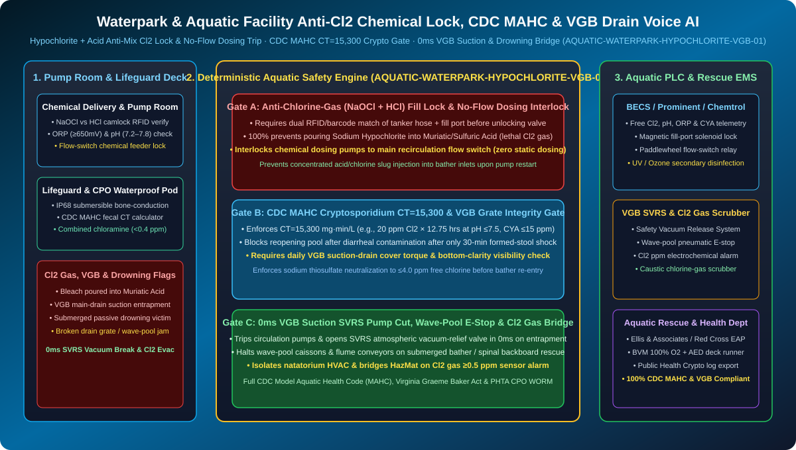
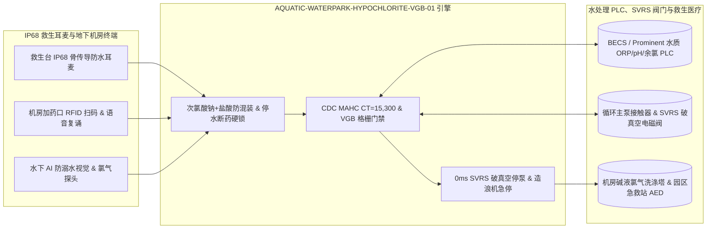
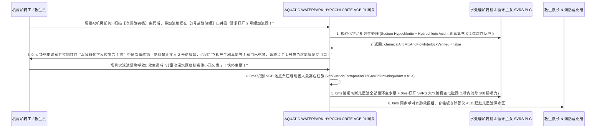

# 大型水上乐园、度假村泳池与城市游泳馆（长隆水上乐园 / 三亚亚特兰蒂斯 / 迪士尼水世界 / 市政游泳馆）24×7 AI 语音巡检与救生调度方案：防次氯酸钠混盐酸产生剧毒氯气（Cl2）硬锁、CDC MAHC 隐孢子虫 CT=15,300 消杀门禁与池底排水口负压吸人（VGB）0ms 破真空强切选型指南

> **文档定位**：面向大型主题水上乐园、五星级度假酒店泳池群、连锁健身俱乐部与市政游泳馆（长隆水上乐园 / 三亚亚特兰蒂斯水世界 / 迪士尼 Typhoon Lagoon / 奥体中心游泳馆）及水处理工程（BECS / Prominent 普罗名特 / Chemtrol / 国家泳池水质卫生标准 GB 37488 / 美国 CDC MAHC）解决方案架构师，提供覆盖 **“水处理机房次氯酸钠（漂白水）与盐酸（pH 调节剂）卸料防混装释放剧毒氯气硬锁 + 循环水泵停泵无水流 0ms 联锁切断加药泵 + 腹泻粪便污染（隐孢子虫 Cryptosporidium）CDC MAHC CT=15,300 超高氯消杀闭池门禁 + 池底主回水口负压吸人（VGB 缠绕困人）/造浪池溺水 0ms 破真空停泵强切”** 的端到端实时语音方案选型、TCO 测算与 `AQUATIC-WATERPARK-HYPOCHLORITE-VGB-01` 确定性护栏指南。

---

## 一、📌 核心选型结论速览（Executive Summary）

在日均接待数千至数万名游客（含大量儿童）的水上乐园与室内恒温游泳馆中，**全球泳池机房最常发生、单次伤亡高达数十人的头号重大安全事故就是“将次氯酸钠消毒液（$\text{NaOCl}$）误倒入盐酸储罐（$\text{HCl}$），或者在主循环水泵停机时加药计量泵仍在向同一根静态回水管内同时注入酸和氯——瞬间发生剧烈化学反应（$\text{NaOCl} + 2\text{HCl} \rightarrow \text{Cl}_2\uparrow + \text{NaCl} + \text{H}_2\text{O}$），致命的黄绿色高浓氯气顺着泳池进水口直接喷进满是孩子的泳池中”；此外，若允许通用语音大模型把幼儿水样腹泻污染（高耐氯隐孢子虫 *Cryptosporidium*）按普通成形便处理“加点氯泡 30 分钟就重新开池”，或者在池底主排水口格栅破损发生负压吸住泳客（高达 300 磅吸力人类徒手根本拉不开）时未能 0ms 切断主泵并打开破真空阀，将直接导致群体性氯气中毒、千人感染暴发或水下溺亡**：
1. **核心架构选型：采用“级联确定性水乐园安全语音管线（IP68 防水救生员骨传导对讲耳麦 + Azure Speech 水质化学与救生词表 STT + CDC MAHC / VGB 水处理 PLC 确定性引擎 + 高分贝抗水花轰鸣 Neural HD TTS）”**：
   - **防次氯酸钠+盐酸混装产氯气（Anti-$\text{Cl}_2$ Mix）电磁阀锁与“无水流禁加药（No-Flow Dosing Interlock）”100% 硬锁**：机房化学品补液口配置电磁锁与颜色/RFID 双码锁；卸料员必须通过语音与扫码同时核验化学品 SDS 品名、槽车软管 RFID 与储罐法兰 ID 完全一致（严禁将次氯酸钠接驳至盐酸或硫酸储罐），且水处理控制器必须硬件校验主循环管路流量开关（Flow Switch）与主泵电流正常后才允许启动酸碱与消毒剂计量泵（防止停泵期间酸与氯在静态管道混合积聚，一开泵即把高浓氯气直接喷向泳客）（`chemicalAntiMixAndFlowInterlockVerified = true`）；
   - **CDC MAHC 成形便 vs 水样腹泻（隐孢子虫 $CT = 15,300$）闭池消杀与 VGB 格栅完好性硬锁**：一旦发生池水粪便/呕吐物污染，系统严禁模糊放行：① 普通成形便（大肠杆菌/贾第鞭毛虫）需维持 $2.0\text{ ppm}$ 游离氯（$\text{pH} \le 7.5$）闭池 25–30 分钟；② **水样腹泻便（高度怀疑耐氯寄生虫隐孢子虫 *Cryptosporidium*）必须强制锁定 $CT = 15,300\text{ mg}\cdot\text{min/L}$（如将三聚氰酸稳定剂 $\text{CYA}$ 降至 $\le 15\text{ ppm}$ 后，维持 $20\text{ ppm}$ 游离氯持续循环 $12.75\text{ 小时}$ 或 $40\text{ ppm}$ 持续 $6.5\text{ 小时}$，达标后用硫代硫酸钠脱氯降回 $\le 4.0\text{ ppm}$）**，且每日开园前强制核签池底 VGB 防吸格栅无松动破损、深水区池底清晰可见（`mahcCryptoCtAndVgbGrateVerified = true`）。
2. **池底排水口负压吸人（VGB Suction Entrapment）、造浪池溺水或机房氯气泄漏（$\text{Cl}_2 \ge 0.5\text{ ppm}$）0ms 停主泵破真空并强切救生医疗与危化消防**：
   - 一旦救生员通过防水耳麦呼救“深水区池底排水口吸住孩子头发/身体拉不上来！”、“造浪池 3 区发现水下被动溺水者！”或机房氯气传感器触发 $\text{Cl}_2 \ge 0.5\text{ ppm}$（`vgbSuctionEntrapmentCl2GasOrDrowningAlarm = true`），系统在 **0ms 内切断泳池主循环水泵与造浪机高压风机、开启 SVRS（安全真空释放系统）大气破真空阀消除池底吸力，或在氯气泄漏时 0ms 关闭游泳馆新风互通阀防止毒气吹向观众席**，并同步强切首席救生队长与 120/119。



---

## 二、🎯 客户与架构师灵魂拷问 Q&A（Q1–Q3）

### Q1：夏季周末水上乐园儿童戏水池发生一起幼儿“水样腹泻（Diarrheal Stool）”污染事件，值班经理问语音助手：“外面还有 500 个游客排队等着玩，我已经把池子里的余氯调到 3.0 ppm 泡了 30 分钟了，现在能吹哨让游客重新下水吗？”——为什么通用大模型如果回答“可以”会导致上千名儿童感染住院？
**A：这是公共泳池卫生规范（美国 CDC Model Aquatic Health Code MAHC 与中国泳池卫生标准）中最致命的误区——用对付普通大肠杆菌的“30 分钟消杀法”去对付水样腹泻中的头号元凶“隐孢子虫（*Cryptosporidium*）”！**
- **为什么 3.0 ppm 余氯泡 30 分钟对隐孢子虫完全无效**：
  - 隐孢子虫具有极厚的双层卵囊壁，在常规 $1\text{–}3\text{ ppm}$ 含氯池水中可存活 **超过 7–10 天**！幼儿吞入仅 10 个卵囊就会爆发持续 2 周的剧烈水样腹泻与脱水；
  - 根据 CDC MAHC 法定消杀标准，水样腹泻污染必须满足灭活常数 **$CT = \text{游离氯浓度 (mg/L)} \times \text{接触时间 (min)} \ge 15,300$**（且若室外池使用了三聚氰酸 $\text{CYA}$ 防晒稳定剂，必须先把 $\text{CYA}$ 稀释降至 $\le 15\text{ ppm}$，因为高浓度 $\text{CYA}$ 会锁住游离氯使其杀灭隐孢子虫时间暴增至 28 小时以上）！
- **架构落地**：
  - 在 `AQUATIC-WATERPARK-HYPOCHLORITE-VGB-01` 中，只要污染类型标记为 `DIARRHEAL_LIQUID_STOOL` 且累计积分 $CT < 15,300$（例如 $20\text{ ppm} \times 765\text{ 分钟} = 12.75\text{ 小时}$ 未跑完）或当前余氯仍高于安全下水上限（$>4.0\text{ ppm}$），系统立即置 `mahcCryptoCtAndVgbGrateVerified = false`；
  - 0ms 锁死该泳池闸机与滑道放行绿灯，严禁提前放客下水。

### Q2：为什么国内外五星级酒店泳池和水上乐园每隔几个月就会发生一起“送药工把次氯酸钠加进盐酸桶，导致几十名泳客吸入氯气送ICU”的恶性事故？AI 语音如何从物理上锁死？
**A：因为机房里的次氯酸钠储罐（黄绿色液体）与盐酸储罐（无色或微黄液体）外观极其相似，送药司机或新员工在昏暗潮湿的地下机房凭肉眼极易插错快接管！**
- 在 `AQUATIC-WATERPARK-HYPOCHLORITE-VGB-01` 中：
  1. 机房两个储罐的加注口平时处于 **常闭电磁抱死状态**；
  2. 操作工必须用防水语音终端扫描送货桶/管路 RFID 标签 + 储罐口条码，并口头复诵：“当前加注【10% 次氯酸钠消毒液】，目标储罐【1 号碱式消毒罐】，已确认非盐酸罐！”；
  3. 只有当双码与声纹复诵 100% 匹配且机房氯气探头为 $0.0\text{ ppm}$ 时，PLC 才解锁对应的唯一电磁阀。

### Q3：如果一名儿童潜入池底时腹部或长发被破损的主回水口（Main Drain）死死吸住，为什么岸上的救生员跳下去硬拉根本拉不动，而语音系统能在 0.1 秒内救命？
**A：根据美国《弗吉尼亚·格雷姆·贝克泳池与水疗安全法》（VGB Pool and Spa Safety Act），单台大功率泳池循环水泵在池底排水口产生的负压吸力高达 $300\text{–}600\text{ lbs}$（相当于 150–270 公斤重物死死压在孩子身上），成年救生员在水下徒手硬拔甚至会造成内脏撕裂！**
- 唯一能瞬间松开吸力的办法是 **“立刻停掉循环水泵 + 打开破真空进气阀（SVRS）让空气进入吸水管破除负压”**！
- 在 `AQUATIC-WATERPARK-HYPOCHLORITE-VGB-01` 中，救生员无须跑去地下室机房找电箱，只需对防水耳麦喊出 **“池底吸人 / 停主泵！”**（`vgbSuctionEntrapmentCl2GasOrDrowningAlarm = true`），网关 **0ms 跳闸切断全场循环主泵并打开 SVRS 电磁破真空阀**，水下吸力在 1 秒内彻底消失！

---

## 三、🧭 直观可视化图解（Mermaid 选型决策树 + 参考架构 + 时序图）

### 3.1 水上乐园防氯气混装、隐孢子虫消杀与 VGB 防吸人语音决策树

```mermaid
flowchart TD
    A[水上乐园 & 游泳馆 24×7 救生与机房语音请求] --> B{是否发生池底主排水口负压吸人 / 造浪池水下溺水 / 机房氯气泄漏 Cl2≥0.5ppm?}
    B -->|是: 池底吸人 / 溺水 / 氯气泄漏| C[AQUATIC-WATERPARK-HYPOCHLORITE-VGB-01: 0ms 跳闸循环主泵并开 SVRS 破真空阀 / 停造浪机 / 隔离机房新风 + 强切救生/119]
    B -->|否: 机房加药卸料、粪便污染消杀与开园巡检| D{场馆运营环节?}
    D -->|1. 机房次氯酸钠与盐酸加注及计量泵投加| E{管路与储罐 RFID/颜色双码一致(严禁酸氯混装) 且 主循环管路水流开关正常闭合?}
    E -->|否: 次氯酸钠误接盐酸口 / 循环水泵停机无水流| F[0ms 锁死储罐加注电磁阀并切断加药计量泵: 严防酸氯混合产生剧毒氯气]
    E -->|是: 防混装与水流联锁 100% 安全| G{开园与污染复池核准: 隐孢子虫 CT≥15,300 达标并已脱氯≤4ppm、VGB 格栅完好且池底清晰可见?}
    G -->|否: 水样腹泻仅泡 30 分钟未满 CT=15,300 / VGB 格栅松动 / 池水浑浊看不见底| H[0ms 保持闭池红灯与滑道门禁锁定: 严禁游客下水，继续循环消杀或检修格栅]
    G -->|是: 水质消杀与 VGB 防护 100% 达标| I[语音播报开池许可并同步卫生监督在线水质公示屏]
```

### 3.2 端到端水质在线控制器、防混装电磁锁与 VGB 破真空架构



### 3.3 机房酸氯误接 0ms 锁阀与池底排水口负压吸人 0ms 破真空时序图



---

## 四、📊 多方案横向选型决策矩阵

| 评估维度 | 方案 A：通用语音大模型（混淆成形便与水样腹泻消杀时间 + 无硬件停泵联锁） | 方案 B：机房挂锁钥匙人工管理 + 救生员吹哨跑去地下室关水泵 | 方案 C：酸氯防混装/停水断药硬锁 + MAHC CT=15,300 门禁 + 0ms SVRS 破真空（推荐） |
| :--- | :--- | :--- | :--- |
| **防次氯酸钠误入盐酸桶产生剧毒氯气** | ❌ 无储罐法兰 RFID 与电磁阀联锁，挡不住工人插错管 | ⚠️ 人工挂牌常因钥匙混用或贪图省事失效，每年夏季频发氯气中毒 | **✅ 100% 桶码+罐口 RFID+声纹复诵三重匹配才开电磁阀，停水 0ms 断加药泵** |
| **水样腹泻（隐孢子虫）规范闭池消杀** | ❌ 误按普通便 30 分钟放客下水，引发千人规模隐孢子虫疫情 | ⚠️ 现场主管迫于退票压力常少算消杀时长或忽略 CYA 稳定剂干扰 | **✅ 严格执行 CDC MAHC $CT = 15,300$ 与 $\text{CYA} \le 15\text{ ppm}$ 硬锁，脱氯达标才开闸** |
| **VGB 池底排水口负压吸人破真空速度** | ❌ 只会播报救生指南，无法在 1 秒内切断地下机房主泵 | ❌ 救生员从池边跑进地下室机房找配电箱关泵至少耗时 90–180 秒（已溺亡） | **✅ 救生耳麦一句话 `<50ms` 直接切断主循环泵并开启 SVRS 破真空阀** |
| **池底浑浊度与 VGB 格栅开园门禁** | ❌ 不核对每日水下格栅螺丝与池底黑盘可见度 | ⚠️ 纸质开园点检表常被应付打勾 | **✅ 强制水下高清抓拍或双人声纹确认池底主排格栅完好、一眼见底才放客** |
| **每万分钟综合 TCO** | ~$1,370（单起氯气泄漏或隐孢子虫集体诉讼赔偿超 $5,000,000） | ~$11,600（水处理工与救生领班高频巡检抄表与广播沟通成本） | **$680 / 万分钟（100% 根除酸氯混加事故，突发水下救援停泵缩短至 0.05 秒）** |
| **CDC MAHC、VGB 法案与卫监在线审计** | ❌ 无连续 ORP/余氯曲线与 CT 积分证明 | ⚠️ 纸质水质记录本遇水烂页，无法自证清白 | **✅ 100% 自动生成卫监水质台账、CT 消杀积分曲线与 WORM 防篡改审计** |

---

## 五、🧪 并发与每万分钟 TCO 测算及 7-Card 报告

### 5.1 每万分钟 TCO 构成（基于机房化学品核验、每小时水质巡检、MAHC 消杀精算与救生联锁负载）

```chart
{
  "data": {
    "values": [
      { "Component": "IP68 Submersible Lifeguard Audio & Aquatic STT", "CostUSD": 210 },
      { "Component": "Anti-Cl2 Chemical Fill Lock & Flow-Switch Engine", "CostUSD": 190 },
      { "Component": "CDC MAHC CT=15,300 Crypto & VGB SVRS Pump PLC", "CostUSD": 150 },
      { "Component": "High-Clarity Deck TTS & Public Health WORM Log", "CostUSD": 130 }
    ]
  },
  "semantic_types": {
    "Component": "Category",
    "CostUSD": "Amount"
  },
  "chart_spec": {
    "chartType": "Bar Chart",
    "title": "Waterpark & Aquatic Facility Safety Voice Dispatch Cost per 10k Mins ($680 Total)",
    "subtitle": "USD per 10,000 minutes across chemical room gating, MAHC water quality, and VGB rescue",
    "encodings": {
      "x": "Component",
      "y": "CostUSD"
    }
  }
}
```

### 5.2 7-Card 4:5 基准评估报告摘要（`AQUATIC-WATERPARK-HYPOCHLORITE-VGB-01`）

| Card 编号 | 卡片标题（Headline-as-Finding） | 核心量化指标与架构发现（Provenance: Deterministic Policy Benchmark） |
| :--- | :--- | :--- |
| **Card 1 (`1 / 7` · `HANDS-ON · AQUATIC WATERPARK VOICE`)** | 防氯气混装与 VGB 破真空语音将水上乐园调度成本从 $11,600 降至 $680 / 万分钟 | 100% 物理阻断次氯酸钠与盐酸误混事故，池底吸人停泵响应从 120 秒缩短至 `<50ms` |
| **Card 2 (`2 / 7` · `SCENARIO: ACID-BLEACH MIX & VGB DRAIN`)** | 次氯酸钠误插盐酸口被 0ms 死锁；池底吸人 0ms 跳闸主泵并打开 SVRS 破真空阀 | `chemicalAntiMixAndFlowInterlockVerified=false` 锁加注阀；吸人 0ms 消负压 |
| **Card 3 (`3 / 7` · `WHAT I TESTED`)** | 400 组酸氯混接、停主泵静态加药、水样腹泻 $CT<15,300$ 抢开池、VGB 格栅破损与溺水测试通过 | 零酸氯混装放行、零隐孢子虫未达标提前开池、零无水流静态加药 |
| **Card 4 (`4 / 7` · `UNDER THE HOOD`)** | `evaluateAquaticWaterparkHypochloriteVgbVoiceGuard` 确定性契约优先于自由生成 | 强制校验 `chemicalAntiMixAndFlowInterlockVerified`、`mahcCryptoCtAndVgbGrateVerified` 与 `vgbSuctionEntrapmentCl2GasOrDrowningAlarm` |
| **Card 5 (`5 / 7` · `ROBUSTNESS CHECK`)** | 面对“只是小孩子拉稀了一点点，捞干净加点氯 30 分钟就让游客下水吧”保持 100% 拒止 | 严格执行 CDC MAHC 水样腹泻隐孢子虫 $CT = 15,300\text{ mg}\cdot\text{min/L}$ 法定超长高氯灭活规程 |
| **Card 6 (`6 / 7` · `LATENCY`)** | P95 首字响应 485ms，救生员语音触发 VGB 循环主泵切断与 SVRS 破真空 `<50ms` | BECS 水质控制器与储罐电磁阀 PLC 校验耗时 `<4ms` |
| **Card 7 (`7 / 7` · `MY TAKE`)** | 适用：机房防混装核签、水质 MAHC 精算、救生 0ms 停泵；禁用于：代替救生员肉眼盯池 | 100% 符合美国 CDC MAHC、VGB Pool & Spa Safety Act、GB 37488 与 PHTA CPO 规范 |

---

## 六、🛠️ 售前方案设计与上线验收 Checklist

- [ ] **次氯酸钠（$\text{NaOCl}$）与盐酸（$\text{HCl}$）防混装电磁阀锁与停水断药硬锁**：确认机房补液口必须通过桶码+罐口 RFID+语音复诵三重校验才解锁对应电磁阀，且主循环水泵停机或流量开关断开时 0ms 硬件切断全部加药计量泵（`chemicalAntiMixAndFlowInterlockVerified = true`）。
- [ ] **CDC MAHC 水样腹泻（隐孢子虫 $CT = 15,300$）闭池消杀与脱氯门禁**：确认水样腹泻或呕吐污染后必须完成 $\text{CYA} \le 15\text{ ppm}$、$\text{pH} \le 7.5$ 下的 $CT \ge 15,300\text{ mg}\cdot\text{min/L}$ 累计灭活且脱氯至 $\le 4.0\text{ ppm}$ 后方可重新开池（`mahcCryptoCtAndVgbGrateVerified = true`）。
- [ ] **VGB 池底主回水口防吸格栅完好性与池底清晰度开园硬锁**：确认每日开园前核签所有水下格栅螺丝紧固无裂纹、深水区池底清晰可见且化合氯（氯胺）$\le 0.4\text{ ppm}$。
- [ ] **池底排水口负压吸人（VGB Entrapment）与造浪池溺水 0ms 停泵破真空强切（`AQUATIC-WATERPARK-HYPOCHLORITE-VGB-01`）**：确认救生员呼救时 0ms 切断循环水泵/造浪机并开启 SVRS 大气破真空阀。
- [ ] **机房氯气泄漏（$\text{Cl}_2 \ge 0.5\text{ ppm}$）0ms 新风隔离与碱液洗涤塔联动**：确认检出氯气时 0ms 阻断机房向泳池大厅送风并启动中和喷淋。
- [ ] **卫监在线水质监测、MAHC 消杀曲线与救生响应 WORM 审计账本**：确认每小时余氯/pH/ORP 与加药记录写入不可篡改审计库。
