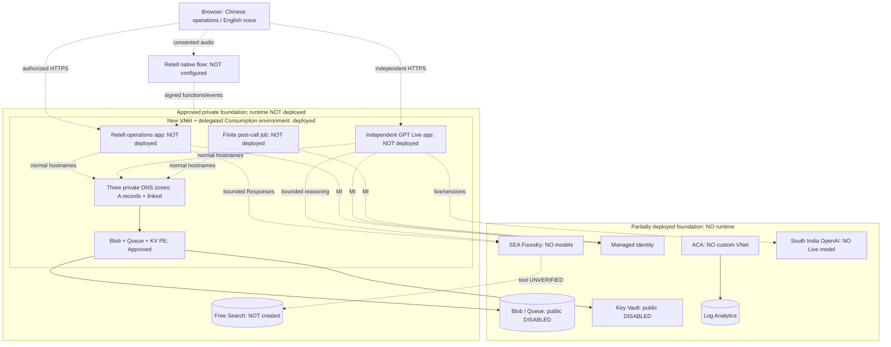
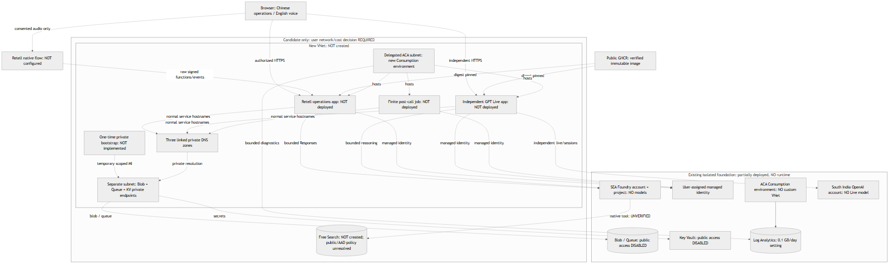

# 架构与部署边界

2026-10-11。图的输入为 `infra/modules/foundation.bicep`、
`search-grounding.bicep`、`apps.bicep` 和本次实际资源观察。
源文件存在不等于资源已经部署。用户已批准受限私网并实际部署成功；
以下内嵌图更新实际基础，文末SVG/PNG保留为2026-10-10历史设计快照。

## Voice Lab Architecture

### Legend

实线为已经配置的依赖（不是有业务流量的证明）；虚线为未启用/未部署/
未验证的预期关系。分组表示资源或候选网络边界，不表示已经连接的网络。

### Key Relationships

运营登录是安全 cookie + 密码哈希，并非 Entra SSO；数据面使用 MI。
审批链接只能定位业务会话，必须通过运营服务的所有者校验。
Azure Blob CAS 是业务/费用/事件状态的一致性边界，Queue 仅通知有限 worker。
Retell webhook 与工具请求先验证独立 signer、原始正文和时间戳，再做通话关联；
接收持久化后才能 ACK，不能让不可取消的业务写入依赖话音中断。

Retell 原生流程不由自定义 LLM 替代。Foundry 只承担有限、有来源的诊断，
不能自行批准工单或记下真人同意。GPT Live 的 `/live/sessions`、WebRTC
与 attach 协议保持独立，不伪装为 Retell Web SDK、Voice Live 或 Realtime。
费用预留和协议/费率门禁在服务端；直接浏览器连接的成本信任边界仍需验证。

现有 ACA 的网络类型不能就地改为自有 VNet。Storage/KV 的 Disabled 是
实际组织 modify 效果，不重新启用。新环境、三数据PE和DNS已实际配置，
bootstrap/私网数据面仍未验收。新环境没有ACA入站PE；浏览器/Retell回调仍
需要受保护的公网 HTTPS。Free Search 不能私有化，basic Foundry 工具路径
也不能假定能访问私有 Search。详见[网络决定与成本](network-decision.md)。

2026-10-10历史导出源为 [architecture.mmd](assets/architecture.mmd)，包含镜像、
委派子网与未实施的 bootstrap。它是静态设计资产，不是实时拓扑发现。

[可缩放 SVG 架构图](assets/architecture.svg)保留所有状态标签；
下图是同一原创源的PNG导出，不依赖颜色区分实际与候选。

导出使用固定 `@mermaid-js/mermaid-cli@11.12.0` 所带 Mermaid bundle，
`scripts/render-architecture.ts` 通过已安装的 Playwright 浏览器离线渲染，
拦截全部网络请求。`MERMAID_BUNDLE` 仅是部署机私密本地工具路径，
不提交个人缓存路径。CLI自身的浏览器渲染等待被有界停止后改用此路径；
最终SVG/PNG来自真实成功的离线render，不是空白/示例占位图。

本文由 GitHub Copilot 辅助编写；后续运行时仍需独立验证，不据静态图声称接通。
