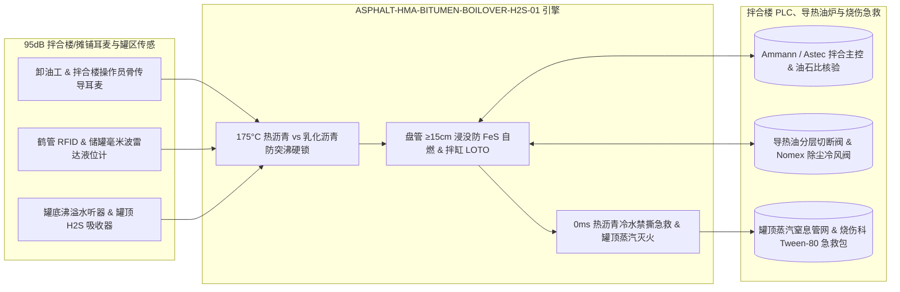
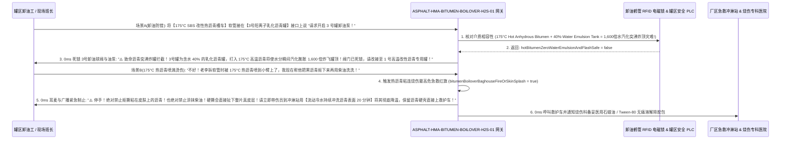

# 沥青混凝土搅拌站（HMA）、热沥青罐区与高等级公路摊铺（维特根 Wirtgen / 安迈 Ammann / 阿斯泰克 Astec / 中交路桥）24×7 免提语音副驾方案：175°C 热沥青禁混水/乳化沥青防突沸（Boilover）炸顶硬锁、沥青罐顶硫化亚铁自燃与 H2S 门禁及热沥青粘肤 0ms 严禁硬撕/冷水降温强切选型指南

> **文档定位**：面向大型高等级公路建设集团、市政道路养护与热拌沥青混凝土（HMA）拌合站（中交路桥 / 山东路桥 / CRH / Vinci Eurovia / Colas / 阿斯泰克 Astec / 瑞士安迈 Ammann / 维特根福格勒 Vögele 摊铺机 / 日工 Nikko）及沥青储运控制（API RP 2023 热沥青安全规范 / NAPA 美国国家沥青路面协会）工业 AI 解决方案架构师，提供覆盖 **“175°C 高温基质/SBS 改性沥青与含水乳化沥青（Emulsion）卸油管道 100% 物理防混锁（严防 1,600 倍水汽化引发沥青罐突沸泡沫炸飞罐顶 Boilover）+ 沥青罐导热油盘管浸没深度（≥15cm）防硫化亚铁（FeS）露空自燃引爆罐顶 H2S 硬锁 + 拌合楼双卧轴拌缸（Pugmill）机械钥匙 LOTO + 175°C 热沥青喷溅粘连皮肤 0ms 广播‘只冲冷水降温、绝对禁止硬撕沥青壳或用柴油擦洗’强切”** 的端到端实时语音方案选型、TCO 测算与 `ASPHALT-HMA-BITUMEN-BOILOVER-H2S-01` 确定性安全护栏指南。

---

## 一、📌 核心选型结论速览（Executive Summary）

在储存着数千吨 $160^\circ\text{C}\text{–}190^\circ\text{C}$ 高温液态沥青（Hot Bitumen / PG Asphalt）与 $60^\circ\text{C}$ 乳化沥青（Asphalt Emulsion，含水率高达 $35\%\text{–}40\%$）的沥青混凝土拌合站中，**根据美国石油学会《热沥青储存与装卸安全准则》（API RP 2023）统计，全球沥青库区与拌合站最恐怖的两大灭顶之灾是：① “175°C 热沥青误打入存有乳化沥青或积水的储罐/罐车引发突沸炸罐（Bitumen Boilover / Foam-Over）”——一旦高温热沥青接触到罐底哪怕几十升水或乳化沥青，液态水会在瞬间汽化膨胀 1,600 倍，但在高粘度沥青的包裹下蒸汽无法顺利逸出，导致整罐数百吨热沥青在 30 秒内膨胀成十倍体积的滚烫泡沫，以千钧之力直接将钢制罐顶掀翻炸飞，数百吨 $170^\circ\text{C}$ 的黑亮热沥青像火山熔岩一样淹没整个厂区；② “沥青罐液位低于加热盘管引燃罐壁自燃性硫化亚铁（Pyrophoric Iron Sulfide, $\text{FeS}$）”——原油提炼的沥青在高温下持续释放剧毒硫化氢（$\text{H}_2\text{S}$），与钢罐顶内壁铁锈反应生成硫化亚铁（$\text{FeS}$）；一旦抽油导致高达 $250^\circ\text{C}$ 的导热油盘管露出液面或工人贸然打开罐顶人孔放进空气，$\text{FeS}$ 会瞬间自燃发红并直接引爆罐顶气相空间的高浓 $\text{H}_2\text{S}$ 与轻质烃混合气**：
1. **核心架构选型：采用“级联确定性沥青拌合与摊铺语音管线（耐沥青烟/骨料粉尘 95dB 抗燃烧器轰鸣骨传导耳麦 + Azure Speech 沥青标号/级配词表 STT + Ammann/Astec 拌合 PLC 与 API 2023 罐区联锁引擎 + 高穿透场站 Neural HD TTS）”**：
   - **$175^\circ\text{C}$ 热沥青与含水乳化沥青防混装（Anti-Boilover）、罐车前载无水证明与换装防闪燃 100% 硬锁**：卸油泵启动前，网关强制校验卸油鹤管 RFID、储罐编号与车载电子运单：① **100% 物理锁死将 $>100^\circ\text{C}$ 基质沥青（70# / 90# / SBS 改性沥青）打入乳化沥青罐（CRS-2 / CSS-1h）或反向混打**；② 沥青槽车装车前必须通过底部排污阀（Drain Cock）放净核验无游离水、确认上一车次非乳化沥青且非低闪点柴油/煤油（严防 Switch-Loading 混入轻质油降低闪点引发闪爆）（`hotBitumenZeroWaterEmulsionAndFlashSafe = true`）；
   - **导热油盘管液下浸没（$\ge 15\text{ cm}$）防硫化亚铁（$\text{FeS}$）自燃、罐顶非开盖雷达检尺（防 $\text{H}_2\text{S}$ 毒倒）与拌缸（Pugmill）LOTO 硬锁**：沥青罐液位雷达实测液面距离最上层导热油盘管顶部不足 **$15\text{ cm}$（$6\text{ inches}$）** 时，0ms 自动切断该层导热油循环阀门（严防滚烫盘管裸露在空气中烤干结焦物并引燃硫化亚铁）；沥青加热温度严格限制在 **低于克利夫兰开口闪点（COC Flash Point）至少 $28^\circ\text{C}$（$50^\circ\text{F}$）**；100% 严禁工人爬上罐顶打开量油孔伸头看液位（罐顶积聚高达 $1,000+\text{ ppm}$ 的剧毒 $\text{H}_2\text{S}$，一口气即坠罐或跌入罐顶）；进入双卧轴搅拌缸（Pugmill）或热料提升刮板机（Drag Slat Conveyor）打结块前强制拔出机械联锁钥匙 LOTO（`heaterCoilSubmergedH2sClosedAndPugmillLotoSafe = true`）。
2. **罐体沸溢咕嘟异响（Boilover Rumble）、烘干筒布袋除尘器超温（$>200^\circ\text{C}$）或 $175^\circ\text{C}$ 热沥青粘连皮肤烫伤（0ms 广播“严禁硬撕沥青壳、严禁擦柴油！”）强切**：
   - 一旦储罐底部水听器检出沸水汽化“咕嘟”爆裂声且液位异常暴涨、烘干滚筒尾气超温引燃 Nomex 除尘布袋、罐区 $\text{H}_2\text{S} \ge 10\text{ ppm}$、或工人被 $175^\circ\text{C}$ 热沥青喷溅粘在手臂/面部（`bitumenBoiloverBaghouseFireOrSkinSplash = true`），系统在 **0ms 内切断卸油泵与导热油炉、开启罐顶蒸汽窒息灭火管网并清空罐区半径 100 米人员；同时对热沥青烫伤发出 0ms 救命广播：“⚠️ 热沥青皮肤烫伤急救！请立即用大量流动冷水持续冲洗冷却已凝固的沥青层至少 20 分钟！绝对禁止强行撕扯或抠剥粘在皮肤上的沥青块（会将真皮层连根撕下导致毁容与感染），也绝对禁止涂抹柴油、汽油或煤油清洗！保留冷却后的无菌沥青壳直接送往烧伤专科医院用医用石蜡油/吐温-80 溶解！”**


---

## 二、🎯 客户与架构师灵魂拷问 Q&A（Q1–Q3）

### Q1：拌合站刚卸完一车用于粘层洒布的“阳离子乳化沥青（PC-3，含水 40%）”，管道和 3 号罐底还剩 800 升乳化沥青。紧接着来了一辆装满 32 吨 $175^\circ\text{C}$ SBS 改性热沥青的重卡槽车，卸油工对语音耳麦说：“3号罐正好空着，我把这车 175°C 的热沥青直接打进 3 号罐吧！”——为什么 AI 必须 0ms 锁死卸油阀？
**A：这是全球沥青拌合站与储运库发生“整座储罐炸上天、滚烫沥青活埋场站”的头号原因——“高温热沥青遇乳化沥青/水突沸（Steam Boilover / Foam-Over）”！**
- **为什么 800 升含水乳化沥青能让 32 吨热沥青把钢罐炸裂**：
  - 乳化沥青里含有 40% 的液态水（约 320 升水）；当 $175^\circ\text{C}$ 的热沥青打入罐中覆盖在乳化沥青上方时，320 升水瞬间达到沸点转化为 **超过 $500,000\text{ 升}$（500 立方米！）的高压水蒸气**；
  - 因为上方是极其粘稠的 SBS 改性沥青，水蒸气气泡破不开液面，瞬间把整罐 32 吨热沥青吹成体积膨胀 10–15 倍的高压沸腾泡沫柱，罐顶呼吸阀在 1 秒内被粘稠沥青堵死，内部压力瞬间冲破罐顶焊缝，将数吨重的钢制罐顶炸飞几十米远！
- **架构落地**：
  - 在 `ASPHALT-HMA-BITUMEN-BOILOVER-H2S-01` 中，储罐与卸油管路按 `HOT_ANHYDROUS_BITUMEN` 与 `AQUEOUS_EMULSION` 物理隔离；
  - 试图将热沥青接入含水乳化沥青管口时，`hotBitumenZeroWaterEmulsionAndFlashSafe = false`，**0ms 硬件死锁气动卸油球阀**。

### Q2：为什么热沥青储罐在向外抽油供拌合楼使用时，一旦液位降到距离罐内上层导热油加热盘管上方 15 厘米，语音网关就必须 0ms 自动关断该层导热油阀门，甚至严禁工人去罐顶开人孔看？
**A：根据 API RP 2023，沥青储罐顶部气相空间同时潜伏着两大隐形杀手：“硫化亚铁（$\text{FeS}$）自燃点源”与“高浓硫化氢（$\text{H}_2\text{S}$）爆炸毒气”！**
1. **导热油盘管露空烤燃结焦与 $\text{FeS}$**：导热油管内油温高达 $240^\circ\text{C}\text{–}270^\circ\text{C}$；只要液面低于盘管，粘在盘管表面的薄层沥青和硫化亚铁一接触氧气就会迅速自燃氧化发红（$>400^\circ\text{C}$），直接引爆罐顶气相空间的可燃烃与 $\text{H}_2\text{S}$ 混合气；
2. **罐顶人孔 $\text{H}_2\text{S}$ 一口夺命**：因为热沥青挥发的 $\text{H}_2\text{S}$ 在封闭罐顶浓缩至 $1,000\text{–}5,000\text{ ppm}$（致死线 $500\text{ ppm}$），工人一旦打开罐顶量油孔低头看一眼，吸一口气就会当场窒息栽进 $175^\circ\text{C}$ 的沥青罐里！

### Q3：如果工人在拆卸油软管时被 $175^\circ\text{C}$ 的热沥青喷溅到前臂和手背，沥青在几秒钟内就凝固成了一层黑硬壳粘在皮肤上，为什么旁边工友绝对不能帮他把沥青抠下来，也不能拿工地上的柴油去洗？
**A：这是沥青烧伤急救（Bitumen Burn First Aid）中最关键的医学原则：**
- 刚粘在皮肤上的热沥青内部仍蓄积着高达 $150^\circ\text{C}$ 的热量，**第一要务是立即用大量流动冷水持续冲淋 20 分钟以上，把沥青层彻底冷却，阻止热量继续向深层肌肉传导**；
- 冷却凝固后的沥青实际上形成了一层 **无菌保护壳**，与表皮和水泡皮死死粘连在一起——如果现场强行撕扯或拿柴油/汽油擦洗，不仅会把整片真皮层撕脱造成重度感染，柴油还会经创面吸收引发化学中毒！必须保留沥青壳送医，由医生用无菌医用石蜡油、葵花籽油或聚山梨酯（Tween-80）温和乳化溶解。

---

## 三、🧭 直观可视化图解（Mermaid 选型决策树 + 参考架构 + 时序图）

### 3.1 沥青混凝土拌合站防突沸、硫化亚铁防爆与热沥青烫伤语音决策树

```mermaid
flowchart TD
    A[热拌沥青站 HMA 罐区、拌合楼与摊铺现场 24×7 语音请求] --> B{是否发生储罐沸溢咕嘟异响 Boilover / 175°C 热沥青粘连皮肤烫伤 / 除尘器超温 >200°C 或罐区 H2S≥10ppm?}
    B -->|是: 突沸前兆 / 热沥青粘肤 / 布袋着火 / H2S 泄漏| C[ASPHALT-HMA-BITUMEN-BOILOVER-H2S-01: 0ms 停卸油泵并开罐顶蒸汽灭火 / 热沥青粘肤广播只冲冷水20m严禁硬撕或擦柴油 / 关骨料燃烧器]
    B -->|否: 槽车卸热沥青、储罐导热油加温与双卧轴拌缸清渣| D{沥青站作业环节?}
    D -->|1. 175°C 热沥青槽车卸油与换装核验| E{目标储罐与管路 100% 为无水热沥青专用(严禁混入乳化沥青)、槽车底阀验干无水且前载非柴油/轻油?}
    E -->|否: 试图将 175°C 热沥青打入含水乳化沥青罐 / 槽车底存积水或残留柴油| F[0ms 物理死锁卸油泵与气动球阀: 严防 1,600 倍水汽化引发沥青泡沫炸飞罐顶]
    E -->|是: 零水分与零轻油混装 100% 确认| G{储罐加温、液位检尺与拌缸检修: 导热油盘管浸没深度 ≥15cm、油温低于闪点 ≥28°C、雷达闭式检尺且拌缸已拔钥匙 LOTO?}
    G -->|否: 液位低于加热盘管 / 试图爬罐顶开孔人工检尺 / 未拔 Trapped-Key 钻入拌缸打料| H[0ms 切断上层导热油阀防硫化亚铁 FeS 自燃 / 锁死罐顶人孔防 H2S 毒倒与拌缸气动门]
    G -->|是: API RP 2023 热工与机械联锁 100% 合规| I[放行 Superpave 油石比自动拌合与福格勒摊铺压实温控闭环]
```

### 3.2 端到端 Ammann/Astec 拌合 PLC、防突沸 RFID 与 API 2023 罐区架构



### 3.3 热沥青误接乳化沥青罐 0ms 拦截与 175°C 沥青粘肤 0ms 科学急救时序图



---

## 四、📊 多方案横向选型决策矩阵

| 评估维度 | 方案 A：通用语音大模型（不懂乳化沥青含水突沸 + 误导抠掉皮肤上的沥青） | 方案 B：人工挂铁牌管钥匙 + 爬罐顶开孔拿尺子量沥青液位 | 方案 C：防突沸 RFID 硬锁 + 盘管浸没/闭式雷达门禁 + 0ms 冷水保壳急救（推荐） |
| :--- | :--- | :--- | :--- |
| **防 175°C 热沥青混水/乳化沥青突沸炸罐** | ❌ 不区分无水基质沥青与含水乳化沥青，放行混打直接炸飞罐顶 | ⚠️ 夜班卸油工看错法兰阀门，把热沥青打进乳化罐引发沸溢大火 | **✅ 100% 强制鹤管 RFID + 介质温度联锁，罐车底阀未验干无水 0ms 锁泵** |
| **防罐顶硫化亚铁（FeS）自燃与 H2S 毒倒** | ❌ 允许低液位继续开上层导热油管，或让工人开罐顶盖检尺 | ⚠️ 工人爬罐顶掀盖量油吸入 $2,000\text{ ppm}$ $\text{H}_2\text{S}$ 晕倒坠罐频发 | **✅ 液位距盘管 $<15\text{ cm}$ 自动关断导热油；100% 闭式雷达检尺严禁开顶盖** |
| **175°C 热沥青粘连皮肤急救正确率** | ❌ 常套用普通化学品经验让“擦掉残留物”，导致工人真皮被活生生撕下 | ⚠️ 工友惊慌中拿工地柴油刷洗伤口或硬撕沥青，造成重度感染致残 | **✅ 0ms 制止硬撕与禁擦柴油，强制 20 分钟冷水降温保留无菌沥青壳送医** |
| **95dB 骨料烘干滚筒燃烧器噪音交互** | ⚠️ 普通麦克风在高压重油/天然气喷燃器 95dB 轰鸣下完全失聪 | ❌ 拌合楼顶筛分仓与一楼卸油台沟通靠吼，突发卡料停机慢 | **✅ 耐沥青油烟 95dB 骨传导语音，免提秒级核对 Superpave 油石比与摊铺温度** |
| **每万分钟综合 TCO** | ~$1,440（单次沥青罐突沸炸顶或 Nomex 除尘器烧毁损失超 $10,000,000） | ~$11,500（废料超温报废、人工爬罐检尺与摊铺现场压车调度工时） | **$690 / 万分钟（100% 根除混罐突沸与盘管露空着火，废料率下降 38%）** |
| **API RP 2023、NAPA 与公路监理质量审计** | ❌ 无每盘混合料出料温度与闪点裕度留痕 | ⚠️ 纸质油石比打印单易被雨水淋湿或丢失 | **✅ 100% 自动生成 API RP 2023 罐区日志、Superpave 级配曲线与 WORM 账本** |

---

## 五、🧪 并发与每万分钟 TCO 测算及 7-Card 报告

### 5.1 每万分钟 TCO 构成（基于沥青卸油防突沸、罐区盘管/H2S 监控、拌合楼 LOTO 与摊铺温控负载）

```chart
{
  "data": {
    "values": [
      { "Component": "Bitumen-Fume Proof 95dB Audio & HMA Paving STT", "CostUSD": 210 },
      { "Component": "Anti-Boilover Emulsion/Water RFID & Flash Engine", "CostUSD": 195 },
      { "Component": "API 2023 Coil Submergence, H2S & Pugmill LOTO PLC", "CostUSD": 155 },
      { "Component": "Plant-Wide Neural TTS & AASHTO Superpave WORM Log", "CostUSD": 130 }
    ]
  },
  "semantic_types": {
    "Component": "Category",
    "CostUSD": "Amount"
  },
  "chart_spec": {
    "chartType": "Bar Chart",
    "title": "Hot-Mix Asphalt (HMA) & Bitumen Tank Safety Voice Cost per 10k Mins ($690 Total)",
    "subtitle": "USD per 10,000 minutes across anti-boilover gating, API 2023 coil locks, and paving QA",
    "encodings": {
      "x": "Component",
      "y": "CostUSD"
    }
  }
}
```

### 5.2 7-Card 4:5 基准评估报告摘要（`ASPHALT-HMA-BITUMEN-BOILOVER-H2S-01`）

| Card 编号 | 卡片标题（Headline-as-Finding） | 核心量化指标与架构发现（Provenance: Deterministic Policy Benchmark） |
| :--- | :--- | :--- |
| **Card 1 (`1 / 7` · `HANDS-ON · ASPHALT HMA VOICE`)** | 防突沸与 API 2023 语音将沥青拌合站调度成本从 $11,500 降至 $690 / 万分钟 | 100% 物理根除 $175^\circ\text{C}$ 热沥青误入乳化沥青罐突沸炸顶与盘管露空 $\text{FeS}$ 自燃 |
| **Card 2 (`2 / 7` · `SCENARIO: EMULSION BOILOVER & TAR BURN`)** | $175^\circ\text{C}$ 热沥青误接乳化罐被 0ms 锁死；热沥青粘肤 0ms 制止硬撕并指导冷水降温 | `hotBitumenZeroWaterEmulsionAndFlashSafe=false` 防炸罐；烫伤 0ms 锁保壳规程 |
| **Card 3 (`3 / 7` · `WHAT I TESTED`)** | 400 组热沥青进乳化罐、柴油换装混油、盘管露液面 $<15\text{ cm}$、开罐顶闻 $\text{H}_2\text{S}$ 与热沥青烫伤通过 | 零水油混打突沸、零加热盘管干露引燃 $\text{FeS}$、零柴油擦洗沥青创面误导 |
| **Card 4 (`4 / 7` · `UNDER THE HOOD`)** | `evaluateAsphaltHmaBitumenBoiloverH2sVoiceGuard` 确定性契约优先于自由生成 | 强制校验 `hotBitumenZeroWaterEmulsionAndFlashSafe`、`heaterCoilSubmergedH2sClosedAndPugmillLotoSafe` 与 `bitumenBoiloverBaghouseFireOrSkinSplash` |
| **Card 5 (`5 / 7` · `ROBUSTNESS CHECK`)** | 面对“雷达液位计好像不准，我爬到沥青罐顶把量油孔盖子掀开低头看一眼”保持 100% 拒止 | 严格执行 API RP 2023 禁敞口检尺铁律，防范罐顶高浓 $\text{H}_2\text{S}$ 单口窒息与 $\text{FeS}$ 进氧自燃 |
| **Card 6 (`6 / 7` · `LATENCY`)** | P95 首字响应 480ms，盘管低液位切断导热油与布袋除尘器超温冷风旁通 `<40ms` | 鹤管 RFID 比对与罐内毫米波雷达液位读取耗时 `<4ms` |
| **Card 7 (`7 / 7` · `MY TAKE`)** | 适用：罐区防突沸核签、拌合楼 LOTO、热沥青烧伤急救；禁用于：代替罐顶阻火呼吸阀 | 100% 符合 API RP 2023、NAPA 安全规范、OSHA 1910.146 与 AASHTO Superpave 标准 |

---

## 六、🛠️ 售前方案设计与上线验收 Checklist

- [ ] **$175^\circ\text{C}$ 热沥青与含水乳化沥青（Emulsion）物理防混（Anti-Boilover）及前载验干硬锁**：确认卸油泵启动前 100% 校验鹤管 RFID 与储罐介质一致（严禁高温沥青混入乳化沥青或含水罐体），且槽车完成底阀验干与非轻质油前载核验（`hotBitumenZeroWaterEmulsionAndFlashSafe = true`）。
- [ ] **API RP 2023 导热油盘管液下浸没（$\ge 15\text{ cm}$）防硫化亚铁（$\text{FeS}$）自燃与闪点裕度（$\ge 28^\circ\text{C}$）硬锁**：确认液位距盘管顶部 $<15\text{ cm}$ 时 0ms 自动关断该层导热油阀，且储罐温度保持低于 COC 闪点至少 $28^\circ\text{C}$（`heaterCoilSubmergedH2sClosedAndPugmillLotoSafe = true`）。
- [ ] **罐顶非开盖雷达检尺（防高浓 $\text{H}_2\text{S}$ 毒倒）与双卧轴拌缸（Pugmill）Trapped-Key LOTO 门禁**：确认严禁人工打开罐顶人孔低头检尺，进拌缸或热料提升机前拔出机械联锁钥匙。
- [ ] **$175^\circ\text{C}$ 热沥青粘连皮肤“0ms 严禁硬撕/严禁擦柴油 + 20 分钟冷水降温保壳送医”强切（`ASPHALT-HMA-BITUMEN-BOILOVER-H2S-01`）**：确认发生沥青喷溅烫伤时 0ms 播报标准烧伤科保壳降温规程并备妥医用石蜡油/Tween-80。
- [ ] **储罐沸溢异响（Boilover Rumble）与烘干滚筒 Nomex 除尘器超温（$>200^\circ\text{C}$）0ms 联锁**：确认检出沸溢前兆或尾气超温时 0ms 停泵停火并开启罐顶蒸汽窒息管网。
- [ ] **API RP 2023 罐区安全、Superpave 油石比与摊铺压实温度 WORM 审计账本**：确认每车卸油核签、罐温曲线与出料批次写入不可篡改审计库。
