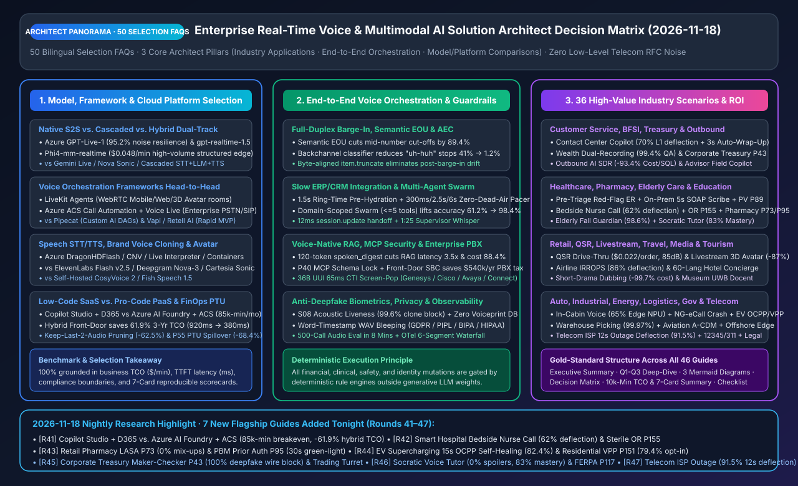

# Enterprise Voice & Multimodal AI Solution Architect Asset Catalog

> **Language / 语言**: [中文](./asset-catalog.md) | **English** · **Navigation**: [README](../README.en.md)

This catalog indexes all curated **Enterprise Voice & Multimodal AI Solution Architect** deliverables in `voice-agent-lab`, including **interactive portals & benchmark reports**, **reference architecture whitepapers**, **runnable PoCs**, and **37 bilingual (`zh-CN` / `en`) architecture selection & industry playbooks**.

---

## 1. Interactive Portal, Executive Deck & 7-Card Benchmark Reports

| Deliverable | Path | Purpose |
| :--- | :--- | :--- |
| **Voice AI Architecture & Scenario Portal** | [`site/index.html`](../site/index.html) | Interactive stack matcher, recorded live prototypes, industry blueprints, and architecture guardrail sandbox |
| **16:9 Executive Presales Slide Deck** | [`site/deck.html`](../site/deck.html) | 12-slide executive architecture & ROI deck for customer workshops |
| **Voice Agent 7-Card Benchmark Report** | [`site/benchmark-cards.html`](../site/benchmark-cards.html) | 4:5 visual benchmark deck covering latency, barge-in, robustness, and fit |
| **Speaker Diarization 7-Card Benchmark Report** | [`site/diarization-benchmark-cards.html`](../site/diarization-benchmark-cards.html) | Azure AI Speech multi-speaker diarization before/after evaluation cards |
| **Global Smart Hardware 6-Language Voice CS Case Study** | [`site/case-study.html`](../site/case-study.html) · [EN](./smart-hardware-global-voice-cs-case-study.md) · [中文](./smart-hardware-global-voice-cs-case-study.zh-CN.md) | End-to-end production architecture & ROI case study (250k → 750k smart rings) |

---

## 2. Core Whitepapers & Runnable Engineering Prototypes (PoCs)

| Category | English Version | 中文版本 | Scope |
| :--- | :--- | :--- | :--- |
| **Solution Architecture Guide** | [`solution-architecture.en.md`](./solution-architecture.en.md) | [`solution-architecture.md`](./solution-architecture.md) | Native S2S vs. Enterprise Cascaded vs. Hybrid reference architectures & guardrails |
| **Business Scenarios & ROI Whitepaper** | [`business-scenarios.en.md`](./business-scenarios.en.md) | [`business-scenarios.md`](./business-scenarios.md) | 12 enterprise scenarios, SLA acceptance targets, and 400k-min/month TCO model |
| **Competitive Battlecards** | [`competitive-analysis.en.md`](./competitive-analysis.en.md) | [`competitive-analysis.md`](./competitive-analysis.md) | Azure Voice Live vs. Sierra, Retell/Vapi, ElevenLabs, and AWS Nova Sonic |
| **Presales Playbook & 2-Week POC** | [`presales-playbook.en.md`](./presales-playbook.en.md) | [`presales-playbook.md`](./presales-playbook.md) | 5-dimension discovery, 15-min live demo script, and 2-week POC validation probes |
| **Azure Speech Diarization PoC** | [`azure-speech-diarization-poc.en.md`](./azure-speech-diarization-poc.en.md) | [`azure-speech-diarization-poc.md`](./azure-speech-diarization-poc.md) | Runnable Python evaluation pipeline & Bicep infra in [`experiments/azure-speech-diarization-poc/`](../experiments/azure-speech-diarization-poc/) |
| **GPT-Live Partner Demo Handbook** | [`gpt-live-partner-demo-handbook.en.md`](./gpt-live-partner-demo-handbook.en.md) | [`gpt-live-partner-demo-handbook.md`](./gpt-live-partner-demo-handbook.md) | Full-duplex Speech-to-Speech web app prototype in [`experiments/gpt-live/`](../experiments/gpt-live/) |
| **Evaluation Rubric & Edge Containers** | [`voice-agent-evaluation-rubric.md`](./voice-agent-evaluation-rubric.md) | [`speech-container-guide.md`](./speech-container-guide.md) | 24-probe red-teaming rubric & disconnected Azure Speech Container deployment guide |

---

## 3. Solution Architect Selection Guides (37 Bilingual Guides)

### 3.1 Foundation Architecture, Models & Telephony Ingress (11 Guides)
1. **Cascaded (ASR→LLM→TTS) vs. Native Speech-to-Speech Architecture Selection**: [EN](./cascaded-vs-s2s-semantic-turn-faq.en.md) | [中文](./cascaded-vs-s2s-semantic-turn-faq.md)
2. **Native S2S Foundation Models Head-to-Head (GPT-Realtime / Azure Voice Live / Gemini Live / Nova Sonic)**: [EN](./voice-native-s2s-models-gpt-live-realtime-gemini-live-nova-sonic-selection-faq.en.md) | [中文](./voice-native-s2s-models-gpt-live-realtime-gemini-live-nova-sonic-selection-faq.md)
3. **Voice Orchestration Frameworks (LiveKit Agents vs. Pipecat vs. ACS vs. Retell / Vapi)**: [EN](./voice-orchestration-framework-livekit-pipecat-acs-retell-vapi-selection-faq.en.md) | [中文](./voice-orchestration-framework-livekit-pipecat-acs-retell-vapi-selection-faq.md)
4. **Microsoft Copilot Studio & D365 Contact Center vs. Azure AI Foundry + ACS**: [EN](./microsoft-copilot-studio-d365-vs-azure-foundry-voice-selection-faq.en.md) | [中文](./microsoft-copilot-studio-d365-vs-azure-foundry-voice-selection-faq.md)
5. **Global Cloud CCaaS & AI Contact Center Platforms (D365 Contact Center vs. Amazon Connect vs. Genesys vs. Google CES vs. Sierra)**: [EN](./cloud-ccaas-d365-amazon-connect-genesys-google-sierra-selection-faq.en.md) | [中文](./cloud-ccaas-d365-amazon-connect-genesys-google-sierra-selection-faq.md)
6. **Streaming STT, Low-Latency TTS, Brand Voice Cloning & Avatar Selection**: [EN](./voice-stt-tts-cloning-avatar-azure-elevenlabs-deepgram-opensource-selection-faq.en.md) | [中文](./voice-stt-tts-cloning-avatar-azure-elevenlabs-deepgram-opensource-selection-faq.md)
7. **WebRTC vs. WebSocket vs. SIP Trunking / ACS Ingress Selection**: [EN](./webrtc-vs-websocket-vs-sip-ingress-selection-faq.en.md) | [中文](./webrtc-vs-websocket-vs-sip-ingress-selection-faq.md)
8. **Enterprise PBX & CCaaS Integration (Genesys / Cisco / Avaya / Connect / Teams Phone)**: [EN](./enterprise-pbx-ccaas-genesys-cisco-avaya-teams-voice-integration-selection-faq.en.md) | [中文](./enterprise-pbx-ccaas-genesys-cisco-avaya-teams-voice-integration-selection-faq.md)
9. **Full-Duplex Barge-In, Semantic Turn Detection (EOU) & Echo/Crosstalk Architecture**: [EN](./enterprise-voice-barge-in-semantic-turn-detection-aec-selection-faq.en.md) | [中文](./enterprise-voice-barge-in-semantic-turn-detection-aec-selection-faq.md)
10. **Multi-Party Streaming Speaker Diarization & Voice-Bound Tool Authorization**: [EN](./voice-multiparty-diarization-role-isolation-faq.en.md) | [中文](./voice-multiparty-diarization-role-isolation-faq.md)
11. **Intra-Sentence Code-Switching (`zh-EN-Yue`) & Enterprise Dialect Routing**: [EN](./voice-multilingual-codeswitch-dialect-faq.en.md) | [中文](./voice-multilingual-codeswitch-dialect-faq.md)

### 3.2 Production Engineering, Compliance, High Availability & FinOps (12 Guides)
11. **Voice-Native RAG, Phonetic Homophone Recall & Zero-Trust MCP Tool Guardrails**: [EN](./enterprise-voice-rag-knowledge-graph-mcp-tool-security-selection-faq.en.md) | [中文](./enterprise-voice-rag-knowledge-graph-mcp-tool-security-selection-faq.md)
12. **Slow ERP/CRM Async Tool Integration, Zero-Dead-Air Pacing & Turn-Epoch Fencing**: [EN](./enterprise-voice-async-erp-crm-integration-zero-dead-air-selection-faq.en.md) | [中文](./enterprise-voice-async-erp-crm-integration-zero-dead-air-selection-faq.md)
13. **Voice AI FinOps: Azure PTU vs. PayGo Capacity Sizing & Audio Context Pruning**: [EN](./enterprise-voice-ai-tco-ptu-capacity-finops-selection-faq.en.md) | [中文](./enterprise-voice-ai-tco-ptu-capacity-finops-selection-faq.md)
14. **Mid-Call High Availability, Cross-Region S2S Failover & Session Recovery**: [EN](./voice-midcall-failover-session-recovery-faq.en.md) | [中文](./voice-midcall-failover-session-recovery-faq.md)
15. **Disconnected Edge Speech Containers & Sovereign Hybrid Cloud Failover**: [EN](./voice-edge-cloud-quantized-container-failover-faq.en.md) | [中文](./voice-edge-cloud-quantized-container-failover-faq.md)
16. **Warm Transfer, Supervisor Whisper & Human-in-the-Loop Escalation**: [EN](./warm-transfer-whisper-handoff-faq.en.md) | [中文](./warm-transfer-whisper-handoff-faq.md)
17. **Multi-Agent Voice Swarm Orchestration & Low-Latency Context Handoff**: [EN](./enterprise-multi-agent-voice-swarm-supervisor-whisper-selection-faq.en.md) | [中文](./enterprise-multi-agent-voice-swarm-supervisor-whisper-selection-faq.md)
18. **PCI-DSS v4.0 Dual-Stream DTMF Redaction & Payment Scope Isolation**: [EN](./voice-pci-dtmf-scope-faq.en.md) | [中文](./voice-pci-dtmf-scope-faq.md)
19. **Dual-Track SIPREC Compliance Recording & Real-Time PII Audio Redaction**: [EN](./siprec-pii-audio-redaction-faq.en.md) | [中文](./siprec-pii-audio-redaction-faq.md)
20. **Voice Biometrics Anti-Deepfake Liveness & Global Privacy Compliance (GDPR / BIPA / PIPL)**: [EN](./enterprise-voice-biometrics-privacy-compliance-selection-faq.en.md) | [中文](./enterprise-voice-biometrics-privacy-compliance-selection-faq.md)
21. **Voice Agent Evaluation, OpenTelemetry Latency Waterfall & Canary Rollout**: [EN](./enterprise-voice-agent-evaluation-observability-redteaming-selection-faq.en.md) | [中文](./enterprise-voice-agent-evaluation-observability-redteaming-selection-faq.md)
22. **Automated Post-Call QA & Spoken-Promise vs. CRM Ticket Reconciliation**: [EN](./voice-postcall-promise-ticket-reconciliation-qa-faq.en.md) | [中文](./voice-postcall-promise-ticket-reconciliation-qa-faq.md)

### 3.3 Enterprise Industry Solution Playbooks (14 Guides)
23. **Enterprise Contact Center Copilot: Tier-1 Deflection, Warm Handoff & Agent Assist**: [EN](./contact-center-ai-copilot-tier1-deflection-agent-assist-selection-faq.en.md) | [中文](./contact-center-ai-copilot-tier1-deflection-agent-assist-selection-faq.md)
24. **Telecom 5G New Calling & Multimodal Visual IVR Modernization**: [EN](./telecom-5g-new-calling-visual-ivr-modernization-selection-faq.en.md) | [中文](./telecom-5g-new-calling-visual-ivr-modernization-selection-faq.md)
25. **BFSI Wealth Management Dual-Recording, Suitability & Insurance Claims**: [EN](./bfsi-wealth-dual-recording-claims-compliant-outbound-voice-selection-faq.en.md) | [中文](./bfsi-wealth-dual-recording-claims-compliant-outbound-voice-selection-faq.md)
26. **Corporate Banking Treasury Maker-Checker & Anti-Deepfake Voice Compliance**: [EN](./corporate-banking-treasury-maker-checker-trading-desk-voice-selection-faq.en.md) | [中文](./corporate-banking-treasury-maker-checker-trading-desk-voice-selection-faq.md)
27. **Healthcare Pre-Triage, Ambient Clinical Scribe & Chronic Care Follow-Up**: [EN](./healthcare-clinical-triage-chronic-followup-ambient-scribe-voice-selection-faq.en.md) | [中文](./healthcare-clinical-triage-chronic-followup-ambient-scribe-voice-selection-faq.md)
28. **Retail Pharmacy Rx Refill, Drug Safety Disambiguation & Prior Authorization**: [EN](./retail-pharmacy-rx-refill-pbm-prior-authorization-voice-selection-faq.en.md) | [中文](./retail-pharmacy-rx-refill-pbm-prior-authorization-voice-selection-faq.md)
29. **Retail & QSR Drive-Thru Noise-Robust Voice Ordering**: [EN](./qsr-drivethru-smart-restaurant-retail-voice-ordering-selection-faq.en.md) | [中文](./qsr-drivethru-smart-restaurant-retail-voice-ordering-selection-faq.md)
30. **E-Commerce Showroom Concierge & Interactive Voice + Digital Human Avatar**: [EN](./ecommerce-livestream-showroom-voice-avatar-digital-human-selection-faq.en.md) | [中文](./ecommerce-livestream-showroom-voice-avatar-digital-human-selection-faq.md)
31. **Airline IRROPS Rebooking & Global Hospitality Multilingual Voice Concierge**: [EN](./travel-airline-irrops-hotel-pms-multilingual-voice-concierge-selection-faq.en.md) | [中文](./travel-airline-irrops-hotel-pms-multilingual-voice-concierge-selection-faq.md)
32. **Automotive In-Cabin Multimodal Voice Assistant & Smart Hardware Support**: [EN](./in-vehicle-cockpit-smart-hardware-multimodal-voice-assistant-selection-faq.en.md) | [中文](./in-vehicle-cockpit-smart-hardware-multimodal-voice-assistant-selection-faq.md)
33. **AI Sales Coach, Pitch Roleplay & Interactive Enablement Copilot**: [EN](./ai-sales-roleplay-mock-interview-language-coach-selection-faq.en.md) | [中文](./ai-sales-roleplay-mock-interview-language-coach-selection-faq.md)
34. **Compliant Outbound Voice SDR, AMD Voicemail Detection & TCPA Governance**: [EN](./enterprise-outbound-voice-sales-lead-qualification-selection-faq.en.md) | [中文](./enterprise-outbound-voice-sales-lead-qualification-selection-faq.md)
35. **Enterprise Multilingual Simultaneous Interpretation & Meeting Intelligence**: [EN](./enterprise-multilingual-simultaneous-interpretation-meeting-minutes-selection-faq.en.md) | [中文](./enterprise-multilingual-simultaneous-interpretation-meeting-minutes-selection-faq.md)
36. **Enterprise Internal IT Service Desk & HR Employee Voice Copilot**: [EN](./enterprise-it-helpdesk-hr-employee-voice-copilot-selection-faq.en.md) | [中文](./enterprise-it-helpdesk-hr-employee-voice-copilot-selection-faq.md)
