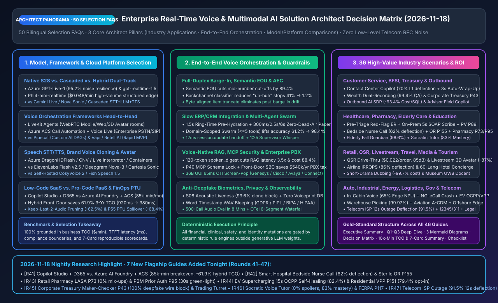

# 企业级语音与多模态 AI 解决方案架构师资产总览 (Asset Catalog)

> **语言 / Language**: **中文** | [English](./asset-catalog.en.md) · **返回总览**: [README](../README.md)

本目录汇总 `voice-agent-lab` 面向 **AI Solution Architect（解决方案架构师）** 的核心交付资产，涵盖**交互式门户与评测报告**、**架构与售前白皮书**、**可运行原型（PoC）**以及 **77 篇中英双语企业级架构选型与行业落地方案指南**。

---

## 一、交互式门户、演示胶片与 7-Card 基准评测报告

| 资产名称 | 路径 / 入口 | 适用场景 |
| :--- | :--- | :--- |
| **AI 语音架构选型与场景门户** | [`site/index.html`](../site/index.html) | 架构栈匹配器、原型演示录像、四大行业蓝图、交互式护栏验证沙盒 |
| **16:9 架构师高管汇报胶片** | [`site/deck.html`](../site/deck.html) | 12 页客户 CXO / 架构评审标准演示幻灯片 |
| **实时语音智能体 7-Card 评测报告** | [`site/benchmark-cards.html`](../site/benchmark-cards.html) | 4:5 视觉卡片：端到端延迟、打断控制、鲁棒性与适用边界 |
| **说话人分离（Diarization）7-Card 评测报告** | [`site/diarization-benchmark-cards.html`](../site/diarization-benchmark-cards.html) | Azure AI Speech 多说话人角色分离实测对比（修复前后指标闭环） |
| **出海智能硬件 6 语种语音客服案例研究** | [`site/case-study.html`](../site/case-study.html) · [中文版](./smart-hardware-global-voice-cs-case-study.zh-CN.md) · [EN](./smart-hardware-global-voice-cs-case-study.md) | 25 万 → 75 万台智能戒指全球多语种 AI 语音客服架构与 ROI 复盘 |

---

## 二、核心架构白皮书与可运行工程原型（PoC）

| 类别 | 中文文档 | English Version | 核心内容 |
| :--- | :--- | :--- | :--- |
| **参考架构白皮书** | [`solution-architecture.md`](./solution-architecture.md) | [`solution-architecture.en.md`](./solution-architecture.en.md) | Native S2S、企业级级联与混合架构三大范式、决策树与工程边界 |
| **行业场景与 ROI 白皮书** | [`business-scenarios.md`](./business-scenarios.md) | [`business-scenarios.en.md`](./business-scenarios.en.md) | 12 大核心企业场景拆解、SLA 验收水位与 40 万分钟/月 TCO 测算 |
| **竞品对比 Battlecards** | [`competitive-analysis.md`](./competitive-analysis.md) | [`competitive-analysis.en.md`](./competitive-analysis.en.md) | Azure Voice Live 对标 Sierra、Retell/Vapi、ElevenLabs、Nova Sonic 攻防策略 |
| **售前打单与两周 POC 手册** | [`presales-playbook.md`](./presales-playbook.md) | [`presales-playbook.en.md`](./presales-playbook.en.md) | 五维需求问卷、15 分钟现场演示剧本、两周 POC 里程碑与验收探针 |
| **Azure Speech 说话人分离 PoC** | [`azure-speech-diarization-poc.md`](./azure-speech-diarization-poc.md) | [`azure-speech-diarization-poc.en.md`](./azure-speech-diarization-poc.en.md) | 配套 [`experiments/azure-speech-diarization-poc/`](../experiments/azure-speech-diarization-poc/) 可复现评测代码与 Bicep |
| **GPT-Live 全双工语音演示手册** | [`gpt-live-partner-demo-handbook.md`](./gpt-live-partner-demo-handbook.md) | [`gpt-live-partner-demo-handbook.en.md`](./gpt-live-partner-demo-handbook.en.md) | 配套 [`experiments/gpt-live/`](../experiments/gpt-live/) 实时语音对话 Web 应用原型 |
| **24 项基准评测与本地容器指南** | [`voice-agent-evaluation-rubric.md`](./voice-agent-evaluation-rubric.md) | [`speech-container-guide.md`](./speech-container-guide.md) | 语音智能体红队评测规范与 Azure Speech 本地边缘容器部署指南 |

---

## 三、架构师核心选型指南（342 篇中英双语专题 FAQ）

### 3.1 基础架构、模型与语音通道接入（11 篇）
1. **级联架构（ASR→LLM→TTS）vs 原生端到端语音（Native S2S）选型**：[中文](./cascaded-vs-s2s-semantic-turn-faq.md) | [EN](./cascaded-vs-s2s-semantic-turn-faq.en.md)
2. **主流原生 S2S 多模态语音模型横评（GPT-Realtime / Azure Voice Live / Gemini Live / Nova Sonic）**：[中文](./voice-native-s2s-models-gpt-live-realtime-gemini-live-nova-sonic-selection-faq.md) | [EN](./voice-native-s2s-models-gpt-live-realtime-gemini-live-nova-sonic-selection-faq.en.md)
3. **实时语音编排框架对比（LiveKit Agents vs Pipecat vs ACS vs Retell / Vapi）**：[中文](./voice-orchestration-framework-livekit-pipecat-acs-retell-vapi-selection-faq.md) | [EN](./voice-orchestration-framework-livekit-pipecat-acs-retell-vapi-selection-faq.en.md)
4. **Microsoft Copilot Studio / D365 Contact Center vs Azure AI Foundry + ACS 选型**：[中文](./microsoft-copilot-studio-d365-vs-azure-foundry-voice-selection-faq.md) | [EN](./microsoft-copilot-studio-d365-vs-azure-foundry-voice-selection-faq.en.md)
5. **全球主流云联络中心与 AI 语音平台选型（D365 Contact Center vs Amazon Connect vs Genesys vs Google CES vs Sierra）**：[中文](./cloud-ccaas-d365-amazon-connect-genesys-google-sierra-selection-faq.md) | [EN](./cloud-ccaas-d365-amazon-connect-genesys-google-sierra-selection-faq.en.md)
6. **流式语音识别（STT）、低延迟合成（TTS）、声音克隆与数字人选型**：[中文](./voice-stt-tts-cloning-avatar-azure-elevenlabs-deepgram-opensource-selection-faq.md) | [EN](./voice-stt-tts-cloning-avatar-azure-elevenlabs-deepgram-opensource-selection-faq.en.md)
7. **WebRTC vs WebSocket vs SIP Trunking / ACS 语音接入架构选型**：[中文](./webrtc-vs-websocket-vs-sip-ingress-selection-faq.md) | [EN](./webrtc-vs-websocket-vs-sip-ingress-selection-faq.en.md)
8. **企业存量呼叫中心 PBX & CCaaS 集成（Genesys / Cisco / Avaya / Connect / Teams Phone）**：[中文](./enterprise-pbx-ccaas-genesys-cisco-avaya-teams-voice-integration-selection-faq.md) | [EN](./enterprise-pbx-ccaas-genesys-cisco-avaya-teams-voice-integration-selection-faq.en.md)
9. **全双工打断（Barge-In）、语义句末检测（Semantic EOU）与回声串音抑制架构**：[中文](./enterprise-voice-barge-in-semantic-turn-detection-aec-selection-faq.md) | [EN](./enterprise-voice-barge-in-semantic-turn-detection-aec-selection-faq.en.md)
10. **多人同场流式说话人分离（Speaker Diarization）与声纹绑定工具鉴权**：[中文](./voice-multiparty-diarization-role-isolation-faq.md) | [EN](./voice-multiparty-diarization-role-isolation-faq.en.md)
11. **句内跨语种混说（中英粤 Code-Switching）与方言路由架构**：[中文](./voice-multilingual-codeswitch-dialect-faq.md) | [EN](./voice-multilingual-codeswitch-dialect-faq.en.md)

### 3.2 生产工程、安全合规、高可用与 FinOps 容量规划（12 篇）
12. **语音原生 RAG、同音字纠偏检索与 MCP 工具零信任安全边界**：[中文](./enterprise-voice-rag-knowledge-graph-mcp-tool-security-selection-faq.md) | [EN](./enterprise-voice-rag-knowledge-graph-mcp-tool-security-selection-faq.en.md)
13. **慢速 ERP/CRM 异步工具集成、零冷场垫音节拍器与 Turn-Epoch 事务隔离**：[中文](./enterprise-voice-async-erp-crm-integration-zero-dead-air-selection-faq.md) | [EN](./enterprise-voice-async-erp-crm-integration-zero-dead-air-selection-faq.en.md)
14. **企业语音 AI 成本建模：Azure PTU vs PayGo 容量精算与音频上下文裁剪 FinOps**：[中文](./enterprise-voice-ai-tco-ptu-capacity-finops-selection-faq.md) | [EN](./enterprise-voice-ai-tco-ptu-capacity-finops-selection-faq.en.md)
15. **通话中途跨区域容灾切换（Mid-Call Failover）与无感会话恢复架构**：[中文](./voice-midcall-failover-session-recovery-faq.md) | [EN](./voice-midcall-failover-session-recovery-faq.en.md)
16. **离线边缘 Speech Container 容器部署与端云协同降级逃生架构**：[中文](./voice-edge-cloud-quantized-container-failover-faq.md) | [EN](./voice-edge-cloud-quantized-container-failover-faq.en.md)
17. **人工坐席热转接（Warm Transfer）与主管耳语（Whisper）无感交接架构**：[中文](./warm-transfer-whisper-handoff-faq.md) | [EN](./warm-transfer-whisper-handoff-faq.en.md)
18. **多智能体语音协同（Multi-Agent Voice Swarm）与防死循环路由架构**：[中文](./enterprise-multi-agent-voice-swarm-supervisor-whisper-selection-faq.md) | [EN](./enterprise-multi-agent-voice-swarm-supervisor-whisper-selection-faq.en.md)
19. **PCI-DSS v4.0 双流 DTMF 支付按键旁路与收单合规隔离**：[中文](./voice-pci-dtmf-scope-faq.md) | [EN](./voice-pci-dtmf-scope-faq.en.md)
20. **双轨 SIPREC 合规录音与实时敏感信息（PII）声学脱敏架构**：[中文](./siprec-pii-audio-redaction-faq.md) | [EN](./siprec-pii-audio-redaction-faq.en.md)
21. **声纹反深伪活体检测（Anti-Deepfake）与全球语音隐私合规（GDPR / BIPA / PIPL）**：[中文](./enterprise-voice-biometrics-privacy-compliance-selection-faq.md) | [EN](./enterprise-voice-biometrics-privacy-compliance-selection-faq.en.md)
22. **企业语音智能体评测体系、OpenTelemetry 全链路延迟瀑布与灰度发布**：[中文](./enterprise-voice-agent-evaluation-observability-redteaming-selection-faq.md) | [EN](./enterprise-voice-agent-evaluation-observability-redteaming-selection-faq.en.md)
23. **话后自动化全量质检（Post-Call QA）与口头承诺 vs CRM 工单对账**：[中文](./voice-postcall-promise-ticket-reconciliation-qa-faq.md) | [EN](./voice-postcall-promise-ticket-reconciliation-qa-faq.en.md)

### 3.3 高价值企业行业解决方案蓝图（77 篇）
24. **企业联络中心 AI Copilot：一线智能分流、人机热交接与实时坐席辅助**：[中文](./contact-center-ai-copilot-tier1-deflection-agent-assist-selection-faq.md) | [EN](./contact-center-ai-copilot-tier1-deflection-agent-assist-selection-faq.en.md)
25. **运营商 5G 新通话与多模态可视化 IVR（Visual IVR）现代化改造**：[中文](./telecom-5g-new-calling-visual-ivr-modernization-selection-faq.md) | [EN](./telecom-5g-new-calling-visual-ivr-modernization-selection-faq.en.md)
26. **银行财富管理智能双录（Dual-Recording）、适当性核验与保险理赔语音方案**：[中文](./bfsi-wealth-dual-recording-claims-compliant-outbound-voice-selection-faq.md) | [EN](./bfsi-wealth-dual-recording-claims-compliant-outbound-voice-selection-faq.en.md)
27. **对公银行财资双人复核（Maker-Checker）、防 CEO 深伪电诈与交易台合规语音**：[中文](./corporate-banking-treasury-maker-checker-trading-desk-voice-selection-faq.md) | [EN](./corporate-banking-treasury-maker-checker-trading-desk-voice-selection-faq.en.md)
28. **医疗院前智能分诊、诊室环境病历生成（Ambient Scribe）与慢病随访方案**：[中文](./healthcare-clinical-triage-chronic-followup-ambient-scribe-voice-selection-faq.md) | [EN](./healthcare-clinical-triage-chronic-followup-ambient-scribe-voice-selection-faq.en.md)
29. **连锁药房处方续配、相似药名防混淆与医保事前授权（Prior Auth）语音方案**：[中文](./retail-pharmacy-rx-refill-pbm-prior-authorization-voice-selection-faq.md) | [EN](./retail-pharmacy-rx-refill-pbm-prior-authorization-voice-selection-faq.en.md)
30. **连锁餐饮得来速（QSR Drive-Thru）与智慧零售门店抗噪语音点单方案**：[中文](./qsr-drivethru-smart-restaurant-retail-voice-ordering-selection-faq.md) | [EN](./qsr-drivethru-smart-restaurant-retail-voice-ordering-selection-faq.en.md)
31. **品牌电商展厅导购与实时语音数字人（Voice + Avatar）交互方案**：[中文](./ecommerce-livestream-showroom-voice-avatar-digital-human-selection-faq.md) | [EN](./ecommerce-livestream-showroom-voice-avatar-digital-human-selection-faq.en.md)
32. **航司大面积航延改签（IRROPS）与连锁酒店多语种 AI 礼宾直连 PMS 方案**：[中文](./travel-airline-irrops-hotel-pms-multilingual-voice-concierge-selection-faq.md) | [EN](./travel-airline-irrops-hotel-pms-multilingual-voice-concierge-selection-faq.en.md)
33. **智能汽车座舱多音区多模态语音助手与车载智能硬件服务方案**：[中文](./in-vehicle-cockpit-smart-hardware-multimodal-voice-assistant-selection-faq.md) | [EN](./in-vehicle-cockpit-smart-hardware-multimodal-voice-assistant-selection-faq.en.md)
34. **AI 销售实战对练（Sales Roleplay）、模拟面试与企业话术教练方案**：[中文](./ai-sales-roleplay-mock-interview-language-coach-selection-faq.md) | [EN](./ai-sales-roleplay-mock-interview-language-coach-selection-faq.en.md)
35. **企业合规智能外呼（Outbound SDR）、答录机检测（AMD）与防骚扰治理方案**：[中文](./enterprise-outbound-voice-sales-lead-qualification-selection-faq.md) | [EN](./enterprise-outbound-voice-sales-lead-qualification-selection-faq.en.md)
36. **跨国会议实时多语种同声传译与结构化纪要行动项提取方案**：[中文](./enterprise-multilingual-simultaneous-interpretation-meeting-minutes-selection-faq.md) | [EN](./enterprise-multilingual-simultaneous-interpretation-meeting-minutes-selection-faq.en.md)
37. **企业内部 IT 服务台（ITSM）与 HR 员工自助语音 Copilot 方案**：[中文](./enterprise-it-helpdesk-hr-employee-voice-copilot-selection-faq.md) | [EN](./enterprise-it-helpdesk-hr-employee-voice-copilot-selection-faq.en.md)
38. **政务服务便民热线（12345 / 311）、公用事业停水停电风暴分流与燃气泄漏 0ms 抢占方案**：[中文](./government-12345-hotline-utility-outage-emergency-dispatch-voice-selection-faq.md) | [EN](./government-12345-hotline-utility-outage-emergency-dispatch-voice-selection-faq.en.md)
39. **企业大规模校招与蓝领批量 AI 语音面试官（STAR 追问）、防提词器作弊与公平性审计方案**：[中文](./enterprise-ai-voice-interviewer-bulk-hiring-fairness-audit-selection-faq.md) | [EN](./enterprise-ai-voice-interviewer-bulk-hiring-fairness-audit-selection-faq.en.md)
40. **财富管理理财师、保险代理人与医药代表（MSL）线下拜访随身语音 Copilot 方案**：[中文](./field-wealth-advisor-insurance-pharma-inperson-voice-copilot-selection-faq.md) | [EN](./field-wealth-advisor-insurance-pharma-inperson-voice-copilot-selection-faq.en.md)
41. **跨境电商全球 20 语种售后客服、国际快递末端派送与海运清关/电放提单语音方案**：[中文](./cross-border-ecommerce-global-logistics-delivery-customs-voice-selection-faq.md) | [EN](./cross-border-ecommerce-global-logistics-delivery-customs-voice-selection-faq.en.md)
42. **K12 与高等院校 1对1 苏格拉底启发式口语/数理家教、校园 FERPA 隐私与无障碍包容方案**：[中文](./education-socratic-voice-tutor-campus-privacy-accessibility-selection-faq.md) | [EN](./education-socratic-voice-tutor-campus-privacy-accessibility-selection-faq.en.md)
43. **电信运营商与宽带 ISP：万户光纤断网 12秒拦截、光猫看图（TR-069）自愈与防 SIM-Swap 方案**：[中文](./telecom-isp-broadband-outage-router-vision-simswap-voice-selection-faq.md) | [EN](./telecom-isp-broadband-outage-router-vision-simswap-voice-selection-faq.en.md)
44. **寿险重疾智能核保回访（反弃权零承诺锁）、养老金生存认证与巨灾查勘定损 Copilot 方案**：[中文](./insurance-underwriting-pension-annuity-adjuster-voice-selection-faq.md) | [EN](./insurance-underwriting-pension-annuity-adjuster-voice-selection-faq.en.md)
45. **新能源超充站 15秒远程自愈（OCPP 防拉弧锁）、虚拟电厂（VPP）负荷邀约与光储运维方案**：[中文](./energy-virtual-power-plant-ev-charging-station-voice-selection-faq.md) | [EN](./energy-virtual-power-plant-ev-charging-station-voice-selection-faq.en.md)
46. **快消品巡店车销（FMCG DSD）、餐饮后厨 B2B 方言补货与智能冰柜 8秒争议秒退方案**：[中文](./fmcg-dsd-route-sales-b2b-wholesale-vending-voice-selection-faq.md) | [EN](./fmcg-dsd-route-sales-b2b-wholesale-vending-voice-selection-faq.en.md)
47. **大型商业综合体智慧停车道闸 10秒脱困、地标级寻店/找车导览与儿童走失 Code Adam 安防方案**：[中文](./smart-mall-parking-gate-wayfinding-retail-concierge-voice-selection-faq.md) | [EN](./smart-mall-parking-gate-wayfinding-retail-concierge-voice-selection-faq.en.md)
48. **短剧/影视出海多语种 AI 译制配音（等时唇形对齐 Isochrony）、多角色有声书与企业播客方案**：[中文](./media-video-dubbing-audiobook-podcast-voice-localization-selection-faq.md) | [EN](./media-video-dubbing-audiobook-podcast-voice-localization-selection-faq.en.md)
49. **大型文旅景区、主题乐园排队动态调度、博物馆亚米级（UWB/BLE）多语种伴游与场馆语音方案**：[中文](./cultural-tourism-theme-park-museum-voice-concierge-selection-faq.md) | [EN](./cultural-tourism-theme-park-museum-voice-concierge-selection-faq.en.md)
50. **商业地产、智慧物业管家（电梯困人 SOS 应急 / 无人岗亭抬杆 / 报修派单）与房产 VR 语音导购方案**：[中文](./real-estate-smart-property-elevator-emergency-voice-selection-faq.md) | [EN](./real-estate-smart-property-elevator-emergency-voice-selection-faq.en.md)
51. **律所 24×7 案源初筛与利益冲突检索（ABA Rule 1.18）、司法庭审多声道笔录与远程视频公证（RON）方案**：[中文](./legal-court-transcription-law-firm-intake-notary-voice-selection-faq.md) | [EN](./legal-court-transcription-law-firm-intake-notary-voice-selection-faq.en.md)
52. **车企紧急呼叫救援（NG-eCall / GB 45672 AECS 碰撞触发）、新能源道路救援与 4S 店售后 DMS 语音方案**：[中文](./automotive-ecall-roadside-rescue-dealer-aftersales-voice-selection-faq.md) | [EN](./automotive-ecall-roadside-rescue-dealer-aftersales-voice-selection-faq.en.md)
53. **智慧养老居家看护（卫浴零镜头毫米波/声学防跌倒）、适老化老年耳聋补偿（Presbycusis EQ）与全屋 Matter 方案**：[中文](./smart-home-elderly-care-ambient-acoustic-guardian-selection-faq.md) | [EN](./smart-home-elderly-care-ambient-acoustic-guardian-selection-faq.en.md)
54. **三甲智慧医院住院床旁呼叫三级分流（Smart Nurse Call）、手术室无菌控屏与 WHO 安全核查（纱布清点锁）方案**：[中文](./smart-hospital-inpatient-nurse-call-surgical-or-voice-selection-faq.md) | [EN](./smart-hospital-inpatient-nurse-call-surgical-or-voice-selection-faq.en.md)
55. **民航万米高空客舱乘务员与 MedLink 机上急救、豪华邮轮零卫星带宽船载礼宾与高铁静音车厢/极限换乘方案**：[中文](./aviation-inflight-cabin-cruise-ship-highspeed-rail-voice-selection-faq.md) | [EN](./aviation-inflight-cabin-cruise-ship-highspeed-rail-voice-selection-faq.en.md)
56. **游戏实时语音 NPC（85/15 战术语音树缓存）、AI 毛绒陪伴玩具与未成年人保护合规（COPPA 零声纹留存）方案**：[中文](./gaming-voice-npc-edtech-companion-minor-safety-selection-faq.md) | [EN](./gaming-voice-npc-edtech-companion-minor-safety-selection-faq.en.md)
57. **情感韵律安抚（0.88x–0.94x 降速降调）、EU AI Act 职场情绪识别红线与哭泣来电 1800ms 判停展宽方案**：[中文](./voice-affective-prosody-emotion-deescalation-faq.md) | [EN](./voice-affective-prosody-emotion-deescalation-faq.en.md)
58. **高危字母/数字编号（航司 PNR / 17位车架号 VIN / 保单号）声学防听错消歧与北约音标分块回读方案**：[中文](./voice-alphanumeric-disambiguation-faq.md) | [EN](./voice-alphanumeric-disambiguation-faq.en.md)
59. **多模态数字人唇音同步（<=45ms 保音弃画）与实时同屏协办（Co-Browsing 隐私遮罩与视口纪元锁）方案**：[中文](./voice-multimodal-avatar-cobrowsing-sync-faq.md) | [EN](./voice-multimodal-avatar-cobrowsing-sync-faq.en.md)
60. **语音智能体金丝雀影子灰度发布（Dry-Run 静音双跑与 <=500ms 回滚）及跨通话长期记忆防投毒方案**：[中文](./voice-canary-shadow-rollout-memory-poisoning-faq.md) | [EN](./voice-canary-shadow-rollout-memory-poisoning-faq.en.md)
61. **无障碍言语障碍自适应（EAA/ADA 口吃 2200ms 判停与 RTT 回退）与紧急呼叫 E911/112 零鉴权位置抢占方案**：[中文](./voice-accessibility-disfluency-e911-pidflo-bridge-faq.md) | [EN](./voice-accessibility-disfluency-e911-pidflo-bridge-faq.en.md)
62. **全渠道语音+手机 App 并发 CAS 乐观锁防重扣、8kHz 抗超声波注入与单通 $2.50 算力钱包防刷爆方案**：[中文](./voice-omnichannel-cas-concurrency-ultrasonic-wallet-guard-faq.md) | [EN](./voice-omnichannel-cas-concurrency-ultrasonic-wallet-guard-faq.en.md)
63. **原生 S2S 情绪传染咆哮镜像抑制（-18 LUFS 响度锁）、句法未完结从句 1350ms 防抢话与 C2PA 双水印方案**：[中文](./voice-s2s-emotional-contagion-lufs-syntactic-incomplete-hold-faq.md) | [EN](./voice-s2s-emotional-contagion-lufs-syntactic-incomplete-hold-faq.en.md)
64. **跨语种实时同传否定极性/剂量数值防反转（Wait-k 双语法树锁）与多租户专属热词 WFST 隔离方案**：[中文](./voice-realtime-interpreter-polarity-hotword-isolation-faq.md) | [EN](./voice-realtime-interpreter-polarity-hotword-isolation-faq.en.md)
65. **企业统一通信（Teams Phone / Zoom Phone / Webex Calling）接入 AI 语音智能体与 Graph Presence 转接预检方案**：[中文](./teams-phone-zoom-phone-webex-calling-enterprise-voice-agent-selection-faq.md) | [EN](./teams-phone-zoom-phone-webex-calling-enterprise-voice-agent-selection-faq.en.md)
66. **社交与超级 App 嵌入式语音通话（WhatsApp Business Calling vs 微信小程序实时语音 vs 原生 WebRTC）方案**：[中文](./whatsapp-wechat-business-calling-inapp-webrtc-voice-selection-faq.md) | [EN](./whatsapp-wechat-business-calling-inapp-webrtc-voice-selection-faq.en.md)
67. **主流企业 CRM 与工单桌面（Dynamics 365 CIF v2 vs Salesforce SCV vs ServiceNow vs Zendesk）语音弹屏与写回方案**：[中文](./voice-agent-crm-ctis-salesforce-service-now-dynamics-integration-selection-faq.md) | [EN](./voice-agent-crm-ctis-salesforce-service-now-dynamics-integration-selection-faq.en.md)
68. **企业自建开源语音模型（Faster-Whisper / SenseVoice + CosyVoice 2 / Fish Speech / Kokoro）GPU 并发与云端 TCO 临界点方案**：[中文](./open-source-local-tts-stt-cosyvoice-fishspeech-kokoro-whisper-vllm-selection-faq.md) | [EN](./open-source-local-tts-stt-cosyvoice-fishspeech-kokoro-whisper-vllm-selection-faq.en.md)
69. **实时语音大模型口语化提示词工程（Voice Prompt）、防朗读 Markdown/URL 清洗器与确定性 SSML 韵律控制方案**：[中文](./enterprise-voice-prompt-engineering-persona-spoken-style-ssml-selection-faq.md) | [EN](./enterprise-voice-prompt-engineering-persona-spoken-style-ssml-selection-faq.en.md)
70. **顶奢品牌与高端百货黑卡 VIP（VIC）私享语音礼宾、稀缺配额防黄牛锁与私人沙龙四联预约方案**：[中文](./retail-loyalty-vip-concierge-luxury-clienteling-voice-selection-faq.md) | [EN](./retail-loyalty-vip-concierge-luxury-clienteling-voice-selection-faq.en.md)
71. **企业财务共享中心（FSSC 报销审单/应付对账）、全球发薪（Payroll 防改卡锁）与财税事务所（CPA）语音方案**：[中文](./wealth-tax-cpa-accounting-payroll-audit-voice-copilot-selection-faq.md) | [EN](./wealth-tax-cpa-accounting-payroll-audit-voice-copilot-selection-faq.en.md)
72. **智能运动穿戴（骨传导耳机/手表 AI 私教）、喘息防误打断、心率超限 0ms 保护与居家骨科术后康复方案**：[中文](./sports-fitness-wearable-coach-rehab-pt-voice-selection-faq.md) | [EN](./sports-fitness-wearable-coach-rehab-pt-voice-selection-faq.en.md)
73. **零售银行按揭/消贷面签预审（LOS）与早期逾期合规提醒（FDCPA 7-in-7 / RPC 本人核身锁 / 困难重组）方案**：[中文](./retail-banking-mortgage-loan-origination-collections-fdCPA-voice-selection-faq.md) | [EN](./retail-banking-mortgage-loan-origination-collections-fdCPA-voice-selection-faq.en.md)
74. **连锁宠物医院 24×7 夜间中毒急诊分诊（mg/kg 毒理精算与催吐禁忌锁）、抗犬吠诊室病历与彩虹桥随访方案**：[中文](./veterinary-clinic-pet-hospital-triage-agro-livestock-voice-selection-faq.md) | [EN](./veterinary-clinic-pet-hospital-triage-agro-livestock-voice-selection-faq.en.md)
75. **智能白电与暖通空调（HVAC/热泵/燃气热水器）80KB 看图听音自愈、免工具防拆安全锁与带件一次修复（91% FTF）方案**：[中文](./home-appliance-hvac-water-heater-aftersales-vision-repair-voice-selection-faq.md) | [EN](./home-appliance-hvac-water-heater-aftersales-vision-repair-voice-selection-faq.en.md)
76. **国际大型展会与峰会（进博会/广交会/CES/MWC）80KB 胸卡名片拍照 + 20秒语音 BANT 速记、断网缓存与 2h 跟进方案**：[中文](./conference-exhibition-trade-show-lead-capture-badge-scan-voice-selection-faq.md) | [EN](./conference-exhibition-trade-show-lead-capture-badge-scan-voice-selection-faq.en.md)
77. **B2B SaaS 客户成功首周激活同屏领航、退订实时语音挽留（防羊毛党折扣锁 & FTC Click-to-Cancel 合规）方案**：[中文](./saas-customer-success-onboarding-churn-save-renewal-voice-selection-faq.md) | [EN](./saas-customer-success-onboarding-churn-save-renewal-voice-selection-faq.en.md)
78. **创新药企临床试验受试者入排初筛（I/E Criteria）、eCOA/ePRO 量表零改写逐字锁（21 CFR Part 11）与药物警戒 SAE 24h 直报方案**：[中文](./clinical-trial-patient-recruitment-ecoa-pharmacovigilance-voice-selection-faq.md) | [EN](./clinical-trial-patient-recruitment-ecoa-pharmacovigilance-voice-selection-faq.en.md)
79. **连锁口腔（DSO）与眼科门诊多椅位联锁排班、无菌语音牙周探诊录入（168点位）及术前抗凝药/停戴镜与术后急症分诊方案**：[中文](./dental-ophthalmology-aesthetic-clinic-scheduling-voice-selection-faq.md) | [EN](./dental-ophthalmology-aesthetic-clinic-scheduling-voice-selection-faq.en.md)
80. **企业实时语音全链路延迟极限优化（P50 TTFA 从 1,450ms 压降至 320ms：180ms 语义 EOU、只读推测预取与首 4 词微切块 TTS）方案**：[中文](./voice-agent-latency-optimization-ttfa-300ms-engineering-selection-faq.md) | [EN](./voice-agent-latency-optimization-ttfa-300ms-engineering-selection-faq.en.md)
81. **公益慈善基金会、高校校友募捐（Phonathon）、脆弱长者 0ms 止捐伦理保护锁与企业 1:1 雇主配捐翻倍方案**：[中文](./nonprofit-charity-alumni-fundraising-donor-voice-selection-faq.md) | [EN](./nonprofit-charity-alumni-fundraising-donor-voice-selection-faq.en.md)
82. **智慧港口集装箱码头闸口（ISO 6346 第11位校验码）、危化箱（IMDG）专用堆场隔离与跨境报关行 HS 税则归类方案**：[中文](./smart-port-container-terminal-customs-clearance-voice-selection-faq.md) | [EN](./smart-port-container-terminal-customs-clearance-voice-selection-faq.en.md)
83. **全球连锁餐饮（QSR）、现制茶饮咖啡与商超门店后厨 HACCP 食安测温强制报废锁、-20°C 冷库离线语音盘点与交接班方案**：[中文](./retail-qsr-store-manager-haccp-food-safety-voice-selection-faq.md) | [EN](./retail-qsr-store-manager-haccp-food-safety-voice-selection-faq.en.md)
84. **居家安宁疗护（Hospice 24×7 爆发痛分诊）、生命礼仪（FTC 透明报价与零加售锁）及政务银行“身后一件事”免本人核身方案**：[中文](./hospice-palliative-care-bereavement-estate-voice-selection-faq.md) | [EN](./hospice-palliative-care-bereavement-estate-voice-selection-faq.en.md)
85. **万人体育场馆与大型演唱会（VIP 包厢语音点餐、比赛记分牌断酒令硬锁、105dB 主扩抵消与 8 万人散场防踩踏分流）方案**：[中文](./sports-stadium-concert-venue-vip-ticketing-voice-selection-faq.md) | [EN](./sports-stadium-concert-venue-vip-ticketing-voice-selection-faq.en.md)
86. **智慧农业农艺师田间语音问诊、农药安全间隔期（PHI 采收红线锁）、禁限用农药拦截与粮库收粮水分扣重透明播报方案**：[中文](./smart-agriculture-agronomist-pesticide-phi-grain-voice-selection-faq.md) | [EN](./smart-agriculture-agronomist-pesticide-phi-grain-voice-selection-faq.en.md)
87. **智慧工地与大型工程总包（EPC）智能安全帽语音巡检、受限空间/动火作业许可（PTW/LOTO）硬锁与 Procore/BIM 质量整改方案**：[中文](./smart-construction-jobsite-bim-osha-safety-voice-selection-faq.md) | [EN](./smart-construction-jobsite-bim-osha-safety-voice-selection-faq.en.md)
88. **血液中心献血健康征询（GB 18467/AABB 暂缓锁）、Rh阴性熊猫血应急招募、献血后回告 0ms 血袋冻结与器官移植冷缺血（CIT）协同方案**：[中文](./blood-center-donor-screening-organ-transplant-voice-selection-faq.md) | [EN](./blood-center-donor-screening-organ-transplant-voice-selection-faq.en.md)
89. **民航机务维修（MRO）按机尾号（Tail/MSN）精准查 AMM/MEL、必检项（RII）双人独立声纹互检与关舱前工具零遗留（FOD）方案**：[中文](./aviation-mro-aircraft-maintenance-amm-fod-voice-selection-faq.md) | [EN](./aviation-mro-aircraft-maintenance-amm-fod-voice-selection-faq.en.md)
90. **幼儿园与 K-12 校车防遗忘空车巡检（车尾物理按钮+雷达四重锁）、放学接送抚养权限制令拦截与校医传染病聚类预警方案**：[中文](./k12-school-bus-child-safety-authorized-pickup-voice-selection-faq.md) | [EN](./k12-school-bus-child-safety-authorized-pickup-voice-selection-faq.en.md)
91. **城市水务与燃气公用事业（燃气臭味 0ms 零鉴权撤离锁、煮沸饮水令广播、维生医疗家庭禁停锁与燃气人在表前安全复气）方案**：[中文](./municipal-water-gas-utility-boil-advisory-life-support-voice-selection-faq.md) | [EN](./municipal-water-gas-utility-boil-advisory-life-support-voice-selection-faq.en.md)
92. **研发实验室免摘手套电子实验记录（ELN/LIMS）、危化品 SDS 禁忌混配防爆锁与专利交底书（Patent Novelty Bar 抢注）方案**：[中文](./rd-wet-lab-eln-sds-safety-patent-disclosure-voice-selection-faq.md) | [EN](./rd-wet-lab-eln-sds-safety-patent-disclosure-voice-selection-faq.en.md)
93. **大型综合度假村（Integrated Resort）多语种 VIP 礼宾、责任关怀自我隔离（Self-Exclusion）0ms 冻结锁与反洗钱（Title-31 AML 静默 SAR）方案**：[中文](./integrated-resort-vip-concierge-responsible-gaming-aml-voice-selection-faq.md) | [EN](./integrated-resort-vip-concierge-responsible-gaming-aml-voice-selection-faq.en.md)
94. **企业实时语音智能体 CI/CD 自动化回归测试（Coval/Hamming vs 自建合成呼叫器、Round-Trip TTS 逆向校验与硬发版门禁）方案**：[中文](./enterprise-voice-agent-cicd-automated-regression-testing-selection-faq.md) | [EN](./enterprise-voice-agent-cicd-automated-regression-testing-selection-faq.en.md)
95. **连锁药房与 PBM 处方续方（ISMP LASA 同音高危药三元消歧锁、麻精管制药 Schedule II 禁续锁与儿科液体药体重浓度双核）方案**：[中文](./retail-pharmacy-pbm-prescription-refill-lasa-voice-selection-faq.md) | [EN](./retail-pharmacy-pbm-prescription-refill-lasa-voice-selection-faq.en.md)
96. **地下矿山、油气钻井与石化防爆区（ATEX/MA 本安离线语音、爆破警戒区 UWB 清零+瓦斯三人锁与 H2S 逆风高处逃生）方案**：[中文](./mining-oilfield-atex-intrinsically-safe-blast-voice-selection-faq.md) | [EN](./mining-oilfield-atex-intrinsically-safe-blast-voice-selection-faq.en.md)
97. **五星级酒店婚宴与万人会展宴会（二级配方隐性过敏原紫标专餐锁、BEO 72小时保底桌数硬锁与现场起菜联锁）方案**：[中文](./luxury-hotel-wedding-mice-banquet-allergen-voice-selection-faq.md) | [EN](./luxury-hotel-wedding-mice-banquet-allergen-voice-selection-faq.en.md)
98. **生物医药冷链与 CAR-T 细胞基因治疗特种物流（唯一身份链 COI 双人声纹锁、-196°C 液氮罐防倾倒强呼与超温 TOR/QP 隔离）方案**：[中文](./biopharma-cold-chain-cart-cell-therapy-logistics-voice-selection-faq.md) | [EN](./biopharma-cold-chain-cart-cell-therapy-logistics-voice-selection-faq.en.md)
99. **城市防汛抗台、山火与地震应急疏散（暴雨严禁下地库挪车与垂直避险锁、失能老人上门背负派单与避难所容量负载均衡）方案**：[中文](./municipal-disaster-typhoon-wildfire-evacuation-voice-selection-faq.md) | [EN](./municipal-disaster-typhoon-wildfire-evacuation-voice-selection-faq.en.md)
100. **企业实时语音与多模态 AI 架构师百景决策总纲（SA-MASTER-100：100大场景全景导航、三大范式分水岭与生产上线十道生死门禁）**：[中文](./enterprise-voice-ai-100-scenario-architect-master-playbook-selection-faq.md) | [EN](./enterprise-voice-ai-100-scenario-architect-master-playbook-selection-faq.en.md)
101. **2026 实时语音与多模态前沿突破（System-1/System-2 快慢双脑语音推理、端侧 NPU <=3B 协同与实时视频流关键帧门控）方案**：[中文](./voice-multimodal-2026-frontier-audio-reasoning-ondevice-npu-live-vision-selection-faq.md) | [EN](./voice-multimodal-2026-frontier-audio-reasoning-ondevice-npu-live-vision-selection-faq.en.md)
102. **半导体晶圆厂（ISO 无尘室 FOUP 批次防报废锁）与汽车总装线（Voice Andon 0ms 暗灯升级 & IATF 16949 扭矩硬锁）方案**：[中文](./smart-manufacturing-semiconductor-fab-automotive-jit-andon-voice-selection-faq.md) | [EN](./smart-manufacturing-semiconductor-fab-automotive-jit-andon-voice-selection-faq.en.md)
103. **商业银行国际结算、信用证（UCP 600）与跨境汇款（SWIFT gpi 追踪、OFAC 反通风报信锁与防 BEC 变造 IBAN 独立回拨）方案**：[中文](./cross-border-trade-finance-swift-gpi-sanctions-lc-voice-selection-faq.md) | [EN](./cross-border-trade-finance-swift-gpi-sanctions-lc-voice-selection-faq.en.md)
104. **航空货运（IATA DGR 独立锂电池 UN3480 客机腹舱禁运锁）与干线重卡车队（连续驾驶 4小时防疲劳强制休整）方案**：[中文](./air-cargo-iata-dgr-lithium-hazmat-heavy-truck-fleet-voice-selection-faq.md) | [EN](./air-cargo-iata-dgr-lithium-hazmat-heavy-truck-fleet-voice-selection-faq.en.md)
105. **医疗美容与皮肤科（玻尿酸血管栓塞黄金 90分钟防失明 0ms 抢占锁、三类药械 UDI 扫码当面验真与医疗广告法合规）方案**：[中文](./medical-aesthetic-dermatology-anti-counterfeit-vascular-occlusion-voice-selection-faq.md) | [EN](./medical-aesthetic-dermatology-anti-counterfeit-vascular-occlusion-voice-selection-faq.en.md)
106. **跨国药企医学信息问询（MedInfo / MIRF 超说明书提问商业 CRM 0ms 防火墙、执业医师 HCP 核身锁与药品质检 PQC 批号捕获）方案**：[中文](./pharma-medical-information-mirf-offlabel-compliance-voice-selection-faq.md) | [EN](./pharma-medical-information-mirf-offlabel-compliance-voice-selection-faq.en.md)
107. **超大规模智算中心（AIDC 万卡液冷 CDU 漏液 0ms 关阀保训练锁、10kV 高压配电双人唱票复诵五防互锁与 NOC 告警风暴收敛）方案**：[中文](./aidc-datacenter-noc-liquid-cooling-switchgear-voice-copilot-selection-faq.md) | [EN](./aidc-datacenter-noc-liquid-cooling-switchgear-voice-copilot-selection-faq.en.md)
108. **大型仓储物流与生鲜前置仓（Pick-by-Voice 储位 2位校验码防错拣锁、收货月台冷链 >-12°C 拒收硬锁与缺货零过敏原替代）方案**：[中文](./warehouse-fulfillment-pick-by-voice-cold-chain-receiving-selection-faq.md) | [EN](./warehouse-fulfillment-pick-by-voice-cold-chain-receiving-selection-faq.en.md)
109. **跨国企业主权云与数据跨境合规（PIPL/GDPR 境内媒体硬锚定、跨境伪名化脱敏协同与零数据留存 ZDR）方案**：[中文](./sovereign-cloud-cross-border-data-residency-gdpr-pipl-voice-selection-faq.md) | [EN](./sovereign-cloud-cross-border-data-residency-gdpr-pipl-voice-selection-faq.en.md)
110. **城市轨道交通（地铁 OCC 调度中心与 GoA4 全自动无人驾驶：屏蔽门 PSD 防夹 0ms 扣车锁、行调命令逐字复诵与三级大客流限流）方案**：[中文](./urban-rail-metro-occ-dispatch-platform-screen-door-voice-selection-faq.md) | [EN](./urban-rail-metro-occ-dispatch-platform-screen-door-voice-selection-faq.en.md)
111. **车险与企业财产险第一现场报案（FNOL 高速撤离与涉水禁打火 0ms 抢占、WebRTC 四角+VIN 一镜到底防扩损与代位求偿锁）方案**：[中文](./auto-property-insurance-fnol-video-claims-subrogation-fraud-voice-selection-faq.md) | [EN](./auto-property-insurance-fnol-video-claims-subrogation-fraud-voice-selection-faq.en.md)
112. **私人银行与超高净值家族办公室（UHNW MNPI 限制名单 0ms 中国墙隔离、瑞士/新加坡保密代号核身与夜间大宗交易五要素复诵）方案**：[中文](./private-banking-family-office-uhnw-mnpi-codename-voice-selection-faq.md) | [EN](./private-banking-family-office-uhnw-mnpi-codename-voice-selection-faq.en.md)
113. **企业安全运营中心（SOC / SecOps 防黑客语音社工钓鱼 Vishing 0ms 禁口头重置 MFA 锁、勒索软件分级隔离与纯客观纪要）方案**：[中文](./enterprise-soc-secops-ransomware-containment-anti-vishing-voice-selection-faq.md) | [EN](./enterprise-soc-secops-ransomware-containment-anti-vishing-voice-selection-faq.en.md)
114. **海上风电（120米机舱主轴锁销互锁与 <12m/s 进轮毂锁）、特高压换流站与电网调度（设备双重名称逐字复诵与黑启动）方案**：[中文](./offshore-wind-uhv-substation-grid-dispatch-blackstart-voice-selection-faq.md) | [EN](./offshore-wind-uhv-substation-grid-dispatch-blackstart-voice-selection-faq.en.md)
115. **跨国企业全球人才流动（Global Mobility）、名义雇主（EOR）与签证税务合规（旅游签办公禁令、H-1B 跨州 LCA 前置锁与常设机构 PE 税险）方案**：[中文](./global-mobility-eor-visa-compliance-permanent-establishment-voice-selection-faq.md) | [EN](./global-mobility-eor-visa-compliance-permanent-establishment-voice-selection-faq.en.md)
116. **企业实时语音大模型选型基准评测工程（告别静态 WER：8kHz 高危槽位精确率、全双工打断停音 <=200ms、15分钟长通话裁剪成本与 7-Card 报告）方案**：[中文](./enterprise-voice-benchmark-harness-duplex-wer-tool-eval-selection-faq.md) | [EN](./enterprise-voice-benchmark-harness-duplex-wer-tool-eval-selection-faq.en.md)
117. **商业航天火箭发射场（24路指显语音网 <80ms Hold 抢占锁）、低轨卫星星座测控（高危遥控双签）与地面站高功放净空互锁方案**：[中文](./aerospace-launch-range-satellite-ttc-ground-station-voice-selection-faq.md) | [EN](./aerospace-launch-range-satellite-ttc-ground-station-voice-selection-faq.en.md)
118. **远洋商船驾驶台（IMO SMCP 舵令复诵与 NMEA 实测舵角防打反舵锁）、港口交管（VTS 碰撞抢占）与修造船厂（压载舱测氧与干船坞注水锁）方案**：[中文](./maritime-vessel-bridge-smcp-helm-readback-vts-shipyard-voice-selection-faq.md) | [EN](./maritime-vessel-bridge-smcp-helm-readback-vts-shipyard-voice-selection-faq.en.md)
119. **顶级艺术品拍卖行（电话委托竞拍保证金授信上限 0ms 熔断锁、看台 Active Lot 防串单互锁与阶梯买家佣金精算）方案**：[中文](./fine-art-auction-telephone-bidding-paddle-ceiling-lock-voice-selection-faq.md) | [EN](./fine-art-auction-telephone-bidding-paddle-ceiling-lock-voice-selection-faq.en.md)
120. **乳制品、精酿啤酒与无菌饮料工厂（CIP 火碱防混罐与防吸瘪死锁、回流电导率 <=15 μS/cm 零残留核验与 UHT 失温回流）方案**：[中文](./food-beverage-dairy-brewery-cip-caustic-interlock-voice-selection-faq.md) | [EN](./food-beverage-dairy-brewery-cip-caustic-interlock-voice-selection-faq.en.md)
121. **公共资源交易中心与央国企招投标评标室（评委倾向性拉票 0ms 声光告警、双盲暗标 250ms 变声消音与畸高畸低分强制说理锁）方案**：[中文](./public-procurement-tender-bid-evaluation-anti-collusion-voice-selection-faq.md) | [EN](./public-procurement-tender-bid-evaluation-anti-collusion-voice-selection-faq.en.md)
122. **企业实时语音智能体接入 MCP 与核心业务系统（CRM/ERP 两阶段 Draft-Commit 预提交、防重扣幂等键与打断 Saga 事务回滚）方案**：[中文](./enterprise-voice-mcp-tool-two-phase-commit-saga-idempotency-selection-faq.md) | [EN](./enterprise-voice-mcp-tool-two-phase-commit-saga-idempotency-selection-faq.en.md)
123. **企业智能客服联络中心（CCaaS）现代化升级深度横评（Azure ACS + GPT-Realtime vs. Amazon Connect + Nova Sonic vs. Genesys/Twilio、规避 AudioHook 过路税与阶梯 TCO）方案**：[中文](./ccaas-acs-gpt-realtime-vs-amazon-connect-genesys-twilio-tco-selection-faq.md) | [EN](./ccaas-acs-gpt-realtime-vs-amazon-connect-genesys-twilio-tco-selection-faq.en.md)
124. **联络中心人工坐席实时辅助 Copilot（Real-Time Agent Assist：双声道物理分轨零串音、`<300ms` 三行微卡片与挂机 `3 秒` 自动工单小结缩短 `80%` ACW）方案**：[中文](./contact-center-realtime-agent-assist-copilot-acw-summarization-selection-faq.md) | [EN](./contact-center-realtime-agent-assist-copilot-acw-summarization-selection-faq.en.md)
125. **医疗健康患者智能预约挂号、诊前症状导诊与出院随访语音助手（HL7 FHIR 号源锁、红旗急症 `0ms` 护士抢占与爽约率压降 `42%`）方案**：[中文](./healthcare-patient-appointment-scheduling-triage-discharge-followup-voice-selection-faq.md) | [EN](./healthcare-patient-appointment-scheduling-triage-discharge-followup-voice-selection-faq.en.md)
126. **零售与电商全渠道智能语音客服（来电 `0 秒` 免报单号预加载 WISMO、退货转免费上门换码留存 `38%` GMV、防羊毛党闪退锁与大促 `10x` 洪峰弹性）方案**：[中文](./retail-ecommerce-wismo-order-tracking-returns-rma-voice-selection-faq.md) | [EN](./retail-ecommerce-wismo-order-tracking-returns-rma-voice-selection-faq.en.md)
127. **零售银行与信用卡中心实时语音客服（盗刷丢卡 `0ms` 保护性锁卡、Ethoca/Visa CE 3.0 商户穿透化解 `48.5%` 乌龙拒付、Reg E 采证与账单分期 APR 强披露）方案**：[中文](./retail-banking-credit-card-fraud-lock-dispute-chargeback-voice-selection-faq.md) | [EN](./retail-banking-credit-card-fraud-lock-dispute-chargeback-voice-selection-faq.en.md)
128. **2026 企业级流式语音识别（Streaming STT）深度横评（Azure AI Speech vs. Deepgram Nova-3 vs. GPT-4o-Transcribe / Whisper vs. 开源 FunASR Paraformer）方案**：[中文](./streaming-stt-azure-speech-deepgram-nova3-gpt4o-transcribe-paraformer-selection-faq.md) | [EN](./streaming-stt-azure-speech-deepgram-nova3-gpt4o-transcribe-paraformer-selection-faq.en.md)
129. **2026 企业级流式语音合成与声音克隆（Streaming TTS）深度横评（Azure Neural HD / CNV vs. ElevenLabs Flash v2.5 vs. Cartesia Sonic-2 vs. CosyVoice 2）方案**：[中文](./streaming-tts-voice-cloning-azure-neural-hd-elevenlabs-cartesia-cosyvoice-selection-faq.md) | [EN](./streaming-tts-voice-cloning-azure-neural-hd-elevenlabs-cartesia-cosyvoice-selection-faq.en.md)
130. **企业级语音知识库检索（Voice RAG）超低延迟与高准确度优化实战（`<120ms` 流式 Partial 投机预检索、同音错字拼音混合索引与口语摘要卡）方案**：[中文](./enterprise-voice-rag-low-latency-phonetic-hybrid-search-selection-faq.md) | [EN](./enterprise-voice-rag-low-latency-phonetic-hybrid-search-selection-faq.en.md)
131. **企业智能语音外呼营销、留资 15 秒极速回访（AI SDR）与全球外呼合规（TCPA/工信部防骚扰、`<180ms` AMD 信箱识别与 `0ms` 退订锁）方案**：[中文](./enterprise-outbound-voice-sales-sdr-amd-tcpa-compliance-selection-faq.md) | [EN](./enterprise-outbound-voice-sales-sdr-amd-tcpa-compliance-selection-faq.en.md)
132. **汽车主机厂（OEM）与 4S 经销商集团售后维保预约、VIN 召回联动与道路救援语音客服（DMS 工位/配件/代步车四维原子锁与高速抛锚 `0ms` 抢占）方案**：[中文](./automotive-dealership-service-scheduling-vin-recall-roadside-voice-selection-faq.md) | [EN](./automotive-dealership-service-scheduling-vin-recall-roadside-voice-selection-faq.en.md)
133. **企业内部 IT 服务台（IT Helpdesk）智能语音 Copilot（ServiceNow P1 全局故障 `0 秒` 广播拦截、Entra ID 防钓鱼数字匹配解锁与 Intune 终端自愈）方案**：[中文](./enterprise-it-helpdesk-servicenow-password-reset-voice-copilot-selection-faq.md) | [EN](./enterprise-it-helpdesk-servicenow-password-reset-voice-copilot-selection-faq.en.md)
134. **跨国企业实时多语种会议同传、个人原声保留（Personal Voice）与结构化纪要（日/德语 SOV 防翻反窗口、万/亿数字量级锁与待办自动派单）方案**：[中文](./multinational-live-meeting-simultaneous-interpretation-action-items-selection-faq.md) | [EN](./multinational-live-meeting-simultaneous-interpretation-action-items-selection-faq.en.md)
135. **线下展厅、银行 VTM、机场问询与电商直播实时语音数字人（Azure Speech Avatar vs. HeyGen vs. 端侧 3D Viseme、`<=1.5m` 视线唤醒锁与成本降 `88%`）方案**：[中文](./interactive-digital-human-avatar-retail-kiosk-livestream-voice-selection-faq.md) | [EN](./interactive-digital-human-avatar-retail-kiosk-livestream-voice-selection-faq.en.md)
136. **企业 AI 金牌销售对练、医药代表合规拜访与客服上岗模拟陪练平台（GPT-Realtime 刁钻客户压测、防“讨好放水”异议锁与一票否决评分卡）方案**：[中文](./enterprise-ai-sales-roleplay-coaching-pharma-compliance-simulator-selection-faq.md) | [EN](./enterprise-ai-sales-roleplay-coaching-pharma-compliance-simulator-selection-faq.en.md)
137. **民航航司大面积航班延误取消（IRROPS）极速改签与连锁酒店高卡礼宾语音客服（GDS/中航信先锁新座再退旧票原子锁、非自愿免差价与 `50x` 台风洪峰）方案**：[中文](./airline-irrops-flight-disruption-rebooking-hotel-concierge-voice-selection-faq.md) | [EN](./airline-irrops-flight-disruption-rebooking-hotel-concierge-voice-selection-faq.en.md)
138. **原生端到端语音大模型（Native S2S）vs. 级联架构（STT+LLM+TTS）vs. 80/20 混合双轨：分钟级 TCO 拐点精算器、长通话平方级计费陷阱与选型总表**：[中文](./native-s2s-vs-cascaded-hybrid-per-minute-tco-inflection-calculator-selection-faq.md) | [EN](./native-s2s-vs-cascaded-hybrid-per-minute-tco-inflection-calculator-selection-faq.en.md)
139. **实时语音智能体编排框架深度横评与高并发工程实战（LiveKit Agents vs. Pipecat vs. Azure ACS、Python GIL 独立子进程防卡顿与 K8s 零掉线缩容）方案**：[中文](./realtime-voice-orchestration-livekit-agents-pipecat-acs-worker-scaling-selection-faq.md) | [EN](./realtime-voice-orchestration-livekit-agents-pipecat-acs-worker-scaling-selection-faq.en.md)
140. **全球连锁快餐（QSR）得来速车道、现制咖啡茶饮与电话语音点单（85dB 引擎降噪、POS 实时估清 `86 List` 硬锁、复杂加料修改树与客单价提升 `+14.2%`）方案**：[中文](./qsr-drive-thru-coffee-voice-ordering-pos-modifier-upsell-selection-faq.md) | [EN](./qsr-drive-thru-coffee-voice-ordering-pos-modifier-upsell-selection-faq.en.md)
141. **寿险与健康险智能电话核保（Tele-Underwriting）、续期 60 天宽限期挽回与温情理赔语音助手（慕再/瑞再动态追问树、双录免责锁与 `13` 个月继续率提升 `+6.8%`）方案**：[中文](./life-health-insurance-tele-underwriting-renewal-claims-voice-selection-faq.md) | [EN](./life-health-insurance-tele-underwriting-renewal-claims-voice-selection-faq.en.md)
142. **智能汽车座舱（In-Cabin Cockpit）多模态语音助手（四/六音区声源权限隔离、行车 `Speed>0` CAN 总线禁关大灯安全锁与高通 8295 隧道断网端云协同）方案**：[中文](./automotive-incabin-multimodal-cockpit-edge-cloud-voice-selection-faq.md) | [EN](./automotive-incabin-multimodal-cockpit-edge-cloud-voice-selection-faq.en.md)
143. **全托管商业语音智能体平台（Vapi vs. Retell AI vs. Bland AI vs. ElevenLabs）vs. 企业自建编排（Azure ACS + LiveKit / Pipecat：五层叠加平台税拆解、BYOC 破局与月呼 8万分钟 TCO 拐点）方案**：[中文](./managed-voice-platforms-vapi-retell-bland-elevenlabs-vs-azure-acs-livekit-tco-selection-faq.md) | [EN](./managed-voice-platforms-vapi-retell-bland-elevenlabs-vs-azure-acs-livekit-tco-selection-faq.en.md)
144. **智能联络中心“AI 一线接待 → 复杂问题带上下文无缝转人工”端到端架构（终结客户重复叙述、3秒 4槽位结构化弹屏卡、6秒坐席耳语与 >180s 虚拟排队回呼）方案**：[中文](./contact-center-warm-transfer-context-packet-sip-uui-agent-whisper-selection-faq.md) | [EN](./contact-center-warm-transfer-context-packet-sip-uui-agent-whisper-selection-faq.en.md)
145. **证券券商、公募基金与财富管理 AI 语音投顾（持仓异动 80ms 归因、C1-C5 适当性越级认购硬拦截、严禁承诺保本保收益锁与开盘 25x 洪峰）方案**：[中文](./wealth-management-robo-advisor-portfolio-rebalance-sec-mifid-suitability-voice-selection-faq.md) | [EN](./wealth-management-robo-advisor-portfolio-rebalance-sec-mifid-suitability-voice-selection-faq.en.md)
146. **大型跨国企业商旅预订（TMC / SAP Concur / 携程商旅）与差旅报销语音助手（机场 22秒改签、职级差标硬锁、历史退票余额优先抵扣与水单拍票剥离报销）方案**：[中文](./corporate-travel-tmc-concur-expense-audit-policy-exception-voice-copilot-selection-faq.md) | [EN](./corporate-travel-tmc-concur-expense-audit-policy-exception-voice-copilot-selection-faq.en.md)
147. **品牌电商 24×7 实时互动直播间与私域导购数字人（弹幕高意向提问 `<600ms` 句末插播、《广告法》极限词 `0ms` 截断、售罄秒切品与每小时 $1.80 本地驱动）方案**：[中文](./ecommerce-livestream-24x7-ai-anchor-tiktok-douyin-ads-compliance-voice-selection-faq.md) | [EN](./ecommerce-livestream-24x7-ai-anchor-tiktok-douyin-ads-compliance-voice-selection-faq.en.md)
148. **AI 智能眼镜（Smart Glasses / AR 头显）与随身穿戴多模态语音助手（指代触发 `<50KB` 第一视角抽帧省电、正面隐私灯防遮挡锁与 `<45dB` 电梯防漏音）方案**：[中文](./smart-glasses-ar-headset-wearable-multimodal-voice-assistant-selection-faq.md) | [EN](./smart-glasses-ar-headset-wearable-multimodal-voice-assistant-selection-faq.en.md)
149. **大型企业全球 HR 员工共享中心（HRSSC）、年度商业医保选计划（Open Enrollment）与入职发薪语音 Copilot（工资条 Diff 15秒释疑、家庭医保精算零病史留存与敏感举报 0ms 隔离）方案**：[中文](./enterprise-hr-payroll-benefits-open-enrollment-onboarding-voice-copilot-selection-faq.md) | [EN](./enterprise-hr-payroll-benefits-open-enrollment-onboarding-voice-copilot-selection-faq.en.md)
150. **消费电子、PC 电脑与智能家居（IoT）全球 25 语种售后技术支持语音智能体（看图查接线压降 54% 假故障返修 NFF、锂电池鼓包 `0ms` 禁寄普通快递锁与防骗保 RMA）方案**：[中文](./consumer-electronics-pc-smartphone-iot-diagnostic-warranty-rma-voice-selection-faq.md) | [EN](./consumer-electronics-pc-smartphone-iot-diagnostic-warranty-rma-voice-selection-faq.en.md)
151. **企业实时语音智能体安全防御与权限治理架构（OWASP Agentic：防声学/备注间接提示词注入、单通 `<=$50` 退款确定性防火墙与防 +882 国际高价号盗打）方案**：[中文](./enterprise-voice-agent-security-prompt-injection-jailbreak-tool-privilege-selection-faq.md) | [EN](./enterprise-voice-agent-security-prompt-injection-jailbreak-tool-privilege-selection-faq.en.md)
152. **干线物流车队、冷链重卡与同城货运智能语音调度官（ELD/北斗疲劳驾驶工时硬互锁、油卡 GPS `<=300m` 防盗刷解封与收货月台压车追偿）方案**：[中文](./commercial-fleet-trucking-eld-hos-dispatch-cold-chain-fuel-fraud-voice-selection-faq.md) | [EN](./commercial-fleet-trucking-eld-hos-dispatch-cold-chain-fuel-fraud-voice-selection-faq.en.md)
153. **连锁长租公寓、住宅物业招租（Multifamily Leasing）与写字楼招商 24×7 语音礼宾（公平住房法 FHA 反歧视锁、自助看房证件活体+150m 门禁核身与 Yardi 净月租）方案**：[中文](./commercial-real-estate-residential-leasing-showing-fair-housing-voice-concierge-selection-faq.md) | [EN](./commercial-real-estate-residential-leasing-showing-fair-housing-voice-concierge-selection-faq.en.md)
154. **新能源汽车与豪华车品牌“线上留资 → 上门试驾预约 → 置换估价与汽车金融（F&I）”全链路语音智能体（15秒配置器上下文首呼、旧车条件区间估价锁与真实年化 APR 强披露）方案**：[中文](./luxury-automotive-test-drive-financing-fni-tradein-appraisal-voice-concierge-selection-faq.md) | [EN](./luxury-automotive-test-drive-financing-fni-tradein-appraisal-voice-concierge-selection-faq.en.md)
155. **连锁家政与家庭上门工程服务（水电管道抢修 / 白蚁消杀 / 屋顶修缮 / ServiceTitan）24×7 语音派工（爆管 `0ms` 关总阀自救、拍图透明价目表防坐地起价与社区顺路拼单）方案**：[中文](./franchise-home-services-plumbing-pest-roofing-field-dispatch-estimate-voice-selection-faq.md) | [EN](./franchise-home-services-plumbing-pest-roofing-field-dispatch-estimate-voice-selection-faq.en.md)
156. **国际货代（Freight Forwarding）、海运整柜/拼箱（FCL/LCL）与空运订舱 24×7 语音询价与跟单台（目的港滞港滞箱费 D&D 72h 催提、带电危品 MSDS 订舱硬锁与甩柜 15秒改配）方案**：[中文](./global-freight-forwarding-air-ocean-charter-demurrage-customs-voice-desk-selection-faq.md) | [EN](./global-freight-forwarding-air-ocean-charter-demurrage-customs-voice-desk-selection-faq.en.md)
157. **商业收单机构（Merchant Acquiring / Toast / Square / 银联商务）与餐饮零售 POS 收银机 24×7 商户语音支持（晚高峰断网 30秒切 4G/离线收单、T+1 日切差额 15秒拆解与禁改结算卡锁）方案**：[中文](./pos-merchant-acquiring-payment-terminal-settlement-chargeback-voice-support-selection-faq.md) | [EN](./pos-merchant-acquiring-payment-terminal-settlement-chargeback-voice-support-selection-faq.en.md)
158. **大型企业 B2B 应收账款管理（AR / Order-to-Cash）、对公发票争议剥离与付款承诺（PTP）语音智能体（通话内 5秒补发 PO/POD 签收单、争议发票免停供锁与 DSO 缩短 8.5天）方案**：[中文](./enterprise-b2b-collections-ar-invoice-dispute-promise-to-pay-voice-selection-faq.md) | [EN](./enterprise-b2b-collections-ar-invoice-dispute-promise-to-pay-voice-selection-faq.en.md)
159. **流媒体视频（OTT）、宽带运营商与订阅制消费品退订挽留（Save Desk）语音智能体（FTC Click-to-Cancel 最多 1轮挽留锁、暂停订阅 Pause 替代销户与 365天防薅羊毛锁）方案**：[中文](./subscription-media-ott-broadband-retention-save-desk-ftc-click-to-cancel-voice-selection-faq.md) | [EN](./subscription-media-ott-broadband-retention-save-desk-ftc-click-to-cancel-voice-selection-faq.en.md)
160. **高星级酒店与度假村客房内 AI 语音管家（Opera PMS `Stay_ID` 退房 0ms 清空隐私记忆锁、送物机器人直派、客房送餐挂账核身与防外线套取房号）方案**：[中文](./hotel-resort-inroom-concierge-housekeeping-room-service-pms-voice-assistant-selection-faq.md) | [EN](./hotel-resort-inroom-concierge-housekeeping-room-service-pms-voice-assistant-selection-faq.en.md)
161. **家用医疗器械（动态血糖仪 CGM / 呼吸机 CPAP / 助听器）患者首月激活与依从性语音教练（前14天弃用压降 48%、危急血糖 `0ms` 临床抢占、禁改剂量锁与 FDA MDR 捕获）方案**：[中文](./medical-device-cgm-cpap-hearing-aid-patient-onboarding-adherence-voice-coach-selection-faq.md) | [EN](./medical-device-cgm-cpap-hearing-aid-patient-onboarding-adherence-voice-coach-selection-faq.en.md)
162. **连锁美发沙龙、高端 SPA 水疗与普拉提工作室（Zenoti / Mindbody）24×7 语音预约管家（技师+房间双资源联锁、染烫 45m 空档穿插排班、48h 过敏皮试锁与防爽约定金）方案**：[中文](./beauty-hair-salon-spa-fitness-studio-membership-booking-noshow-voice-concierge-selection-faq.md) | [EN](./beauty-hair-salon-spa-fitness-studio-membership-booking-noshow-voice-concierge-selection-faq.en.md)
163. **工程机械租赁、高空作业车与叉车机队（United Rentals / Sunbelt / 宏信建发）24×7 语音报修与停租（Off-Rent）调度台（高空困人 0ms 降篮与液压禁拆锁、J1939 假故障 60秒自愈与停租远程锁车）方案**：[中文](./heavy-equipment-construction-rental-united-sunbelt-telematics-breakdown-voice-desk-selection-faq.md) | [EN](./heavy-equipment-construction-rental-united-sunbelt-telematics-breakdown-voice-desk-selection-faq.en.md)
164. **公务机包机（Private Jet / NetJets / VistaJet）、FBO 贵宾航站楼与游艇 24×7 语音礼宾（临时加客海关 eAPIS 与 MTOW 配载硬锁、机尾号防追踪保密盾与机坪礼宾车牌照核验）方案**：[中文](./private-aviation-fbo-yacht-charter-uhnw-concierge-catering-manifest-voice-selection-faq.md) | [EN](./private-aviation-fbo-yacht-charter-uhnw-concierge-catering-manifest-voice-selection-faq.en.md)
165. **医学检验中心（Quest / Labcorp / 金域迪安）与高端体检机构 24×7 语音预约与报告解读助手（检验危急值 0ms 防信箱强呼闭环、胃肠镜清肠伴喝、孕期防辐射锁与恶性病理保密盾）方案**：[中文](./diagnostic-lab-pathology-health-checkup-fasting-panic-value-voice-concierge-selection-faq.md) | [EN](./diagnostic-lab-pathology-health-checkup-fasting-panic-value-voice-concierge-selection-faq.en.md)
166. **大型商业地产设施管理（IFM / CBRE / JLL / 万物云）与连锁商超保洁安防 24×7 语音报事与派单（地面湿滑 0ms 立牌防摔伤理赔锁、血液呕吐物 PPE 专派与外包 SLA 强呼）方案**：[中文](./commercial-cleaning-janitorial-facility-management-cbre-jll-sla-voice-dispatch-selection-faq.md) | [EN](./commercial-cleaning-janitorial-facility-management-cbre-jll-sla-voice-dispatch-selection-faq.en.md)
167. **高端婚礼堂、高定婚纱馆与目的地草坪婚礼 24×7 语音礼宾（户外婚礼 1:1 室内防雨备厅 Plan B 硬互锁、高定婚纱定制工期与 5天精洗缓冲锁及满档吉日平替）方案**：[中文](./wedding-bridal-photography-luxury-event-venue-deposit-rain-contingency-voice-selection-faq.md) | [EN](./wedding-bridal-photography-luxury-event-venue-deposit-rain-contingency-voice-selection-faq.en.md)
168. **连锁自助仓储（Self-Storage / Public Storage / 万物仓）与搬家货车租赁（U-Haul / Penske）24×7 语音管家（深夜欠费锁门 25秒补缴秒开闸、危化禁存锁与 3.8米箱货限高复诵）方案**：[中文](./self-storage-moving-van-rental-public-storage-uhaul-gate-pin-lien-auction-voice-selection-faq.md) | [EN](./self-storage-moving-van-rental-public-storage-uhaul-gate-pin-lien-auction-voice-selection-faq.en.md)
169. **律所客户接案（Legal Intake / Clio / Lawmatics）、人身伤害与劳动仲裁 24×7 语音初筛（利益冲突 ABA Rule 1.18 0ms 前置阻断、UPL 零法律意见/禁止承诺胜诉围栏与诉讼时效紧急预审）方案**：[中文](./legal-firm-client-intake-conflict-check-statute-of-limitations-voice-concierge-selection-faq.md) | [EN](./legal-firm-client-intake-conflict-check-statute-of-limitations-voice-concierge-selection-faq.en.md)
170. **会计师事务所、财税代账与报税季（CPA Firm / CCH Axcess / Intuit ProConnect / 金蝶代账）24×7 语音顾问（IRS 7216 纳税申报保密硬锁、延期申报不免滞纳金复诵与缺件催收）方案**：[中文](./accounting-cpa-tax-preparation-intuit-irs-7216-extension-penalty-voice-advisor-selection-faq.md) | [EN](./accounting-cpa-tax-preparation-intuit-irs-7216-extension-penalty-voice-advisor-selection-faq.en.md)
171. **人力资源外包（RPO / 猎头 / 灵活用工 Randstad / Manpower / Bullhorn）24×7 语音初筛与排班调度（EEOC 薪资历史与婚育禁问硬锁、执业证照与 40小时加班费防穿仓锁及凌晨爽约 90秒替补）方案**：[中文](./talent-staffing-agency-rpo-recruiting-eeoc-salary-history-ban-shift-fill-voice-selection-faq.md) | [EN](./talent-staffing-agency-rpo-recruiting-eeoc-salary-history-ban-shift-fill-voice-selection-faq.en.md)
172. **企业采购寻源、MRO 工业备件急采与供应商催交（SAP Ariba / Coupa / 震坤行 / 京东工业）24×7 语音工作台（AVL/OFAC 合格供应商硬锁、FCPA 反商业贿赂与密封标底防泄密及电话改收款账户 0ms 熔断）方案**：[中文](./enterprise-procurement-sourcing-ariba-coupa-vendor-expediting-mro-voice-desk-selection-faq.md) | [EN](./enterprise-procurement-sourcing-ariba-coupa-vendor-expediting-mro-voice-desk-selection-faq.en.md)
173. **网络安全运营中心（SOC / CrowdStrike / Microsoft Sentinel）与 PagerDuty 24×7 语音战情指挥与值班叫醒（防 Deepfake/Scattered Spider 社工重置 MFA 硬锁、生产核心域控双人隔离审批与防梦游叫醒挑战）方案**：[中文](./cybersecurity-soc-pagerduty-incident-response-ransomware-deepfake-voice-bridge-selection-faq.md) | [EN](./cybersecurity-soc-pagerduty-incident-response-ransomware-deepfake-voice-bridge-selection-faq.en.md)
174. **酒店集团 MICE 会展团房销售（Cvent / Amadeus Delphi）、企业协议价与高卡会员礼宾 24×7 语音工作台（团房减房免责期 Attrition 硬锁、大客户 LRA 底价防盗用与顶级会员满房禁拒住）方案**：[中文](./hospitality-group-mice-sales-cvent-delphi-attrition-loyalty-vip-voice-desk-selection-faq.md) | [EN](./hospitality-group-mice-sales-cvent-delphi-attrition-loyalty-vip-voice-desk-selection-faq.en.md)
175. **商业保险经纪、ACORD 25 保单凭证（COI）与工伤理赔报案（Applied Epic / Vertafore / Guidewire）24×7 语音工作台（已知事故倒签批改 0ms 反欺诈锁、COI 超保额拒签护栏与 OSHA 重伤 24小时强报）方案**：[中文](./commercial-insurance-brokerage-workers-comp-coi-endorsement-fnol-voice-desk-selection-faq.md) | [EN](./commercial-insurance-brokerage-workers-comp-coi-endorsement-fnol-voice-desk-selection-faq.en.md)
176. **新能源充电桩运营网（ChargePoint / 星星充电 / 特来电 / OCPP 2.0.1）与商用车队加油卡（WEX / 路歌）24×7 语音救援（高压零电流断电后拔枪铁律、枪头冒烟 0ms 永久封桩与车队油卡 GPS 防盗刷）方案**：[中文](./ev-charging-station-network-ocpp-connector-unlock-fleet-fuel-card-voice-desk-selection-faq.md) | [EN](./ev-charging-station-network-ocpp-connector-unlock-fleet-fuel-card-voice-desk-selection-faq.en.md)
177. **知识产权代理、专利商标年费托管（Anaqua / Clarivate CPA Global）与跨境电商 TRO 侵权应诉 24×7 语音顾问（绝对新颖性公开日 0ms 强升级、专利弃权双签硬锁与 FTO 不侵权意见禁区）方案**：[中文](./intellectual-property-patent-trademark-renewal-tro-takedown-voice-advisor-selection-faq.md) | [EN](./intellectual-property-patent-trademark-renewal-tro-takedown-voice-advisor-selection-faq.en.md)
178. **连锁商超生鲜冷链、中央厨房 HACCP 与食品召回（FDA FSMA 204 / SafetyChain / SAP EWM）24×7 语音品控（收货中心温超 5°C/41°F 拒收硬锁、一级过敏原/李斯特菌 12分钟全门店强呼下架与留样封存）方案**：[中文](./food-safety-cold-chain-fsma-204-haccp-allergen-recall-voice-desk-selection-faq.md) | [EN](./food-safety-cold-chain-fsma-204-haccp-allergen-recall-voice-desk-selection-faq.en.md)
179. **危化品物流、环保危废联单（EPA RCRA e-Manifest）与泄漏应急（CHEMTREC / 49 CFR / 万华巴斯夫物流）24×7 语音调度（不相容危化品同车混装 0ms 阻断、遇水反应禁水灭火硬锁与 NRC 法定强报）方案**：[中文](./hazmat-chemical-logistics-chemtrec-epa-rcra-erg-spill-voice-dispatch-selection-faq.md) | [EN](./hazmat-chemical-logistics-chemtrec-epa-rcra-erg-spill-voice-dispatch-selection-faq.en.md)
180. **上市公司投资者关系（IR / 董秘办）、财报静默期与并购虚拟数据室（Datasite / Intralinks / SEC Reg FD）24×7 语音顾问（未公开内幕信息 MNPI 0ms 强阻断、静默期禁评锁与并购 Clean-Team 反垄断门禁）方案**：[中文](./investor-relations-earnings-call-mna-vdr-reg-fd-mnpi-voice-concierge-selection-faq.md) | [EN](./investor-relations-earnings-call-mna-vdr-reg-fd-mnpi-voice-concierge-selection-faq.en.md)
181. **数据中心服务器退役、IT 资产处置（ITAD / Iron Mountain / Sims）与涉密硬盘消磁粉碎（NIST SP 800-88 / ServiceNow HAM）24×7 语音调度（未消磁粉碎禁出机房硬锁、诉讼保全 Legal-Hold 防误毁与鼓包锂电池隔离）方案**：[中文](./it-asset-disposition-itad-data-center-decommissioning-nist-800-88-voice-desk-selection-faq.md) | [EN](./it-asset-disposition-itad-data-center-decommissioning-nist-800-88-voice-desk-selection-faq.en.md)
182. **高定艺术品拍卖行、名表珠宝竞投与藏家礼宾（苏富比 Sotheby's / 佳士得 Christie's / 富艺斯 / 嘉德保利）24×7 语音顾问（反洗钱 UBO 与保证金先验硬锁、委托方保留底价物理隔离与含 26% 买家佣金总价强复诵）方案**：[中文](./fine-art-auction-house-luxury-watch-bidding-kyc-aml-reserve-voice-concierge-selection-faq.md) | [EN](./fine-art-auction-house-luxury-watch-bidding-kyc-aml-reserve-voice-concierge-selection-faq.en.md)
183. **半导体晶圆厂洁净室（Cleanroom Fab）、机台 PM 维保与特种气体安全（IBM SiView / Applied SmartFactory / SEMI S2）24×7 免提语音副驾（50万美元 FOUP 晶圆批次误报废双签锁、硅烷/氢氟酸泄漏 0ms 撤离与腔体氮气吹扫 LOTO 互锁）方案**：[中文](./semiconductor-cleanroom-fab-wafer-lot-hold-tgms-gas-leak-voice-copilot-selection-faq.md) | [EN](./semiconductor-cleanroom-fab-wafer-lot-hold-tgms-gas-leak-voice-copilot-selection-faq.en.md)
184. **主题乐园、野生动物园与大型海洋馆（Disney / Universal / 长隆 / AZA / ASTM F2291）24×7 语音礼宾与安全调度（雷暴半径 8英里户外过山车 0ms 停运锁、走失儿童 Code Adam 6秒锁大门与猛兽/轨道禁入护栏）方案**：[中文](./theme-park-zoo-aquarium-ride-lightning-hold-code-adam-voice-concierge-selection-faq.md) | [EN](./theme-park-zoo-aquarium-ride-lightning-hold-code-adam-voice-concierge-selection-faq.en.md)
185. **肿瘤液体活检、临床基因检测与遗传咨询（Guardant / Foundation Medicine / 华大基因 / CLIA / GINA）24×7 语音顾问（致病突变与 VUS 零自主解读硬锁、Streck 游离核酸管严禁冷冻重采锁与 GINA 基因反歧视护栏）方案**：[中文](./genomic-testing-oncology-liquid-biopsy-genetic-counselor-clia-voice-concierge-selection-faq.md) | [EN](./genomic-testing-oncology-liquid-biopsy-genetic-counselor-clia-voice-concierge-selection-faq.en.md)
186. **高端养老社区（CCRC）、护理院与阿尔茨海默记忆照护（Brookdale / Sunrise / 泰康之家 / PointClickCare）24×7 语音礼宾与护理调度（无目击跌倒+抗凝血药禁盲目扶起硬锁、防走失 WanderGuard 0ms 封门与医疗授权书 POA 隐私门禁）方案**：[中文](./senior-living-assisted-memory-care-wanderguard-fall-triage-poa-voice-concierge-selection-faq.md) | [EN](./senior-living-assisted-memory-care-wanderguard-fall-triage-poa-voice-concierge-selection-faq.en.md)
187. **跨国企业外派全球流动（Global Mobility）、H-1B/L-1 工作签证与移民合规（Fragomen / Envoy Global / INSZoom）24×7 语音顾问（H-1B 跨城远程搬家先交 LCA/I-129 修正案硬锁、I-485 绿卡等待期无回美证离境作废拦截与 I-94 逾期禁令预警）方案**：[中文](./corporate-immigration-global-mobility-h1b-lca-unlawful-presence-voice-concierge-selection-faq.md) | [EN](./corporate-immigration-global-mobility-h1b-lca-unlawful-presence-voice-concierge-selection-faq.en.md)
188. **企业 ESG 碳交易登记簿（Verra / Gold Standard / I-REC）、欧盟碳关税（CBAM）与供应链范围三催报 24×7 语音顾问（碳信用注销防重复计算硬锁、不可逆注销受益人全称复诵与欧盟反漂绿指令围栏）方案**：[中文](./esg-carbon-credit-registry-verra-cbam-retirement-audit-voice-advisor-selection-faq.md) | [EN](./esg-carbon-credit-registry-verra-cbam-retirement-audit-voice-advisor-selection-faq.en.md)
189. **远洋航运租船（BIMCO Charterparty）、船舶代理（Port Agency）与装卸滞期费（Veson IMOS）24×7 语音运营台（准备就绪通知书 NOR 锚地检疫生效硬锁、JWC 战争险航区越权拦截与无正本提单放货 P&I 脱保熔断）方案**：[中文](./maritime-chartering-port-agency-laytime-nor-war-risk-voice-desk-selection-faq.md) | [EN](./maritime-chartering-port-agency-laytime-nor-war-risk-voice-desk-selection-faq.en.md)
190. **血液中心、单采血浆站（CSL / Octapharma）与医院输血科（AABB / FDA CBER / WellSky）24×7 语音招募与紧急配血（ABO/RhD 与辐照特殊血双核对硬锁、致畸药物献血暂缓门禁与献血后发热 PDI 4秒锁定血液制品）方案**：[中文](./blood-bank-plasma-apheresis-donor-deferral-crossmatch-aabb-voice-desk-selection-faq.md) | [EN](./blood-bank-plasma-apheresis-donor-deferral-crossmatch-aabb-voice-desk-selection-faq.en.md)
191. **低空经济 eVTOL 垂直起降港、工业无人机超视距巡检（BVLOS）与 UTM 空域（Joby / 亿航智能 / 大疆司空 2 / FAA LAANC）24×7 语音调度（临时禁飞区 TFR 与救护直升机 0ms 避让锁、20% 备降电量红线与乘客实称配平硬锁）方案**：[中文](./evtol-vertiport-commercial-drone-bvlos-utm-airspace-voice-dispatch-selection-faq.md) | [EN](./evtol-vertiport-commercial-drone-bvlos-utm-airspace-voice-dispatch-selection-faq.en.md)
192. **企业数据隐私权利中心（DSAR / OneTrust / BigID）、跨境数据出境合规（GDPR / PIPL）与 72 小时数据泄露通报 24×7 语音工作台（防黑客借 DSAR 窃取个人全量档案、防老赖借“被遗忘权”抹除欠款/反洗钱记录与 72 小时 DPO 强报）方案**：[中文](./privacy-dsar-cross-border-data-transfer-gdpr-pipl-breach-voice-desk-selection-faq.md) | [EN](./privacy-dsar-cross-border-data-transfer-gdpr-pipl-breach-voice-desk-selection-faq.en.md)
193. **风电光伏集控中心（SCADA）、虚拟电厂（VPP）与风机高空登塔安全（金风 / 远景 EnOS / 阳光电源 / NERC CIP）24×7 语音调度（塔内有人严禁远程复位偏航/变桨硬锁、12m/s 强风与叶轮机械插销互锁及储能舱氢气防爆燃严禁开门护栏）方案**：[中文](./renewable-wind-solar-scada-vpp-curtailment-climb-safety-voice-desk-selection-faq.md) | [EN](./renewable-wind-solar-scada-vpp-curtailment-climb-safety-voice-desk-selection-faq.en.md)
194. **影视剧组制片（Movie Magic / SAG-AFTRA）、大型演唱会与体育赛事转播（Live Nation / IATSE）24×7 语音通告单与安全调度（演员 12小时连轴转工会违约金硬锁、枪械爆破特技双签清场门禁与 AI 声音/数字分身专项授权锁）方案**：[中文](./film-tv-production-live-sports-broadcast-call-sheet-stunt-safety-voice-desk-selection-faq.md) | [EN](./film-tv-production-live-sports-broadcast-call-sheet-stunt-safety-voice-desk-selection-faq.en.md)
195. **民航机务维修（MRO / FAA Part 145 / CCAR-145）、AOG 飞机停场抢修与适航放行（Swiss-AS AMOS / TRAX）24×7 语音副驾（无适航挂签假航材 8130-3 零装机硬锁、必检项目 RII 异体双人检验锁与工具清点 FOD 防遗留闭锁）方案**：[中文](./aviation-mro-aog-part-145-airworthiness-rii-8130-voice-desk-selection-faq.md) | [EN](./aviation-mro-aog-part-145-airworthiness-rii-8130-voice-desk-selection-faq.en.md)
196. **智慧农业植保、大宗粮库熏蒸（Cargill / 中储粮）与规模化牧场生物安全（牧原 / 温氏 / John Deere / USDA APHIS）24×7 语音调度与农技顾问（粮仓磷化氢 0.3ppm 与绞龙断电进仓硬锁、农药安全间隔期 PHI 拒收锁与非洲猪瘟/高致病性禽流感 0ms 封场强报）方案**：[中文](./agritech-precision-farming-grain-fumigation-livestock-biosecurity-voice-advisor-selection-faq.md) | [EN](./agritech-precision-farming-grain-fumigation-livestock-biosecurity-voice-advisor-selection-faq.en.md)
197. **生物医药 CAR-T 细胞治疗身份链（Chain of Identity）、无菌灌装车间（EU GMP Annex 1）与电子批记录（Körber PAS-X / 21 CFR Part 11）24×7 免提语音副驾（自体细胞 COI 零错配双核对硬锁、-150°C 液氮干式运输超温熔断与清淋化疗前置放行锁）方案**：[中文](./biopharma-car-t-cell-therapy-chain-of-identity-aseptic-ebr-voice-copilot-selection-faq.md) | [EN](./biopharma-car-t-cell-therapy-chain-of-identity-aseptic-ebr-voice-copilot-selection-faq.en.md)
198. **集团司库与财资管理（Corporate Treasury / Kyriba / SAP TRM）、外汇套保（360T / FX）与 SWIFT gpi 大额电汇 24×7 语音工作台（预备案标准清算指令 SSI 与四眼硬件签名硬锁、外汇十倍乌龙指 Fat-Finger 限额锁与假冒 CEO 秘密并购汇款 0ms 熔断）方案**：[中文](./corporate-treasury-fx-hedging-wire-transfer-swift-gpi-voice-desk-selection-faq.md) | [EN](./corporate-treasury-fx-hedging-wire-transfer-swift-gpi-voice-desk-selection-faq.en.md)
199. **商业地产写字楼、超大规模数据中心托管（Colocation）与物流产业园 REITs 招商、租户装修审批及物业 CAM 结算（Yardi Voyager / MRI / ServiceNow）24×7 语音管家（动火与预应力楼板钻孔 MOP 硬锁、租约提前退租/租金减免法务锁与电梯困人/机房超温 0ms 强切）方案**：[中文](./commercial-real-estate-reit-colocation-yardi-mri-cam-fitout-voice-concierge-selection-faq.md) | [EN](./commercial-real-estate-reit-colocation-yardi-mri-cam-fitout-voice-concierge-selection-faq.en.md)
200. **城市集中供热管网、热电联产（CHP）机组与工业蒸汽管网（西门子 SPPA-T3000 / 丹佛斯 Leanheat / ASME BPVC）24×7 语音调度台（蒸汽冷凝水排空与暖管防汽水锤硬锁、极寒以热定电防冻保底锁与爆管补水激增/锅炉缺水 MFT 0ms 强切）方案**：[中文](./district-heating-chp-cogeneration-steam-network-water-hammer-voice-dispatch-selection-faq.md) | [EN](./district-heating-chp-cogeneration-steam-network-water-hammer-voice-dispatch-selection-faq.en.md)
201. **原生端到端语音大模型（GPT-Realtime / Gemini Live）vs 级联流式架构（STT+LLM+TTS）通话内按意图动态双轨切换路由器（受监管交易强制切回级联硬锁、跨引擎统一品牌音色与上下文同步锁、S2S 音频 Token 预算超限自动降级）方案**：[中文](./hybrid-s2s-realtime-vs-cascaded-stt-llm-tts-dynamic-intent-router-selection-faq.md) | [EN](./hybrid-s2s-realtime-vs-cascaded-stt-llm-tts-dynamic-intent-router-selection-faq.en.md)
202. **实时语音数字人导购与 24×7 品牌直播平台横向选型（Azure AI Speech Avatar vs HeyGen Interactive Avatar vs Tavus Phoenix-3 vs 自建 GPU 集群：广告法极限词与医疗功效 0ms 拦截锁、大促秒杀防超卖/防低价注入锁与音画不同步 <45ms 自动切流护栏）方案**：[中文](./ecommerce-livestream-retail-kiosk-interactive-avatar-heygen-azure-tavus-selection-faq.md) | [EN](./ecommerce-livestream-retail-kiosk-interactive-avatar-heygen-azure-tavus-selection-faq.en.md)
203. **跨国企业实时多语种同传与高管董事会纪要平台横向选型（Azure AI Speech Live Interpreter vs 级联精校同传管道 vs 本地私有化同传容器：SOV/SVO 谓语后置否定极性硬锁、亿/万与 Million/Billion 量级双校验、零数据留存与原声克隆授权锁）方案**：[中文](./multilingual-simultaneous-interpretation-azure-live-interpreter-board-meeting-selection-faq.md) | [EN](./multilingual-simultaneous-interpretation-azure-live-interpreter-board-meeting-selection-faq.en.md)
204. **慢速外部 API 与遗留 ERP（3s–12s）场景下实时语音异步安抚播报（Async Filler）、进度心跳与防重复提交架构（700ms 非承诺性安抚话术硬锁、工具执行中用户改口 Epoch 吊销锁与 >9s 超时转异步通知闭环）方案**：[中文](./slow-api-rag-async-filler-progress-heartbeat-idempotent-voice-orchestration-selection-faq.md) | [EN](./slow-api-rag-async-filler-progress-heartbeat-idempotent-voice-orchestration-selection-faq.en.md)
205. **智能联络中心 AI 首线接待与“带上下文零重复无缝转人工（Warm Handoff + Whisper Briefing + 坐席实时辅助 Copilot）”架构（严禁客户重复自述硬锁、6 秒坐席耳语简报、身份核验继承与转后旁路话术推荐）方案**：[中文](./contact-center-warm-handoff-whisper-briefing-zero-repeat-context-bridge-selection-faq.md) | [EN](./contact-center-warm-handoff-whisper-briefing-zero-repeat-context-bridge-selection-faq.en.md)
206. **AI 金牌销售对练、医药代表合规学术拜访（Med-Rep Detailing）与模拟面试陪练平台架构（演评分离防讨好/防越狱硬锁、超说明书 Off-Label 与商业贿赂 0ms 红牌一票否决锁、带录音时间戳证据链的 Rubric 评分引擎）方案**：[中文](./ai-sales-roleplay-medrep-detailing-mock-interview-coaching-platform-selection-faq.md) | [EN](./ai-sales-roleplay-medrep-detailing-mock-interview-coaching-platform-selection-faq.en.md)
207. **智能汽车座舱（高通骁龙 8295/8797 端侧 NPU + 云端多模态大模型）端云协同语音助手架构（四音区声源权限与车速 P 挡硬锁、隧道断网 0ms 端侧 190ms 控车兜底锁、视线手势多模态融合与驾驶分心长度管控）方案**：[中文](./in-cabin-automotive-cockpit-edge-npu-cloud-hybrid-multimodal-voice-selection-faq.md) | [EN](./in-cabin-automotive-cockpit-edge-npu-cloud-hybrid-multimodal-voice-selection-faq.en.md)
208. **企业级多智能体实时语音编排与子智能体无缝移交（Multi-Agent Handoff Graph：LiveKit Agents vs Pipecat Flows vs LangGraph：前置核身与最小工具沙箱硬锁、零感知静默交接锁与防互相踢皮球死循环熔断）方案**：[中文](./multi-agent-voice-handoff-graph-livekit-pipecat-langgraph-orchestration-selection-faq.md) | [EN](./multi-agent-voice-handoff-graph-livekit-pipecat-langgraph-orchestration-selection-faq.en.md)
209. **企业级实时语音合规录音、PCI-DSS 4.0 落盘前敏感音频消音与 100% 自动化全量质检（Automated QA）架构（双声道分轨 WORM 防篡改归档硬锁、落盘前内存态卡号 CVV 消音锁与话后 60 秒漏播条款自动补救闭环）方案**：[中文](./enterprise-compliance-recording-automated-qa-pci-redaction-worm-audit-selection-faq.md) | [EN](./enterprise-compliance-recording-automated-qa-pci-redaction-worm-audit-selection-faq.en.md)
210. **实时语音开发与编排框架全景横向选型（LiveKit Agents vs Pipecat vs Azure Communication Services Call Automation vs Twilio Voice / Vapi / Retell AI：自建开源 vs 云原生 CPaaS vs 全托管商业平台 4 万分钟/月 TCO 拐点与 K8s 零掉线缩容硬锁）方案**：[中文](./voice-orchestration-frameworks-livekit-pipecat-acs-twilio-vapi-retell-selection-faq.md) | [EN](./voice-orchestration-frameworks-livekit-pipecat-acs-twilio-vapi-retell-selection-faq.en.md)
211. **企业级流式语音识别（STT）、语音合成（TTS）与品牌音色克隆全景选型（Azure AI Speech CNV/HD vs ElevenLabs Flash v2.5 vs Deepgram Nova-3/Aura-2 vs Cartesia Sonic-2 vs 开源 Whisper/CosyVoice 2/Fish Speech：配音员声纹挑战短语授权硬锁、多音字与专有名词 IPA 音标字典锁、>350ms 抖动热备切流）方案**：[中文](./stt-tts-voice-cloning-azure-elevenlabs-deepgram-cartesia-cosyvoice-selection-faq.md) | [EN](./stt-tts-voice-cloning-azure-elevenlabs-deepgram-cartesia-cosyvoice-selection-faq.en.md)
212. **浏览器 WebRTC、移动 App、固话 SIP 与 WhatsApp 多渠道接入网关及主说话人背景人声隔离（Target-Speaker Extraction：防旁人/电视串音误打断硬锁、免提扬声器回声自激 0ms 破环锁与 Wi-Fi 切 5G 15 秒不断线恢复）方案**：[中文](./omnichannel-voice-ingress-webrtc-sip-whatsapp-background-voice-isolation-selection-faq.md) | [EN](./omnichannel-voice-ingress-webrtc-sip-whatsapp-background-voice-isolation-selection-faq.en.md)
213. **智能穿戴与 AI 硬件（AI 智能眼镜 / 开放式蓝牙耳机 / 儿童陪伴机器人）多模态语音助手架构（骨传导 VPU 锁死佩戴者本人发声、按需指代词触发单帧抓拍省电 84% 硬锁、防偷拍隐私 LED 联锁与儿童内容安全护栏）方案**：[中文](./smart-wearables-ai-glasses-earbuds-companion-hardware-multimodal-voice-selection-faq.md) | [EN](./smart-wearables-ai-glasses-earbuds-companion-hardware-multimodal-voice-selection-faq.en.md)
214. **2026–2027 实时语音与多模态最新能力突破选型（Thinker-Talker 双流原生音频模型 Qwen2.5-Omni / Kimi-Audio / Step-Audio vs 闭源 S2S GPT-Realtime / Gemini Live 与 18ms 语义断句 Semantic EoT 架构落地）方案**：[中文](./frontier-2026-duplex-audio-llms-qwen-omni-step-audio-semantic-eot-selection-faq.md) | [EN](./frontier-2026-duplex-audio-llms-qwen-omni-step-audio-semantic-eot-selection-faq.en.md)
215. **顶奢腕表、高级珠宝与高净值 VIC 私人导购（LVMH / 历峰集团 Richemont / 劳力士 / Salesforce Luxury Clienteling）24×7 语音私享管家（门店金库现货零披露防抢劫硬锁、限量表款反黄牛配额与严禁口头强制搭售锁、Brinks 装甲押运与 CITES 濒危皮表带通关锁）方案**：[中文](./luxury-retail-watch-jewelry-vic-clienteling-brinks-concierge-voice-selection-faq.md) | [EN](./luxury-retail-watch-jewelry-vic-clienteling-brinks-concierge-voice-selection-faq.en.md)
216. **数字化手术室（Digital OR）WHO 手术安全核查（Time-Out）、无菌台免提阅片与器械纱布清点（Epic OpTime / 卡尔史托斯 Karl Storz / 达芬奇手术室）24×7 语音副驾（划刀前主刀/麻醉/巡回三方左右侧别核对硬锁、关腹前 RFID 纱布缝针零差错闭锁与术中大出血 MTP / 恶性高热 0ms 强切）方案**：[中文](./operating-room-surgical-time-out-anesthesia-aseptic-voice-copilot-selection-faq.md) | [EN](./operating-room-surgical-time-out-anesthesia-aseptic-voice-copilot-selection-faq.en.md)
217. **企业级实时语音原生 RAG（Voice-Native Agentic RAG）架构（入库预编译口语摘要、拼音/音素同音词混合检索与零 Markdown 播报护栏：过期失效政策 0ms 拦截硬锁、≤45 字两句话首答锁与低置信度诚实拒答）方案**：[中文](./voice-native-agentic-rag-phonetic-hybrid-search-zero-markdown-tts-selection-faq.md) | [EN](./voice-native-agentic-rag-phonetic-hybrid-search-zero-markdown-tts-selection-faq.en.md)
218. **连锁快餐双车道得来速（QSR Dual-Lane Drive-Thru）、过敏原防交叉污染与后厨 KDS 实时联动（麦当劳 / 星巴克 / 肯德基 / NCR Aloha / Toast POS）24×7 语音点餐（FDA 9 大致敏原零绝对安全承诺硬锁、“18,000 杯水”恶搞订单与售罄 86'd 拦截锁、Y 型并道车辆视觉绑定防串单）方案**：[中文](./qsr-drive-thru-lane-pos-allergen-cross-contact-upsell-voice-ordering-selection-faq.md) | [EN](./qsr-drive-thru-lane-pos-allergen-cross-contact-upsell-voice-ordering-selection-faq.en.md)
219. **AI 语言外教陪练、雅思/托福口语模考与高管领导力教练（Business English / IELTS / ICF Executive Coaching）全双工语音平台架构（外语初学者 1,600ms 找词停顿防抢话硬锁、声学音素级 GOP 发音评测防文本幻觉锁与高管私密倾诉 HR 物理隔离护栏）方案**：[中文](./ai-language-tutor-executive-leadership-coaching-cefr-phoneme-voice-selection-faq.md) | [EN](./ai-language-tutor-executive-leadership-coaching-cefr-phoneme-voice-selection-faq.en.md)
220. **实时语音智能体安全防御、防声学越狱（Acoustic Jailbreak）与 OWASP Agentic 工具调用防火墙架构（工具 Schema 物理剥离客户 ID 防越权 IDOR 硬锁、声学带通滤波与双轨一致性校验锁、假冒研发测试管理员 0ms 熔断）方案**：[中文](./voice-agent-security-acoustic-jailbreak-owasp-agentic-rbac-firewall-selection-faq.md) | [EN](./voice-agent-security-acoustic-jailbreak-owasp-agentic-rbac-firewall-selection-faq.en.md)
221. **工业现场免提巡检、电力/石化“两票三制”唱票复诵与防爆头戴设备（RealWear ATEX Zone-1 / SAP S/4HANA PM / IBM Maximo）24×7 语音副驾（操作人+监护人双声纹唱票硬锁、OSHA 1910.147 上锁挂牌零残压点动测试锁与硫化氢/倒地报警 0ms 强切）方案**：[中文](./industrial-field-service-sap-pm-two-ticket-loto-atex-voice-copilot-selection-faq.md) | [EN](./industrial-field-service-sap-pm-two-ticket-loto-atex-voice-copilot-selection-faq.en.md)
222. **企业级智能外呼（预约确认 / 客户续费 / 物流派前通知 / 贷后提醒）与投机式毫秒级答录机识别（Speculative AMD）、TCPA/防骚扰合规架构（消除 2.5 秒“推销电话死寂停顿”、语音信箱滴声后精准留言与“别再打给我”0ms 全局退订硬锁）方案**：[中文](./outbound-voice-campaign-amd-voicemail-tcpa-stir-shaken-orchestration-selection-faq.md) | [EN](./outbound-voice-campaign-amd-voicemail-tcpa-stir-shaken-orchestration-selection-faq.en.md)
223. **国家级博物馆、文化遗产石窟与科技馆 AI 多模态实时语音导览官（Museum Multimodal Voice Docent：故宫 / 国家博物馆 / 卢浮宫 / 敦煌研究院：策展知识图谱 CIDOC-CRM 史实零野史幻觉硬锁、UWB+视觉双模 30cm 防邻柜串讲锁与丝绸古画展厅禁闪光灯 0ms 硬件闭锁）方案**：[中文](./museum-cultural-heritage-multimodal-audio-docent-uwb-hallucination-lock-selection-faq.md) | [EN](./museum-cultural-heritage-multimodal-audio-docent-uwb-hallucination-lock-selection-faq.en.md)
224. **城市水务集团、自来水厂加药消毒（SCADA）与防汛排涝抢修（威立雅 Veolia / 苏伊士 / 智慧水务 GIS / EPA SDWA）24×7 语音调度与客服热线（防 Oldsmar 氢氧化钠/液氯百倍误投加硬锁、管网水压 <20 PSI 沸水令与大肠杆菌阴性复水硬锁、主干管爆裂与血液透析中心保供 0ms 强切）方案**：[中文](./water-utility-scada-chemical-dosing-boil-water-advisory-voice-dispatch-selection-faq.md) | [EN](./water-utility-scada-chemical-dosing-boil-water-advisory-voice-dispatch-selection-faq.en.md)
225. **上市公司财报电话会（Earnings Call）、投资者关系（IR）与高管路演对练 AI 语音方案（美股 SEC EDGAR / 港股 / A 股业绩会：SEC Reg FD 零内幕信息 MNPI 越界硬锁、iXBRL GAAP/Non-GAAP 调节表同报硬锁与激进做空/并购传闻 0ms 强切）**：[中文](./earnings-call-investor-relations-reg-fd-mnpi-sec-filing-voice-briefing-selection-faq.md) | [EN](./earnings-call-investor-relations-reg-fd-mnpi-sec-filing-voice-briefing-selection-faq.en.md)
226. **精准医学肿瘤分子病理（NGS 基因测序）与遗传咨询（Genetic Counseling：Illumina / Foundation Medicine / 华大基因 / Epic Beaker Genomics）多模态语音方案（ACMG/AMP Class 3 VUS 意义未明变异非临床干预硬锁、CLIA/CAP 病理医师终审签字门禁与高危 BRCA/林奇综合征 0ms 强切执业遗传咨询师）**：[中文](./genomic-molecular-pathology-acmg-variant-counseling-clia-cap-voice-selection-faq.md) | [EN](./genomic-molecular-pathology-acmg-variant-counseling-clia-cap-voice-selection-faq.en.md)
227. **电动重卡兆瓦级超充（MCS / OCPP 2.0.1）、V2G 车网互动与新能源车队场站（特来电 / 宁德时代换电 / ChargePoint / ABB）24×7 语音调度方案（零电流与 <60V DC 退电拔枪防电弧硬锁、早班发车保底 SOC 防趴窝硬锁与 BMS 电池热失控 0ms 脱扣强切）**：[中文](./ev-megawatt-charging-ocpp-v2g-fleet-depot-thermal-runaway-voice-dispatch-selection-faq.md) | [EN](./ev-megawatt-charging-ocpp-v2g-fleet-depot-thermal-runaway-voice-dispatch-selection-faq.en.md)
228. **超高层智慧楼宇自控（BMS / BACnet）与电梯困人应急对讲（奥的斯 Otis ONE / 通力 KONE / 迅达 / ASME A17.1）24×7 多模态语音方案（非平层禁开门与严禁私扒轿门防坠井硬锁、BACnet Priority 1–8 消防正压排烟风阀隔离锁与 0ms 消防控制室 FCC 强切）**：[中文](./smart-building-bms-elevator-entrapment-asme-a17-smoke-damper-voice-dispatch-selection-faq.md) | [EN](./smart-building-bms-elevator-entrapment-asme-a17-smoke-damper-voice-dispatch-selection-faq.en.md)
229. **汽车道路救援、高速抛锚与新能源车拖车（AAA / 安盛救援 / 平安好车主 / 车企 SOS bCall）24×7 语音调度方案（高速护栏外安全撤离首问硬锁、纯电/四驱全落地平板拖车防反电动势烧毁电机硬锁与主线行车道趴窝 0ms 122 交警强切）**：[中文](./roadside-assistance-auto-breakdown-highway-gore-zone-ev-flatbed-tow-voice-dispatch-selection-faq.md) | [EN](./roadside-assistance-auto-breakdown-highway-gore-zone-ev-flatbed-tow-voice-dispatch-selection-faq.en.md)
230. **规模化畜牧养殖生物安全、兽药停药期（FARAD）与宠物医院 24×7 急诊语音分诊方案（牧原 / 温氏 / 现代牧业 / Banfield / VCA：肉奶法定休药期与弃奶期出栏硬锁、VCPR 跨物种药物毒性拦截如猫禁泰诺/双氧水催吐与一类动物疫病 ASF/HPAI 0ms 封场强切）**：[中文](./veterinary-livestock-biosecurity-woah-vcpr-withdrawal-period-voice-triage-selection-faq.md) | [EN](./veterinary-livestock-biosecurity-woah-vcpr-withdrawal-period-voice-triage-selection-faq.en.md)
231. **国家级高利害资格考试监考（Pearson VUE / ETS / 医师与法考机考）、口语测评与无障碍读屏（Section 508 / ADA）多模态语音方案（IMS QTI 3.0 题干逐字朗读零答案提示硬锁、残障考生 1.5x/2.0x 加时防误收卷硬锁与场外串通声纹 0ms 人工主考官复核强切）**：[中文](./high-stakes-exam-proctoring-oral-assessment-section-508-ferpa-voice-selection-faq.md) | [EN](./high-stakes-exam-proctoring-oral-assessment-section-508-ferpa-voice-selection-faq.en.md)
232. **连锁视光中心、配镜电商与远程验光（EssilorLuxottica 依视路陆逊梯卡 / Warby Parker / 宝岛眼镜 / 眼科视光）AI 语音与多模态导购方案（屈光度正负号与实测瞳距 PD 硬锁、FTC 隐形眼镜基弧 BC 门禁与视网膜脱离/角膜溃疡红眼 0ms 眼科急诊强切）**：[中文](./tele-optometry-eyewear-prescription-pupillary-distance-red-eye-voice-concierge-selection-faq.md) | [EN](./tele-optometry-eyewear-prescription-pupillary-distance-red-eye-voice-concierge-selection-faq.en.md)
233. **生物制药无菌洁净室（Grade A/B Cleanroom）、CAR-T 细胞治疗与 GMP 电子批记录（Werum PAS-X / PharmaSuite / Veeva QMS）免提语音方案（FDA 21 CFR Part 11 ALCOA+ 禁无痕覆盖硬锁、关键工艺双人声纹四眼复核锁与隔离器压差失锁/OOS 0ms 批次冻结强切）**：[中文](./biopharma-cleanroom-gmp-ebr-21-cfr-part-11-alcoa-voice-execution-selection-faq.md) | [EN](./biopharma-cleanroom-gmp-ebr-21-cfr-part-11-alcoa-voice-execution-selection-faq.en.md)
234. **财税申报、会计师事务所与智能报税（Intuit TurboTax Live / 四大税务 / 金税四期企业办税）AI 语音与多模态方案（IRC § 7216 纳税人税表隐私与禁营销硬锁、IRS Circular 230 真实凭据与确定性算税内核锁及税务稽查通知 CP2000 0ms 强切执业注册会计师 CPA）**：[中文](./tax-preparation-cpa-irs-circular-230-section-7216-voice-intake-selection-faq.md) | [EN](./tax-preparation-cpa-irs-circular-230-section-7216-voice-intake-selection-faq.en.md)
235. **干线重卡物流车队、危化品道路运输与车载行车记录仪（FMCSA ELD / Samsara / Motive / G7 易流）24×7 免提语音副驾方案（49 CFR Part 395 疲劳驾驶时限禁篡改硬锁、4.15m 桥涵限高与 UN 危化品禁行隧道硬锁及气压制动失压 <60 PSI 0ms 避险车道领航强切）**：[中文](./commercial-trucking-fmcsa-eld-hos-hazmat-placard-tunnel-voice-copilot-selection-faq.md) | [EN](./commercial-trucking-fmcsa-eld-hos-hazmat-placard-tunnel-voice-copilot-selection-faq.en.md)
236. **大型建筑工程总包（EPC）、工地 BIM 巡检（Procore / Autodesk ACC）与塔吊/深基坑作业 24×7 语音安全副驾方案（最新有效 IFC 图纸与注册结构师 PE 签章变更硬锁、塔吊大风 <20 mph 与 >1.5m 深基坑支护箱硬锁及基坑坍塌 0ms 全区停工强切）**：[中文](./construction-jobsite-procore-bim-crane-wind-trench-shoring-voice-copilot-selection-faq.md) | [EN](./construction-jobsite-procore-bim-crane-wind-trench-shoring-voice-copilot-selection-faq.en.md)
237. **个人征信异议申诉、信贷拒贷解释（ECOA / FCRA）与反身份盗用冻结（Experian / Equifax / TransUnion / 央行征信 / 零售银行信贷中心）24×7 AI 语音客服方案（ECOA Reg B 官方拒贷原因代码只读零偏见硬锁、反非法“征信洗白”拦截与冒名贷款 0ms 全局征信安全冻结强切）**：[中文](./consumer-credit-dispute-fcra-ecoa-adverse-action-debt-relief-voice-concierge-selection-faq.md) | [EN](./consumer-credit-dispute-fcra-ecoa-adverse-action-debt-relief-voice-concierge-selection-faq.en.md)
238. **睡眠呼吸暂停（OSA）、家用双水平呼吸机（CPAP / BiPAP）与慢阻肺居家无创通气（瑞思迈 ResMed AirView / 飞利浦伟康）24×7 语音随访方案（处方气道压力 cmH2O 禁擅调与隐藏临床菜单防破解硬锁、CMS 90 天依从性漏气辅导与 COPD 二氧化碳潴留 0ms 强切）**：[中文](./sleep-apnea-cpap-bipap-home-ventilator-cms-compliance-voice-coach-selection-faq.md) | [EN](./sleep-apnea-cpap-bipap-home-ventilator-cms-compliance-voice-coach-selection-faq.en.md)
239. **大型国际邮轮、舱房智能穿戴（嘉年华 OceanMedallion / 皇家加勒比 / 爱达邮轮）与远洋船载边缘 24×7 多语种语音管家方案（船上时间 Ship Time vs 港口当地时间防漏船硬锁、CDC VSP 诺如病毒胃肠隔离门禁与人员落水 Code Oscar 0ms 驾驶台海图标点强切）**：[中文](./cruise-line-shipboard-medallion-gangway-all-aboard-man-overboard-voice-concierge-selection-faq.md) | [EN](./cruise-line-shipboard-medallion-gangway-all-aboard-man-overboard-voice-concierge-selection-faq.en.md)
240. **L4 自动驾驶无人出租车（Robotaxi：Waymo / 百度萝卜快跑 / 小马智行 / Zoox）座舱乘客与车外警察/消防员 24×7 多模态语音方案（SAE J3016 安全靠边最小风险策略 MRC 与防“开门杀”雷达硬锁、ASIL-D 底盘线控物理隔离与车外 B 柱警消对讲 0ms 强切）**：[中文](./autonomous-robotaxi-av-in-cabin-pull-over-first-responder-law-enforcement-voice-selection-faq.md) | [EN](./autonomous-robotaxi-av-in-cabin-pull-over-first-responder-law-enforcement-voice-selection-faq.en.md)
241. **高定西装（Savile Row / Zegna MTM）、奢华婚纱礼服（Vera Wang / Pronovias）与 3D 量体改衣 24×7 AI 语音与多模态方案（不可逆剪裁与真袖扣眼 Surgeon's Cuffs 试穿硬锁、婚礼正日子倒排工期门禁与真丝污渍/婚礼前夜拉链崩裂 0ms 首席裁缝强切）**：[中文](./bespoke-tailoring-bridal-couture-3d-body-scan-alteration-seam-allowance-voice-concierge-selection-faq.md) | [EN](./bespoke-tailoring-bridal-couture-3d-body-scan-alteration-seam-allowance-voice-concierge-selection-faq.en.md)
242. **商业财产与责任保险（Chubb 安达 / AIG / 达信 Marsh / 平安政企）、ACORD 25 保险凭证（COI）与承保授权 24×7 AI 语音方案（无批单严禁篡改 ACORD 25 凭证保单真相硬锁、台风/山火巨灾禁保期 Binding Moratorium 地域锁与工厂爆炸/勒索软件 0ms 首席公估师强切）**：[中文](./commercial-insurance-acord-25-certificate-binding-authority-cat-moratorium-voice-selection-faq.md) | [EN](./commercial-insurance-acord-25-certificate-binding-authority-cat-moratorium-voice-selection-faq.en.md)
243. **高校与医药研发化学湿实验室（Wet Lab）、通风橱免提实验记录（Benchling ELN）与危化品 SDS 24×7 语音副驾方案（NOAA CAMEO 废液混配爆炸与水敏自燃试剂硬锁、通风橱面风速与超期醚类过氧化物门禁及氢氟酸 HF 溅射 0ms 葡萄糖酸钙急救强切）**：[中文](./university-wet-lab-chemical-fume-hood-sds-hydrofluoric-acid-pyrophoric-voice-copilot-selection-faq.md) | [EN](./university-wet-lab-chemical-fume-hood-sds-hydrofluoric-acid-pyrophoric-voice-copilot-selection-faq.en.md)
244. **万人大型体育场馆、超级演唱会与赛事运营（FIFA 世界杯 / 鸟巢 / 梅奔中心 / Ticketmaster）24×7 多模态语音方案（防踩踏人群密度 <4.0 人/㎡ 动态分流硬锁、8 英里雷暴避险与球员脑震荡 SCAT6 禁当日返场硬锁及看台心脏骤停 0ms 球票排座反查与 AED 强切）**：[中文](./stadium-mega-event-crowd-crush-turnstile-concussion-lightning-shelter-voice-concierge-selection-faq.md) | [EN](./stadium-mega-event-crowd-crush-turnstile-concussion-lightning-shelter-voice-concierge-selection-faq.en.md)
245. **生殖医学中心（IVF 试管婴儿：北医三院 / 锦欣生殖 / Kindbody）、胚胎实验室双人电子核对（RI Witness）与液氮罐守护 24×7 语音方案（36 小时破卵针 Trigger Shot 分钟级与手术室重排硬锁、配子/胚胎 RFID 与双胚胎师声纹防错配硬锁及重度 OHSS/液氮失温 0ms 强切）**：[中文](./fertility-ivf-embryology-cryobank-liquid-nitrogen-witness-hcg-trigger-voice-concierge-selection-faq.md) | [EN](./fertility-ivf-embryology-cryobank-liquid-nitrogen-witness-hcg-trigger-voice-concierge-selection-faq.en.md)
246. **城市环卫垃圾清运、再生资源分拣中心（MRF：Waste Management / 威立雅 / 光大环境）与垃圾压缩车防火 24×7 语音方案（锂电池/电子烟/丙烷气罐严禁入压缩桶硬锁、石棉/医疗针头分流与打包机 LOTO 锁及车厢冒烟 Hot Load 0ms 空旷安全卸料坪领航强切）**：[中文](./municipal-waste-recycling-mrf-lithium-battery-compactor-fire-hazmat-voice-dispatch-selection-faq.md) | [EN](./municipal-waste-recycling-mrf-lithium-battery-compactor-fire-hazmat-voice-dispatch-selection-faq.en.md)
247. **公务航空（NetJets / VistaJet / 湾流 Gulfstream）、FBO 地面保障与包机签派 24×7 AI 语音方案（防加错航油 Jet-A/100LL 与防车用尿素 DEF 混入防冰剂硬锁、Part 135 湿跑道平衡场长门禁与机库泡沫误喷 0ms 疏散/MedAire 强切）**：[中文](./business-aviation-fbo-fractional-jet-misfueling-def-contaminated-jet-a-notam-voice-dispatch-selection-faq.md) | [EN](./business-aviation-fbo-fractional-jet-misfueling-def-contaminated-jet-a-notam-voice-dispatch-selection-faq.en.md)
248. **骨科术后康复（全膝/全髋关节置换 TKA/THA / ACL 重建 / 脊柱术后）与居家物理治疗（Sword / Hinge Health）24×7 多模态语音教练方案（主刀负重分级 NWB/TTWB 与后入路全髋屈髋 >90° 防脱位硬锁、禁强忍锐痛折断内固定锁与下肢深静脉血栓 DVT 0ms 禁揉制动急诊强切）**：[中文](./physical-therapy-orthopedic-post-op-rehab-weight-bearing-dvt-pe-voice-coach-selection-faq.md) | [EN](./physical-therapy-orthopedic-post-op-rehab-weight-bearing-dvt-pe-voice-coach-selection-faq.en.md)
249. **家族信托（Family Trust）、遗嘱认证（Probate）与财富传承家事律所（私人银行家办 / 北方信托）24×7 AI 语音访谈方案（委托人独处防旁听教唆 Anti-Undue Influence 声纹硬锁、特殊需要信托 SNT 与法定见证形式门禁及长者金融剥削/ICU 病危立遗嘱 0ms 合伙人律师强切）**：[中文](./estate-planning-probate-trust-fiduciary-undue-influence-capacity-voice-intake-selection-faq.md) | [EN](./estate-planning-probate-trust-fiduciary-undue-influence-capacity-voice-intake-selection-faq.en.md)
250. **智慧农业无人农机（John Deere / 大疆农业植保机）、防药害飘移与大型粮仓（中储粮 / ADM / Bunge）24×7 语音副驾方案（EPA 3–10 mph 植保风速与清晨逆温层禁喷硬锁、OSHA 1910.272 粮仓出粮绞龙 LOTO 防流沙掩埋硬锁及陷人 0ms 停绞龙开通风机围堰救援强切）**：[中文](./precision-ag-autonomous-tractor-isobus-grain-bin-entrapment-drift-wind-voice-copilot-selection-faq.md) | [EN](./precision-ag-autonomous-tractor-isobus-grain-bin-entrapment-drift-wind-voice-copilot-selection-faq.en.md)
251. **工业无损检测（NDT：SGS / 必维 / 油气管线探伤）、伽马射线探伤机（铱-192 / 钴-60）与 ASME Section V 免提语音方案（蓝牙辐射巡测仪 Survey Meter 贴机物理验源收回硬锁、NRC 10 CFR 34 双人三表警戒边界锁与放射源卡壳脱落 0ms 撤离强切 RSO）**：[中文](./industrial-ndt-radiography-iridium-192-cobalt-60-source-retraction-asme-section-v-voice-copilot-selection-faq.md) | [EN](./industrial-ndt-radiography-iridium-192-cobalt-60-source-retraction-asme-section-v-voice-copilot-selection-faq.en.md)
252. **智能无人仓（Amazon Robotics / 极智嘉 Geek+ / 海柔创新 / AutoStore）、AMR 机器人集群与自动化立库（ASRS）24×7 语音调度方案（ISO 3691-4 机械联锁钥匙 Trapped-Key LOTO 与禁软暂停进场硬锁、超高超宽托盘防高空坠落锁及危化品掉落 0ms 全区安全 PLC 急停防车轮碾压扩散强切）**：[中文](./warehouse-robotics-amr-asrs-goods-to-person-iso-3691-4-trapped-key-loto-voice-dispatch-selection-faq.md) | [EN](./warehouse-robotics-amr-asrs-goods-to-person-iso-3691-4-trapped-key-loto-voice-dispatch-selection-faq.en.md)
253. **儿童预防接种门诊、国家免疫规划（CDC ACIP / 疾控免疫规划）与疫苗冷链（2–8°C）24×7 AI 语音预检与随访方案（活疫苗 28 天间隔与 SCID/川崎病 IVIG 禁忌硬锁、铝佐剂疫苗零冻结与专用稀释液双码配对门禁及过敏性休克 0.01mg/kg 肾上腺素/肠套叠 0ms 强切）**：[中文](./pediatric-vaccine-immunization-cdc-acip-cold-chain-live-attenuated-anaphylaxis-voice-triage-selection-faq.md) | [EN](./pediatric-vaccine-immunization-cdc-acip-cold-chain-live-attenuated-anaphylaxis-voice-triage-selection-faq.en.md)
254. **房产交易产权代管（Title & Escrow：First American / Fidelity National FNF / 贝壳签约中心资金监管）与按揭交割 24×7 AI 语音管家方案（防电汇诈骗 Anti-BEC 零口头改号与 CertifID 加密门户硬锁、CFPB TRID 3 天披露冷静期门禁及首付款误汇 Fedwire Recall / 冒名卖房 0ms 强切）**：[中文](./title-escrow-real-estate-closing-trid-wire-instruction-callback-mechanic-lien-voice-concierge-selection-faq.md) | [EN](./title-escrow-real-estate-closing-trid-wire-instruction-callback-mechanic-lien-voice-concierge-selection-faq.en.md)
255. **医学影像中心（MRI 核磁共振 / 增强 CT：Siemens Healthineers / GE HealthCare / Epic Radiant）24×7 AI 语音预检与舱内对讲方案（ACR Zone IV 铁磁性植入物/焊工眼片与防导弹效应硬锁、对比剂 eGFR≥30 与二甲双胍 48h 停药门禁及高压注射器外渗 0ms 停泵/撤床回 Zone III 抢救强切）**：[中文](./radiology-mri-ferromagnetic-implant-pacemaker-gadolinium-egfr-contrast-voice-triage-selection-faq.md) | [EN](./radiology-mri-ferromagnetic-implant-pacemaker-gadolinium-egfr-contrast-voice-triage-selection-faq.en.md)
256. **大型冷链物流中心、-25°C 超低温冷库（Lineage / Americold / 万纬冷链 / 顺丰冷运）与冷藏集装箱（Reefer）24×7 AI 语音调度方案（FDA FSMA 204 蓝牙中心果肉温度与禁隐瞒二次复冻硬锁、-25°C 极寒 45 分钟防失温强制复温门禁及无水液氨 NH3 泄漏实时风向标逆风撤离/冷库困人 0ms 破冰开门强切）**：[中文](./cold-storage-reefer-fsma-204-ammonia-nh3-leak-man-down-freezer-voice-dispatch-selection-faq.md) | [EN](./cold-storage-reefer-fsma-204-ammonia-nh3-leak-man-down-freezer-voice-dispatch-selection-faq.en.md)
257. **特药药房（Specialty Pharmacy：CVS Specialty / Accredo / 圆心大药房 / 思派健康）、FDA REMS 高危药物管控与生物制剂冷链直达患者（DTP）24×7 AI 语音方案（iPLEDGE/来那度胺 7 天阴性验孕死线与氯氮平 ANC≥1500 硬锁、万元单抗活体确认在家零盲发与冰箱余药盘点门禁及粒缺发热 0ms 停药强切肿瘤临床药师）**：[中文](./specialty-pharmacy-rems-ipledge-clozapine-anc-biologics-cold-chain-voice-concierge-selection-faq.md) | [EN](./specialty-pharmacy-rems-ipledge-clozapine-anc-biologics-cold-chain-voice-concierge-selection-faq.en.md)
258. **食品饮料与烘焙工业产线（雀巢 Nestlé / 亿滋 Mondelēz / 宾堡 Bimbo / 伊利 / 桃李面包）、致敏原换线洗消（CIP）与面粉粉尘防爆（NFPA 61）24×7 免提语音副驾方案（ELISA 致敏原蛋白试纸 <5ppm 与包装卷膜条码防错硬锁、每小时 CCP 金检三球测试块门禁及严禁压缩空气吹扫面粉粉尘/金检漏踢 0ms 回溯冻结托盘强切）**：[中文](./food-manufacturing-bakery-nfpa-61-flour-dust-allergen-changeover-swab-voice-copilot-selection-faq.md) | [EN](./food-manufacturing-bakery-nfpa-61-flour-dust-allergen-changeover-swab-voice-copilot-selection-faq.en.md)
259. **大型水上乐园、度假村泳池与城市游泳馆（长隆水上乐园 / 三亚亚特兰蒂斯 / 迪士尼水世界 / 市政游泳馆）24×7 AI 语音巡检与救生调度方案（防次氯酸钠混盐酸产生剧毒氯气 Cl2 与停水断药硬锁、CDC MAHC 水样腹泻隐孢子虫 CT=15,300 闭池消杀门禁及池底排水口负压吸人 VGB 0ms 停主泵破真空强切）**：[中文](./aquatic-waterpark-swimming-pool-hypochlorite-acid-mix-vgb-drain-entrapment-cryptosporidium-voice-dispatch-selection-faq.md) | [EN](./aquatic-waterpark-swimming-pool-hypochlorite-acid-mix-vgb-drain-entrapment-cryptosporidium-voice-dispatch-selection-faq.en.md)
260. **商业印刷与软包装/医药包材工厂（Amcor 安姆科 / 裕同科技 / 紫江企业 / 海德堡 Heidelberg / 博斯特 Bobst）24×7 免提语音副驾方案（食品级低迁移无苯油墨与医药印稿 PDF 防混版硬锁、压印滚筒咬口 ANSI B65 安全点动/LOTO 门禁及凹印烘道溶剂 >25% LEL 0ms 断墨/RTO 旁通抑爆强切）**：[中文](./commercial-printing-flexible-packaging-flexo-gravure-solvent-lel-low-migration-ink-nip-loto-voice-copilot-selection-faq.md) | [EN](./commercial-printing-flexible-packaging-flexo-gravure-solvent-lel-low-migration-ink-nip-loto-voice-copilot-selection-faq.en.md)
261. **商业有害生物防制（Pest Control：Rentokil 能多洁 / Terminix / Orkin / 艺康 Ecolab）与建筑帐篷熏蒸（硫酰氟 Vikane）24×7 AI 语音调度方案（放毒前清场/氯化苦催泪警示剂与二次蛤壳门锁硬锁、Interscan 逐屋实测 ≤1.0 ppm 散气返屋门禁及误闯熏蒸帐篷/幼儿误食鼠药 0ms 强切 SCBA 消防与中毒控制中心）**：[中文](./pest-control-structural-fumigation-sulfuryl-fluoride-chloropicrin-clearance-fifra-voice-dispatch-selection-faq.md) | [EN](./pest-control-structural-fumigation-sulfuryl-fluoride-chloropicrin-clearance-fifra-voice-dispatch-selection-faq.en.md)
262. **高山滑雪度假村（Vail / 万龙 / 北大湖 / 太舞 / 多贝玛亚 Doppelmayr 索道）、雪崩爆破控雪（Gazex）与雪场巡逻队（Ski Patrol）24×7 AI 语音调度方案（雪崩泄洪区净空双声纹与陡坡压雪车绞盘钢索封道硬锁、ANSI B77.1 索道塔架脱索开关禁短接与横风门禁及雪崩埋人黄金 15 分钟/树井窒息/索道溜车 0ms 大轮抱闸强切）**：[中文](./ski-resort-gondola-chairlift-avalanche-gazex-hypothermia-patrol-voice-dispatch-selection-faq.md) | [EN](./ski-resort-gondola-chairlift-avalanche-gazex-hypothermia-patrol-voice-dispatch-selection-faq.en.md)
263. **医用布草洗涤中心、酒店工业水洗厂（Crothall / Cintas / 医院医用织物洗涤中心 WS/T 508 / HLAC）与隧道式连续洗衣机（Kannegiesser / Jensen）24×7 免提语音副驾方案（艰难梭菌芽孢 71°C×25m 或 PAA 灭活硬锁、SPA 精油/餐饮毛巾出烘 ≤40°C 冷风降温防夜间蓄热自燃门禁及分拣混入手术刀/针刺伤 0ms 吊袋 RFID 溯源启动 2h HIV PEP 强切）**：[中文](./healthcare-hospitality-commercial-laundry-hlac-cdiff-spores-sharps-linen-voice-dispatch-selection-faq.md) | [EN](./healthcare-hospitality-commercial-laundry-hlac-cdiff-spores-sharps-linen-voice-dispatch-selection-faq.en.md)
264. **葡萄酒庄、威士忌/白酒蒸馏厂与精酿酒厂（Diageo 帝亚吉欧 / 保乐力加 / 茅台 / 张裕 / 百威）24×7 免提语音副驾方案（发酵酒窖地面 30cm NDIR CO2 ≤5,000 ppm 与掏酒糟密闭空间硬锁、蒸馏酒头 Foreshots 甲醇截流与冷凝水断流停汽门禁及罐内 CO2 窒息倒地 0ms 禁无 SCBA 盲目施救/三脚架绞盘提取强切）**：[中文](./winery-distillery-fermentation-cellar-co2-asphyxiation-pot-still-ethanol-lel-ttb-voice-copilot-selection-faq.md) | [EN](./winery-distillery-fermentation-cellar-co2-asphyxiation-pot-still-ethanol-lel-ttb-voice-copilot-selection-faq.en.md)
265. **制浆造纸基地（玖龙纸业 / 太阳纸业 / 国际纸业 IP / 维美德 Valmet / 福伊特 Voith）、碱回收炉（BLRBAC）与高速纸机 24×7 免提语音副驾方案（入炉黑液干固形物 ≥58% 双折光仪防熔融物-水物理大爆炸硬锁、1,800m/min 压光/卷取咬口与损纸碎浆机 H2S/LOTO 门禁及炉管漏水 0ms 严禁现场看火孔窥视/防爆室远程 ESP 快速排空强切）**：[中文](./pulp-paper-mill-kraft-recovery-boiler-black-liquor-smelt-water-clo2-bleach-reel-nip-voice-copilot-selection-faq.md) | [EN](./pulp-paper-mill-kraft-recovery-boiler-black-liquor-smelt-water-clo2-bleach-reel-nip-voice-copilot-selection-faq.en.md)
266. **浮法玻璃、汽车安全玻璃深加工与日用制瓶厂（福耀玻璃 / 信义玻璃 / 圣戈班 Saint-Gobain / 康宁 Corning）24×7 免提语音副驾方案（冷端 3 吨大板玻璃 A 字架防倾倒压杆与正面坠落区净空硬锁、1,100°C 锡槽氮氢正压与 IS 制瓶机截料涂模 LOTO 门禁及 1,600°C 熔窑穿孔漏液 0ms 底坑撤离与外部水枪凝固堵漏强切）**：[中文](./glass-manufacturing-float-furnace-tin-bath-h2-stillage-a-frame-is-machine-voice-copilot-selection-faq.md) | [EN](./glass-manufacturing-float-furnace-tin-bath-h2-stillage-a-frame-is-machine-voice-copilot-selection-faq.en.md)
267. **轮胎与橡胶制造工厂（米其林 Michelin / 普利司通 Bridgestone / 中策橡胶 / 赛轮轮胎）24×7 免提语音副驾方案（180°C 硫化机胶囊 0.00 MPa 双表零残压开模与换模机械安全销硬锁、生胎 RFID 规格匹配模具与跨周 DOT 周号锡牌防错门禁及双辊开炼机碰杆 0ms 动态反转退辊松缝强切）**：[中文](./tire-rubber-manufacturing-banbury-mixer-curing-press-steam-bladder-dot-tin-voice-copilot-selection-faq.md) | [EN](./tire-rubber-manufacturing-banbury-mixer-curing-press-steam-bladder-dot-tin-voice-copilot-selection-faq.en.md)
268. **纺织印染、面料后整理与成衣制造工厂（申洲国际 / 鲁泰纺织 / 盛虹 / 东丽 Toray / 优衣库与 Inditex 供应链）24×7 免提语音副驾方案（135°C 高温高压染缸 <80°C 与 0.00 MPa 开盖防暴沸硬锁、保险粉防潮禁水与硫化碱混酸防 H2S 门禁、童装断针 100% 残片视觉拼合锁及定型机起火 0ms 关风门蒸汽窒息强切）**：[中文](./textile-dyeing-finishing-garment-jet-dyer-hydrosulfite-zdhc-broken-needle-voice-copilot-selection-faq.md) | [EN](./textile-dyeing-finishing-garment-jet-dyer-hydrosulfite-zdhc-broken-needle-voice-copilot-selection-faq.en.md)
269. **涂料、油漆、工业树脂与胶粘剂工厂（宣伟 Sherwin-Williams / PPG / 阿克苏诺贝尔 / 立邦 / 三棵树 / 东方雨虹）24×7 免提语音副驾方案（分散拉缸 Earth-Rite <10Ω 防爆接地与氮封液下吸粉防气粉静电闪爆硬锁、合成树脂反应釜釜顶重力阻聚剂 Shortstop 热备与 TDI/硝化棉门禁及热失控暴聚 0ms 重力注药/AR-AFFF 抗溶泡沫强切）**：[中文](./paint-coatings-resin-reactor-thermal-runaway-disperser-static-ground-tdi-isocyanate-voice-copilot-selection-faq.md) | [EN](./paint-coatings-resin-reactor-thermal-runaway-disperser-static-ground-tdi-isocyanate-voice-copilot-selection-faq.en.md)
270. **定制家居、人造板材（MDF/刨花板）与现代木工家具工厂（欧派家居 / 索菲亚 / 顾家 / 宜家供应链 / 豪迈 Homag / 迪芬巴赫）24×7 免提语音副驾方案（NFPA 664 木粉尘吸尘风速 ≥20m/s 与 GreCon 火花水压硬锁、多片纵剖锯防反弹止逆爪与 ENF/CARB 无醛板扫码防错门禁及砂光火花 0ms 300毫秒水雾熄灭强切）**：[中文](./furniture-woodworking-mdf-hot-press-nfpa-664-wood-dust-carb-formaldehyde-voice-copilot-selection-faq.md) | [EN](./furniture-woodworking-mdf-hot-press-nfpa-664-wood-dust-carb-formaldehyde-voice-copilot-selection-faq.en.md)
271. **电镀、阳极氧化与热浸镀锌表面处理工厂（安美特 Atotech / 麦德美乐思 / 航空 NADCAP / 消费电子果链阳极线）24×7 免提语音副驾方案（含氰镀槽 pH≥11.5 与酸液/酸沟防混释放剧毒氢氰酸 HCN 硬锁、10,000A 整流器零电流起吊防氢爆与 PP 塑料槽防干烧门禁及氰化物中毒 0ms 严禁口对口呼吸/羟钴胺素 Cyanokit 强切）**：[中文](./electroplating-anodizing-surface-finishing-cyanide-acid-hcn-lock-rectifier-arc-hexavalent-chromium-voice-copilot-selection-faq.md) | [EN](./electroplating-anodizing-surface-finishing-cyanide-acid-hcn-lock-rectifier-arc-hexavalent-chromium-voice-copilot-selection-faq.en.md)
272. **工业气体、深冷空分基地（ASU）与 200-Bar 高压气瓶充装站（林德 Linde / 液化空气 Air Liquide / 空气产品 / 盈德气体 / 杭氧）24×7 免提语音副驾方案（高压氧气小旁通均压 ΔP<0.5 MPa 防绝热压缩燃爆与 UV 黑光禁油硬锁、CGA 气瓶汇流排严禁螺纹转接头防氢氧混充炸瓶门禁及 -183°C 液氧洒落柏油沥青路面 0ms 严禁踩踏动车防引爆强切）**：[中文](./industrial-gases-air-separation-cryogenic-lox-lin-oxygen-adiabatic-compression-cga-manifold-voice-copilot-selection-faq.md) | [EN](./industrial-gases-air-separation-cryogenic-lox-lin-oxygen-adiabatic-compression-cga-manifold-voice-copilot-selection-faq.en.md)
273. **水泥熟料基地（海螺水泥 / 天山水泥 / 豪瑞 Holcim / 海德堡材料 / 中材国际 / 史密斯 FLSmidth）、850°C 五级旋风预热器清堵与回转窑/煤磨 24×7 免提语音副驾方案（旋风筒“严禁堵点下方开孔”与下层塔架 UWB 全员撤离硬锁、煤磨 CO 阴燃禁开门充氮与回转窑防偏重反转机械销门禁及窑尾电收尘 CO≥0.8% 0ms 高压跳闸强切）**：[中文](./cement-plant-rotary-kiln-preheater-cyclone-jam-coal-mill-co-silo-voice-copilot-selection-faq.md) | [EN](./cement-plant-rotary-kiln-preheater-cyclone-jam-coal-mill-co-silo-voice-copilot-selection-faq.en.md)
274. **商品混凝土搅拌站（三一重工 SANY / 中联重科 / 华润混凝土 / CEMEX / Command Alkon）、搅拌车罐内清渣 LOTO 与 62m 臂架泵车 24×7 AI 语音调度方案（ACI 318 最大水胶比车载水表死锁防工地私自加水与 90 分钟初凝硬锁、进搅拌筒风镐打灰机械防转销与高压线 ≥6m 防触电门禁及 85-Bar 堵管 0ms 自动反泵退压归零/严禁压缩空气吹管强切）**：[中文](./ready-mix-concrete-batching-mixer-drum-loto-water-cement-ratio-pump-boom-powerline-voice-dispatch-selection-faq.md) | [EN](./ready-mix-concrete-batching-mixer-drum-loto-water-cement-ratio-pump-boom-powerline-voice-dispatch-selection-faq.en.md)
275. **沥青混凝土搅拌站（HMA）、热沥青罐区与高等级公路摊铺（维特根 Wirtgen / 安迈 Ammann / 阿斯泰克 Astec / 中交路桥）24×7 免提语音副驾方案（175°C 热沥青与含水乳化沥青防混装突沸炸顶 Boilover 硬锁、API 2023 加热盘管浸没 ≥15cm 防硫化亚铁 FeS 自燃与罐顶 H2S 禁开孔门禁及热沥青粘肤 0ms 只冲冷水 20m 严禁硬撕或擦柴油强切）**：[中文](./asphalt-hot-mix-plant-bitumen-boilover-h2s-pyrophoric-iron-sulfide-paver-voice-copilot-selection-faq.md) | [EN](./asphalt-hot-mix-plant-bitumen-boilover-h2s-pyrophoric-iron-sulfide-paver-voice-copilot-selection-faq.en.md)
276. **建筑陶瓷、岩板大板与卫浴洁具制造基地（科勒 Kohler / TOTO / 东鹏控股 / 马可波罗 / 蒙娜丽莎 / 萨克米 SACMI）24×7 免提语音副驾方案（40 吨球磨机 0.00 MPa 排气泄压开盖与石英粉尘 SiO2 严禁干扫硬锁、10,000 吨液压压砖机机械安全垫块与 1,220°C 辊道窑 4 倍容积吹扫门禁及叠坯断辊 0ms 关燃气切正反摆动护辊强切）**：[中文](./ceramics-porcelain-sanitaryware-roller-kiln-silica-slurry-spray-dryer-loto-voice-copilot-selection-faq.md) | [EN](./ceramics-porcelain-sanitaryware-roller-kiln-silica-slurry-spray-dryer-loto-voice-copilot-selection-faq.en.md)
277. **注塑成型、高分子挤出与汽车/医疗塑件工厂（海天国际 Haitian / 恩格尔 Engel / 阿博格 Arburg / 克劳斯玛菲 / 金发科技）24×7 免提语音副驾方案（POM 赛钢与 PVC 严禁同筒混熔防甲醛解聚炸炮筒与射嘴防溅罩硬锁、ANSI B151.1 合模区机/电/液三重棘爪杆与机械手归位门禁及滞留冒烟 0ms 断电自动退射台泄压排风强切）**：[中文](./plastics-injection-molding-extrusion-pom-pvc-barrel-explosion-ansi-b151-drop-bar-voice-copilot-selection-faq.md) | [EN](./plastics-injection-molding-extrusion-pom-pvc-barrel-explosion-ansi-b151-drop-bar-voice-copilot-selection-faq.en.md)
278. **工业热处理、渗碳淬火多用炉与真空炉车间（易普森 Ipsen / 爱协林 Aichelin / 世科 SECO/WARWICK / 丰东热技术）24×7 免提语音副驾方案（NFPA 86 吸热式 Rx 气 760°C 自燃底线与火帘门点亮硬锁、淬火油槽微水 <=0.05% 防沸溢喷火门禁及失压/油火/水套漏水 0ms 紧急液氮洪流吹扫强切）**：[中文](./heat-treating-carburizing-furnace-endothermic-rx-burnoff-oil-quench-boilover-vacuum-voice-copilot-selection-faq.md) | [EN](./heat-treating-carburizing-furnace-endothermic-rx-burnoff-oil-quench-boilover-vacuum-voice-copilot-selection-faq.en.md)
279. **铸造车间、中频感应电炉熔炼与铁水/铝水浇注基地（应达 Inductotherm / ABP / 迪砂 DISA / 乔治费歇尔 GF / 共享装备）24×7 免提语音副驾方案（潮湿废钢与密闭容器 >=350°C 烘干防蒸汽炸炉硬锁、铁水包 >=850°C 红热烘烤与应急事故坑绝对干燥门禁及炉衬穿炉漏电 0ms 断中频电强制保水冷却线圈强切）**：[中文](./foundry-metal-casting-induction-furnace-wet-scrap-explosion-coil-water-leak-ladle-voice-copilot-selection-faq.md) | [EN](./foundry-metal-casting-induction-furnace-wet-scrap-explosion-coil-water-leak-ladle-voice-copilot-selection-faq.en.md)
280. **汽车冲压车间、重型锻压机与高速开卷落料线（舒勒 Schuler / 小松 Komatsu / 会田 AIDA / 济南二机床 / 麦格纳 Magna）24×7 免提语音副驾方案（OSHA 1910.217 模具安全垫块拔插头与飞轮 0 RPM 硬锁及禁语音寸动、双料检测/光电出件与四角吨位防砸模门禁及双联安全阀异动/光幕遮挡 0ms 排空离合器泄过载垫强切）**：[中文](./metal-stamping-forging-press-die-safety-block-flywheel-zero-speed-tonnage-overload-voice-copilot-selection-faq.md) | [EN](./metal-stamping-forging-press-die-safety-block-flywheel-zero-speed-tonnage-overload-voice-copilot-selection-faq.en.md)
281. **重工焊接、激光/弧焊机器人工作站与压力容器制造基地（发那科 FANUC / 安川 Yaskawa / 伏能士 Fronius / 林肯电气 / 通快 TRUMPF）24×7 免提语音副驾方案（含氯除油剂遇电弧紫外线生成剧毒光气 COCl2 与不锈钢六价铬排风硬锁、受限空间充氩双点测氧防窒息与 4 类激光光闸/ASME WPS 门禁及区域闯入/乙炔回火 0ms 机器人 STO 落光闸强切）**：[中文](./welding-fabrication-robotic-laser-cell-chlorinated-phosgene-argon-asphyxiation-wps-voice-copilot-selection-faq.md) | [EN](./welding-fabrication-robotic-laser-cell-chlorinated-phosgene-argon-asphyxiation-wps-voice-copilot-selection-faq.en.md)
282. **数控机加工、五轴航空结构件铣削与钛/镁合金切削车间（德马吉森精机 DMG MORI / 马扎克 Mazak / 牧野 Makino / 大隈 Okuma / 北京精雕）24×7 免提语音副驾方案（NFPA 484 镁合金禁水基切削液防氢爆与钛合金 70bar 中心内冷硬锁、ISO 23125 卡盘拉刀压力与主轴 0 RPM 门锁及语音刀补 ±0.05mm 防撞限幅、内腔火情 0ms 锁死水/CO2 释放氩气/D 类金属灭火强切）**：[中文](./cnc-machining-aerospace-milling-titanium-magnesium-swarf-fire-chuck-clamping-voice-copilot-selection-faq.md) | [EN](./cnc-machining-aerospace-milling-titanium-magnesium-swarf-fire-chuck-clamping-voice-copilot-selection-faq.en.md)
283. **金属增材制造、激光选区熔化（LPBF/SLM）与钛/铝合金粉末筛分车间（铂力特 BLT / EOS / 尼康 SLM Solutions / 雷尼绍 Renishaw / 华曙高科）24×7 免提语音副驾方案（NFPA 484 活性钛/铝微粉充氩残氧 <=100 ppm 与 ESD 接地及纳米黑烟滤桶湿法钝化硬锁、ASTM F2924 专机专粉 RFID 防混料与刮刀翘曲门禁及滤桶 >65°C 放热自燃 0ms 关激光闭球阀注氩/注油强切）**：[中文](./additive-manufacturing-metal-3d-printing-lpbf-titanium-aluminum-powder-argon-nfpa-484-voice-copilot-selection-faq.md) | [EN](./additive-manufacturing-metal-3d-printing-lpbf-titanium-aluminum-powder-argon-nfpa-484-voice-copilot-selection-faq.en.md)
284. **航空碳纤维复合材料、无尘铺丝铺叠车间与大型热压罐固化基地（中国商飞 COMAC / 中航复材 / 东丽 Toray / 赫氏 Hexcel / 肖尔茨 Scholz）24×7 免提语音副驾方案（Nadcap AC7118 领先/滞后热电偶温差 <=14°C 防环氧放热烧焦与真空袋检漏硬锁、0.00 bar 齿啮罐门与充氮罐体 >=19.5% O2 防窒息及背衬膜 FOD 门禁、芯部 >205°C 放热失控 0ms 断加热 100% 全开冷水急冷强切）**：[中文](./aerospace-composites-autoclave-curing-epoxy-exotherm-nitrogen-purge-cleanroom-voice-copilot-selection-faq.md) | [EN](./aerospace-composites-autoclave-curing-epoxy-exotherm-nitrogen-purge-cleanroom-voice-copilot-selection-faq.en.md)
285. **电子制造 PCBA、SMT 高速贴片回流焊与选择性波峰焊工厂（西门子 ASMPT / 富士 Fuji / 松下 Panasonic / 贺利氏 Heller / 锐德 Rehm / 工业富联）24×7 免提语音副驾方案（IPC J-STD-033 湿敏元件 MSL 暴露防爆米花分层与锡膏 4h 回温硬锁、充氮回流焊开盖 >=19.5% O2 防窒息与波峰焊醇基助焊剂 LEL <=25% 门禁、助焊剂闪燃/卡板 0ms 落锡锅喷 CO2 与全氮急冷强切）**：[中文](./pcb-smt-electronics-assembly-reflow-oven-nitrogen-msd-j-std-033-flux-fire-voice-copilot-selection-faq.md) | [EN](./pcb-smt-electronics-assembly-reflow-oven-nitrogen-msd-j-std-033-flux-fire-voice-copilot-selection-faq.en.md)
286. **显示面板（OLED/TFT-LCD）与高效光伏电池工厂（京东方 BOE / TCL 华星 / 三星显示 / 隆基绿能 LONGi / 通威太阳能）24×7 免提语音副驾方案（SEMI S2 自燃硅烷 SiH4 与剧毒磷烷 PH3 30 次循环氮吹破空硬锁、49% 氢氟酸玻璃减薄/制绒拉门高度与葡萄糖酸钙凝胶 RFID 在位门禁、下夹层尾气塔 POU 跳机 0ms 关闭气瓶根部阀防屋顶总管爆炸强切）**：[中文](./display-panel-oled-photovoltaic-solar-fab-silane-pecvd-hf-etch-subfab-voice-copilot-selection-faq.md) | [EN](./display-panel-oled-photovoltaic-solar-fab-silane-pecvd-hf-etch-subfab-voice-copilot-selection-faq.en.md)
287. **光纤预制棒（MCVD/OVD/VAD）、2,200°C 高速拉丝塔与海底光缆制造基地（长飞光纤 YOFC / 康宁 Corning / 亨通光电 / 烽火通信 / 普睿司曼 Prysmian）24×7 免提语音副驾方案（SiCl4/GeCl4 卤化物露点 <=-70°C 防盐酸毒雾与烧结氯气 NaOH 碱洗塔 pH >=10.5 硬锁、25 米塔顶 2,200°C 石墨炉氩气密封与 3,000 m/min 紫外灯罩门禁、氯气泄漏/高速断纤 0ms 切特气阀激发气动吸丝捕集强切）**：[中文](./optical-fiber-preform-drawing-tower-sicl4-chlorine-2200c-furnace-submarine-cable-voice-copilot-selection-faq.md) | [EN](./optical-fiber-preform-drawing-tower-sicl4-chlorine-2200c-furnace-submarine-cable-voice-copilot-selection-faq.en.md)
288. **特高压电力电缆、150 米立塔交联聚乙烯（XLPE VCV）挤出与 800kV 局放屏蔽大厅（中天科技 ZTT / 东方电缆 / 亨通高压 / 普睿司曼 Prysmian / 耐克森 Nexans）24×7 免提语音副驾方案（14 bar / 400°C 交联硫化管道 0.00 bar 泄压与过氧化物裂解副产物甲烷 CH4 <=20% LEL 硬锁、IEEE 510 800kV 法拉第厅 20km 长海缆电容残压 0.00 kV 阻尼泄放与接地刀死合门禁、屏蔽厅闯入/绞机断线 0ms 瞬落重力接地铜排抱闸强切）**：[中文](./high-voltage-power-cable-xlpe-cv-vulcanization-faraday-cage-rod-drawing-voice-copilot-selection-faq.md) | [EN](./high-voltage-power-cable-xlpe-cv-vulcanization-faraday-cage-rod-drawing-voice-copilot-selection-faq.en.md)
289. **特高压电力变压器、煤油气相干燥（VPD）真空罐与 2,400kV 冲击耐压试验大厅（特变电工 TBEA / 中国西电 XD / 保变电气 / 日立能源 Hitachi Energy / 西门子能源）24×7 免提语音副驾方案（130°C 煤油气相干燥 VPD 罐溶剂分压 <=1.0 mbar 与纯氮先行破空防闪爆硬锁、2,400kV 马克思发生器全 12 级短路接地带闭合与铁芯单点接地 >=1,000 MΩ 门禁、煤油段漏气失真空 0ms 切蒸发器启动紧急充氮淹没强切）**：[中文](./power-transformer-manufacturing-vapor-phase-drying-kerosene-marx-impulse-test-voice-copilot-selection-faq.md) | [EN](./power-transformer-manufacturing-vapor-phase-drying-kerosene-marx-impulse-test-voice-copilot-selection-faq.en.md)
290. **海上风电百米级叶片制造、真空辅助树脂灌注（VARTM）与液压翻转合模基地（明阳智能 / 金风科技 / 中材叶片 / 时代新材 / 维斯塔斯 Vestas / 西门子歌美飒）24×7 免提语音副驾方案（VARTM 科里奥利质量配比 ±1.0% 与保压压降 <=5 mbar 及 100mm 叶根放热峰硬锁、80 吨 130 米上模 16 组翻转死点机械插销与叶根受限空间苯乙烯 <=20 ppm 门禁、翻转同步偏差 >15mm 0ms 闭锁油缸平衡阀及混胶桶 >75°C 排入水槽淹没强切）**：[中文](./wind-turbine-blade-manufacturing-vartm-resin-infusion-mold-turnover-nacelle-voice-copilot-selection-faq.md) | [EN](./wind-turbine-blade-manufacturing-vartm-resin-infusion-mold-turnover-nacelle-voice-copilot-selection-faq.en.md)
291. **大型造船厂、干船坞龙门吊巨型总段合拢与压载舱涂装基地（中国船舶江南造船 / 沪东中华 / 大连造船 / 现代重工 HD Hyundai / 三星重工）24×7 免提语音副驾方案（OSHA 1915 压载舱涂装溶剂 LEL <=10% 与三维六邻舱严禁隔墙背面动火硬锁、1,200 吨双龙门吊千吨总段重心偏心率 <=2.5% 与干船坞注水海底门盲板封堵门禁、双层底 LEL >10% 或阵风 >15 m/s 0ms 切高压漆泵断全区焊机及龙门吊抱闸强切）**：[中文](./shipbuilding-drydock-goliath-crane-block-erection-ballast-tank-coating-lel-voice-copilot-selection-faq.md) | [EN](./shipbuilding-drydock-goliath-crane-block-erection-ballast-tank-coating-lel-voice-copilot-selection-faq.en.md)
292. **高铁动车组总装、转向架轮对压装与 25kV 动车段立体检修基地（中国中车 CRRC / 西门子交通 Siemens Mobility / 阿尔斯通 Alstom / 日立铁路）24×7 免提语音副驾方案（EN 50122 25kV 接触网三工位隔离开关 EARTHED 接地位与 Castell 机械钥匙登顶门硬锁、EN 13260 轮对过盈压装力-位移曲线包络与地沟人员在位防制动夹伤门禁、32 柱整列同步架车偏差 >5.0mm 0ms 抱死机械安全螺母强切）**：[中文](./rail-rolling-stock-bogie-wheelset-press-depot-25kv-catenary-earthing-voice-copilot-selection-faq.md) | [EN](./rail-rolling-stock-bogie-wheelset-press-depot-25kv-catenary-earthing-voice-copilot-selection-faq.en.md)
293. **民用大飞机总装线（FAL）、机翼整体油箱密封作业与飞控舵面液压联调机库（中国商飞 COMAC / 空客 Airbus / 波音 Boeing / 中航西飞）24×7 免提语音副驾方案（NFPA 410 机翼油箱航煤/丁酮 LEL <=10% 与机体静电接地 <1.0Ω 硬锁、5,000 psi 液压地面泵车轮舱/襟翼/RAT 3D 净空雷达与 AS9100D RFID 工具零 FOD 封舱门禁、轮舱闯入或三点千斤顶倾斜 >3.0mm 0ms 液压车 0 psi 卸荷并锁死千斤顶安全环强切）**：[中文](./aircraft-final-assembly-line-wing-fuel-tank-entry-flight-control-rigging-jacking-voice-copilot-selection-faq.md) | [EN](./aircraft-final-assembly-line-wing-fuel-tank-entry-flight-control-rigging-jacking-voice-copilot-selection-faq.en.md)
294. **航空发动机与燃气轮机大修（MRO）、工业试车台（Test Cell）与孔探检测基地（GE Aerospace / 普惠 Pratt & Whitney / 罗罗 Rolls-Royce / 中国航发 AECC / 摩天宇 MTU）24×7 免提语音副驾方案（试车大厅 1,500 kg/s 进气钟形口零人员热成像与液压防爆门插销硬锁、孔探后附件机匣 AGB 手动盘车扳手 RFID 归位与 N1/N2=0.0% 开门门禁、喘振超温或振动 >4.0 ips 0ms 双切发动机 HPSOV 与厂务断头台总燃油阀强切）**：[中文](./aero-engine-gas-turbine-test-cell-mro-inlet-vortex-fod-titanium-fire-voice-copilot-selection-faq.md) | [EN](./aero-engine-gas-turbine-test-cell-mro-inlet-vortex-fod-titanium-fire-voice-copilot-selection-faq.en.md)
295. **动力电池与储能电芯超级工厂（Gigafactory：宁德时代 CATL / 比亚迪 BYD / LG 新能源 / 松下 Panasonic / 特斯拉 Megapack）、NMP 涂布烘箱与露点 -45°C 干燥房注液化成 24×7 免提语音副驾方案（80 米正极涂布烘箱 NMP 蒸汽 LEL <=20% 与浆料电磁除铁 <=30 ppb 防枝晶刺穿隔膜硬锁、注液干燥房露点 <=-45.0°C 防六氟磷酸锂水解生成剧毒氢氟酸 HF 与 X-Ray 阴阳极 Overhang 门禁、化成万托盘立库电芯 >60°C 或析氢 0ms 断电闭氮气罩并由堆垛机抽盘投入盐水消防池强切）**：[中文](./lithium-battery-gigafactory-electrode-coating-nmp-lel-dry-room-dewpoint-formation-voice-copilot-selection-faq.md) | [EN](./lithium-battery-gigafactory-electrode-coating-nmp-lel-dry-room-dewpoint-formation-voice-copilot-selection-faq.en.md)
296. **现代化钢铁冶金基地（中国宝武 Baowu / 鞍钢 / 河钢 / 安赛乐米塔尔 ArcelorMittal / 浦项 POSCO / 普锐特 Primetals）、高炉出铁场、300吨转炉炼钢（BOF）与板坯连铸平台 24×7 免提语音副驾方案（300 吨转炉水冷氧枪进回水流量差 ==0.0 L/min 与废钢槽/钢包 >=1,000°C 干燥防蒸汽炸炉硬锁、OG 煤气回收烟道含氧 <=1.0% 防电除尘爆炸与出铁场 CO <=24 ppm 及 450 吨铁水天车净空门禁、氧枪漏水 0ms 自动提枪死锁转炉零位禁摇炉与连铸粘结漏钢 0ms 瞬关中包滑板强切）**：[中文](./steel-mill-blast-furnace-bof-converter-molten-slag-water-explosion-co-gas-voice-copilot-selection-faq.md) | [EN](./steel-mill-blast-furnace-bof-converter-molten-slag-water-explosion-co-gas-voice-copilot-selection-faq.en.md)
297. **石油炼化一体化基地（中国石化 Sinopec / 中国石油 CNPC / 埃克森美孚 ExxonMobil / 壳牌 Shell / 沙特阿美 Aramco / 霍尼韦尔 UOP）、常减压/催化裂化（FCC）装置大修吹扫、盲板抽堵与硫化亚铁防自燃 24×7 免提语音副驾方案（2,400+ 块界区盲板 100% RFID 加装/抽除闭环与管线 0.00 bar 零残压硬锁、分馏塔规整填料硫化亚铁 FeS 高锰酸钾钝化保湿与 H2S ==0.0 ppm 进塔门禁、填料床层 >55°C 或 H2S >=10 ppm 0ms 全开塔顶水喷淋吊销全区动火票并播报横风撤离强切）**：[中文](./petrochemical-refinery-fcc-turnaround-blind-flange-pyrophoric-fes-h2s-voice-copilot-selection-faq.md) | [EN](./petrochemical-refinery-fcc-turnaround-blind-flange-pyrophoric-fes-h2s-voice-copilot-selection-faq.en.md)
298. **铜铝有色金属冶炼、闪速熔炼炉（Flash Smelting）、500kA 万安培电解铝槽与深井立式铸造（江西铜业 / 紫金矿业 / 中国铝业 Chalco / 魏桥创业 / 自由港麦克莫兰 Freeport / 美卓奥图泰 Metso Outotec）24×7 免提语音副驾方案（铝深井铸造冷却水满流/井壁防锈涂层与流槽 >=350°C 烘干防铝热氢爆硬锁、500kA 电解系列 1,200V DC 等电位绝缘与铜净液车间剧毒砷化氢 AsH3 ==0.00 ppm 门禁、结晶器漏铝或闪速炉水套漏水 0ms 静置炉回倾堵眼并切入干式应急事故箱强切）**：[中文](./nonferrous-copper-aluminum-smelting-electrolytic-potline-launder-water-explosion-so2-voice-copilot-selection-faq.md) | [EN](./nonferrous-copper-aluminum-smelting-electrolytic-potline-launder-water-explosion-so2-voice-copilot-selection-faq.en.md)
299. **企业全渠道智能客服中心（CCaaS）传统 IVR 现代化替代与人工坐席零重复移交全栈选型（Azure Communication Services + GPT-Realtime vs. Amazon Connect + Bedrock Nova Sonic vs. Genesys Cloud CX AI：前置 SIP 分流规避 AudioHook 过路税、4 槽位 CTI 弹屏卡 + 5 秒坐席耳语零重复交接硬锁、`<=$50` 自动退赔防火墙与 2 次未听清 0ms 跳出转专席）方案**：[中文](./ccaas-ivr-modernization-warm-agent-handoff-azure-acs-amazon-connect-genesys-selection-faq.md) | [EN](./ccaas-ivr-modernization-warm-agent-handoff-azure-acs-amazon-connect-genesys-selection-faq.en.md)
300. **高并发 B2C/B2B 智能外呼、留资 15 秒极速回访与预约确认语音 Agent 编排选型（自建开源 LiveKit Agents / Pipecat vs. 全托管商业平台 Retell AI / Vapi / Bland AI：五层叠加平台溢价拆解与月呼 6.5 万分钟 TCO 拐点、拨号前 Opt-In 与被叫当地时区 `08:00–21:00` 硬锁、`<400ms` 投机式 AMD 零停顿问候与日历 90 秒原子锁及“别再打给我”`0ms` 全局 DNC 退订熔断）方案**：[中文](./high-concurrency-outbound-appointment-agent-livekit-pipecat-vs-retell-vapi-bland-tco-selection-faq.md) | [EN](./high-concurrency-outbound-appointment-agent-livekit-pipecat-vs-retell-vapi-bland-tco-selection-faq.en.md)
301. **原生全双工端到端语音大模型（GPT-4o Realtime / Gemini Live）vs. 受控级联流水线（Azure AI Speech Custom Neural STT/TTS + DeepSeek-V3 / GPT-4o-mini）金融合规、热词注入与长通话 FinOps 定量选型（5,000+ 专有热词 WFST 增强与校验位硬锁、3 轮滑动窗口历史音频帧裁剪省 `64.3%` 成本、金融 APR/医疗剂量 `0ms` 切换锁定 SSML 逐字播报）方案**：[中文](./s2s-gpt4o-realtime-gemini-live-vs-cascaded-custom-stt-deepseek-gpt4omini-finops-selection-faq.md) | [EN](./s2s-gpt4o-realtime-gemini-live-vs-cascaded-custom-stt-deepseek-gpt4omini-finops-selection-faq.en.md)
302. **跨国企业全球多语种 IT/HR 员工服务台（ServiceNow / Workday / Teams Phone）语音工单自动化与企业知识库低延迟 Voice RAG 架构设计（Entra ID 防社工语音钓鱼带外 MFA 硬锁与国别/职级 RBAC 隔离、`<140ms` 流式 Partial 投机预检索与 `<=40字` 零 Markdown 口语卡 + Teams 伴随推卡、P1 全局故障 `0秒` 广播分流与 Intune 终端远程自愈）方案**：[中文](./global-multilingual-it-hr-helpdesk-servicenow-workday-low-latency-voice-rag-selection-faq.md) | [EN](./global-multilingual-it-hr-helpdesk-servicenow-workday-low-latency-voice-rag-selection-faq.en.md)
303. **B2B 大客户销售与客户成功团队实时通话赋能（Real-Time Sales Call Assist & Auto-CRM 总结回写：Gong / 微软 Copilot for Sales vs. 自建双声道流式 STT + Battlecard 引擎：Ch0 客户与 Ch1 销售双声道物理分轨防自嗨污染硬锁、`<350ms` 三要点 `<=25字` 竞品微卡片与客户原话时间戳证据锚定 CRM 草稿门禁、口头越权打折 `0ms` 红条纠偏并省 `74%` 成本）方案**：[中文](./realtime-sales-call-assist-battlecard-auto-crm-sync-salesforce-dynamics-selection-faq.md) | [EN](./realtime-sales-call-assist-battlecard-auto-crm-sync-salesforce-dynamics-selection-faq.en.md)
304. **企业品牌专属音色克隆（Custom Neural Voice）、超低延迟 TTS 与实时交互数字人（Voice + Avatar）平台选型（Azure AI Speech CNV/Avatar vs. ElevenLabs Flash v2.5 vs. Cartesia Sonic-2 vs. HeyGen vs. 端侧 Viseme 驱动：配音员活体同意短语与 C2PA 水印硬锁、W3C PLS 多音字词典与 `<=45ms` 唇音同步降级门禁、端侧 Viseme 驱动省 `83.2%` 渲染成本）方案**：[中文](./enterprise-brand-voice-cloning-interactive-avatar-azure-elevenlabs-cartesia-heygen-selection-faq.md) | [EN](./enterprise-brand-voice-cloning-interactive-avatar-azure-elevenlabs-cartesia-heygen-selection-faq.en.md)
305. **全双工实时语音打断处理（Barge-In）、语义句末判停（Semantic Turn Detection）与慢速企业 API（ERP/RAG 3–8 秒）零冷场异步安抚话术编排（Silero VAD + `18ms` 语义 EoT 报卡号停顿防抢话与“嗯/好的”附庸词过滤硬锁、`700ms` 非承诺性安抚垫音与 `Turn-Epoch` 过期回调写栅栏、手机免提回声自激 `0ms` 破环与 `>8s` 超时转异步短信）方案**：[中文](./duplex-barge-in-semantic-turn-detection-slow-api-async-filler-orchestration-selection-faq.md) | [EN](./duplex-barge-in-semantic-turn-detection-slow-api-async-filler-orchestration-selection-faq.en.md)
306. **跨国企业实时多语种会议同传、个人原声保留（Personal Voice）与结构化纪要行动项自动派单选型（Azure AI Speech Live Interpreter vs. Microsoft Teams Interpreter vs. 自建流式同传管道：日/德语 SOV 句尾否定极性缓冲与“万/亿 ↔ Million/Billion”算术硬锁、参会人单次会议原声同传明示授权与会后 `0ms` 声纹销毁门禁、董事会零数据留存 ZDR 与主持人一键审批派发 Jira/Planner）方案**：[中文](./enterprise-live-meeting-interpreter-personal-voice-glossary-action-item-sync-selection-faq.md) | [EN](./enterprise-live-meeting-interpreter-personal-voice-glossary-action-item-sync-selection-faq.en.md)
307. **AI 金牌销售实战对练（Sales Roleplay）、客服上岗通关陪练与结构化模拟面试平台选型（GPT-4o Realtime 全双工刁钻客户 Actor + 独立 BARS 考官 Grader：演评物理分离与防讨好放水 3 阶异议状态机硬锁、评分 100% 绑定录音时间戳原话引用与 EEOC 口音公平性门禁、医药超适应症/保本承诺与提示词越狱骗分 `0ms` 红牌一票否决）方案**：[中文](./ai-sales-roleplay-customer-service-sparring-structured-interview-rubric-platform-selection-faq.md) | [EN](./ai-sales-roleplay-customer-service-sparring-structured-interview-rubric-platform-selection-faq.en.md)
308. **汽车智能座舱与智能穿戴硬件（AI 眼镜 / 移动 App / IoT 终端）端云协同多模态语音架构选型（端侧高通/穿戴 NPU 65% 本地控车卸载 + 云端 GPT-4o Realtime / Gemini Live：四音区声源权限与车速 `Speed>0` 限答 `<=35字` 硬锁、指代词按需触发 `<60KB` 单帧 WebP 抓拍省电 `85.4%` 与隐私灯联锁、隧道/地库断网 `0ms` 切端侧 3B 模型 `180ms` 兜底）方案**：[中文](./in-vehicle-cockpit-smart-hardware-edge-cloud-webrtc-multimodal-voice-architecture-selection-faq.md) | [EN](./in-vehicle-cockpit-smart-hardware-edge-cloud-webrtc-multimodal-voice-architecture-selection-faq.en.md)
309. **企业存量呼叫中心（Genesys Cloud / Avaya Aura / Cisco Webex CC / Microsoft Teams Phone）零停机渐进式接入 AI 语音 Agent 选型（企业 SBC 前置 SIP 分流规避 62% 旧端口与 AudioHook 过路税硬锁、转接前 ACD 队列与 Teams Graph Presence 在位预检及 Finesse 旧桌面微件同步门禁、AI 网关异常 `0ms` SBC Fail-Open 自动回退原传统 IVR）方案**：[中文](./legacy-pbx-ccaas-genesys-avaya-cisco-teams-ai-voice-migration-selection-faq.md) | [EN](./legacy-pbx-ccaas-genesys-avaya-cisco-teams-ai-voice-migration-selection-faq.en.md)
310. **电商大促与零售全渠道语音客服（来电 `0 秒` 预加载订单 WISMO、退货改免费上门换码留存 `38.2%` GMV、防羊毛党“仅退款”反欺诈风控分 `<0.70` 与 `<=$35` 秒退上限硬锁、双十一/黑五 `10x` 洪峰 PTU 满载 `0ms` 跨区域 PayGo 弹性溢出）方案**：[中文](./ecommerce-retail-wismo-returns-exchange-retention-10x-surge-voice-architecture-selection-faq.md) | [EN](./ecommerce-retail-wismo-returns-exchange-retention-10x-surge-voice-architecture-selection-faq.en.md)
311. **企业级语音智能体生产可观测性（OpenTelemetry 6-Span 延迟瀑布）、合成呼叫 CI/CD 回归测试（Coval / Hamming vs. 自建无头仿真器）与金丝雀影子灰度发布（发版前 200 路 `8kHz` 带噪音频回归与 Round-Trip TTS→STT 逆向校验硬锁、影子双跑写工具 `100% Dry-Run` 隔离门禁、金丝雀 `P95 TTFA > 800ms` `0ms` 自动回滚）方案**：[中文](./enterprise-voice-agent-otel-observability-synthetic-cicd-canary-rollout-selection-faq.md) | [EN](./enterprise-voice-agent-otel-observability-synthetic-cicd-canary-rollout-selection-faq.en.md)
312. **企业级多智能体实时语音编排与子智能体无缝移交（Multi-Agent Voice Swarm：LiveKit Agents vs. Pipecat Flows vs. LangGraph：移交前置 KYC 契约与单节点 `<=6` 工具最小沙箱硬锁、复用同一音色 `<15ms` 静默无感交接与 `<=150 Token` 状态压缩门禁、跨部门踢皮球 `>2跳` `0ms` 熔断并省 `50.9%` 成本）方案**：[中文](./multi-agent-voice-swarm-triage-specialist-handoff-livekit-pipecat-langgraph-selection-faq.md) | [EN](./multi-agent-voice-swarm-triage-specialist-handoff-livekit-pipecat-langgraph-selection-faq.en.md)
313. **金融银行与保险电话服务合规双录、PCI-DSS v4.0 落盘前敏感音频消音与 100% 话后自动化质检（Automated Post-Call QA：3 秒内存环形缓冲落盘前卡号/CVV 蜂鸣消音与 DTMF 物理旁路硬锁、双声道 WORM 不可篡改归档与挂机 4 秒“口头承诺 vs. CRM 账务流水”1:1 对账门禁、漏播法定条款 `60 秒` 自动外呼/短信补救闭环）方案**：[中文](./financial-pci-redaction-compliance-recording-automated-postcall-qa-reconciliation-selection-faq.md) | [EN](./financial-pci-redaction-compliance-recording-automated-postcall-qa-reconciliation-selection-faq.en.md)
314. **医疗健康患者全周期语音智能体（门诊智能分诊挂号 HL7 FHIR、诊室多说话人环境病历生成 Ambient Scribe 与院后 72h 随访：主诊医师注册声纹与患者/家属三方分离及医师电子签章前禁写正式 EHR 硬锁、ISMP 同音药名 LASA 三元消歧与严禁 AI 自主调剂量门禁、胸痛/卒中红旗急症 `0ms` 抢占直转急诊护士台）方案**：[中文](./healthcare-patient-triage-ambient-clinical-scribe-discharge-followup-fhir-voice-selection-faq.md) | [EN](./healthcare-patient-triage-ambient-clinical-scribe-discharge-followup-fhir-voice-selection-faq.en.md)
315. **企业级语音智能体安全防御（OWASP Agentic Top 10：工具 Schema 物理剥离 `customer_id` 服务端绑定 `JWT.sub` 根除跨户 IDOR 硬锁、订单/工单备注间接提示词注入污点隔离与高危写操作“草稿-复述-口头确认”两阶段提交门禁、伪冒管理员越狱与 `+882` 国际高价号 SIP 盗打 `0ms` 熔断）方案**：[中文](./voice-agent-owasp-security-prompt-injection-idor-two-phase-commit-firewall-selection-faq.md) | [EN](./voice-agent-owasp-security-prompt-injection-idor-two-phase-commit-firewall-selection-faq.en.md)
316. **民航大面积航班延误改签（IRROPS）与高星级酒店集团多语种 AI 语音礼宾（Amadeus/中航信“先占新座 HK、再退旧票 XE”原子锁与非自愿免差价硬锁、酒店 Opera PMS `Stay_ID` 退房 `0ms` 记忆擦除与防外线套取房号门禁、无陪儿童 `UMNR` 特服强切与台风 `50x` 洪峰弹性）方案**：[中文](./airline-irrops-mass-rebooking-hotel-opera-pms-multilingual-voice-concierge-selection-faq.md) | [EN](./airline-irrops-mass-rebooking-hotel-opera-pms-multilingual-voice-concierge-selection-faq.en.md)
317. **企业自建开源语音栈（Faster-Whisper / SenseVoice + vLLM + CosyVoice 2 / Kokoro）vs. 云端托管 API（Azure AI Speech / OpenAI / Deepgram / ElevenLabs）GPU 并发与 120 万分钟/月 TCO 拐点精算（Silero VAD 静音切除防 Whisper 字幕幻觉与 Apache 2.0 商用许可硬锁、vLLM Prefix Caching 与显存 KV-Cache `<=80%` 水位门禁、本地 GPU 满载 `0ms` 溢出云端 API 省 `50%` 成本）方案**：[中文](./self-hosted-open-source-whisper-vllm-cosyvoice-gpu-vs-cloud-voice-api-tco-selection-faq.md) | [EN](./self-hosted-open-source-whisper-vllm-cosyvoice-gpu-vs-cloud-voice-api-tco-selection-faq.en.md)
318. **企业语音 AI 容量规划与 FinOps 成本治理（Azure OpenAI PTU 预留吞吐 vs. PayGo 溢出水位、系统提示词前 `2,048 Token` 字节级静态前缀缓存命中 `88.4%` 硬锁、分句级边缘 TTS 音频缓存命中 `72%` 与单通 `$1.20` 算力钱包上限门禁、PTU `>85%` 时 Azure APIM `0ms` 跨区域溢出省 `66.4%` 账单）方案**：[中文](./enterprise-voice-ai-capacity-planning-ptu-paygo-prompt-tts-caching-finops-selection-faq.md) | [EN](./enterprise-voice-ai-capacity-planning-ptu-paygo-prompt-tts-caching-finops-selection-faq.en.md)
319. **浏览器 WebRTC、移动 App（iOS CallKit）、固话 SIP 与 WhatsApp/微信多渠道语音接入及主说话人背景人声隔离（Target-Speaker Extraction：前 `2.5s` 主说话人声纹与近场能量锁定滤除电视/旁人串音降 `94.2%` 误打断硬锁、App 签名 `Session_JWT` 零验证码直通与 CallKit 防锁屏断麦门禁、Wi-Fi 切 5G `ICE-Restart` 与 15 秒会话冻结恢复）方案**：[中文](./omnichannel-webrtc-mobile-callkit-sip-whatsapp-speaker-isolation-selection-faq.md) | [EN](./omnichannel-webrtc-mobile-callkit-sip-whatsapp-speaker-isolation-selection-faq.en.md)
320. **银行财富管理智能双录（Dual-Recording）、投资者适当性（C1–C5）匹配与保险电话核保（Tele-Underwriting）语音架构（`Product_Risk <= Investor_KYC_Tier` 禁越级与零“保本”承诺词法硬锁、`SHA-256` 锁定 SSML 法定揭示逐字宣读与反误解确认提双录一次通过率至 `98.8%`、阳性体征 `0ms` 慕再/瑞再动态疾病追问树与 `>=65岁` 24h 冷静期转接）方案**：[中文](./wealth-dual-recording-suitability-insurance-tele-underwriting-voice-architecture-selection-faq.md) | [EN](./wealth-dual-recording-suitability-insurance-tele-underwriting-voice-architecture-selection-faq.en.md)
321. **全球连锁快餐得来速（QSR Dual-Lane Drive-Thru）、现制茶饮咖啡点单与门店 POS 实时联动语音架构（本地 POS 实时估清 `86-Stock` 防超卖与 4 层修饰词 `PLU DAG` 校验硬锁、FDA 9 大致敏原零绝对安全承诺与后厨 `KDS` 告警门禁、85 dBA 车道定向降噪与店员耳麦 `PTT` `<250ms` 无感接管提客单价 `+14.2%`）方案**：[中文](./qsr-drive-thru-coffee-pos-86-stock-lock-allergen-upsell-voice-ordering-selection-faq.md) | [EN](./qsr-drive-thru-coffee-pos-86-stock-lock-allergen-upsell-voice-ordering-selection-faq.en.md)
322. **电信运营商与宽带 ISP 智能客服热线（防 `SIM-Swap` 补换 eSIM 卡与携号转网活体证照硬锁、`TR-069` 光衰遥测 + 手机拍光猫 `LOS` 灯/背板网口多模态看图自愈压降 `54.2%` 假故障装维上门、区域光缆挖断 `0ms` 队列前分流与 FTC 单次挽留秒退）方案**：[中文](./telecom-isp-outage-deflection-router-vision-triage-anti-simswap-voice-selection-faq.md) | [EN](./telecom-isp-outage-deflection-router-vision-triage-anti-simswap-voice-selection-faq.en.md)
323. **跨国企业数据主权（GDPR / PIPL / HIPAA / BIPA）、主权云媒体流本地锚定与零数据留存（ZDR）语音架构（原始音频/STT 境内主权节点锁死与大模型 `ZDR` `0天` 留存硬锁、声纹生物识别 `BIPA/PIPL` 单独同意与自持 `CMK HSM` 门禁、跨境工单 `PII Token Vault` 伪名化与 `GDPR Art. 17` `<60s` 密钥粉碎）方案**：[中文](./sovereign-cloud-data-residency-gdpr-pipl-zdr-biometric-voice-architecture-selection-faq.md) | [EN](./sovereign-cloud-data-residency-gdpr-pipl-zdr-biometric-voice-architecture-selection-faq.en.md)
324. **企业 CRM 与工单桌面（Salesforce SCV vs. Microsoft Dynamics 365 CIF v2 vs. ServiceNow vs. Zendesk）实时语音 CTI 弹屏、同屏协办与自动话后小结（`<300ms` 振铃前预水合弹屏与幂等 `Call_UUID` 防重复工单硬锁、客户端 DOM 掩码同屏协办与禁坐席代点提交门禁、挂机 `<3s` 三级枚举自动结案 `Auto-ACW` 压降 `92%` 话后工时与 `429` 限流发件箱）方案**：[中文](./crm-cti-salesforce-scv-dynamics-cif-servicenow-cobrowsing-auto-acw-selection-faq.md) | [EN](./crm-cti-salesforce-scv-dynamics-cif-servicenow-cobrowsing-auto-acw-selection-faq.en.md)
325. **2026–2027 实时语音与原生多模态大模型最新能力突破选型（`Thinker-Talker` 双流物理隔离零 `<think>` 思维链朗读泄露硬锁、`System-1` `<260ms` 快脑共情承接 + `System-2` 异步慢脑推理验算提复杂规则准确率至 `98.9%` 门禁、用户中途打断 `0ms` `AbortSignal` 取消后台在途推理防串台）方案**：[中文](./frontier-2026-system1-system2-thinker-talker-omni-audio-llm-enterprise-selection-faq.md) | [EN](./frontier-2026-system1-system2-thinker-talker-omni-audio-llm-enterprise-selection-faq.en.md)
326. **企业 B2B 应收账款跟催（Order-to-Cash AR）与零售信贷早期逾期（M0/M1）合规语音提醒及分期重组架构（`FDCPA Reg F 7-in-7` 频控与 `08:00–21:00` 双时区拨前硬锁、右方当事人 `RPC` 核身前零第三方债务泄露与锁定 `SSML` 告知门禁、B2B 争议发票/签收单 `POD` 通话中 `<5s` 重发缩 `8.5天` DSO 与困难分期提 `+22.4%` 自愈率）方案**：[中文](./b2b-ar-collections-retail-early-delinquency-fdcpa-rpc-restructuring-voice-selection-faq.md) | [EN](./b2b-ar-collections-retail-early-delinquency-fdcpa-rpc-restructuring-voice-selection-faq.en.md)
327. **政务便民服务热线（12345 / 311）与城市公用事业（供电 95598 / 供水 / 燃气）应急语音调度中心架构（居家维生医疗设备 `Life-Support` 禁远程拉闸断电与 `P0` 优先复电硬锁、`150m GeoHash` 空间网格自动合单消减 `88.4%` 重复派工与多方言 `0.85x` 适老化门禁、燃气异味/坠线触电 `0ms` 零鉴权警告禁碰开关撤离抢占）方案**：[中文](./government-12345-311-utility-outage-storm-gas-leak-preemption-accessibility-voice-selection-faq.md) | [EN](./government-12345-311-utility-outage-storm-gas-leak-preemption-accessibility-voice-selection-faq.en.md)
328. **跨境电商与国际物流快递（DHL / FedEx / 顺丰国际 / 菜鸟全球）25 语种语音客服、清关补件与末端派送协同架构（在途改址校验发件人 `Direct_Delivery_Only` 禁改标志与 `<=15km` 同站半径防截胡硬锁、海关清关 `HS Code` 税号/身份证加密门户免明文录音门禁、末端上门未果巴枪触发 `<30s` 母语外呼改派智能快递柜压降 `48.5%` 二次派送）方案**：[中文](./cross-border-ecommerce-global-parcel-delivery-customs-clearance-25lang-voice-selection-faq.md) | [EN](./cross-border-ecommerce-global-parcel-delivery-customs-clearance-25lang-voice-selection-faq.en.md)
329. **车险与财险报案定损（FNOL）、手机实时视频查勘（WebRTC Video Appraisal）与防骗保语音架构（禁用本地相册上传强制一镜到底 `17位 VIN -> 车损` 实时视频与 3D 视差防伪硬锁、零口头承诺全赔与 `<=$800` 小额车损 10 分钟 Guidewire 闪赔门禁、人伤/气囊弹出/高速占道 `0ms` 熔断拍照避险与拖车救援抢占省 `61.5%` 外勤出车）方案**：[中文](./insurance-fnol-claims-video-damage-appraisal-guidewire-fraud-voice-selection-faq.md) | [EN](./insurance-fnol-claims-video-damage-appraisal-guidewire-fraud-voice-selection-faq.en.md)
330. **连锁药房与医疗处方福利管理（PBM）慢病续方（Refill）、医保事先授权（Prior Auth）与用药安全语音架构（ISMP `LASA` 易混药名“处方号+毫克剂量+适应症”三重匹配与二类精麻药禁自动续方硬锁、零非持牌改量建议与 `2–8°C` 冷链特药在家签收窗门禁、药物不良反应 `ADR` `0ms` 执业药师抢占与 `NCPDP ePA` 自动申诉省 `84%` 冷链报废）方案**：[中文](./retail-pharmacy-pbm-prescription-refill-prior-auth-lasa-pharmacist-voice-selection-faq.md) | [EN](./retail-pharmacy-pbm-prescription-refill-prior-auth-lasa-pharmacist-voice-selection-faq.en.md)
331. **汽车 4S 经销商集团（CDK Global / Reynolds & Reynolds / Tekion DMS）售后维保预约、召回备件锁与代步车调度语音架构（技师技能等级工位 `A/B/C-Tech` 与召回专件在库 `Parts_Bin >= 1` 双重硬锁、代步车 `Dealerware` 原子预留与二手车条件估值区间门禁、在修工单 `Open RO` 进线 `0ms` 播报分流 `78.4%` 催单电话与禁驾召回免费拖车）方案**：[中文](./automotive-dealership-dms-service-scheduling-vin-recall-loaner-voice-selection-faq.md) | [EN](./automotive-dealership-dms-service-scheduling-vin-recall-loaner-voice-selection-faq.en.md)
332. **企业语音 AI 模型上下文协议（MCP - Model Context Protocol）工具网关、OAuth 2.1 On-Behalf-Of 最小权限委托与 `<150 Token` 语音投影架构（强制 `OAuth 2.1 OBO` 呼叫人短期 JWT 与 `SHA-256` 签名工具清单防投毒硬锁、网关层 `JMESPath` 将万字 JSON 裁剪至 `<=150 Token` 提速 `1,520ms` 门禁、`>800ms` `notifications/progress` 播报与打断 `notifications/cancelled` 级联中止）方案**：[中文](./enterprise-voice-mcp-model-context-protocol-oauth-obo-gateway-selection-faq.md) | [EN](./enterprise-voice-mcp-model-context-protocol-oauth-obo-gateway-selection-faq.en.md)
333. **线下智慧展厅、机场航站楼、博物馆与旗舰零售大屏数字人（Interactive Kiosk Voice + Avatar）架构（`ToF/毫米波 <=1.5m` 驻足与正面视线凝视免唤醒词开麦削减 `98.6%` 误唤醒硬锁、`+-15°` 窄波束声幕防邻机串音与公共外放零个人隐私朗读门禁、端侧 `60fps Viseme` 渲染省 `90.7%` 成本与离场 `3秒` 瞬时清屏销忆）方案**：[中文](./retail-airport-museum-interactive-kiosk-avatar-ultrasonic-presence-voice-selection-faq.md) | [EN](./retail-airport-museum-interactive-kiosk-avatar-ultrasonic-presence-voice-selection-faq.en.md)
334. **长租公寓与住宅/商业物业管理（Yardi / RealPage / AppFolio）租客报修、自助看房智能锁与《公平住房法》（Fair Housing）语音架构（HUD `FHA` 严禁族裔/治安/家庭倾向性引导与 `ESA` 辅助动物免押金硬锁、自助看房智能门锁身份证活体与 `100m` 地理围栏双因子门禁、凌晨爆管/冬夜 `<4°C` 停暖 `0ms` 顺时针关总阀指导压降 `68%` 水损）方案**：[中文](./property-management-yardi-realpage-maintenance-fair-housing-showing-voice-selection-faq.md) | [EN](./property-management-yardi-realpage-maintenance-fair-housing-showing-voice-selection-faq.en.md)
335. **企业 B2B 供应链采购跟单（SAP Ariba / Coupa）与长尾供应商交期确认（PO Expediting & Voice-to-ASN）语音架构（`PO` 合同单价只读与 `+-5%` 数量容差硬锁、免登录口述车牌/运单自动合成 `cXML / EDI 856 ASN` 提覆盖率至 `96.4%` 与预约收货月台门禁、延期断供 `Line-Down` `0ms` 并发外呼二级备选供应商 `AVL` 12分钟锁现货）方案**：[中文](./b2b-procurement-sap-ariba-coupa-po-expediting-asn-supplier-voice-selection-faq.md) | [EN](./b2b-procurement-sap-ariba-coupa-po-expediting-asn-supplier-voice-selection-faq.en.md)
336. **全球多语种与句内语码转换（Code-Switching：中英混说 / 粤英混说 / Spanglish / Hinglish）实时语音识别与合成选型基准（联合多字符集解码保护句内英文 SKU/API 零汉字谐音污染将混合错误率 `MER` 压至 `4.6%` 硬锁、单一多语种共享声纹 TTS 禁句内换人门禁、`<300ms` 区分借词与整句语种切换动态跟随）方案**：[中文](./multilingual-code-switching-zh-en-spanglish-hinglish-asr-tts-benchmark-selection-faq.md) | [EN](./multilingual-code-switching-zh-en-spanglish-hinglish-asr-tts-benchmark-selection-faq.en.md)
337. **连锁家政、暖通空调（HVAC）、水电抢修与上门安装（ServiceTitan / Salesforce Field Service）24/7 语音接单与技师排班架构（技师特种操作证照 `EPA 608`、设备役龄 `>=12年` 换新路由与 `<=25m` 车程硬锁、严禁未检报一口价与手机拍设备铭牌 `Nameplate OCR` 预带配件提首次修复率至 `92.8%` 门禁、出发前 `T-30m` 自动外呼核实在家压降 `62.4%` 放鸽子空跑）方案**：[中文](./home-services-hvac-plumbing-servicetitan-dispatch-eta-confirmation-voice-selection-faq.md) | [EN](./home-services-hvac-plumbing-servicetitan-dispatch-eta-confirmation-voice-selection-faq.en.md)
338. **高校招生办、助学金辅导（FAFSA / Financial Aid）与全天候智慧校园服务台（Ellucian Banner / Workday Student）语音架构（联邦 `FERPA` 成年学生隐私与家长分项代理授权 `Proxy Waiver` 防越权查分硬锁、零口头保录取/保奖学金承诺与 `FAFSA` 缺件清障压降 `29.4%` 暑期新生流失门禁、深夜校园心理危机 `988 / CAPS` `0ms` 温暖抢占热转接）方案**：[中文](./higher-education-admissions-fafsa-financial-aid-ferpa-crisis-voice-selection-faq.md) | [EN](./higher-education-admissions-fafsa-financial-aid-ferpa-crisis-voice-selection-faq.en.md)
339. **企业级主动参会语音智能体（Teams / Zoom / Webex Active Voice Bot）、多人叠话声纹分离与 Jira/Planner 任务自动化架构（显式按名点呼唤醒与全场参会人 `RBAC` 权限交集 `ACL_Room = ∩ ACL_i` 防当众泄密硬锁、会议室多人叠话声纹分离 `97.9%` 归属率与原话时间戳证据锚定建单门禁、外部访客入会 `0ms` 降级与口头“这段别录”即时清缓存）方案**：[中文](./enterprise-meeting-voice-participant-overlap-diarization-action-item-jira-selection-faq.md) | [EN](./enterprise-meeting-voice-participant-overlap-diarization-action-item-jira-selection-faq.en.md)
340. **商业银行对公财资（Corporate Treasury）、大额电汇（SWIFT / Fedwire）防 CEO 深度伪造语音诈骗与双人复核（Maker-Checker）语音架构（`ASVspoof 5` 声码器伪影活体检测与严禁呼入直办强制向 KYC 预留号码带外回拨硬锁、绑定交易哈希的 `FIDO2` 硬件签名与双人四眼 `Maker-Checker` 90秒放行门禁、合成语音/OFAC 命中 `0ms` 冻结与 RTP 司法取证封存）方案**：[中文](./corporate-treasury-wire-transfer-deepfake-voice-defense-maker-checker-selection-faq.md) | [EN](./corporate-treasury-wire-transfer-deepfake-voice-defense-maker-checker-selection-faq.en.md)
341. **大型主题公园、综合度假村与豪华邮轮（Disney / Universal / Royal Caribbean / 长隆模式）多语种语音礼宾、动态排队错峰与儿童防走失（Code Adam）架构（游乐设施法定身高/孕妇禁忌硬锁与家庭交替乘骑 `Rider Switch` 自动签发、整组家庭虚拟排队 `Virtual Queue` 原子库存防拆散与错峰激励提二消 `+16.8%` 门禁、儿童走失 `Code Adam` `0ms` 锁定手环 `BLE` 坐标与出口闸机联防缩找回时间至 `<4.5m`）方案**：[中文](./theme-park-cruise-resort-multilingual-voice-concierge-queue-code-adam-selection-faq.md) | [EN](./theme-park-cruise-resort-multilingual-voice-concierge-queue-code-adam-selection-faq.en.md)
342. **全球人力资源大批量招聘（Workday Recruiting / Greenhouse / iCIMS）24/7 AI 语音电话初筛与反就业歧视（EEOC / EU AI Act）架构（`EEOC / 劳动法` 受保护属性零追问、主动披露自动脱敏与物理禁用声学口音/情绪打分硬锁、客观硬性资格 `Knockout` 核验与法定薪资区间透明披露提 `+44.2%` 到面率门禁、`NYC LL144` 事前告知与 `ADA` 口吃 `2,000ms` 耐心等待/人工切换）方案**：[中文](./high-volume-recruiting-workday-greenhouse-eeoc-bias-free-voice-screening-selection-faq.md) | [EN](./high-volume-recruiting-workday-greenhouse-eeoc-bias-free-voice-screening-selection-faq.en.md)
