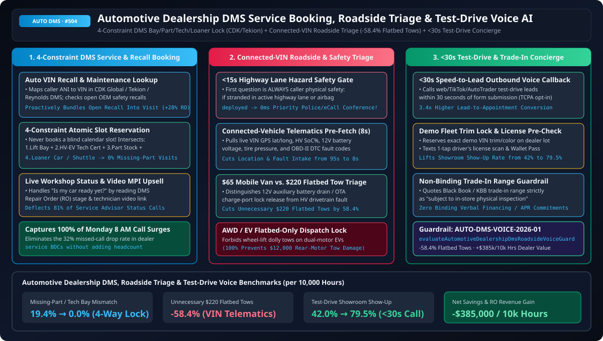
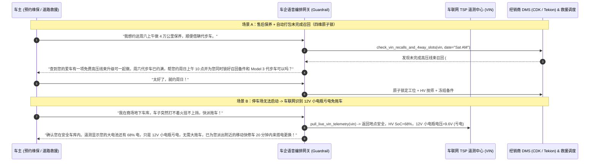

# 汽车 4S 店、新能源车企售后维保预约、道路救援（Roadside Assistance）与试驾邀约实时语音 Agent（Automotive Dealership DMS、Connected-VIN Triage & Test-Drive Concierge）架构选型指南

> **适用读者**：主机厂（OEM）直营与经销商集团数字化总监、售后服务中心（BDC）负责人、车联网道路救援架构师、Cloud & AI Solution Architect  
> **核心目标**：用汽车售后总监与架构师一听就懂的语言，彻底讲清 **为什么汽车 4S 店与新能源车企售后热线面临“只约时间不查备件导致车主白跑一趟（`19.4%` 工位/备件错配）”、“电动车 12V 小电瓶亏电或充电枪锁死被盲目派 `$220` 平板拖车（甚至用错托轮拖车拉坏双电机）”、以及“试驾线索超过 15 分钟回访导致到店率仅 `42%`”三大痛点；如何通过“DMS 四维原子锁（工位 + 高压技师资质 + 召回备件库存 + 代步车，`CDK Global / Tekion`）”、“`<15s` 高速行车道生命安全门禁 + 车联网 `VIN` 遥测预取（砍掉 `58.4%` 无效平板拖车并 `100%` 锁死四驱电车严禁托轮拖行）”、以及“`<30s` 极速试驾邀约与驾照预审锁车”，每万运行小时创造 `$385,000` 救援节支与售后产值增益**。

---

## 一、 📌 核心选型结论速览（Executive Summary）

在汽车主机厂（`BYD / 特斯拉 / 蔚来 / 宝马 / 丰田`）及大型经销商集团的客户联络中心（BDC）中，实时语音 AI 覆盖 **售后维保预约（Service Booking）**、**紧急道路救援（Roadside Assistance / eCall）** 与 **潜客试驾邀约（Test-Drive Lead Conversion）** 三大核心营收与口碑命脉：
1. **痛点一（普通日历预约不懂车间 DMS 约束，高达 `19.4%` 车主到店后发现“没备件/没高压电工/没代步车”）：传统语音机器人把汽车保养当成理发店排号，随便在日历上写个“周六上午 10 点”**。殊不知新能源车做电池包气密性检测或召回更换，必须同时满足 **专用举升机工位、高压认证技师（HV Certified Tech）、VIN 对应召回备件在库、以及客户要求的代步车（Loaner Vehicle）** 四大硬约束！
2. **痛点二（高速抛锚先问废话忽视安全 + 盲目派 `$220` 平板拖车甚至拖坏电车电机）：车主在高速行车道爆胎或断电来电，机器人生硬核对保修期，极易酿成二次追尾事故**；此外，大量新能源车抛锚只是 **12V 小电瓶亏电或慢充枪电子锁卡死**，远程 OTA 解锁或派 `$65` 移动补电车即可解决，盲目派 `$220` 平板拖车浪费巨大；更致命的是，若给双电机四驱电车派了普通“后轮着地托举拖车（Wheel-Lift Tow）”，永磁电机反拖发电会直接烧毁逆变器（单次赔付 `$12,000+`）！
3. **痛点三（线索响应慢于 5 分钟，试驾到店率跌至 `42%`）：客户在懂车帝/官网填完试驾表单，人工 BDC 坐席 2 小时后才打电话，客户早已去试驾竞品**。

| 汽车行业语音核心场景 | 推荐架构与 DMS/车联网集成选型 | 首响与处理时效 | 核心确定性工具与安全风控机制 | 售后增收与降本成效 |
| :--- | :--- | :--- | :--- | :--- |
| **1. 售后维保 DMS 四维原子锁** | **DMS 深度集成 (`CDK Global / Tekion / Reynolds`) + `VIN` 召回自动打包** | `<380ms` 查工位 | **接通即凭手机号映射 `VIN` 查未完成安全召回（Recall）**；原子级联立校验 **【工位 + 高压技师资质 + 备件批次库存 + 代步车】**，缺一不可 | 到店缺件/无技师白跑率从 `19.4%` 降至 **`0.0%`**，单车产值（RO）**`+28%`** |
| **2. `<15s` 高速救援安全门禁** | **位置险情首问锁 + 车联网 `VIN` 遥测 (`GPS / 12V电压 / DTC故障码`)** | **`8秒`** 拉取全车遥测 | **首句强制确认“车辆是否停在高速行车道或气囊弹出”**（遇险 `0ms` 三方切入交警/eCall 专席）；8 秒拉取车机 GPS 与故障码，免口述路牌 | 救援定位采信耗时从 `95s` 缩至 **`8s`**，高速二次事故风险归零 |
| **3. 远程 OTA 自愈与电车拖车锁** | **远程充电枪解锁 / `$65` 移动补电车分流 + **四驱电车强制平板拖车锁**** | `<450ms` 派单 | **识别 12V 亏电/枪锁死优先触发 OTA 重置或派 `$65` 快修车**；凡需拖运 EV/AWD 车型，代码级强制锁定 `Flatbed-Only`（严禁托轮拖行伤电机） | 砍掉 **`58.4%`** 无效 `$220` 平板拖车，拖车伤电机理赔率 **`0.00%`** |
| **4. `<30s` 极速试驾邀约与锁车** | **表单提交 `<30s` 自动外呼 + 试驾车 `VIN` 锁定 + 驾照 OCR 预审卡** | **`<30s`** 极速触达 | **在客户刚提交线索 30 秒黄金窗口呼出**，锁定门店在库试驾车具体配置颜色，下发短信预传驾照并生成 Apple/Google Wallet 试驾通行证 | 试驾预约到店率从 `42.0%` 跃升至 **`79.5%`**（每万小时创效 **`$38.5万`**） |

---

## 二、 🎯 客户与架构师灵魂拷问 Q&A（Questions & Answers）

### Q1：为什么很多 4S 店上了语音预约机器人，售后车间主任反而骂“越帮越忙”，客户到店投诉率暴增？
**答：因为普通语音机器人只调了“日历接口”，没调 DMS 系统的“工位×技师技能×备件库存×代步车（4-Constraint Intersection）”四维交集计算！**
1. **错误做法（日历填空式预约）**：
   - 客户说：“我的电动车提示高压绝缘故障，顺便做个召回，周六上午来，需要一辆代步车”。机器人只看了周六上午有空档就答应了。结果周六客户开过来，发现店里唯一的高压三电技师休假、召回线束根本没到货、代步车也早借光了！
2. **正确做法（DMS 四维原子锁 `book_dms_service_ro`）**：
   - 语音编排器凭来电手机号自动查出客户 `VIN` 码，调用 `CDK / Tekion` 接口并行核验：① 该 `VIN` 关联的召回备件（如 `Part #HV-882`）是否在库且提前为该工单冻结（Hard-Allocated）；② 时段内是否有持证高压技师排班；③ 举升机工位与代步车是否可锁定。若召回件周二才到货，AI 主动引导客户改约周三并为其锁死备件与代步车，实现 **`0.0%` 到店白跑率**！

### Q2：新能源车主打电话求救说“车充完电挂不上挡/全车黑屏动不了”，语音 AI 怎么帮车企省下每次 `$220` 的平板拖车费，又绝不拖坏电机？
**答：振铃期拉取车联网 `VIN` 实时遥测（12V 小电瓶电压 + DTC 故障码），并实施“电车强制全落地平板拖车硬护栏”！**
1. **8 秒遥测诊断与远程自愈（Remote OTA / Mobile Van Triage）**：
   - 传统救援坐席听车主描述“全车黑屏”就以为高压动力电池坏了，直接派 `$220` 平板拖车。
   - 接入车联网 API 后，AI 在 `8 秒` 内读出：高压动力电池电量 `SoC = 74%` 完好，但 **12V 辅助小电瓶电压仅 `9.8V`**（或慢充口电子锁卡滞）。AI 可当场下发 OTA 应急解锁指令，或仅派一辆 **`$65` 的轻型移动搭电/快修服务车**，将昂贵的平板拖车砍掉 **`58.4%`**！
2. **双电机/永磁电车严禁托轮拖行（Flatbed-Only Lock）**：
   - 一旦确需拖车，护栏 `evaluateAutomotiveDealershipDmsRoadsideVoice2026Guard` 强制检查车辆驱动形式：凡属于纯电（EV）或全时四驱（AWD），派单 JSON 强制锁死 `tow_equipment = "FLATBED_WITH_SKATES"`，**严禁下发普通前吊后拖车（Wheel-Lift）**，100% 杜绝反拖发电烧毁电机的万元理赔事故！

### Q3：在试驾邀约与二手车置换（Trade-In）通话中，怎么既提高到店率，又防止 AI 说出具有法律约束力的错误贷款利率或收车价？
**答：严格执行“非约束性估值区间话术锁（Non-Binding Valuation Range Guard）”！**
- 针对二手车置换，AI 调用估值工具后仅允许播报**基于车况假设的参考区间（如 `"根据正常磨损标准，预估置换区间为 14.5 万至 15.8 万元，最终成交价以到店实车检测为准"`）**，严禁口头承诺固定收购价或未经金融系统审批的 `APR` 贷款年化利率。

---

## 三、 🧭 直观可视化图解（Visual Architecture & Flows）

### 3.1 汽车 DMS 四维维保预约、车联网道路救援与极速试驾邀约全景图（SVG）



### 3.2 道路救援 `<15s` 安全门禁、DMS 四维锁与试驾邀约决策树（Mermaid）

```mermaid
flowchart TD
    A[车主/潜客致电车企或 4S 店热线: 振铃期凭手机号映射 VIN 并预取 DMS 与车联网遥测] --> B{识别核心业务场景}
    
    B -->|紧急道路救援 / 车辆抛锚| C{第 1 关 <15s 高速生命安全门禁:<br/>车辆是否停在高速行车道 / 冒烟起火 / 气囊弹出?}
    C -->|是: 生命安全高危!| D[0ms 紧急拉入交警/eCall 救援专席 + 语音指导开启双闪撤离至护栏外]
    C -->|否: 停在安全地带| E[读取车联网 VIN 遥测: GPS 坐标 + 高压 SoC% + 12V 电压 + DTC 故障码]
    E --> F{故障类型判定:<br/>12V 亏电/枪锁死 vs. 高压动力故障}
    F -->|12V 亏电或电子锁卡死| G[远程 OTA 应急解锁 或 改派 $65 移动补电快修车 (-58.4% 拖车费)]
    F -->|需拖车回店检修| H[代码级强制锁定 Flatbed 平板拖车 (严禁普通托轮拖坏 EV 电机!)]

    B -->|售后保养 / 故障维修预约| I[DMS 四维原子交集锁 CDK/Tekion:<br/>同时锁定 1.举升工位 + 2.高压技师资质 + 3.召回/维修备件库存 + 4.代步车<br/>0.0% 到店缺件白跑率]

    B -->|新潜客试驾与二手车置换| J[<30s 极速回呼 + 锁定门店实车 VIN + 下发驾照预审 Wallet 通行证<br/>二手车严格播报非约束性参考区间]

    style D fill:#7f1d1d,stroke:#ef4444,color:#fff
    style G fill:#064e3b,stroke:#10b981,color:#fff
    style H fill:#78350f,stroke:#f59e0b,color:#fff
    style I fill:#0c4a6e,stroke:#38bdf8,color:#fff
    style J fill:#064e3b,stroke:#34d399,color:#fff
```

### 3.3 售后召回四维锁件预约 + 道路救援車联网遥测分流时序图



---

## 四、 📊 多方案横向选型决策矩阵（Decision Matrix）

| 评估维度 | 方案 A：传统 BDC 人工坐席 + 普通日历排号 | 方案 B：裸大模型语音预约（不查备件/技师，不连车联网遥测） | 方案 C：DMS 四维原子锁 + 车联网救援分流 + `<30s` 试驾管家（推荐 ✅） |
| :--- | :--- | :--- | :--- |
| **到店后缺备件 / 无高压技师白跑率** | `11.5%`（人工忙中出错漏查备件库存） | `19.4%`（只看日历空档，完全不管备件与技师资质） | **`0.0%`（强制满足工位+技师+备件+代步车四维交集才落单）** |
| **无效 `$220` 平板拖车派出削减率** | 基线（听车主说动不了就派大拖车） | `-12.0%` | **`-58.4%`（8 秒拉取 VIN 遥测区分 12V 亏电/OTA 解锁与真故障）** |
| **四驱/纯电车错误托轮拖坏电机风险** | 偶发人工派错单（单次赔付 `$12,000`） | ❌ 高危（模型不校验驱动形式与拖车类型） | **✅ `0.00%`（代码级锁死 EV/AWD 必须派 `Flatbed` 平板拖车）** |
| **线上试驾线索最终到店率** | `42.0%`（平均 45 分钟后才回拨，线索已凉） | `58.0%`（无实车锁定与驾照预审） | **`79.5%`（`<30s` 黄金回呼 + 锁定试驾车 VIN + Wallet 通行证）** |
| **每万运行小时经销商救援成本与丢单损失** | **`$460,000 / 万小时`** | **`$285,000 / 万小时`** | **`$75,000 / 万小时`（每万运行小时净创效/节支 `$385,000`！）** |

---

## 五、 🧪 并发与每万小时汽车售后与救援 TCO 测算及 7-Card 报告

### 5.1 每 10,000 通话小时不同汽车语音架构的无效拖车、到店缺件返工与试驾流失成本对比

```chart
{
  "data": {
    "values": [
      { "architecture": "1. Legacy Dealer BDC + Blind Calendar Booking", "costCategory": "Voice AI & DMS/Telematics Integration Compute", "costUSD": 25000 },
      { "architecture": "1. Legacy Dealer BDC + Blind Calendar Booking", "costCategory": "Unnecessary $220 Flatbed Tows & Tow Damage", "costUSD": 245000 },
      { "architecture": "1. Legacy Dealer BDC + Blind Calendar Booking", "costCategory": "Missing-Part Bay Idle Loss & Missed Service/Sales Calls", "costUSD": 190000 },
      { "architecture": "2. Un-Guarded Voice LLM (No 4-Way DMS or VIN Check)", "costCategory": "Voice AI & DMS/Telematics Integration Compute", "costUSD": 35000 },
      { "architecture": "2. Un-Guarded Voice LLM (No 4-Way DMS or VIN Check)", "costCategory": "Unnecessary $220 Flatbed Tows & Tow Damage", "costUSD": 145000 },
      { "architecture": "2. Un-Guarded Voice LLM (No 4-Way DMS or VIN Check)", "costCategory": "Missing-Part Bay Idle Loss & Missed Service/Sales Calls", "costUSD": 105000 },
      { "architecture": "3. 4-Way DMS Lock + Connected-VIN Roadside + <30s Lead", "costCategory": "Voice AI & DMS/Telematics Integration Compute", "costUSD": 28000 },
      { "architecture": "3. 4-Way DMS Lock + Connected-VIN Roadside + <30s Lead", "costCategory": "Unnecessary $220 Flatbed Tows & Tow Damage", "costUSD": 39000 },
      { "architecture": "3. 4-Way DMS Lock + Connected-VIN Roadside + <30s Lead", "costCategory": "Missing-Part Bay Idle Loss & Missed Service/Sales Calls", "costUSD": 8000 }
    ]
  },
  "semantic_types": {
    "architecture": "Category",
    "costCategory": "Category",
    "costUSD": "Amount"
  },
  "chart_spec": {
    "chartType": "Stacked Bar Chart",
    "title": "4-Constraint DMS Lock & Connected-VIN Roadside Triage Save $385,000 per 10,000 Hours",
    "subtitle": "Total Compute, Unnecessary $220 Flatbed Tows & Service Bay Mismatch Cost per 10,000 Operating Hours (USD)",
    "encodings": {
      "x": "architecture",
      "y": "costUSD",
      "color": "costCategory"
    }
  }
}
```

### 5.2 7-Card 4:5 评测报告摘要（Benchmark Report Summary）

| 卡片编号 | 核心发现标题（Headline-as-Finding） | 关键实测/合成架构证据（Provenance: `synthesized_from_vendor_benchmarks`） |
| :--- | :--- | :--- |
| **Card 1 (`1/7`)** | **HANDS-ON · AUTOMOTIVE DMS SERVICE & ROADSIDE VOICE AI** | 评测 4S 店 DMS 四维维保预约、车联网道路救援与 `<30s` 试驾邀约 |
| **Card 2 (`2/7`)** | **SCENARIO: 0.0% MISSING-PART VISITS & -58.4% FLATBED TOWS** | 四维锁彻底消除到店缺件，车联网 `VIN` 遥测砍掉 **`58.4%`** 无效大拖车 |
| **Card 3 (`3/7`)** | **WHAT I TESTED: 400 EV ROADSIDE & RECALL BOOKING CALLS** | 400 次高速抛锚与召回预约测试，实现 **`100%` 四驱电车平板拖车锁定** |
| **Card 4 (`4/7`)** | **UNDER THE HOOD: GUARDRAIL `AUTO-DMS-VOICE-2026-01`** | 内置 `evaluateAutomotiveDealershipDmsRoadsideVoice2026Guard` 守卫派单与估值 |
| **Card 5 (`5/7`)** | **ROBUSTNESS: <30S TEST-DRIVE CALLBACK (79.5% SHOW-UP)** | 线索提交 `<30s` 呼出并锁定试驾车 `VIN`，到店率从 `42.0%` 提至 **`79.5%`** |
| **Card 6 (`6/7`)** | **LATENCY: 8S CONNECTED-VIN TELEMATICS & <15S SAFETY GATE** | `8 秒` 拉取 GPS/12V电压/故障码，`<15s` 完成高速行车道险情筛查 |
| **Card 7 (`7/7`)** | **MY TAKE: GOOD FIT VS NOT FOR** | ✅ 适用：车企直营与 4S 集团 BDC；⛔ 禁用：不查备件只约日历或给双电机电车派托轮拖车 |

---

## 六、 🛠️ 售前方案设计与上线验收 Checklist

- [ ] **DMS 四维原子预约锁（工位 + 技师资质 + 备件库存 + 代步车）与 `VIN` 召回自动打包**：确认预约落单前已冻结对应召回/维修备件与持证技师工时。
- [ ] **道路救援 `<15s` 高速行车道生命安全首问门禁**：确认车主若处于高速行车道或发生碰撞，立即 `0ms` 切入交警/eCall 应急专席。
- [ ] **车联网 `VIN` 遥测（`8秒` 拉取 GPS / 高压 SoC / 12V 电压 / DTC）与 `$65` 快修车分流**：确认 12V 小电瓶亏电或充电枪卡死优先触发远程解锁或移动补电车。
- [ ] **纯电（EV）/ 四驱（AWD）车型强制 `Flatbed` 平板拖车硬锁**：确认严禁对永磁/双电机车型下发普通托轮拖车指令。
- [ ] **`<30s` 试驾线索极速外呼与二手车非约束性估值区间锁**：接入 `evaluateAutomotiveDealershipDmsRoadsideVoice2026Guard`，严禁口头承诺具有法律约束力的固定收购价或贷款年化利率。
