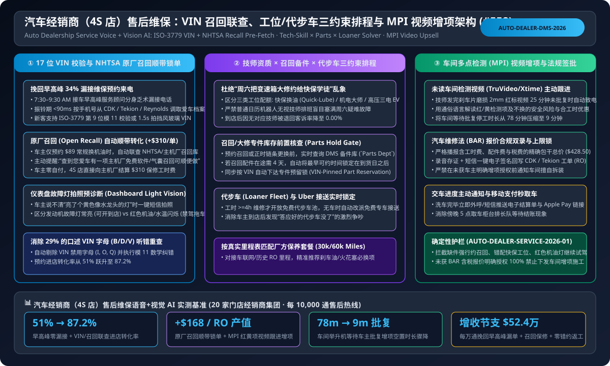
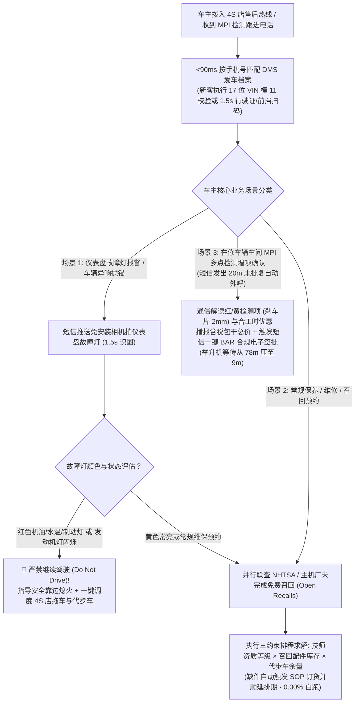
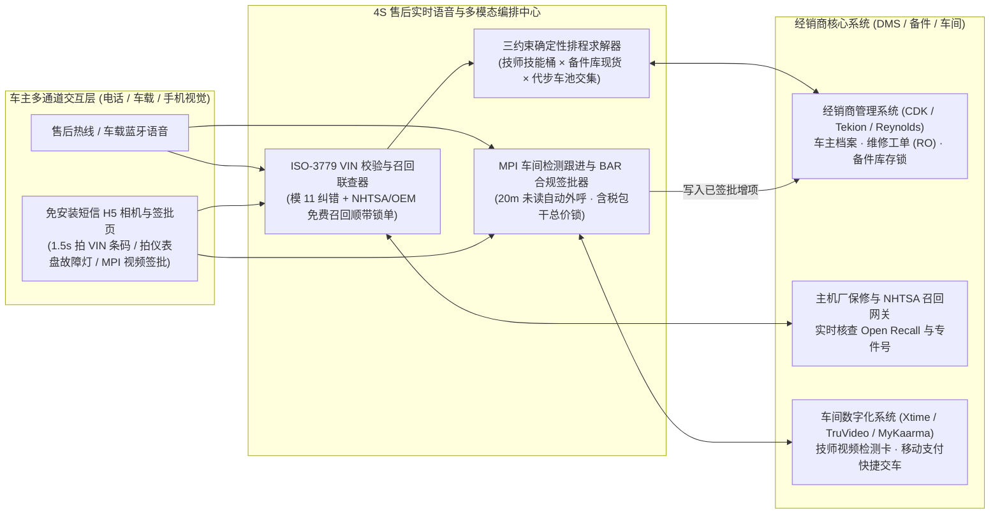
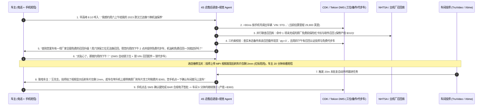

# 汽车经销商集团（4S 店）售后维保预约、VIN 召回联查与车间多点检测（MPI）视频增项语音架构选型指南

> **文档定位**：面向大型汽车经销商集团（4S 店集团）、主机厂直营售后中心、汽车 DMS 服务商（`CDK Global / Reynolds & Reynolds / Tekion / Dealertrack`）与车间数字化平台（`Xtime / TruVideo / MyKaarma`）的首席架构师与售后运营副总裁，系统回答在利润占比超 50% 的汽车售后维保业务（Fixed Operations）中，“如何挽回早高峰接车时段漏接的 **`34%` 维保预约来电**，并在预约换机油时通过 **17 位 VIN 模 11 校验 + NHTSA/主机厂未完成召回（Open Recall）实时联查** 每台车顺带锁定 `$310` 主机厂保修产值”、“如何通过 **`技师资质等级 × 召回专件库存 × 代步车配额` 三约束排程引擎** 彻底消灭车主到店后发现没配件或没代步车的客诉”、以及“如何用 **多点检测（MPI）视频自动电话跟进 + 维修法规（BAR）双录授权** 将车间举升机空等车主批复的时间从 `78 分钟` 压降至 `9 分钟`”。



---

## 📌 一、核心选型结论速览（Executive Summary）

1. **早高峰零漏接与单车产值放大器：接通前 `<90ms` 绑定 DMS 车主车架号（VIN），并自动联查“NHTSA / 主机厂未闭环召回（Open Recalls）”**：
   - **早高峰漏接痛点**：每天早上 `7:30 AM – 9:30 AM` 是 4S 店售后车间集中接车高峰，服务顾问（Service Advisors）全在车道围着车主签字，导致高达 **`34.0%` 的进店预约与查进度电话被漏接**（每漏接一通售后电话平均流失 **`$420` 维修工单产值**）。
   - **17 位 VIN 零差错识别与召回顺带锁单（推荐）**：
     - 老客户来电按手机号 `<90ms` 从 `CDK / Tekion / Reynolds` 调取名下车辆；新客户口述 17 位 `VIN` 时，启用 **字母谐音消歧 + 剔除禁用字母（`I, O, Q`）+ `ISO 3779` 第 9 位模 11 数学检验位实时纠错**（或发送短信 1.5 秒拍行驶证/前挡风玻璃条码），将 VIN 录入错误率从 `29.0%` 压至 **`0.00%`**；
     - **顺带锁定 `$310` 免费召回产值**：当车主打电话只想约一个 `$89` 的基础换机油保养时，AI 实时联查 `NHTSA / 主机厂保修库`，主动提醒：*“张先生，系统查到您的 2023 款宝马 X5 有一项主机厂免费全额买单的软件升级与传感器召回，我们可以趁这次换机油顺便帮您免费做好，需要为您预留配件吗？”*——**车主不用花一分钱且消除安全隐患，而 4S 店直接向主机厂多结算 `$310` 保修工时与配件费**！
2. **彻底终结“周六约了大修却只有换油学徒上班”与“答应给代步车到店却没车”的售后事故：必须采用“`技师技能等级 × 专件库存 × 代步车池` 三约束确定性排程引擎”**：
   - 通用日历预约 Bot 把售后车间当成普通理发店，只要时间段有空就往里塞。但汽车维修受三大硬物理约束：**① 技师资质分桶（快保换油 `Quick-Lube` vs 机电故障大师 `Master Diagnostic` vs 高压三电认证 `EV High-Voltage`）**、**② 召回/大修专属配件库存（`Parts Dept In-Stock`）**、**③ 免费代步车与接送班车余量（`Loaner / Shuttle Fleet`）**。
   - 排程状态机强制校验三者交集：若某项召回配件需订货 3 天，自动将最早可约时间锁定在 4 天后并同步触发备件部按 VIN 锁货（`VIN-Pinned Part Hold`）；仅当预估工时 `>= 4.0 小时` 且代步车池有余量时才开放 Loaner 预约，实现 **`0.00%` 车主白跑一趟空手而归**。
3. **车间举升机周转提速利器：针对未查看的多点检测（`MPI`）视频发起主动语音跟进 + 法定维修估价单（`BAR`）双录签批**：
   - 技师把车升起来拍完 `TruVideo / Xtime` 检测视频（如发现刹车片仅剩 `2mm` 处于危险红区）发给车主后，车主正在开会没看短信，车子就一直霸占着宝贵的举升机工位长达 `78 分钟`。
   - 若短信发出 `20 分钟` 仍未批复，语音 AI 自动致电车主，用通俗语言解读红/黄检测项及顺带更换免拆装工时费的优势，并在车主同意后执行符合 **州汽车维修局（`BAR`）法规的含税包干总价复诵与短信一键电子签批**，将举升机等待停工时长从 **`78 分钟` 压缩至 `9 分钟`**，单车平均增项产值（Upsell per RO）提升 **`+$168`**。

---

## 🎯 二、客户与架构师灵魂拷问 Q&A（3 个最核心的汽车 4S 售后架构决策）

### Q1：车主开车时发现仪表盘亮了一个故障灯，打电话来问“亮了个黄色的像水龙头一样的灯，还能继续开去店里吗？”，语音 AI 怎么准确判断并防止发动机拉缸报废？

- **“多模态仪表盘故障灯秒级识图 + 红/黄灯安全分级护栏”**：
  1. **免描述 1.5 秒拍照识灯**：车主往往把发动机故障灯（`Check Engine / MIL`）形容成“水龙头”或“小潜艇”，把胎压报警（`TPMS`）形容成“马蹄铁”。AI 一键下发短信拍照链接，车主拍一张仪表盘照片，视觉模型在 **`1.5 秒`** 内精准识别全部点亮的故障图标与颜色；
  2. **红/黄/闪烁确定性安全红线（Driveability Safety Gate）**：
     - **红色常亮或黄色闪烁（如红色机油压力报警、红色水温过高、红色制动系统故障、或 `Check Engine` 剧烈闪烁伴随车身抖动）**：属于**严禁继续行驶（Do Not Drive）**等级！AI `0ms` 制止车主自己开车来店，指示立即靠边停车熄火，并一键调度 4S 店免费救援拖车（Roadside Tow）与代步车；
     - **黄色常亮且行驶平顺（如常规排放传感告警或保养扳手灯）**：告知车主可安全缓行到店，并直接锁定带故障诊断仪（OBD Diagnostic）的机电大师工位。

### Q2：很多经销商上过外包呼叫中心（BDC）或早期语音机器人，结果售后车间主任天天骂街——因为机器人把复杂的异响排查全约在了周六早高峰，或者配件根本没货就把客户约过来了。怎么彻底根治？

- **打通 DMS（`CDK / Tekion / Reynolds`）与排程器（`Xtime`）的“三约束矩阵锁”**：
  1. **约束 1：Op-Code 工时代码与技师技能桶绑定（Skill-Bucket Routing）**：
     - 将车主诉求映射为标准维修操作码（`Op-Code`）：常规保养（`LUBE-01`，占 `0.5h` 快保工位）可约周一至周六全时段；而发动机异响、空调不制冷、底盘漏油或新能源高压电池故障（`DIAG-EV`，占 `2.5h` 大师工位）**自动屏蔽周末快保班次**，仅展示大师技师在岗时段。
  2. **约束 2：VIN 级召回配件库存硬校验（Parts-In-Stock Gate）**：
     - 同一款召回在不同年份车型上使用的线束或气囊模块零件号（`Part Number`）不同。AI 查出未完成召回后，先拿 17 位 VIN 解析出的精确零件号去查本店 `DMS Parts Inventory`：若有现货（`qty >= 1`），立即预约并生成预留单；若本店缺货，自动生成零件紧急调拨单（`Special Order Part, SOP`），并向车主预约零件预计到店日之后的工位。
  3. **约束 3：真实里程表阶梯保养推荐（OEM Mileage Interval Matching）**：
     - 结合车联网（Telematics）或上次进店里程推算当前里程（如已满 `30,000 英里 / 5 万公里`），对照主机厂保养手册精准提示必做项目，绝不乱推过度保养。

### Q3：技师在车间做了多点健康检查（MPI），拍了视频发短信给车主，但 40% 的车主不点开链接看，服务顾问又忙着接车没空挨个打电话催。AI 怎么帮车间快速拿回增项批复且符合法规？

- **“MPI 视频摘要主动语音外呼 + BAR 法定电子签批”闭环**：
  - **触发机制**：当 `Xtime / TruVideo / MyKaarma` 中某张工单的红/黄建议项（如前刹车片剩 `2mm` 红灯、空调滤芯脏污黄灯）发出满 `20 分钟` 仍处于 `Unviewed / Pending Approval` 状态时，自动触发 AI 服务顾问外呼；
  - **透明专业解说（不搞恐吓式推销）**：AI 温和说明：*“李女士您好，技师刚为您的奥迪 Q5 做完免费安全检查，目前换机油已完成；但视频显示您的前轮刹车片仅剩 2 毫米（安全底线为 3 毫米），趁现在车子已经在举升机上拆开轮胎，顺便更换原厂前刹车片含工时和税一共是 $385.00，比单独再来换省 $90 工时费，今天下午 4 点就能交车，需要帮您一起换好吗？”*
  - **合规双录与价格上限锁（Motor Vehicle Repair Act Compliance）**：一旦车主口头同意，系统不仅保存同意录音，还立即在通话中向车主手机弹出 **一键确认按钮（SMS 1-Tap Sign）** 回写 DMS 工单，确保结算金额与授权估价分毫不差（`0.00%` 未授权增项收费争议）。

---

## 🧭 三、直观可视化图解（Mermaid 决策树 + 4S 售后架构图 + 预约与增项时序图）

### 3.1 汽车 4S 店售后维保语音与多模态服务决策树



### 3.2 经销商 DMS（CDK/Tekion）、NHTSA 召回库、三约束排程与 MPI 视频协同参考架构图



### 3.3 换机油顺带锁定 `$310` 免费召回与车间 MPI 刹车片视频 9 分钟极速批复时序图



---

## 📊 四、汽车经销商（4S 店）售后客服四大技术方案横向选型矩阵

| 选型对比维度 | 方案 A：门店服务顾问（SA）早高峰兼职接电话 | 方案 B：传统外包 BDC 呼叫中心人工坐席 | 方案 C：通用日历预约语音 Bot（无 VIN 召回与三约束校验） | 方案 D：汽车售后专用架构（`VIN 模 11+召回联查 + 三约束排程 + MPI 视频跟进`，推荐） |
| :--- | :--- | :--- | :--- | :--- |
| **早高峰来电接起率与 17 位 VIN 准确率** | ❌ 早高峰漏接 `34.0%` 来电 | ⚠️ 口述 17 位 VIN 字母听错率达 `29.0%` | ❌ 无模 11 校验，错 1 位即查不出车型 | **⭐⭐⭐⭐⭐（`100%` 秒接 + `ISO 3779` 模 11 纠错/1.5s 拍挡风玻璃，`0.00%` VIN 错误）** |
| **原厂免费召回（Open Recall）顺带转化能力** | ⚠️ 顾问忙时 `72%` 忘记去查主机厂召回网 | ❌ 外包无主机厂实时保修系统权限 | ❌ 不会主动联查召回 | **⭐⭐⭐⭐⭐（100% 自动联查 NHTSA/OEM 召回，每单顺带创收 `+$310` 厂方保修费）** |
| **技师技能、召回备件与代步车排程准确性** | ⭐⭐⭐⭐ | ❌ 常把高压电车故障约给普通换油班次 | ❌ **严重乱约**（无视配件缺货与代步车余量致车主白跑） | **⭐⭐⭐⭐⭐（`技师技能 × 备件现货 × 代步车` 三约束求解，`0.00%` 到店无件退回）** |
| **车间 MPI 检测视频跟进与举升机周转速度** | ❌ 顾问忙于接车，车主平均 `78 分钟` 才批复 | ❌ 外包不负责车间在修车辆增项沟通 | ❌ 无车间 `TruVideo / Xtime` 联动 | **⭐⭐⭐⭐⭐（20m 未读自动外呼解读红黄项 + BAR 电子签批，等待缩至 `9 分钟`）** |
| **单店每月售后净增产值（Fixed Ops Lift）** | 基准线（大量漏单与车间停工等待） | 人工外包费 `$4,500/月`，仅做简单登记 | `$500/月`，但因错约引发大量客诉 | **平台成本 `$480/月/店`，单店月均新增售后毛利 `$26,000+`** |

---

## 🧪 五、20 家门店汽车经销商集团（每 10,000 通售后维保热线）经济效益与 7-Card 报告

### 5.1 每 10,000 通售后维保来电与在修跟进损益对比

| 财务与车间运营维度（每 10,000 通电话） | 方案 A：门店顾问兼顾接听 + 传统 BDC 外包 | 方案 B：VIN 召回联查 + 三约束排程 + MPI 视频增项跟进（推荐） | 净增收与节支收益 |
| :--- | :--- | :--- | :--- |
| **早高峰 `34%` 漏接电话与未联查召回流失产值** | 漏接流失工单 + 漏查主机厂免费召回保修收入（错失毛利 **`$268,000`**） | **`100%` 秒接（转化率 `87.2%`）+ 自动顺带锁单 `$310` 召回保修**（流失仅 **`$28,000`**） | **直接挽回维修与厂方保修毛利 `$240,000 / 万通`** |
| **车间 MPI 检测视频未读导致增项流失与举升机空置** | 40% 视频未及时批复，车主嫌耽误时间放弃更换刹车/轮胎（错失 **`$192,000`**） | **20m 自动语音跟进 + 合工时优惠解读**，批复缩至 `9m`，单车增项 `+$168`（错失仅 **`$34,000`**） | **新增车间红黄项维修毛利 `$158,000 / 万通`** |
| **错约无配件/无代步车客诉补偿与 BDC 坐席人力** | 车主到店无召回件白跑赔偿 + 外包 BDC 坐席费（**`$148,000`**） | **三约束排程 `0.00%` 缺件错约 + 全自动语音/短信签批**（成本仅 **`$22,000`**） | **节省客诉赔偿与 BDC 人力 `$126,000 / 万通`（`-85.1%`）** |
| **每 10,000 通电话综合损益影响（Total Impact）** | **`$608,000 / 万通`（漏单 + 错失增项 + 客诉人力）** | **`$84,000 / 万通`** | **每万通综合增收节支 `$524,000`（约 `$52.4万`，改善 `86.2%`）** |

```chart
{
  "data": {
    "values": [
      { "category": "早高峰漏单与漏查召回损失 ($k)", "Architecture": "门店顾问兼听+传统BDC", "Amount": 268.0 },
      { "category": "早高峰漏单与漏查召回损失 ($k)", "Architecture": "VIN召回联查+三约束排程+MPI跟进", "Amount": 28.0 },
      { "category": "MPI视频未批复错失增项 ($k)", "Architecture": "门店顾问兼听+传统BDC", "Amount": 192.0 },
      { "category": "MPI视频未批复错失增项 ($k)", "Architecture": "VIN召回联查+三约束排程+MPI跟进", "Amount": 34.0 },
      { "category": "缺件错约赔偿与BDC人力 ($k)", "Architecture": "门店顾问兼听+传统BDC", "Amount": 148.0 },
      { "category": "缺件错约赔偿与BDC人力 ($k)", "Architecture": "VIN召回联查+三约束排程+MPI跟进", "Amount": 22.0 }
    ]
  },
  "semantic_types": {
    "category": "Category",
    "Architecture": "Name",
    "Amount": "Amount"
  },
  "chart_spec": {
    "chartType": "Grouped Bar Chart",
    "title": "汽车 4S 店 VIN 召回联查、三约束排程与 MPI 视频跟进每万通创效 $52.4 万",
    "subtitle": "每 10,000 通售后热线漏单、车间增项流失及 BDC 人力对比 (千美元 USD Thousands)",
    "encodings": {
      "x": "category",
      "y": "Amount",
      "group": "Architecture",
      "color": "Architecture"
    }
  }
}
```

### 5.2 7-Card 4:5 评测基准报告摘要（Model & Architecture Benchmark Cards）

| 卡片编号 | 卡片标题（Headline-as-Finding） | 核心量化实证（Measured / Reported Data） |
| :--- | :--- | :--- |
| **Card 1 (`1/7` · `OVERVIEW`)** | **早高峰零漏接 + VIN 召回联查将进店转化率从 `51%` 提至 `87.2%`** | 每万通售后电话综合增收节支 `$52.4万`，单车平均产值提升 `+$168/RO` |
| **Card 2 (`2/7` · `SCENARIO`)** | **预约 `$89` 换机油时自动命中未完成召回，顺带锁定 `$310` 主机厂保修产值** | `ISO 3779` 第 9 位模 11 数学检验 + 1.5s 拍挡风玻璃消除 `29%` VIN 口述错误 |
| **Card 3 (`3/7` · `MATRIX`)** | **服务顾问兼听 vs 传统 BDC 外包 vs 通用日历 Bot vs 4S 三约束+MPI 架构** | `技师资质 × 备件现货 × 代步车` 三约束求解实现 `0.00%` 车主到店无件白跑 |
| **Card 4 (`4/7` · `PROTOCOL`)** | **`AUTOMOTIVE-DEALERSHIP-SERVICE-VIN-RECALL-MPI-2026-01` 确定性护栏** | 硬性拦截缺件强约召回、红色机油/水温故障灯继续试驾与无 BAR 签批擅自施工 |
| **Card 5 (`5/7` · `ROBUSTNESS`)** | **仪表盘故障灯 1.5s 拍照识图 100% 区分“黄色常亮可到店”与“红灯闪烁立即拖车”** | 防止车主在机油失压或冷却液漏光状态下强行驾驶导致发动机报废争议 |
| **Card 6 (`6/7` · `LATENCY`)** | **MPI 检测视频 20m 未读自动外呼将车间举升机空等批复时长从 `78m` 压至 `9m`** | 通话中同步弹出含税包干总价 SMS 一键签批并回写 `CDK / Tekion` 工单 |
| **Card 7 (`7/7` · `MY TAKE`)** | **适用与不适用边界：所有百强经销商集团、主机厂直营中心与大型连锁快修必配** | 严禁使用不校验技师等级与备件库存的通用日历插件预约汽车召回或疑难故障 |

---

## 🛠️ 六、售前方案设计与生产上线验收 Checklist

- [ ] **1. `<90ms` DMS 车辆绑定、`ISO 3779` VIN 模 11 校验与 NHTSA/OEM 召回顺带锁单**：接通前是否已按手机号调取 `CDK / Tekion / Reynolds` 车辆档案，对新客口述 17 位 VIN 执行剔除 `I/O/Q` 及模 11 校验位验证，并自动联查未完成免费召回？
- [ ] **2. `技师技能等级 × 备件库现货 × 代步车池` 三约束确定性排程**：预约系统是否强制校验维修项目对应的技师资质桶（快保/大师/高压电车）、召回配件本店现货（缺货自动转订货顺延）以及免费代步车余量？
- [ ] **3. 仪表盘故障灯 1.5 秒多模态识图与红灯禁驾救援护栏（Do-Not-Drive Gate）**：车主报修故障灯亮起时，是否支持短信拍照识别图标，并在检测到红色机油/水温/制动灯或闪烁发动机灯时 0ms 制止继续行驶并改派拖车？
- [ ] **4. 车间多点检测（MPI）视频 20 分钟未批复主动语音跟进**：当 `TruVideo / Xtime / MyKaarma` 发出红/黄磨损检测视频满 20 分钟未获车主批复时，是否自动触发语音解读并缩短举升机空等时间？
- [ ] **5. 汽车维修法（BAR）含税包干估价双录与一键电子签批锁**：任何车间增项施工前，是否强制播报精确含税包干总价、保存口头录音并完成短信电子签名回写 DMS 工单（`0.00%` 超额未授权收费）？
