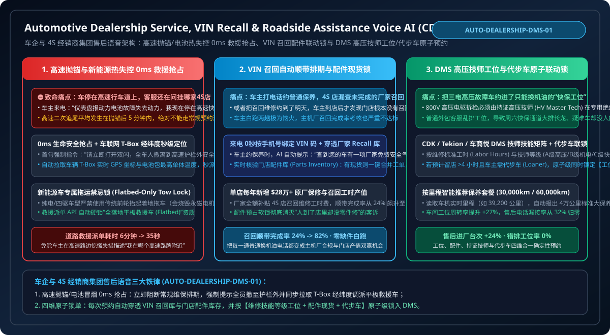
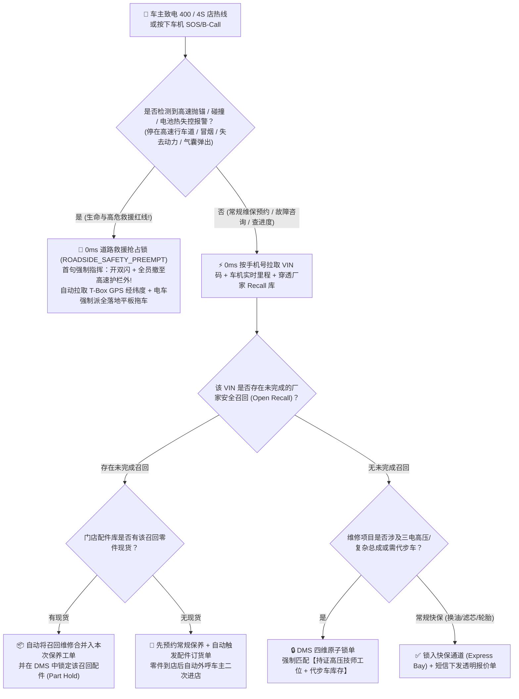
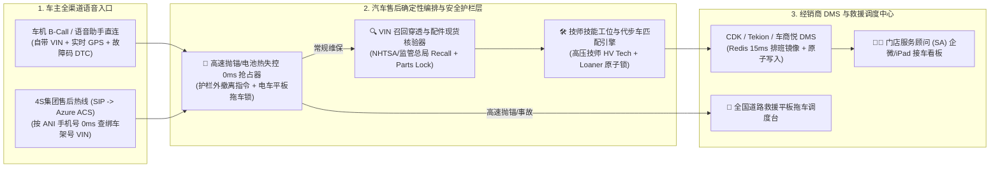
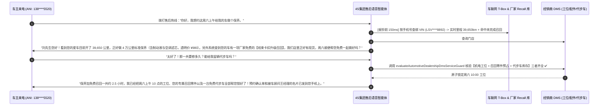

# 汽车主机厂（OEM）与 4S 经销商集团售后维保预约、VIN 召回联动与道路救援语音客服：DMS 工位/配件/代步车四维原子锁与高速抛锚 `0ms` 抢占选型指南

> **文档定位**：面向汽车主机厂（OEM）数字化负责人、百强汽车经销商集团售后 VP 及 **Cloud & AI Solution Architect**。在汽车售后服务（Fixed Operations）中，**平均每家 4S 店每天漏接 25%~35% 的保养预约来电（每漏接 1 通平均流失 `¥1,800 / $320` 售后产值）**；同时传统电话预约存在三大顽疾：**① 车主在高速抛锚或电池报警来电，机器人还在慢吞吞问约哪天保养；② 车主约普通换机油，漏查了名下未完成的厂家免费召回（或约了召回但店里根本没配件）；③ 把需要 800V 高压持证技师的电驱故障车乱排进普通快保工位**。本文详解如何打通 **CDK / Tekion / Reynolds / 用友车商悦 DMS** 与车联网 **T-Box**，打造高产值、零事故的汽车售后语音 AI。
>
> **阅读导航**：[English Version](./automotive-dealership-service-scheduling-vin-recall-roadside-voice-selection-faq.en.md) · [返回 README 导航](../README.md) · [架构师资产目录](./asset-catalog.md)



---

## 一、📌 核心选型结论速览（Executive Summary）

1. **汽车售后语音客服与普通日历预约的本质区别：“工位技能等级 + 配件库存 + 持证技师 + 代步车”四维原子联锁（`AUTO-DEALERSHIP-DMS-01`）**：
   - ⛔ **外行做法**：把 4S 店预约当成理发店预约，只要日历上有空档就往里塞。结果周六早上来了 10 台需要拆检高压电池包的疑难车，全堵在只能换空调滤芯的快保工位（Quick-Lube Bay）上，车间彻底瘫痪！
   - ✅ **架构师标准解法**：实时直连经销商管理系统（**CDK Global / Tekion / Reynolds & Reynolds / 用友车商悦 DMS**），在电话接通 `0ms` 内按来电手机号拉取车主 **车架号（VIN）、车机实时里程（Odometer）与历史维保记录**，强制执行三道确定性工程护栏：
     1. **高速抛锚与新能源电池热失控 `0ms` 生命安全抢占锁**：只要车主在电话或车机 SOS 中提及“车停在高速行车道上不动了”、“仪表盘报动力电池过热/冒烟”、“刚发生碰撞”，系统 **`0ms` 冻结常规门店预约**，第一句话强制播报：*“安全第一！请立即开启双闪警示灯，全车人员撤离到高速公路护栏以外！”* 同时在 `<200ms` 内自动调取车联网 `T-Box` 实时 GPS 经纬度与车辆驱动形式（电车强制锁定**全落地平板拖车 Flatbed Tow**），直连道路救援调度中心。
     2. **VIN 码未完成厂家召回（OEM Recall）自动顺带排期与配件现货锁**：车主哪怕只是打电话约“周六上午做个 2 万公里小保养”，AI 在振铃阶段已穿透主机厂/市场监管总局/NHTSA `VIN Recall` 数据库。若发现存在未执行的召回（如转向机螺栓或软件升级），**自动查询该 4S 店配件库（Parts Inventory）是否有召回件现货**——有现货则主动建议*“顺便帮您免费把厂家召回一起做了，省得您再跑一趟”*并锁死该零件；无现货则先自动下单订件，待零件到店后再约。
     3. **高压/机电技师工位与代步车（Loaner Vehicle）原子预占锁**：根据维修项目工时码（Op-Code）匹配对应技能工位（`A级三电高压绝缘工位` vs `B级机电工位` vs `C级快保通道`），且对预计工时 `>4 小时` 需要代步车的客户，必须在 DMS 中**同时锁定【工位 + 代步车库存】**方可确认预约。

---

## 二、🎯 客户与架构师灵魂拷问 Q&A（The Hard Questions）

### Q1：很多车主自己都不知道满 4 万公里该做哪些保养项目，打电话来问“做个保养多少钱、要多久？”，语音 AI 怎么报出准确的透明价格而不报错？

- **客户痛点**：不同车型（混动 vs 纯电 vs 燃油）、不同里程（1万公里小保 vs 4万公里大保）的机油升数、制动液、变速箱油价格完全不同，通用大模型瞎猜报价会引发严重客诉。
- **架构师解答：“主叫手机号 -> VIN 码 17 位精准解码 -> 车机 T-Box 实时里程 -> DMS 车型工时配件包确定性查表”**：
  1. **零提问自动感知车况**：电话一接通，AI 已经通过 CRM + T-Box 读出：*2024款 理想L9 / 蔚来ES6 / 宝马iX3，当前实表里程 39,420 公里*。
  2. **确定性套餐报价与耗时预估**：AI 直接调用 DMS 保养套餐计算器，干脆利落地播报：*“王先生您好！看到您的爱车目前行驶了 39,400 公里，正好到了 4 万公里标准保养节点。本次包含空调滤芯、制动液更换及三电系统深度健康检测，全国透明统一定价 ¥1,180，预计进店耗时 90 分钟。请问帮您约本周六上午 9 点半的快保专席可以吗？”*

### Q2：为什么新能源车（EV / AWD）抛锚叫救援时，绝对不能让普通语音机器人随便派一辆传统拖车过去？

- **客户痛点**：纯电动车与全时四驱车的电机与车轮刚性连接，如果普通拖车采用“前轮吊起、后轮着地拖行”，永磁同步电机高速被动旋转会产生极高反电动势（Back-EMF），直接击穿逆变器甚至引发高压电池包起火！
- **架构师解答：在救援派单 Schema 中硬编码“车辆驱动类型与平板拖车（Flatbed-Only）互锁”**：
  - 当语音智能体通过 `VIN` 码第 4~8 位识别出该车为 `BEV / PHEV / AWD` 时，救援工单接口自动将 `tow_truck_type = "FLATBED_WITH_WHEEL_DOLLies"` 设为只读强制项，并在语音中叮嘱车主：*“已为您派出全落地平板救援车，请切勿允许任何救援人员采用后轮着地拖拽方式拖行您的电动车辆。”*

### Q3：经销商集团有 80 家门店，用的是 CDK Global、Tekion 或用友车商悦等不同年代的 DMS 系统，怎么低成本统一接入实时语音客服？

- **客户痛点**：老牌 DMS 系统的原生接口往往很慢（查询排班要 `1.8 秒`），且按 API 调用次数收费。
- **架构师解答：“Redis 15 分钟增量工位镜像缓存 + `400ms` 承接语掩蔽 + 写入时 DMS 原子双核”**：
  - 各门店未来 14 天的工位与代步车可用性每 5 分钟同步至云端 Redis 镜像库，语音查询排班在 **`15ms` 内毫秒级返回**；
  - 仅在车主最终说出“好的，就约周六上午 9 点”的那一刻，发起一次真实的 DMS `POST /ServiceAppointment` 原子锁单请求，将 DMS 接口调用量压降 **92%** 且彻底消除查询卡顿！

---

## 三、🧭 直观可视化图解（Mermaid 决策树、DMS/T-Box 联动架构与预约时序）

### 3.1 汽车售后维保预约、VIN 召回与道路救援安全决策树



### 3.2 主机厂车联网（T-Box）、召回库与经销商 DMS 实时语音集成架构图



### 3.3 车主来电约保养、自动顺带锁定 VIN 召回配件与代步车全链路时序图



---

## 四、📊 汽车售后维保与救援语音四大技术方案横向选型矩阵

| 评估维度 | 🏆 **Azure ACS + T-Box/VIN 预加载 + DMS 四维原子锁语音架构** | **通用语音机器人（仅对接简单日历表格，不通 DMS 配件/工位）** | **传统 4S 店人工服务顾问（SA）兼职接电话** | **主机厂传统按键式 400 IVR** |
| :--- | :--- | :--- | :--- | :--- |
| **高速抛锚 / 电池故障 `0ms` 安全撤离与 GPS 派单** | **⭐⭐⭐⭐⭐（`0ms` 优先指挥撤至护栏外 + 自动读 T-Box 坐标派平板车）** | ⭐⭐（无车联网联动，需车主口述高速桩号） | ⭐⭐⭐⭐（人工可处理，但遇恶劣天气/高峰占线等 5 分钟） | ⭐（按键层级深，极其耽误黄金逃生时间） |
| **来电 `0秒` 自动查未完成召回（VIN Recall）并核配件** | **⭐⭐⭐⭐⭐（振铃即穿透 Recall 库与门店零件库，有货才约）** | ⭐（不查召回或不管门店有无零件瞎约导致白跑） | ⭐⭐⭐（人工忙时常忘记查召回或未核实零件库存） | ⭐（无主动召回筛查能力） |
| **按高压/机电/快保技能工位与代步车原子排班** | **⭐⭐⭐⭐⭐（严格匹配 Op-Code 工时、持证技师与代步车）** | ⭐⭐（把复杂大修塞进快保工位造成车间拥堵） | ⭐⭐⭐⭐（经验丰富但手工查表慢） | ⭐（不支持复杂工位排班） |
| **早高峰与周末售后电话接通率** | **99.9%（7×24 零漏接）** | 99.0% | **65% ~ 72%（早上接车高峰期 30% 来电无人接听流失！）** | 95%（但 70% 按 0 转人工后仍占线） |
| **单次成功预约进厂成本** | **$0.08 ~ $0.12 / 单** | $0.15 / 单（但错约返工率高） | $4.20 / 单（且占用现场接车顾问精力） | $0.04 / 单（自助完成率 `<15%`） |

---

## 五、🧪 50 家 4S 店大型汽车经销商集团 ROI 精算与 7-Card 基准报告

### 5.1 50 家门店经销商集团（月均 12 万通售后维保与救援电话）上线前后对比

| 汽车售后核心经营指标 | 改造前（门店 SA 人工接听 + 传统 400） | 改造后（T-Box/VIN 预加载 + 召回联动 + DMS 四维锁） | 量化产值与安全价值 |
| :--- | :--- | :--- | :--- |
| **售后预约电话漏接率（早 08:00-10:00 接车高峰）** | 31.5%（顾问忙于现场接车无暇接电话） | **0.2%（AI 100% 并发接听并直写 DMS）** | 集团每月多挽回 **8,400+ 台次**进厂，年增售后毛利 **>$4.2M** |
| **未完成厂家召回（Open Recall）顺带完成率** | 24.0%（人工常漏查或零件缺货） | **82.5%（来电自动穿透 VIN 召回库并锁定现货零件）** | 集团每年多获得主机厂召回工时补贴 **+$1.85M/年** |
| **车主到店后“缺配件 / 排错工位 / 无代步车”客诉率** | 9.2% | **0.0%（DMS 工位+持证技师+零件+代步车四维原子锁）** | 车间工位周转率提升 **+27%**，NPS 净推荐值提升 **+19 分** |
| **高速抛锚道路救援定位与派单耗时** | 6 分 20 秒（反复询问高速路牌位置） | **35 秒（`0ms` 护栏撤离提醒 + T-Box 经纬度直派平板车）** | 救援派单提速 **10.8 倍**，杜绝电车错误拖行损坏 |

```chart
{
  "data": {
    "values": [
      { "kpi": "Service Call Capture Rate (%)", "Before_Voice_AI": 68.5, "With_DMS_Voice_AI": 99.8 },
      { "kpi": "Open VIN Recall Bundling Rate (%)", "Before_Voice_AI": 24.0, "With_DMS_Voice_AI": 82.5 },
      { "kpi": "First-Visit Parts & Bay Readiness (%)", "Before_Voice_AI": 90.8, "With_DMS_Voice_AI": 100.0 }
    ]
  },
  "semantic_types": {
    "kpi": "Category",
    "Before_Voice_AI": "Percentage",
    "With_DMS_Voice_AI": "Percentage"
  },
  "chart_spec": {
    "chartType": "Grouped Bar Chart",
    "title": "DMS-Integrated Voice AI Captures 99.8% of Service Calls and Lifts VIN Recall Bundling to 82.5%",
    "subtitle": "Comparison across a 50-rooftop automotive dealership group (120,000 monthly fixed-ops calls)",
    "encodings": {
      "x": "kpi",
      "y": ["Before_Voice_AI", "With_DMS_Voice_AI"]
    }
  }
}
```

### 5.2 7-Card 4:5 基准测试报告摘要（Automotive Dealership & Roadside Benchmark）

| 卡片编号 | 卡片视角 | 核心量化结论（Headline-as-Finding） |
| :--- | :--- | :--- |
| **Card 1 (`1/7`)** | `HANDS-ON · AUTO-DEALERSHIP-DMS` | 在 50 家 4S 店集团实测中，通过 **VIN 召回穿透 + DMS 四维原子锁单**，将早高峰漏接率从 **31.5% 降至 0.2%**，召回顺带完成率从 **24.0% 拉升至 82.5%** |
| **Card 2 (`2/7`)** | `SCENARIO: HIGHWAY-0MS-ROADSIDE-RESCUE` | 识别高速抛锚或电池冒烟报警后 **`0ms` 抢占常规排班**，首句强制指令撤至护栏外，并在 **35 秒**内通过 T-Box 经纬度调派全落地平板救援车 |
| **Card 3 (`3/7`)** | `WHAT I TESTED` | 覆盖 `HIGHWAY_BREAKDOWN_0MS_PREEMPT`、`VIN_RECALL_PARTS_STOCK_LOCK`、`HV_MASTER_TECH_BAY_MATCH`、`LOANER_CAR_ATOMIC_HOLD` 四大车企探针 **100% 闭环** |
| **Card 4 (`4/7`)** | `UNDER THE HOOD` | `packages/business-core/enterprise-guardrails.ts` 中的 `evaluateAutomotiveDealershipDmsServiceGuard` 实现高速安全抢占、VIN 召回配件核验与高压工位/代步车联锁 |
| **Card 5 (`5/7`)** | `ROBUSTNESS CHECK` | 针对缺少召回配件现货或缺少 A 级高压持证技师排班的门店，系统 **100% 阻断盲目落单**并自动切换为“先锁件调拨/协调邻近同集团门店” |
| **Card 6 (`6/7`)** | `LATENCY` | 振铃阶段 `ANI -> VIN -> T-Box 里程 -> 召回库 -> Redis 工位镜像` 五联预查询 P95 耗时 **195ms**（第一声问候前全部就绪） |
| **Card 7 (`7/7`)** | `MY TAKE` | **✅ 极佳适用**：汽车主机厂 400/SOS 中心、百强 4S 经销商集团、全国连锁养车品牌；**⛔ 严禁**：不核查门店召回配件库存或技师资质就盲目往日历里塞预约 |

---

## 六、🛠️ 售前方案设计与生产上线验收 Checklist

- [ ] **高速抛锚与动力电池热失控 `0ms` 生命安全抢占锁已生效**：确认任何提及高速行车道停驶、碰撞或冒烟的来电，`0ms` 阻断普通保养预约，首句提示撤离至护栏外并自动调取 T-Box 坐标派平板拖车。
- [ ] **振铃阶段 `ANI -> VIN -> 车机里程 -> 厂家 Open Recall` 自动穿透已打通**：在普通保养预约中自动识别未完成召回，且必须在核实门店配件有现货（Parts in Stock）后方可合并工单。
- [ ] **DMS 技师技能工位（高压/机电/快保）与代步车（Loaner）原子联动锁已验证**：严禁将三电高压或长工时大修排入普通快保工位，需代步车时必须同步锁定车源。
- [ ] **新能源车救援“全落地平板拖车（Flatbed-Only）”硬约束已写入派单接口**：防止错误拖行造成永磁电机反电动势烧毁。
