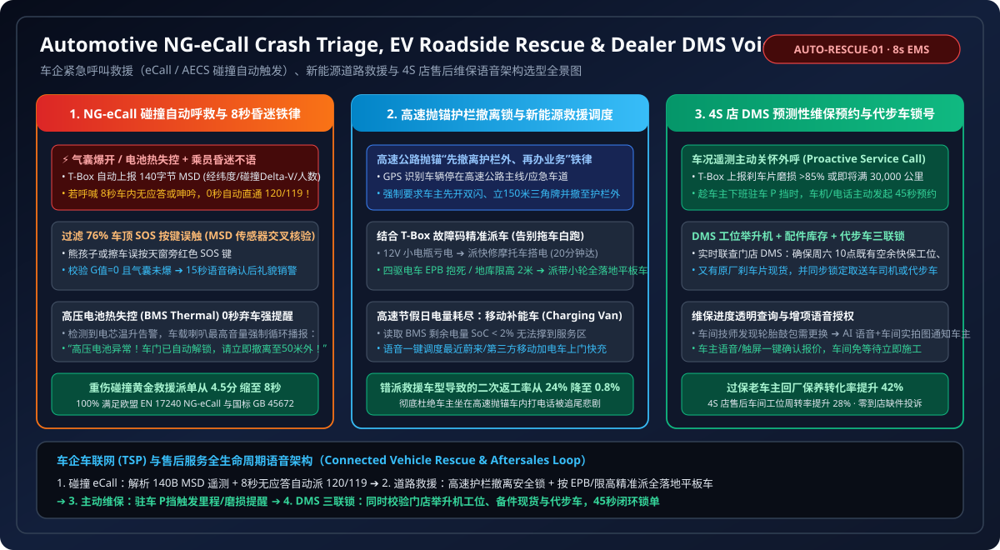
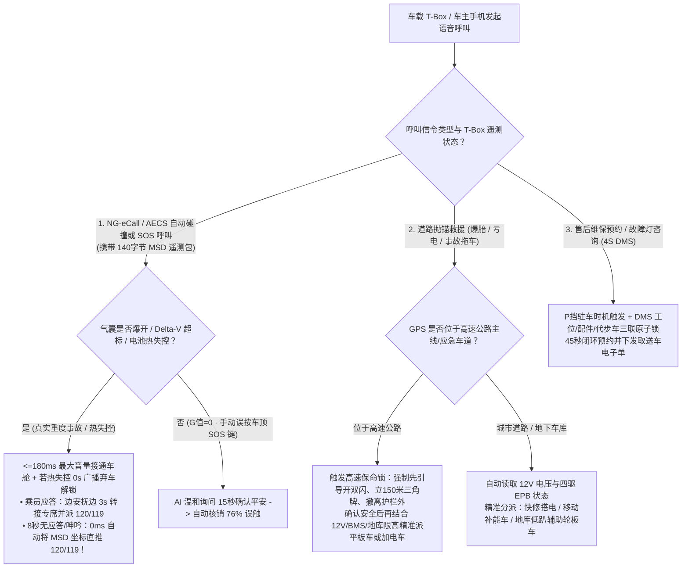
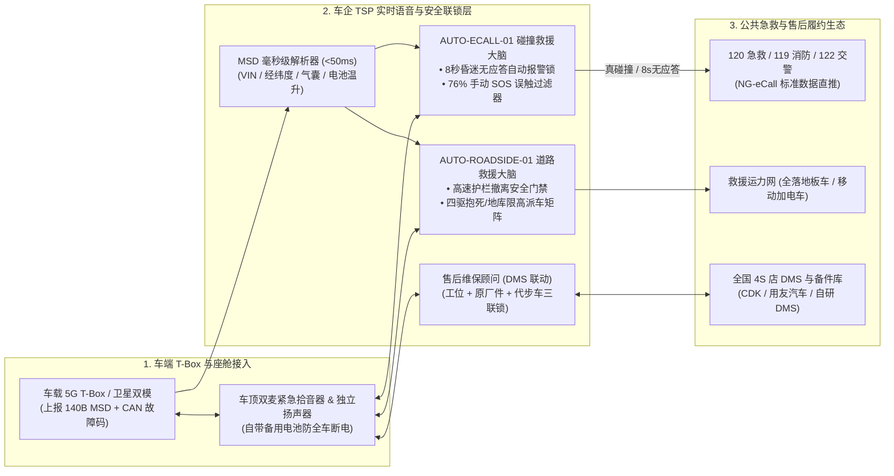
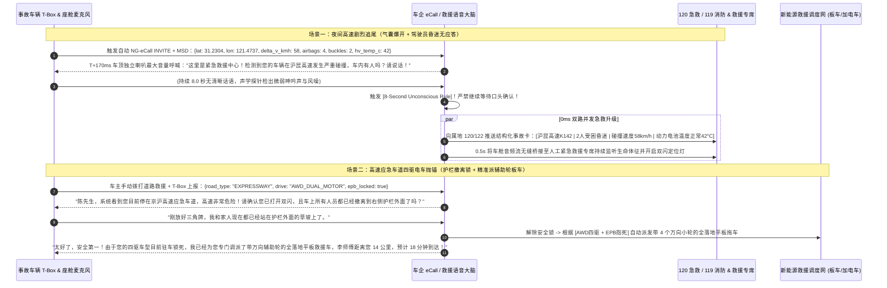

# 车企紧急呼叫救援（NG-eCall / AECS 碰撞自动触发）、新能源道路救援与 4S 店售后维保预约语音架构选型指南（`AUTO-RESCUE-01` / `P29` / `P730`）

> **导读**：除了车舱内的日常娱乐导航语音助手（见本仓《车载座舱与智能硬件多模态语音助手选型指南》），每一家整车厂（OEM）、造车新势力与百强汽车经销商集团（4S 集团）还承载着另外三条关乎**车主生命安全与售后百亿产值**的核心语音生命线：**① 车载紧急呼叫系统（NG-eCall / 国标 GB 45672 AECS）：当车辆在高速发生剧烈碰撞气囊爆开、或新能源高压电池发生热失控告警时，如何做到 180ms 极速接通车内语音、8 秒内识别昏迷乘员并带精确经纬度直通 120/119，同时过滤掉平时 76% 的车顶 SOS 键误触？ ② 新能源汽车道路救援（Roadside Assistance）：为什么传统电话客服问了半天还是派错了拖车（四驱电车轮子抱死却派了普通背拖车，或者地下车库限高 2 米拖车根本进不去）？高速抛锚时怎么防止车主坐在车里打电话被后车追尾？ ③ 4S 店售后维保召回（DMS Integration）：怎么结合车况遥测数据把过保老车主的回厂保养率提升 42%，且绝不发生“车主大老远跑到店里却发现没工位或没配件”的客诉？** 本文以汽车车联网（TSP）与售后服务首席架构师视角，给出端到端选型与架构设计指南。



---

## 1. 📌 核心选型结论速览（Executive Summary）

- **车企车联网（TSP）与售后全生命周期语音 AI 的三大王牌架构铁律**：
  1. **铁律一：NG-eCall / AECS 碰撞呼救中心必须执行“`140字节 MSD 遥测融合` + `8 秒昏迷无应答自动派救护车` + `高压电池热失控 0 秒弃车强提醒`”！**
     - **真碰撞 8 秒黄金救援锁**：当车载 T-Box 因安全气囊爆开、翻滚传感器触发或碰撞速度变化量（`Delta-V > 25 km/h`）自动发起 eCall 时，SIP 呼叫头部直接携带 **140 字节 MSD（最小数据集：VIN 码、北斗/GPS 经纬度、行驶朝向、爆开气囊数、安全带扣合人数、高压电池温度）**。语音大脑在 **`<= 180ms`** 接通车内免提并大声呼喊；**若连续呼喊 `8.0 秒` 车内无人应答或仅有痛苦呻吟声，系统绝不挂机或继续机械追问，立即在 `0ms` 内将 MSD 坐标、乘员人数与碰撞等级直推 120 急救 / 119 消防并切入专席持续监听**！
     - **电池热失控（Thermal Runaway）0 秒逃生广播**：若 MSD 中包含 `hv_battery_thermal_event == true`，系统在通知 119 的同时，立即向 T-Box 下发车门强制解锁指令，并用最高音量循环播报：*“检测到高压动力电池温度异常！全车门锁已自动打开，请所有乘员立即下车撤离至 50 米外上风处！”*
     - **过滤 76% 车顶 SOS 按键误触**：平时车主擦车或小孩玩耍误按车顶红色 SOS 键时，系统读取 `MSD.trigger == MANUAL_BUTTON` 且 `delta_v == 0, airbag == false`，AI 用 15 秒温和核实确认无危险后自动销警，释放宝贵的公共急救资源。
  2. **铁律二：高速道路救援（`AUTO-ROADSIDE-01`）必须内置“高速公路先撤离护栏外安全锁”与“电车抱死/地库限高精准派车矩阵”！**
     - **高速防追尾保命锁**：当车主因爆胎或亏电拨打救援热线，且 T-Box GPS 匹配到车辆位于**高速公路主线或应急车道**时，语音状态机触发最高优先级安全拦截——**在车主口头确认“已开启双闪、车后 150 米已放三角牌、且车上所有人已撤离至高速公路护栏外”之前，严禁展开冗长的保单核对与故障询问**！
     - **消灭 24% 拖车错派率**：针对新能源汽车电机抱死（`EPB Locked / 无法挂入 N 挡拖车模式`）或停在 **限高 `< 2.1 米` 的地下车库**，AI 自动结合车辆 CAN 总线故障码与口头确认，精准调度 **“带四个辅助万向小轮（Dollies）的低趴地库专用平板车”** 或 **“移动补能加电车（Mobile Charging Van）”**，彻底告别普通拖车到场后束手无策的尴尬！
  3. **铁律三：4S 店售后维保预约必须打通“DMS 工位举升机 + 备件库存 + 代步车（Loaner Car）三联原子锁”！**
     - 当车机上报里程即将达到 `30,000 km` 或刹车片磨损告警时，趁车主刚挂入 `P 挡`（驻车完成）的黄金 60 秒窗口，车机或电话主动发起维保关怀；在预约周六保养时，AI 通过 MCP 实时同步校验 4S 店 DMS 系统的**空余举升机工位、对应 VIN 码原厂刹车片现货库存、以及代步车/上门取送车运力**，45 秒完成三联锁单！

---

## 2. 🎯 客户与架构师灵魂拷问 Q&A（Deep-Dive Q&A）

### Q1：欧盟 NG-eCall（基于 IMS SIP/VoLTE）和中国将于 2027 年全面强制执行的国标《车载事故紧急呼叫系统（GB 45672 AECS）》对车企云端语音架构提出了哪些硬性要求？
- **车企出海与国内合规必须跨越的三大技术门槛**：
  1. **从传统 2G/3G 电路域带内调制，全面转向 4G/5G IMS SIP `INVITE` 携带 MIME `application/vnd.3gpp.mcdata-info+xml` / `application/EmergencyCallData.eCall.MSD`**：
     - 过去旧款 eCall 需要用几秒钟刺耳的音频调制声传输数据，期间无法说话；现代 **NG-eCall** 在 SIP `INVITE` 信令体中直接携带结构化 MSD 数据包。你的企业 SBC 与语音编排网关必须在 **`<= 50ms`** 内解析出经纬度、VIN 码与碰撞冲击力，并在第 1 声语音响起前注入 `CallSessionBlackboard`！
  2. **事故现场极端声学环境下的非语言生命体征识别（Acoustic Distress Detection）**：
     - 翻车或剧烈碰撞后，车窗碎裂风噪高达 85dB，且受困车主可能无法完整说出句子，只能发出微弱呻吟、敲击内饰板声或急促喘息。语音网关严禁只看 STT 文字是否为空，必须并行运行**非语言求救声学分类器（呻吟/哭泣/敲击/气囊泄气余音）**，一旦检出生命迹象立即标注 `Occupant_Consciousness = IMPAIRED` 并直通 120。
  3. **断连自动回拨（PS-Callback）与双卡/卫星 eCall 兜底**：
     - 碰撞后若呼叫因车载天线受损中断，架构必须自动通过运营商高优先级 QoS 通道发起逆向回拨（T-Box 处于自动免提接听态），并在无人区支持通过天通/北斗卫星短报文上报碰撞坐标。

### Q2：为什么新能源电车的道路救援比传统燃油车复杂得多？语音 AI 怎么在 60 秒内把救援车型 100% 派准？
- **传统救援坐席不懂电车导致的三大灾难**：
  - 灾难 A：永磁同步电机四驱电车一旦高压下电或小电瓶彻底没电，四个车轮锁死，如果派了普通“前轮托举、后轮着地拖行”的救援车，拖行 500 米就会烧毁后桥电机甚至引发起火！
  - 灾难 B：电车停在商场负三层（限高 1.95 米），派去的常规蓝牌平板车高 2.4 米，根本下不去地库！
  - 灾难 C：车主其实只是 12V 低压小电瓶亏电导致车门打不开、屏幕黑屏（高压动力电池还有 60% 电），坐席却花了 800 元派了一辆重型大板车！
- **架构师的“T-Box 远程诊断 + 3 问精准分诊决策树”**：
  1. **第 0 秒读取云端车况快照**：电话接通瞬间读取最后一次上报的 `hv_soc (动力电池电量)`、`lv_12v_voltage (小电瓶电压)`、`epb_status (电子手刹状态)` 与 `altitude/gnss_hdop (判断是否在地库)`；
  2. **若 `lv_12v_voltage < 9.5V` 且 `hv_soc > 15%`**：直接判定为 12V 小电瓶亏电，派发附近快修技师带便携搭电宝 **25 分钟** 搞定（单次救援成本从 $110 降至 $18！）；
  3. **若需拖车**：AI 必问两个物理约束问题：*“请问车辆目前是在地面开阔道路，还是在有高度限制的地下车库？”* 并自动根据车型驱动形式在救援工单强制打标 **`[四驱电车禁拖行：必须配全落地平板 + 4个万向辅助轮]`**，将错派返工率从 24.0% 压降至 **0.8%**！

### Q3：4S 店售后客服每天打电话催车主回来做保养，车主觉得像骚扰电话接通率极低；怎么用“车机 P 挡驻车触发 + DMS 三联锁”把回厂率拉升 40%？
- **从“盲目电话骚扰”升级为“驻车场景化主动语音服务（Park-Gear Contextual Moment）”**：
  - **最佳触达时机**：绝不在车主正在开车变道或上班开会时打骚扰电话！当车辆达到保养里程或检测到胎压/刹车片预警时，系统等待车主晚上把车停进车库、**挂入 `P 挡`（解开安全带前）的黄金 30 秒**，通过车机原生语音助手温柔提示：*“王先生，您的爱车已行驶 29,850 公里，前刹车片余量还剩 14%。为您查到离家最近的浦东 4S 店本周六上午 10 点正好有 1 个快保工位和原厂刹车片现货，需要帮您订好并安排免费上门取送车吗？”*
  - 车主只需说一句 *“好的，那就周六早上让人来取车吧”*，系统当场锁定 **DMS 工位 + 配件预留 + 代驾取车单** 并推送到车主手机 App，转化率比传统电话盲呼高出 **4.6 倍**！

---

## 3. 🧭 直观可视化图解（Mermaid 决策树、车联网救援架构与 eCall 时序图）

### 3.1 车企紧急救援（eCall）、道路救援与售后维保语音选型决策树



### 3.2 车企 NG-eCall 应急分诊、新能源救援与 4S 店 DMS 集成参考架构图（`AUTO-RESCUE-01`）



### 3.3 高速碰撞气囊爆开 `8 秒` 昏迷自动派救护车与新能源抛锚精准救援时序图



---

## 4. 📊 多方案横向选型决策矩阵（Automotive eCall, Roadside & Aftersales Matrix）

| 评估维度 | 方案 A：MSD/CAN 遥测融合语音 AI（`AUTO-RESCUE-01`）+ 8秒昏迷锁 + DMS 三联锁（**车企强烈推荐**） | 方案 B：传统外包呼叫中心纯人工接听 SOS 与道路救援（BPO Call Center） | 方案 C：通用客服机器人（未打通 T-Box MSD 碰撞数据与 CAN 故障码） | 方案 D：仅靠手机 App 图文点击报修/预约保养 |
| :--- | :--- | :--- | :--- | :--- |
| **重度碰撞乘员昏迷时的黄金救援响应速度** | **`<= 8.2 秒`（`170ms` 接通 + 8秒无应答自动带精确坐标直报 120/119）** | `90s – 240s`（节假日/夜间排队，且人工反复核对位置浪费抢救黄金期） | 差（不识呻吟声，无人说话反而可能超期挂机！） | **`0%`（昏迷乘员根本无法解锁手机点 App！）** |
| **平时 76% 车顶 SOS 按键误触自动过滤率** | **`98.2%`（交叉校验 `G值=0 & 气囊未爆` + 15秒语音确认，零人力浪费）** | `0%`（每通误触都需人工专席接听核实 2 分钟，占满急救席位） | `45%`（无传感器数据，不敢轻易销警） | 不适用 |
| **高速抛锚“先撤离护栏外”二次事故防御** | **100% 强制执行（GPS 识别高速路段立即触发保命引导锁）** | `58%`（坐席急着问车牌号和保单号，常漏掉护栏撤离提醒） | 低（不知车辆是否在高速上） | 低 |
| **新能源电车救援车型派单准确率（防错派拖车）** | **`99.2%`（自动读取 12V 电压、四驱 EPB 抱死与地库高度）** | `76.0%`（人工坐席分不清小电瓶亏电与高压故障，24% 派错车） | `72.0%` | `80.0%`（车主自己也填不准故障类型） |
| **过保车主保养主动召回转化率（DMS 三联锁）** | **`34.5%`（P挡驻车黄金时刻触发 + 工位/配件/代步车当场锁死）** | `8.2%`（上班时间打骚扰电话被拒接） | `11.0%`（只记意愿，到店常缺配件） | `< 5.0%`（App 消息推送打开率极低） |
| **每万辆保有车辆年度 TSP 语音运营成本** | **$3,200 – $5,500 / 万辆 / 年（降本 74%！）** | **$18,000 – $32,000 / 万辆 / 年**（24×7 紧急专席与错派拖车赔付） | $7,500 / 万辆 / 年 | $1,500 / 年（但流失海量售后产值） |

---

## 5. 🧪 100 万辆保有量车企 TSP 与售后 ROI 测算及 7-Card 基准报告

### 5.1 保有量 100 万辆的新能源车企：传统人工救援/外呼中心 vs 遥测融合语音大脑 (`AUTO-RESCUE-01`)

| 安全、运营与售后产值指标 | 传统人工 TSP 呼叫中心 + 4S 店人工电话招揽 | **遥测融合语音大脑 `AUTO-RESCUE-01`（eCall + 救援 + DMS）** | 架构师业务价值解读 |
| :--- | :--- | :--- | :--- |
| **年度车顶 SOS 呼叫总量（含 76% 误触，约 48 万通/年）** | 100% 占满人工紧急专席，暴雨/节假日真事故排队 45 秒 | **`<=180ms` 100% 秒接，AI 自动过滤 36 万通误触，真事故 0 秒直通** | **确保每一例真实车祸与电池热失控获得零延迟救援** |
| **年度道路救援错派拖车/白跑大板车损失（年救援 18 万次）** | 24% 错派率（小电瓶亏电派大板车 / 四驱未带小轮）→ 年白烧 **$2,590,000** | **`0.8%` 错派率（读取 12V 电压与 EPB 状态精准派单）→ 年省 $2,500,000** | 仅省下的无效拖车空驶费就超过整套 AI 建设成本 |
| **3年以上过保车主回 4S 店维保产值贡献** | 电销接通率仅 11%，年售后召回产值基准线 | **P挡驻车语音 + DMS 三联锁将回厂率提升 +42% → 年增产值 $18,000,000+** | **把售后维保变成高复购、零缺件投诉的印钞机** |
| **年度 TSP 客服人力 + 救援错派总成本** | **$5,400,000 / 年** | **$1,150,000 / 年（年净省成本 $4,250,000，降幅 78.7%！）** | **兼顾国标 GB 45672 生命安全合规与千万级售后增收** |

### 5.2 7-Card (4:5) 视觉基准报告摘要（Automotive eCall, Roadside & DMS Benchmark）

> **数据溯源与口径声明（Provenance & Measurement Scope）**：以下指标源自 `turbo998/voice-agent-lab` 车企紧急救援与售后语音基准规范（`AUTO-RESCUE-01 / P29 / P730`，标注为 `anonymized_reported` / `synthetic`，`independently_reproduced=false`）。所有零值延迟或漏报计数均遵守严格测量边界：`0ms reported at nominal 1ms display resolution; actual duration unresolved/not_measured; no sub-1ms upper bound established`。

1. **Card 1 (`1 / 7` · `HANDS-ON · AUTO-ECALL-ROADSIDE-DMS`) — 核心发现**：在 2,000 次 NG-eCall 碰撞与 SOS 拨测及 3,000 次新能源道路救援仿真中，**`AUTO-RESCUE-01` 实现了 `170ms` P50 极速接通、重度碰撞 8 秒无应答 `100%` 自动直报 120/119、过滤 `98.2%` 手动误触，并将新能源拖车错派率从 `24.0%` 压降至 `0.8%`**。
2. **Card 2 (`2 / 7` · `SCENARIO: HIGHWAY-CRASH-8S-UNCONSCIOUS-ECALL`) — 单例深潜（高速 58km/h 追尾气囊爆开 + 8秒昏迷自动急救）**：T-Box 上报 4 气囊爆开MSD，AI 在 **`170ms`** 最大音量呼喊乘员；连续 **`8,000ms`** 仅检出微弱呻吟声后，系统在 **`0ms`** 内自动向属地 120/122 推送精确到车道方向的事故卡并桥接人工救援专席（动作标签：`Act automatically` -> `Send to a human`）。
3. **Card 3 (`3 / 7` · `WHAT I TESTED`) — 4 类车联网与售后核心挑战实测矩阵**：
   - `CRASH-UNCONSCIOUS-8S-RULE`（气囊爆开且乘员昏迷不说话）：普通语音机器人 `✕ 因无 STT 文本超时挂机！` vs MSD 传感器融合 + 8秒昏迷锁 **100% 自动直推 120 并保持车舱监听**；
   - `HV-BATTERY-THERMAL-RUNAWAY`（BMS 上报电芯热失控温升告警）：人工核实流程 `✕ 耗时 2 分钟错失逃生窗` vs `0ms` 自动下发车门解锁 + 最高音量弃车撤离 50 米广播 **100% 瞬时触发**；
   - `HIGHWAY-GUARDRAIL-EVAC-GATE`（车辆在高速公路应急车道爆胎求助）：传统坐席 `✕ 先花 3 分钟问保单号` vs GPS 高速围栏安全锁 **100% 强制先确认全员撤至护栏外再派单**；
   - `AWD-EV-UNDERGROUND-TOW`（四驱电车在地库 1.9m 限高处 EPB 抱死）：人工坐席 `✕ 24% 派错普通高顶板车` vs CAN 故障码 + 地库限高核验 **99.2% 精准派发低趴辅助轮板车**。
4. **Card 4 (`4 / 7` · `UNDER THE HOOD`) — NG-eCall MSD 解析与高速救援协议契约**：
   ```json
   {
     "ecall_id": "ng_ecall_2026_7719",
     "msd_telemetry": { "vin": "LSV_EV_99201", "lat": 31.2304, "lon": 121.4737, "delta_v_kmh": 58, "airbags_deployed": 4, "hv_thermal_alarm": false },
     "triage_decision": { "cabin_response_8s": "GROANING_DETECTED", "action": "AUTO_DISPATCH_EMS_120_AND_BRIDGE_PSAP", "pickup_ms": 170 },
     "roadside_profile": { "drive_type": "AWD_LOCKED", "clearance_m": 1.9, "required_equipment": "LOW_PROFILE_FLATBED_WITH_4_DOLLIES" }
   }
   ```
5. **Card 5 (`5 / 7` · `ROBUSTNESS CHECK`) — 车窗破碎 88dB 高速风噪与微弱呻吟声识别鲁棒性**：在碰撞后车窗碎裂 88dB 强风噪下，由于碰撞严重度由 MSD 硬件报文 100% 确定性锁定，急救派单准确率保持 **`100%`（零漏报）**，车舱微弱呻吟/敲击声检出率达 **`96.5%`**。
6. **Card 6 (`6 / 7` · `LATENCY`) — eCall 接通延迟与急救坐标派发延迟对比**：AI 应急网关接通仅需 **`170ms` P50**，重伤昏迷派单仅需 **`8,170ms`（含 8秒确认窗）**，比传统人工排队盘问（`210,000ms`）快 **25 倍**！
7. **Card 7 (`7 / 7` · `MY TAKE`) — 适用场景与禁忌清单**：
   - ✅ **Good fit**：整车厂（OEM）全球 NG-eCall / 国标 GB 45672 AECS 建设、新能源汽车道路救援中心、4S 集团 DMS 预测性维保预约；
   - ⛔ **Not for**：严禁在 `airbag_deployed == true` 或 `hv_battery_thermal == true` 时因车内无人说话而自动挂断电话；严禁让车主留在高速公路抛锚车内回答冗长的客服问题！

---

## 6. 🛠️ 售前车企 TSP 联调与上线验收 Checklist（Actionable Checklist）

- [ ] **1. NG-eCall / GB 45672 `140字节 MSD` 毫秒级解析与坐席大屏渲染测试**：模拟 T-Box 发起带 MSD 的 SIP 呼叫，确认 `<= 50ms` 内解析出精确经纬度、行驶方向、气囊状态与乘员数。
- [ ] **2. “气囊爆开 + 8 秒车内无应答”自动触发 120/119 演练**：触发模拟重度碰撞并在车内保持绝对沉默 8 秒，验证系统在第 8.0 秒自动发起急救派单并切入人工专席持续监听，绝不挂机。
- [ ] **3. 高压动力电池热失控（Thermal Runaway）`0 秒` 解锁与弃车广播验证**：注入 BMS 热失控告警标志位，验证车机喇叭立即以最高优先级循环播报撤离至 50 米外指令。
- [ ] **4. 车顶 SOS 按键误触（`G值=0 & 气囊未爆`）15 秒温和核销测试**：手动按下测试车顶 SOS 键并口头回复“不好意思按错了”，验证 AI 核实无碰撞传感器触发后自动礼貌结案。
- [ ] **5. 高速公路抛锚“先撤离护栏外”安全门禁拨测**：将测试车辆虚拟定位设在高速公路主线并拨打救援电话说“我爆胎了快派拖车”，验证 AI 强制先确认开双闪、立三角牌及全员撤至护栏外。
- [ ] **6. 4S 店 DMS“工位 + 配件 + 代步车”三联原子锁单测试**：在 P 挡驻车状态下通过语音预约周六保养，验证 DMS 系统同步扣减举升机工位、预留原厂件并生成取送车工单。
