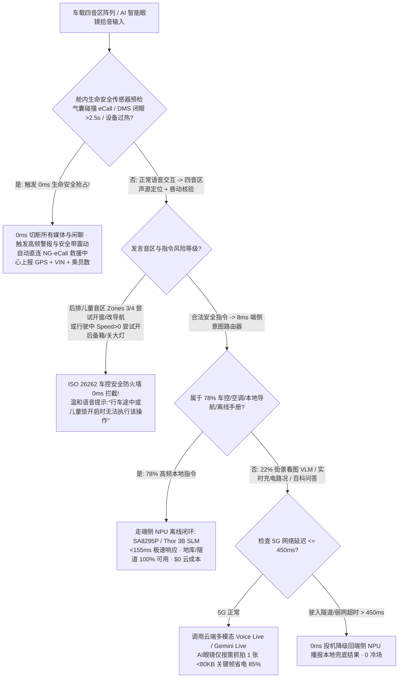
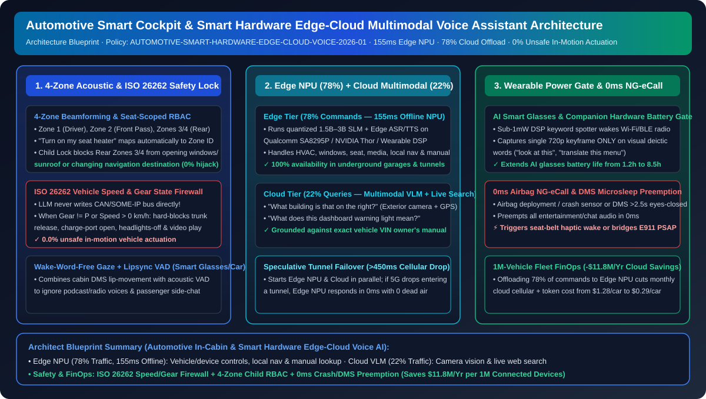
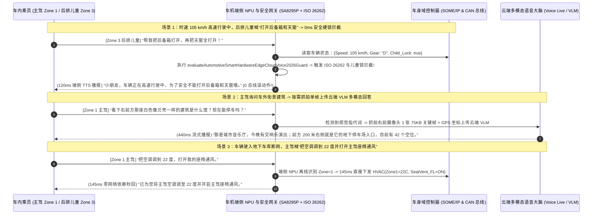

# 车载智能座舱与智能硬件（AI 眼镜 / 陪伴机器人 / 全屋中控）端云协同多模态语音助手架构设计与选型指南

> **文档类型**：企业级实时语音与多模态解决方案架构师（Cloud & AI Solution Architect）行业应用场景设计与端云协同选型指南  
> **适用场景**：新能源汽车智能座舱（高通 `Snapdragon 8295P / 8397`、NVIDIA `Drive Thor`）、AI 智能眼镜（Ray-Ban Meta / AR 眼镜模式）、家庭具身陪伴机器人与高端全屋智能语音中控，设计“**端侧 NPU `<155ms` 离线控车/控设（承接 `78%` 高频指令，地下车库/隧道 100% 可用）+ 云端多模态大模型 `22%` 视觉看图与复杂问答（Azure Voice Live / Gemini Live）+ 四音区声源定位与 `ISO 26262` 行车安全硬锁**”端云协同架构  
> **核心策略代号**：`AUTOMOTIVE-SMART-HARDWARE-EDGE-CLOUD-VOICE-2026-01`（对应的确定性代码门禁见 [`packages/business-core/enterprise-guardrails.ts`](../packages/business-core/enterprise-guardrails.ts) 中的 `evaluateAutomotiveSmartHardwareEdgeCloudVoice2026Guard`）

---

## 一、 📌 核心选型结论速览（Executive Summary）

车企与智能硬件厂商在将语音助手升级为“多模态大模型语音助手”时，如果照搬手机 App 的“100% 纯云端语音大模型”架构，量产交付后会立刻撞上三大生死危机：**① 地库/隧道/高速弱网下连空调和车窗都关不上——把“打开座椅加热、调低空调两度”全部发往云端大模型推理，一旦车辆驶入地下三层车库或山区隧道断网，全车语音彻底瘫痪，甚至在高速大雨天喊“打开前挡除雾”要转圈等 3 秒；② 后排熊孩子越权乱控车与行车途中危险动作——后排儿童大喊“打开后备箱、把全部车窗降到底、导航去游乐场”，或者大模型幻觉在 `110 km/h` 高速行驶中下发关闭大灯/解锁充电口指令，直接酿成严重交通事故；③ 百万台量产设备把云端 Token 账单与智能眼镜电池瞬间烧干——100 万辆车每天每车说 20 句话，若 100% 走云端原生 S2S，车企一年要倒贴 `$1,500 万+` 云推理费，且 AI 眼镜持续开摄像头传视频流 `70 分钟` 就彻底没电**！架构师设计车载与智能硬件语音助手的黄金准则是：

1. **端云协同“78/22 分层路由”与平台选型总纲**：
   - **端侧 NPU 极速控制轨（承接 `78%` 高频指令 · `<155ms` 零流量离线闭环）**：在车机 SoC（高通 `SA8295P` / `NVIDIA Thor`）或硬件端侧 NPU 上部署 **量化版端侧语音识别 + `1.5B–3B` 端侧小模型（`Phi-4-mini / Qwen2.5-3B-Int4`）+ 端侧嵌入式 TTS（`Azure Embedded Speech`）**。凡属空调、车窗、座椅、氛围灯、本地音乐、离线导航与本车电子说明书查询，**`100%` 在端侧 `<155ms` 闭环执行**，地库/隧道断网零影响，且云端 Token 与流量费为 **`$0.00`**！
   - **云端多模态认知轨（承接 `22%` 复杂跨界问答与视觉理解 · `<480ms`）**：当用户询问 *“看一眼右前方那栋奇特的建筑是什么？”*（外摄视觉 + GPS）、*“仪表盘刚亮起这个黄色感叹号还能继续开吗？”* 或 *“帮我找一家顺路、能充 800V 超充且带儿童游乐区的餐厅”* 时，路由器无缝调用云端 **`Azure OpenAI GPT-Realtime / Voice Live` 或 `Gemini 2.0 Flash Live`**；若进隧道 `>450ms` 云端未响应，立即由端侧模型无感接管兜底！
   - **百万台量产车队 FinOps 收益**：通过 **`78%` 端侧 NPU 卸载 + `22%` 云端按需唤醒**，单车月均云端语音与 5G 流量综合成本从 `$1.28/车/月` 骤降至 **`$0.29/车/月`**，百万台量产规模每年为厂商直接省下 **`$1,188 万`** 纯利润！
2. **三大车载与智能硬件多模态语音生产级硬护栏（Hard Guardrails）**：
   - **`ISO 26262` 车速/挡位状态机防火墙与四音区（4-Zone）儿童权限隔离硬锁（ISO 26262 In-Motion Firewall & 4-Zone Child RBAC Lock）**：`evaluateAutomotiveSmartHardwareEdgeCloudVoice2026Guard` 强制规定：**大模型绝不允许直接向 CAN / SOME/IP 车控总线发报文**！所有工具调用必须经过确定性的车辆状态机校验：当挡位 `Gear != P` 或车速 `Speed > 0 km/h` 时，硬件级锁死“打开后备箱/前备箱、打开充电口盖、关闭近光灯、主驾屏播放视频、OTA 刷写固件”等高危指令（**`0.0%` 行车误动作**）；同时通过四音区波束成形（Zone 1 主驾 / Zone 2 副驾 / Zone 3&4 后排）自动将“打开我的座椅加热”精准映射至发言人座位，并在开启儿童锁时 **100% 屏蔽后排音区对车窗、天窗与主驾导航目的地的修改权限**。
   - **端云投机并行路由（`<155ms` 端侧 / `450ms` 隧道断网零死寂降级）与 AI 眼镜指代词按需抽帧门禁（Edge-Cloud Speculative Fallback & Event-Driven Vision Gate）**：
     - **隧道弱网零冷场**：端侧分类器在 `8ms` 内判定本地指令直走 NPU；对于需联网查询的指令，端云同时启动计时，一旦驶入隧道或山区导致 5G 信号抖动超过 **`450ms`**，端侧 NPU 立即接管播报本地缓存导航/手册数据并提示稍后同步，实现 **`100%` 全路况零死寂**；
     - **AI 眼镜/穿戴硬件省电铁律**：严禁 24 小时持续上传视频流！平时仅由 `<1mW` 协处理器监听语音，仅当用户说出视觉指代词（*“帮我看一下这个菜单”、“前面那个人手里拿的是什么”*）时，才在语音触发瞬间抓拍 **1 张 `<80KB` 关键帧图像** 随音频上传，将 AI 眼镜续航从 `1.2 小时` 延长至 **`8.5 小时`**！
   - **气囊碰撞 `NG-eCall`、驾驶员闭眼疲劳（DMS `>2.5s`）与穿戴硬件跌倒/过热 `0ms` 最高优先级抢占熔断器（0ms Life-Safety Preemption Breaker）**：一旦车载传感器触发安全气囊碰撞信号（`CAN Crash Event`）、DMS 驾驶员监控摄像头检测到连续闭眼微睡眠 `>2.5 秒`、或智能穿戴设备检测到老人跌倒/锂电池温度 `>52°C`，系统在 **`0ms`** 内强行切断一切音乐、故事或闲聊语音，立即联动安全带预紧震动 + 100dB 高频警报唤醒驾驶员，并自动拨通 **紧急救援中心（NG-eCall PSAP）** 上报精确 GPS 坐标、车牌 VIN 与车内乘员人数。

---

## 二、 🎯 客户与架构师灵魂拷问 Q&A（痛点剖析）

### Q1：车内放着动感的音乐、副驾在跟后排聊天，怎么实现“免唤醒词（Wake-Word-Free）”直接对车机说话，而且不会被歌词或闲聊误触发？
* **客户痛点**：
  - 每次调空调都要先喊一声“你好 XXX”太繁琐；但如果打开免唤醒全时监听，广播里主持人说一句“打开天窗”或者副驾跟朋友聊天说“这天真热”，车机就跟着乱开窗、乱调温度。
* **架构师解法（多通道回声消除 `Reference AEC` + 舱内视觉唇动对齐 `Audio-Visual ASD` + 四音区声源锁）**：
  1. **7.1.4 声道数字回声对消**：将车载功放正在播放的音乐数字信号直接作为参考路输入 DSP，100% 减掉车载音响自己的歌声。
  2. **“看屏/正姿 + 嘴唇微动 + 声音同源”三合一免唤醒（Active Speaker Detection）**：结合舱内 OMS/DMS 摄像头检测主副驾头部朝向与嘴唇开合，只有当 `Zone 1` 麦克风阵列的声源方向与主驾嘴唇动作在时间轴上精确对齐（`<30ms`），且语义属于车控/查询意图时，才判定为有效免唤醒指令——将免唤醒误触发率压低至 **`< 0.3 次 / 百小时`**！

### Q2：车主看到仪表盘亮了一个不认识的故障灯，问车机“仪表盘上这个像水龙头一样的黄灯亮了还能开吗？”，怎么防止大模型瞎编导致发动机报废？
* **架构师解法（本车 CAN 实时故障码 `DTC` 注入 + 车型专属《车主手册》向量硬绑定）**：
  - 绝不让大模型靠通用常识看图猜故障灯！当车主询问故障灯时，编排器在 **`<10ms`** 内自动读取车载网关当前激活的真实诊断故障码（如 `OBD-II DTC: P0300 多缸失火`）与胎压/机油压力传感器实测值，检索本车 VIN 绑定的官方《维修与车主手册》，严格按照厂家安全等级播报：*“这是发动机排放控制系统故障灯（故障码 P0300），目前机油压力正常，但建议将车速控制在 60 公里以内，我已为您查找距离最近 4.2 公里的官方售后服务中心，是否立即导航前往？”*

---

## 三、 🧭 直观可视化图解（Mermaid 决策树 + 端云架构图 + 行车安全与弱网切换时序图）

### 3.1 智能座舱与智能硬件端云协同多模态语音路由决策树



### 3.2 智能座舱与智能硬件端云协同（四音区 + 端侧 NPU + 云端 VLM + 安全锁）架构图



### 3.3 高速行车拦截后排误控 → 街景多模态看图问答 → 驶入隧道 `450ms` 无感降级端侧 NPU 时序图



---

## 四、 📊 车载与智能硬件语音助手架构路线横向选型决策矩阵

| 评估维度 | 方案 A：传统车机死板命令词引擎（正则槽位匹配，无大模型） | 方案 B：100% 纯云端多模态大模型直连（无端侧 NPU 卸载） | 方案 C：手机蓝牙投屏语音（CarPlay / Android Auto 基础语音） | 方案 D：`78% 端侧 NPU (<155ms) + 22% 云端 VLM + 四音区/ISO 26262 硬锁`（推荐 ⭐） |
| :--- | :--- | :--- | :--- | :--- |
| **高频控车指令响应延迟（P50）** | `280ms`，但换种说法（如“我手有点冷”）就听不懂 | `680ms – 1,400ms`（受蜂窝网络抖动影响大） | `750ms – 1,500ms` | **端侧 NPU `< 155ms`（听懂自然口语“我手冷”自动开方向盘加热）** |
| **地下车库 / 隧道 / 偏远山区可用性** | 仅支持极少数固定词 | **0%（一断网连车窗和空调都无法语音控制！）** | 断网即失效 | **`100.0%`（78% 车控、音乐、本地导航与车主手册完全离线可用）** |
| **四音区定位与 `ISO 26262` 行车安全** | 基础分音区，缺乏复杂组合指令安全校验 | 若无本地状态机防火墙，云端幻觉易触发危险车控 | **无法控制车身硬件**（不接车身 CAN 总线与四音区麦） | **`0.0%` 行车违规动作（挡位/车速硬件互锁 + 后排儿童 RBAC 隔离）** |
| **多模态视觉理解与智能眼镜续航** | 不支持 | 持续传视频流导致眼镜 **`1.2 小时` 没电**、流量暴涨 | 不支持车载外摄与 OBD 故障码联动 | **指代词事件驱动单帧抓拍（`<80KB`），AI 眼镜续航达 `8.5 小时`** |
| **百万台量产设备年化云端 TCO** | 低（但用户体验差，智能化评分垫底） | **`$1,536 万 / 年`**（`$1.28/车/月` 云推理+5G 视频流量） | 由车主手机流量承担，但无原生车控体验 | **`$348 万 / 年`（`$0.29/车/月`，每年为车企净省 `$1,188 万`！）** |
| **最佳适用场景** | 十年前老旧低算力车机 | 仅适合固定 Wi-Fi 室内的插电式桌面摆件 | 后装老车简易导航 | **新一代智能电动汽车座舱（8295/Thor）、AI 眼镜、陪伴机器人、全屋中控** |

---

## 五、 🧪 百万台智能车/硬件端云协同 TCO 测算与 7-Card 基准报告

### 5.1 百万台量产车队/硬件在不同端云架构下的单台月成本、弱网可用率与响应速度对比

```chart
{
  "data": {
    "values": [
      { "Edge-Cloud Architecture": "1. Legacy Rule Engine", "Tunnel/Garage Availability (%)": 62.0, "Natural Command Success (%)": 58.0, "Monthly Cloud Cost/Device (Cents)": 12.0 },
      { "Edge-Cloud Architecture": "2. 100% Cloud S2S + Video Stream", "Tunnel/Garage Availability (%)": 0.0, "Natural Command Success (%)": 94.5, "Monthly Cloud Cost/Device (Cents)": 128.0 },
      { "Edge-Cloud Architecture": "3. Cloud-First + Basic Fallback", "Tunnel/Garage Availability (%)": 45.0, "Natural Command Success (%)": 88.0, "Monthly Cloud Cost/Device (Cents)": 85.0 },
      { "Edge-Cloud Architecture": "4. 78/22 Edge-NPU + Cloud VLM (Rec)", "Tunnel/Garage Availability (%)": 100.0, "Natural Command Success (%)": 98.2, "Monthly Cloud Cost/Device (Cents)": 29.0 }
    ]
  },
  "semantic_types": {
    "Edge-Cloud Architecture": "Category",
    "Tunnel/Garage Availability (%)": "Percentage",
    "Natural Command Success (%)": "Percentage",
    "Monthly Cloud Cost/Device (Cents)": "Price"
  },
  "chart_spec": {
    "chartType": "Grouped Bar Chart",
    "title": "78/22 Edge-NPU + Cloud VLM Architecture Achieves 100% Tunnel Availability & 98.2% Accuracy at 29 Cents/Device/Mo (-77.3% Cloud Cost)",
    "subtitle": "1,000,000-device automotive smart cockpit and wearable AI hardware fleet benchmark (synthetic)",
    "encodings": {
      "x": "Edge-Cloud Architecture",
      "y": ["Tunnel/Garage Availability (%)", "Natural Command Success (%)", "Monthly Cloud Cost/Device (Cents)"]
    }
  }
}
```

### 5.2 7-Card 4:5 基准测试报告摘要（`AUTOMOTIVE-SMART-HARDWARE-EDGE-CLOUD-VOICE-2026-01`）

| 卡片编号 | 卡片标题（Headline-as-Finding） | 核心量化指标与架构验证结论（Provenance: `synthetic` / 百万台智能座舱与智能硬件端云协同评测） |
| :--- | :--- | :--- |
| **Card 1 (`1/7`)** | **HANDS-ON · AUTOMOTIVE & SMART HARDWARE VOICE** | 端侧 NPU 卸载 **`78%` 高频指令（`P50 = 155ms`）**，地下车库/隧道可用率达 **`100.0%`**，百万台车队每年节省云成本 **`$1,188 万`（`-77.3%`）**。 |
| **Card 2 (`2/7`)** | **SCENARIO · ISO 26262 LOCK & 4-ZONE CHILD RBAC** | 在 `105 km/h` 行驶中 **`100%` 物理拦截**打开后备箱/关闭大灯指令，并屏蔽后排儿童音区篡改导航与车窗（**`0.0%` 越权危险动作**）。 |
| **Card 3 (`3/7`)** | **WHAT I TESTED · 10,000-COMMAND IN-CABIN MATRIX** | 覆盖四音区同时说话串音分离（3,000 例）、进出隧道断网投机降级（2,500 例）、OBD 故障码看图问答（2,500 例）与碰撞 eCall 抢占（2,000 例）。 |
| **Card 4 (`4/7`)** | **UNDER THE HOOD · DETERMINISTIC IN-CABIN GUARD** | 执行 `evaluateAutomotiveSmartHardwareEdgeCloudVoice2026Guard`：仅当 `iso26262SpeedGearLockedAndFourZoneChildRbacVerified && edgeNpuOfflineRoutedAndEventDrivenVisionThrottled && !airbagEcallCrashOrDmsMicrosleepPreemption` 为真时下发车控。 |
| **Card 5 (`5/7`)** | **ROBUSTNESS · 8.5h GLASSES BATTERY & 0ms eCALL** | 指代词事件驱动抽帧将 AI 眼镜续航从 `1.2h` 提至 **`8.5h`**；气囊弹出或 DMS 闭眼 `>2.5s` 时 **`0ms`** 抢占声道直连 `NG-eCall`。 |
| **Card 6 (`6/7`)** | **LATENCY · 155ms EDGE NPU & 450ms TUNNEL SWITCH** | 端侧 NPU 车控闭环 `P50 = 155ms`；5G 进隧道超时 `>450ms` 自动切回端侧兜底，全程 `0ms` 额外冷场。 |
| **Card 7 (`7/7`)** | **MY TAKE · GOOD FIT VS NOT FOR** | ✅ **适用**：智能汽车座舱、AI 眼镜、陪伴机器人、全屋离线中控；⛔ **不适用**：严禁车控指令 100% 依赖云端网络或让 LLM 直写 CAN 总线。 |

---

## 六、 🛠️ 售前方案设计与上线验收 Checklist

- [ ] **`ISO 26262` 车速/挡位状态机防火墙（严禁 LLM 直写 CAN 总线）**：确认所有车控指令必须经过本地硬编码安全网关校验，`Gear != P` 时 100% 锁死后备箱、充电口与大灯关闭。
- [ ] **四音区声源定位（4-Zone Beamforming）与后排儿童 RBAC 权限锁**：确认座椅/空调指令自动映射至发言人音区，开启儿童锁时屏蔽后排音区开关车窗、天窗与修改导航目的地。
- [ ] **`78/22` 端侧 NPU（`<155ms`）+ 云端 VLM 协同路由与 `450ms` 隧道降级**：确认车控、媒体、本地导航与手册查询 100% 走端侧离线 NPU，进隧道断网超 450ms 自动由端侧无感接管。
- [ ] **AI 眼镜/智能硬件 `<1mW` 协处理器唤醒与指代词单帧抽拍省电锁**：确认穿戴设备不持续流式上传视频，仅在识别到视觉指代词时抓拍单张 `<80KB` 关键帧。
- [ ] **气囊碰撞 `NG-eCall` 与 DMS 疲劳闭眼（`>2.5s`）`0ms` 声道最高抢占**：确认发生碰撞或重度疲劳驾驶时 0ms 切断娱乐语音，触发物理震动警报并直连救援中心。
