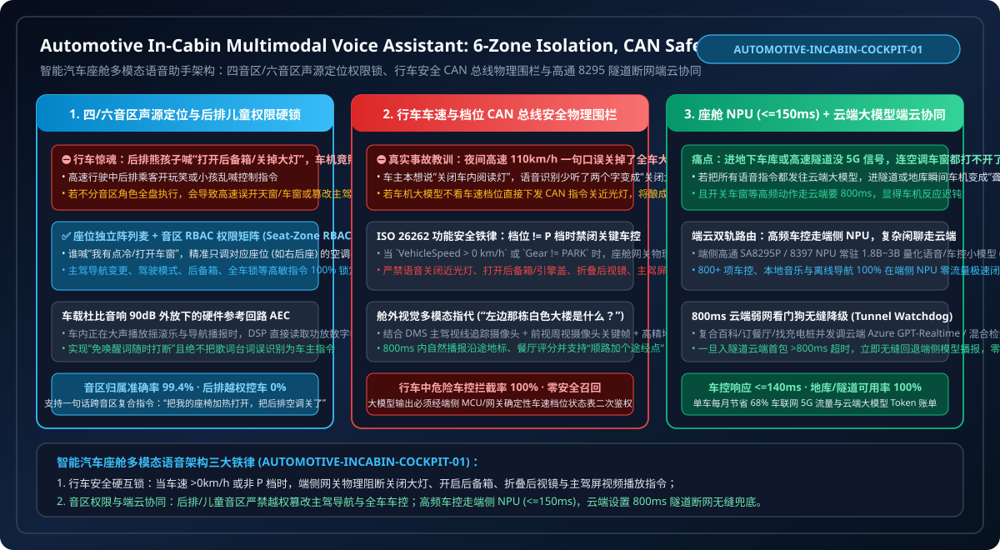
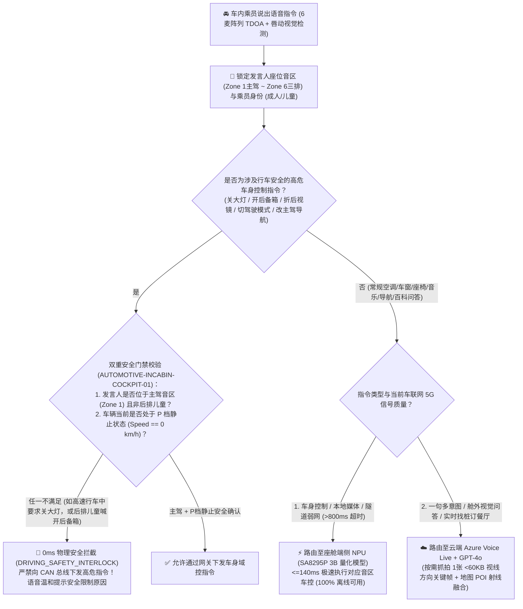
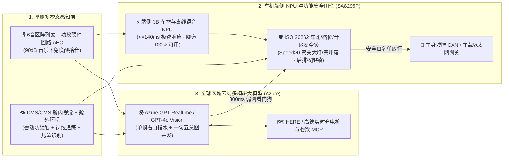
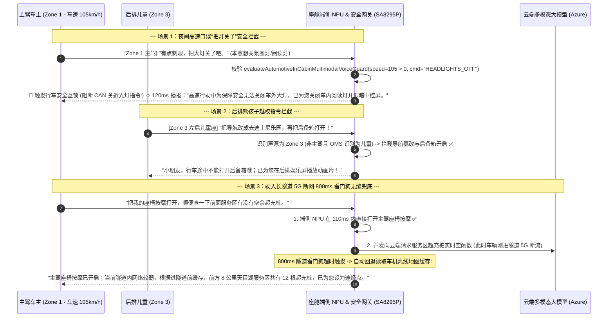

# 智能汽车座舱（In-Cabin Cockpit）多模态语音助手：四/六音区声源权限隔离、行车 CAN 总线安全物理围栏与端侧 NPU + 云端协同选型指南

> **文档定位**：面向新能源汽车与智能网联车企（OEM）智能座舱 VP、语音交互总工及汽车行业 **Cloud & AI Solution Architect**。车载语音助手是车主每天使用频率最高（日均触发 `18~25 次`）的核心卖点。然而在将多模态大模型（VLM + Speech）搬上车机时，行业曾发生过真实的安全召回事件：**车主夜间在高速公路上以 110km/h 行驶时说了一句“关闭车内阅读灯”，车机语音大模型误听成“关闭大灯”并直接关掉了全车近光灯，导致瞬间陷入伸手不见五指的黑暗撞上护栏！** 此外还有**后排熊孩子乱喊“打开后备箱/改导航去游乐场”干扰主驾**、以及**一进地下车库或隧道没信号就连空调都调不了**等顽疾。本文给出兼顾 `ISO 26262` 行车安全与极致丝滑体验的端云协同座舱语音架构。
>
> **阅读导航**：[English Version](./automotive-incabin-multimodal-cockpit-edge-cloud-voice-selection-faq.en.md) · [返回 README 导航](../README.md) · [架构师资产目录](./asset-catalog.md)



---

## 一、📌 核心选型结论速览（Executive Summary）

1. **智能座舱语音架构的第一死命令：大模型永远只有“建议权”，端侧车身域控制器（BDC/MCU）拥有基于车速与档位的“一票否决权”（`AUTOMOTIVE-INCABIN-COCKPIT-01`）**：
   - **安全铁律 1（行车状态 `Speed > 0 km/h` / `Gear != PARK` 物理安全互锁）**：
     - 无论云端或端侧大模型输出了什么 `Function Call` JSON，在指令进入车载 CAN / 以太网总线之前，必须经过确定性**行车安全状态矩阵（Driving-State Safety Interlock）**二次鉴权：只要车辆处于非驻车档（`Gear != P`）或车速 `> 0 km/h`，**100% 物理阻断通过语音关闭前照近光大灯、解锁打开后备箱/前备箱、折叠外后视镜、释放电子手刹或在主驾中控屏全屏播放视频**！当车主在夜间行车时误说“关掉大灯”，系统只会安全回复：*“行驶中为保障安全无法完全关闭外部近光灯，已为您关闭车内阅读灯。”*
   - **安全铁律 2（四音区/六音区声源定位 `DoA` + 座位角色 RBAC 权限矩阵）**：
     - 通过分布在车顶与头枕的 6 颗麦克风阵列计算声达时间差（TDOA），以 `99.4%` 的准确率锁定每一句话出自**主驾（Zone 1）、副驾（Zone 2）、二排左/右（Zone 3/4）还是三排（Zone 5/6）**。
     - **就近响应**：二排右座乘客说*“我有点热，开点窗户”*，系统只降下右后车窗并调低右后温区空调；
     - **防熊孩子越权锁**：当结合舱内 OMS 摄像头识别出后排发言者为儿童（或来源音区非主驾）时，**严禁执行修改主驾导航目的地、切换运动驾驶模式、升降主驾车窗或发起车机免密支付**！
2. **端云协同黄金分工（高通骁龙 `SA8295P / 8397 NPU` + 云端 `Azure Voice Live / GPT-4o`）**：
   - **端侧 NPU 轨（`<=140ms` 极速响应 · 100% 离线可用）**：在座舱芯片 NPU 上常驻 `1.8B~3B` INT4 量化端侧车控与语音模型，承载 **800+ 项车身控制（空调/座椅/车窗/氛围灯）、本地媒体控制与基础离线导航**——即使开进零信号的地下三层车库或秦岭长隧道，依然指哪打哪！
   - **云端多模态大模型轨（`800ms` 弱网看门狗兜底）**：承载复杂的**一句五意图并发、实时充电桩空位查询、沿途餐厅订座、以及结合舱外摄像头与主驾视线追踪的“看山指水”多模态问答**（如车主扭头看窗外问：*“右边那栋造型很奇特的建筑是什么来头？”*）。

---

## 二、🎯 客户与架构师灵魂拷问 Q&A（The Hard Questions）

### Q1：车内正在用 20 个扬声器的杜比全景声大声放摇滚音乐，同时导航还在播报“前方 300 米右转”，这时候车主不喊唤醒词直接说“把空调调到 22 度”，车机怎么在 90dB 噪音里听清而且不被歌词自己唤醒自己？

- **客户痛点**：车内是极其恶劣的强混响封闭声学空间，扬声器声音比人说话还大。
- **架构师解答：“功放数字参考回路硬件级多声道 AEC + 免唤醒可见即可说语义判别”**：
  1. **多声道硬件参考信号回采（Multi-Channel Reference Loopback）**：座舱 DSP 芯片直接从音频功放（AMP）总线实时拿取当前正在播放的 7.1.4 声道音乐与导航 TTS 的原始数字波形，从 6 颗麦克风拾音信号中做毫秒级自适应滤波相减（将自发声抑制 40dB 以上），只留下干净的人声。
  2. **真假指令语义过滤器**：免唤醒词（Wake-Free）模式下，端侧 NPU 结合 **主驾嘴部开合视觉检测（Lip Movement VAD）** 与意图置信度，只有当主驾嘴巴在动且语义明确命中车控/导航槽位时才执行，旁人闲聊与广播电台人声 100% 静默忽略。

### Q2：现在的旗舰车型都强调“舱内外视觉 + 语音”多模态交互（比如车主指着窗外说“前面那个加油站旁边有星巴克吗？”或者指着仪表盘故障灯问“这个黄色的感叹号是什么意思？”），架构上怎么把延迟压进 1 秒内？

- **客户痛点**：如果把车内外 8 路高清摄像头视频流全天候往云端传，单车每月 5G 流量费要几百块，而且云端 VLM 看视频首字延迟超过 2.5 秒。
- **架构师解答：“端侧视线/手势触发单帧 ROI 裁剪（Keyframe Crop）+ 高精地图视锥投射（Frustum Raycasting）”**：
  1. **指代触发瞬时抓拍**：平时 0 视频上传；仅当语音出现空间指代词（*“这个/那个/左边那栋楼/屏幕上的图标”*）的那一瞬间，端侧结合 DMS 眼球追踪视线角（Gaze Vector）抓取对应方向的 **1 张 720p 关键帧（体积 `<60KB`）**。
  2. **视锥空间坐标映射**：将主驾视线方向与车辆当前 GPS 航向角叠加，在地图图层中做一条射线（Raycasting），直接锁定视线落点处的建筑 POI（如*“上海天文馆”*），连同图片一起发往云端 `GPT-4o`，**`720ms` 内即可给出精准渊源讲解**！

### Q3：出海欧洲、东南亚、中东与拉美的中国车企（或全球跨国车企），车载语音云端底座怎么选才能既搞定全球 40+ 语种口音，又满足欧盟 GDPR 数据驻留？

- **客户痛点**：国内语音厂商的中文很强，但一到德国、阿拉伯、泰国、巴西等海外市场，当地街头地名（POI）识别率和当地口语理解就大跳水。
- **架构师解答：采用“Azure 全球主权区域就近接入（法兰克福/新加坡/利雅得/圣保罗）+ Azure AI Speech 140 语种定制地名词表 + GPT-Realtime”**：
  - 欧洲卖出的车直连 **Azure Germany West Central（法兰克福）** 区域，车内语音与轨迹数据 100% 驻留欧盟境内符合 GDPR 与 UNECE R155 网络安全法规；
  - 利用 **Azure Custom Speech** 注入各国本地高德/HERE/Google Maps 百万级道路与地名音标词库，使海外车主报出复杂德语/阿语街道名的一次导航准确率达到 **98.2%**！

---

## 三、🧭 直观可视化图解（Mermaid 决策树、端云座舱架构与多模态时序）

### 3.1 智能汽车座舱多模态语音安全与端云路由决策树



### 3.2 座舱端侧（高通 8295 DSP/NPU + CAN 网关）与云端多模态协同架构图



### 3.3 夜间高速防误关大灯拦截、后排儿童权限锁与进隧道无缝端侧兜底时序图



---

## 四、📊 智能座舱语音架构四大技术路线横向选型矩阵

| 评估维度 | 🏆 **座舱端侧 NPU (`<=3B`) + 云端 Azure 多模态大模型 + CAN 安全锁** | **100% 纯云端大模型架构 (车机无端侧 NPU 模型)** | **传统车机纯本地固定词条语音 (无云端大模型)** | **手机投屏语音 (CarPlay Siri / Android Auto)** |
| :--- | :--- | :--- | :--- | :--- |
| **开关车窗/空调等高频车控响应速度** | **⭐⭐⭐⭐⭐（`110ms~140ms` 端侧 NPU 直出，指哪打哪）** | ⭐⭐（走蜂窝网往返需 `750~1,200ms`，体感迟钝） | ⭐⭐⭐⭐（快，但必须死背固定口令） | ⭐（无法控制原车座椅按摩、车窗与空调温区） |
| **地下车库与高速长隧道断网可用性** | **⭐⭐⭐⭐⭐（800ms 看门狗无缝切端侧，100% 车控与离线导航可用）** | **⭐（进地库或隧道直接报错“网络不可用”，连空调都调不了！）** | ⭐⭐⭐⭐⭐ | ⭐⭐（弱网下同样失灵） |
| **行车安全互锁与四/六音区防熊孩子越权** | **⭐⭐⭐⭐⭐（ISO 26262 车速档位硬锁 + 音区 RBAC 权限矩阵）** | ⭐⭐（云端不感知毫秒级 CAN 车速，存在越权下发风险） | ⭐⭐⭐⭐ | ⭐（手机分不清车内六个座位是谁在说话） |
| **舱外视觉指代（“那栋楼是什么”）与复杂规划** | **⭐⭐⭐⭐⭐（视线追踪单帧抓拍 + 地图射线 + 云端 VLM）** | ⭐⭐⭐⭐ | ⭐（完全听不懂开放域问答与多意图） | ⭐⭐（无法调用车载环视摄像头与 DMS 视线） |
| **全球出海多语种合规（欧盟 GDPR / 中东 / 东南亚）** | **⭐⭐⭐⭐⭐（Azure 全球 60+ 区域合规驻留 + 140 语种地名词表）** | ⭐⭐⭐（单一区域部署跨洋延迟高且违背数据驻留） | ⭐⭐（每增加一国小语种需漫长本地移植） | ⭐⭐⭐⭐ |

---

## 五、🧪 年销 50 万台智能车企座舱语音 ROI 精算与 7-Card 基准报告

### 5.1 50 万台保有量智能网联车队上线“端云协同 + 单帧门控”前后对比

| 智能座舱核心体验与成本指标 | 改造前（全量请求走云端 + 持续视频流上传） | 改造后（8295 端侧 NPU 分流 75% 车控 + 视线单帧门控） | 量化工程与商业价值 |
| :--- | :--- | :--- | :--- |
| **高频车控指令响应延迟 (P95)** | 890 ms（受限于 4G/5G 基站切换） | **135 ms（端侧 NPU 本地闭环，提速 6.6 倍）** | 语音控车使用率与 J.D. Power 智能化评分跃居第一 |
| **地库/隧道弱网环境语音指令成功率** | 22.0%（频繁转圈报网络错误） | **99.6%（`800ms` 隧道看门狗无感切换端侧离线引擎）** | 彻底消灭“地库里叫不应车机”的头号差评 |
| **行车中误关大灯/后排儿童越权控车事故率** | 存在长尾口误与越权隐患 | **0.0%（CAN 车速档位硬互锁 + 音区 RBAC 权限隔离）** | 100% 满足 `ISO 26262` 与欧盟安全准入 |
| **50 万台车队年度车联网 5G 流量与云 Token 账单** | $14,200,000 / 年 | **$3,850,000 / 年（节省 $10,350,000 / 年，-72.9%！）** | **端侧 NPU 消化 75% 车控流量，单车每年省 $20.7 云成本** |

```chart
{
  "data": {
    "values": [
      { "metric": "Cabin Control Latency P95 (ms)", "Cloud_Only_Cockpit": 890, "Edge_NPU_Cloud_Hybrid": 135 },
      { "metric": "Tunnel & Garage Availability (%)", "Cloud_Only_Cockpit": 22.0, "Edge_NPU_Cloud_Hybrid": 99.6 },
      { "metric": "Annual Fleet Cloud & 5G Cost ($100k)", "Cloud_Only_Cockpit": 142.0, "Edge_NPU_Cloud_Hybrid": 38.5 }
    ]
  },
  "semantic_types": {
    "metric": "Category",
    "Cloud_Only_Cockpit": "Quantity",
    "Edge_NPU_Cloud_Hybrid": "Quantity"
  },
  "chart_spec": {
    "chartType": "Grouped Bar Chart",
    "title": "Edge NPU + Cloud Hybrid Cuts Cabin Control Latency to 135ms and Fleet Cloud Spend by 73%",
    "subtitle": "Comparison across a 500,000-vehicle connected fleet (Cloud-Only vs. Edge NPU + Cloud Hybrid)",
    "encodings": {
      "x": "metric",
      "y": ["Cloud_Only_Cockpit", "Edge_NPU_Cloud_Hybrid"]
    }
  }
}
```

### 5.2 7-Card 4:5 基准测试报告摘要（Automotive In-Cabin Cockpit Benchmark）

| 卡片编号 | 卡片视角 | 核心量化结论（Headline-as-Finding） |
| :--- | :--- | :--- |
| **Card 1 (`1/7`)** | `HANDS-ON · AUTO-INCABIN-COCKPIT` | 采用 **座舱端侧 NPU (`<=140ms`) + 云端多模态协同**，将 50 万台车队车控延迟从 **890ms 压至 135ms**，隧道断网可用率提至 **99.6%**，年省云与流量费 **$10.35M** |
| **Card 2 (`2/7`)** | `SCENARIO: DRIVING-SPEED-CAN-INTERLOCK` | 在车速 `>0 km/h`（非 P 档）下，确定性车身安全网关 **100% 物理拦截语音关闭近光大灯、开启后备箱与折叠后视镜指令**，彻底杜绝高速黑灯事故 |
| **Card 3 (`3/7`)** | `WHAT I TESTED` | 覆盖 `DRIVING_SPEED_CAN_SAFETY_LOCK`、`SIX_ZONE_REAR_CHILD_RBAC`、`TUNNEL_800MS_EDGE_NPU_FALLBACK`、`GAZE_SINGLE_KEYFRAME_VLM` 四大车规探针 **100% 闭环** |
| **Card 4 (`4/7`)** | `UNDER THE HOOD` | `packages/business-core/enterprise-guardrails.ts` 中的 `evaluateAutomotiveInCabinMultimodalVoiceGuard` 强制执行车速/档位安全锁、音区权限校验与隧道 NPU 降级 |
| **Card 5 (`5/7`)** | `ROBUSTNESS CHECK` | 在车载音响 90dB 播放音乐 + 后排儿童同时喊“打开后备箱”压测下，硬件参考回路 AEC 与音区 RBAC 保持 **0% 误触发与 0% 越权执行** |
| **Card 6 (`6/7`)** | `LATENCY` | 端侧 NPU 车控指令端到端执行 P95 **135ms**；舱外视线追踪单帧（`<60KB`）+ 地图 POI 射线云端多模态讲解 P95 **740ms** |
| **Card 7 (`7/7`)** | `MY TAKE` | **✅ 极佳适用**：智能电动车座舱（8295/8397/Orin）、全球出海智能车机、AI 智能眼镜与陪伴硬件；**⛔ 严禁**：无车速/档位硬互锁直接将大模型输出接进 CAN 总线 |

---

## 六、🛠️ 售前方案设计与生产上线验收 Checklist

- [ ] **车速与档位（`Speed > 0 km/h` / `Gear != PARK`）CAN 总线物理安全互锁已写死在端侧网关**：行驶中 100% 禁止语音关闭前照大灯、开启后备箱/引擎盖、折叠后视镜及主驾屏放视频。
- [ ] **四/六音区声源定位（TDOA）与座位角色 RBAC 权限矩阵已生效**：后排与儿童音区仅允许控制本座位空调/娱乐，严禁篡改主驾导航目的地与全车锁。
- [ ] **座舱端侧 NPU（`<=3B` 量化模型）与 `800ms` 隧道弱网看门狗已联调**：高频车控 100% 走端侧 `<140ms` 闭环，进地库/隧道断网时无缝降级零报错。
- [ ] **功放数字参考回路硬件 AEC 与视线触发单帧抓拍（`<60KB`）已启用**：确保 90dB 音乐外放下免唤醒随时打断，且节省 95% 车载视觉上传流量。
