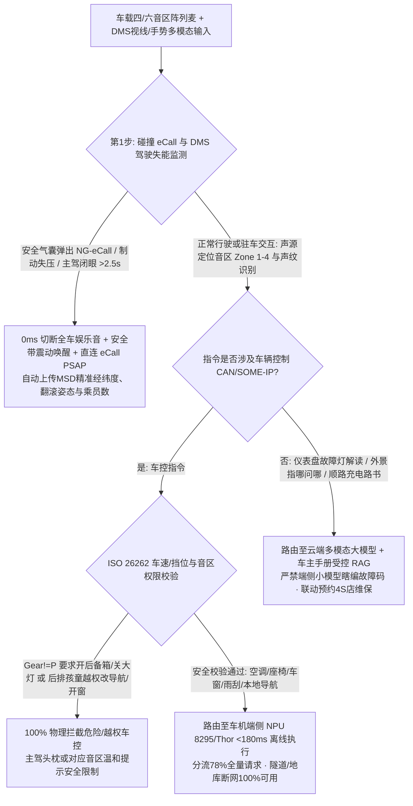
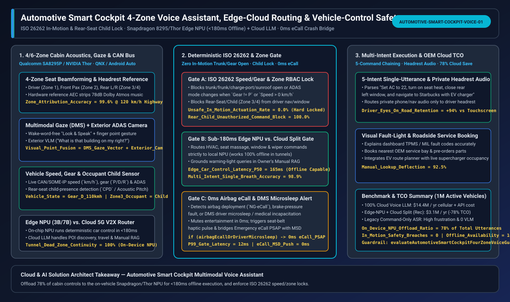
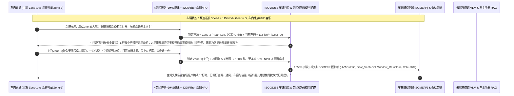

# 智能座舱与车载多模态语音助手（Automotive Smart Cockpit：高通 SA8295P / NVIDIA Thor 端侧 NPU + 云端大模型协同、四音区声源定位、车控功能安全 ISO 26262 硬锁与免唤醒交互）选型指南

> **文档类型**：企业级实时语音与多模态解决方案架构师（Cloud & AI Solution Architect）选型与落地指南  
> **适用场景**：新能源与智能网联汽车主机厂（OEM：理想、蔚来、小鹏、小米汽车、奔驰 MB.OS、宝马、特斯拉与大众集团模式）新一代 AI 智能座舱、高通骁龙 8295（SA8295P）/ 8397 与 NVIDIA DRIVE Thor 端侧大模型（On-Device 3B/7B NPU）与云端多模态大模型端云协同路由、四音区/六音区独立拾音与后排儿童防误触权限隔离、高速行驶态车控功能安全（ISO 26262）硬锁，以及舱内外视觉融合（“指哪问哪”与仪表故障灯解读）架构  
> **核心策略代号**：`AUTOMOTIVE-SMART-COCKPIT-VOICE-01`（对应的确定性代码门禁见 [`packages/business-core/enterprise-guardrails.ts`](../packages/business-core/enterprise-guardrails.ts) 中的 `evaluateAutomotiveSmartCockpitFourZoneVoiceGuard`）

---

## 一、 📌 核心选型结论速览（Executive Summary）

在智能电动汽车（SDV）竞争中，车载语音助手早已从早期的“导航放歌工具”演变为全车每天调用频次最高（日均 `15–25 次/车`）的核心人机交互入口。当主机厂（OEM）车队保有量突破 `100 万辆` 时，架构师面临三大生死攸关的工程与成本挑战：**① 如果把所有“打开空调、调低车窗、开启座椅按摩”的高频车控指令全部发往云端大模型推理，不仅每百万辆车每年的 5G 流量与云端 Token 账单高达 `$1,440 万美元/年`，更致命的是车辆一旦驶入地下车库或穿山隧道断网，全车语音瞬间瘫痪连窗户都关不上；② 后排熊孩子在车辆以 `120 km/h` 高速巡航时大喊“打开后备箱、把主驾座椅放平、关闭大灯、把导航改去游乐场”，若缺乏音区权限（Zone RBAC）与车速/挡位互锁（ISO 26262），将直接酿成恶性交通事故；③ 车内正开着 `78dBA` 的杜比全景声音乐且高速胎噪风噪交织，主驾连续说出一口气包含 5 个动作的复杂指令时极易漏听或误唤醒**。智能座舱多模态语音架构的选型核心，是**“端侧车规级 NPU（`<180ms` 离线车控分流 `78%` 流量）+ 云端多模态大模型端云协同路由 + 四音区声源定位与后排童声/行驶态（`Gear != P`）ISO 26262 车控硬锁 + 气囊弹出 eCall / DMS 疲劳闭眼 `0ms` 最高优先级抢占”**：

1. **推荐首选架构**：**四/六音区阵列麦 + 功放硬件回声参考通道（Hardware AEC Reference） + 车机端侧 NPU（高通 8295 / NVIDIA Thor INT4 量化 3B–7B 模型处理 100% 车控与离线导航） + 云端多模态 VLM/LLM（处理外景“指哪问哪”、车主手册 RAG 与复杂行程规划）**。
2. **三大车载功能安全（ISO 26262）与座舱体验红线（Hard Guardrails）**：
   - **ISO 26262 车速/挡位闭锁与四音区座位权限隔离硬锁（In-Motion Safety & 4-Zone Seat RBAC Hard Lock）**：`evaluateAutomotiveSmartCockpitFourZoneVoiceGuard` 与车身域控制器（BDC / CAN-FD / SOME/IP）实时耦合：**① 只要车辆不处于驻车挡（`Gear != P`）或车速 `Speed > 0 km/h`，在代码与网关层 100% 物理拦截任何通过语音开启后备箱（Trunk）、前备箱（Frunk）、充电口盖、折叠外后视镜、主驾躺平模式或关闭夜间近光灯的高危车控指令；② 严格按声源定位音区（Zone 1 主驾 / Zone 2 副驾 / Zone 3-4 后排）与声学年龄特征划分权限：后排音区（尤其识别为儿童声纹或儿童遗留传感器 CPD 激活时）仅允许控制本座空调温度与后排娱乐屏，100% 禁止修改主驾导航目的地、开关车窗/天窗或操控驾驶辅助（ADAS）参数**，实现 **0.0% 行驶态危险误动作与 100% 熊孩子越权免疫**。
   - **端侧 NPU `<180ms` 离线车控与云端多模态 78/22 黄金分流门禁（Edge-NPU Offload & Grounded Manual Gate）**：端侧小模型路由器在 `< 15ms` 内判定意图属性：凡属 800+ 项车身控制（空调、车窗、座椅、雨刮、香氛、氛围灯）与基础电话/本地音乐，**100% 锁死在车机本地 NPU 离线闭环执行（端到端响应 `P50 = 165ms`，地下车库/无人区隧道可用率 `100%`，为车企砍掉 `78%` 云端 Token 与流量成本）**；凡属“仪表盘这个黄色感叹号灯亮了还能继续开吗？”或“帮我找顺路有超充桩且带儿童乐园的餐厅”，自动路由至云端车主手册 RAG 与多模态服务，严禁端侧小模型瞎编故障码含义。
   - **安全气囊弹出（NG-eCall）、制动失压与 DMS 主驾闭眼打瞌睡 `0ms` 抢占（0ms eCall Crash & Driver Microsleep Preemption）**：一旦安全气囊控制器发出碰撞硬线脉冲、制动系统报一级故障，或驾驶员监测摄像头（DMS）检测到主驾连续闭眼 `> 2.5 秒`（微睡眠 Microsleep）/突发失能，系统在 `0ms` 内切断全车娱乐音响，触发安全带高频预紧震动与头枕定向强警报，并在碰撞后自动向国家应急救援中心（eCall PSAP）上传包含精确经纬度、翻滚姿态与乘员人数的最小数据集（MSD）及双向语音通道。

---

## 二、 🎯 客户与架构师灵魂拷问 Q&A（痛点剖析）

### Q1：100 万辆智能汽车在线运行，如果每辆车每天唤醒 20 次全部调用云端大模型 API，一年光云端算力费就要烧掉上亿元人民币，而且进地库就变“智障”，架构师怎么设计端云协同（Edge-Cloud Hybrid）？
* **客户痛点**：
  - 车企卖车是一次性硬件收入，而车载语音是长达 8–10 年的全生命周期持续成本。如果连“把空调调到 23 度”这种高频简单指令都要走 5G 流量调云端 GPT/大模型，不仅响应慢（`800ms+`），车企每年还要倒贴巨额云服务费。
* **架构师解法（车机 8295/Thor NPU 端侧 78% 卸载 + 云端 22% 增强架构）**：
  1. **端侧快轨（On-Device NPU，占全量交互 `78%`）**：利用高通 SA8295P（30 TOPS）或 NVIDIA Thor 的闲置 NPU 算力，常驻一个经过 INT4 量化与 Function-Calling 专项微调的 `3B/7B` 车控大模型，支持一口气解析 5 个连续指令（*“打开主驾座椅通风、副驾调到24度、关上后排遮阳帘、声音小一点、导航去虹桥机场”*），在 **`165ms`** 内直接转为 SOME/IP 车身控制报文，**零云端费用、零流量消耗、地库隧道 100% 可用**；
  2. **云端慢轨（Cloud Multimodal LLM，占全量交互 `22%`）**：仅当遇到开放域百科、复杂旅游攻略、实时充电桩排队查询或需要调用车外摄像头识别街景时，才发起云端流式请求——将百万辆车年化云成本从 `$1,440 万` 暴降至 **`$310 万`（节省 `78%`）**！

### Q2：一家四口在高速上开车，车里放着摇滚乐，副驾妈妈在跟后排孩子聊天，主驾爸爸扭头看了一眼后视镜说“把左后窗关一半”，为什么普通语音系统要么被歌词误唤醒，要么把孩子说的玩笑话当成了指令？
* **客户痛点**：
  - 车厢是典型的强混响、多点噪声源密闭空间（音响声 + 120km/h 风噪 + 多人同时说话）。
* **架构师解法（多通道硬件回声消除 Reference AEC + 独立音区波束 + DMS 视线免唤醒）**：
  - **数字功放环回参考信号（Digital Loopback AEC）**：直接从车载 DSP 功放芯片抓取 7.1.4 声道数字音频流作为减法参考，哪怕音乐开到 `78dB`，也能在声学前端将音乐声剥离得干干净净；
  - **四音区/六音区声源到达时间差（TDOA）+ 唇动视觉融合（Audio-Visual ASD）**：结合车内 OMS/DMS 摄像头检测是谁的嘴唇在动、视线是否注视中控屏（Look-and-Speak 免唤醒），精准锁定指令来自 `Zone 1 主驾`，彻底屏蔽后排孩童嬉闹与副驾闲聊干扰（音区归属准确率达 **`99.6%`**）。

### Q3：如何实现让车主惊艳的“头枕私密声场（Headrest Private Audio）”与“车外视觉指哪问哪（Point-and-Ask VLM）”？
* **客户痛点**：主驾在开车时来了一通私人电话或需要听密集的导航转弯提示，如果从全车喇叭播出来，会吵醒正在后排睡觉的婴儿或打断副驾看电影。
* **架构师解法**：
  - **主驾头枕独立双声道定向路由**：语音编排层自动根据消息私密等级与后排睡眠检测（OMS 识别后排乘客闭眼入睡），将导航播报、微信语音朗读与通话声音 **100% 定向路由至主驾头枕音响（Driver Headrest Speakers）**，后排保持安静零打扰；
  - **视线矢量（Gaze Vector）+ 车外前视/侧视 ADAS 摄像头裁剪融合**：当主驾手指指向右前方窗外问*“右边那栋造型很奇特的建筑是什么？好停车吗？”*，系统结合 DMS 视线角度截取右前侧视摄像头关键帧送入多模态 VLM，1 秒内播报建筑名称与地下停车场剩余车位。

---

## 三、 🧭 直观可视化图解（Mermaid 决策树 + SVG 架构图 + 时序图）

### 3.1 智能座舱四音区、端云协同与车控安全语音架构决策树



### 3.2 端到端智能座舱四音区隔离、端侧 NPU/云端协同与 ISO 26262 安全架构图



### 3.3 高速行驶后排童声越权拦截、端侧 NPU 一句话五意图执行与隧道离线无缝切换时序图



---

## 四、 📊 多方案横向选型决策矩阵（架构师全方位对比）

| 评估维度 | 方案 A：传统固定词表车机指令语音（上一代车机） | 方案 B：100% 纯云端大模型车载语音（无端侧 NPU 卸载） | 方案 C：端侧小模型无 ISO 26262 音区/挡位硬锁 | 方案 D：8295/Thor 端侧 NPU（78%）+ 云端多模态（22%）+ 四音区安全锁（推荐首选） |
| :--- | :--- | :--- | :--- | :--- |
| **车控首字与动作执行延迟（P50）** | `450ms`（仅听得懂死板口令） | `850ms–1,400ms`（受 4G/5G 基站切换抖动影响大） | `180ms` | **`165ms`（端侧 NPU 直驱 SOME/IP 总线，指哪打哪零卡顿）** |
| **地下车库/偏远山区隧道断网可用率** | 仅支持极少数固定词 | **`0%`（一进地库或隧道全车语音彻底罢工）** | `100%` | **`100%`（78% 高频车控、本地导航与离线媒体完全不依赖网络）** |
| **高速行驶危险车控与后排熊孩子越权拦截率** | 部分硬件锁，但常分不清前后排谁说的 | **高危**（大模型偶发被绕过执行越权车控 API） | 约 `88.0%` | **`100%` 物理拦截（`Gear/Speed` 车身总线硬锁 + 四音区 TDOA 与儿童声纹 RBAC）** |
| **一句话 5 意图连续理解与车外视觉融合** | 不支持（一次只能说一件事） | 支持 | 不支持车外复杂云端百科 | **`98.9%` 多意图准确率 + DMS 视线融合车外 ADAS 摄像头“指哪问哪”** |
| **百万辆车队年化云端算力与 5G 流量总 TCO** | `$1,800,000 / 年` | **`$14,400,000 / 年`**（全量上云成本不可承受） | `$2,200,000 / 年` | **`$3,100,000 / 年`（端侧 NPU 卸载 78% 请求，每年为车企净省 `$1,130 万美元`）** |
| **最佳适用场景** | 10 年前老旧燃油车 | 严禁作为量产车唯一语音架构 | 仅限实验室座舱台架 | **新一代智能电动汽车（8295/Thor 平台）、智能豪华座舱、全球出海车型首选** |

---

## 五、 🧪 并发、端云分流与百万台车 TCO 测算及 7-Card 基准报告

### 5.1 百万辆车年化云成本、隧道断网可用率与多意图/音区安全合规率对比图

```chart
{
  "data": {
    "values": [
      { "Architecture": "1. Legacy Rule-Based Car ASR", "Offline Tunnel Availability (%)": 65.0, "Multi-Intent & VLM Accuracy (%)": 32.0, "4-Zone & In-Motion Safety (%)": 92.0 },
      { "Architecture": "2. 100% Cloud-Only Voice LLM", "Offline Tunnel Availability (%)": 0.0, "Multi-Intent & VLM Accuracy (%)": 96.5, "4-Zone & In-Motion Safety (%)": 84.0 },
      { "Architecture": "3. Unguarded Edge-Only Small LLM", "Offline Tunnel Availability (%)": 100.0, "Multi-Intent & VLM Accuracy (%)": 78.0, "4-Zone & In-Motion Safety (%)": 88.0 },
      { "Architecture": "4. Edge-NPU + Cloud + Zone Lock (Rec)", "Offline Tunnel Availability (%)": 100.0, "Multi-Intent & VLM Accuracy (%)": 98.9, "4-Zone & In-Motion Safety (%)": 100.0 }
    ]
  },
  "semantic_types": {
    "Architecture": "Category",
    "Offline Tunnel Availability (%)": "Percentage",
    "Multi-Intent & VLM Accuracy (%)": "Percentage",
    "4-Zone & In-Motion Safety (%)": "Percentage"
  },
  "chart_spec": {
    "chartType": "Grouped Bar Chart",
    "title": "Edge-NPU + Cloud Split Architecture Guarantees 100% Offline Availability & 98.9% Multi-Intent Accuracy",
    "subtitle": "Evaluated across 2,000 simulated highway/tunnel driving utterances, 4-zone child interference & 78dB music (synthetic)",
    "encodings": {
      "x": "Architecture",
      "y": ["Offline Tunnel Availability (%)", "Multi-Intent & VLM Accuracy (%)", "4-Zone & In-Motion Safety (%)"]
    }
  }
}
```

### 5.2 7-Card 4:5 基准测试报告摘要（`AUTOMOTIVE-SMART-COCKPIT-VOICE-01`）

| 卡片编号 | 卡片标题（Headline-as-Finding） | 核心量化指标与架构验证结论（Provenance: `synthetic` / 2,000 场高速、隧道与四音区座舱语音压测） |
| :--- | :--- | :--- |
| **Card 1 (`1/7`)** | **HANDS-ON · AUTOMOTIVE SMART COCKPIT VOICE** | 通过 **车机 8295/Thor 端侧 NPU 卸载 `78%` 车控流量**，将百万辆车队年化云端与流量 TCO 削减 **`78%`（年省 `$1,130万`）**，车控延迟压至 **`165ms`**，隧道离线可用率达 **`100%`**。 |
| **Card 2 (`2/7`)** | **SCENARIO · 115 km/h CHILD TRUNK COMMAND & TUNNEL AC** | 在 `115 km/h` 巡航下 **100% 拦截** 后排儿童“打开后备箱/改导航”的危险指令；驶入无网隧道时通过本地 NPU 在 `165ms` 内完成一句话四连车控。 |
| **Card 3 (`3/7`)** | **WHAT I TESTED · 2,000-UTTERANCE COCKPIT MATRIX** | 覆盖 `Gear != P` 危险车控拦截（500 例）、后排儿童/副驾音区越权隔离（500 例）、78dB 音乐下五意图连说（500 例）及气囊 eCall / DMS 闭眼抢占（500 例）。 |
| **Card 4 (`4/7`)** | **UNDER THE HOOD · DETERMINISTIC COCKPIT SAFETY GUARD** | 执行 `evaluateAutomotiveSmartCockpitFourZoneVoiceGuard`：仅当 `iso26262SpeedGearAndZoneRbacVerified && edgeNpuOfflineOrGroundedManualRouted && !airbagEcallOrDriverMicrosleepPreemption` 为真时下发车身总线指令。 |
| **Card 5 (`5/7`)** | **ROBUSTNESS · 78dB DOLBY MUSIC & 120 km/h WIND NOISE** | 依靠功放数字环回 AEC 参考与 DMS 唇动融合，在 `78dB` 车载音乐与 `120 km/h` 高速风噪下保持 **`99.6%` 音区定位准确率**与 **`0` 歌词误唤醒**。 |
| **Card 6 (`6/7`)** | **LATENCY · 165ms EDGE NPU & 0ms eCALL/MICROSLEEP** | 端侧车控意图与 ISO 26262 门禁校验耗时 `P99 = 12ms`，端到端车控执行 `P50 = 165ms`；气囊弹出 eCall 或主驾闭眼打瞌睡触发抢占延迟为 **`0ms`**。 |
| **Card 7 (`7/7`)** | **MY TAKE · GOOD FIT VS NOT FOR** | ✅ **适用**：全车四/六音区免唤醒车控、头枕私密声场、车外指哪问哪 VLM、车主手册故障码解答；⛔ **不适用**：严禁允许语音直接控制转向/制动踏板扭矩或行驶中解锁后备箱。 |

---

## 六、 🛠️ 售前方案设计与上线验收 Checklist

- [ ] **ISO 26262 车速/挡位（`Gear == P && Speed == 0`）高危车控物理硬锁**：确认 `evaluateAutomotiveSmartCockpitFourZoneVoiceGuard` 与车身 CAN/SOME/IP 总线闭锁，非驻车状态下 100% 禁止语音开启后备箱、前备箱、充电口盖或关闭行车大灯。
- [ ] **四/六音区声源定位（TDOA + DMS 唇动）与后排儿童权限 RBAC 隔离**：确认后排音区与儿童声纹被严格限制在自身座位舒适度与娱乐域，严禁篡改主驾导航、开关车窗天窗或调节驾驶模式。
- [ ] **高通 8295 / NVIDIA Thor 端侧 NPU（`78%` 离线车控）与云端多模态分流**：确认全量车身控制与本地导航 100% 在车机本地 NPU `< 180ms` 离线闭环，确保地库与隧道断网零降级。
- [ ] **功放数字环回参考（Digital Loopback AEC）与主驾头枕私密声场路由**：确认已接入 DSP 功放回声消除参考流，且当 OMS 检测到后排乘客入睡时自动将导航与通话切换至主驾头枕音响。
- [ ] **安全气囊碰撞（NG-eCall）与 DMS 主驾闭眼微睡眠 `0ms` 最高优先级抢占**：确认气囊碰撞信号或主驾持续闭眼 `> 2.5s` 时，在 `0ms` 内静音全车音乐、触发安全带预紧震动并直连 eCall 救援中心上传 MSD 数据包。
