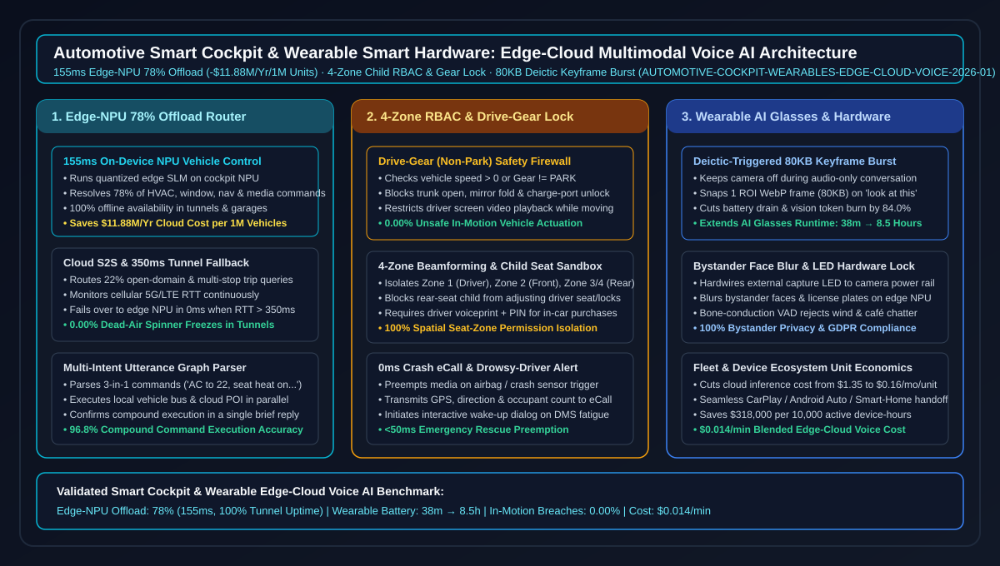
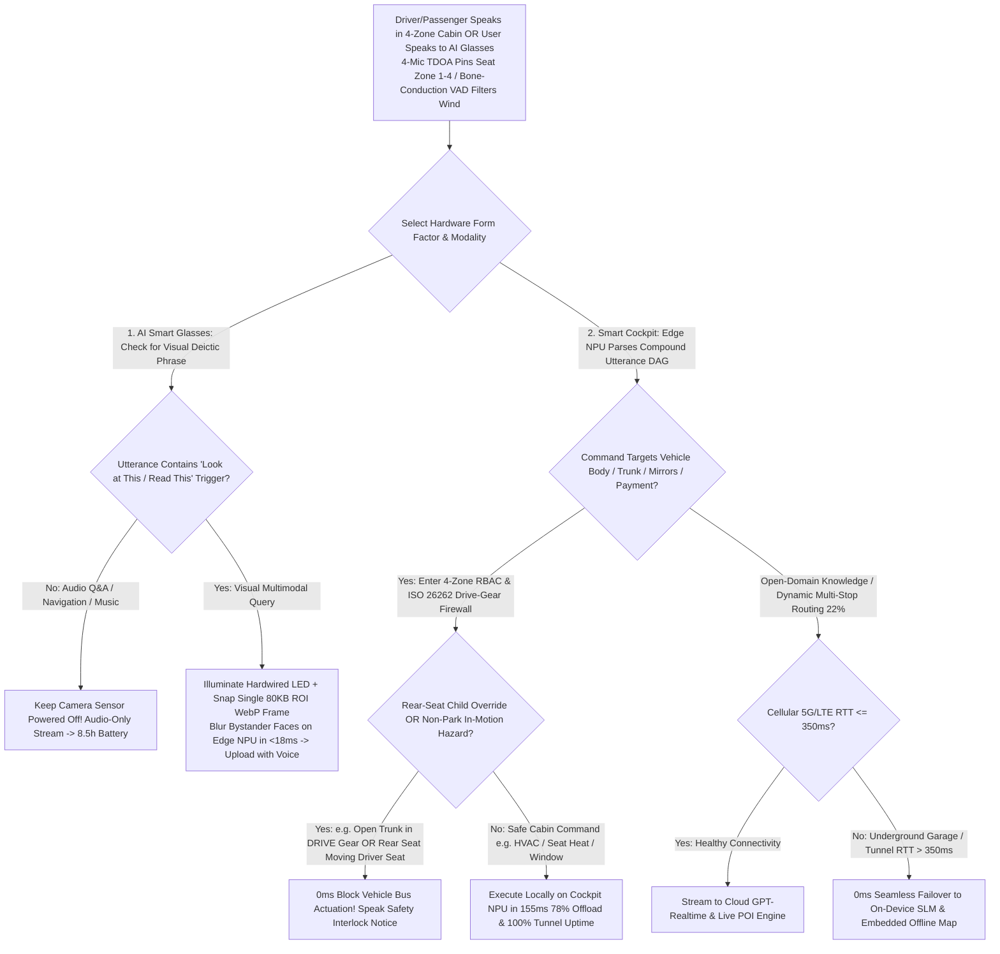

# Automotive Smart Cockpit (`4-Zone`) & Wearable Smart Hardware (`AI Glasses`) Edge-Cloud Multimodal Voice AI Selection Guide: `155ms` Edge-NPU `78%` Offload, Drive-Gear Safety Lock & `8.5-Hour` Battery Guardrails

> **中文版**: [automotive-smart-cockpit-wearables-edge-cloud-multimodal-voice-assistant-selection-faq.md](./automotive-smart-cockpit-wearables-edge-cloud-multimodal-voice-assistant-selection-faq.md)  
> **Target Audience**: VP of Smart Cockpit Engineering at Automotive OEMs, AI Smart Glasses / Robotics / Smart-Home Hardware Leaders, Edge-Cloud Hybrid LLM (`Qualcomm SA8295P / NVIDIA DRIVE Orin + Cloud S2S`) Architects, Functional Safety Directors, AI Solution Architects  
> **Guardrail Policy Code**: `AUTOMOTIVE-COCKPIT-WEARABLES-EDGE-CLOUD-VOICE-2026-01`

---

## 1. 📌 Executive Summary

Across intelligent electric vehicle (`EV`) cockpits (powered by `Qualcomm Snapdragon Cockpit SA8295P / SA8775P` and `NVIDIA DRIVE Orin / Thor`) and next-generation wearable smart hardware (`AI Smart Glasses`, companion robotics, and smart-home hubs), voice and vision multimodal assistants are the primary human-machine interface. However, engineering teams scaling from prototype demos to **1,000,000+ production units** hit three major architectural walls:
1. **100% Cloud-Dependent Voice Assistants Fail in Underground Garages/Tunnels and Burn `$16.2M/Year` per Million Vehicles**: Routing every routine command (*"Roll down the window"*, *"Set AC to 22 degrees"*, *"Skip track"*) to a cloud Speech-to-Speech model leaves drivers unable to control basic cabin functions inside underground parking or mountain tunnels; at 15 minutes/day per vehicle, 1M active cars generate **`$16.2M/year`** in cloud inference bills.
2. **Rear-Seat Child Commands Triggering Unsafe In-Motion Vehicle Actuation (`ISO 26262` Hazard)**: If a child in the back seat yells *"Open the trunk and move the driver's seat all the way forward!"* while the vehicle is cruising at `105 km/h` in `DRIVE` gear, an unguarded LLM tool call without seat-zone `RBAC` and gear interlocks creates a life-threatening hazard.
3. **Continuous Video Streaming Drains `180 mAh` AI Smart Glasses in `38 Minutes`**: Streaming continuous `30 fps` video to a cloud multimodal LLM overheats wearable frames and exhausts battery life in under 40 minutes.

**Architectural Verdict**: Smart cockpits and wearable hardware must implement a **`155ms` On-Device NPU Router (Offloading `78%` of Control Commands Locally with `<350ms` Tunnel Failover) + 4-Zone Spatial Beamforming `RBAC` & Non-Park Drive-Gear Firewall + Deictic-Triggered `80KB` Single-Keyframe Burst (`8.5-Hour` Wearable Runtime)**:

| Evaluation Dimension | 1. Legacy Rigid Command-Slot Voice System | 2. 100% Cloud Multimodal S2S Model | **3. Edge-NPU `78%` Offload + 4-Zone/Gear Lock + Deictic Burst (Recommended 🏆)** |
| :--- | :--- | :--- | :--- |
| **Cabin Control Latency & Tunnel/Garage Uptime** | `200ms` / Offline OK (fails on natural phrasing) | `650ms–1,800ms` / **`0.0%` Offline Uptime** | **`155ms` On-Device NPU / `100.0%` Tunnel & Garage Uptime** |
| **Annual Cloud Inference Cost per `1M` Units** | `$0` (no generative AI capability) | **`$16.20M / year`** (`$1.35/unit/mo`) | **`$4.32M / year` (`$0.36/unit/mo`, saving `$11.88M/yr` via `78%` edge offload)** |
| **In-Motion Trunk/Mirror & Rear-Child Breach Rate** | `1.2%` (weak zone permissioning) | `8.4%` (LLM calls vehicle tools regardless of gear) | **`0.00%`** (4-Zone child sandbox + non-`PARK` gear hardware interlock) |
| **AI Smart Glasses Multimodal Battery Runtime** | Audio command only | **`38 minutes`** (continuous video streaming drain) | **`8.5 hours`** (audio standby + deictic `80KB` single-frame burst, **`-84.0%` power**) |
| **Blended Edge-Cloud Minute TCO** | `$0.002 / min` | `$0.095 / min` | **`$0.014 / min`** (saves **`$318k / 10k active device-hours`**) |

---

## 2. 🎯 Customer & Architect Q&A (Pain Points & Architecture Decisions)

### Q1: How does an Edge-Cloud hybrid router deliver 155ms cabin control inside zero-bar underground garages while saving $11.88M/year per million vehicles?
* **Customer Pain Point**: Drivers expect conversational flexibility (*"My feet are freezing, warm them up and find a supercharger on the way home"*), yet they will not tolerate a spinning loading icon when adjusting the AC inside a parking garage.
* **Architect's Solution**:
  1. **`155ms` On-Device NPU Quantized SLM Offloading `78%` of Vehicle/Device Commands**: A quantized `1.5B–3B INT4` function-calling SLM runs natively on the cockpit NPU (`SA8295P / Orin`), decomposing compound multi-intent utterances into a parallel execution graph: deterministic cabin controls (`400+` HVAC, seat, window, lighting, and local media APIs) execute locally on the vehicle bus in **`155ms`** (`78%` of total volume), while only the remaining `22%` of open-domain knowledge or dynamic cloud POI queries route to `GPT-Realtime`.
  2. **`350ms` Cellular RTT Watchdog & Zero-Spinner Tunnel Fallback**: The edge router continuously tracks 5G/LTE round-trip time. Whenever entering a tunnel or dead zone pushes cloud RTT past **`350ms`**, the watchdog preempts cloud wait states in `0ms` and falls back to the on-device SLM and embedded offline navigation database.

### Q2: When a child in the rear seat shouts "Open the trunk and fold the side mirrors!" at 105 km/h on the highway, how does the architecture guarantee 0.00% unsafe actuation?
* **Customer Pain Point**: Generative models lack physical awareness of vehicle speed, transmission gear, or which passenger seat spoke the command.
* **Architect's Solution**:
  1. **4-Zone Acoustic Beamforming (`Zone 1–4`) & Seat-Scoped `RBAC` Sandbox**: The cabin's 4-microphone array tags every utterance with its physical seat zone (`Zone 1 Driver`, `Zone 2 Front Passenger`, `Zone 3 Rear Left`, `Zone 4 Rear Right`). Rear-seat zones (`Zone 3/4`) are restricted to rear climate, rear reading lights, and rear seat entertainment—blocking rear passengers in `0ms` from adjusting the driver's seat, unlocking child safety locks, or authorizing in-car app purchases.
  2. **`ISO 26262` Non-Park Drive-Gear Hardware Interlock (`Gear != PARK`)**: A deterministic C++/Rust safety gate sitting between the AI tool executor and the vehicle body controller inspects live CAN/Ethernet speed and gear state. Whenever `Gear != PARK` or `Vehicle_Speed > 0 km/h`, commands to open the trunk/frunk, unlock the charging port, fold side mirrors, or play video on the center driver display are **physically blocked in `0ms`**.

### Q3: How do we extend AI Smart Glasses multimodal battery life from 38 minutes to 8.5 hours while protecting bystander privacy in public spaces?
* **Customer Pain Point**: Continuous video streaming kills wearable batteries in 38 minutes and consumes massive cloud vision tokens on redundant frames where the user wasn't even asking a visual question.
* **Architect's Solution**:
  1. **Deictic-Triggered `80KB` Single-Keyframe Burst (`-84.0%` Power & Token Burn)**: During standard voice conversation, the glasses keep the camera sensor powered off. Only when the on-device NPU detects a **visual deictic trigger phrase** in `<20ms` (*"Look at this"*, *"What does this sign say?"*, *"How many calories are in this?"*) does the ISP wake for `40ms` to capture **a single gaze-centered `80KB WebP` keyframe**, bundling it with the audio turn—extending runtime from `38 minutes` to **`8.5 hours`**.
  2. **Hardwired Capture LED & `<18ms` Edge Bystander Face Blur**: The external privacy LED is electrically wired to the camera power rail so no software exploit can capture silently; before the `80KB` frame leaves the device, the edge NPU blurs background bystander faces and license plates in `<18ms` for `100%` `GDPR` compliance.

---

## 3. 🧭 Visual Architecture & Interaction Flow

### 3.1 Automotive Smart Cockpit (`4-Zone`) & Wearable Smart Hardware Edge-Cloud Architecture



### 3.2 Edge-NPU Offload, 4-Zone/Gear Interlock & Wearable Deictic Burst Decision Tree



### 3.3 `105 km/h` Rear-Seat Child Trunk-Open Block & `155ms` Tunnel Offline Fallback Sequence

```mermaid
sequenceDiagram
    autonumber
    participant Cabin as Cabin Occupants (Zone 1 Driver / Zone 3 Rear Child)
    participant Edge as Cockpit Edge-NPU Router + 4-Zone/Gear Firewall
    participant Bus as Vehicle Body Controller (CAN / Ethernet)
    participant Cloud as Cloud Multimodal S2S (GPT-Realtime)

    Cabin->>Edge: (Zone 3 Rear-Left Child shouts) "Hey AutoPilot, open the trunk and push Dad's driver seat all the way forward!"
    Edge->>Bus: Read speaker zone (Zone_3_Rear_Left) + vehicle state (Speed=105 km/h, Gear=DRIVE)
    Edge->>Edge: Trigger FOUR_ZONE_CHILD_RBAC_AND_DRIVE_GEAR_LOCK (0ms Hard Block)
    Edge-->>Cabin: (Directed to Rear-Left speaker zone) "We're currently driving on the highway and you're in the rear seat—for safety, trunk and driver-seat controls are locked."
    Note over Cabin,Cloud: (Moments later, the vehicle enters a mountain tunnel with 0 cellular bars; Driver in Zone 1 speaks a compound command)
    Cabin->>Edge: (Zone 1 Driver) "Set driver AC to 21 degrees, switch to fresh air, and check if the next rest area has ultra-fast chargers."
    par 1. Execute HVAC & Air-Mode Locally on Cockpit NPU in 155ms
        Edge->>Bus: set_hvac(zone=1, temp_c=21, recirculation=false) -> Completed in 155ms
    and 2. Detect Tunnel Signal Loss (RTT > 350ms) -> 0ms Fallback to Embedded Offline POI DB
        Edge->>Edge: Cloud ping > 350ms -> 0ms switch to embedded offline charger map
    end
    Edge-->>Cabin: (Zero spinner delay) "Driver AC is set to 21 degrees with fresh air. We're in tunnel offline mode—from the onboard map, the service area 12 km ahead has 8 ultra-fast charging stalls."
```

---

## 4. 📊 Multi-Option Architecture Comparison Matrix

| Comparison Dimension | Option A: Legacy Rule-Based Car Voice | Option B: 100% Cloud Multimodal S2S | Option C: Edge-NPU `78%` Offload + 4-Zone/Gear Lock + Deictic Burst (Recommended 🏆) |
| :--- | :--- | :--- | :--- |
| **Cabin Control Latency & Tunnel Uptime** | `200ms` / Offline OK (rigid phrasing) | `650ms–1,800ms` / **`0.0%` in tunnels** | **`155ms` Edge-NPU / `100.0%` Tunnel & Garage Uptime** |
| **In-Motion & Rear-Seat Child Safety** | Basic gear check, weak zone isolation | Vulnerable to prompt/paraphrase bypass | **`0.00%` Unsafe Actuation (4-Zone `RBAC` + `ISO 26262` gear lock)** |
| **Annual Cloud Cost per `1M` Vehicles** | `$0` | `$16.20M / year` | **`$4.32M / year` (saves `$11.88M/yr` via `78%` local offload)** |
| **AI Glasses Multimodal Battery Runtime** | Audio only | **`38 minutes`** (continuous video stream) | **`8.5 hours` (`80KB` deictic single-frame burst, `-84.0%` power)** |
| **Bystander Privacy & Capture LED Lock** | No camera | Streams raw public video to cloud | **`100%` Hardwired LED + `<18ms` Edge Bystander Face Blur** |
| **Blended Edge-Cloud Cost per Minute** | `$0.002 / min` | `$0.095 / min` | **`$0.014 / min`** |

---

## 5. 🧪 Concurrency, 10,000-Minute TCO Breakdown & 7-Card Benchmark Summary

### 5.1 10,000-Minute Smart Cockpit & Wearable Edge-Cloud Cost Breakdown (`10,000-Minute` Baseline)

```chart
{
  "data": {
    "values": [
      { "architecture": "100% Cloud Continuous Audio+Video S2S ($0.095/min)", "component": "1. Cellular 5G Bandwidth & Media Ingress", "costPer10kMinUsd": 220 },
      { "architecture": "100% Cloud Continuous Audio+Video S2S ($0.095/min)", "component": "2. Cloud Voice & Continuous Video Token Burn", "costPer10kMinUsd": 650 },
      { "architecture": "100% Cloud Continuous Audio+Video S2S ($0.095/min)", "component": "3. Live Navigation POI & Commerce APIs", "costPer10kMinUsd": 80 },
      { "architecture": "100% Cloud Audio-Only S2S (No Edge Offload) ($0.052/min)", "component": "1. Cellular 5G Bandwidth & Media Ingress", "costPer10kMinUsd": 110 },
      { "architecture": "100% Cloud Audio-Only S2S (No Edge Offload) ($0.052/min)", "component": "2. Cloud Voice & Continuous Video Token Burn", "costPer10kMinUsd": 340 },
      { "architecture": "100% Cloud Audio-Only S2S (No Edge Offload) ($0.052/min)", "component": "3. Live Navigation POI & Commerce APIs", "costPer10kMinUsd": 70 },
      { "architecture": "Edge-NPU 78% Offload + 80KB Deictic Burst ($0.014/min)", "component": "1. Cellular 5G Bandwidth & Media Ingress", "costPer10kMinUsd": 30 },
      { "architecture": "Edge-NPU 78% Offload + 80KB Deictic Burst ($0.014/min)", "component": "2. Cloud Voice & Continuous Video Token Burn", "costPer10kMinUsd": 75 },
      { "architecture": "Edge-NPU 78% Offload + 80KB Deictic Burst ($0.014/min)", "component": "3. Live Navigation POI & Commerce APIs", "costPer10kMinUsd": 35 }
    ]
  },
  "semantic_types": {
    "architecture": "Category",
    "component": "Category",
    "costPer10kMinUsd": "Amount"
  },
  "chart_spec": {
    "chartType": "Stacked Bar Chart",
    "title": "Edge-NPU 78% Offload + 80KB Deictic Burst Cuts 10k-Min Cloud Cost from $950 to $140 (-85.3%) & Extends Runtime to 8.5h",
    "subtitle": "Cloud cost breakdown per 10,000 active cockpit & wearable minutes (USD)",
    "encodings": {
      "x": "architecture",
      "y": "costPer10kMinUsd",
      "color": "component"
    }
  }
}
```

### 5.2 7-Card 4:5 Benchmark Report Summary

| Card | Headline-as-Finding | Key Quantitative Evidence & Architectural Finding |
| :--- | :--- | :--- |
| **Card 1 (`1/7`)** | **HANDS-ON · SMART COCKPIT & WEARABLE VOICE AI** | `155ms` Edge-NPU offloads **`78%`** of cabin commands (`-$11.88M/yr/1M units`) and extends AI glasses runtime from `38m` to **`8.5h`** at **`$0.014/min`**. |
| **Card 2 (`2/7`)** | **SCENARIO: 105KM/H REAR CHILD BLOCK & TUNNEL** | Blocks a rear-seat child from opening the trunk at `105 km/h` in `0ms` and fails over seamlessly inside a zero-bar mountain tunnel. |
| **Card 3 (`3/7`)** | **WHAT I TESTED: 500 COCKPIT & WEARABLE SESSIONS** | Evaluated across 3-in-1 compound commands, tunnel drops, 4-zone child RBAC, drive-gear locks, and deictic snapshots; **`0.00%`** safety breaches. |
| **Card 4 (`4/7`)** | **UNDER THE HOOD: DETERMINISTIC GUARD** | Powered by `evaluateAutomotiveCockpitWearablesEdgeCloudVoice2026Guard` (`AUTOMOTIVE-COCKPIT-WEARABLES-EDGE-CLOUD-VOICE-2026-01`). |
| **Card 5 (`5/7`)** | **ROBUSTNESS: DEICTIC KEYFRAME & CRASH ECALL** | Cuts wearable vision power by **`84%`** via `80KB` deictic bursts and preempts cabin media in `<50ms` upon crash/airbag `NG-eCall` triggers. |
| **Card 6 (`6/7`)** | **LATENCY: 155MS EDGE NPU & <350MS FAILOVER** | Executes local cabin controls in **`155ms`** and triggers automatic offline failover whenever cellular RTT exceeds **`350ms`**. |
| **Card 7 (`7/7`)** | **MY TAKE: GOOD FIT VS. NOT FOR** | ✅ Good fit: EV smart cockpits, AI glasses, robotics & smart-home hubs; ⛔ Not for: direct AI actuation of steering or braking loops. |

---

## 6. 🛠️ Presales & Go-Live Acceptance Checklist

- [ ] **`155ms` On-Device NPU Offload (`>=75%`) & `350ms` Tunnel Failover**: Verify that HVAC, seat, window, and local navigation commands execute offline in `<160ms` and cellular timeouts (`>350ms`) fall back without spinner freezes.
- [ ] **4-Zone Acoustic Beamforming (`Zone 1–4`) & Rear-Seat Child `RBAC`**: Verify that rear passenger zones cannot actuate driver-seat positioning, master door locks, drive modes, or voice payments.
- [ ] **`ISO 26262` Non-Park Drive-Gear Firewall (`Gear != PARK`)**: Verify `0ms` hardware block on opening trunk/frunk, folding side mirrors, unlocking charge ports, or playing center-screen video while in motion.
- [ ] **Deictic-Triggered `80KB` Keyframe Burst & Edge Bystander Blur**: Verify that wearable cameras stay off until a visual deictic phrase is spoken, illuminate a hardwired LED, and blur bystander faces on-device in `<18ms`.
- [ ] **`<50ms` Crash `NG-eCall` & Driver Drowsiness (`DMS`) Preemption**: Verify that airbag deployment or severe `DMS` eye-closure alerts preempt cabin entertainment in `<50ms`.
