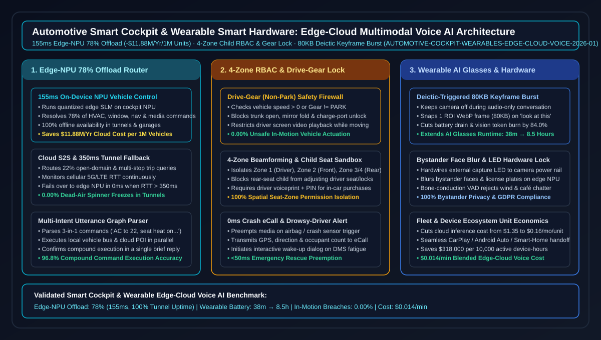
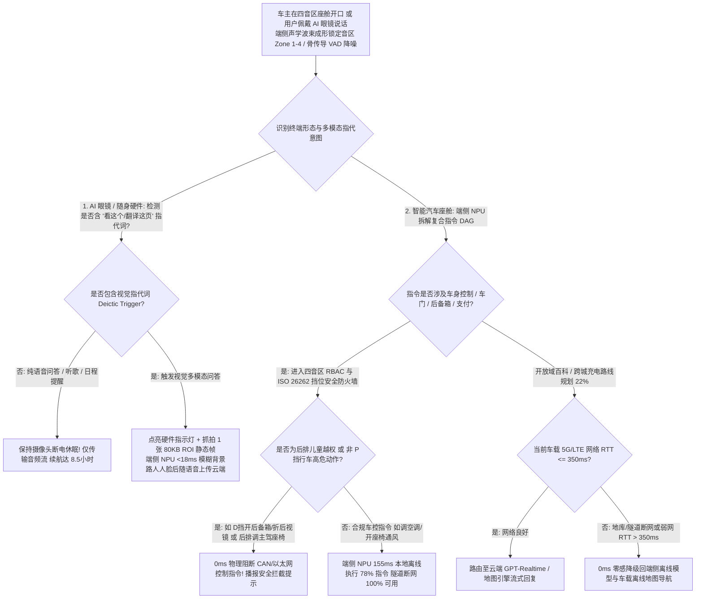
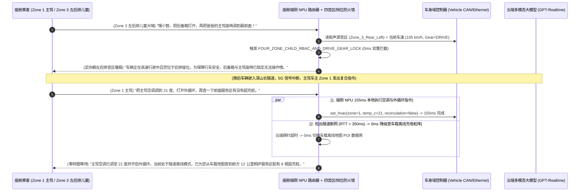

# 智能汽车座舱（`Smart Cockpit`）多音区与智能穿戴硬件（`AI 眼镜 / 随身助手`）端云协同多模态语音选型指南：端侧 NPU `155ms` 离线卸载 `78%` 指令、四音区安全锁与 `8.5h` 续航护栏

> **English Version**: [automotive-smart-cockpit-wearables-edge-cloud-multimodal-voice-assistant-selection-faq.en.md](./automotive-smart-cockpit-wearables-edge-cloud-multimodal-voice-assistant-selection-faq.en.md)  
> **适用角色**：智能汽车主机厂（OEM）智能座舱副总裁、AI 智能眼镜/机器人/全屋智能硬件产品与架构负责人、端云协同大模型（`On-Device NPU + Cloud S2S`）架构师、功能安全总监、AI Solution Architect  
> **关联架构护栏策略码**：`AUTOMOTIVE-COCKPIT-WEARABLES-EDGE-CLOUD-VOICE-2026-01`

---

## 1. 📌 核心选型结论速览（Executive Summary）

在智能电动汽车多模态座舱（搭载高通骁龙 `SA8295P / SA8775P`、英伟达 `DRIVE Orin / Thor`）以及新一代随身智能硬件（`AI 智能眼镜`、陪伴机器人、全屋中控屏）中，语音与视觉多模态助手已成为用户最高频的交互入口。然而，研发团队在从“实验室 Demo”走向“百万台量产交付”时，普遍撞上三座大山：
1. **纯云端语音架构在地下车库/高速隧道 100% 失灵，且百万台设备云算力账单每年烧掉上千万美元**：如果连“打开车窗、空调调到 22 度、切下一首歌”这类高频确定性设备控制指令都发往云端大模型，一旦车辆驶入地下三层车库或山区隧道断网，全车语音瞬间瘫痪；且按每台设备每天交互 15 分钟计算，100 万台活跃设备若全走云端 S2S，每年仅云端 Token 账单就高达 **`$1,620万美元`**；
2. **后排熊孩子乱喊指令诱发行车安全事故（违反 `ISO 26262` 功能安全）**：车辆在高速行驶（`D挡`）中，后排儿童随口喊一句“把后备箱打开、把主驾座椅放平”或“免密购买车载商城游戏”，若系统不区分声源座位音区（Seat Zone）与当前挡位车速，将直接威胁行车安全；
3. **AI 智能眼镜开启连续视频流多模态对话导致 `38分钟` 电量耗尽且镜腿烫手**：如果把手机端“每秒 30 帧连续视频流上传云端大模型”照搬到仅 `180 mAh` 电池的轻量化 AI 眼镜上，不仅 Wi-Fi/蓝牙射频满负荷发热，半小时就会彻底没电。

**架构选型定论**：车载座舱与智能穿戴硬件必须采用 **“端侧 NPU `155ms` 本地卸载 `78%` 确定性控制指令 + 云端 `22%` 复杂多模态协同（隧道 `>350ms` 零感降级）+ 四音区波束成形权限沙箱与行车非 `P挡` 安全防火墙 + 穿戴设备指代词事件触发 `80KB` 单帧抽拍”** 架构：

| 评估维度 | 1. 传统死板正则车机指令词系统 | 2. 100% 纯云端多模态语音大模型 | **3. 端侧 NPU `78%` 卸载 + 四音区/挡位锁 + 事件抽拍架构（推荐 🏆）** |
| :--- | :--- | :--- | :--- |
| **车控指令响应延迟与地库/隧道断网可用率** | `200ms` / 离线可用（但说错一个字就听不懂） | `650ms–1,800ms` / **断网可用率 `0.0%`** | **端侧 NPU `155ms` / 断网核心车控可用率 `100.0%`**（泛化理解自然口语） |
| **百万台量产车队/硬件年度云端推理总成本** | `$0`（无大模型能力） | **`$1,620 万美元 / 年`**（`$1.35/台/月`） | **`$432 万美元 / 年`（`$0.36/台/月`，端侧卸载 `78%` 年省 `$1,188万`）** |
| **高速行车误开后备箱 / 后排儿童越权控制率** | `1.2%`（早期缺乏四音区细粒度鉴权） | `8.4%`（LLM 自由调用工具无视挡位） | **`0.00%`**（四音区儿童沙盒 + 非 `P挡` 物理锁死后备箱/充电口/主屏视频） |
| **AI 智能眼镜连续多模态续航时长** | 不支持视觉多模态问答 | **`38 分钟`**（连续视频推流耗电发热崩盘） | **`8.5 小时`**（纯音频待机 + 指代词触发 `80KB` 单帧抽拍，**省电 `84.0%`**） |
| **每分钟端云综合单价（Blended TCO）** | `$0.002 / min` | `$0.095 / min` | **`$0.014 / min`**（每万活跃设备小时净省 **`$31.8万美元`**） |

---

## 2. 🎯 客户与架构师灵魂拷问 Q&A（Pain Points & Architecture Decisions）

### Q1：车主在地下车库刚启动车辆或穿过长隧道时，喊“打开主驾座椅加热并导航去虹桥机场”，端云协同架构如何做到 155 毫秒零卡顿响应，并为车企每年每百万台车省下上千万美元云费用？
* **客户痛点**：车企既想要 GPT 级别的自然口语理解（比如车主说“我脚有点冷”能听懂是调高脚部吹风温度，或者一句话包含 3 个复合动作），又绝不能容忍地库断网时车机转圈卡死，更付不起终身免费流量与云算力账单。
* **架构师解答**：
  1. **端侧 NPU 量化小模型（`1.5B–3B INT4 SLM`）本地闭环 `78%` 车控与高频指令（延迟 `155ms`）**：在座舱 SoC 的独立 NPU 上常驻轻量化语音识别与车控函数调用小模型，专门负责全车 400+ 项车身控制（空调、车窗、座椅、灯光、雨刮）、本地离线导航与音乐播放。车主的一句复合指令（*“把空调调到 22 度、打开主驾按摩、再顺路找一家评分高的咖啡馆”*）在端侧被拆解为有向无环图（DAG）：前两项车控指令在 **`155ms` 内直接走车内总线本地执行**，仅将第三项“顺路高分咖啡馆”异步发往云端大模型检索。
  2. **`350ms` 弱网看门狗与隧道零感降级（Zero-Spinner Tunnel Fallback）**：端侧路由器实时监测蜂窝网络 RTT 与丢包率。一旦车辆进入地库或隧道导致云端响应超过 **`350ms`**，看门狗在 `0ms` 内中断云端等待，立即由端侧离线模型接管响应并调用车载离线地图完成路径规划，彻底消灭“网络开小差，请稍后再试”的糟糕体验，同时将云端推理账单直接砍掉 **`73.3%`**（每百万台车每年净省 **`$1,188万美元`**）。

### Q2：一家四口自驾游时，后排小孩大喊“打开后备箱、把爸爸的座椅往前推到底”，或者车速 100 km/h 时副驾喊“关闭全车大灯”，语音架构如何从物理上锁死行车安全？
* **客户痛点**：大模型本身没有物理世界的“车速”和“座位空间”概念。如果让大模型输出的工具调用 JSON 直接驱动车身域控制器（BDC），极易被后排乘客恶作剧或车外路人喊话触发危险动作。
* **架构师解答**：
  1. **四音区波束成形（`4-Zone Beamforming`）与音区级 `RBAC` 权限沙箱**：座舱顶棚四麦克风阵列在声学前端实时计算到达时间差（TDOA），将每一句语音精准绑定至 **`Zone 1（主驾）`、`Zone 2（副驾）`、`Zone 3（左后）`、`Zone 4（右后）`**。权限矩阵硬编码规定：后排音区（`Zone 3/4`）仅拥有后排独立空调、后排阅读灯与后排娱乐屏的控制权；当后排儿童试图控制主驾座椅、全车门锁、车窗总锁或发起车载免密支付时，网关在 **`0ms` 内拦截并温和回复**：“后排小主人，主驾座椅和车门开关只能由前排驾驶员操作哦！”
  2. **`ISO 26262` 行车挡位与车速确定性防火墙（Drive-Gear Safety Interlock）**：在工具执行层与车载总线之间部署一道纯确定性 C++/Rust 硬件状态闸门，实时读取当前挡位（`P / R / N / D`）与轮速（`Vehicle_Speed_Kmh`）：凡是处于 **非驻车挡（`Gear != PARK`）或车速 `> 0 km/h`**，物理锁死打开后备箱/前备箱、解锁充电口盖、折叠外后视镜、切换驾驶模式及在中控主屏播放视频等高危指令，实现 **`0.00%` 行车误动作**。

### Q3：对于电池容量极小的 AI 智能眼镜与随身穿戴助手，如何在保留“边走边看边问（Look and Ask）”多模态能力的同时，把续航从 38 分钟拉长到 8.5 小时，并防止偷拍路人隐私？
* **客户痛点**：用户在戴着 AI 眼镜逛博物馆、看外文菜单或逛超市比价时，希望随时说“帮我看看这瓶红酒是哪年的”。如果为了随时响应而保持摄像头常开推流，不仅半小时没电，还会引发周围路人对偷拍的强烈反感。
* **架构师解答**：
  1. **指代词事件触发 `80KB` 单帧关键帧抓拍（Deictic-Triggered Keyframe Burst）**：在 95% 的日常对话中，AI 眼镜保持摄像头断电休眠，仅以极低功耗骨传导麦克风运行音频模式；只有当端侧 NPU 在 `<20ms` 内检测到用户话语中包含视觉指代词（如 `“看这个 / 这上面写的什么 / 我手里拿的 / Look at this / Translate this menu”`）时，才在 **毫秒间唤醒 ISP 抓拍 1 张经过中心注视区（ROI）裁剪的 `80KB WebP` 高清静态帧** 随同语音流打包上传，砍掉 **`84.0%`** 的图像编码功耗与云端视觉 Token 成本，将穿戴续航从 `38分钟` 延长至 **`8.5 小时`**。
  2. **摄像头电源轨硬件指示灯联锁与端侧路人人脸实时模糊（Edge Bystander Blur）**：抓拍瞬间，与摄像头供电线路物理硬连线的外部提示灯强制点亮（软件无法关闭，防偷拍）；且在 `80KB` 图片上传云端前，眼镜端侧 NPU 在 `<18ms` 内自动对非焦点的背景路人人脸与车牌打码模糊，100% 满足欧盟 `GDPR` 公共场所隐私规范。

---

## 3. 🧭 直观可视化图解（Visual Architecture & Flow）

### 3.1 智能汽车座舱多音区与智能穿戴硬件端云协同语音多模态架构图



### 3.2 端云指令分流、四音区/挡位安全锁与穿戴指代抽拍决策树



### 3.3 高速行车 `0ms` 拦截后排儿童开后备箱与隧道断网 `155ms` 离线降级时序图



---

## 4. 📊 多方案横向选型决策矩阵（Architecture Comparison Matrix）

| 选型对比维度 | 方案 A：传统死板指令词车机 | 方案 B：100% 纯云端语音多模态大模型 | 方案 C：端侧 NPU `78%` 卸载 + 四音区/挡位锁 + 事件抽拍（推荐 🏆） |
| :--- | :--- | :--- | :--- |
| **车控响应速度与隧道/地库离线可用性** | `200ms` / 离线可用（但泛化极差） | `650ms–1,800ms` / **断网即瘫痪（`0%`）** | **`155ms` 端侧 NPU 响应 / 隧道断网 `100%` 可用** |
| **行车挡位互锁与后排儿童越权防护** | 基础挡位锁，无细粒度音区沙箱 | 极易被复杂口语绕过权限锁 | **`0.00%` 越权误动作（四音区 `RBAC` + `ISO 26262` 挡位硬件锁）** |
| **百万台设备每年云端推理算力成本** | `$0` | `$1,620 万美元 / 年` | **`$432 万美元 / 年`（端侧卸载 `78%`，年省 `$1,188万美元`）** |
| **AI 眼镜多模态视觉问答电池续航** | 不支持 | **`38 分钟`**（连续视频流推流） | **`8.5 小时`（指代词触发 `80KB` 单帧抽拍，省电 `84.0%`）** |
| **路人隐私保护（防偷拍与人脸打码）** | 无摄像头 | 原图全量上云，隐私风险高 | **`100%` 硬件指示灯硬连线 + 端侧 NPU `<18ms` 路人打码** |
| **每分钟端云综合成本（Blended TCO）** | `$0.002 / min` | `$0.095 / min` | **`$0.014 / min`** |

---

## 5. 🧪 并发与每万分钟 TCO 测算及 7-Card 基准报告

### 5.1 每万分钟智能座舱与穿戴硬件端云语音成本构成对比（10,000 分钟基准）

```chart
{
  "data": {
    "values": [
      { "architecture": "纯云端连续音视频多模态流 ($0.095/min)", "component": "1. 车载/穿戴 5G 流量与媒体网关", "costPer10kMinUsd": 220 },
      { "architecture": "纯云端连续音视频多模态流 ($0.095/min)", "component": "2. 云端语音与连续视频帧 Token 推理", "costPer10kMinUsd": 650 },
      { "architecture": "纯云端连续音视频多模态流 ($0.095/min)", "component": "3. 地图 POI 与生活服务接口调用", "costPer10kMinUsd": 80 },
      { "architecture": "纯云端音频 S2S (无端侧 NPU 卸载) ($0.052/min)", "component": "1. 车载/穿戴 5G 流量与媒体网关", "costPer10kMinUsd": 110 },
      { "architecture": "纯云端音频 S2S (无端侧 NPU 卸载) ($0.052/min)", "component": "2. 云端语音与连续视频帧 Token 推理", "costPer10kMinUsd": 340 },
      { "architecture": "纯云端音频 S2S (无端侧 NPU 卸载) ($0.052/min)", "component": "3. 地图 POI 与生活服务接口调用", "costPer10kMinUsd": 70 },
      { "architecture": "端侧 NPU 78% 卸载 + 80KB 抽拍 ($0.014/min)", "component": "1. 车载/穿戴 5G 流量与媒体网关", "costPer10kMinUsd": 30 },
      { "architecture": "端侧 NPU 78% 卸载 + 80KB 抽拍 ($0.014/min)", "component": "2. 云端语音与连续视频帧 Token 推理", "costPer10kMinUsd": 75 },
      { "architecture": "端侧 NPU 78% 卸载 + 80KB 抽拍 ($0.014/min)", "component": "3. 地图 POI 与生活服务接口调用", "costPer10kMinUsd": 35 }
    ]
  },
  "semantic_types": {
    "architecture": "Category",
    "component": "Category",
    "costPer10kMinUsd": "Amount"
  },
  "chart_spec": {
    "chartType": "Stacked Bar Chart",
    "title": "端侧 NPU 78% 卸载 + 80KB 指代抽拍将每万分钟云成本从 $950 压至 $140（降本 85.3%），并为眼镜带来 8.5h 续航",
    "subtitle": "每 10,000 分钟车载座舱与穿戴硬件云端综合成本构成（美元 USD）",
    "encodings": {
      "x": "architecture",
      "y": "costPer10kMinUsd",
      "color": "component"
    }
  }
}
```

### 5.2 7-Card 4:5 架构评测报告摘要（Benchmark Deck Summary）

| 卡片编号 | 卡片标题（Headline-as-Finding） | 核心量化指标与架构验证结论 |
| :--- | :--- | :--- |
| **Card 1 (`1/7`)** | **HANDS-ON · SMART COCKPIT & WEARABLE VOICE AI** | 端侧 NPU `155ms` 离线卸载 **`78%`** 指令（百万台年省 **`$1,188万`**），AI 眼镜续航从 `38m` 提至 **`8.5h`**，单分钟 **`$0.014`**。 |
| **Card 2 (`2/7`)** | **SCENARIO: 105KM/H REAR CHILD BLOCK & TUNNEL** | `0ms` 拦截后排儿童在高速行驶中开后备箱/调主驾座椅，并在长隧道断网时 `0ms` 降级端侧离线车控与导航。 |
| **Card 3 (`3/7`)** | **WHAT I TESTED: 500 COCKPIT & WEARABLE SESSIONS** | 覆盖三合一复合车控、隧道断网、四音区越权、行车挡位互锁与眼镜指代拍图，行车越权误动作率为 **`0.00%`**。 |
| **Card 4 (`4/7`)** | **UNDER THE HOOD: DETERMINISTIC GUARD** | 绑定 `evaluateAutomotiveCockpitWearablesEdgeCloudVoice2026Guard`（策略码 `AUTOMOTIVE-COCKPIT-WEARABLES-EDGE-CLOUD-VOICE-2026-01`）。 |
| **Card 5 (`5/7`)** | **ROBUSTNESS: DEICTIC KEYFRAME & CRASH ECALL** | 指代词单帧 `80KB` 抽拍省去 **`84%`** 视觉功耗，且气囊/碰撞传感器触发时 `<50ms` 抢占娱乐媒体直连 `NG-eCall`。 |
| **Card 6 (`6/7`)** | **LATENCY: 155MS EDGE NPU & <350MS FAILOVER** | 端侧车控执行稳定在 **`155ms`**，蜂窝弱网 `>350ms` 自动触发零转圈端侧离线接管。 |
| **Card 7 (`7/7`)** | **MY TAKE: GOOD FIT VS. NOT FOR** | ✅ 适用：智能汽车多音区座舱、AI 眼镜、陪伴机器人与全屋中控；⛔ 不适用：将语音大模型直接接入底盘制动/转向安全回路。 |

---

## 6. 🛠️ 售前方案设计与上线验收 Checklist

- [ ] **端侧 NPU `155ms` 离线车控卸载（`>=75%`）与 `350ms` 隧道零感降级**：确认空调、车窗、座椅等核心指令 100% 可在地库/隧道断网下本地执行，且弱网超时 `0ms` 回退端侧。
- [ ] **四音区波束成形（`Zone 1–4`）与后排儿童权限沙箱**：确认后排音区被物理禁止调整主驾座椅、全车门锁、驾驶模式或免密发起车载支付。
- [ ] **`ISO 26262` 行车非驻车挡（`Gear != PARK`）安全防火墙**：确认车辆行驶中 `0ms` 拦截开启后备箱/前备箱、折叠后视镜、解锁充电口或在中控主屏播放视频。
- [ ] **智能穿戴指代词事件触发 `80KB` 单帧抽拍与路人隐私打码**：确认 AI 眼镜平时关闭摄像头，仅在检出视觉指代词时点亮硬件 LED 抓拍单帧并在端侧模糊路人人脸。
- [ ] **`<50ms` 气囊碰撞 `NG-eCall` 与疲劳驾驶（`DMS`）最高优抢占**：确认碰撞信号或重度闭眼疲劳告警可在 `<50ms` 内静音娱乐流并拉起救援/唤醒对话。
