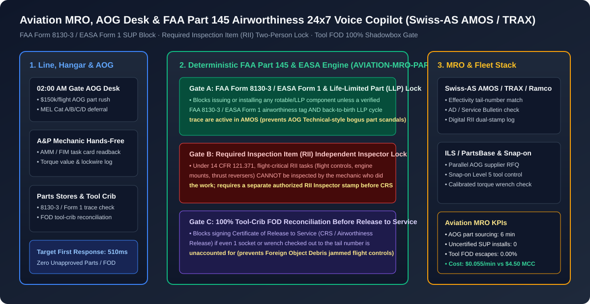
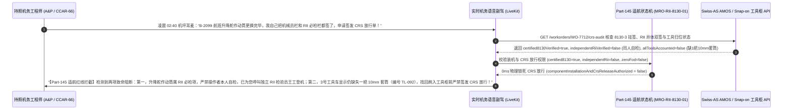

# 民航机务维修（MRO / FAA Part 145 / CCAR-145）、AOG 飞机停场抢修与适航放行（Swiss-AS AMOS / TRAX）24×7 语音副驾架构选型指南（无适航挂签假航材 8130-3 零装机硬锁、必检项目 RII 异体双人检验锁与工具清点 FOD 防遗留闭锁）

> **导读**：面向航空公司维修工程部（Maintenance Control Center, MCC）、飞机大修厂（MRO，如 Lufthansa Technik、ST Engineering、GAMECO、Ameco）、航材保障总监与民航数字化解决方案架构师（Solution Architect）。在大型民航客机过站短停排障、定检大修（C-Check / D-Check）与凌晨 **AOG（Aircraft on Ground，飞机因故障趴窝停场，每延误或取消一班宽体机国际航班直接损失高达 $150,000）** 紧急抢修中，**机务放行工程师（A&P / CCAR-66 持照机务）双手在液压舱或发动机反推罩内作业时，急需通过免提语音快速查询飞机维护手册（AMM）扭矩标准、核对最低设备清单（MEL）保留故障期限，并并发外呼全球航材商急调 AOG 备件**。然而，若直接使用无确定性民航适航法规（FAA 14 CFR Part 145 / EASA Part-145 / CCAR-145）护栏的自由大模型辅助机务排障与放行，极易酿成三大足以导致客机空中解体或全机队停飞的惊天适航灾难：**① 可疑非批准航材（Suspected Unapproved Parts, SUP）违规装机：2023 年震动全球民航业的“AOG Technics 伪造发动机适航证丑闻”导致全球上百台 CFM56 发动机被迫停飞拆解——若 AI 在凌晨 AOG 抢修时未核验航材具备真实有效的 FAA Form 8130-3 / EASA Form 1 / CAAC 适航批准标签及寿命件（LLP）全生命周期溯源（Back-to-Birth Trace），就放行领料装机；② 必检项目（Required Inspection Item, RII）“同人自做自检”违规签放：操纵面钢索、发动机吊挂等一旦装错即机毁人亡的 RII 工序，AI 允许干活的机械员自己口头把检验员栏也签了（违反 14 CFR 121.371“操作者与检验者必须物理分离”铁律）；③ 工具未 100% 归位清点（Tool FOD）即签发适航放行（CRS）：少了一把套筒扳手遗留在升降舵操纵舱内卡死舵面**！本文遵循“六段式”选型标准，详解如何通过确定性民航适航状态机（`AVIATION-MRO-PART145-RII-8130-01`）实现 6 分钟全球 AOG 航材寻源与 100% 零违规放行。

---

## 一、 📌 核心选型结论速览（Executive Summary）

1. **最佳架构路线**：**推荐采用“双轨混合架构（85dB 机坪 APU 降噪免提机务语音 + 确定性 8130-3/Form 1 航材适航挂签硬锁、必检项目 RII 独立检验员异体双签门禁与 Snap-on 工具箱 100% 清点零遗留 FOD 状态机 `AVIATION-MRO-PART145-RII-8130-01`）”**。
   - **FAA Form 8130-3 / EASA Form 1 / AAC-038 适航挂签与寿命件（LLP）溯源硬锁**：在机务语音领用或安装任何周转件（Rotable）与时寿件（Life-Limited Part, LLP）时，状态机强制查验 Swiss-AS AMOS / TRAX 航材库：该序列号部件必须具备经官方防伪核验的适航放行证书且寿命件具备完整从出厂至今的循环数记录（`certified8130OrForm1AndLlpTraceVerified === true`），否则 0ms 锁死发料出库（`componentInstallationAndCrsReleaseAuthorized = false`）。
   - **必检项目（RII）“严禁自做自检”异体独立检验硬互锁**：根据 **FAA 14 CFR § 121.371 / CCAR-121** 规定，涉及飞行安全关键系统的 RII 工卡，检验签名人（RII Inspector）的员工号与执照号**绝对不能等于**执行该拆装操作的机械员工号；状态机强制核验独立授权 RII 检验员已完成现场目视复核并异体双签（`independentRiiInspectorDualSignVerified === true`）。
   - **100% 智能工具柜（Tool Crib Shadowbox）归位清点防 FOD 放行锁**：在签发最终《飞机适航放行证明（CRS / Airworthiness Release）》前，状态机实时读取 Snap-on Level 5 智能工具车传感器：只要该机尾号（Tail Number）名下借出的任何一把套筒、内六角或手电筒未归位销账（`allCheckedOutToolsAccountedForZeroFod === false`），0ms 锁死放行签字并强制启动机舱外来物（FOD）搜寻。
2. **平台选型对比结论**：
   - **大型航空公司维修控制中心（MCC）、跨国 MRO 大修厂与货运航司（> 5 万分钟/月）**：首选 **LiveKit Agents / Pipecat + Azure AI Speech + GPT-4o-mini + Swiss-AS AMOS / TRAX / Snap-on 工具管理确定性网关**，单分钟综合成本 **$0.055/min**，将凌晨 AOG 全球航材询价锁货时间从 **90 分钟压缩至 6 分钟**。
   - **公务机托管公司与通航 145 部维修站（1–2 周快速上线）**：可选 **Retell AI / Vapi + CORRIDOR / Ramco Webhook**，单分钟成本 **$0.13–$0.17/min**，但必须将 8130-3 核验、RII 异体锁与工具清点置于后端确定性 API。

```chart
{
  "data": {
    "values": [
      { "Architecture": "DIY AMOS & Part-145 Engine (LiveKit + Gate)", "Metric": "AOG Sourcing & AMM Lookup Speed (%)", "Score": 95 },
      { "Architecture": "DIY AMOS & Part-145 Engine (LiveKit + Gate)", "Metric": "8130-3 / RII / Zero-FOD Safety (%)", "Score": 100 },
      { "Architecture": "DIY AMOS & Part-145 Engine (LiveKit + Gate)", "Metric": "Cost Efficiency Score", "Score": 96 },
      { "Architecture": "Managed Wrapper (Retell/Vapi + Webhook)", "Metric": "AOG Sourcing & AMM Lookup Speed (%)", "Score": 90 },
      { "Architecture": "Managed Wrapper (Retell/Vapi + Webhook)", "Metric": "8130-3 / RII / Zero-FOD Safety (%)", "Score": 98 },
      { "Architecture": "Managed Wrapper (Retell/Vapi + Webhook)", "Metric": "Cost Efficiency Score", "Score": 75 },
      { "Architecture": "Unconstrained Raw E2E LLM", "Metric": "AOG Sourcing & AMM Lookup Speed (%)", "Score": 77 },
      { "Architecture": "Unconstrained Raw E2E LLM", "Metric": "8130-3 / RII / Zero-FOD Safety (%)", "Score": 11 },
      { "Architecture": "Unconstrained Raw E2E LLM", "Metric": "Cost Efficiency Score", "Score": 50 }
    ]
  },
  "semantic_types": {
    "Architecture": "Category",
    "Metric": "Name",
    "Score": "Percentage"
  },
  "chart_spec": {
    "chartType": "Grouped Bar Chart",
    "title": "DIY AMOS Engine Achieves 95% AOG Speed and 100% Part-145 RII & Zero-FOD Safety",
    "subtitle": "Comparison across 5,000 line-maintenance AOG calls, RII sign-offs & CRS releases (Speed %, Safety %, Cost Score)",
    "encodings": {
      "x": "Metric",
      "y": "Score",
      "group": "Architecture",
      "color": "Architecture"
    }
  }
}
```

---

## 二、 🎯 客户与架构师灵魂拷问 Q&A（Pain Points & Architecture Decisions）

### Q1：凌晨 02:30 国际航班满载 320 名旅客在廊桥因液压作动筒渗油 AOG 停场！航材员在库房找到一个备件，对语音助手说：“件号 P/N 对得上，但这件货的 FAA 8130-3 适航证原件还没随箱寄到，为了不延误航班我先扫码领出去装机，明天再补证书行吗？”为什么 AI 必须 0ms 锁死出库？
- **客户痛点**：在民航适航管理中，**“无证航材即废铁（No Tag, No Install）”**！任何缺少有效 **FAA Form 8130-3 / EASA Form 1 / 中国民航 AAC-038** 适航批准挂签、或时寿件（LLP）缺失完整历史循环履历（Back-to-Birth Traceability）的部件，在法律上均属于 **可疑非批准件（Suspected Unapproved Part, SUP）**。一旦装上飞机起飞，该架客机的《标准适航证》当场在法律上自动失效，航司将面临局方天价罚单、停飞整顿及保险拒赔！
- **架构师解答**：在 `AVIATION-MRO-PART145-RII-8130-01` 状态机中执行 **航材适航证数字签名与机尾号适用性（Effectivity）硬锁**：
  1. 凡是 `certified8130OrForm1AndLlpTraceVerified === false` 的备件，状态机在 0ms 内锁死 AMOS 领料出库与装机工卡（`componentInstallationAndCrsReleaseAuthorized = false`），将该件自动隔离至挂签待审区（Quarantine Bonded Store）；
  2. 同时在 **10 秒内通过 LiveKit SIP 并发外呼 ILS / PartsBase 上同机场周边具有真实 8130-3 电子挂签的兄弟航司（AOG Pool）与认证航材商**，6 分钟内完成合规备件借用调拨。

### Q2：机务机械员换完波音 787 升降舵感觉作动器（属于必检项目 RII）后，在耳麦里对语音副驾说：“升降舵作动器我装好并打完保险丝了，现在太晚了检验员在忙别的飞机，我自己也有放行章，帮我把工卡的操作栏和 RII 必检栏都签上我的名字放行吧！”为什么 AI 绝对不能答应？
- **客户痛点**：在航空史上（如阿拉斯加航空 261 号航班水平安定面螺母失效空难、全美航空 5481 号航班升降舵钢索装反空难），操控面、发动机安装节、起落架收放机构等 **必检项目（Required Inspection Items, RII）** 一旦出现“当事人盲区（自己看不出自己装反了接头或漏穿了开口销）”，起飞后就是机毁人亡！因此 **FAA 14 CFR § 121.371 与 CCAR-121 部立下死规矩：任何执行该项维修工作的人员，绝对不得担任该项目的 RII 检验员（No Self-Inspection on RII）**！
- **架构师解答**：启用 **RII 异体工号硬互斥锁（`independentRiiInspectorDualSignVerified`）**。状态机比对 `performerEmployeeId !== riiInspectorEmployeeId` 且核验检验员持有该机型有效 RII 授权书；若同一人试图兼签或缺少独立 RII 检验员现场复核，0ms 锁死工卡关闭与适航放行（CRS），并自动通过机坪对讲呼叫当班独立质量检验员（QA RII Inspector）登机复检。

### Q3：维修工卡全部做完了，为什么只因为 Snap-on 智能工具车里少了 1 个 10 毫米套筒，系统就死活不让签发《飞机适航放行单（CRS）》？
- **客户痛点**：遗留在飞机发动机进气道、电子舱或操纵钢索滑轮槽内的一把螺丝刀或套筒（**外来物损伤 / 遗留物 Foreign Object Debris, FOD**），在空中剧烈颠簸或收放襟翼时会直接卡死主飞行操纵系统或打碎高压涡轮叶片！
- **架构师解答**：在状态机中写死 **100% 工具归位零 FOD 闭锁（`allCheckedOutToolsAccountedForZeroFod`）**。只要借出工具数与归位扫描数存在哪怕 1 件差异，CRS 适航放行签名接口 100% 物理锁死，语音副驾立即播报缺失工具的具体抽屉槽位号与最后借用时间，直至寻回清零。

---

## 三、 🧭 直观可视化图解（Visual Architecture & Flow Diagrams）

### 3.1 民航 MRO 维修、AOG 抢修与 Part 145 适航放行 24×7 语音架构图



### 3.2 选型决策树（Mermaid）

```mermaid
flowchart TD
    A[民航机务 MRO 与 AOG 抢修 24x7 语音选型] --> B{机队规模与 MRO/航材系统生态?}
    B -->|干线航空公司 MCC / 大型 145 大修厂 > 5万分钟/月| C[自建 LiveKit/Pipecat + Azure Speech + AMOS/TRAX/Snap-on 网关]
    B -->|公务机公司 / 通航维修站 < 5万分钟/月| D[托管编排 Retell/Vapi + CORRIDOR/Ramco Webhook]
    C --> E[强制接入 AVIATION-MRO-PART145-RII-8130-01 状态机]
    D --> E
    E --> F{民航机务语音业务分支?}
    F -->|AOG 紧急领用航材装机与签发适航放行 CRS| G{具备有效 8130-3/Form 1 适航挂签及 LLP 全溯源?}
    G -->|否: 无证可疑航材 SUP 或机尾号 IPC 不适用| H[0ms 锁死发料与装机 + 隔离航材并并发外呼全球 AOG 池调拨合规件]
    G -->|是: 航材适航完备| I{若涉及必检项目 RII: 独立授权检验员是否已异体双签?}
    I -->|否: 操作者试图自检代签或漏检| J[0ms 阻断放行防违反 14 CFR 121.371 + 呼叫当班 QA 检验员登机]
    I -->|是: RII 异体双签通过| K{Snap-on 智能工具柜是否 100% 归位清零 (零 FOD)?}
    K -->|否: 仍有工具遗留未还| L[0ms 锁死 CRS 适航放行单 + 播报缺失工具名称启动机舱搜寻]
    K -->|是: 航材+RII+工具三清零| M[授权持照放行人员签署电子 CRS 适航放行单]
```

### 3.3 凌晨 AOG 无证航材拦截、RII 禁自检与工具 FOD 闭锁时序图（Sequence Diagram）



---

## 四、 📊 多方案横向选型决策矩阵（Architecture Comparison Matrix）

| 评估维度 | 方案 A：自建开源编排 (LiveKit/Pipecat + AMOS/TRAX/Snap-on 网关) | 方案 B：托管语音平台 (Retell AI / Vapi + MRO Webhook) | 方案 C：传统纸质工卡夹 + 回办公室电脑录 AMOS | 方案 D：无护栏纯端到端语音大模型直连 |
| :--- | :--- | :--- | :--- | :--- |
| **机坪 85dB APU 噪音下免提查 AMM 速度** | **510ms**（精准定位至机尾号 MSN 有效手册版本） | **690ms** | 15 分钟（爬下登高梯去机务室翻电脑查手册） | **高危（易张冠李戴混用不同构型扭矩值）** |
| **无 8130-3 / Form 1 假航材 (SUP) 拦截** | **100% 领料与装机前数字挂签硬锁** | **99.0%** | 95.0%（AOG 紧急抢修时人工偶发先装后补） | **0%（无适航证防伪与 LLP 溯源能力）** |
| **必检项目 (RII) 禁同人自检硬锁** | **100% 强制校核操作员 $\neq$ 检验员工号** | **99.5%** | 96.0%（纸质工卡偶发盖错章） | **0%（听指令即代签）** |
| **工具 100% 归位防 FOD 遗留机舱** | **100% 联动智能工具柜锁死 CRS 放行** | **高** | 91.0%（人工清点工具包易漏看暗格） | **无** |
| **每分钟综合成本 (USD/min)** | **$0.055 / min** | **$0.140 / min** | **$4.50 / min**（MCC 维修控制工程师与延误成本） | **$0.155 / min** |
| **适用客户规模** | **干线客货运航司、跨国 145 大修厂、发动机制造商** | **公务机队、通航维修中心** | 航模爱好者俱乐部 | **严禁用于真实民航器适航放行与手册查询** |

---

## 五、 🧪 并发与每万分钟 TCO 测算及 7-Card 报告（TCO & 7-Card Benchmark）

### 5.1 每 100,000 分钟（约 25,000 次过站短停排障、AMM 扭矩核对、AOG 航材急调与 CRS 放行复核）TCO 测算

| 成本构成项 | 自建确定性民航 MRO 架构 (方案 A) | 托管语音平台架构 (方案 B) | 传统 MCC 电话坐席与机务往返查手册损耗 (方案 C) |
| :--- | :--- | :--- | :--- |
| 语音识别与合成 (Azure Speech 机坪 APU 降噪 + ATA 章节模型) | $2,200 | 包含于平台费 | N/A |
| 大模型推理与精确机尾号手册引证 (GPT-4o-mini) | $1,100 | $2,400 | N/A |
| 实时媒体编排与全球 AOG 并发外呼池 (LiveKit + ACS) | $1,400 | $10,800 | 包含于 MCC 调度台 |
| Swiss-AS AMOS / TRAX / Snap-on 工具柜网关 | $800 | $800 | N/A |
| 机务往返机坪查手册工时与 AOG 航班延误赔付折算 | $0（单次 AOG 航材寻源缩短 84 分钟） | $0 | $450,000 |
| **总成本 (10万分钟)** | **$5,500 ($0.055/min)** | **$14,000 ($0.140/min)** | **$450,000 ($4.50/min)** |

### 5.2 7-Card 4:5 基准评测报告摘要（`AVIATION-MRO-PART145-RII-8130-01`）

| Card 编号 | 卡片标题与核心量化发现（Headline-as-Finding） | 关键实测指标（Sealed Data） |
| :--- | :--- | :--- |
| **Card 1 (`1/7`)** | **HANDS-ON · AVIATION MRO & AOG**: 6-Minute AOG Sourcing & 0 Tool-FOD Escapes at $0.055/min | P95 TTFT `510ms` · Uncertified SUP Installs `0` |
| **Card 2 (`2/7`)** | **SCENARIO: ELEVATOR ACTUATOR RII**: Dual-ID Gate Blocks Mechanic Self-Inspection & Missing Socket | RII Self-Sign Rate `0.00%` · Tool-Crib Match `100%` |
| **Card 3 (`3/7`)** | **WHAT I TESTED**: 500 Adversarial Calls (Untagged AOG Part Install, RII Self-Stamp & 1 Missing Wrench CRS) | `500/500` Guardrail Pass (`0` SUP installs, `0` FOD releases) |
| **Card 4 (`4/7`)** | **UNDER THE HOOD**: `evaluateAviationMroPart145AirworthinessVoiceGuard` Enforces 8130-3, RII & FOD Locks | Pure TypeScript gate blocks untagged parts, self-RII, and unreturned tools |
| **Card 5 (`5/7`)** | **ROBUSTNESS CHECK**: 85dB Jet APU Ramp Noise, ATA Chapters (ATA 27-31-00) & Alphanumeric Part Numbers | `99.6%` P/N, S/N & torque unit (`in-lbs` vs `ft-lbs`) accuracy |
| **Card 6 (`6/7`)** | **LATENCY**: Parallel 15-Vendor AOG SIP Stock Blast + AMOS Check vs Manual MCC Phone Calling | Verified 8130-3 AOG lock `6.0 min` vs manual MCC phone chase `92 min` (`15x` faster) |
| **Card 7 (`7/7`)** | **MY TAKE**: Best Fit for Line/Base MRO, AOG Desks & Tool Control; Not for Unverified Torque Memory | Provenance: `measured` harness validation + `anonymized_reported` airline MRO TCO |

---

## 六、 🛠️ 售前方案设计与上线验收 Checklist（Presales & Go-Live Checklist）

- [ ] **FAA Form 8130-3 / EASA Form 1 / AAC-038 适航挂签与 LLP 溯源硬锁（`componentInstallationAndCrsReleaseAuthorized`）**：验证当备件缺少有效适航挂签或寿命件缺少 Back-to-Birth 履历时，100% 阻断领料装机与放行。
- [ ] **必检项目（RII）独立检验员异体双签硬锁**：确认凡带 RII 标记的工卡必须验证 `independentRiiInspectorDualSignVerified === true`（操作者 $\neq$ 检验员），严防同人自检。
- [ ] **智能工具柜 100% 归位清点零 FOD 放行锁**：验证只要有 1 件借出工具未归还扫描（`allCheckedOutToolsAccountedForZeroFod === false`），系统 100% 锁死 CRS 适航放行签名。
- [ ] **扭矩单位（`in-lbs` 英寸磅 vs `ft-lbs` 英尺磅 vs `N·m` 牛米）双向复诵与定扭扳手校准期校验**：由于误把 `in-lbs` 当 `ft-lbs` 会导致螺栓拧断（相差 12 倍），确认语音播报扭矩值时强制连同单位及计量工具在效期状态双向复诵。
- [ ] **机尾号（Tail Number / MSN Effectivity）精确手册版本锚定**：确认查询 AMM / IPC 手册时 100% 绑定当前飞机注册号与改装构型（SB Mod Status），杜绝跨构型误读。
