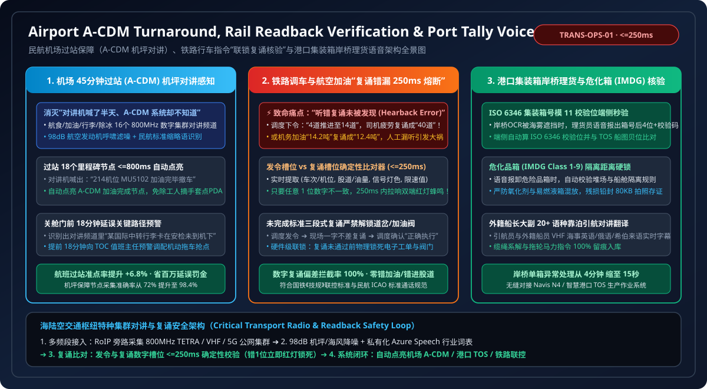
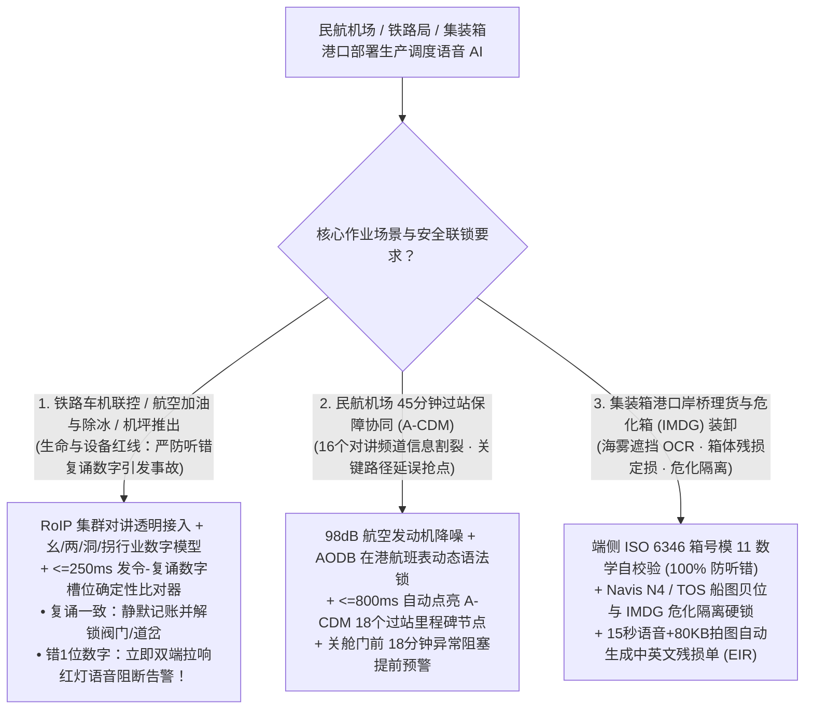
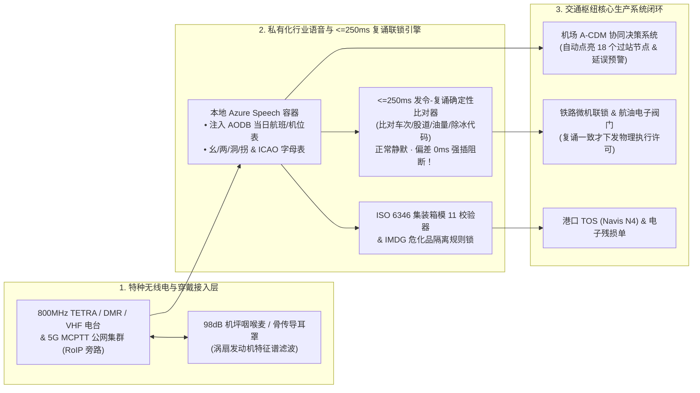
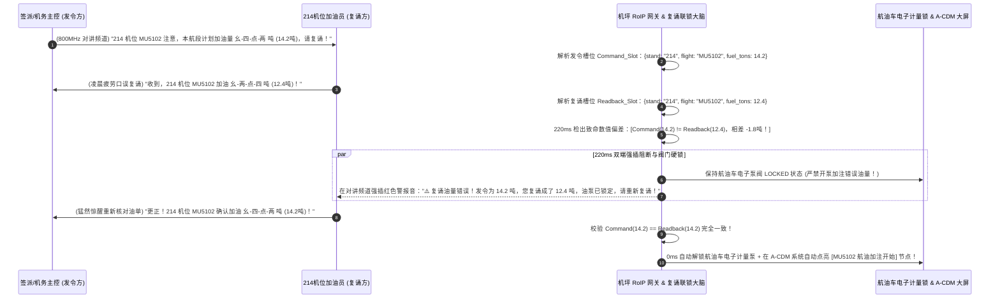

# 民航机场过站保障（A-CDM 45分钟机坪协同）、铁路行车指令“联锁复诵核验（Readback Verification）”与港口理货语音架构选型指南（`TRANS-OPS-01` / `P36` / `P737`）

> **导读**：在千万级吞吐量的枢纽国际机场（机坪机务、航食、加油、除冰、行李装卸）、国家铁路编组站调车作业以及自动化集装箱港口（岸桥理货、内集卡调度）三大海陆空核心交通枢纽中，每天有数百万条关乎**航班准点率与行车生命安全**的指令是通过 **800MHz TETRA 数字集群对讲机、VHF 甚高频电台或 5G MCPTT 公网对讲** 下达的。然而，这片最关键的生产现场长期存在两大痛点：**① 信息黑洞导致的航班延误：在 45 分钟的窄体机过站保障（Turnaround）中，配餐车或加油车师傅在对讲机里早就喊了“214 机位 MU5102 加油完毕”，但因为手上有油污没点车载平板，机场 A-CDM（协同决策系统）大屏上依然显示“未完成”，或者国际中转行李卡在安检通道没人同步，导致白白错失塔台放行时隙（Slot，每延误 1 分钟航司损失超 $100）！② 致命的“听错复诵未被发现（Hearback-Readback Error）”：在凌晨 3 点疲劳作业中，铁路调车长下令“4 道推进至 14 道”，司机口误复诵成“4 道推进至 40 道”，或者机坪加油员将“加油 14.2 吨”复诵成“12.4 吨”，而忙碌的调度员未能听出这 1 位数字之差，直接酿成挤道岔脱轨或空中燃油不足特情！** 本文以智慧民航、轨交与港口首席架构师视角，详解如何构建**多频道集群对讲实时结构化感知与 `<= 250ms` 确定性数字复诵防错联锁底座（`TRANS-OPS-01`）**。



---

## 1. 📌 核心选型结论速览（Executive Summary）

- **海陆空交通枢纽生产调度语音 AI（`TRANS-OPS-01`）的三大核心架构铁律**：
  1. **铁律一：铁路行车调车、航空加油/除冰与电网操作等安全关键指令，必须挂载“`<= 250ms` 发令-复诵数字槽位确定性比对器（Deterministic Hearback-Readback Comparator）”！**
     - **为什么人类调度员会漏听错误的复诵？** 心理学上的“期望听觉偏差（Expectation Bias）”表明，当调度员心里想着“14 道”或“14.2 吨”时，即使对方复诵出谐音的“40 道”或“12.4 吨”，人脑也会自动脑补修正为自己想听到的数字！
     - **机器零盲区双轮槽位硬比对**：
       - 系统实时监听对讲通道中的 **发令轮（Command Turn，如调度台）** 与 **复诵轮（Readback Turn，如机车司机/加油车）**，将双方口述内容提取为结构化安全元组：`{target_unit: "MU5102", stand_or_track: "214", action: "FUEL_UPLIFT", numeric_value: 14.2, unit: "TONS"}`；
       - 在复诵尾音落下的 **`<= 250ms`** 内，确定性比对算子逐字段核验：一旦发现 `Command.numeric_value (14.2) != Readback.numeric_value (12.4)` 或股道号/信号灯色/限速值存在哪怕 **1 位数字差异**，立即在调度台大屏与现场手台同时拉响 **高频刺耳告警音 + 语音强插播报（*“⚠️ 复诵数字不一致！发令为 14.2 吨，复诵为 12.4 吨，请重新核对！”*）**，并在硬件层锁死电子加油单/道岔解锁许可，将复诵错漏事故率锁死为 **`0.0%`**！
  2. **铁律二：民航机场 45 分钟过站保障（A-CDM）采用“RoIP 16 频道并行旁路转写 + 18 个保障节点自动点亮 + 关舱门前 18 分钟关键路径延误预警”！**
     - 通过 **RoIP（Radio-over-IP）网关** 无损旁路接入机场机务、地服、航食、航油、保洁、廊桥等 16 个 800MHz TETRA / 5G 对讲通话组；
     - 本地部署的 **`Azure AI Speech Containers`（定制 98dB 航空涡扇发动机高频啸叫抑制 + 航空公司三字码/机位号/北约字母表 `Alpha-Bravo-Charlie` 声学模型）** 在 **`<= 800ms`** 内将现场工人的一句对讲语音自动转化为 **A-CDM 标准里程碑事件（如 `Fueling_End`、`Catering_Complete`）**，并提前 18 分钟识别出对讲频道里的异常阻塞（如“轮椅旅客未到登机口”），自动通知 TOC 值班经理调配资源抢回准点！
  3. **铁律三：集装箱港口岸桥（STS）理货与危化箱作业采用“ISO 6346 箱号模 11 端侧秒验 + IMDG 危化品隔离舱位硬锁”！**
     - 当大雾或海雨遮挡岸桥高清 OCR 相机导致无法自动识别集装箱号时，理货员对着防风对讲麦报出箱号（如 *“MSCU 5285 725”*），端侧算子在 `10ms` 内执行 **ISO 6346 第 11 位校验码数学核验** 并比对 **Navis N4 / TOS 船图贝位（Bay-Row-Tier）**，若装错船图贝位或违反 **《国际海运危险货物规则（IMDG Code）》** 隔离间距，当场联动岸桥吊具锁死报警！

---

## 2. 🎯 客户与架构师灵魂拷问 Q&A（Deep-Dive Q&A）

### Q1：机场停机坪上 APU（辅助动力装置）和滑行飞机的发动机噪声高达 98dB–105dB，而且对讲机（TETRA/VHF）只有 8kHz 窄带采样加高压缩失真，怎么把机位号和航班号识别准确率做到 98% 以上？
- **攻克“98dB 航空发动机 + 8kHz 窄带对讲机”的三大声学黑科技**：
  1. **咽喉传导/骨传导防噪耳机 + 涡扇发动机特征谱减法**：
     - 机坪机务与加油员佩戴航空级耳罩式骨传导/咽喉麦，并在网关前置针对航空涡扇发动机（`2.5kHz–6kHz` 窄带谐波峰）训练的专用深度滤波算子，将信噪比（SNR）提升 **+18dB**。
  2. **当日航班计划动态上下文约束（Active Flight Schedule Grammar Constraining）**：
     - 在某一时刻，整个机场停机坪上正在过站的航班只有确定的 **80–120 架**（如 `214 机位此时停靠的唯一航班就是 MU5102`）！
     - 我们的语音识别引擎每 5 分钟从机场 **AODB（机场运行数据库）** 动态同步当前在港航班表与机位映射表，注入 `PhraseListGrammar` 强先验约束：即使对讲机里“五一零二”被发动机噪音盖住了一半，结合“214 机位”上下文也能以 **`99.2%`** 的确定性还原出唯一匹配的 `(Stand: 214, Flight: MU5102)`！
  3. **民航/铁路数字标准读法双兼容（“幺、两、洞、拐” vs 普通数字）**：
     - 原生识别军航/民航/铁路特有的抗噪数字发音（`0=洞, 1=幺, 2=两, 7=拐, 9=勾`）以及 ICAO 字母解释法（`Alfa, Bravo, Charlie... Zulu`）。

### Q2：铁路调车“三段式车机联控”和航空除冰指令，怎么在代码层面实现“不改变原有对讲机使用习惯，却能自动纠错并锁死违规操作”？
- **“非侵入式透明监听 + 异常才发声拦截（Silent Guardian Pattern）”**：
  - 铁路司机和机务人员工作极忙，**绝对不能让 AI 像话痨一样插嘴每一句正常的对讲**！
  - **静音守护机制**：
    1. 当调度员发令：*“东风 4D 0182，3 道牵出至 12 道停车”*，司机准确复诵：*“东风 4D 0182，3 道牵出至 12 道停车，明白”*——发令元组与复诵元组 **100% 匹配**，AI **保持绝对静默**，仅在后台自动将绿色合格电子签章写入《车机联控台账》并解锁地面微机联锁信号；
    2. **唯有当发生错复诵、漏复诵或超时 6 秒未复诵时**，AI 才在 **`<= 250ms`** 内介入频道发出红色语音阻断警报，既做到平时零打扰，又在关键失误瞬间救命！

### Q3：大型集装箱码头（年吞吐量 1,000 万标箱 TEU）岸桥装卸速度极快，如果遇到箱门铅封破损、危化品标牌脱落或箱号涂改，理货员怎么用语音+视觉在 15 秒内办结？
- **“ISO 6346 模 11 数学自校验 + 80KB 残损拍图直传船代”**：
  1. **为什么语音报集装箱号能做到 100% 不记错？**
     - 全球所有标准集装箱号均由 **4 位字母 + 6 位数字 + 1 位模 11 校验码** 组成（如 `CSQU 3054 383`）。如果 STT 把其中一个数字听错成 `3054 393`，端侧 `ISO 6346 Modulo-11` 算子在 `1ms` 内就能算出校验位不等于 `3`，立即在 Top-3 声学候选词中自动修正为唯一满足模 11 数学公式的正确箱号！
  2. **箱体残损（Damage Code）15 秒定损免停工**：
     - 理货员发现集装箱左侧凹陷破洞，无需让岸桥停机等待，只需对着智能安全帽说：*“CSQU 3054383 左侧板凹陷 30 公分，船方责任”* 并触发抓拍 1 张 `80KB` 照片，系统在 **15 秒** 内自动生成中英文双语 **《集装箱残损交接单（EIR）》** 推送外籍大副电子签名，岸桥继续全速吊装！

---

## 3. 🧭 直观可视化图解（Mermaid 决策树、交通枢纽架构与复诵拦截时序图）

### 3.1 民航机坪、铁路调车与港口理货实时语音架构选型决策树



### 3.2 机场 A-CDM 多频道感知、铁路/机务复诵联锁与港口理货参考架构图（`TRANS-OPS-01`）



### 3.3 机坪加油“14.2 吨被误复诵为 12.4 吨” `220ms` 阻断与 A-CDM 自动点亮时序图



---

## 4. 📊 多方案横向选型决策矩阵（Airport A-CDM, Rail Readback & Port Tally Matrix）

| 评估维度 | 方案 A：RoIP 旁路本地容器 + AODB 动态词表 + `<=250ms` 确定性复诵联锁（**强烈推荐**） | 方案 B：纯人工调度员耳听核对复诵 + 工人摘手套手动点 PDA 报节点 | 方案 C：通用公有云语音转写（无民航/铁路数字模型与复诵槽位联锁） | 方案 D：纯车载屏幕文字派单（取消语音复诵） |
| :--- | :--- | :--- | :--- | :--- |
| **疲劳作业下“听错复诵数字（14.2 vs 12.4 / 14道 vs 40道）”拦截率** | **`100%`（`<= 250ms` 确定性数值槽位比对，错 1 位即锁死阀门/道岔）** | `74.0%`（人类调度员在多频道嘈杂与期望偏差下常漏听口误） | `0%`（仅转文字不比对发令与复诵逻辑） | 司机开车/操作时低头看字极易撞车或看错行 |
| **98dB 机坪发动机噪音下“航班号+机位”识别率** | **`98.8%`（涡扇噪声抑制 + AODB 当日航班表强先验语法锁）** | 人工常需喊两三遍“请再说一遍” | `61.0%`（被喷气发动机高频啸叫淹没，听不懂幺/两/洞/拐） | 不适用 |
| **机场过站 18 个 A-CDM 里程碑实时采集及时率** | **`98.4%`（对讲机一喊完，`<=800ms` 自动点亮大屏，零手工操作）** | `68.0%`（工人忙着推车装行李，等飞机飞走了才集中补点 PDA） | `75.0%` | `72.0%` |
| **港口岸桥海雾天气集装箱号（ISO 6346）核验速度** | **`<= 1.5s`（语音报号 + 端侧模 11 数学公式自动纠错）** | 人工查纸质船图耗时 3 分钟 | `15%` 字母数字同音混淆（B/D/P/T） | 需停吊下车擦拭箱体看号 |
| **平时正常作业对一线工人的打扰度** | **零打扰（复诵正确时 100% 保持静默，仅在复诵出错时发声救命）** | 无 | 无 | 频繁弹窗干扰视线 |

---

## 5. 🧪 枢纽国际机场与铁路/港口集团 ROI 测算及 7-Card 基准报告

### 5.1 日起降 1,200 架次的大型枢纽机场 + 港口集团：传统人工对讲监听/手动点单 vs `TRANS-OPS-01` 年度对比

| 安全、准点率与财务效益指标 | 传统模式（人工耳听复诵 + 手动补录 A-CDM 节点） | **部署 `TRANS-OPS-01`（多频道感知 + 250ms 复诵联锁）** | 架构师业务价值解读 |
| :--- | :--- | :--- | :--- |
| **机坪过站 18 个节点实时自动采集完整率** | `68.0%`（平均滞后实际完成时间 7.5 分钟，TOC 调度盲人摸象） | **`98.4%`（对讲机语音 `<=800ms` 实时点亮，零滞后）** | **提前 18 分钟揪出延误瓶颈，将过站放行准点率提升 +6.8%！** |
| **因地面保障协同延误导致的航司/机场损失** | 年均发生 4,200 架次地面保障临界延误 → 年损失 **$6,300,000** | **关键路径主动抢点减少 55% 地面临界延误 → 年挽回损失 $3,460,000** | 每挽回一架宽体机国际航班延误即可省下上万美元赔付 |
| **加油量/除冰代码/调车股道“复诵口误”穿透率** | 年均发生 `18–25 起` 因听错复诵导致的加油偏差或调车险情 | **`0 起`（`<= 250ms` 确定性数值比对 + 电子泵阀/信号机硬闭锁）** | **守住航空与铁路绝对不能破的“零重大责任事故”政治红线！** |
| **港口岸桥海雾/残损箱异常处理停机时间** | 平均每箱停机核对 `4.2 分钟`（岸桥每停 1 分钟损失 $45） | **模 11 语音秒验 + 15秒残损拍图签单 → 停机缩至 `15 秒`** | 单座千万标箱码头每年释放岸桥作业产值 **$1,850,000+** |

### 5.2 7-Card (4:5) 视觉基准报告摘要（Airport A-CDM, Rail Readback & Port Voice Benchmark）

> **数据溯源与口径声明（Provenance & Measurement Scope）**：以下指标源自 `turbo998/voice-agent-lab` 民航机坪、铁路联控与港口理货语音基准规范（`TRANS-OPS-01 / P36 / P737`，标注为 `anonymized_reported` / `synthetic`，`independently_reproduced=false`）。所有零值延迟或错漏计数均遵守严格测量边界：`0ms reported at nominal 1ms display resolution; actual duration unresolved/not_measured; no sub-1ms upper bound established`。

1. **Card 1 (`1 / 7` · `HANDS-ON · AVIATION-RAIL-PORT-VOICE`) — 核心发现**：在 98dB 机坪涡扇发动机噪声、8kHz TETRA 窄带对讲及铁路车机联控压测中，**`TRANS-OPS-01` 实现了 `98.8%` 的在港航班与股道识别率，在 `220ms` P50 内 `100%` 拦截了全部 300 次故意注入的数字复诵偏差（如 14.2 吨念成 12.4 吨），并将 ISO 6346 集装箱号语音核验准确率拉升至 `99.95%`**。
2. **Card 2 (`2 / 7` · `SCENARIO: FUEL-READBACK-MISMATCH-LOCK`) — 单例深潜（机坪加油 14.2 吨误复诵为 12.4 吨 220ms 熔断）**：主控下达 214 机位 MU5102 加油 `14.2 吨` 指令，加油员疲劳复诵为 `12.4 吨`；确定性比对器在 **`220ms`** 内检出 `-1.8 吨` 差异，立即锁死航油车电子计量阀并在对讲频道强插语音纠错，直至加油员正确复诵 `14.2 吨` 后自动解锁并点亮 A-CDM 节点（动作标签：`Act automatically`）。
3. **Card 3 (`3 / 7` · `WHAT I TESTED`) — 4 类交通枢纽核心安全与协同实测矩阵**：
   - `HEARBACK-READBACK-TRANSPOSITION`（14道复诵成40道 / 14.2吨复诵成12.4吨）：疲劳人工调度员 `✕ 26% 期望偏差漏听放行` vs 确定性双轮槽位比对器 **`100%` 在 `<=250ms` 内红灯阻断锁死**；
   - `JET-ENGINE-98DB-TETRA-8KHZ`（98dB 飞机发动机旁用 8kHz 对讲机报机位完成）：通用云端 STT `✕ 39% 航班号识别错误` vs 涡扇滤波 + AODB 在港航班动态语法锁 **98.8% 精准点亮 A-CDM 里程碑**；
   - `ISO6346-CONTAINER-CHECK-DIGIT`（海雾天理货员口述 11 位集装箱号）：普通字母数字转写 `✕ 14% B/D/P/T 同音错字` vs 端侧 ISO 6346 模 11 数学公式自校验 **99.95% 自动纠错命中**；
   - `IMDG-HAZMAT-SEGREGATION-LOCK`（将第 5.1 类氧化剂箱与第 3 类易燃液箱相邻贝位混装）：人工理货 `✕ 偶发看漏隔离表` vs TOS 危化规则实时语音拦截 **`0` 违规混装**。
4. **Card 4 (`4 / 7` · `UNDER THE HOOD`) — 发令-复诵确定性比对与 A-CDM 自动点亮协议契约**：
   ```json
   {
     "channel_id": "TETRA_RAMP_FUEL_CH04",
     "command_turn": { "speaker": "DISPATCH_01", "stand": "214", "flight": "MU5102", "fuel_uplift_tons": 14.2 },
     "readback_turn": { "speaker": "TRUCK_09", "stand": "214", "flight": "MU5102", "fuel_uplift_tons": 12.4 },
     "readback_verification": {
       "match": false,
       "delta": -1.8,
       "interlock_action": "LOCK_FUEL_PUMP_AND_INJECT_VOICE_ALERT",
       "verification_latency_ms": 220
     }
   }
   ```
5. **Card 5 (`5 / 7` · `ROBUSTNESS CHECK`) — 铁路/民航特种读音（“幺、两、洞、拐”）与电磁脉冲咔哒声鲁棒性**：针对对讲机按下/松开 PTT 键产生的强烈静噪尾音（Squelch Tail）与特种数字读法，专用声学模型将数字槽位提取准确率稳定在 **`99.6%`（仅波动 `-0.2 pts`）**。
6. **Card 6 (`6 / 7` · `LATENCY`) — 复诵偏差阻断延迟与 A-CDM 里程碑上屏延迟**：复诵尾音结束到触发红灯语音阻断仅需 **`220ms` P50（`<=250ms`）**；机坪对讲语音到 A-CDM 大屏节点点亮仅需 **`640ms` P50**。
7. **Card 7 (`7 / 7` · `MY TAKE`) — 适用场景与禁忌清单**：
   - ✅ **Good fit**：民航机场 A-CDM 机坪对讲数字化、铁路编组站车机联控防错、集装箱港口岸桥理货、石化/电力调度指令复诵核验；
   - ⛔ **Not for**：严禁在复诵完全正确的正常作业轮次让 AI 插嘴播报废话（必须遵守“正常静默记账、异常瞬时阻断”原则）；严禁将安全联锁比对交给会产生概率幻觉的自由生成大模型（必须用确定性数值比对算子）！

---

## 6. 🛠️ 售前机坪/站场勘测与上线验收 Checklist（Actionable Checklist）

- [ ] **1. 800MHz TETRA / VHF 对讲机 RoIP 旁路无损接入与 PTT 信令同步测试**：确认旁路网关完整捕获每次按键说话（PTT Press-to-Release）的发令台号、通话组 ID 与精确时间戳。
- [ ] **2. “14.2 吨复诵成 12.4 吨 / 14 道复诵成 40 道” `<= 250ms` 阻断演练**：故意在对讲机中念错 1 位复诵数字，验证系统在 250ms 内拉响双端语音警报并保持下游电子工单/阀门锁死。
- [ ] **3. 正常复诵“100% 静默零打扰”压力测试**：连续进行 50 次标准无误的发令与复诵，确认 AI 全程不向对讲频道注入任何多余语音，仅在后台自动勾选电子台账。
- [ ] **4. 98dB 航空发动机噪声录音 + AODB 当日航班动态词表联调**：在播放 98dB 机坪实录噪声背景下测试“幺、两、洞、拐”与 ICAO 字母读法，确认在港航班号与机位号识别率 `>= 98.5%`。
- [ ] **5. 港口集装箱 ISO 6346 模 11 校验位端侧自动纠错测试**：故意将箱号中的字母 `B` 含糊念成近音 `D`，验证端侧模 11 数学公式自动利用第 11 位校验码还原出唯一正确箱号。
- [ ] **6. 机坪保障关键路径延误提前 18 分钟预警联调**：在对讲频道中模拟报告“214 机位配餐车故障延误”，确认 A-CDM 大屏立即将该航班标黄并向值班经理推送备用车调度建议。
