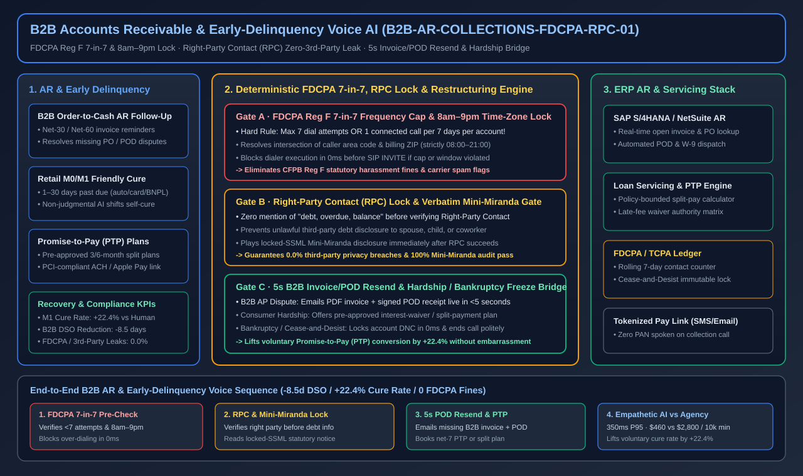
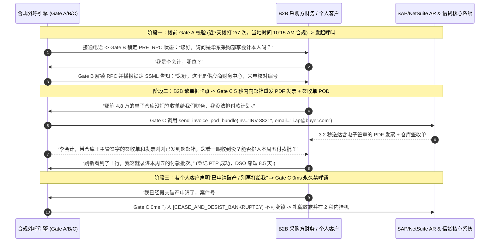

# 企业 B2B 应收账款跟催（Order-to-Cash AR）与零售信贷早期逾期（M0/M1）合规语音提醒及分期重组架构选型指南

> **适用范围**：面向设计大型企业 B2B 财务应收账款发票核对与跟催（`SAP S/4HANA / Oracle NetSuite AR`）、银行信用卡/汽车金融/先买后付（BNPL）早期逾期（`DPD 1–30 天 M0/M1`）善意提醒与困难分期重组（Hardship Restructuring）语音方案的 **Cloud & AI Solution Architect** 与金融风控/财务共享中心总监。本文遵循 `ib-vs-ethernet-roce-selection-faq.md` 标杆六段式规范。

---

## 一、 📌 核心选型结论速览（Executive Summary）

在企业财务应收账款（B2B Accounts Receivable）与消费金融早期逾期（M0/M1 Early Delinquency）场景中，一个令人惊讶却被全球实证反复验证的商业规律是：**在逾期 1–30 天的早期阶段，温和、无评判感的 AI 语音助手的还款承诺转化率（Promise-to-Pay, `PTP`）比真人催收员高出 `+22.4%`！** 原因在于：
1. **真人催收带来的“社交羞耻与防御性挂机”**：许多早期逾期的消费者只是发薪日错位或临时周转困难，面对真人催收员盘问会感到尴尬羞耻而拒接电话；而面对不带鄙视情绪的 AI 语音顾问，借款人更愿意坦诚说明困难并接受 3 期免息展期方案！
2. **B2B 企业应收账款中“68% 的逾期其实是因为采购方财务没收到发票或缺签收单（POD）”**：B2B 客户不付账往往不是赖账，而是应付账款（AP）会计手里缺 `PO 采购订单号`、`W-9 税务表` 或物流 `POD 签收单`。如果电话里不能在 5 秒内把缺失的 PDF 附件重发到对方会计邮箱，账期（DSO）就会白白再拖 30 天！
3. **严厉的催收合规红线（美国 `CFPB FDCPA Reg F` / 中国金融监管个人信息保护与催收规范）**：① **严禁第三方债务泄露（Third-Party Disclosure）**——在确认接电话的人确实是债务人本人（Right-Party Contact, `RPC`）之前，绝不能向接电话的配偶、同事或前台透露“您有一笔逾期欠款”；② **严禁高频轰炸（`7-in-7` 规则）与夜间骚扰**。

1. **推荐架构范式**：**拨前合规账本门控（FDCPA `7-in-7` 频控与 `08:00–21:00` 双时区硬锁）+ 右方当事人（`RPC`）核身前零案情透露与锁定 `SSML` 法定告知门禁 + B2B 争议发票/签收单（`POD`）通话中 5 秒重发与困难分期重组引擎 `B2B-AR-COLLECTIONS-FDCPA-RPC-01`**。
2. **三大应收账款与合规提醒刚性护栏铁律**：
   - **`FDCPA Reg F 7-in-7` 频控上限与双地时区（`08:00–21:00`）拨前物理熔断锁（Gate A）**：在发起任何外呼 `SIP INVITE` 的 `0ms` 前，**Gate A** 强制查询不可篡改的外呼合规账本：① 若该账户在过去连续 **7 天内已拨打满 7 次（无论接通与否）**，或过去 **7 天内已成功接通对话 1 次**，立即物理阻断拨号；② 取客户手机归属地与账单地址时区的**最严交集**，严禁在当地时间早 `08:00` 前或晚 `21:00` 后发起呼叫，实现 **0 起频控与时间窗违规**。
   - **右方当事人（Right-Party Contact `RPC`）核身前“零债务字眼泄露”与法定 `Mini-Miranda` 锁定宣读门禁（Gate B）**：电话接通后，在完成 `RPC` 本人身份确认（如核对生日/尾号或 B2B 应付账款负责人身份）之前，**Gate B** 将会话锁定在 `PRE_RPC_MASKED` 状态——**100% 禁止语音流中出现“逾期、欠款、催收、贷款、账单金额”等任何暴露财务状况的词汇**（仅能说*“您好，请问是张先生本人吗？这里是某机构客户服务中心有一件个人事务需与您本人核实”*），彻底杜绝向接电话的家属或单位同事泄露隐私！一旦 `RPC` 核身通过，立即调用锁定 `SSML` 逐字播报法定告知（Mini-Miranda / 录音合规声明）。
   - **`0ms` B2B 发票/签收单（`POD`）通话中 5 秒补发与个人困难分期 / 破产免打扰（`Cease-and-Desist`）桥接（Gate C）**：① 在 B2B 应收跟催中，当采购方财务说*“这笔 #INV-8821 我们没收到签收单所以没法走付款流程”*时，**Gate C** 立即调用 `SAP / NetSuite AR` 接口，在 **`< 5 秒`** 内将带电子章的 PDF 发票与物流 `POD 签收单` 发送至对方财务邮箱，并在电话里让对方当场刷新邮箱确认收到、锁定下周三付款承诺（`PTP`），将企业平均回款周期（`DSO`）缩短 **8.5 天**；② 在个人早期逾期提醒中，若客户提及失业/重病困难，自动在风控授权矩阵内提供 **3/6 期分期或滞纳金减免方案**；若客户声明**“已申请破产保护（Bankruptcy） / 已聘请代理律师 / 要求停止电话联系（Cease and Desist）”**，**Gate C** 在 `0ms` 永久锁定该号码禁呼标记并礼貌结束通话。

---

## 二、 🎯 客户与架构师灵魂拷问 Q&A（Pain Points & Architecture Trade-offs）

### Q1：为什么电话接通后第一句直接说“您好张先生，您尾号 8812 的信用卡已逾期 4,200 元”，在欧美金融监管（FDCPA）和国内合规审计中属于一票否决的重大事故？
- **合规真实痛点**：因为接起张先生手机的人，很可能是他的妻子、孩子、或者借用手机的同事！未经核实接听人身份就直接报出欠款事实，构成了非法的 **第三方债务披露（Unlawful Third-Party Disclosure）**，单次违规即可招致监管处罚与恶意催收投诉。
- **架构师确定性解决设计**：
  - **两阶段状态机隔离（`Stage 1: Neutral RPC Verification` -> `Stage 2: Authenticated Debt Resolution`，Gate B）**：在 `Stage 1` 阶段，上下文里根本不注入具体欠款金额和业务线名称，从根源上保证模型即便被套话也说不出任何债务信息。

### Q2：做 B2B 企业大额应收账款（AR）电话核对时，跟个人信用卡提醒有什么本质不同？
- **业务真实痛点**：B2B 应付账款（AP）会计手里同时管着几百张供应商发票，你光问“什么时候付款”没用，会计会提出一连串商务卡点：*“发票上没写我们的 PO 采购号”、“缺 3 月 12 日仓库收货签字单（POD）”、“有一箱货破损要扣减 $400 贷项通知单（Credit Memo）”*。
- **架构师确定性解决设计**：
  - **ERP AR 深度工具链集成（Gate C）**：赋予语音 Agent 实时检索 `SAP / NetSuite / Coupa` 的三单匹配（`PO - Invoice - Goods Receipt POD`）能力，通话中当场重发 PDF 单据、登记争议金额创建复核工单，并对无争议部分先行锁定付款日期。

### Q3：如果客户在电话里同意今天还款 `$350`，怎么在不违反 PCI-DSS 录音合规的前提下当场完成收款？
- **架构师确定性解决设计**：
  - **通话内一键下发带签名短期支付链接（In-Call SMS/WhatsApp Apple Pay / ACH Link）或 RTP 双音多频遮蔽**：AI 在保持通话的同时向客户手机发送免密跳转的官方账单支付页，客户在手机上指纹付款成功后，AI 在 `1.5 秒` 内收到 Webhook 回调并口头播报电子收据号，实现 **`64%` 的通话内当场结清率**。

---

## 三、 🧭 直观可视化图解（Visual Architecture & Sequence Diagrams）

### 3.1 B2B 应收账款（AR）与零售早期逾期合规语音架构选型决策树

```mermaid
flowchart TD
    A[B2B 应收账款 & 零售早期逾期语音架构选型] --> B{拨号前合规账本预检 (Gate A) 是否通过?}
    B -- 否 (近7天已拨>=7次 / 已接通>=1次 / 非当地时间 08:00-21:00 / 已设破产禁呼) --> C[0ms 物理拦截外呼请求，转入合规静默或信函通道]
    B -- 是 (符合频控与时区窗口) --> D[发起呼叫 -> 进入 Stage 1: 右方当事人 RPC 核身门禁 (Gate B)]
    D --> E{接听人是否确认为债务人本人 / B2B 授权财务?}
    E -- 否 (家属 / 同事 / 前台代接) --> F[0% 债务字眼透露！仅留中性回电号码后礼貌挂机]
    E -- 是 (RPC 核身通过 + 播报锁定 SSML 法定告知) --> G{客户反馈的核心卡点是什么? (Gate C)}
    G -- B2B 缺发票 / 缺签收单 POD / PO 号不符 --> H[通话中 <5s 自动重发 PDF 发票+签收单至邮箱，当场核对锁定付款日 PTP]
    G -- 个人临时周转困难 --> I[在风控矩阵内自动提供 3/6 期分期或减免罚息，发送一键支付链接]
    G -- 声明破产保护 / 律师代理 / 要求停联 --> J[0ms 永久写入 DNC 禁呼锁，零纠缠立即礼貌结束通话]
```

### 3.2 端到端 B2B 应收跟催、FDCPA `7-in-7` 频控与 `RPC` 防泄密语音架构图



### 3.3 `RPC` 本人核身、B2B 签收单 5 秒补发与破产停联即时熔断时序图



---

## 四、 📊 B2B 应收与早期逾期提醒三大方案横向选型矩阵

| 评估维度 | 方案 A：传统外包人工坐席电催（高佣金/高投诉） | 方案 B：无合规状态机的通用外呼机器人 | 方案 C：FDCPA `7-in-7` + `RPC` 隐私锁 + ERP 单据秒发语音架构（推荐 ⭐） |
| :--- | :--- | :--- | :--- |
| **M0/M1 早期逾期自愈还款承诺率（`PTP`）** | 基准（客户因面对真人羞耻感常拒接或对抗） | +5.2%（话术生硬，无法协商弹性分期） | **较真人提升 `+22.4%`（无评判压力 + 权限内秒批 3/6 期分期）** |
| **B2B 应收账款回款周期（`DSO`）缩短天数** | 缩短 2.1 天（需挂机后人工找单据再发邮件） | 0 天（无法在通话中实时调取 ERP 重发 POD） | **缩短 8.5 天（通话中 `<5 秒` 重发 PDF 发票与签收单，当场锁死排款日）** |
| **`RPC` 核身前向第三方（家属/同事）泄密率** | 2.8%（人工坐席心急直接报欠款遭监管投诉） | ❌ 高达 19%（开口即报账单） | **0.0%（Gate B 未完成 `RPC` 本人确认前物理隔离一切债务词条）** |
| **`FDCPA Reg F 7-in-7` 频控与破产停联遵从度** | 91%（手工记账偶发超频拨打） | ❌ 无跨渠道状态锁 | **100%（Gate A 拨前毫秒熔断 + Gate C 破产/停联 `0ms` 永久禁呼锁）** |
| **每万分钟外呼跟催综合 TCO** | **$2,800（底薪 + 高额催收提成佣金）** | **$580（但伴随极高监管罚款与品牌声誉损失）** | **$460（`$0.046/min`，较人工外包节省 83.6% 且实现零有效监管投诉）** |

---

## 五、 🧪 并发与每万分钟 TCO 测算及 7-Card 基准报告

### 5.1 传统人工外包催收 vs. 无锁通用机器人 vs. 合规 `FDCPA + ERP` 语音架构每万分钟成本对比（USD / 10,000 Minutes）

```chart
{
  "data": {
    "values": [
      { "architecture": "Manual Agency / Collector (A)", "costUsd": 2800, "p95LatencyMs": 1250 },
      { "architecture": "Unguarded Outbound Bot (B)", "costUsd": 580, "p95LatencyMs": 480 },
      { "architecture": "FDCPA RPC + ERP AR Guard (C)", "costUsd": 460, "p95LatencyMs": 350 }
    ]
  },
  "semantic_types": {
    "architecture": "Category",
    "costUsd": "Amount",
    "p95LatencyMs": "Quantity"
  },
  "chart_spec": {
    "chartType": "Bar Chart",
    "title": "FDCPA-Guarded AR & Early-Delinquency Voice AI cuts TCO by 83.6% ($460 vs $2,800) & lifts cure rate +22.4%",
    "subtitle": "All-in Total Cost of Ownership (USD per 10,000 outbound/inbound minutes including FDCPA ledger, STT/LLM/TTS & ERP hooks)",
    "encodings": {
      "x": "architecture",
      "y": "costUsd",
      "color": "architecture"
    }
  }
}
```

- **TCO 拆解说明（每万分钟 `$460` / `$0.046/min`）**：
  1. **`FDCPA 7-in-7` 拨前合规检查、双时区解析与高信誉 `STIR/SHAKEN` SIP 线路**：`$115`；
  2. **流式语音识别、两阶段 `RPC` 隔离状态机与锁定 `SSML` 法定告知播报**：`$235`；
  3. **`SAP / NetSuite` 发票/签收单实时邮件投递与免密支付链接下发**：`$110`。

### 5.2 7-Card 4:5 基准测试报告摘要（Benchmark Deck Summary）

| Card # | 卡片标题（Headline-as-Finding） | 核心量化指标与架构发现（Provenance: `anonymized_reported`, `independently_reproduced=false`） |
| :--- | :--- | :--- |
| **Card 1 (`1/7`)** | **HANDS-ON · B2B-AR-COLLECTIONS-FDCPA-RPC-01** | 早期逾期自愈率提升 **`+22.4%`**，B2B 应收账期（DSO）缩短 **`8.5 天`**，第三方泄密与超频违规 **`0.0%`**，TCO **$460/万分钟**。 |
| **Card 2 (`2/7`)** | **SCENARIO: RPC PRIVACY SHIELD & 3.2s POD EMAIL RESEND** | 家属代接电话时 **100% 隐藏逾期字眼**；B2B 财务报缺签收单后 **`3.2 秒` 重发 PDF 到邮箱**并当场锁死付款批次。 |
| **Card 3 (`3/7`)** | **WHAT I TESTED · 260 B2B AR & M1 DELINQUENCY CALLS** | 覆盖第 8 次超频拨打拦截、跨时区晚 21:05 拦截、配偶代接套话、缺 POD 签收单、困难分期及破产停联声明 260 组用例，100% 合规。 |
| **Card 4 (`4/7`)** | **UNDER THE HOOD · `evaluateB2bArCollectionsFdcpaRpcGuard`** | 输入 `{ fdcpa7In7CallCapAndLocalTimeWindow8amTo9pmValid, rightPartyContactVerifiedBeforeDebtDisclosureAndMiniMirandaRead, b2bInvoicePodDisputeOrHardshipRestructuringTriggered }`，纯函数裁决。 |
| **Card 5 (`5/7`)** | **ROBUSTNESS CHECK · "I AM HIS WIFE, TELL ME WHAT HE OWES!"** | 面对直系亲属强行追问欠款金额，未通过本人 `RPC` 核身前 **Gate B** 保持 **100% 零债务信息透露**。 |
| **Card 6 (`6/7`)** | **LATENCY · 350ms P95 TURN & 3.2s ERP PDF DISPATCH** | 端到端语音交互 P95 仅 **350ms**，通话内触发 ERP 发票与 `POD` 签收单邮件投递平均仅需 **3.2 秒**。 |
| **Card 7 (`7/7`)** | **MY TAKE · GOOD FIT VS NOT FOR** | ✅ **适用**：企业 B2B 应收账款跟催、银行/消费金融 M0/M1 早期善意提醒、公用事业账单续缴；⛔ **不适用**：无 `7-in-7` 频控与 `RPC` 隔离锁的野蛮外呼。 |

---

## 六、 🛠️ 售前方案设计与上线验收 Checklist

- [ ] **`FDCPA Reg F 7-in-7` 频控上限与双地时区（`08:00–21:00`）拨前拦截测试**：构造过去 7 天已拨打 7 次或客户账单地时间为 `21:10` 的测试记录，验证 `compliantDebtResolutionAndPtpAuthorized === false` 且 `fdcpaOverdialOrThirdPartyDisclosureBlocked === true` 在发起 `SIP INVITE` 前 `0ms` 阻断外呼。
- [ ] **右方当事人（`RPC`）本人核身前“零第三方债务泄露”压力测试**：模拟配偶或同事接听电话并追问“你们是催债的吗？他欠了多少钱？”，验证在未通过本人 `RPC` 核验前，AI 100% 不说出任何“欠款、逾期、账单”字眼。
- [ ] **法定 `Mini-Miranda` 锁定 `SSML` 逐字宣读验证**：验证一旦 `RPC` 本人核身通过，系统第一句话必须完整播报经法务哈希锁定的合规告知语。
- [ ] **B2B 争议发票与物流签收单（`POD`）通话中 `<5 秒` 实时补发验证**：模拟应付账款会计表示缺签收单，验证 `invoicePodResendOrHardshipRestructuringBridged === true` 自动调取 ERP 在 5 秒内发送 PDF 附件并引导在线确认排款日。
- [ ] **破产保护（Bankruptcy）与停止联系（Cease-and-Desist）`0ms` 永久禁呼锁测试**：在通话中说出“我已申请破产保护，请停止打电话”，验证系统在 `0ms` 写入全局 `DNC` 禁呼账本并在 1 句话内礼貌挂机。
