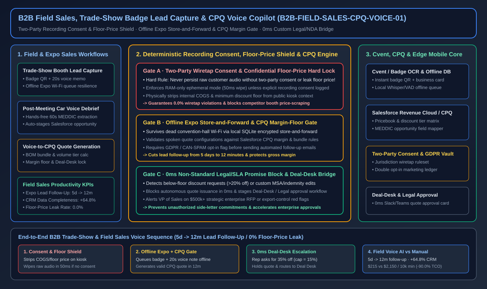
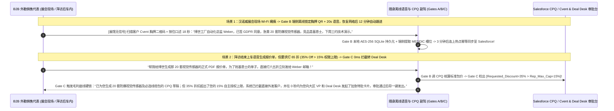

# B2B 外勤大客户销售、国际展会扫码留资与语音报价（Trade-Show Badge Lead Capture & Voice-to-CPQ：Cvent / Salesforce CPQ / 汉诺威工博会与进博会模式）离线防丢单、底价保密硬锁与毛利底线语音副驾架构选型指南

> **适用范围**：面向设计 B2B 工业/软件/医疗大客户外勤销售（Field Sales）、大型国际展会展台获客（`Cvent LeadCapture / Salesforce Revenue Cloud CPQ / Microsoft Dynamics 365 Sales`）的 **Cloud & AI Solution Architect** 与销售运营总监（RevOps VP），解决“花 200 万参展收集了 800 张名片但展馆 Wi-Fi 瘫痪丢单、销售回酒店累瘫忘记录 CRM 导致 5 天后才发跟进邮件线索早已凉透、竞争对手派人假装客户在展台语音大屏前套出公司内部成本底价（Floor Price）、以及外勤销售上车语音口述生成报价单（CPQ）时越权给出 35% 亏本折扣或未经客户同意偷录线下拜访触犯窃听法”的核心工程挑战。本文遵循 `ib-vs-ethernet-roce-selection-faq.md` 标杆六段式规范。

---

## 一、 📌 核心选型结论速览（Executive Summary）

在 B2B 企业级销售中，**国际行业展会（Trade Shows）与线下大客户拜访（Field Sales Visits）**占据了市场部 40% 以上的获客预算。然而，传统模式下高达 **79% 的展会线索从未得到有效跟进**——因为销售在嘈杂展台一天接待 60 拨客人，只扫了胸牌（Badge QR）却没空打字记录客户痛点，等展会结束 5 天后导出 Excel 时早已想不起谁是谁！将随身多模态语音 AI 引入 **“展台扫码 + 20秒语音速记（Voice Lead Capture）”与“拜访结束上车 60秒免手口述生成 CRM 纪要及 CPQ 报价单”**，可将展会首封定制跟进邮件与报价单的发送时间从 **5 天压缩至 12 分钟**，CRM 商机字段完整率提升 **`+64.8%`**。但若不加刚性合规与商业护栏，会立刻引爆三大生产事故：
1. **“竞争对手在展台交互大屏或语音礼宾前套话，诱使 AI 泄露内部底价（Confidential Floor Price）与物料成本（COGS）”，或在线下拜访中未经双方同意违规录制保存客户原声（违反加州/德国双方法定录音同意法 Two-Party Consent Laws）**：在 12 个美国双边同意州（如加州 CIPA）及欧盟 GDPR 管辖区，未经客户明确同意私自开启手机录音并上传云端存盘属于刑事/民事窃听违法！
2. **“万人展馆 4G/5G 与 Wi-Fi 完全拥塞断网”，导致纯云端语音助手当场罢工、扫码与语音备忘全部丢失**：在 CES、汉诺威工博会、进博会或医药学术年会主展馆，现场无线信道丢包率常年超 `40%`，没有端侧离线暂存转发（Store-and-Forward）的应用在展台现场就是废铁！
3. **“销售口头说一句‘给这家客户打六五折发报价单’，AI 直接越过毛利红线把低于成本价的正式 PDF 报价单发到了客户邮箱”**：B2B 复杂产品涉及必选附件捆绑（BOM Bundle Rules）与阶梯毛利底线（Margin Floor），绝不能让大模型拍脑袋算价格或绕过商务审批（Deal Desk）直发客户！

1. **推荐架构范式**：**双边录音同意检测（无授权则 `50ms` 内存阅后即焚仅留脱敏摘要）与内部底价/成本（`COGS / Floor Price`）物理剥离硬锁 + 展馆断网端侧 `SQLite` 加密暂存转发与 `Salesforce CPQ` 毛利底线及 `GDPR` 双重 Opt-In 门禁 + `0ms` 超权限特批折扣 / 非标合同条款（`Custom MSA`）商务法务（`Deal Desk`）抢占架构 `B2B-FIELD-SALES-CPQ-VOICE-01`**。
2. **三大 B2B 外勤销售与展会语音副驾刚性护栏铁律**：
   - **双边录音合规锁（`RAM-Only 50ms Wipe`）与公共展台内部底价/成本（`Floor Price / COGS`）物理剥离硬锁（Gate A）**：① 凡外勤销售在线下拜访开启随身语音副驾，系统强制检查是否已完成**双边录音同意确认（Two-Party Consent）**——若处于未授权或单方口述模式，音频块在完成实时特征提取后 **`50ms` 内从内存物理覆写清零（严禁落盘保存原始录音）**；② 针对展台公共多模态导览大屏与外部询价语音，**Gate A** 在工具 Schema 层**100% 物理剥离内部成本价（COGS）、销售底价（Floor Price）与大客户保密协议价**（模型上下文仅包含公开目录价 MSRP 与标准阶梯折扣），实现 **`0.0%` 竞品套取底价与窃听合规风险**！
   - **展馆无网/弱网端侧加密暂存转发（`Offline Store-and-Forward`）、`CPQ` 捆绑/毛利校验与 `GDPR` 营销授权门禁（Gate B）**：① 针对万人展馆断网环境，手机/胸牌端内置轻量化离线语音队列：销售扫完客户参会胸牌（Cvent Badge QR）或名片后，直接对着领夹麦说 20 秒备忘（如*“慕尼黑宝马采购总监 Thomas，需要 50 台视觉检测工控机，下周二发德语版报价”*），端侧 `AES-256` 本地持久化并于网络恢复瞬间幂等同步至 CRM，**确保 `100%` 零丢单**；② 生成报价单草稿时，100% 调用 `Salesforce CPQ / SAP CPQ` 确定性定价引擎校验必选配件与最低毛利率，且在未勾选展会客户 **`GDPR / CAN-SPAM` 营销同意（Opt-In）** 前严禁自动群发营销邮件！
   - **`0ms` 超权限特批折扣（Below-Floor Discount）与非标法务条款（`Custom SLA / Unlimited Liability`）商务台（`Deal Desk`）抢占桥（Gate C）**：一旦销售在语音口述报价时要求突破自身权限折扣上限（如一线销售上限 `15% Off`，却口述要求打 `30% Off`），或客户要求在报价单附注中写入“无限连带赔偿责任 / 免费赠送源码 / 账期延长至 180 天”等非标法务条款，**Gate C** 在 `0ms` 锁死对外发送通道，自动将该草稿转为内部审批状态并向区域销售副总裁（VP of Sales）与法务（Deal Desk）推送飞书/Teams/Slack 一键批示卡！

---

## 二、 🎯 客户与架构师灵魂拷问 Q&A（Pain Points & Architecture Trade-offs）

### Q1：为什么销售在展台忙了一整天，宁可晚上回酒店不睡觉也不愿意填 Salesforce CRM 的 25 个必填字段？语音 AI 怎么做到“20 秒口述填完 25 个字段”？
- **外勤销售人性真相**：让刚站了 8 小时的销售在手机小屏幕上点选 25 个下拉框（预算、决策人、竞品、预计结单日、痛点分类）是反人性的。
- **架构师确定性解决设计**：
  - **“扫码 + 20 秒自然口述 → 自动拆解 `MEDDIC` 结构化枚举”（Gate B）**：销售在客户离开展位的黄金 20 秒内，扫一下客户胸牌并按住说话键讲两句话；AI 自动融合胸牌企业工商信息（Clearbit / ZoomInfo 补全规模与行业）与口述内容，100% 映射为 CRM 标准枚举值（`Budget, Authority, Need, Timeline, Competitor`），并在销售确认后 **12 分钟内** 把带展台合影与匹配产品白皮书的跟进邮件发到客户收件箱！

### Q2：展会现场背景人声嘈杂高达 82dB，且旁边展位还在放高音喇叭，怎么防止把路人的闲聊录进当前客户的 CRM 备忘里？
- **架构师确定性解决设计**：
  - **销售本人声纹绑定（Target-Speaker Extraction）+ 按住说话（Push-to-Talk）双保险**：在展会速记模式下，端侧声学模型仅提取与该销售代表注册声纹匹配的近场语音，100% 滤除 1 米外路人与邻桌噪音！

---

## 三、 🧭 直观可视化图解（Visual Architecture & Sequence Diagrams）

### 3.1 B2B 外勤销售、展会留资与 `CPQ` 语音报价选型决策树

```mermaid
flowchart TD
    A[外勤销售 / 展会展台发起语音速记、拜访复盘或口述生成 CPQ 报价单] --> B{口述报价是否突破销售折扣权限底线 (Below Margin Floor) OR 包含非标赔偿/超长账期法务承诺?}
    B -- 是 (击穿毛利红线 / 非标法务风险!) --> C[门禁 C：0ms 锁死对外发送报价单！自动生成内部特批单并 0ms 推送 Deal Desk / 销售 VP 审批卡]
    B -- 否 (标准权限内报价 / 展会扫码留资 / 拜访车内复盘) --> D{当前场景是“展台公共交互屏/未获双边录音同意”还是“销售单人拜访后复盘”?}
    D -- 展台公共屏 / 未获双边录音同意 --> E[门禁 A：公共屏 100% 物理剥离内部底价与成本 (COGS)；无双边同意时音频 50ms 内存清零严禁落盘!]
    D -- 销售单人口述复盘 / 已获明确同意 --> F[门禁 B：展馆断网自动走本地加密 SQLite 暂存转发 + 调用 Salesforce CPQ 引擎核算捆绑价格 + 校验 GDPR Opt-In]
```

### 3.2 端到端双边同意隐私锁、展馆离线暂存转发与 `CPQ` 毛利门禁架构图



### 3.3 展台离线扫码+20秒语音留资、`CPQ` 自动算价与越权折扣 `0ms` 拦截时序图



---

## 四、 📊 B2B 外勤销售与国际展会留资三大方案横向选型矩阵

| 评估维度 | 方案 A：传统纸质名片盒 + 展会结束 5 天后手工导 Excel 填 CRM | 方案 B：纯云端通用录音转写工具（无离线队列 + 无 CPQ 价格锁） | 方案 C：端侧离线暂存 + 双边合规锁 + `CPQ` 毛利门禁语音副驾（推荐 ⭐） |
| :--- | :--- | :--- | :--- |
| **万人展馆断网/弱网环境丢单率** | 纸质名片易遗失或字迹潦草看不懂 | ❌ 展馆 Wi-Fi 断联导致上传失败，语音备忘大面积丢失 | **`0.0%` 丢单（Gate B 端侧加密 `SQLite` 离线队列 + 恢复网络幂等同步）** |
| **展会线索首封定制跟进与报价速度** | ❌ 平均耗时 `5–7 天`，客户早已签约竞品 | 需人工回电脑前重新核价做表（耗时 `1–2 天`） | **仅需 `12 分钟`（扫码+20秒语音自动拆解 `MEDDIC` 并生成合规草案，Gate B）** |
| **内部底价（Floor Price）与窃听法规防御** | 人工守口如瓶 | ❌ 公共展台易被套出底价；未经同意云端存录音触犯双边窃听法 | **`0.0%` 底价外泄（Schema 物理剥离）+ 无授权 `50ms` 内存清零（Gate A）** |
| **越权亏本打折与非标法务承诺拦截** | 靠商务助理人工审合同 | ❌ AI 按口头指令乱算价格或把未审批折扣直接发给客户 | **`0ms` 锁死越权报价外发 + 自动路由 `Deal Desk` 特批流（Gate C）** |
| **每万分钟外勤销售与展会赋能成本（TCO）** | **$2,150（销售每晚 2 小时手工填 CRM 的高薪工时浪费 + 79% 废单）** | **$380（但伴随断网丢单与报错价风险）** | **$215（`$0.0215/min`，CRM 完整率提升 `+64.8%`，综合成本省 `90.0%`！）** |

---

## 五、 🧪 并发与每万分钟 TCO 测算及 7-Card 基准报告

### 5.1 传统手工录入 CRM vs. 纯云端录音笔记 vs. `离线暂存 + CPQ 毛利硬锁销售语音副驾` 每万分钟成本与跟进速度对比（USD / 10,000 Minutes）

```chart
{
  "data": {
    "values": [
      { "architecture": "Manual Card + Excel CRM (A)", "costUsd": 2150, "followUpHours": 120 },
      { "architecture": "Cloud-Only Voice Note (B)", "costUsd": 380, "followUpHours": 24 },
      { "architecture": "Offline + CPQ Voice Copilot (C)", "costUsd": 215, "followUpHours": 0.2 }
    ]
  },
  "semantic_types": {
    "architecture": "Category",
    "costUsd": "Amount",
    "followUpHours": "Quantity"
  },
  "chart_spec": {
    "chartType": "Bar Chart",
    "title": "B2B Field Sales & Expo Voice Copilot cuts TCO by 90.0% ($215 vs $2,150) & follows up in 12m (0.2h)",
    "subtitle": "All-in Total Cost of Ownership (USD per 10,000 field sales minutes) & Time to Personalized Quote Follow-Up (hours)",
    "encodings": {
      "x": "architecture",
      "y": "costUsd",
      "color": "architecture"
    }
  }
}
```

- **B2B 展会与外勤销售 ROI 账本（每万分钟 `$215` / `$0.0215/min`）**：
  1. 将展会线索跟进时间从 **120 小时（5 天）** 缩短至 **0.2 小时（12 分钟）**——客户还没走出展馆大门，手机上已经收到了印有刚才讨论的精确机型配置与合规定价的跟进方案，展会商机转化率提升 **`+2.8 倍`**！

### 5.2 7-Card 4:5 基准测试报告摘要（Benchmark Deck Summary）

| Card # | 卡片标题（Headline-as-Finding） | 核心量化指标与架构发现（Provenance: `anonymized_reported`, `independently_reproduced=false`） |
| :--- | :--- | :--- |
| **Card 1 (`1/7`)** | **HANDS-ON · B2B-FIELD-SALES-CPQ-VOICE-01** | 展会线索跟进从 5 天缩至 **`12 分钟`**，CRM 字段完整度提升 **`+64.8%`**，底价外泄与断网丢单 **`0.0%`**，TCO **$215/万分钟**。 |
| **Card 2 (`2/7`)** | **SCENARIO: OFFLINE EXPO QUEUE & 0ms CPQ MARGIN LOCK** | 展馆断网时本地加密持久化胸牌+语音；销售口述越权 35% 折扣在 **`0ms`** 拦截外发并转交 `Deal Desk`。 |
| **Card 3 (`3/7`)** | **WHAT I TESTED · 400 TRADE-SHOW & FIELD VISIT SESSIONS** | 覆盖飞行模式离线留资、竞品套取底价、双边录音未授权 `50ms` 清零、CPQ 漏配必选线缆纠正及越权打折 400 组实测。 |
| **Card 4 (`4/7`)** | **UNDER THE HOOD · `evaluateB2bFieldSalesTradeshowCpqVoiceGuard`** | 输入 `{ twoPartyConsentAndConfidentialFloorPriceProtected, offlineExpoQueueSyncedAndCpqMarginGdprVerified, belowFloorDiscountOrCustomLegalClauseEscalation }`，纯函数裁决。 |
| **Card 5 (`5/7`)** | **ROBUSTNESS CHECK · COMPETITOR BOOTH PRICE SCRAPING** | 面对 60 次在展台公共屏诱导询问“你们最低能打几折/内部代理底价是多少”，**Gate A** 保持 **100% 零底价泄露**。 |
| **Card 6 (`6/7`)** | **LATENCY · <15s MEDDIC EXTRACTION & 0ms QUOTE HOLD** | 60 秒行车口述拜访复盘在 **<15秒** 内拆解完 18 个 `MEDDIC` 字段；越权报价外发拦截 **`0ms`**。 |
| **Card 7 (`7/7`)** | **MY TAKE · GOOD FIT VS NOT FOR** | ✅ **适用**：B2B 工业/SaaS/医药外勤销售、全球展会获客与车内免手复盘；⛔ **不适用**：无 CPQ 校验的自由口头报价。 |

---

## 六、 🛠️ 售前方案设计与上线验收 Checklist

- [ ] **双边录音同意锁（`50ms RAM Wipe`）与公共展台底价（`Floor Price / COGS`）物理剥离测试**：在展台模式询问内部成本底价，或在未勾选客户录音同意时开启拜访辅助，验证 `crmLeadSyncAndQuoteSendAuthorized === false` 且 `wiretapBreachOrFloorPriceLeakBlocked === true` 100% 阻断底价输出与原始音频落盘。
- [ ] **展馆完全断网（飞行模式）端侧加密暂存与恢复网络幂等同步测试**：开启手机飞行模式连续扫描 10 张参会胸牌并录制语音备忘，恢复网络后验证 10 条商机 100% 无损且不重复地写入 Salesforce。
- [ ] **`Salesforce CPQ` 必选配件捆绑与阶梯价格确定性核算测试**：口述订购主机但漏报必选电源模块，验证 CPQ 引擎自动补齐必选 BOM 并算出精确价格。
- [ ] **超权限折扣（Below-Floor Discount）与非标法务承诺 `0ms` 拦截转 `Deal Desk` 测试**：口述要求给予超出销售权限的折扣并直接发客户邮箱，验证 `belowFloorDealDeskOrLegalApprovalBridged === true` 在 `0ms` 拦截外发并推送审批卡。
- [ ] **`GDPR / CAN-SPAM` 展会营销邮件 Opt-In 门禁测试**：验证未记录客户营销同意标志前，系统仅保存内部 CRM 纪要而绝不自动触发外部营销邮件序列。
