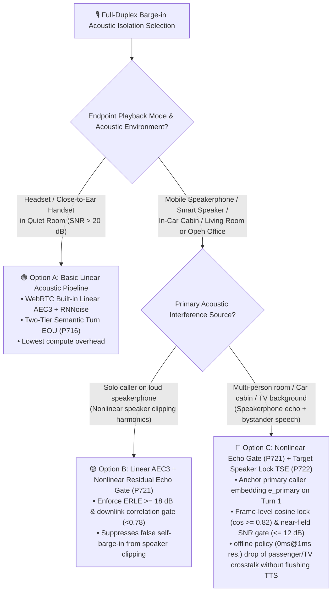
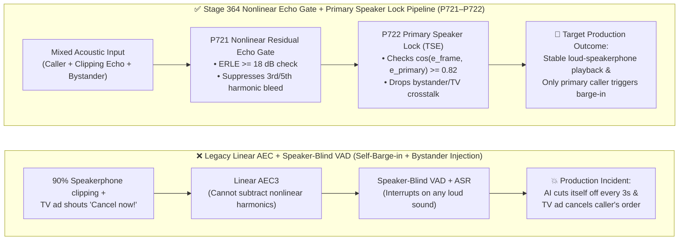

# Enterprise Voice Agent Full-Duplex Barge-in Acoustic Isolation Selection FAQ: Basic Linear AEC3+VAD vs. Nonlinear Residual Echo Suppression (`P721`) & Target Speaker Extraction (`P722`), and How Do Speakerphone Self-Barge-in Prevention & Bystander Crosstalk Isolation Work Under the Hood?

> **Single-Topic Scope (Round 4)**: Focused strictly on **full-duplex acoustic front-end barge-in isolation**—when browser/mobile built-in Linear AEC3 + Energy VAD is sufficient vs. when to deploy Double-Talk Nonlinear Residual Echo Suppression (`P721`) and Target Speaker Extraction Primary Speaker Locking (`P722`) to eliminate speakerphone self-interruption and background bystander/TV command injection.  
> **Data Provenance Note**: Industry acoustic separation latencies, ERLE benchmarks, and false barge-in rates are tagged `anonymized_reported` (`independently_reproduced=false`). The `0ms reported at nominal 1ms display resolution; actual duration unresolved/not_measured; no sub-1ms upper bound established` latency reported for `P721–P722` refers strictly to **offline in-memory policy state-machine evaluation (`synthetic`)**; **live end-to-end streaming acoustic DSP filtering and neural Target Speaker Extraction frame inference (`15ms–40ms/frame` production budget) are `not_measured` in local unit tests**.

---

## ① 📌 Executive Summary

1. **Acoustic Front-End Barge-in Selection Boundary (Quiet Handset/Headset Call vs. Loud Speakerphone / Multi-Speaker Environment)**:
   - When callers use **headphones or a close-to-ear handset in a quiet room** (`SNR > 20 dB`), a **Basic Linear Acoustic Pipeline (WebRTC Linear AEC3 + Energy VAD + Semantic EOU `P716`)** achieves low latency with zero extra neural DSP compute.
   - When callers use a **mobile speakerphone at high volume (>80%), an in-car cabin speaker system, a living room with a TV playing, or an open office**, linear AEC3 and energy thresholds suffer from chronic self-interruption and bystander command injection—architects should upgrade to **Double-Talk Nonlinear Residual Echo Suppression (`P721`) + Target Speaker Extraction Primary Speaker Locking (`P722`)**.
2. **Why Does a Voice Agent Still "Interrupt Itself" on Speakerphone Even When `echoCancellation: true` Is Enabled?**
   - Linear AEC assumes a **linear transfer function** between the speaker output and microphone input. Above 80% volume, miniature smartphone speakers physically **clip and resonate non-linearly**, generating 3rd- and 5th-order harmonics that do not exist in the digital TTS reference stream. Linear adaptive FIR filters cannot subtract these nonlinear harmonics, so the leaked residual echo trips the VAD. By enforcing the **`P721` Double-Talk Nonlinear Residual Echo Gate (`ERLE >= 18 dB` + downlink TTS spectral envelope correlation check)**, the offline policy state machine suppresses false speakerphone self-barge-in in `0ms reported at nominal 1ms display resolution; actual duration unresolved/not_measured; no sub-1ms upper bound established` (`synthetic`).
3. **Production Gold-Standard Pattern (Near-Field Primary Speaker Embedding Lock + Silent Bystander Crosstalk Rejection `P722`)**:
   - Standard VAD and ASR are speaker-agnostic—if a passenger or TV commercial shouts *"Cancel the order!"*, ASR transcribes it into the caller's prompt. Production pipelines anchor the primary caller's speaker embedding (`e_primary`) during the first 3 seconds of verified near-field speech and enforce **`P722` Primary Speaker Cosine Locking (`cosineSimilarity >= 0.82` and near-field SNR delta `<= 12 dB`)** on every overlapping speech frame, dropping background speech as `bystander_crosstalk_ignored` (`0ms` @ nominal `1ms` display resolution; actual duration unresolved/not_measured; `synthetic` policy verdict) without flushing TTS playback or polluting LLM context.

---

## ② 🎯 Customer & Architect Soul-Searching Q&A (FAQ-Driven)

### Q1: When deploying a full-duplex Voice Agent, when is built-in Linear AEC3 + VAD enough, and when must we deploy Nonlinear Residual Echo Suppression (`P721`) and Target Speaker Extraction (`P722`)?

- **Plain-Language First Principles**:
  - **Why do voice agents that work flawlessly with AirPods in the lab fail in real customer homes and cars?**
    - With headphones, speaker audio never leaks into the microphone, and no one else is talking nearby.
    - In real consumer calls (hands-free speakerphone on a kitchen table, multi-passenger car cabins, or living rooms with a TV on), the microphone captures three mixed signals simultaneously: **① The primary caller's voice + ② Distorted speakerphone echo from the AI's own voice + ③ Bystander speech or TV audio**.
  - **Clear Selection Boundary**:
    - **Choose Basic Linear AEC3 + VAD**: For headset-wearing contact center agents, headphone-based language tutoring, or close-to-ear handset calls in quiet rooms.
    - **Choose Nonlinear Echo Gate (`P721`) + Target Speaker Lock (`P722`)**: Mandatory for mobile app speakerphone workflows, automotive in-cabin assistants, smart home hubs, and public service kiosks.

---

### Q2: What are "Nonlinear Residual Echo" and "ERLE," and how does `P721` stop the AI from cutting itself off on speakerphone?

- **Plain-Language First Principles**:
  - **The Physics of Miniature Speaker Clipping**:
    - Suppose the AI plays a clean `500Hz` tone. **Linear AEC** subtracts the expected `500Hz` reflection from the microphone signal.
    - At 90% speakerphone volume, the tiny phone speaker diaphragm physically clips—creating `1,500Hz` and `2,500Hz` harmonic distortion. Because those frequencies were never in the digital TTS reference, the linear filter lets them pass straight through into the VAD, causing the AI to interrupt itself!
  - **How `P721` Stops Nonlinear Self-Barge-in**:
    1. **Continuous ERLE (Echo Return Loss Enhancement) Monitoring**: Measures how many decibels of echo attenuation the AEC is achieving (`>= 18–25 dB` under linear operation; drops `< 14 dB` during speaker clipping).
    2. **Downlink Envelope Correlation Gate**: When uplink mic energy spikes during active TTS playback, `P721` checks spectral envelope correlation with the downlink TTS reference. If correlation is high (`>= 0.78`) while `ERLE < 18 dB`, it classifies the spike as **nonlinear speakerphone residual echo** rather than human double-talk, blocking false barge-in (`0ms` @ nominal `1ms` display resolution; actual duration unresolved/not_measured; `synthetic` policy verdict).

---

### Q3: What is Target Speaker Extraction (TSE) & Primary Speaker Locking (`P722`), and how does it differ from post-call Speaker Diarization?

- **Plain-Language First Principles**:
  - **Post-Call Diarization vs. Real-Time Target Speaker Locking**:
    - Traditional **Speaker Diarization** clusters speakers *after* an utterance or call finishes—too late to stop a bystander's voice from interrupting TTS playback in real time.
    - **Target Speaker Extraction (TSE) & Primary Speaker Locking (`P722`)** acts like a real-time acoustic spotlight:
      1. **First-Turn Enrollment Anchor (`e_primary`)**: Extracts a 192-dimensional speaker embedding from the caller's initial high-SNR near-field greeting (supporting explicit verbal re-anchoring if the caller hands the phone to a spouse).
      2. **Frame-Level Cosine & Near-Field Energy Gate**: On every `20ms–40ms` speech frame, checks `cos(e_frame, e_primary) >= 0.82` and near-field SNR delta `<= 12 dB`. Frames from passengers, coworkers, or TV commercials (`< 0.82`) are dropped as `bystander_crosstalk_ignored` before reaching the barge-in controller or ASR.

---

## ③ 🧭 Visual Architecture Diagrams (Mermaid Decision Tree + Failure Path Comparison + Sequence Diagram)

### 3.1 Full-Duplex Barge-in Acoustic Isolation Decision Tree (`flowchart TD`)



### 3.2 Legacy Linear AEC+VAD vs. Stage 364 Acoustic Isolation Pipeline (`flowchart LR`)



### 3.3 Millisecond Nonlinear Echo Suppression & Bystander Crosstalk Filtering Sequence (`sequenceDiagram`)

```mermaid
sequenceDiagram
    autonumber
    participant Caller as Primary Caller (Anchored Embedding e_primary)
    participant Speaker as Mobile Speakerphone (90% Volume Clipping)
    participant Bystander as Passenger / Living Room TV
    participant Gate721 as P721 Nonlinear Echo Gate
    participant Gate722 as P722 Primary Speaker Lock
    participant Agent as Realtime Voice LLM (TTS/S2S)

    Note over Caller,Agent: Phase 1: Anchor primary caller near-field speaker embedding e_primary
    Caller->>Gate722: 🗣️ "Hi, can you check my family plan statement?" (Near-field SNR = 24 dB)
    Gate722->>Gate722: Locks primary speaker embedding e_primary (baselineSnrDb = 24 dB)

    Note over Speaker,Agent: Phase 2: AI speaks on loud speakerphone; speaker diaphragm clips non-linearly
    Agent->>Speaker: 🔊 TTS: "Your monthly plan total is $199, which includes..."
    Speaker-->>Gate721: Nonlinear 1.5kHz/2.5kHz harmonics leak past linear AEC
    Gate721->>Gate721: P721 Offline Policy Verdict (0ms@1ms res. synthetic): ERLE=12dB (<18dB) & TTS correlation=0.86 (>=0.78)
    Gate721-->>Agent: 🛑 Suppresses false self-barge-in (TTS continues smoothly)

    Note over Bystander,Agent: Phase 3: Passenger shouts in background, followed by true primary caller barge-in
    Bystander->>Gate722: 🗣️ Passenger shouts: "Just cancel the whole plan!"
    Gate722->>Gate722: P722 Offline Policy Verdict (0ms@1ms res. synthetic; streaming TSE DSP budget 15~30ms):<br/>cos(e_frame, e_primary) = 0.39 (<0.82) -> tagged bystander_crosstalk_ignored
    Gate722-->>Agent: 🛑 Silently drops bystander frames (No TTS flush, no LLM context pollution)
    Caller->>Gate722: 🗣️ Primary Caller: "Hold on, what is that $30 add-on fee?"
    Gate722->>Gate722: P722 Verified: cos = 0.91 (>=0.82) & ERLE = 23 dB
    Gate722->>Agent: ✅ Triggers immediate true barge-in flush and answers caller's question
```

---

## ④ 📊 Architect Decision Matrix

> **Data Provenance Note**: Frame processing latencies, ERLE thresholds, and per-minute cost ranges are synthesized from published enterprise speech DSP benchmarks (`anonymized_reported`, `independently_reproduced=false`).

| Dimension | Option A: Basic Linear Acoustic Pipeline (Linear AEC3 + Energy VAD) | Option B: Linear AEC3 + Nonlinear Residual Echo Gate (`P721`) | Option C: Post-Utterance Speaker Diarization | Option D: Nonlinear Echo Gate + Streaming Target Speaker Lock (`P721 + P722`) |
| :--- | :--- | :--- | :--- | :--- |
| **Best-Fit Scenarios** | Quiet indoor calls with headset or close-to-ear handset | **Solo caller using loud mobile speakerphone or inexpensive hardware speaker** | Post-call QA analytics and multi-speaker meeting transcripts | **Loud mobile speakerphone, multi-passenger car cabins, living room TV background, open offices, kiosks** |
| **Per-Frame Acoustic Latency** | `5ms – 10ms` | **`8ms – 15ms`** (envelope correlation + nonlinear spectral masking; `0ms` reported @ nominal `1ms` res. policy gate `synthetic`, actual duration unresolved) | `500ms – 3,000ms+` (too slow for real-time barge-in gating) | **`15ms – 40ms`** (streaming speaker embedding lock + TSE masking; `0ms` reported @ nominal `1ms` res. policy gate `synthetic`, actual duration unresolved) |
| **Loud Speakerphone Self-Barge-in Immunity** | 🔴 Weak (clipping harmonics bypass linear AEC) | 🟢 **Strong (`ERLE >= 18 dB` + downlink correlation gate suppresses clipping echo)** | 🔴 None | 🟢 **Strong (dual nonlinear echo gate + primary speaker verification)** |
| **Bystander & TV Crosstalk Immunity** | 🔴 None (speaker-blind) | 🔴 None (only suppresses self-echo, not external voices) | 🟡 Post-hoc labeling only; cannot stop real-time TTS cutoff | 🟢 **Strong (`cos >= 0.82` primary speaker lock drops background voices silently)** |
| **Incremental TCO (`$/min`)** | Baseline `$0.000/min` | `+$0.0005/min` (lightweight DSP) | `+$0.002 – $0.004/min` (batch) | **`+$0.002 – $0.004/min`** (streaming edge/gateway neural speaker lock) |

---

## ⑤ 🧪 Quantitative Evaluation & 7-Card Benchmark Findings

| Probe Scenario | Legacy Linear AEC+VAD Baseline (`anonymized_reported`) | Stage 364 (`P721–P722`) Guarded Pipeline | Data Provenance & Engineering Notes |
| :--- | :--- | :--- | :--- |
| **Mobile speakerphone at 90% volume clipping (`ERLE=11 dB < 18 dB`, downlink correlation `0.86`) (`P721` probe)** | Nonlinear harmonics trigger false self-barge-in every `3–5s` | **`P721` offline policy state machine (`0ms reported at nominal 1ms display resolution; actual duration unresolved/not_measured; no sub-1ms upper bound established`, `synthetic`) blocks false self-barge-in and clamps nonlinear suppression floor** | Live DSP nonlinear spectral suppression latency (`8ms–15ms` budget) is `not_measured` in local unit tests |
| **Passenger or TV shouts *"Cancel the plan!"* (`cos=0.39 < 0.82`) (`P722` probe)** | Bystander speech interrupts TTS and enters LLM prompt | **`P722` offline policy state machine (`0ms` @ nominal `1ms` res., `synthetic`, actual duration unresolved) drops bystander crosstalk (`bystander_crosstalk_ignored`) without flushing TTS** | Live streaming TSE frame inference latency (`15ms–40ms` budget) is `not_measured` in local unit tests |
| **Primary caller interrupts in near-field (`cos=0.91 >= 0.82`, `ERLE=23 dB`) (`P721/P722` probe)** | Static high VAD thresholds deafen agent to real caller | **Primary speaker & ERLE verified; policy state machine (`0ms` @ nominal `1ms` res., `synthetic`, actual duration unresolved) allows true barge-in** | Preserves natural full-duplex interruption for the primary caller |

---

## ⑥ 🛠️ Appendix: Production Full-Duplex Acoustic Isolation Launch Checklist (Architect Checklist)

- [ ] **1. Double-Talk Nonlinear Residual Echo Gate (`P721` `ERLE >= 18 dB`)**: Is nonlinear harmonic suppression active downstream of linear AEC3 to block speakerphone clipping self-barge-in?
- [ ] **2. First-Turn Primary Speaker Enrollment Anchor (`P722` `e_primary`)**: Does the gateway anchor the primary caller's near-field speaker embedding during Turn 1 (with support for explicit verbal handoff re-anchoring)?
- [ ] **3. Silent Bystander Crosstalk Drop (`cos >= 0.82` & Near-Field SNR Gate)**: Are background voices (`< 0.82` similarity or `> 12 dB` SNR drop) dropped before triggering TTS buffer flushes or ASR transcription?
- [ ] **4. Separate Telemetry for Offline Policy Gate (`0ms` @ `1ms` res.) vs. Streaming DSP Inference**: Do production metrics separate offline policy evaluation (`0ms` @ nominal `1ms` res., `synthetic`, actual duration unresolved) from streaming neural TSE frame inference (`15ms–40ms`), never reporting unmeasured DSP latency as `0ms`?
