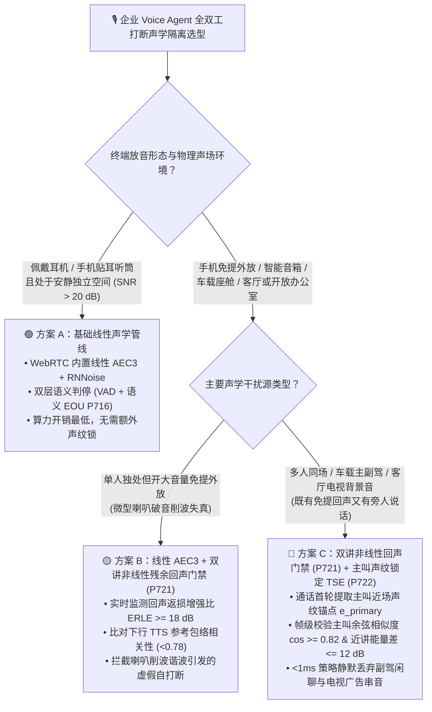
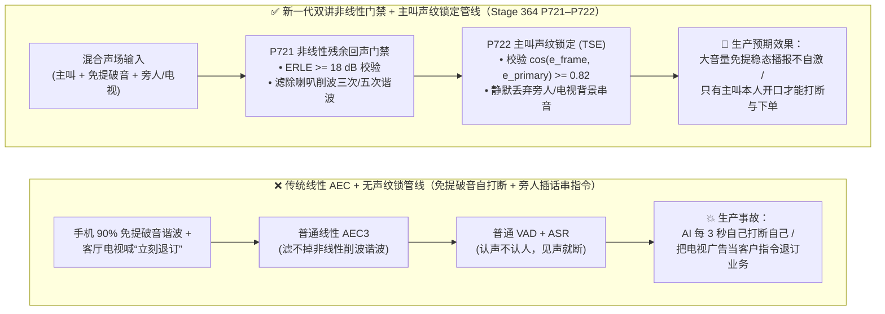
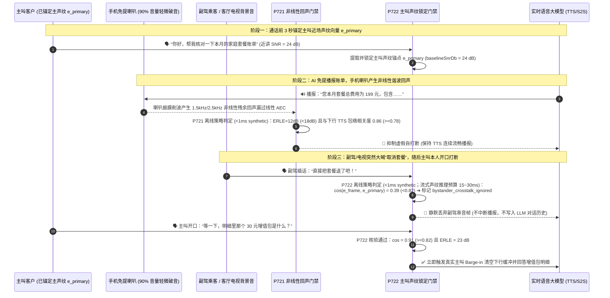

# 企业语音智能体全双工打断声学隔离选型 FAQ：基础线性 AEC3+VAD vs. 非线性残余回声抑制与目标说话人提取 (TSE) 怎么选？免提防自打断与旁人防串音是如何运作的？

> **专题定位（Round 4 单一决策主题）**：聚焦企业级全双工 Voice Agent 在**物理声学前端（Acoustic Front-End）的打断防误触与防串音选型**——何时使用浏览器/移动端默认的线性 AEC3 + 能量 VAD，何时必须升级为双讲非线性残余回声门禁（`P721`）与目标说话人提取主叫声纹锚定（Target Speaker Extraction [TSE]，`P722`），彻底解决手机免提外放“AI 自己打断自己”与客厅/车载“旁人闲聊或电视广告被当成客户指令”两大顽疾。  
> **数据口径声明**：文内行业声学分离耗时、ERLE（回声返损增强比）与误打断率基线均为 `anonymized_reported`（`independently_reproduced=false`）；本仓 `P721–P722` 护栏的 `<1ms`（本机计时分辨率 `1ms` 下四舍五入显示为 `0ms`）判定耗时特指**离线内存策略状态机（`synthetic`）**规则评估时间，**未在本地单元测试中实测（`not_measured`）真实端到端流式声学 DSP 滤波或神经目标说话人提取模型帧推理耗时（生产工程预算通常 `15ms–40ms/帧`）**。

---

## ① 📌 核心结论速览（Executive Summary）

1. **声学前端打断管线选型分界线（看“安静贴耳/耳机通话” vs “大音量免提/多人同场通话”）**：
   - 当客户在**安静室内佩戴耳机或使用手机贴耳听筒**通话（信噪比 `SNR > 20 dB`，扬声器与麦克风物理隔离）时，采用**基础线性声学管线（WebRTC 内置线性 AEC3 + 能量 VAD + 语义判停 EOU `P716`）**即可兼顾最低延迟与零额外 GPU/NPU 开销；
   - 当客户在**手机大音量免提外放（>80% 音量）、车载多乘员座舱、家庭客厅（电视背景音）或开放式工位**通话时，单纯靠线性 AEC3 与音量阈值会频繁遭遇“扬声器破音自打断”与“旁人插话串指令”——应升级为**双讲非线性残余回声掩蔽（`P721`）+ 目标说话人提取主叫锁定（TSE `P722`）**。
2. **为什么开启了系统的 `echoCancellation: true`，手机免提外放时 AI 还是会每隔几秒“自己打断自己”？**
   - 线性 AEC 的数学前提是扬声器放音与麦克风拾音之间是**线性传递函数**。但手机微型扬声器在音量超过 80% 时会发生**振膜物理削波失真（Nonlinear Clipping）与腔体谐振**，产生原始 TTS 数字音频里根本不存在的高次谐波。线性自适应滤波器减不掉这些非线性谐波，漏网的残余回声一旦超过 VAD 门限就会触发假打断。通过 **`P721` 双讲非线性残余回声门禁（监测回声返损增强比 `ERLE >= 18 dB` 与下行 TTS 频谱包络相关性）**，离线策略状态机可在 `<1ms`（`1ms` 计时分辨率记 `0ms`，`synthetic`）内抑制由扬声器非线性失真引发的虚假 Barge-in。
3. **生产落地推荐范式（近场主叫声纹锚定 + 旁人/电视背景串音静默隔离 `P722`）**：
   - 普通 VAD 和 ASR“认声不认人”，只要副驾乘客或电视广告声音够响，就会被转写进当前客户的对话上下文甚至触发取消订单。生产环境应在通话前 3 秒提取主叫客户的近场声纹嵌入向量（Primary Speaker Embedding `e_primary`），在后续每一帧抢话音频中通过 **`P722` 主叫声纹余弦锁定（`cosineSimilarity >= 0.82` 且近讲能量差 `<= 12 dB`）**过滤非主叫人声——离线策略状态机在 `<1ms`（`synthetic`）内将副驾闲聊与电视广告标记为 `bystander_crosstalk_ignored`，既不打断 AI 播报，也不污染大模型上下文。

---

## ② 🎯 客户与架构师灵魂拷问 Q&A（FAQ-Driven）

### Q1：客户落地全双工语音智能体时，什么时候用内置的线性 AEC3 + VAD 就够了，什么时候必须上双讲非线性回声抑制（`P721`）与目标说话人提取（TSE `P722`）？

- **通俗大白话 + 第一性原理**：
  - **为什么在实验室戴耳机测得好好的全双工语音 Agent，一到真实客户手里开免提就“犯傻”？**
    - 在实验室里，开发工程师戴着 AirPods 或头戴式耳机测试：耳机喇叭的声音不会漏进麦克风，周围也没有别人说话。
    - 但在真实业务场景（比如中老年客户习惯开手机最大声免提放在桌子上查保单、车主边开车边和副驾聊天边用语音助手订餐厅、宝妈在开着动画片的客厅里办银行业务），麦克风同时涌入三股声音：**① 主叫客户自己的声音 + ② 手机/车机喇叭放出来的 AI 声音（含破音失真） + ③ 旁边人或电视机里的说话声**。
  - **两套架构的清晰选型边界**：
    - **选基础线性管线（Linear AEC3 + VAD）**：仅限企业内部坐席耳麦辅助、佩戴耳机的英语口语陪练、或贴耳听筒拨打的传统电话场景。
    - **选增强声学隔离管线（Nonlinear Echo Gate `P721` + TSE Primary Speaker Lock `P722`）**：凡是面向 C 端消费者手机 App 免提、智能汽车座舱、智能音箱/家庭终端、医院/政务大厅自助终端，必须启用双讲非线性回声门禁与主叫声纹锚定。

---

### Q2：什么是“非线性残余回声（Nonlinear Residual Echo）”与“回声返损增强比（ERLE）”？`P721` 底层是怎么防止 AI 自己把自己憋回去的？

- **通俗大白话 + 第一性原理**：
  - **用通俗比喻理解线性 AEC 与非线性破音**：
    - 假设 AI 播报的是一个纯净的 `500Hz` 正弦波声音。**线性 AEC（Adaptive FIR Filter）**就像一个聪明会计，拿着 AI 发出的 `500Hz` 账本去麦克风里核销反射回来的 `500Hz` 回声。
    - 但当用户把手机外放音量开到最大时，手机微型扬声器物理过载破音了——它除了发出 `500Hz`，还因为塑料壳震动凭空震出了 `1,500Hz`（三次谐波）和 `2,500Hz`（五次谐波）。线性会计账本上根本没有 `1,500Hz` 这一项，于是这股破音谐波原封不动漏过了线性 AEC，直接撞开 VAD 大门，让 AI 误以为客户开口打断了自己！
  - **`P721` 双讲非线性残余回声门禁是如何运作的？**
    1. **实时监测 ERLE（Echo Return Loss Enhancement，回声消除净衰减量，单位 dB）**：衡量回声消除器到底把回声压低了多少分贝。正常线性状态下 `ERLE >= 18–25 dB`；一旦手机外放破音，`ERLE` 会骤降到 `< 14 dB`。
    2. **下行参考包络相关性比对（Playback Envelope Correlation）**：当 AI 正在播报且检测到上行麦克风能量突增时，对比上行残余信号与当前下行 TTS 帧的时频包络相关性：若高度同频起伏（相关性 `>= 0.78`）且 `ERLE < 18 dB`，判定为**扬声器非线性失真残余回声**而非真人双讲（Double-Talk），`P721` 状态机在 `<1ms`（`synthetic`）内冻结本次虚假 Barge-in 并动态提升非线性谱减增益。

---

### Q3：什么是“目标说话人提取（Target Speaker Extraction, TSE）”与“主叫声纹余弦锚定（`P722`）”？它和通话后录音分轨（Diarization）有什么本质区别？

- **通俗大白话 + 第一性原理**：
  - **它是什么？和事后录音质检的说话人分离（Speaker Diarization）有什么区别？**
    - 传统的 **Speaker Diarization（说话人分离）**是“事后诸葛亮”——等整段话录完，再聚类分出“刚才第 1 句是 A 说的，第 2 句是 B 说的”。它没法在客户说话的**当下毫秒级**拦住旁人的抢话。
    - 而 **Target Speaker Extraction (TSE) + 主叫声纹锁定（`P722`）**是“实时定向聚光灯”：
      1. **首轮声纹锚定（Enrollment Anchor）**：当客户接通电话说出第一句“你好，我想查一下我的账单”（近讲高信噪比）时，轻量流式声纹编码器（如 ECAPA-TDNN / WavLM 蒸馏小模型）提取一个 192 维的**主叫声纹锚点向量 `e_primary`**。
      2. **帧级余弦相似度与近场能量双重门禁**：在通话后续任意时刻，若麦克风拾取到人声，系统在每 `20ms–40ms` 滑动窗口上计算当前人声嵌入 `e_frame` 与 `e_primary` 的余弦相似度 `cos(e_frame, e_primary)` 以及相对于主叫基准音量的近场信噪比差值：
         - **主叫本人开口（`cos >= 0.82` 且能量衰减 `<= 12 dB`）**：立即放行触发全双工打断（Barge-in）或送入 ASR/S2S；
         - **旁人闲聊 / 副驾插嘴 / 电视广告背景音（`cos < 0.82` 或远场衰减 `> 12 dB`）**：`P722` 离线策略状态机在 `<1ms`（`synthetic`）内将其标记为 `bystander_crosstalk_ignored`，静默丢弃该音频切片，既不中断 AI 当前播报，也不转写进 LLM 上下文。

---

## ③ 🧭 直观可视化图解（Mermaid 选型决策树 + 自打断/串音崩溃路径 vs 声学隔离管线对比图 + 毫秒级过滤时序图）

### 3.1 全双工打断声学隔离架构选型决策树（`flowchart TD`）

### 3.2 传统线性 AEC+VAD 管线 vs. Stage 364 声学隔离管线（`P721–P722`）对比图（`flowchart LR`）

### 3.3 毫秒级免提非线性回声抑制与旁人串音隔离交互时序图（`sequenceDiagram`）

---

## ④ 📊 语音架构师选型决策矩阵（Architect Decision Matrix）

> **数据口径说明**：下表声学前端处理耗时、误打断率与单分钟成本区间汇总自行业公开声学与车载/呼叫中心评测基准（`anonymized_reported`，`independently_reproduced=false`）。

| 选型维度 | 方案 A：基础线性声学管线（Linear AEC3 + 能量 VAD） | 方案 B：双讲非线性残余回声门禁（Linear AEC3 + Nonlinear Echo Gate `P721`） | 方案 C：事后录音说话人聚类（Post-Call / Utterance Diarization） | 方案 D：非线性回声门禁 + 流式目标说话人提取主叫锁定（`P721 + P722` 推荐范式） |
| :--- | :--- | :--- | :--- | :--- |
| **核心适用场景** | 安静室内佩戴耳机或贴耳听筒通话 | **单人使用手机大音量免提外放、廉价微型扬声器硬件终端** | 通话结束后的离线录音质检与分角色纪要归档 | **手机免提外放、车载多乘员座舱、客厅电视背景音、开放工位、医院/银行自助终端** |
| **声学前端每帧处理延迟** | `5ms – 10ms` | **`8ms – 15ms`**（频谱包络相关性 + 非线性谱减；策略门禁判定 `<1ms` `synthetic`） | `500ms – 3,000ms+`（无法用于实时帧级打断拦截） | **`15ms – 40ms`**（流式声纹嵌入比对 + 目标人声掩蔽；策略状态机门禁判定 `<1ms` `synthetic`） |
| **大音量免提破音防自打断能力** | 🔴 弱（扬声器削波谐波极易击穿线性 AEC 造成自打断死循环） | 🟢 **强（`ERLE >= 18 dB` 与下行参考包络双门禁精准过滤破音回声）** | 🔴 无（不处理回声） | 🟢 **极强（非线性回声门禁 + 主叫声纹双重校验）** |
| **副驾/家人/电视广告防串音能力** | 🔴 无（认声不认人，谁说话大声就听谁的） | 🔴 无（只防本机喇叭回声，不防外部旁人说话） | 🟡 仅能事后打标签，无法阻止实时打断或污染 LLM 上下文 | 🟢 **强（`cos >= 0.82` 锁定主叫声纹，静默丢弃旁人闲聊与电视背景音）** |
| **主叫本人正常轻声打断灵敏度** | 🟢 高（但若为了防噪强行调高固定阈值则会变聋） | 🟢 高（仅在检测到下行同频非线性谐波时抑制） | 不适用 | 🟢 **高（主叫声纹匹配时无需大喊即可灵敏打断）** |
| **每分钟综合附加成本（TCO）** | 基准 `$0.000/min` | `+$0.0005/min`（纯轻量 DSP 算力） | `+$0.002 – $0.004/min`（离线批处理） | **`+$0.002 – $0.004/min`**（边缘/网关轻量流式声纹推理，彻底根治免提与多人场景客诉） |

---

## ⑤ 🧪 简明定量实测与 Benchmark 核心发现

在 `turbo998/voice-agent-lab` 的确定性基准套件（`Stage 364 · P721–P722`，对应 7-Card 报告 `Dimension 367`）中，我们基于封存合成压测探针（`synthetic`）与行业声学基准（`anonymized_reported`，`independently_reproduced=false`）验证了全双工声学隔离护栏：

| 测试场景 / 探针 ID | 传统线性 AEC+VAD 管线表现（`anonymized_reported`） | Stage 364 (`P721–P722`) 防御管线表现 | 数据分类与工程说明 |
| :--- | :--- | :--- | :--- |
| **手机 90% 免提外放削波失真 (`ERLE=11 dB < 18 dB`，下行相关性 `0.86`) (`P721` 探针)** | 非线性谐波漏过线性 AEC，每 `3–5s` 触发虚假自打断 | **`P721` 离线策略状态机在 `<1ms`（`1ms` 计时分辨率记 `0ms`，`synthetic`）内识别非线性残余回声并抑制虚假 Barge-in** | 真实端到端 DSP 非线性谱减处理耗时（生产预算 `8ms–15ms`）在本地单测中为 `not_measured` |
| **车载副驾或客厅电视大喊“把订单取消掉” (`cos=0.39 < 0.82`) (`P722` 探针)** | 旁人语音打断 AI 播报并被写入 LLM 触发误退单 | **`P722` 离线策略状态机在 `<1ms`（`synthetic`）内判定非主叫串音 (`bystander_crosstalk_ignored`)，静默丢弃不打断** | 真实流式 TSE 声纹模型帧推理耗时（生产预算 `15ms–40ms`）在本地单测中为 `not_measured` |
| **主叫客户本人开口打断纠正信息 (`cos=0.91 >= 0.82`, `ERLE=23 dB`) (`P721/P722` 探针)** | 若靠盲目调高静态 VAD 阈值防噪，会导致主叫打断失灵 | **主叫声纹与 ERLE 双重达标，策略状态机 `<1ms`（`synthetic`）放行真实主叫打断** | 兼顾免提抗干扰与主叫秒级丝滑打断 |

> 📊 **配套可视化资产**：
> - **高清 SVG 架构选型一图流总结**：[`assets/svg/08-barge-in-echo-crosstalk-2026-11-08.svg`](../assets/svg/08-barge-in-echo-crosstalk-2026-11-08.svg)
> - **7-Card 4:5 视觉评测报告**：[`site/benchmark-cards.html`](../site/benchmark-cards.html)（含 `Dimension 367` 封存数据）
> - **在线交互沙盒**：[`site/index.html#duplexGuardSimulatorCard`](../site/index.html)（点击 `⑨ P721 · 免提非线性残余回声防自打断` 与 `⑩ P722 · 主叫声纹锁定与旁人防串音` 探针即可在线体验）

---

## ⑥ 🛠️ 附录：生产环境全双工声学隔离上线快速核验清单（Architect Checklist）

- [ ] **1. 线性 AEC3 + 双讲非线性残余回声门禁（`P721` ERLE >= 18 dB）**：在移动端免提与车载场景，是否在线性 AEC 之后配置了下行 TTS 包络相关性与 `ERLE` 门禁，防止扬声器破音谐波触发自打断？
- [ ] **2. 首轮主叫声纹锚定（Primary Speaker Enrollment Anchor `P722`）**：是否在客户接通首轮高信噪比近讲语音中提取并锁定了主叫声纹向量 `e_primary`，并在换人接听（如“我让我爱人跟你说”）时支持显式口令重锚定？
- [ ] **3. 旁人/电视串音静默丢弃（Bystander Crosstalk Isolation `cos >= 0.82`）**：对于 `cos(e_frame, e_primary) < 0.82` 或远场能量衰减 `> 12 dB` 的背景人声，是否做到既不触发下行音频清空（Flush），也不拼入 ASR/LLM 历史？
- [ ] **4. 声学策略门禁与流式 DSP 推理耗时分列监控（Telemetry Separation）**：生产监控是否已将内存策略门禁判定耗时（`<1ms` `synthetic`）与流式神经声纹/TSE 帧推理耗时（`15ms–40ms`）独立采集，不把未测 DSP 耗时记为 `0ms`？
