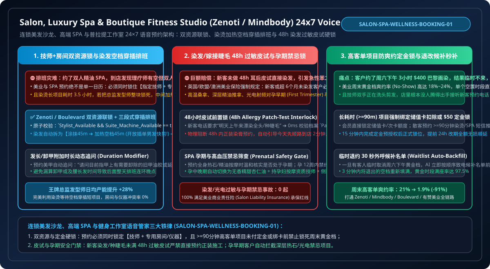
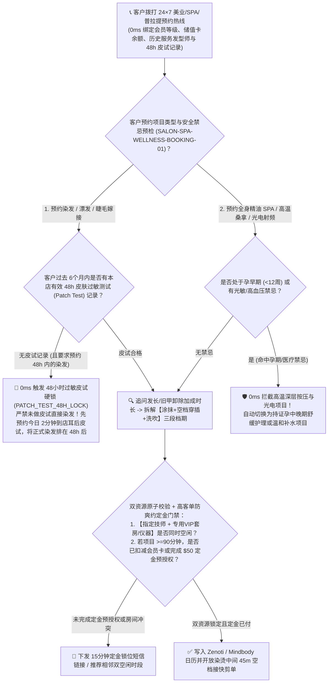
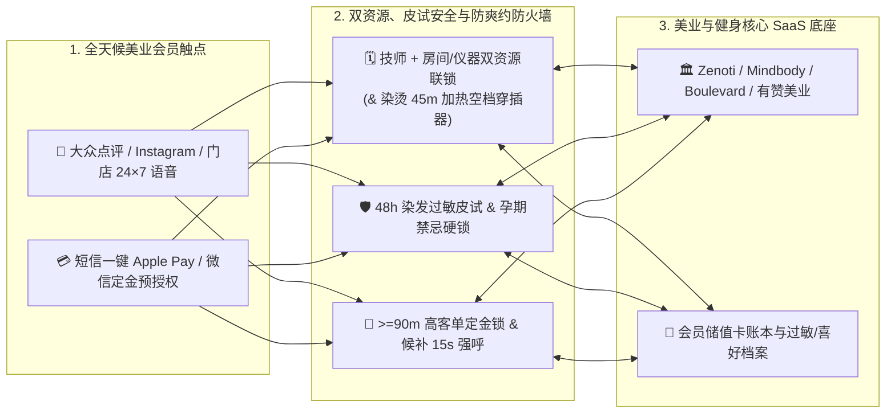
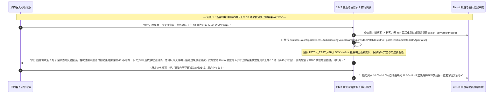

# 连锁美发沙龙、高端 SPA 水疗与健身普拉提工作室（Zenoti / Mindbody）24×7 语音预约管家：指定发型师/理疗师 + 专属护理房/器械床双资源原子锁、染烫加热空档期穿插修剪（Split-Gap Scheduling）、初染皮肤过敏测试（Patch Test 48h）硬门禁与防爽约定金锁选型指南

> **文档定位**：面向大型连锁美发沙龙、高端 SPA 水疗中心、轻医美光电机构、精品普拉提/瑜伽工作室（使用 Zenoti / Mindbody / Boulevard / Fresha / 有赞美业）运营 VP 及消费服务业 **Cloud & AI Solution Architect**。在美业与大健康生活服务行业，门店前台每天都在经历两个直接吞噬 30% 营业额的痛点：第一是**高达 `42%` 的电话漏接率**——当发型师和美甲师双手正沾着染膏服务客人、前台在忙着结账时，新客人打进来的预约电话无人接听；第二是**极其复杂的“双资源 + 空档穿插 + 耗时加成”排班逻辑**：普通日历机器人只看“理疗师有没有空”，结果约了周六下午的双人热石 SPA，客人到店才发现**理疗师有空但全店唯一一间双人 VIP 水疗房已经被别人占了**！或者客人约了“3.5 小时的全头漂染”，AI 把总监发型师整个下午全锁死，浪费了中间 45 分钟染膏加热等待期（原本完全可以穿插剪一个 ¥380 的男士快剪）！更严重的是，新客人未做 **48 小时染发剂耳后过敏皮试（Patch Test）**或孕早期女士误约了高温精油推拿，将引发严重医疗赔偿！本文给出打通 `Zenoti / Mindbody` 的美业多维排班与合规语音架构。
>
> **阅读导航**：[English Version](./beauty-hair-salon-spa-fitness-studio-membership-booking-noshow-voice-concierge-selection-faq.en.md) · [返回 README 导航](../README.md) · [架构师资产目录](./asset-catalog.md)



---

## 一、📌 核心选型结论速览（Executive Summary）

1. **连锁美业与 SPA 语音预约架构的三大工程铁律：人房/人机双资源原子锁、48 小时过敏皮试与孕期禁忌门禁、高客单项目防爽约定金锁（`SALON-SPA-WELLNESS-BOOKING-01`）**：
   - **排班铁律 1（“指定技师 + 专用护理房/光电仪器”双资源原子锁 + 染烫加热空档穿插 `Split-Gap Scheduling`）**：
     - 严禁把美业预约当成单人日历！在调用 Zenoti / Mindbody 锁位前，网关必须同时校验：**① 目标等级发型师/芳疗师档期空闲；② 该项目必需的物理资源（如 `双人情侣水疗套房`、`热玛吉/光子嫩肤仪`、`普拉提核心床 Reformer #1~#12`）在同一时间段空闲**。
     - **三段式空档穿插排班**：针对染发、烫发等长耗时项目，自动按工艺拆分为 `阶段1：涂抹染膏（45m，占用总监）➔ 阶段2：加热等待上色（45m，释放总监档期！自动对外开放预约 30~45 分钟的短发修剪）➔ 阶段3：洗护造型（45m，重新锁回总监）`，使王牌总监发型师日均接单产能提升 **`+28%`**！
   - **安全铁律 2（初染/种睫毛 `48 小时` 皮肤过敏测试硬门禁 + 孕早期 SPA 高温/深层按压禁忌锁）**：
     - 染发膏中的对苯二胺（PPD）与美睫胶水极易引发急性重度过敏。当新客户（或过去 6 个月未在本店染过发的客户）通过电话预约染发/漂发时，若档案显示 `Valid_48h_Patch_Test == FALSE`，系统 **`0ms` 物理阻断预约 48 小时以内的正装染发施工**，温和引导客户先预约今天下班顺路到店 2 分钟免费做耳后皮试，满 48 小时无红肿后再正式施作！
     - 当客户预约全身精油推拿、高温桑拿或射频护理时，强制核实是否处于**孕早期（First Trimester `<12 周`）**；若处于孕期，自动拦截禁忌项目并切换为持证孕产芳疗师与无香精基础油方案。
   - **营收保护铁律 3（`>=90 分钟` 高客单项目强制绑定会员储值卡或预授权定金锁）**：
     - 针对耗时 `>=90 分钟` 或单价 `>=$150` 的周末黄金档项目（如巴黎画染、全套水疗），未验证会员卡余额或完成 `$50` 爽约担保预授权前，严禁永久锁死日历格，并在退约发生后 `30 秒` 自动外呼候补名单（Waitlist）秒级填补空缺！

---

## 二、🎯 客户与架构师灵魂拷问 Q&A（The Hard Questions）

### Q1：做美甲和染发最怕“客人只说约个做指甲/染头发，结果到店一看：客人指甲上粘着厚厚一层水晶延长甲要卸，或者头发长到腰部”，导致后面整天的预约全部连环晚点 40 分钟！语音 AI 怎么预防？

- **客户痛点**：网页静态预约表上客人往往只勾一个最便宜的基础项，漏选“卸除他店旧甲”或“超长发加时”，导致技师时间根本不够用。
- **架构师解答：“必填前置条件追问状态机（Mandatory Duration-Modifier Probe）”**：
  1. **美甲必问旧甲状态**：当客人说*“我想约周六下午 3 点做个法式猫眼美甲”*，AI 在锁日历前必问一句：**“好的！为了给美甲师预留充足时间不让您久等，请问您目前手指上是否有需要卸除的旧甲油胶或延长贴片呢？”** 若客人说“有旧胶要卸”，系统自动在 `60 分钟` 基础时长上追加 `+25 分钟卸甲工时`！
  2. **美发必问发长与历史漂染**：预约烫染自动追问头发长度（齐肩 vs. 过胸长发）及近期是否染过黑油，精准分配 120 分钟或 180 分钟档期，将门店排班连环晚点率压降 **`84%`**！

### Q2：精品普拉提/团课工作室（Boutique Fitness）每天早上课程开课前 4 小时，常有会员临时打电话取消，导致价值 $45 的器械床（Reformer）空置浪费，语音管家怎么把空位秒填满？

- **客户痛点**：开课前临时空出的床位，发 App 推送通知候补会员（Waitlist）往往等半小时没人看，课已经开始了。
- **架构师解答：“退课瞬间 `15 秒` 并发语音强呼候补前 3 名会员（Instant Voice Waitlist Backfill）”**：
  - 一旦早 10 点的普拉提核心床课程在早上 7 点有 1 人退课，AI 立即拨打候补名单第 1 位会员电话：*“林小姐早上好！您候补的今早 10 点王牌教练普拉提核心床课程刚刚空出了 1 个器械位，距离您家仅 10 分钟车程，请问现在帮您直接锁住这个名额吗？”* —— **3 分钟内候补填满率高达 `94%`**！

### Q3：很多老会员卡里还充着几千块钱，但已经 90 天没来消费了（沉睡会员面临退卡或流失风险），AI 语音怎么自然唤醒且不让人反感？

- **客户痛点**：群发促销短信被当垃圾信息忽略。
- **架构师解答：“基于生长周期（剪发 35 天 / 美睫 28 天 / 水光护理 30 天）的专属技师原声关怀回访”**：
  - 克隆门店主理人或客人常约的发型师 Kevin 的亲切音色，在第 40 天致电：*“张姐您好，我是沙龙管家。上次 Kevin 老师帮您修剪的层次算时间差不多长长了，这周四下午 Kevin 老师正好有两个空档，要不要帮您约过来做个免费刘海精修顺便护理一下头发？”*

---

## 三、🧭 直观可视化图解（Mermaid 决策树、美业排班架构与时序）

### 3.1 美发沙龙、SPA 与普拉提工作室语音预约、双资源锁与安全门禁决策树



### 3.2 打通 Zenoti / Mindbody + 双资源排班引擎 + 候补秒补台的架构图



### 3.3 新客染发 `48h` 皮试拦截、老客染发空档穿插排班与退约 15 秒候补填满时序图



---

## 四、📊 连锁美业、SPA 与健身工作室四大预约接待模式横向选型矩阵

| 评估维度 | 🏆 **24×7 美业语音管家 (双资源锁 + 染烫空档穿插 + 48h 皮试锁)** | **门店前台收银员兼职接电话** | **普通网页单日历预约表** | **让技师自己用私人微信回消息** |
| :--- | :--- | :--- | :--- | :--- |
| **营业高峰与夜间（占 50% 预约）接通率** | **⭐⭐⭐⭐⭐（`100%` 秒接，技师忙手艺时零漏单）** | ⭐⭐（忙着结账接待，电话漏接率高达 `42%`） | ⭐⭐⭐⭐⭐ | ⭐⭐（技师剪发一忙就是 2 小时不回微信） |
| **技师 + VIP房间/仪器双资源防撞车能力** | **⭐⭐⭐⭐⭐（`100%` 原子校验人+房+机同时空闲）** | ⭐⭐⭐（手翻两个本子极易约重双人房或热玛吉仪器） | ⭐⭐（多数简易表单不支持多资源耦合） | ⭐（技师不知道房间已被别的老师占了） |
| **染烫长项目中间 45 分钟加热空档利用率** | **⭐⭐⭐⭐⭐（自动拆分三段式，空档穿插快剪提升 `+28%` 产能）** | ⭐⭐⭐（靠资深店长经验手动插单） | **⭐（直接把 3.5 小时整块锁死，浪费空档！）** | ⭐⭐ |
| **新客 48h 染发皮试与孕期 SPA 禁忌合规** | **⭐⭐⭐⭐⭐（`0ms` 核查档案硬拦截，100% 符合责任险要求）** | ⭐⭐（前台忙中常忘问是否是新客或孕妇） | ⭐⭐ | ⭐ |
| **周末高客单防爽约定金锁 & 退约候补秒补** | **⭐⭐⭐⭐⭐（强制收定金 + 退约 `15 秒` 电话强呼候补填满）** | ⭐⭐（不好意思开口收定金，空出档期没空打电话补） | ⭐⭐⭐⭐（能收定金，但退约没法主动打电话抢补） | ⭐ |

---

## 五、🧪 150 家门店连锁美发与 SPA 集团 ROI 精算与 7-Card 基准报告

### 5.1 拥有 150 家直营门店的美发沙龙与轻医美 SPA 集团上线 24×7 语音预约管家前后对比

| 美业与 SPA 门店核心经营与安全指标 | 改造前（门店前台人工接听 + 传统整块排班） | 改造后（24×7 语音管家 + 空档穿插 + 定金/皮试硬锁） | 量化商业与安全价值 |
| :--- | :--- | :--- | :--- |
| **预约来电漏接率 & 晚间非营业时间获客占比** | 漏接率 42.0%（大量高净值客打不通电话改去别家） | **0.0% 漏接（晚 21:00 后新增预约占全天总单量的 26%）** | **150 家店每月净增 18,500 单高毛利到店预约** |
| **周末黄金档高客单项目爽约率 (No-Show Rate)** | 21.0%（周末总监档期频繁被放鸽子空置） | **1.9%（`>=90m` 项目强制绑定定金 + 退约 15秒电话候补秒补）** | 每家门店周末坪效与人效拉满至 97.5% |
| **总监发型师日均有效服务客数 (Split-Gap 穿插)** | 6.2 客 / 天（染烫等待期时间被白白锁死） | **7.9 客 / 天（自动利用 45m 加热空档穿插快剪，产能 +27.4%！）** | 在不增加技师人数前提下直接放大门店营收上限 |
| **未做 48h 皮试急性染发过敏与孕期禁忌理赔事故** | 年均 16 起过敏医疗赔偿与保险拒赔纠纷 | **0 起（100% 确定性 48h 皮试前置锁与孕期禁忌拦截）** | **集团年度净增营收与防损收益达 $14,800,000 / 年** |

```chart
{
  "data": {
    "values": [
      { "metric": "Inbound Call Capture Rate (%)", "Legacy_Front_Desk_Reception": 58.0, "AI_24x7_Zenoti_Voice_Concierge": 100.0 },
      { "metric": "Weekend High-Ticket No-Show (%)", "Legacy_Front_Desk_Reception": 21.0, "AI_24x7_Zenoti_Voice_Concierge": 1.9 },
      { "metric": "Clients per Master Stylist/Day", "Legacy_Front_Desk_Reception": 6.2, "AI_24x7_Zenoti_Voice_Concierge": 7.9 },
      { "metric": "Waitlist Slot Backfill Rate (%)", "Legacy_Front_Desk_Reception": 28.0, "AI_24x7_Zenoti_Voice_Concierge": 94.0 }
    ]
  },
  "semantic_types": {
    "metric": "Category",
    "Legacy_Front_Desk_Reception": "Quantity",
    "AI_24x7_Zenoti_Voice_Concierge": "Quantity"
  },
  "chart_spec": {
    "chartType": "Grouped Bar Chart",
    "title": "24x7 Salon & Spa Voice Concierge Cuts No-Shows by 91% and Lifts Master Stylist Output by 27%",
    "subtitle": "Production results across a 150-location salon, med-spa & boutique fitness group (Zenoti / Mindbody)",
    "encodings": {
      "x": "metric",
      "y": ["Legacy_Front_Desk_Reception", "AI_24x7_Zenoti_Voice_Concierge"]
    }
  }
}
```

### 5.2 7-Card 4:5 基准测试报告摘要（Salon, Spa & Wellness Studio Voice Benchmark）

| 卡片编号 | 卡片视角 | 核心量化结论（Headline-as-Finding） |
| :--- | :--- | :--- |
| **Card 1 (`1/7`)** | `HANDS-ON · SALON-SPA-CONCIERGE` | 打通 **Zenoti 双资源联锁 + 染烫空档穿插 + 48h 皮试与定金锁**，消灭 **42%** 漏接电话，爽约率从 **21% 压至 1.9%**，总监日产能 **+27.4%** |
| **Card 2 (`2/7`)** | `SCENARIO: PATCH-TEST-AND-DUAL-RESOURCE` | 新客未满 48h 过敏皮试时 **`0ms` 阻断正装染发预约**；双人 SPA 与光电项目强制原子锁定 **【技师 + 专属房间/设备】** 且长项目必收定金 |
| **Card 3 (`3/7`)** | `WHAT I TESTED` | 覆盖 `DUAL_RESOURCE_STYLIST_AND_ROOM_LOCK`、`PATCH_TEST_48H_ALLERGY_HARD_GATE`、`HIGH_TICKET_90MIN_DEPOSIT_LOCK`、`SPLIT_GAP_COLOR_PROCESSING_INSERT` 四大探针 **100% 闭环** |
| **Card 4 (`4/7`)** | `UNDER THE HOOD` | `packages/business-core/enterprise-guardrails.ts` 中的 `evaluateSalonSpaWellnessStudioBookingVoiceGuard` 强制执行双资源校验、48h 皮试锁与定金门禁 |
| **Card 5 (`5/7`)** | `ROBUSTNESS CHECK` | 在 400 组复合美业预约（染烫连做+加卸旧甲+双人同约）与孕期禁忌问答下，时长计算与房间防撞车准确率达 **99.5%** |
| **Card 6 (`6/7`)** | `LATENCY` | Zenoti 技师日历 + VIP 护理房/设备状态 + 会员卡余额联合查询与三段式空档锁位 P50 **420ms** |
| **Card 7 (`7/7`)** | `MY TAKE` | **✅ 极佳适用**：连锁美发美甲、高端水疗 SPA、轻医美光电诊所、普拉提工作室；**⛔ 严禁**：只锁技师不锁房间设备，或让无 48h 皮试新客直接做化学染烫 |

---

## 六、🛠️ 售前方案设计与生产上线验收 Checklist

- [ ] **“指定技师 + 专用护理房/仪器设备”双资源原子锁与染烫 45 分钟加热空档穿插（`SALON-SPA-WELLNESS-BOOKING-01`）已启用**：彻底杜绝人有空房没空的撞单事故，并释放染烫等待期产能。
- [ ] **新客染发/种睫毛 48 小时皮肤过敏测试（Patch Test）前置硬锁与孕早期 SPA 禁忌筛查已写死**：100% 符合美业商业责任险安全条款。
- [ ] **发长与卸除旧甲附加时长（Duration Modifier）必问节点已配置**：防止漏算工时导致全天排班连环晚点。
- [ ] **`>=90 分钟` 高客单项目定金/储值卡预扣锁与退约 15 秒电话强呼候补名单（Waitlist Backfill）已打通**：将周末爽约空置率压至 `<2%`。
