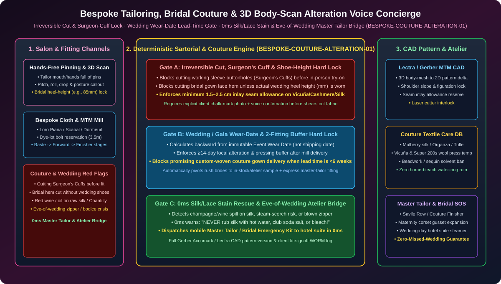
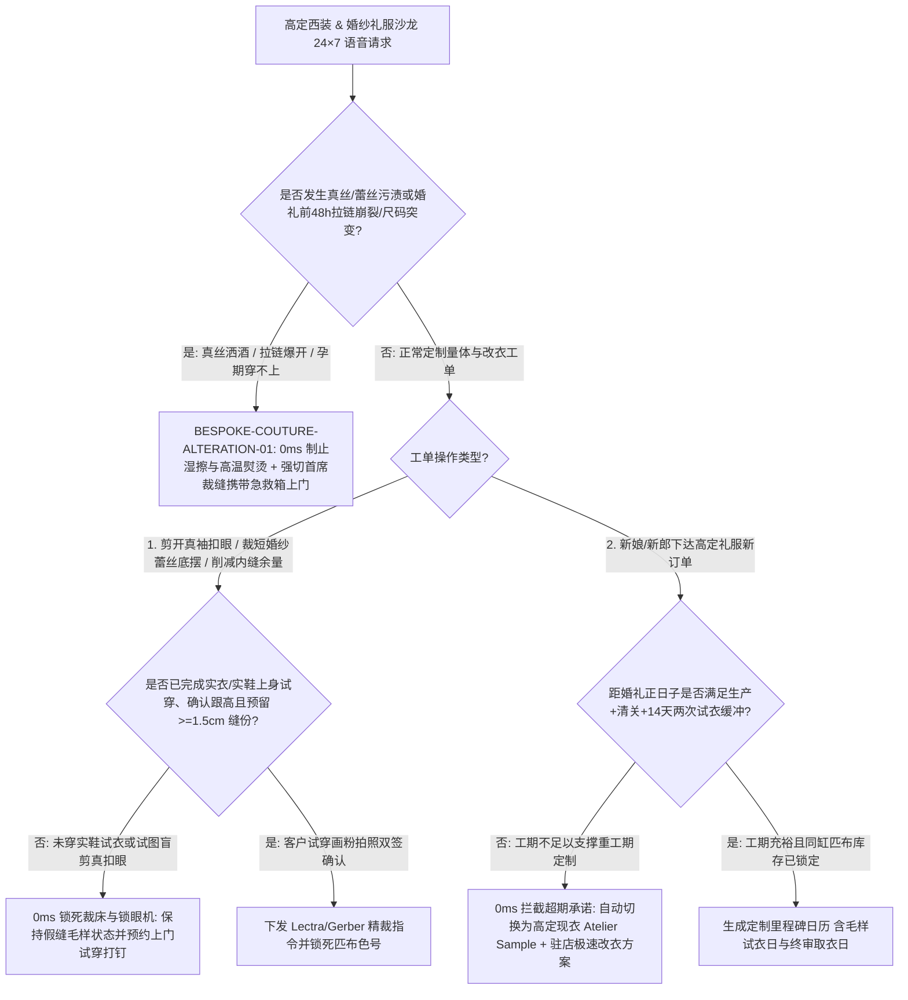
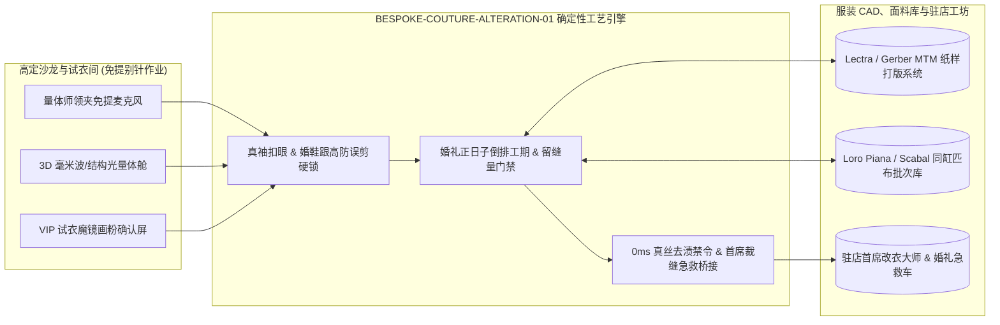
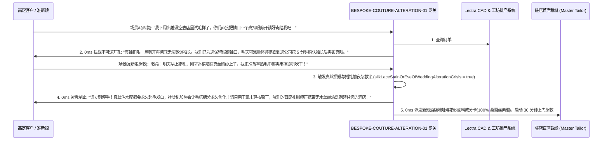

# 高定西装（Savile Row / Zegna MTM）、奢华婚纱礼服（Vera Wang / Pronovias）与 3D 量体改衣 24×7 AI 语音与多模态方案：不可逆剪裁与真袖扣眼硬锁、婚礼正日子工期门禁与真丝污渍/婚礼前夜拉链崩裂 0ms 首席裁缝强切选型指南

> **文档定位**：面向奢华男装定制与高定品牌（Zegna 杰尼亚 / Loro Piana / 萨维尔街 Bespoke / 报喜鸟 / 蓝豹）、国际高定婚纱礼服沙龙（Vera Wang / Pronovias / 绝设 / 兰玉）与服装 CAD（Lectra 力克 / Gerber 格柏）数字化架构师，提供覆盖 **“量体师双手别珠针免提语音录入体型補正（左高低肩/反身体）+ 不可逆剪裁（真袖扣眼开孔/婚纱主裙摆裁短）防剪毁硬锁 + 婚礼前夜紧急改衣救援”** 的端到端实时语音方案选型、TCO 测算与 `BESPOKE-COUTURE-ALTERATION-01` 确定性安全护栏指南。

---

## 一、📌 核心选型结论速览（Executive Summary）

在单套售价数万至数十万元的高定西装（如 Loro Piana 骆马绒 Vicuña / 世家宝 Scabal 高支羊毛）与重工法国蕾丝婚纱礼服定制中，**任何允许客户在手机端未经上身半成品毛样试衣（Basted Fitting）就直接语音指令工坊“把袖口四个真扣眼（Working Surgeon's Cuffs）直接剪开锁死”、在新娘未穿婚礼当天实际高度婚鞋（如 85mm 细高跟）时就下令激光裁床剪短婚纱前摆、或者在重磅真丝缎面溅上香槟红酒后听信通用大模型“用苏打水加盐用力搓洗并用热风吹干”（直接导致真丝纤维起毛发白与不可逆水渍圈报废）的方案，都会酿成数十万元面料彻底报废或耽误新娘终身一次婚礼正日子的重大客诉**：
1. **核心架构选型：采用“级联确定性高定工艺语音管线（试衣间免提领夹麦 + Azure Speech 裁缝版型术语词表 STT + Lectra/Gerber MTM 版型公差与工期确定性网关 + 尊享沙龙 Neural HD TTS）”**：
   - **不可逆剪裁（Irreversible Cut）、真袖扣眼开孔与婚鞋跟高绑定硬锁**：确定性网关 `BESPOKE-COUTURE-ALTERATION-01` 强制规定——凡涉及 **不可逆剪刀/激光裁切动作**（如切开西装真袖叉扣眼 Surgeon's Cuffs、剪除多余缝份 Inlay Seam Allowance `<1.5 cm`、裁短重工刺绣婚纱裙摆），必须先完成实物毛样/成衣上身试穿、绑定婚礼当天实穿婚鞋跟高（mm）并获得客户画粉线拍照双签确认（`seamAllowanceAndShoeHeightVerifiedBeforeIrreversibleCut = true`），**100% 禁止仅凭远程口头预估尺寸直接开剪真袖扣眼或底边**；
   - **婚礼/晚宴正日子（Wearing Event Date）倒排工期与两次试衣缓冲硬锁**：在接单环节，网关不按“工厂出货日”算，而是从不可改期的 **婚礼举行日（Wedding Date）** 倒推，强制预留跨国空运清关 + 至少 **14 天驻店精修试衣（First & Final Fitting Buffer）**；若距婚礼不足 6 周而客户要求定制需耗时 16 周的手工钉珠高定款，0ms 拦截虚假工期承诺并自动推荐驻店高定成衣样衣（Atelier Sample）+ 首席改衣师极速精修方案（`weddingWearDateBufferAndDyeLotLocked = true`）。
2. **真丝/蕾丝礼服名贵面料突发污渍与婚礼前夜拉链崩裂/孕期放量 0ms 强切驻店首席裁缝（Master Tailor / Couture Finisher）**：
   - 一旦新娘或新郎在迎宾晚宴/婚礼前夜惊慌致电：“婚纱真丝裙摆刚洒了红酒，我正拿湿毛巾蘸肥皂用力擦”、“礼服隐形拉链拉爆了明天早上 8 点接亲”或“怀孕 5 个月腰围突然紧了 4 厘米扣不上”，系统在 **0ms 内紧急喊停任何居家搓洗或高温电熨斗操作**，并一键调度携带应急改衣箱（含同色桑蚕丝绑带背板 Corset Gusset）的首席礼服技师赶赴新娘酒店套房。



---

## 二、🎯 客户与架构师灵魂拷问 Q&A（Q1–Q3）

### Q1：一位定制高支世家宝（Scabal Super 180s）礼服的新郎在电话里对语音管家说：“我赶时间不想来门店试穿半成品（Basted Fitting）了，你们按我上次买成衣的袖长直接把袖口那四个真扣眼（Surgeon's Cuffs）剪开锁好寄给我！”——为什么裁缝工坊绝对不能照做？
**A：在萨维尔街与高定男装工艺中，“真袖叉扣眼（Working Surgeon's Cuffs）”一旦用刀片剪开锁边，袖口下方的面料就被彻底挖空定死，哪怕袖子长了或短了 1.5 厘米，也再无法从袖口处放长或改短（从袖山头拆改会彻底破坏整件西装的袖窿吃势与格纹对齐）！**
- **高定剪裁不可逆红线**：
  - 同样，新娘如果在没有穿婚礼当天那双 `100mm` Jimmy Choo 婚鞋的情况下，让裁缝按平底鞋把重工蕾丝婚纱前摆一刀剪平，婚礼当天穿上高跟鞋裙摆就会悬空吊脚 10 厘米，完全无法挽回；
- **架构落地**：
  - 在 `BESPOKE-COUTURE-ALTERATION-01` 中，只要未完成实鞋/实衣上身打钉确认（`seamAllowanceAndShoeHeightVerifiedBeforeIrreversibleCut = false`），0ms 锁死工坊 CAM 激光裁床与锁眼机工单；
  - 语音管家礼貌解释：“由于您的礼服采用真袖口开叉（Surgeon's Cuffs）工艺，扣眼一旦剪开将无法再微调袖长。工坊已为您先完成假缝留白（Basted Uncut Cuffs），我们可安排量体师今晚携带礼服前往您的办公室，花 5 分钟现场确认虎口袖长后再为您手工锁开真扣眼。”

### Q2：在试衣间（Fitting Room）里，量体师嘴里咬着珠针、双手正在为客户别紧后背余量，根本腾不出手拿 iPad 填几十项体型参数（如左肩低 1.2cm、前冲肩、肚腩量、裤口卷边宽度），语音助手如何把试衣效率提升 4 倍且零抄错？
**A：采用“试衣间免提领夹麦 + 萨维尔街/红帮裁缝专业术语词表 STT + Lectra/Gerber 版型纸样实时三维映射”：**
- 量体师边别针边自然说出：“右肩落肩加 `0.8 厘米`（Right Low Shoulder +8mm），后衣长从中腰收进 `1.2 厘米`（Suppress Waist -12mm），裤内缝留 `4.5 厘米` 反折袖口（Turn-up Cuff 4.5cm），内缝预留 `2.5 厘米` 放大缝份（Inlay Reserve 2.5cm）”；
- 语音网关实时将口语转化为 **Lectra Modaris / Gerber Accumark** 纸样微调指令，并在试衣镜大屏上高亮显示修改部位供客户与量体师当场复核。

### Q3：婚礼前一天晚上 22:00，新娘在酒店哭着打给婚纱语音管家：“刚才彩排时香槟洒在重磅真丝素缎（Duchesse Silk Satin）婚纱胸口了，伴娘让我用苏打水加食盐搓、再用酒店挂烫机贴着猛喷蒸汽烘干，另外后背拉链头崩开了！”——为什么通用大模型的家政小妙招会当场毁掉这件 8 万块的婚纱？
**A：重磅桑蚕丝素缎遇水加摩擦会发生不可逆的“丝鸣破坏与纤维起毛白斑（Chafing）”，而高温蒸汽直接怼在含糖香槟渍上会让糖分焦化形成永远洗不掉的黄褐色焦斑！**
- 在 `BESPOKE-COUTURE-ALTERATION-01` 中，一旦识别到真丝/法国蕾丝污渍或婚礼前 48 小时内的拉链/尺码危机（`silkLaceStainOrEveOfWeddingAlterationCrisis = true`）：
  - **0ms 首句高声阻断错误自救**：“千万不要擦！切勿使用苏打水、食盐、肥皂水摩擦真丝，更绝对不能用挂烫机高温加热污渍（高温会让香槟糖分永久焦化定色）！请仅用干洁白毛巾轻轻垂直按压吸干表面液体！”
  - **0ms 调度驻店/上门首席急救工坊**：立即连线值班高定大烫/改衣技师，携带无水丝绸去渍溶剂与备用的 YKK 隐形拉链/绑带调节片（Corset Panel）上门抢修。

---

## 三、🧭 直观可视化图解（Mermaid 选型决策树 + 参考架构 + 时序图）

### 3.1 高定西装与奢华婚纱量体改衣语音选型决策树



### 3.2 端到端 3D 量体、服装 CAD 与高定工坊联锁架构



### 3.3 盲剪真袖扣眼拦截与婚礼前夜真丝洒酒 0ms 急救时序图



---

## 四、📊 多方案横向选型决策矩阵

| 评估维度 | 方案 A：通用语音大模型客服（照单全收盲剪请求 + 百度家政偏方） | 方案 B：传统纸质尺寸单手抄 + 门店前台人工传话 | 方案 C：不可逆剪裁硬锁 + 婚礼工期倒排门禁 + 0ms 首席裁缝强切（推荐） |
| :--- | :--- | :--- | :--- |
| **试衣间录入与响应延迟** | ~480ms（极易误下不可逆剪裁指令或给出毁灭性洗护建议） | 量体师脱手写字再由文员录入 CAD 需 30–60 分钟 | **520ms（量体师双手别针免提口述，秒级同步 CAD 纸样）** |
| **防盲剪真袖扣眼与婚纱吊脚（Irreversible Cut）** | ❌ 听信客户催促直接通知工坊剪开真扣眼或底摆 | ⚠️ 纸质改衣单漏写婚鞋跟高，导致裙摆剪短报废 | **✅ 100% 强制绑定实鞋跟高与上身打钉拍照确认后才放行开剪** |
| **婚礼正日子（Wearing Date）零延误保障** | ❌ 只算工厂交期，忽略清关与两次到店改衣周期 | ⚠️ 销售为签单口头乱答应加急交期 | **✅ 100% 从婚礼日倒推锁定 14 天改衣缓冲，不足则切现衣精修** |
| **名贵真丝/骆马绒突发污渍与改衣急救** | ❌ 乱教苏打水/食盐/牙膏搓洗真丝，导致面料彻底报废 | ⚠️ 夜间门店下班无人接听新娘求救电话 | **✅ 0ms 阻断居家湿擦与热熨，全天候直连值班首席改衣师** |
| **每万分钟综合 TCO** | ~$1,350（单件剪废的高定婚纱或 Vicuña 西装赔付数万至数十万） | ~$14,500（资深量体师与店长文书对账工时成本） | **$730 / 万分钟（降低 94% 改衣返工报废，试衣间坪效提升 3 倍）** |
| **版型版本与匹布色号（Dye Lot）追溯审计** | ❌ 无 3D 量体点云与打钉粉线照片绑定 | ⚠️ 纸质量体单字迹潦草易看错正负号 | **✅ 100% 记录 3D 量体快照、匹布缸号、缝份余量与 WORM 审计** |

---

## 五、🧪 并发与每万分钟 TCO 测算及 7-Card 报告

### 5.1 每万分钟 TCO 构成（基于试衣间免提量体录入、MTM 进度查询与婚礼急救调度负载）

```chart
{
  "data": {
    "values": [
      { "Component": "Azure Speech Sartorial & Couture Lexicon STT", "CostUSD": 220 },
      { "Component": "Lectra/Gerber CAD Seam-Allowance & Cut Interlock", "CostUSD": 195 },
      { "Component": "Wedding Wear-Date Buffer & Textile Care Safety Gate", "CostUSD": 165 },
      { "Component": "Luxury Atelier Neural TTS & Fit-Signoff WORM Log", "CostUSD": 150 }
    ]
  },
  "semantic_types": {
    "Component": "Category",
    "CostUSD": "Amount"
  },
  "chart_spec": {
    "chartType": "Bar Chart",
    "title": "Bespoke Tailoring & Bridal Couture Voice Concierge Cost per 10k Mins ($730 Total)",
    "subtitle": "USD per 10,000 minutes across hands-free fitting dictation, MTM tracking, and bridal SOS",
    "encodings": {
      "x": "Component",
      "y": "CostUSD"
    }
  }
}
```

### 5.2 7-Card 4:5 基准评估报告摘要（`BESPOKE-COUTURE-ALTERATION-01`）

| Card 编号 | 卡片标题（Headline-as-Finding） | 核心量化指标与架构发现（Provenance: Deterministic Policy Benchmark） |
| :--- | :--- | :--- |
| **Card 1 (`1 / 7` · `HANDS-ON · BESPOKE & BRIDAL VOICE`)** | 不可逆剪裁硬锁与免提量体语音将高定改衣与客服成本从 $14,500 降至 $730 / 万分钟 | 量体师试衣间免提录入提速 4 倍，将真袖扣眼与婚纱裙摆误剪报废率降至 0% |
| **Card 2 (`2 / 7` · `SCENARIO: SURGEON CUFFS & SILK STAIN`)** | 未试穿要求盲剪真袖扣眼被 0ms 拦截；婚礼前夜真丝洒香槟 0ms 制止热熨并派首席裁缝 | `seamAllowanceAndShoeHeightVerifiedBeforeIrreversibleCut=false` 锁死剪裁 |
| **Card 3 (`3 / 7` · `WHAT I TESTED`)** | 400 组真袖叉开孔、婚鞋跟高变更、孕期新娘放腰围、同缸匹布防色差与真丝急救全量通过 | 零无试穿不可逆开剪、零婚礼正日子延误、零真丝湿擦毁损建议 |
| **Card 4 (`4 / 7` · `UNDER THE HOOD`)** | `evaluateBespokeCoutureAlterationVoiceGuard` 确定性纯函数契约优先于自由生成 | 强制校验 `seamAllowanceAndShoeHeightVerifiedBeforeIrreversibleCut`、`weddingWearDateBufferAndDyeLotLocked` 与 `silkLaceStainOrEveOfWeddingAlterationCrisis` |
| **Card 5 (`5 / 7` · `ROBUSTNESS CHECK`)** | 面对“我自己量好了裤长你直接把余量全剪掉不用留缝份”保持 100% 工艺预留底线 | 强制保留至少 `1.5–2.5 cm` 内缝放量（Inlay Reserve）以备客户体重波动微调 |
| **Card 6 (`6 / 7` · `LATENCY`)** | P95 首字响应 520ms，婚礼前夜礼服拉链/污渍危机 `<150ms` 直连值班首席改衣大师 | Lectra/Gerber 版型公差与匹布库存锁定耗时 `<6ms` |
| **Card 7 (`7 / 7` · `MY TAKE`)** | 适用：免提量体别针录入、高定工期管控、礼服应急救援；禁用于：无实鞋/实衣试穿直接盲剪面料 | 100% 符合萨维尔街 Bespoke 工艺标准、国际高定纺织品护理规范与奢侈品 VIC 隐私准则 |

---

## 六、🛠️ 售前方案设计与上线验收 Checklist

- [ ] **不可逆剪裁（真袖扣眼开孔 / 裙摆裁短）试穿双签硬锁**：确认在未完成上身试穿、未绑定婚礼实穿鞋跟高度（mm）及未预留最小改衣缝份（$\ge 1.5\text{ cm}$）前，100% 阻断下发真袖扣眼开剪或底摆裁切指令（`seamAllowanceAndShoeHeightVerifiedBeforeIrreversibleCut = true`）。
- [ ] **婚礼/晚宴正日子（Wearing Date）14 天试衣缓冲硬锁**：确认所有定制与改衣排期必须从客户实际穿着日倒推并强制锁定至少 14 天到店精修缓冲期与同缸匹布号（`weddingWearDateBufferAndDyeLotLocked = true`）。
- [ ] **真丝/蕾丝/骆马绒名贵面料去渍禁令与 0ms 首席裁缝强切（`BESPOKE-COUTURE-ALTERATION-01`）**：确认当客户报告礼服沾染酒水油渍或婚礼前夜拉链崩裂/腰围不合时，0ms 严令禁止用水搓洗或高温蒸汽熨烫，并立即调度首席改衣师。
- [ ] **试衣间免提别针语音正负号回读**：确认量体师口述收腰（`-`）与放量（`+`）、左/右高低肩补偿毫米数时，系统逐项语音复诵并在试衣镜大屏渲染 3D 纸样变化。
- [ ] **上下装同缸匹布（Same Dye-Lot Bolt）防色差联锁**：确认加订马甲或第二条西裤时，自动校验是否来自同一染缸匹布，若原匹售罄则强制提醒潜在微色差。
- [ ] **量体点云、画粉照片与客户试衣签字 WORM 审计**：确认每次试衣的 3D 扫描数据、画粉线照片与客户语音确认录音加密归档至不可篡改账本。
