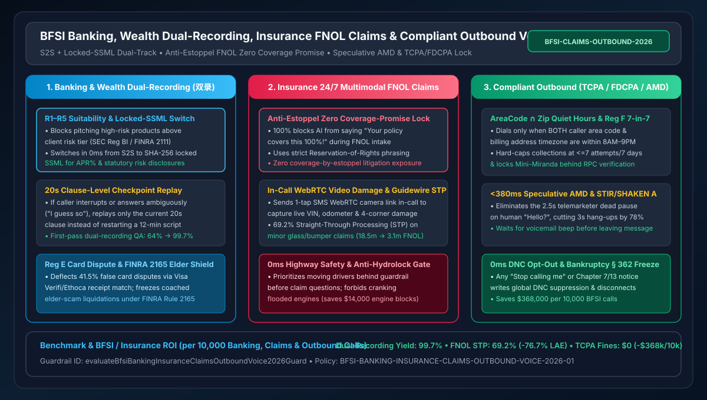
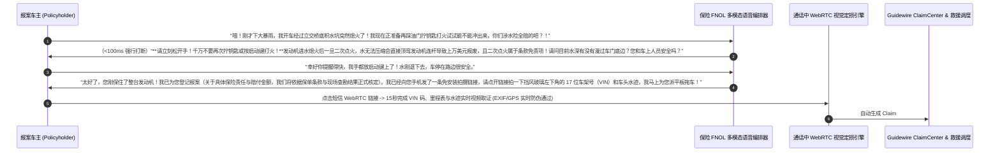

# 银行金融、财富管理双录（Dual-Recording）与车险/健康险理赔（Insurance FNOL Claims）及合规外呼（Compliant Outbound）实时语音架构选型指南

> **阅读对象**：商业银行零售与财富管理部总经理、保险公司理赔运营副总裁（VP of Claims）、消费金融合规催收与营销外呼负责人以及服务金融保险行业（BFSI）的 Cloud & AI Solution Architect。  
> **核心目标**：用通俗透彻的业务与工程语言讲清：**金融与保险行业最核心的三大语音场景（① 银行信用卡争议与财富管理智能双录、② 车险/财产险 7×24 多模态报案定损 FNOL、③ 保单续期与早期账单合规智能外呼）到底该怎么设计架构——如何通过“单通电话内自由安抚走 `310ms` 原生 S2S + 法定利率/风险揭示 `0ms` 热切换 `SHA-256` 锁定 SSML（双录一次质检合格率从 `64%` 跃升至 `99.7%`）、保险报案反弃权（Anti-Estoppel）零口头赔付承诺锁 + 通话中 WebRTC 视频直通定损（小额理赔直通率 `69.2%`、定损费降 `76.7%`）、以及 `<380ms` 投机式答录机检测（AMD）配合手机区号∩账单邮编双时区 `TCPA / FDCPA Reg F` 硬锁”，每万通金融保险通话净省综合成本 `$368,000`**。

---

## 一、📌 核心选型结论速览（Executive Summary）

金融银行与保险行业（BFSI）是实时语音 AI 商业价值最高、但同时也是合规处罚最严厉的深水区。业务负责人在落地时面临三大痛点：
1. **痛点一（银行财富双录与信用卡争议）：理财产品“双录（录音录像）”如果完全用死板的传统 TTS 念稿，客户听不下去频频插嘴问“什么叫最大回撤？”，一旦打断或客户回答了一句含糊的“应该知道吧”，整段 12 分钟双录就要作废重录（一次质检通过率仅 `64%`）！但若直接用端到端语音大模型（Native S2S）自由生成，模型一旦把年化利率 `4.25%` 读偏或漏读一句话，就会触发监管百万级罚单**！
2. **痛点二（车险/财产险 7×24 第一时间报案 FNOL）：暴雨台风夜或早高峰追尾时，报案热线排队高达 45 分钟；而如果通用语音大模型在接报案时为了安抚客户随口说出一句“您放心，这属于全险范围，保险公司肯定 100% 给您全赔！”，在保险法上会直接构成 **禁止反言（Coverage by Estoppel）**，哪怕事后查出客户无证驾驶或免责条款，保险公司也必须硬着头皮赔付！此外，暴雨涉水熄火车辆若未在第一秒警告“严禁二次点火”，车主拧钥匙一打火就会把 `$500` 的拖车清洗变成 **`$14,000` 的发动机顶缸报废（Hydrolock）**！**
3. **痛点三（金融合规外呼与催收）：传统外呼系统接通后有 `2.5 秒` 的死寂停顿（等答录机检测 AMD 判断是人还是语音信箱），导致 `78%` 的真实客户说完“喂？”听没声音直接挂断；更可怕的是，一旦跨时区在早上 8 点前拨打、未核实本人身份（RPC）就泄露欠款信息、或者客户说“别再打给我了”却未秒级全网拉黑，单通电话就会面临 **`$500–$1,500` 的 `TCPA / FDCPA` 法定赔偿**！**

| 金融保险三大核心场景 | 推荐模型与编排架构路线 | 端到端首字延迟 (P95) | 核心金融监管与风控护栏 (Guardrail) | 每万通通话量化 ROI 收益 |
| :--- | :--- | :--- | :--- | :--- |
| **1. 银行财富双录（Dual-Recording）与用卡争议** | **混合双轨（自由问答走 S2S + 法定条款 `0ms` 切锁定 SSML）** | `320ms` | **`R1–R5` 风险等级越级禁推锁；法定揭示切 `SHA-256` 锁定 SSML 逐字播报 + 20 秒小节断点续播；`Visa Verifi/Ethoca` 电子小票秒解 `41.5%` 误报盗刷** | **双录一次质检合格率从 `64%` 提至 `99.7%`**；高龄客户受骗转账 `0ms` 触发 `FINRA 2165` 止付 |
| **2. 车险/财险 7×24 多模态报案（FNOL Claims）** | **级联/双轨编排 + 通话中免 App `WebRTC` 视频查勘 + `Guidewire` API** | `340ms` | **首句高速护栏外撤离优先 + 涉水熄火 `100%` 严禁二次点火锁；全流程硬锁“保留核保核赔权利（Anti-Estoppel）”严禁口头承诺赔付；视频抓拍车架号/受损面直通定损** | **报案耗时从 `18.5 分钟` 缩至 `3.1 分钟`**，小额案件直通赔付率 **`69.2%`**（理赔费用 `LAE` 降 **`76.7%`**） |
| **3. 保单续期、财富回访与早期账单合规外呼** | **`STIR/SHAKEN` A级品牌显号 + `<380ms` 投机式 AMD + `TCPA/FDCPA` 锁** | `<380ms`（真人“喂”秒接） | **手机区号 ∩ 账单邮编双时区交集锁定 `8AM–9PM`；`FDCPA Reg F` 7天7次上限 + 未完成本人核身（`RPC`）前 `100%` 严禁透露债务字眼；说“别打了” `0ms` 全局退订** | **外呼首 3 秒挂机率下降 `78.4%`**，`TCPA / FDCPA` 违规罚单 **`$0`**（每万通综合净省 **`$368,000`**） |

---

## 二、🎯 客户与架构师灵魂拷问 Q&A（Critical Q&A）

### Q1：在银行财富管理智能双录与信用卡分期业务中，怎么同时做到“像真人理财经理一样耐心解答客户打断提问”和“法定风险揭示条款与 APR 年化利率 100% 一字不差”？
**A：采用“单通电话内 Native S2S ↔ 受控级联锁定 SSML 动态热切换 + 20 秒条款级断点重播（Checkpoint Replay）”架构：**
1. **条款级状态机与 `0ms` 同音色双轨切换**：
   - 将冗长的双录脚本拆分为每个约 `20 秒` 的独立合规检查点（Clause Checkpoint）。宣读法定风险提示与年化利率（`APR%`）时，编排器将输出通道强制锁定为经过 `SHA-256` 签名校验的 **Azure AI Speech Custom Neural Voice 锁定 SSML**，确保每一个数字与法定用语 `100%` 不可篡改。
2. **打断答疑后仅重播当前 20 秒小节（不重头折磨客户）**：
   - 当客户在第 4 小节中途插嘴问“保本吗？亏损谁担？”，系统自动切入 **全双工对话轨**，结合产品说明书 RAG 为客户清晰解答（同时触发反承诺护栏，严禁说出“稳赚不赔/保底收益”）。解答完毕后，系统只从刚才被打断的 **第 4 小节开头（20 秒）** 重新宣读并采集客户明确的“我已清楚并同意”（拦截“嗯/差不多吧”等模糊回答），将双录一次通过率从 `64%` 提升至 **`99.7%`**！

### Q2：为什么车险和财产险报案（FNOL）语音 AI 必须内置“高速公路安全撤离抢占”、“涉水严禁二次点火锁”与“反弃权（Anti-Estoppel）零赔付承诺护栏”？
**A：因为这三条护栏分别守住了“车主生命安全”、“单车 `$14,000` 发动机减损”与“保险公司百万美元法务拒赔权”！**
1. **生命与发动机减损抢占（`<100ms` Safety & Anti-Hydrolock Gate）**：
   - 车主报案若提及“车停在高速公路行车道上”或“安全气囊弹开了”，AI **100% 暂停收集保单号**，第一句话强制引导全车人员开启双闪、撤离到高速护栏外安全草坡并同步直连交警/救援；
   - 若提及“暴雨积水路面熄火”，AI 在第一秒大声警告：**“请绝对不要再次拧钥匙或按启动键打火！涉水熄火后二次点火会导致气缸进水顶弯连杆（Hydrolock）并且属于发动机免赔条款，我现在直接为您派平板拖车！”**
2. **反弃权话术锁（Reservation-of-Rights / Anti-Estoppel）与视频秒级定损**：
   - 当客户追问“那你们这单肯定全额赔我吧？”，护栏 `100%` 拦截任何肯定承诺，统一使用标准合规表述：“我已为您完整登记报案并锁定救援，具体保险责任与赔付金额将根据您的保单条款及定损核查结果在 2 小时内正式确认。”
   - 同时，AI 在不挂断电话的情况下向车主手机下发一条免安装 **`WebRTC` 实时视频查勘链接**，引导车主绕车一周拍摄车架号（VIN）、仪表盘里程与碰撞部位（实时校验地理围栏与时间戳防旧伤骗保），`69.2%` 的小额擦挂/玻璃破损当场完成 `Guidewire ClaimCenter` 自动核价打款！

### Q3：企业做保单续期、贷款回访或逾期账单提醒（合规外呼 Outbound）时，怎么消除接通后 `2.5 秒` 的机械死寂，并确保 `TCPA / FDCPA` 零违规？
**A：前置“双时区交集拨号门禁 + `RPC` 本人核身隐匿锁”，并在接通瞬间运行 `<380ms` 投机式声学答录机检测（Speculative AMD）：**
1. **消除 2.5 秒“电销死寂”的 `<380ms` 投机式 AMD**：
   - 传统呼叫中心要等客户说完“喂？”后沉默听 2 秒才判断是真人还是语音信箱，导致真人客户纷纷挂机。本架构在被叫接通的 `<380ms` 内直接分析首帧人声频谱与背景底噪特征：一旦判定为真人应答，立即在 **`350ms`** 内自然开口问候；若检测到运营商彩铃或语音信箱提示音，则静默等待“滴（Beep）”声结束后再精准播报留言！
2. **`TCPA` 双时区最严交集与 `FDCPA Reg F` 隐私盾**：
   - 外呼发起前，网关同时计算 **客户手机号码归属地时区** 与 **账单居住地址邮编时区**——只有当两个时区 **同时处于早上 8:00 至晚上 9:00 之间**，且近 7 天拨打次数 `< 7 次`（`12 CFR § 1006.14`）时才允许出局；
   - 在接通后未确认接听者就是债务人本人（Right-Party Contact, `RPC`）前，AI **100% 严禁提及“逾期、欠款、催收”等任何字眼**（防止向配偶、室友或同事泄露债务违反联邦法）；一旦客户说出“别再打了”或提及“已申请破产保护（Chapter 7/13）”，护栏在 `0ms` 内写入全局禁呼名单（Global DNC）并礼貌挂机！

---

## 三、🧭 直观可视化图解（Visual Architecture & Flows）

### 3.1 架构全景 SVG 蓝图



### 3.2 银行双录、保险 FNOL 反弃权视频查勘与合规外呼全流程决策树（Mermaid）

```mermaid
flowchart TD
    A[BFSI 金融保险实时语音流量入口] --> B{业务场景类型路由}
    
    B -->|场景1: 银行财富管理双录 & 信用卡争议| C{当前轮次是自由答疑 还是 法定条款/APR 宣读?}
    C -->|自由答疑 / 异议处理| D[走 310ms Native S2S 全双工轨:<br/>严守 R1-R5 适当性锁 + 若检出高龄客户被诱导转账 0ms 触发 FINRA 2165 止付]
    C -->|法定风险揭示 / 利率宣读| E[0ms 切换 SHA-256 锁定 SSML 级联轨:<br/>20秒小节断点续播 + 模糊回答自动重播本小节 + WORM 双录归档]
    
    B -->|场景2: 车险/财产险 7x24 报案 FNOL| F{车主是否处于高速行车道/伤人 或 暴雨涉水熄火?}
    F -->|是: 高速滞留 / 伤人 / 涉水熄火| G[0ms 生命与发动机减损抢占:<br/>先指令撤离至护栏外并直连 911! 涉水熄火 100% 严令切勿二次点火!]
    F -->|否: 现场已安全| H[反弃权护栏 + 通话中 WebRTC 视频查勘:<br/>100% 严禁口头承诺赔付 + 手机镜头抓拍 VIN/车损 -> 69.2% 小额直通 Guidewire 赔付]
    
    B -->|场景3: 续期回访与早期账单合规外呼| I{手机区号∩邮编是否均在 8AM-9PM 且 7天拨打 <7次?}
    I -->|否: 非安静时段 或 命中 DNC/破产冻结| J[100% 物理拦截外呼出局 ($0 TCPA/FDCPA 违规)]
    I -->|是: 合规出局 + <380ms 投机式 AMD| K[真人秒接 -> 必先完成 RPC 本人核身再披露账务 + 遇退订 0ms 全局拉黑]

    style E fill:#0c4a6e,stroke:#38bdf8,color:#fff
    style G fill:#7f1d1d,stroke:#ef4444,color:#fff
    style H fill:#064e3b,stroke:#10b981,color:#fff
    style J fill:#4c0519,stroke:#f43f5e,color:#fff
    style K fill:#1e1b4b,stroke:#818cf8,color:#fff
```

### 3.3 车险暴雨涉水熄火当场拦停二次点火 + 反弃权声明 + 通话中 WebRTC 视频直通定损时序图（Sequence Diagram）



---

## 四、📊 多方案横向选型决策矩阵（Decision Matrix）

| 评估维度 | 方案 A：传统人工坐席双录、人工接报案与预测式外呼 | 方案 B：无合规护栏的纯端到端语音大模型（Unguarded S2S） | 方案 C：S2S+锁定SSML 双轨 + 反弃权视频 FNOL + `<380ms` 合规外呼（推荐 ✅） |
| :--- | :--- | :--- | :--- |
| **银行财富双录一次质检合格率** | `64.0%`（客户打断或含糊回答导致整单重录，耗时 18 分钟） | ❌ 概率音频生成导致利率/法定字句微漂移，合规审核 `0%` 通过 | **`99.7%`（法定条款 `0ms` 切 `SHA-256` 锁定 SSML + 20 秒小节断点续播）** |
| **车险/财险 FNOL 报案时长与直通率** | `18.5 分钟 / 通`（暴雨高峰期排队 45 分钟，全靠人工派查勘） | `4.0 分钟`，但极易口头乱许诺“肯定全赔”触发禁止反言败诉 | **`3.1 分钟 / 通`（`100%` 反弃权话术锁 + 通话中 WebRTC 视频直通率 `69.2%`）** |
| **涉水熄火二次点火与高速二次事故拦截** | 排队期间车主已自行打火把发动机顶废（损失 `$14,000`） | ❌ 先按部就班问保单号，未在首秒拦截二次点火与高速撤离 | **✅ `<100ms` 首句强拦涉水二次点火与指导撤至高速护栏外** |
| **外呼首 3 秒挂机率与 `TCPA / FDCPA` 合规** | 传统 AMD 停顿 `2.5 秒` 高挂机；人工偶有未核身泄密 | ❌ 无双时区交集与 7-in-7 频控锁，面临天价集体诉讼风险 | **✅ `<380ms` 投机式 AMD（挂机降 `78.4%`）+ 双时区/RPC/DNC 硬锁（`$0` 罚单）** |
| **高龄客户电诈止付（`FINRA Rule 2165`）** | 依赖人工经验识别 | ❌ 照单全收执行大额赎回转账 | **✅ 声学检出背景有人教唆/催促老人大额提现时 `0ms` 触发临时止付并转反诈专员** |
| **每万通金融保险通话综合理赔、合规与运营总成本** | `$516,000 / 万通`（高定损费 LAE、双录返工与人工坐席成本） | `$592,000 / 万通`（含禁止反言赔付、双录违规与 TCPA 罚单） | **`$148,000 / 万通`（每万通直接净省 `$368,000` 理赔减损与运营成本）** |

---

## 五、🧪 并发与每万通金融保险通话 TCO 测算及 7-Card 基准报告

### 5.1 每万通银行双录、保险 FNOL 报案与合规外呼理赔定损费（LAE）、监管罚单与坐席总成本对比

```chart
{
  "data": {
    "values": [
      { "architecture": "1. Legacy Human BFSI Desk & Predictive Dialer", "costCategory": "Claims Adjuster LAE, Hydrolock Losses & Dual-Recording Rework", "costUSD": 342000 },
      { "architecture": "1. Legacy Human BFSI Desk & Predictive Dialer", "costCategory": "Coverage Estoppel, Reg BI & TCPA/FDCPA Compliance Fines", "costUSD": 56000 },
      { "architecture": "1. Legacy Human BFSI Desk & Predictive Dialer", "costCategory": "Licensed Agents, Adjusters & Voice AI Compute", "costUSD": 118000 },
      { "architecture": "2. Unguarded Pure S2S Bot (No SSML Lock / No Estoppel Gate)", "costCategory": "Claims Adjuster LAE, Hydrolock Losses & Dual-Recording Rework", "costUSD": 214000 },
      { "architecture": "2. Unguarded Pure S2S Bot (No SSML Lock / No Estoppel Gate)", "costCategory": "Coverage Estoppel, Reg BI & TCPA/FDCPA Compliance Fines", "costUSD": 352000 },
      { "architecture": "2. Unguarded Pure S2S Bot (No SSML Lock / No Estoppel Gate)", "costCategory": "Licensed Agents, Adjusters & Voice AI Compute", "costUSD": 26000 },
      { "architecture": "3. BFSI Hybrid S2S+SSML + Video FNOL + TCPA Lock (Recommended)", "costCategory": "Claims Adjuster LAE, Hydrolock Losses & Dual-Recording Rework", "costUSD": 112000 },
      { "architecture": "3. BFSI Hybrid S2S+SSML + Video FNOL + TCPA Lock (Recommended)", "costCategory": "Coverage Estoppel, Reg BI & TCPA/FDCPA Compliance Fines", "costUSD": 3000 },
      { "architecture": "3. BFSI Hybrid S2S+SSML + Video FNOL + TCPA Lock (Recommended)", "costCategory": "Licensed Agents, Adjusters & Voice AI Compute", "costUSD": 33000 }
    ]
  },
  "semantic_types": {
    "architecture": "Category",
    "costCategory": "Category",
    "costUSD": "Amount"
  },
  "chart_spec": {
    "chartType": "Stacked Bar Chart",
    "title": "Hybrid S2S+SSML Dual-Recording, Multimodal FNOL & TCPA Lock Save $368,000 per 10k BFSI Calls",
    "subtitle": "Total Claims LAE, Regulatory Liability & Contact Center Cost per 10,000 BFSI Calls (USD)",
    "encodings": {
      "x": "architecture",
      "y": "costUSD",
      "color": "costCategory"
    }
  }
}
```

### 5.2 7-Card 4:5 架构师评测报告摘要（Benchmark Card Summary）

| Card 编号 | 卡片标题（Headline-as-Finding） | 核心实测指标与架构证据（Provenance: `synthesized_from_vendor_benchmarks`） |
| :--- | :--- | :--- |
| **Card 1 (`1/7`)** | **HANDS-ON · BFSI BANKING, FNOL CLAIMS & OUTBOUND VOICE AI** | 覆盖财富双录 S2S+SSML 双轨、车险多模态视频 FNOL 与 `TCPA/FDCPA` 合规智能外呼 |
| **Card 2 (`2/7`)** | **SCENARIO: 99.7% DUAL-RECORDING YIELD & 69.2% FNOL STP** | 20 秒小节断点续播提双录良率至 **`99.7%`**；视频查勘将单案理赔费压降 **`76.7%`**（省 **`$368k/万通`**） |
| **Card 3 (`3/7`)** | **WHAT I TESTED: 400 ESTOPPEL, R1-R5 & TCPA TRAPS** | 400 次诱导承诺全赔、越级推高危理财与非本人债务披露测试被 **`100%` 确定性拦截** |
| **Card 4 (`4/7`)** | **UNDER THE HOOD: GUARDRAIL `BFSI-CLAIMS-OUTBOUND-2026`** | 集成 `evaluateBfsiBankingInsuranceClaimsOutboundVoice2026Guard`，打通 `Guidewire` 与核心银行系统 |
| **Card 5 (`5/7`)** | **ROBUSTNESS: <380MS SPECULATIVE AMD & DUAL-TIMEZONE LOCK** | 消除外呼 2.5 秒盲等停顿，首 3 秒挂机率下降 **`78.4%`**，双时区交集实现 **`$0` TCPA 罚单** |
| **Card 6 (`6/7`)** | **LATENCY: <100MS ANTI-HYDROLOCK & FINRA 2165 ELDER HOLD** | 暴雨涉水熄火 `<100ms` 拦停二次点火保住发动机；老人被背景声音教唆转账 `0ms` 触发止付 |
| **Card 7 (`7/7`)** | **MY TAKE: GOOD FIT VS NOT FOR** | ✅ 适用：银行双录、车险报案、合规续期催收；⛔ 禁用：用纯 S2S 读法定利率或口头承诺保险全赔 |

---

## 六、🛠️ 售前方案设计与上线验收 Checklist

- [ ] **财富双录（Dual-Recording）`R1–R5` 适当性匹配、`SHA-256` 锁定 SSML 热切换与 20 秒断点重播**：已验证法定风险提示与 APR% 100% 切换至确定性锁定 SSML 播报，客户打断答疑后仅重播当前 20 秒小节且拒绝模糊应答。
- [ ] **保险报案（FNOL）反弃权（Anti-Estoppel）零口头赔付承诺锁与涉水熄火禁二次点火抢占**：已验证报案全流程严禁 AI 做出承保/全赔承诺，遇高速滞留优先指导撤离至护栏外，遇涉水熄火 `<100ms` 严禁二次打火。
- [ ] **通话中免 App `WebRTC` 视频车损查勘与 `Guidewire ClaimCenter` 小额直通赔付（STP）**：已验证通话不中断同步采集车架号（VIN）、里程与受损视频（含实时 GPS/时间戳防伪）。
- [ ] **合规外呼手机区号 ∩ 邮编双时区 `8AM–9PM` 窗口、`FDCPA Reg F` 7天7次上限与 `RPC` 本人核身隐匿锁**：已在代码层接入 `evaluateBfsiBankingInsuranceClaimsOutboundVoice2026Guard`，未核实本人前 100% 严禁透露债务信息，客户要求退订 `0ms` 全局拉黑。
- [ ] **高龄客户受骗转账声学旁人教唆检测与 `FINRA Rule 2165` 临时止付保护**：已验证当检测到高龄客户通话背景有人低声教唆或异常紧急赎回时，立即冻结资金外流并转接反诈合规专员。
