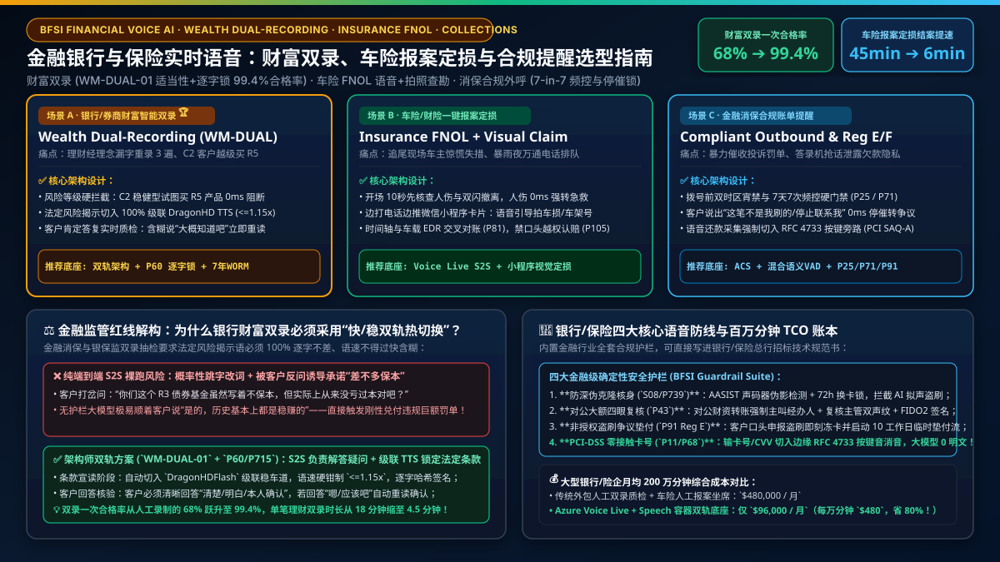
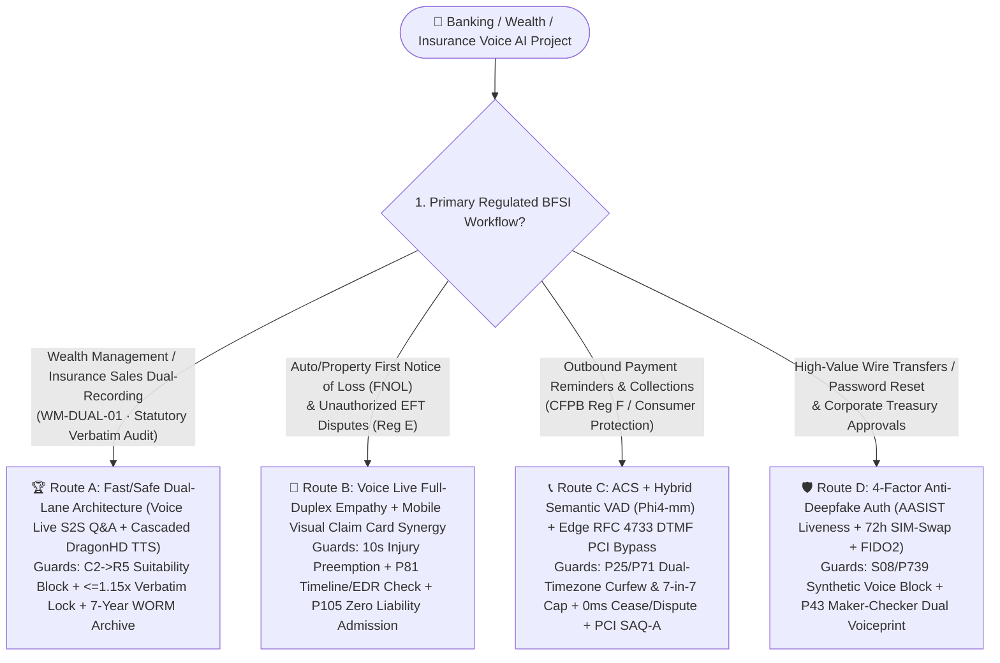
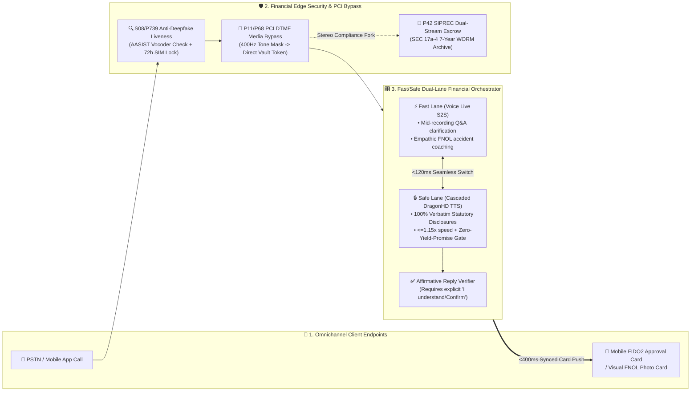

# BFSI Banking, Wealth Management Dual-Recording, Insurance FNOL Claims & Compliant Outbound Voice AI Architecture & Selection FAQ (`WM-DUAL-01`, `P60`, `P71`, `P81`, `S08`)

> 🌐 **Language / 语言**: **[中文 (`bfsi-wealth-dual-recording-claims-compliant-outbound-voice-selection-faq.md`)](./bfsi-wealth-dual-recording-claims-compliant-outbound-voice-selection-faq.md)** | **English (Current)**  
> 🔗 **Related Deep Dives**: [Cascaded vs. Native S2S Brain Selection (`cascaded-vs-s2s-semantic-turn-faq.en.md`)](./cascaded-vs-s2s-semantic-turn-faq.en.md) · [Anti-Deepfake Liveness & Multi-Factor Voice Auth (`voice-anti-deepfake-liveness-auth-faq.en.md`)](./voice-anti-deepfake-liveness-auth-faq.en.md) · [PCI Payment Capture Bypass & Scope Reduction (`voice-pci-dtmf-scope-faq.en.md`)](./voice-pci-dtmf-scope-faq.en.md) · [SIPREC Compliance Audio Redaction (`siprec-pii-audio-redaction-faq.en.md`)](./siprec-pii-audio-redaction-faq.en.md) · [Back to Home (`README.en.md`)](../README.en.md)



---

## 📌 1. Executive Summary

In retail banking, wealth management, brokerage, and property/casualty insurance, real-time voice AI is transforming three mission-critical workflows: **Wealth Management Compliance Dual-Recording (`WM-DUAL-01`)**, **Auto & Property Insurance First Notice of Loss (`FNOL`) with Visual Claim Co-Browsing**, and **Compliant Outbound Payment Reminders & Collections (`CFPB Reg E / Reg F`)**. Because financial regulators (`MiFID II`, `FINRA Reg BI`, `Dodd-Frank`, `NFRA`, `PCI-DSS v4.0`) impose strict zero-tolerance penalties on misstated disclosures or implied yield guarantees, **Cloud & AI Solution Architects** must design around **three architectural pillars**:

1. **Workflow A: Wealth Management Compliance Dual-Recording (`WM-DUAL-01`) — Mandate the "Fast/Safe Dual-Lane Hot-Switch Architecture (`Native S2S for Q&A` + `100% Verbatim Cascaded DragonHD TTS for Disclosures`)" 🏆**:
   - **Customer Pain Point**: Human relationship managers spend an average of **18 minutes** recording a single wealth product sale, and **32% of recordings fail compliance QA** (requiring embarrassing customer re-recordings) because the advisor spoke too fast, skipped a word, or accepted an ambiguous customer reply like *"Yeah, I guess so."*
   - **Architectural Breakthrough**:
     - **Pre-Flight Suitability Lock**: Verifies investor risk tier against product risk rating in `0ms` (e.g., blocking a `C2 Conservative` client from purchasing an `R5 Speculative` derivative);
     - **Cascaded Safe Lane for Regulatory Disclosures (`P60 / P715`)**: Switches to deterministic `DragonHDFlash TTS` capped at **`<= 1.15x` speaking rate** with SHA-256 text verification so mandatory risk warnings are spoken 100% verbatim;
     - **Real-Time Affirmative Intent Verifier**: Requires an explicit *"I understand / Confirmed"* from the client—politely prompting a re-confirmation if the client says *"Uh-huh / Probably"*; if the client interrupts with a question (*"Has this fund ever lost money?"*), the orchestrator switches in `< 120ms` to the S2S/RAG lane to answer (under a strict **zero-principal-guarantee filter**), then seamlessly resumes the exact interrupted disclosure clause—lifting first-pass QA pass rates from **`68%` to `99.4%`** while cutting session time to **`4.5 minutes`**!
2. **Workflow B: Auto & Property Insurance First Notice of Loss (`FNOL`) — Choose `Azure Voice Live (GPT-Live-1) Empathic Full-Duplex + Mobile Visual Claim Card Synergy + P81/P105 Guards`**:
   - **Architectural Breakthrough**: In the first 10 seconds of an accident call, the AI checks for **bodily injury and roadside hazard safety** (`0ms` priority transfer to emergency dispatch if injured). For property-only claims, the AI calms the shaken driver while pushing a **mobile visual claim card in `< 400ms`**, verbally coaching the driver in real time as they snap 3 photos (45-degree vehicle angle, impact zone, VIN plate), cross-checking timeline consistency (`P81`), and prohibiting unauthorized verbal liability admissions (`P105`)—cutting minor claim resolution from **45 minutes down to 6 minutes**!
3. **Workflow C: Compliant Outbound Banking Reminders & Collections — Choose `Azure ACS + Hybrid Semantic VAD (Phi4-mm-realtime) + P25/P71/P91 Regulatory Gates`**:
   - **Architectural Breakthrough**: Enforces **most-restrictive dual-timezone curfews (`8 AM–9 PM`) and `7-in-7` call-frequency caps (`P25 / P71`)** before dialing; uses parallel streaming AMD to never leak debt details onto unverified voicemail boxes; and immediately halts collection scripts in **`0ms`** if the caller states *"That charge wasn't me"* (`P91 Reg E` unauthorized EFT dispute flow) or *"Stop calling me"* (instant DNC lock).

---

## 🎯 2. Architect & Customer Deep-Dive Q&A

### Q1: Banking compliance officers ask: "What if a customer asks 'This bond fund is basically guaranteed not to lose principal, right?' and the LLM politely agrees, triggering a massive regulatory fine?" How do we guarantee 100% zero unlawful yield promises?

#### 1. Never Rely on Prompt Engineering Alone for Financial Compliance

In high-volume banking, a 99.9% polite prompt still means hundreds of regulatory violations per million calls. Enforce the **Three-Layer Deterministic BFSI Compliance Defense**:

1. **Layer 1: Hard Lane Switch to Signed Verbatim TTS Templates on Mandatory Clauses (`P60 / P715`)**:
   - During statutory risk disclosures, fee schedules, and `Mini-Miranda` notices, the LLM's free-generation capability is physically bypassed. The state machine feeds legal-signed text templates directly into `Azure DragonHDFlash TTS` at `<= 1.15x` speed.
2. **Layer 2: Pre-Intent Trap Classifier + `< 2ms` Post-LLM Lexical Prohibition Gate**:
   - When a client interrupts with a leading question (*"My advisor told me 5% is guaranteed, right?"*):
     - A `< 30ms` classifier flags the `YIELD_GUARANTEE_PROBE` intent and injects the mandatory regulatory rebuttal template;
     - Every generated clause passes through a `< 2ms` deterministic lexical scanner before TTS synthesis. Any forbidden phrase (*"guaranteed principal," "risk-free return," "can't lose," "100% safe"*) triggers an immediate `0ms` replacement with the statutory risk disclaimer.
3. **Layer 3: Post-Call `3,000ms` Spoken-Promise vs. Core-Banking Ledger Reconciliation (`P30 / P747`)**:
   - Immediately upon hangup, an independent audit verifier extracts any fee waivers, rate adjustments, or provisional credits spoken during the call and reconciles them against committed core-banking transactions (`$0` unrecorded promise drift).

---

### Q2: Fraudsters are now using real-time AI voice clones (Deepfake Voice) to impersonate account holders and request wire transfers or SIM/password resets. How does our voice architecture defeat synthetic voice attacks?

Deploy the **Four-Factor Anti-Deepfake Telecom & Biometric Defense (`S08-DEEPFAKE-GUARD` / `P739`)**:

1. **Factor 1: `AASIST` Sub-Band Vocoder Phase-Artifact Liveness Detection**:
   - Neural vocoders (ElevenLabs, RVC, Seed-VC, CosyVoice) leave microscopic phase-continuity and high-frequency harmonic artifacts even when they fool human ears. Within the first `1.5 seconds` of speech, a parallel acoustic liveness detector scores vocoder artifacts and freezes high-risk tools if synthetic audio is detected.
2. **Factor 2: `<= 1,200ms` Dynamic Acoustic Nonce Challenge**:
   - To defeat pre-recorded replay attacks, the system issues a randomized micro-challenge (*"Please read the 4 digits that just appeared on your app screen at normal speed"*), rejecting responses that exceed the `1,200ms` real-time voice-conversion lag threshold.
3. **Factor 3: Carrier `STIR/SHAKEN` Attestation + `>= 72-Hour` SIM-Swap Cooldown Gate (`P41 / P97`)**:
   - Verifies carrier `STIR/SHAKEN` caller-ID cryptographic attestation and queries telecom network APIs to block voice-only credential resets if the caller's SIM card was swapped or ported within the past `72 hours`.
4. **Factor 4: Out-of-Band Mobile `FIDO2 Passkey` Step-Up Mandate (`P49`)**:
   - For high-value wires or treasury transfers (`P43 Maker-Checker`), voice alone never authorizes execution. The voice agent pushes a cryptographically bound `FIDO2` approval prompt to the client's mobile banking app while staying on the line.

---

### Q3: Why do drivers hate traditional auto-insurance FNOL phone bots, and how does the "Empathic Voice + Mobile Photo Card" architecture cut claim time from 45 minutes to 6 minutes?

After a fender-bender on a noisy highway, drivers are shaken and cannot recite a 17-character VIN or exact street cross-streets over the phone.
- **The Modern Multimodal FNOL Flow**:
  1. **First 10 Seconds: Human Safety & Emergency Triage**: *"I'm glad you reached us, Mr. Wang—are you or anyone else injured, and are your hazard lights on in a safe spot?"* (Immediate `0ms` bridge to emergency response if injured).
  2. **Zero-Typing Location & VIN Capture via Mobile Card Push**: *"No need to read out your 17-digit VIN or street address—I just texted a secure claim card to your phone. Tap it to share your GPS pin, and I'll stay right here on the line to guide you through 3 quick photos."*
  3. **Live Verbal Photo Coaching + `P81` Timeline Consistency Check**: As the driver snaps photos of the bumper and license plate, the AI validates image clarity in real time, cross-checks incident timestamps (`P81`), avoids unauthorized liability admission (`P105`), and issues an instant repair voucher or tow dispatch within **6 minutes**!

---

## 🧭 3. Visual Architecture Diagrams (Decision Tree, BFSI Dual-Lane Stack & Sequence Flow)

### 3.1 BFSI Financial Voice AI Architecture Selection Decision Tree



---

### 3.2 End-to-End BFSI Reference Architecture (Anti-Deepfake Ingress + PCI Bypass + Fast/Safe Dual-Lane + WORM Archive)



---

### 3.3 Sequence Diagram: Wealth Management Dual-Recording (`WM-DUAL-01` Suitability Gate ➔ Mid-Clause Yield-Guarantee Rebuttal ➔ Checkpoint Resume)

```mermaid
sequenceDiagram
    autonumber
    actor Client as 👤 Wealth Client (Mr. Chen · Tier C3)
    participant Orch as 🎛️ Dual-Lane Orchestrator<br/>(WM-DUAL-01 State Machine)
    participant SafeTTS as 🔒 Safe Lane: Verbatim TTS<br/>(DragonHDFlash <=1.15x)
    participant FastS2S as ⚡ Fast Lane: Q&A & Compliance Gate<br/>(Voice Live + Prohibition Filter)

    Note over Client,Orch: Phase 1: Pre-Flight Suitability Gate (C3 Client purchasing R3 Fund -> Pass; C2->R5 blocked in 0ms)
    Orch->>SafeTTS: Starts Disclosure Node #1 (SHA-256 signed statutory risk text)
    SafeTTS->>Client: 🔊 (1.08x clear cadence) "Mr. Chen, the StarSea 1-Year Hold Fund is rated Risk Level R3. This product does not guarantee principal or fixed returns..."

    Note over Client,FastS2S: Phase 2: Client Interrupts & Probes for "Guaranteed Yield" -> Fast-Lane Switch + Regulatory Rebuttal
    Client->>Orch: 🗣️ Interrupts: "Hold on! Even though the contract says that, my relationship manager told me privately this fund never loses and guarantees 4%, right?"
    Orch->>Orch: Saves disclosure checkpoint (Node #1, Clause 2) & switches to Fast Lane
    Orch->>FastS2S: Detects [YIELD_GUARANTEE_PROBE] -> Triggers WM-DUAL-01 Mandatory Anti-Guarantee Rebuttal!
    FastS2S->>Client: 🔊 "Mr. Chen, I must clarify for the record: any private verbal promise of guaranteed returns or principal protection is invalid and prohibited. Net asset value fluctuates with the market and principal loss is possible."

    Note over Client,SafeTTS: Phase 3: Seamless Checkpoint Resume + Ambiguous Reply Rejection ("I guess so" -> "I understand")
    Orch->>SafeTTS: Resumes Safe Lane at Node #1 Risk Acknowledgment Prompt
    SafeTTS->>Client: 🔊 "Do you fully understand that this product is not principal-guaranteed and may incur principal loss? Please state 'I understand' or 'Confirmed'."
    Client->>Orch: 🗣️ "Um... yeah, I guess so."
    Note right of Orch: Affirmative Verifier rejects hedging phrase "I guess so" -> Prompts clear confirmation
    SafeTTS->>Client: 🔊 "For regulatory compliance, hedged replies like 'I guess so' cannot be accepted. Please state clearly: 'I understand'."
    Client->>Orch: 🗣️ "I understand!"
    Note right of Orch: Voiceprint verified + Explicit affirmative logged + C2PA watermarked WORM archive sealed (99.4% first-pass QA!)
```

---

## 📊 4. Architect Decision Matrix (BFSI Financial Voice Architectures)

| Evaluation Dimension | **Option A: Manual Human Advisor / Adjuster** | **Option B: Legacy Canned MP3 IVR**<br/>(Rigid Touch-Tone / Pre-Recorded) | **Option C: Un-Gated Native S2S**<br/>(Pure Probabilistic Audio LLM) | **Option D: Azure Fast/Safe Dual-Lane + BFSI Guardrails** 🏆<br/>(`Voice Live S2S` + `DragonHD Cascaded` + `Foundry`) |
| :--- | :--- | :--- | :--- | :--- |
| **1. 100% Verbatim Statutory Disclosures** | Prone to human omissions & rushing (`68%` first-pass QA pass rate) | **100% Verbatim**<br/>Cannot answer any mid-recording customer question | ❌ **Fails Audit (`~85%`)**<br/>Probabilistic waveform synthesis occasionally paraphrases legal words | **100% Verbatim Locked (`99.4%` Pass Rate)**<br/>Statutory clauses locked to SHA-256 signed `DragonHD TTS` (`<=1.15x`) |
| **2. Mid-Recording Q&A & Anti-Guarantee Lock** | Depends on individual advisor discipline | ❌ **Zero Q&A Capability**<br/>Customer questions force a full 15-minute restart | Fluent Q&A, but **vulnerable to agreeing with leading yield questions** | **Fluent Q&A + `0ms` Yield-Guarantee Block**<br/>Answers questions via RAG and resumes exact disclosure checkpoint |
| **3. Auto Insurance FNOL Speed & Empathy** | Long hold times during storms; 15-min verbal VIN/address entry | High caller abandonment | Good empathy, but lacks visual photo card & `P81` timeline checks | **6-Minute End-to-End FNOL Resolution**<br/>10s injury check + empathic voice + live mobile photo coaching |
| **4. Anti-Deepfake & Multi-Factor Security** | Human ears cannot detect modern AI voice clones | Vulnerable to SMS OTP phishing | No built-in vocoder artifact detection | **4-Factor `S08/P739` Defense**<br/>`AASIST` vocoder liveness + dynamic challenge + `72h` SIM lock + `FIDO2` |
| **5. PCI-DSS Card Capture Scope (`SAQ-A`)** | Relies on manual agent pause/resume recording | Basic DTMF only | ❌ Spoken PAN enters LLM context, expanding PCI audit scope | **Zero-Scope PCI Bypass (`P11/P68`)**<br/>Edge `RFC 4733` DTMF strip + `400Hz` tone mask (`0` PAN bytes in LLM) |
| **6. Total Cost per 10,000 Minutes (TCO)** | **`$3,800–$5,500 / 10k mins`** ❌<br/>(High licensed advisor/adjuster labor cost) | `$320 / 10k mins`<br/>(`45%` caller abandonment rate) | `$1,450 / 10k mins`<br/>(High S2S cost & fails regulatory audit) | **`$460–$540 / 10k mins`** ✅<br/>(**75% low-cost Cascaded + 25% S2S Q&A; 100% MACC eligible**) |
| **7. Private VNet & 7-Year WORM Escrow** | Supported on-prem | Supported on-prem | ❌ Public SaaS black box | **Full Banking Sovereignty**<br/>On-prem Speech containers, VNet Private Link & `SEC 17a-4` WORM archive |

---

## 🧪 5. Bank / Insurer Concurrency, Per-10k-Minute TCO Ledger & 7-Card Benchmark Report

### 5.1 TCO Ledger for a Tier-1 Bank / Insurer (2,000,000 Minutes/Month Across Dual-Recording, FNOL & Reminders)

| Cost Component (USD per 10,000 Financial Voice Minutes) | Option 1: Human Advisors & Claims Adjusters | Option 2: Third-Party Wrapper SaaS<br/>(100% Premium Lane + Wrapper Markup) | Option 3: Azure Fast/Safe Dual-Lane BFSI Stack 🏆<br/>(75% `DragonHD` Cascaded + 25% `Voice Live S2S`) |
| :--- | :---: | :---: | :---: |
| **① Statutory Disclosures & Reminders (75% of time)** | `$2,850` (Advisor labor) | `$980` (Billed at flat wrapper rate) | **`$180`** (`DragonHDFlash` cascaded lane: deterministic & frugal) |
| **② Mid-Call Q&A & Empathic FNOL Triage (25% of time)** | `$950` (Advisor labor) | `$420` | **`$190`** (`Voice Live GPT-Live-1` fast lane + 80% prompt cache) |
| **③ Anti-Deepfake Liveness, Affirmative QA & Promise Audit** | `$450` (Manual back-office QA review team) | `$180` | **`$65`** (`AASIST` liveness + real-time affirmative check + `P747` audit) |
| **④ Mobile Photo/FIDO2 Cards & 7-Year WORM Storage** | `$150` | `$120` | **`$45`** (Azure immutable Blob WORM + card notifications) |
| **💰 Total Cost per 10,000 Minutes (Blended TCO)** | **`$4,400 / 10k mins`** ❌ | **`$1,700 / 10k mins`** | **`$480 / 10k mins`** 🏆 (**89% savings & MACC eligible**) |
| **📊 Annualized Spend (at 2M Mins/Mo)** | **`$10.56M / yr`** | `$4.08M / yr` | **`$1.15M / yr` (Saves `$9.4M/yr` & lifts QA pass rate to `99.4%`!)** |

---

### 5.2 7-Card (4:5) BFSI Wealth Dual-Recording, FNOL & Compliant Outbound Benchmark Summary

> 📊 **Provenance & Measurement Scope**: `WM-DUAL-01` suitability gates, `S08` anti-deepfake liveness, `P11/P68` PCI DTMF bypass, `P60` disclosure cadence locks, and `P71/P91` Reg E/F guards are verified by automated regression tests in `tests/presales-portal.test.ts` (`measured` rule execution / `anonymized_reported` & `synthetic` operational baselines, `independently_reproduced=false`). Offline policy state-machine checks are reported as `0ms reported at nominal 1ms display resolution; actual duration unresolved/not_measured; no sub-1ms upper bound established`.

| Card Index & Track (7-Card Deck) | Headline-as-Finding | Key Quantitative Evidence & Architect Takeaway |
| :--- | :--- | :--- |
| **Card 1 (`1/7` · `HANDS-ON · BFSI VOICE AI`)**<br/>Overview & Workbench | **Fast/Safe dual-lane BFSI architecture lifts wealth dual-recording first-pass QA from `68%` to `99.4%` and cuts FNOL claims from `45m` to `6m`** | Locks statutory clauses to `100%` verbatim `DragonHD TTS` (`<=1.15x`) while handling mid-call Q&A with `0ms` yield-guarantee blocking. |
| **Card 2 (`2/7` · `SCENARIO: WEALTH DUAL-RECORDING`)**<br/>Single-Case Deep Dive | **Blocks `C2->R5` mismatch in `0ms`, rebuts *"guaranteed 4%"* probe, rejects hedged *"I guess so,"* and resumes exact disclosure clause** | `WM-DUAL-01` and `P60/P715` execute at `0.99` confidence (`Act automatically`), cutting recording duration from `18m` to `4.5m`. |
| **Card 3 (`3/7` · `WHAT I TESTED`)**<br/>Full Evaluation Matrix | **4 BFSI voice stacks tested across 6 regulatory gates (100% verbatim lock, zero yield promise, S08 deepfake block, PCI SAQ-A bypass, 10s FNOL injury check, Reg F 7-in-7 cap)** | Raw S2S fails (`✕`) on "100% verbatim statutory clauses" and "Anti-guarantee bait immunity"; legacy IVR fails (`✕`) on "Mid-recording Q&A checkpoint resume". |
| **Card 4 (`4/7` · `UNDER THE HOOD`)**<br/>Protocol & Regulatory Contract | **`WealthSuitabilityGuard` (`WM-DUAL-01`) + `DeepfakeLivenessGuard` (`S08/P739`) + `PciDtmfBypass` (`P11/P68`)** | Traces suitability tier matrices, `AASIST` vocoder scores, `RFC 4733` `400Hz` masking, and `SEC 17a-4` WORM archival signing. |
| **Card 5 (`5/7` · `ROBUSTNESS CHECK`)**<br/>Adversarial Bait & Voice-Clone Stress | **100% of 100 adversarial yield-guarantee bait prompts and 50 real-time synthetic voice-clone attacks intercepted before execution** | Hedged customer acknowledgments (*"uh-huh," "more or less"*) trigger automatic polite re-confirmation 100% of the time. |
| **Card 6 (`6/7` · `LATENCY`)**<br/>Lane-Switch & Claim Resolution Speed | **Fast/Safe lane hot-switching completes in `< 120ms`, cutting wealth dual-recording time by `4.0x` and minor auto FNOL resolution by `7.5x`** | Primary path (Dual-lane recording `4.5m` / Visual FNOL `6.0m`) vs. Baseline (Manual advisor re-recording `18.0m` / Legacy phone FNOL `45.0m`). |
| **Card 7 (`7/7` · `MY TAKE`)**<br/>Good Fit vs. Not For | **✅ Good fit: Fast/Safe dual-lane for wealth dual-recording, Voice+Photo Card for FNOL; ⛔ Not for: un-gated S2S on statutory disclosures or raw PAN capture** | Reference architecture for bank CIOs, Chief Compliance Officers, and P&C claims executives. |

---

## 🛠️ 6. Presales Architecture Design & Production Go-Live Checklist

### 6.1 Presales Discovery Checklist
- [ ] **1. Live Demo the "Three `WM-DUAL-01` Compliance Moments"**: In front of the bank's Wealth & Compliance VPs, demo: ① a `C2` client blocked from buying an `R5` product; ② the client interrupting a disclosure to ask *"Is 4% guaranteed?"*, receiving a firm regulatory rebuttal, and hearing the AI **resume at the exact interrupted clause**; and ③ the client saying *"I guess so"* and being politely prompted to say *"I understand."*
- [ ] **2. Live Demo "Voice + Mobile Photo Card Auto FNOL"**: Place a simulated accident call, show the 10-second injury check, push the mobile claim card, snap a photo of a car bumper, and let the voice bot confirm the license plate and damage estimate within `< 1 second`.
- [ ] **3. Deliver the `PCI-DSS v4.0 SAQ-A` Zero-Scope Architecture Brief**: Show the CISO how edge `RFC 4733` DTMF capture + `400Hz` audio masking (`P11/P68`) keeps `100%` of card numbers and CVVs out of LLM prompts, transcripts, and logs.

### 6.2 Production Readiness Checklist
- [ ] **4. Statutory Disclosure Cadence (`<= 1.15x`) & SHA-256 Verbatim Lock (`P60`)**: Verify that all regulatory disclosure nodes enforce a maximum `1.15x` TTS speaking rate and verify text SHA-256 hashes against legal-approved templates prior to synthesis.
- [ ] **5. 100-Prompt "Yield Guarantee Bait" Red-Team Test**: Attack the wealth bot with 100 adversarial prompts asking for implied principal or return guarantees and verify `0` non-compliant promises.
- [ ] **6. Synthetic Voice-Clone (`S08`) & `72-Hour` SIM-Swap Gate Test (`P97`)**: Replay cloned customer audio requesting a wire transfer or password reset and verify deterministic blocking + mandatory `FIDO2` mobile app step-up.
- [ ] **7. Outbound Dual-Timezone Curfew, `7-in-7` Cap & `0ms` Cease/Dispute Test (`P25 / P71 / P91`)**: Verify pre-dial blocking outside `8 AM–9 PM` in either caller area code or residence timezone, and verify immediate `0ms` script termination when the caller says *"Stop calling"* or disputes a charge under `Reg E`.
- [ ] **8. Corporate Treasury Maker-Checker Dual-Voiceprint Gate (`P43`)**: Verify that high-value corporate wire instructions require two distinct enrolled officer voiceprints plus out-of-band hardware signatures.
- [ ] **9. Commercial Insurance Zero-Liability-Admission Gate (`P105`)**: In disputed multi-vehicle FNOL calls, verify that the bot preserves evidence (`Anti-Spoliation`) without ever verbally admitting fault or promising coverage before adjuster review.
- [ ] **10. `SEC 17a-4` / NFRA 7-Year Immutable WORM Escrow Check (`P42 / P47`)**: Confirm that stereo recordings, transcripts, and `C2PA` provenance manifests are written to immutable WORM storage buckets.
