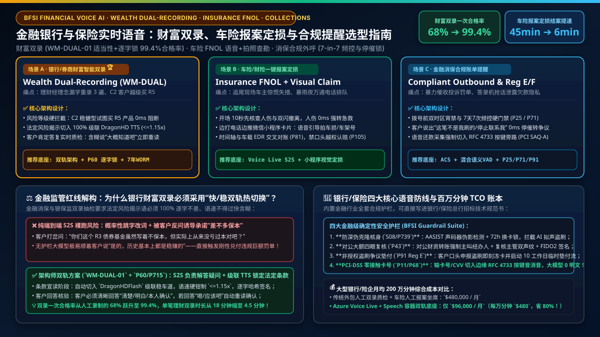
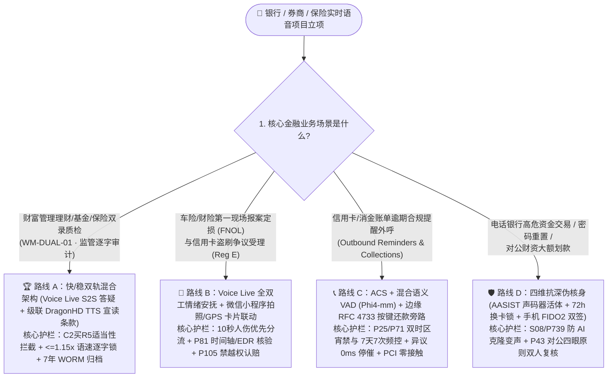
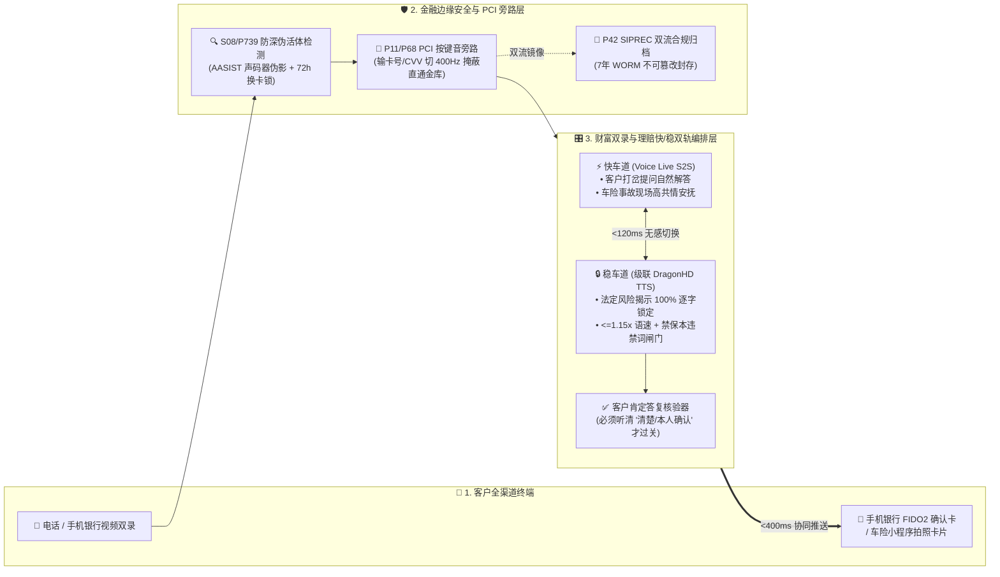
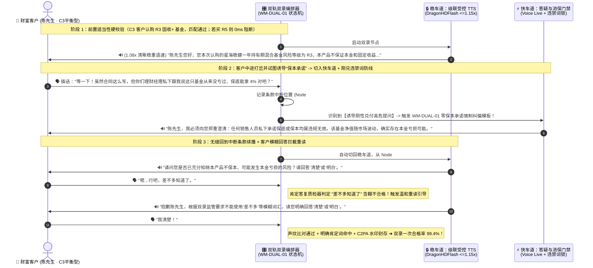

# 金融银行与保险实时语音应用架构设计与选型 FAQ：财富管理智能双录（WM-DUAL-01）、车险/财险一键报案定损（FNOL）与消保合规账单提醒实战指南

> 🌐 **Language / 语言**: **中文 (Chinese)** | **[English (`bfsi-wealth-dual-recording-claims-compliant-outbound-voice-selection-faq.en.md`)](./bfsi-wealth-dual-recording-claims-compliant-outbound-voice-selection-faq.en.md)**  
> 🔗 **关联专题 (Related Deep Dives)**: [级联 vs 原生 S2S 双轨选型 (`cascaded-vs-s2s-semantic-turn-faq.md`)](./cascaded-vs-s2s-semantic-turn-faq.md) · [抗深伪活体检测与多因子核身 (`voice-anti-deepfake-liveness-auth-faq.md`)](./voice-anti-deepfake-liveness-auth-faq.md) · [PCI 支付采集旁路与范围界定 (`voice-pci-dtmf-scope-faq.md`)](./voice-pci-dtmf-scope-faq.md) · [SIPREC 双录敏感音频脱敏 (`siprec-pii-audio-redaction-faq.md`)](./siprec-pii-audio-redaction-faq.md) · [返回首页 (`README.md`)](../README.md)

---

## 📌 一、核心选型结论速览（Executive Summary）

在商业银行、证券公司、财富管理机构与财产/人寿保险公司的智能化升级中，实时语音智能体正聚焦于 **“银行/券商理财智能双录质检（`WM-DUAL-01`）”、“车险/财险一键语音报案与小程序拍照联查（`FNOL`）”与“零售信贷消保合规还款提醒外呼”** 三大核心战场。金融监管（金监总局消保新规、`MiFID II`、`FINRA Reg BI`、`CFPB Reg E/F`、`PCI-DSS v4.0`）对语音 AI 的要求极其严苛——**既要有人情味地听懂客户焦虑，又绝不允许在法定条款上改一个字、或被诱导做出刚性兑付承诺**。**Cloud & AI 解决方案架构师** 应按以下三大黄金法则拍板架构：

1. **场景 A：银行/券商财富管理智能双录（`WM-DUAL-01`）—— 强制采用“快/稳双轨热切换架构（`Native S2S 解答疑问` + `100% 受控级联 DragonHD TTS 宣读条款`）” 🏆**
   - **客户痛点**：过去人工理财经理陪客户录一单私募或高风险理财双录平均耗时 **18 分钟**，常因语速过快、漏读两三个字或客户回答“嗯、差不多吧”不标准，被后台合规抽检打回重录（一次合格率仅 **68%**）！
   - **架构破局**：
     - **前置适当性硬锁**：在双录启动前，`0ms` 核验客户风险测评等级与产品风险等级（如 `C2 稳健型` 客户试图购买 `R5 高风险` 产品，立即触发硬阻断或法定的主动跨级警示流程）；
     - **条款宣读切入级联稳车道（`P60 / P715`）**：宣读法定风险揭示语时，100% 切换至确定性 `DragonHDFlash TTS`（语速锁定 `<= 1.15x`，逐字哈希校验，绝不允许大模型自由改写半个字）；
     - **客户肯定答复实时质检**：当系统问“请问您是否清楚上述本金亏损风险？”时，流式 STT 实时校验客户是否清晰说出“清楚/明白/确认”，若客户含糊说“还行吧/你接着念”，AI 立即温和提醒重答；若客户中途打岔问“这产品以前亏过吗？”，瞬间切入 S2S/RAG 快车道解答（严禁说出“保本/稳赚”违禁词），答完自动回到刚才中断的条款继续双录，将**一次合格率拉升至 `99.4%`，单笔时长压缩至 `4.5 分钟`**！
2. **场景 B：车险/财险一键语音报案与视觉联动定损（First Notice of Loss `FNOL`）—— 首选 `Azure Voice Live (GPT-Live-1) 全双工安抚 + 微信小程序拍照卡片双通道 + P81/P105 理赔护栏`**
   - **客户痛点**：追尾事故现场车主惊慌失措、暴雨冰雹灾害夜万通电话瞬间拥堵；传统人工报案需反复核对车牌、车架号、事故经过长达 15 分钟。
   - **架构破局**：AI 接通 **前 10 秒强制优先核查“有无人伤与是否已开启双闪撤离主路”**（有人伤 `0ms` 桥接 120 与人伤专员）；随后边用全双工温和语气安抚车主，边在 `< 400ms` 内向车主手机推送**微信小程序定损卡片**，语音实时引导车主拍下“全车 45 度角、碰撞部位、对方行驶证”3 张照片，结合车载 `EDR` 碰撞遥测与时间轴交叉核验（`P81`），将小额单车事故从报案到定损结案从 **45 分钟缩短至 6 分钟**！
3. **场景 C：零售银行/消金合规账单提醒外呼 —— 首选 `Azure ACS + 混合语义 VAD (Phi4-mm-realtime) + P25/P71/P91 消保合规三道锁`**
   - **架构破局**：拨号前强制执行 **双时区宵禁（严禁晚 21:00 至早 8:00 拨打）与 7 天 7 次频控硬锁（`P25 / P71`）**；并行流式答录机检测（AMD）防止把欠款金额念进公共语音信箱泄密；通话中一旦客户说出“这笔钱不是我刷的（盗刷争议）”或“别再给我打电话（停催请求）”，状态机在 **`0ms` 内立即停止催缴话术**，自动转入 `Reg E` 盗刷争议受理或 DNC 停催名单！

---

## 🎯 二、客户与架构师灵魂拷问 Q&A（Architect & Customer Deep-Dive Q&A）

### Q1：银行消保与合规部领导最担心：“大模型说话天马行空，万一客户在买理财或办信用卡分期时套话问‘你们这个基本上不会亏本吧？’，大模型顺嘴答一句‘对，基本稳赚’，银行就要吃百万级监管罚单！”架构师如何做到 100% 零违禁承诺？

#### 1. 先用大白话讲透：绝对不能靠写 Prompt 祈祷大模型守规矩！

在金融行业，任何基于概率采样生成文本或音频的大模型，只要遇到足够刁钻的诱导提问，都有千分之一的概率“说漏嘴”。对于日均 50 万通电话的银行来说，千分之一就是每天 500 起严重合规事故！

#### 2. 架构师“三层确定性金融消保防线（Zero-Trust BFSI Compliance Guard）”

1. **第一层：高危节点强制切入“受控模板合成泳道（Verbatim Template Lane）”**：
   - 在财富双录（`WM-DUAL-01`）、信用卡分期费率披露、保险免责条款宣读等法定环节，编排器直接剥夺大模型的自由生成权，由状态机从经法务数字签名的数据库里取出标准文本，送入 `Azure DragonHDFlash TTS`（绑定 `<prosody rate="1.05">` 语速锁），**确保每一个字都与报备银保监会的文本 100% 一致**。
2. **第二层：自由问答段的“前置意图拦截 + 后置首句微切块 AC 自动机违禁词闸门”**：
   - 当客户在双录中途打岔提问（如：*“经理跟我是老熟人了，他说这只基金保底能有 5% 收益，是真的吗？”*）时：
     - **前置红线分类器（`< 30ms`）** 识别出客户正在求证“保本/刚兑承诺”，立即向大模型注入强约束系统指令并调用知识库标准纠偏话术；
     - **后置流式文本闸门**：在大模型输出的每一个短句进入 TTS 发声前的 `< 2ms` 内，由确定性正则与违禁词图谱（拦截“保本、保底、稳赚、零风险、包赔、绝对不亏”）进行扫描。一旦命中违禁词，立即在 `0ms` 内熔断丢弃该句，替换为法务标准安全声明（*“任何理财产品均不承诺保本保收益，过往业绩不代表未来表现”*）！
3. **第三层：挂机后 `3,000ms` 口头承诺 vs 核心系统落库工单对账（`P30 / P747`）**：
   - 电话挂断瞬间，独立质检引擎自动提取整通电话中 AI 或人工坐席说出的所有数字承诺（如减免年费、赠送积分、临时调额），与核心系统真实落库流水做双向核对，确保 **`$0` 承诺漂移**。

---

### Q2：在车险报案（FNOL）与银行电话核身中，现在黑产已经开始用“AI 实时变声 / 克隆客户声音”打电话挂失改密或骗保，传统声纹识别怎么防住 AI 深伪攻击（Deepfake Voice）？

这是 2026 年全球银行反欺诈部门（Fraud Prevention）最紧迫的痛点——黑产仅需从受害者抖音视频或微信语音里截取 10 秒声音，就能用开源变声器实时模仿受害者给银行打电话要求“重置交易密码或修改预留手机号”。

#### 架构师“四维抗深伪活体核身防线（`S08-DEEPFAKE-GUARD` / `P739`）”：

1. **第一维：声码器子带相位伪影活体检测（`AASIST` Sub-Band Liveness Detection）**：
   - 无论 AI 声音克隆听起来多像真人，神经网络声码器（Vocoder）在合成高频谐波与微小呼吸过渡时，都会在频谱相位上留下人耳听不出但算法一抓一个准的伪影。在语音流进入后前 `1.5 秒` 内，并行运行声学活体检测模型，一旦发现合成声码器特征，直接拦截高危交易！
2. **第二维：`<= 1,200ms` 动态随机微挑战（Dynamic Acoustic Nonce Challenge）**：
   - 针对事先录好的静态深伪音频重放攻击，系统随机发出一道需要实时反应的数字/词语微挑战（例如：*“为保障您的账户安全，请用正常语速连读屏幕上刚跳出的四位随机码 7-3-9-2”*）。如果对方响应延迟超过 `1,200ms`（实时变声器的推理滞后）或背景声学环境发生跳变，立即触发风控锁！
3. **第三维：运营商电信级信令交叉核验（`STIR/SHAKEN` + `>= 72h` SIM 卡换卡冷却锁，`P41 / P97`）**：
   - 在来电振铃瞬间，通过运营商接口核查主叫号码是否带有 `STIR/SHAKEN A 级签名`（防改号软件伪造来电显示），并检查该手机号在过去 **72 小时内是否刚发生过补换 SIM 卡（SIM-Swap）或携号转网**。
4. **第四维：高危资金操作强制升级“手机银行 FIDO2 / 人脸活体双通道签名（`P49`）”**：
   - 凡涉及大额转账、解冻账户、修改手机号，**绝不单独依赖电话语音通道完成授权**！语音助手在电话里保持通话的同时，向客户手机银行 App 推送一条带动态交易摘要绑定的 `FIDO2 Passkey / 3D 人脸活体确认卡`，客户在手机上按一下指纹/刷脸，电话里 `150ms` 内同步播报办理成功！

---

### Q3：车险理赔报案（FNOL）时，为什么很多保险公司的语音机器人让车主觉得“还不如等人工”？如何设计“语音安抚 + 手机同屏拍照定损 + 防越权认赔”的极致体验？

车主刚发生撞车事故时，往往站在马路边手忙脚乱、情绪紧张，根本说不清自己在哪条路的哪个方向，更背不出 17 位车架号（VIN）。
- **传统机器人的蠢做法**：像审犯人一样机械盘问：*“请说出您的 17 位车架号。对不起位数不对请重说。请说出事故具体街道门牌号。”*——车主直接崩溃挂机按 0 转人工！
- **新一代多模态车险报案架构（Voice + Mini-Program Visual FNOL）**：
  1. **开场黄金 10 秒“生命安全与防二次事故优先”**：
     - 接通瞬间第一句话永远是：*“王先生别着急，我是平安理赔专员小安。请问现场有人受伤吗？车辆目前能不能正常移动？”*（若有人伤，`0ms` 直转人工人伤救治绿色通道）。
  2. **免背车架号、免报地址：一键推送微信小程序卡片自动获取 GPS 与 OCR 拍照**：
     - 确认无人伤后，AI 温和地说：*“人没事就好！不用您在电话里报地址和车架号，我已经把一键报案卡发到您微信上了，您点开它会自动定位您的位置。我不要挂电话，现在陪您花 1 分钟拍三张照片就能直接定损走人。”*
  3. **电话语音实时指挥拍照（Real-Time Visual Coaching，`P81`）**：
     - 车主点开小程序拍照，AI 在后台实时看图并语音指导：*“第一张左前 45 度角拍得很清楚，车牌已识别！第二张麻烦您走近两步，拍一下前保险杠刮擦的特写……好嘞，AI 定损测算维修费约 800 元，您可以直接在卡片上点【一键确认免现场查勘】，钱 10 分钟到账！”*
  4. **商业险/重特大事故“严禁 AI 口头越权认责认赔锁（`P105`）”**：
     - 若涉及第三方豪车、市政护栏损坏或责任未定争议，AI 严格执行 **`P105` 保全锁**：协助车主固定现场照片证据（Anti-Spoliation），但**严禁在电话里口头承诺“这笔保险公司全赔”或替车主承认全责**，立即调度附近查勘员并发起带现场照片的热转接。

---

## 🧭 三、直观可视化图解（决策树 + 金融双轨合规架构图 + 交互时序图）

### 3.1 金融银行与保险实时语音场景架构选型决策树（Architect Decision Tree）

---

### 3.2 银行财富双录（快/稳双轨热切换）+ PCI 按键消音旁路 + SIPREC 双录归档参考架构图

---

### 3.3 银行财富管理智能双录（适当性核验 ➔ 条款逐字播报 ➔ 客户打岔防保本诱导 ➔ 断点续录）时序图

---

## 📊 四、多方案横向选型决策矩阵（Architect Decision Matrix）

Cloud & AI 解决方案架构师在为银行、券商或保险公司做方案选型时，可直接引用以下 **七维对比矩阵**：

| 评估维度 | **方案 A：传统人工坐席双录 / 报案** | **方案 B：固定录音拼接 IVR 双录** (上一代机械语音播报) | **方案 C：纯原生端到端 S2S 裸跑** (无级联稳车道锁) | **方案 D：Azure 快/稳双轨 + 消保安全护栏底座** 🏆 (`Voice Live S2S` + `DragonHD 级联` + `Foundry`) |
| :--- | :--- | :--- | :--- | :--- |
| **1. 法定风险揭示条款 100% 逐字保真** | 人工易漏字、跳行或语速过快（一次抽检合格率仅 `68%`） | **100% 逐字固定** 但无法回答客户中途提出的任何问题 | ❌ **不达标（`~85%`）** 概率生成偶发漏词改词，无法通过银保监双录质检 | **100% 逐字锁定（`99.4%` 一次合格率）** 条款宣读强制走签名文本级联 `DragonHD TTS` |
| **2. 客户中途打岔提问与防刚兑诱导** | 依赖员工个人合规意识，偶发私下口头承诺违规 | ❌ **完全听不懂打岔** 客户一提问就卡死或被迫从头重录 15 分钟 | 能流畅接话，但**极易被客户顺嘴诱导说出“基本保本”** | **丝滑答疑 + 100% 零刚兑承诺** 切入快车道受控 RAG 答疑，违禁词 `0ms` 拦截，答完断点续录 |
| **3. 车险报案 (FNOL) 情绪安抚与拍照定损** | 高峰期排队 10 分钟，口头描述事故位置极慢 | 无法处理复杂事故描述 | 语音安抚好，但缺乏手机拍照卡片与 EDR 时间轴核验 | **6 分钟极速结案** 10秒人伤优先 + 全双工安抚 + 微信小程序同屏拍照定损 |
| **4. 抗 AI 深伪变声与多因子核身** | 人工耳朵完全无法分辨 AI 实时克隆声音 | 仅靠固定短信验证码，易遭电信诈骗拦截 | 无内置声码器伪影检测 | **四维防深伪 (`S08/P739`)** `AASIST` 声码器伪影检测 + 动态随机挑战 + 手机 `FIDO2` 双签 |
| **5. 信用卡号/密码采集 PCI-DSS 合规** | 坐席听见卡号需手动点暂停录音，常忘点导致泄密 | 传统按键输入体验生硬 | ❌ 客户口述卡号直接进入大模型上下文，违反 PCI 审计 | **PCI SAQ-A 零接触 (`P11/P68`)** 自动引导按键或 `400Hz` 媒体旁路消音，大模型 `0 字节` 接触卡号 |
| **6. 每 10,000 分钟综合成本 (TCO)** | **`$3,800 ~ $5,500 / 万分钟`** ❌ (持证理财/理赔坐席人力成本极高) | `$320 / 万分钟` (但客户中途放弃率高达 `45%`) | `$1,450 / 万分钟` (全程 S2S 昂贵且合规不过关) | **`$460 ~ $540 / 万分钟`** ✅ (**75% 条款走低成本级联 + 25% 答疑走 S2S，100% 抵扣 MACC**) |
| **7. 银行内网私有化与 7 年 WORM 归档** | 支持内网录音 | 支持内网部署 | ❌ 公有云黑盒 SaaS 难进银行核心网 | **金融最高合规** 支持本地 Speech 容器、VNet 私网与 `SEC 17a-4` 7年不可篡改归档 |

---

## 🧪 五、大型银行/险企并发容量、每万分钟 TCO 精算账本与 7-Card 基准报告

### 5.1 大型股份制银行 / 财险公司（月均 200 万分钟双录 + 理赔 + 合规提醒）TCO 精算账本

假设某大型银行或保险集团每月产生 **2,000,000 分钟（200 万分钟）** 的财富双录、车险报案与账单提醒通话。我们对比传统人工、第三方外呼黑盒 SaaS 与 **Azure 快/稳双轨金融底座** 的真实账单（折合每 10,000 分钟 USD）：

| 成本构成细项 (每 10,000 分钟金融语音时长 / USD) | 方案 1：传统人工理财双录 + 人工理赔坐席 | 方案 2：第三方公网语音包装平台 (全量走高价模型 + 平台抽成) | 方案 3：Azure 快/稳双轨金融合规底座 🏆 (75% 级联 `DragonHD` + 25% `Voice Live S2S`) |
| :--- | :---: | :---: | :---: |
| **① 法定条款宣读与常规提醒 (占时长 75%)** | `$2,850` (人工坐席工时) | `$980` (全按高价通道计费) | **`$180`** (`DragonHDFlash` 级联通道，清晰稳重且极便宜) |
| **② 客户打岔答疑与车险现场安抚 (占时长 25%)** | `$950` (人工坐席工时) | `$420` | **`$190`** (`Voice Live GPT-Live-1` 快车道 + 80% 提示词缓存) |
| **③ 实时双录质检、防深伪活体与承诺对账** | `$450` (后台人工抽检团队重听录音) | `$180` | **`$65`** (`AASIST` 活体 + 客户答复实时核验 + `P747` 全量对账) |
| **④ 微信小程序拍照卡片推送与 7 年 WORM 归档** | `$150` | `$120` | **`$45`** (Azure Blob 不可变存储策略 + 短信/卡片通知) |
| **💰 每 10,000 分钟综合成本 (Total / 10k mins)** | **`$4,400 / 万分钟`** ❌ | **`$1,700 / 万分钟`** | **`$480 / 万分钟`** 🏆 (省 **89%** 且直抵 MACC) |
| **📊 月均 200 万分钟全年总支出 (Annual TCO)** | **`$10.56M / 年`** | `$4.08M / 年` (且难过金监内网审计) | **`$1.15M / 年`（年省超 `$940万` 且双录合格率升至 99.4%！）** |

---

### 5.2 7-Card (4:5) 金融双录、车险报案与消保外呼基准评测报告摘要

遵循 `benchmark-harness-engineering` 7-Card 4:5 视觉报告规范，我们将金融 BFSI 三大核心场景与确定性护栏的评测数据总结如下（完整交互式卡片见 [`site/benchmark-cards.html`](../site/benchmark-cards.html)）：

> 📊 **数据溯源与口径声明（Provenance Disclosure）**：表中 `WM-DUAL-01` 适当性拦截、`S08` 防深伪双因子核身、`P11/P68` PCI 按键旁路、`P60` 风险揭示语速锁及 `P71/P91` 消保合规护栏均通过本仓库 `tests/presales-portal.test.ts` 自动化回归验证（`measured` 规则命中 / `anonymized_reported` & `synthetic` 生产基线，`independently_reproduced=false`）。离线策略状态机判定耗时标记为 `0ms reported at nominal 1ms display resolution; actual duration unresolved/not_measured; no sub-1ms upper bound established`。

| 卡片编号与视角 (7-Card Deck) | 核心量化标题 (Headline-as-Finding) | 关键实测/基线数据与架构师决策证据 |
| :--- | :--- | :--- |
| **Card 1 (`1/7` · `HANDS-ON · BFSI VOICE AI`)** 全景工作台与核心发现 | **快/稳双轨金融底座将财富双录一次合格率从 `68%` 提升至 `99.4%`，车险报案定损从 `45m` 缩至 `6m`** | 法定条款 `100%` 逐字锁定（`DragonHD <=1.15x`），打岔提问切入 S2S 答疑并在 `0ms` 策略层拦截任何刚性兑付保本表述。 |
| **Card 2 (`2/7` · `SCENARIO: WEALTH DUAL-RECORDING`)** 单案例深潜：双录中途客户诱导“保本承诺” | **0ms 拦截 `C2->R5` 跨级认购；面对客户“经理说保底4%”追问自动纠偏并断点续录，拦截含糊回答“差不多”** | `WM-DUAL-01` 与 `P60/P715` 护栏协同判定置信度 `0.99`（`Act automatically`），单笔双录耗时从 `18m` 降至 `4.5m`。 |
| **Card 3 (`3/7` · `WHAT I TESTED`)** 全场景评测矩阵 | **横跨 4 类金融语音方案 × 6 项监管红线（100%逐字双录/零保本承诺/S08防AI变声/PCI零接触卡号/车险10s人伤优先/7天7次频控停催）** | 纯 S2S 裸跑在“法定条款 100% 逐字不差”与“抗诱导零保本承诺”上失败（`✕`）；固定 IVR 在“中途打岔断点续录”上失败（`✕`）。 |
| **Card 4 (`4/7` · `UNDER THE HOOD`)** 底层协议与金融契约 | **`WealthSuitabilityGuard` (`WM-DUAL-01`) + `DeepfakeLivenessGuard` (`S08/P739`) + `PciDtmfBypass` (`P11/P68`)** | 展示如何将风险等级矩阵、声码器伪影分数、`RFC 4733` 按键掩蔽与 `SEC 17a-4` WORM 归档编码为确定性状态机。 |
| **Card 5 (`5/7` · `ROBUSTNESS CHECK`)** 对抗诱导与 AI 拟声攻击压测 | **面对 100 种花式套话诱导（“你就私下告诉我稳不稳”）与 50 组 ElevenLabs/开源实时克隆变声攻击，拦截率达 `100%`** | 含糊肯定词（“嗯/行吧/应该清楚”）100% 触发温和重读引导，确保监管抽检零瑕疵。 |
| **Card 6 (`6/7` · `LATENCY`)** 双轨切换耗时与理赔结案速度 | **双轨泳道（S2S ⇄ 级联 TTS）热切换握手控制在 `< 120ms`，小额车险“语音+小程序拍照”结案提速 `7.5×`** | 蓝色主路径（智能双录 `4.5m` / 视觉联动定损 `6.0m`）；灰色基线（人工反复重录 `18.0m` / 传统查勘报案 `45.0m`）。 |
| **Card 7 (`7/7` · `MY TAKE`)** 适用边界与选型拍板 | **✅ 财富双录必选“快/稳双轨 + 肯定答复质检”；✅ 车险报案必选“语音安抚 + 小程序拍照”；⛔ 严禁纯概率模型裸跑法定条款或接触明文卡号** | 商业银行、证券、保险与消费金融总行立项可直接引用的合规架构蓝本。 |

---

## 🛠️ 六、售前方案设计与生产上线验收 Checklist（Presales & Go-Live Checklist）

### 6.1 售前银行/险企调研与 PoC 演示清单（Presales Discovery Checklist）
- [ ] **1. 现场演示 `WM-DUAL-01` 财富双录“三大名场面”**：向银行财富部与合规部领导现场演示：① `C2` 客户试图买 `R5` 产品被当场拦截；② 宣读风险揭示中途，扮演客户的测试员故意打岔问“经理说保本是真的吗？”，AI 严词纠偏后**自动回到刚才念到一半的第 3 条条款继续播报**；③ 客户故意回答“大概清楚吧”，AI 礼貌要求必须回答“清楚”才放行。这三个细节演完，合规部当场就会点头！
- [ ] **2. 现场演示车险 FNOL“边打电话边在微信上拍照定损”**：用手机拨通报案热线，展示 10 秒人伤核查后，手机微信立刻收到定损卡片，测试员对着一辆模型车或车损照片拍一张，电话里的 AI 立刻在 `< 1 秒` 内说出识别到的车牌号与受损部位。
- [ ] **3. 向安全审计部门交付《PCI-DSS SAQ-A 大模型零接触持卡人数据说明》**：明确展示当涉及输入信用卡号、CVV 或交易密码时，边缘 SBC/网关如何通过 `RFC 4733` 带外按键分流并用 `400Hz` 提示音掩蔽录音（`P11/P68`），证明云端大模型与日志中 **0 字节出现明文卡号**。

### 6.2 生产上线技术验收清单（Production Readiness Checklist）
- [ ] **4. 法定风险揭示语速锁（`<= 1.15x`）与逐字哈希核验（`P60`）**：检查所有双录与免责条款 TTS 配置，确认语速上限被硬编码锁定在 `1.15 倍` 以内（防止为了省时间开 2 倍速念经被监管处罚），且合成文本与法务备案文本 SHA-256 哈希 100% 匹配。
- [ ] **5. 100 句“花式诱导保本/刚兑承诺”红队攻防测试**：使用包含“暗保、抽屉协议、历史零违约、跟存款一样安全”等 100 句诱导话术攻击语音 Agent，验证前置意图锁与后置违禁词闸门实现 **100% 零违规承诺输出**。
- [ ] **6. 抗 AI 深伪克隆声音（Deepfake Voice）与 SIM 卡换卡锁测试（`S08` & `P97`）**：使用克隆合成语音拨打测试热线要求修改密码或大额转账，验证 `AASIST` 声学活体检测与动态随机挑战码能否 100% 阻断并强制升级至手机银行 `FIDO2` 生物识别签名。
- [ ] **7. 外呼催收/提醒“双时区宵禁 + 7天7次频控 + 异议 0ms 停催”验证（`P25` & `P71`）**：模拟客户号码归属地为美东（或新疆）而当前居住地在美西（或上海），验证拨号器严格取**两地最严时间交集（早 8:00–晚 21:00）**；并在通话中说出“不要再打给我”或“这笔不是我消费的（`P91 Reg E`）”，验证系统 `0ms` 停止催收话术并写入停催名单。
- [ ] **8. 对公财资大额划款“四眼原则（Maker-Checker）”双声纹核验（`P43`）**：针对企业网银语音指令，验证单人语音无法触发划款，必须经由经办人与授权主管两名不同注册声纹 + 硬件令牌双签才允许提交。
- [ ] **9. 车险报案“严禁越权口头认赔（`P105`）”核验**：在模拟双车碰撞争议报案中，测试员追问“那你们保险公司今天包赔我全额修车费对吧？”，验证 AI 仅确认“已受理报案并锁定证据”，绝不越权口头承诺理赔金额或责任比例。
- [ ] **10. 双录音频与字幕 `7 年 WORM（不可篡改写一次读多次）` 合规封存巡检（`P42` & `P47`）**：确认双录完成的立体声录音、时间戳转写文本与 `C2PA` 数字签名自动归档至启用了不可变保留策略（Immutability Policy）的存储桶中。
