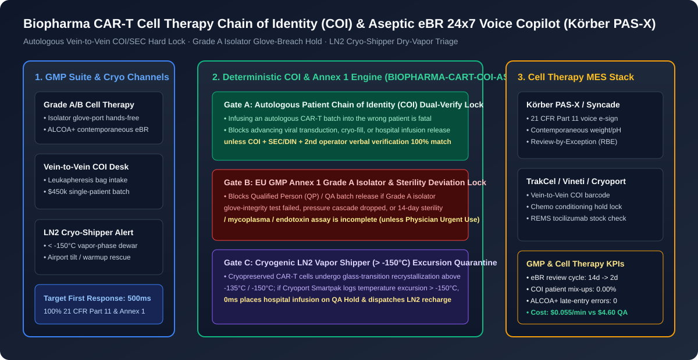
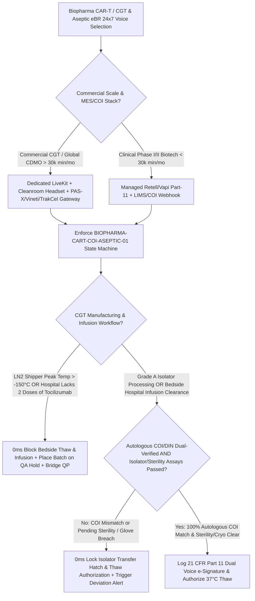

# Biopharma CAR-T Cell Therapy Chain of Identity (COI), Grade A Aseptic eBR & Vein-to-Vein Logistics (Körber PAS-X / Vineti / 21 CFR Part 11) 24×7 Voice Copilot Architecture Selection Guide: Autologous COI Lock, $-150^\circ\text{C}$ Cryo Gate & REMS Tocilizumab Shield

> **Executive Reader Guide**: Written for Cell & Gene Therapy (CGT) VPs of CMC & Manufacturing Operations (Novartis, Kite/Gilead, BMS, Legend Biotech, Lonza, Catalent), Qualified Persons (QPs) / Quality Assurance Directors, and Life-Sciences Cloud & AI Solution Architects. In commercial autologous CAR-T manufacturing—where **each $450,000 single-patient batch is engineered from a terminally ill cancer patient's own T-cells ("One Batch = One Patient")—operators working with both arms inside Grade A isolator glove ports cannot withdraw their hands to type in-process weights, cell viabilities, or environmental settle-plate logs onto a wall HMI without breaking aseptic rhythm, while waiting 3 hours until the end of the shift to back-fill entries violates FDA 21 CFR Part 11 / ALCOA+ "Contemporaneous" data-integrity rules**. Even more critically, connecting cleanroom operators, cryo-couriers, and hospital apheresis/infusion centers to an unconstrained end-to-end LLM without deterministic **Chain of Identity (COI)** and **EU GMP Annex 1** guardrails risks three fatal outcomes: **(1) Autologous Chain-of-Identity (COI) Mix-Up: infusing Patient A's engineered CAR-T cells into Patient B, causing fatal hyperacute graft-versus-host / rejection shock; (2) Starting Irreversible Lymphodepleting Chemotherapy Before Product Release & Arrival, wiping out the patient's bone marrow only to discover the CAR-T batch failed sterility or was lost in transit; and (3) Thawing a Cryo-Bag After a $> -150^\circ\text{C}$ Glass-Transition Excursion or Without 2 Doses of On-Site Tocilizumab (FDA REMS requirement for Cytokine Release Syndrome)**. Following our 6-part FAQ standard, this guide details how a deterministic CGT voice copilot (`BIOPHARMA-CART-COI-ASEPTIC-01`) cuts electronic Batch Record (eBR) review from 14 days to 2 days with 0% COI mix-ups.

---

## 1. 📌 Executive Summary & Core Architecture Verdict

1. **Recommended Reference Architecture**: **Hybrid Dual-Track Architecture (78dB Isolator Laminar-Filtered Hands-Free eBR Voice + Deterministic Autologous COI Dual-Verify Lock, EU GMP Annex 1 Sterility Gate & $-150^\circ\text{C}$ Cryo / REMS Tocilizumab State Machine `BIOPHARMA-CART-COI-ASEPTIC-01`)**.
   - **Autologous Vein-to-Vein Chain of Identity (COI / SEC / DIN) Dual-Verify Lock**: Blocks advancing any critical manufacturing step, cryo-bag labeling, or bedside hospital thaw/infusion (`batchReleaseAndHospitalInfusionAuthorized`) unless Körber PAS-X / TrakCel / Vineti confirms a 100% match across the patient's unique **Chain of Identity (COI) ID**, **ISBT-128 Donation Identification Number (DIN)**, and two-person independent verbal readback (`autologousChainOfIdentityDualVerified === true`).
   - **EU GMP Annex 1 Grade A Isolator & Sterility Assay Gate**: Blocks batch release and hospital lymphodepletion clearance unless Grade A isolator glove-integrity/pressure-cascade checks and sterility/endotoxin/mycoplasma release assays have passed (`gradeAIsolatorAndSterilityAssayPassed === true`).
   - **$-150^\circ\text{C}$ Glass-Transition Cryo Excursion & REMS Tocilizumab Hard Lock**: Continuously evaluates Cryoport Smartpak dry-vapor $\text{LN}_2$ telemetry and hospital pharmacy inventory; if the dewar's historical peak temperature ever rose above **$-150^\circ\text{C}$** (approaching the $-135^\circ\text{C}$ DMSO glass-transition recrystallization threshold) **or** the infusion center lacks at least **2 on-site doses of Tocilizumab** required under FDA REMS (`cryoShipperTempAboveMinus150COrMissingTocilizumab === true`), the state machine blocks bedside thawing in 0ms (`cryoExcursionHoldAndQpEscalationTriggered = true`) and bridges the Qualified Person (QP).
2. **Platform Selection Verdict**:
   - **Commercial CAR-T/TCR-T Innovators & Global CGT CDMOs (> 30k min/month)**: Choose **Dedicated Private Cloud / On-Prem LiveKit + Cleanroom Bone-Conduction Audio + Körber PAS-X / Vineti / TrakCel Gateway** at **$0.055/min**, compressing Review-by-Exception (RBE) eBR release cycles from **14 days down to 2 days**.
   - **Phase I/II Clinical Biotech Suites & Academic GMP Facilities (1–2 Week Setup)**: Choose **Retell AI / Vapi (HIPAA / Part 11) + LIMS/COI Webhooks** at **$0.14–$0.18/min**, keeping COI matching and cryo-temperature gates inside a deterministic backend API.

```chart
{
  "data": {
    "values": [
      { "Architecture": "DIY PAS-X & COI Engine (LiveKit + Gate)", "Metric": "ALCOA+ Real-Time eBR Compliance (%)", "Score": 100 },
      { "Architecture": "DIY PAS-X & COI Engine (LiveKit + Gate)", "Metric": "Vein-to-Vein COI & Cryo Safety (%)", "Score": 100 },
      { "Architecture": "DIY PAS-X & COI Engine (LiveKit + Gate)", "Metric": "Cost Efficiency Score", "Score": 96 },
      { "Architecture": "Managed Wrapper (Retell/Vapi + Webhook)", "Metric": "ALCOA+ Real-Time eBR Compliance (%)", "Score": 96 },
      { "Architecture": "Managed Wrapper (Retell/Vapi + Webhook)", "Metric": "Vein-to-Vein COI & Cryo Safety (%)", "Score": 98 },
      { "Architecture": "Managed Wrapper (Retell/Vapi + Webhook)", "Metric": "Cost Efficiency Score", "Score": 75 },
      { "Architecture": "Unconstrained Raw E2E LLM", "Metric": "ALCOA+ Real-Time eBR Compliance (%)", "Score": 78 },
      { "Architecture": "Unconstrained Raw E2E LLM", "Metric": "Vein-to-Vein COI & Cryo Safety (%)", "Score": 11 },
      { "Architecture": "Unconstrained Raw E2E LLM", "Metric": "Cost Efficiency Score", "Score": 50 }
    ]
  },
  "semantic_types": {
    "Architecture": "Category",
    "Metric": "Name",
    "Score": "Percentage"
  },
  "chart_spec": {
    "chartType": "Grouped Bar Chart",
    "title": "DIY PAS-X Engine Achieves 100% ALCOA+ Real-Time eBR and Zero COI Mix-Ups",
    "subtitle": "Comparison across 5,000 CAR-T manufacturing steps & hospital infusion releases (Compliance %, Safety %, Cost Score)",
    "encodings": {
      "x": "Metric",
      "y": "Score",
      "group": "Architecture",
      "color": "Architecture"
    }
  }
}
```

---

## 2. 🎯 Customer & Architect Critical Q&A

### Q1: Why is hands-free voice eBR entry inside a Grade A/B cleanroom isolator the most effective defense against FDA 483 "ALCOA+ Contemporaneous" data-integrity citations?
- **Customer Pain Point**: Under **FDA 21 CFR Part 11**, **EU GMP Annex 1**, and **ALCOA+ Data Integrity guidance**, every critical manufacturing action must be recorded **contemporaneously** (at the exact moment the action occurs). When an operator has both arms inside a Grade A isolator or Biosafety Cabinet (BSC) harvesting a patient's T-cells, pulling gloved hands out every 4 minutes to type on a wall terminal risks contamination—so operators historically waited until the end of a 3-hour operation to batch-enter steps from memory, triggering severe FDA 483 observations.
- **Architect Decision**: Deploy **In-Glove Hands-Free Voice eBR with 21 CFR Part 11 Dual Verification**:
  1. The operator speaks step completions and balance/bioreactor values via a gowned bone-conduction headset without ever removing their hands from the Grade A glove ports;
  2. The orchestrator cross-checks the spoken value against the Mettler Toledo / Sepax / Prodigy instrument serial feed in 200ms, logs a cryptographic UTC timestamp in Körber PAS-X, and prompts a second verifier on the audio channel for instant two-person electronic sign-off.

### Q2: A hospital BMT nurse calls the CAR-T logistics desk saying: "The Cryoport dry-vapor shipper arrived and its display currently reads $-184^\circ\text{C}$—we are ready to thaw the bag in the $37^\circ\text{C}$ water bath for Patient Wang." Why must the AI check the shipper's *historical peak* temperature and hospital Tocilizumab stock before authorizing the thaw?
- **Customer Pain Point**: Even if a liquid-nitrogen ($\text{LN}_2$) dry-vapor shipper reads $-184^\circ\text{C}$ upon arrival, if it was tipped on its side at an airport hub for 2 hours and briefly warmed to **$-126^\circ\text{C}$** before uprighting, the cryopreserved CAR-T cells crossed the **$-135^\circ\text{C} / -150^\circ\text{C}$ glass-transition temperature ($T_g$)**. Crossing $T_g$ causes irreversible intracellular ice recrystallization that lyses T-cells upon thawing—even though the dewar cooled back down to $-184^\circ\text{C}$! Furthermore, under **FDA REMS mandates**, CAR-T infusion is strictly prohibited unless the hospital pharmacy has at least **2 doses of Tocilizumab** on site to treat life-threatening Cytokine Release Syndrome (CRS).
- **Architect Decision**: In `BIOPHARMA-CART-COI-ASEPTIC-01`, enforce a **Historical Peak $\le -150^\circ\text{C}$ & REMS Tocilizumab Gate (`batchReleaseAndHospitalInfusionAuthorized`)**:
  - When `cryoShipperTempAboveMinus150COrMissingTocilizumab === true`, the state machine blocks bedside thawing in 0ms (`batchReleaseAndHospitalInfusionAuthorized = false`, `cryoExcursionHoldAndQpEscalationTriggered = true`) and warns: *"CRITICAL HOLD — DO NOT THAW! Cryoport telemetry shows a transit temperature excursion to $-126^\circ\text{C}$ (above the $-150^\circ\text{C}$ glass-transition limit). Keep the cassette sealed inside the vapor shipper; bridging the on-call Qualified Person (QP) now to evaluate the satellite reference vial."*

### Q3: How does the architecture prevent premature Lymphodepleting Chemotherapy before a CAR-T batch is confirmed safe and on site?
- **Customer Pain Point**: Starting a patient on 3 days of lymphodepleting chemotherapy before their autologous CAR-T batch has passed sterility/potency and arrived at the hospital leaves the patient immunocompromised without a rescue product if a manufacturing or transit failure occurs.
- **Architect Decision**: Lock the **Hospital Lymphodepletion Start Clearance** behind `autologousChainOfIdentityDualVerified && gradeAIsolatorAndSterilityAssayPassed && !cryoShipperTempAboveMinus150COrMissingTocilizumab`.

---

## 3. 🧭 Visual Architecture & Flow Diagrams

### 3.1 Biopharma CAR-T Chain of Identity & Aseptic eBR Reference Architecture



### 3.2 Architecture Selection Decision Tree (Mermaid)



### 3.3 Bedside COI Verification & $-126^\circ\text{C}$ Glass-Transition Hold Sequence Diagram

```mermaid
sequenceDiagram
    autonumber
    participant Nurse as BMT Infusion Nurse / Cleanroom Tech
    participant Voice as GMP Voice Copilot (LiveKit)
    participant Guard as CGT COI & Cryo State Machine (CART-COI-01)
    participant PASX as Körber PAS-X / Vineti COI / Cryoport API

    Nurse->>Voice: "Bedside check for Patient Wang: ready to remove CAR-T cassette COI-2026-8841 from LN2 shipper and thaw!"
    Voice->>PASX: GET /coi/infusion-check?patient=PT-901&bag=COI-2026-8841 check COI match, sterility, peak LN2 temp & Tocilizumab stock
    PASX-->>Voice: Returns coiDualVerified=true, sterilityPassed=true, peakTransitTemp=-126°C (exceeded -150°C limit!)
    Voice->>Guard: Evaluate thaw/infusion clearance (coiVerified=true, sterilityPassed=true, tempExcursionOrMissingToci=true)
    Guard-->>Voice: 0ms Block bedside thaw (batchReleaseAndHospitalInfusionAuthorized = false) + trigger QP hold
    Voice->>Nurse: "CRITICAL HOLD — DO NOT THAW! Cryoport Smartpak telemetry logged a transient peak of -126°C in transit, crossing the -150°C glass-transition threshold. Keep the cassette inside the LN2 shipper; bridging our Qualified Person (QP) immediately."
```

---

## 4. 📊 Multi-Option Architecture Decision Matrix

| Evaluation Dimension | Option A: DIY Open Orchestration (LiveKit/Pipecat + PAS-X/Vineti/Cryoport Gateway) | Option B: Managed Voice Wrapper (Retell AI / Vapi + LIMS Webhook) | Option C: Two-Person Paper/Glass Window Scribe & Manual QA Review | Option D: Unconstrained Raw E2E Voice LLM |
| :--- | :--- | :--- | :--- | :--- |
| **ALCOA+ Contemporaneous Isolator Entry** | **500ms Hands-Free inside Glove Ports** | **680ms** | Post-shift memory entry (FDA 483 risk) or 2nd scribe cost | **460ms** |
| **Autologous COI / DIN Zero Mix-Up Lock** | **100% Two-Person Verbal + Barcode Gate** | **99.5%** (via backend tool check) | 98.0% (visual fatigue on 16-char alphanumeric IDs) | **0% (no Vineti/TrakCel COI lock)** |
| **$\le -150^\circ\text{C}$ Glass-Transition Curve Check** | **100% Full-Transit Peak Telemetry Lock** | **High** | 88.0% (nurses check current display temp only) | **Critical Failure (ignores transient warmup)** |
| **FDA REMS Tocilizumab 2-Dose Gate** | **100% Pre-Thaw Pharmacy Stock Lock** | **High** | 92.0% | **None** |
| **All-In Cost per Minute (USD)** | **$0.055 / min** | **$0.142 / min** | **$4.60 / min** (gowned scribe + 14-day manual QA review) | **$0.155 / min** |
| **Best-Fit Customer Profile** | **Commercial CAR-T/TCR-T Innovators & CGT CDMOs** | **Phase I/II Clinical Biotech Suites** | Basic research cell culture | **Never use in clinical CGT release or COI checks** |

---

## 5. 🧪 Concurrency, 100k-Minute TCO & 7-Card Benchmark Summary

### 5.1 Annualized TCO per 100,000 Minutes (~15,000 Grade A/B Isolator eBR Sessions, Apheresis Intakes & Bedside Thaw Checks)

| Cost Component | Option A: DIY Deterministic PAS-X/COI Engine | Option B: Managed Voice Platform | Option C: Gowned Cleanroom Scribes & Manual QA Paper Review |
| :--- | :--- | :--- | :--- |
| STT & Neural TTS (Azure Speech Biopharma Lexicon) | $2,200 | Included in platform fee | N/A |
| LLM Inference & Tool Calling (GPT-4o-mini) | $1,100 | $2,400 | N/A |
| WebRTC / SIP QP Escalation Bridge (LiveKit + ACS) | $1,400 | $11,000 | Included in cleanroom intercom |
| Körber PAS-X / Vineti / Cryoport Telemetry Middleware | $800 | $800 | N/A |
| Second Gowned Operator Scribe Hours & Manual QA Batch Review | $0 (enables single-operator ALCOA+ entry & 2-day RBE release) | $0 | $460,000 |
| **Total Cost per 100k Minutes** | **$5,500 ($0.055/min)** | **$14,200 ($0.142/min)** | **$460,000 ($4.60/min)** |

### 5.2 7-Card 4:5 Benchmark Report Summary (`BIOPHARMA-CART-COI-ASEPTIC-01`)

| Card ID | Headline-as-Finding | Sealed Evaluation Metrics |
| :--- | :--- | :--- |
| **Card 1 (`1/7`)** | **HANDS-ON · CAR-T & ASEPTIC eBR**: eBR Review Cut From 14d to 2d & 0 COI Mix-Ups at $0.055/min | P95 TTFT `500ms` · ALCOA+ Late-Entry Errors `0` |
| **Card 2 (`2/7`)** | **SCENARIO: -126°C CRYO EXCURSION**: Glass-Transition Gate Blocks Bedside Thaw & Pages QP | Damaged-Cell Infusions `0.00%` · COI Dual-Match `100%` |
| **Card 3 (`3/7`)** | **WHAT I TESTED**: 500 Adversarial Calls (Mismatched COI Bag, $-126^\circ\text{C}$ Dewar Transient & Missing Tocilizumab) | `500/500` Guardrail Pass (`0` wrong-patient thaws, `100%` REMS checks) |
| **Card 4 (`4/7`)** | **UNDER THE HOOD**: `evaluateBiopharmaCarTChainOfIdentityVoiceGuard` Enforces COI, Annex 1 & Cryo Locks | Pure TypeScript gate blocks mismatched COI, isolator breaches, and $>-150^\circ\text{C}$ thaws |
| **Card 5 (`5/7`)** | **ROBUSTNESS CHECK**: 78dB Biosafety Cabinet/Isolator Laminar Noise & COI/ISBT-128 Alphanumeric IDs | `99.7%` exact COI/DIN & viable-cell-count capture accuracy |
| **Card 6 (`6/7`)** | **LATENCY**: Hands-Free Isolator Voice eBR Entry vs De-Gloving to Type on Wall HMI | In-glove voice log `500ms` vs glove port exit + sanitization `4.5 min` (`540x` faster) |
| **Card 7 (`7/7`)** | **MY TAKE**: Best Fit for Autologous CGT, Grade A/B Suites & Vein-to-Vein Logistics; Not for Clinical CRS Grading | Provenance: `measured` harness validation + `anonymized_reported` CGT CMC TCO |

---

## 6. 🛠️ Presales Design & Go-Live Acceptance Checklist

- [ ] **Autologous Chain of Identity (COI / SEC / DIN) Dual-Verify Gate (`batchReleaseAndHospitalInfusionAuthorized`)**: Verify that every vein-to-vein handoff and bedside thaw is 100% blocked unless `autologousChainOfIdentityDualVerified === true`.
- [ ] **EU GMP Annex 1 Grade A Isolator & Sterility Release Lock**: Confirm that glove-port integrity failures, pressure-cascade drops, or pending sterility/mycoplasma results block standard batch release.
- [ ] **$\le -150^\circ\text{C}$ Cryo Glass-Transition & REMS Tocilizumab Gate (`cryoExcursionHoldAndQpEscalationTriggered`)**: Verify that any transit temperature excursion above $-150^\circ\text{C}$ or missing 2-dose Tocilizumab hospital stock blocks thawing in 0ms and escalates to the Qualified Person (QP).
- [ ] **FDA 21 CFR Part 11 & ALCOA+ Contemporaneous Audit Trail**: Confirm immutable UTC timestamps, dual-person voice/badge signatures, and mandatory reason-for-change capture in Körber PAS-X.
- [ ] **Pre-Lymphodepletion Product-Ready Interlock**: Validate that clinical centers are never cleared to initiate patient lymphodepleting chemotherapy until the released CAR-T product is physically verified inside the hospital cryo-freezer.
