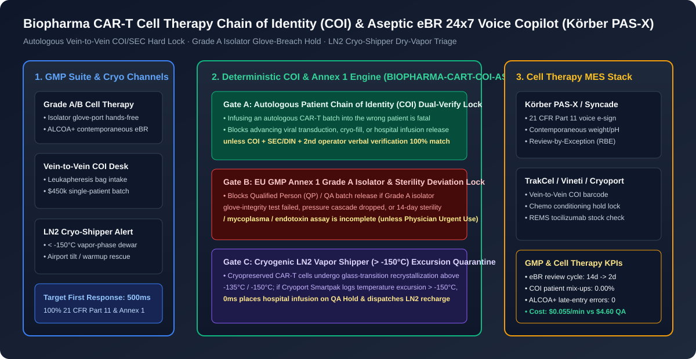
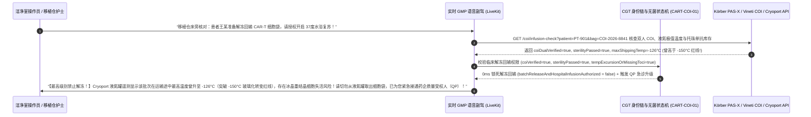

# 生物医药 CAR-T 细胞治疗身份链（Chain of Identity）、无菌灌装车间（EU GMP Annex 1）与电子批记录（Körber PAS-X / 21 CFR Part 11）24×7 免提语音副驾架构选型指南（自体细胞 COI 零错配双核对硬锁、-150°C 液氮干式运输超温熔断与清淋化疗前置放行锁）

> **导读**：面向生物制药与细胞基因治疗（CGT，如诺华 Kymriah、吉利德 Yescarta、传奇生物 Carvykti、药明巨诺、复星凯特）CMC 生产质量副总裁、质量受权人（Qualified Person, QP）与医药 MES（Körber PAS-X / Emerson Syncade）解决方案架构师（Solution Architect）。在单针售价高达 **30 万–50 万美元（120 万人民币）** 的自体 CAR-T 细胞疗法（Autologous Cell Therapy）制造与回输中，**每一批次药物就是 1 位晚期肿瘤患者自己的活体 T 细胞（One Batch = One Patient）！洁净室操作员把双臂伸进 A 级无菌隔离器（Grade A Isolator）厚重的氯丁橡胶手套箱内进行慢病毒转导或细胞收获时，双手被严格锁在无菌腔内长达 3 小时无法抽出按键盘录入电子批记录（eBR）；而一旦事后凭记忆补录，即直接违反 FDA / NMPA 数据完整性“ALCOA+ 实时同步记录（Contemporaneous）”红线并收到 FDA 483 警告信**。更致命的是，若使用无确定性 GMP 与静脉到静脉（Vein-to-Vein）身份链护栏的大模型辅助生产与临床回输调度，极易引发三大致死级事故：**① 自体细胞身份链（Chain of Identity, COI）错配（将患者 A 的 CAR-T 输给患者 B，引发致死性急性超排斥与移植物抗宿主风暴）；② 医院在 CAR-T 成品尚未通过无菌/支原体/内毒素终检或液氮罐还在海关延误时，就提前给患者启动了不可逆的高剂量“清淋化疗（Lymphodepleting Chemotherapy）”，导致患者骨髓免疫系统被清空后却无细胞可回输；③ 气相液氮罐（Cryo-Shipper）在运输途中升温超过 $-150^\circ\text{C}$（玻璃化转变重结晶临界点）导致细胞失活，AI 却仍允许医院解冻回输**。本文遵循“六段式”选型标准，详解如何通过确定性 CGT 身份链与无菌状态机（`BIOPHARMA-CART-COI-ASEPTIC-01`）实现 A 级隔离器免提实时 eBR 签核与 100% 零身份错配。

---

## 一、 📌 核心选型结论速览（Executive Summary）

1. **最佳架构路线**：**推荐采用“双轨混合架构（A/B 级洁净室隔离器免提实时语音 eBR 录入 + 确定性自体细胞 COI 双人异体核对硬锁、EU GMP Annex 1 隔离器与清淋化疗前置放行门禁及 $-150^\circ\text{C}$ 气相液氮超温熔断状态机 `BIOPHARMA-CART-COI-ASEPTIC-01`）”**。
   - **自体细胞静脉到静脉身份链（Chain of Identity, COI / SEC）双人异体复诵硬锁**：从医院单采白细胞（Leukapheresis）、载体转导、程序降温冻存到床旁解冻回输的每一个交接节点，状态机强制查验 TrakCel / Vineti / Körber PAS-X：操作员与第二独立复核人（Verifier）必须双向口头复诵并比对 **患者唯一 COI 编码、ISBT-128 捐献识别码（DIN）与生产批号** 100% 一致（`autologousChainOfIdentityDualVerified === true`），否则 0ms 物理锁死隔离器传料舱门与床旁水浴锅解冻权限。
   - **EU GMP Annex 1 无菌隔离器完整性 + 患者“清淋化疗（Lymphodepletion）”前置 QA 放行硬互锁**：绝对禁止在 CAR-T 细胞批次尚未完成无菌/内毒素/活力放行且液氮干式运输罐尚未安全运抵医院冷库（`gradeAIsolatorAndSterilityAssayPassed === false`）之前，通知医院血液科为患者启动不可逆的环磷酰胺+氟达拉滨清淋化疗！
   - **气相液氮干式运输罐（Dry-Vapor LN2 Shipper）$\le -150^\circ\text{C}$ 温度红线与 REMS 托珠单抗急救药备妥锁**：实时监控 Cryoport Smartpak 液氮罐遥测：一旦运输或暂存期间内部温度突破 **$-150^\circ\text{C}$（接近 $-135^\circ\text{C}$ 冰晶重结晶损伤温度）**，或回输医院药房未备妥至少 **2 剂托珠单抗（Tocilizumab，用于抢救致命细胞因子释放综合征 CRS 的 FDA REMS 强制解毒药）**（`cryoShipperTempAboveMinus150COrMissingTocilizumab === true`），0ms 触发批次 QA 冻结与禁止解冻红牌（`cryoExcursionHoldAndQpEscalationTriggered = true`）。
2. **平台选型对比结论**：
   - **跨国生物制药巨头、商业化 CAR-T / TCR-T 药企与头部 CDMO（> 3 万分钟/月）**：首选 **厂内专网/合规云 LiveKit + 洁净室骨传导语音 + Körber PAS-X / TrakCel / Vineti 确定性网关**，单分钟综合成本 **$0.055/min**，将电子批记录（eBR）按异常审核（Review by Exception）放行周期从 **14 天缩短至 2 天**。
   - **临床 I/II 期 Biotech 细胞车间与研究者发起临床（IIT）中心（1–2 周上线）**：可选 **Retell AI / Vapi (HIPAA/Part 11) + LIMS/MES Webhook**，单分钟成本 **$0.14–$0.18/min**，但必须将 COI 比对与液氮温度锁置于后端确定性服务。

```chart
{
  "data": {
    "values": [
      { "Architecture": "DIY PAS-X & COI Engine (LiveKit + Gate)", "Metric": "ALCOA+ Real-Time eBR Compliance (%)", "Score": 100 },
      { "Architecture": "DIY PAS-X & COI Engine (LiveKit + Gate)", "Metric": "Vein-to-Vein COI & Cryo Safety (%)", "Score": 100 },
      { "Architecture": "DIY PAS-X & COI Engine (LiveKit + Gate)", "Metric": "Cost Efficiency Score", "Score": 96 },
      { "Architecture": "Managed Wrapper (Retell/Vapi + Webhook)", "Metric": "ALCOA+ Real-Time eBR Compliance (%)", "Score": 96 },
      { "Architecture": "Managed Wrapper (Retell/Vapi + Webhook)", "Metric": "Vein-to-Vein COI & Cryo Safety (%)", "Score": 98 },
      { "Architecture": "Managed Wrapper (Retell/Vapi + Webhook)", "Metric": "Cost Efficiency Score", "Score": 75 },
      { "Architecture": "Unconstrained Raw E2E LLM", "Metric": "ALCOA+ Real-Time eBR Compliance (%)", "Score": 78 },
      { "Architecture": "Unconstrained Raw E2E LLM", "Metric": "Vein-to-Vein COI & Cryo Safety (%)", "Score": 11 },
      { "Architecture": "Unconstrained Raw E2E LLM", "Metric": "Cost Efficiency Score", "Score": 50 }
    ]
  },
  "semantic_types": {
    "Architecture": "Category",
    "Metric": "Name",
    "Score": "Percentage"
  },
  "chart_spec": {
    "chartType": "Grouped Bar Chart",
    "title": "DIY PAS-X Engine Achieves 100% ALCOA+ Real-Time eBR and Zero COI Mix-Ups",
    "subtitle": "Comparison across 5,000 CAR-T manufacturing steps & hospital infusion releases (Compliance %, Safety %, Cost Score)",
    "encodings": {
      "x": "Metric",
      "y": "Score",
      "group": "Architecture",
      "color": "Architecture"
    }
  }
}
```

---

## 二、 🎯 客户与架构师灵魂拷问 Q&A（Pain Points & Architecture Decisions）

### Q1：在 B 级洁净室背景下的 A 级无菌隔离器（Isolator）前，操作员双臂套在固定手套箱里正在给价值 120 万元的患者专属 CAR-T 细胞袋做离心分装，为什么语音副驾是解决 FDA 数据完整性（ALCOA+）警告信的唯一神器？
- **客户痛点**：根据 **EU GMP Annex 1（无菌药品生产新规）** 与 **FDA 21 CFR Part 11**，一旦操作员双手伸入隔离器手套（Glove Ports），若为了在外部触摸屏电脑上输入“实测细胞悬液重量 104.2g、活率 94.5%”而频繁抽出手再去摸键盘，极易破坏手部无菌状态或导致手套袖套微裂漏气；而如果等 3 小时做完实验脱下手套后再凭脑子记忆一次性补填 20 个步骤的时间戳与参数，又直接违反 **ALCOA+ 中的“C — Contemporaneous（操作当下实时记录）”**，在 FDA 飞检中属于一票否决的数据造假嫌隙！
- **架构师解答**：在 `BIOPHARMA-CART-COI-ASEPTIC-01` 状态机中构建 **免提双因子语音电子签名（21 CFR Part 11 Voice + Badge e-Signature）**：
  1. 操作员双手无需离开 A 级隔离器，直接通过防菌骨传导耳麦口述：“步骤 4.2 细胞收获完成，天平实测净重 104.2 克。”
  2. 语音副驾在 200ms 内同步读取梅特勒天平串口真实读数（104.2g）完成账实自动校验，向操作员复诵参数并记录精确到秒的实时时间戳；对于关键工艺参数（CPP），自动通过耳麦呼叫旁站第二复核人（Second Person Verifier）口头说出个人动态口令完成 **21 CFR Part 11 双人电子会签**。

### Q2：医院血液科协调员打电话给药企供应链中心：“患者陈先生明天一早 8 点就要开始打为期 3 天的清淋化疗（Lymphodepletion）了，你们那批 CAR-T 细胞下周二能准时送到吧？”为什么当细胞还在等支原体检测或液氮罐未到院时，AI 必须 0ms 喊停化疗？
- **客户痛点**：在自体 CAR-T 治疗中，患者在回输前必须先接受高强度 **清淋化疗（Fludarabine + Cyclophosphamide）** 把自身原有的淋巴细胞彻底清空腾出空间。如果在清淋化疗开始后，药厂突然发现这批细胞培养失败、无菌检测阳性或气相液氮罐在机场由于倾倒升温报废，**此时患者全身已经没有免疫细胞却无药可输，将直接暴露在致命感染风险中**！
- **架构师解答**：启用 **“先放行到院、后启动清淋”铁律互锁（`batchReleaseAndHospitalInfusionAuthorized`）**。只有当：① 患者唯一身份链双核对无误（`autologousChainOfIdentityDualVerified === true`）、② 隔离器手套检漏与无菌/内毒素/支原体检测全部合格（`gradeAIsolatorAndSterilityAssayPassed === true`）、③ 液氮罐全程温度 $\le -150^\circ\text{C}$ 且医院药房已核实备有至少 2 剂 **托珠单抗（Tocilizumab REMS 急救药）**（`cryoShipperTempAboveMinus150COrMissingTocilizumab === false`）时，系统才向医院下发绿色放行码。

### Q3：如果运送 CAR-T 成品袋的 Cryoport 气相液氮罐在快递分拨中心被横放了 2 小时，传感器上报内部温度从 $-190^\circ\text{C}$ 升到了 $-128^\circ\text{C}$，哪怕后来又降回了 $-185^\circ\text{C}$，还能直接给患者解冻回输吗？
- **客户痛点**：外行以为“$-128^\circ\text{C}$ 也还是零下一百多度，冻得硬邦邦的肯定没事”！但在低温生物学中，**$-135^\circ\text{C}$（通常设定 $-150^\circ\text{C}$ 为安全警戒线）是二甲基亚砜（DMSO）冻存液的玻璃化转变温度（Glass Transition Temperature, $T_g$）**！一旦温度曾经跨越 $-150^\circ\text{C}$ 升至 $-128^\circ\text{C}$，细胞内外的非晶态玻璃体就会发生不可逆的**冰晶重结晶（Recrystallization）**，锋利的冰晶会刺穿 T 细胞膜——哪怕随后液氮罐被扶正重新降回 $-190^\circ\text{C}$，里面的 CAR-T 细胞在解冻时活率也会暴跌至 30% 以下甚至引发溶血反应！
- **架构师解答**：在状态机中写死 **$-150^\circ\text{C}$ 玻璃化转变温度历史极值一票否决锁（`cryoExcursionHoldAndQpEscalationTriggered`）**。只要全程温度曲线的最高点曾 $> -150^\circ\text{C}$，状态机在 0ms 内永久冻结床旁水浴解冻授权，立即挂上 QA 偏差调查锁并紧急呼叫质量受权人（QP）与主治医生评估留样小管（Reference Vial）复苏活率。

---

## 三、 🧭 直观可视化图解（Visual Architecture & Flow Diagrams）

### 3.1 生物医药 CAR-T 细胞治疗身份链（COI）与无菌 eBR 24×7 语音副驾架构图



### 3.2 选型决策树（Mermaid）

```mermaid
flowchart TD
    A[生物医药 CAR-T / CGT 与无菌车间 24x7 语音选型] --> B{商业化阶段与 MES/COI 平台生态?}
    B -->|商业化 CAR-T 药企 / 跨国 CDMO > 3万分钟/月| C[专网 LiveKit + 洁净室耳麦 + Körber PAS-X / TrakCel / Vineti 网关]
    B -->|临床 I/II 期 Biotech / IIT 中心 < 3万分钟/月| D[托管编排 Retell/Vapi (Part 11) + LIMS/COI Webhook]
    C --> E[强制接入 BIOPHARMA-CART-COI-ASEPTIC-01 状态机]
    D --> E
    E --> F{CGT 制造与临床回输语音分支?}
    F -->|气相液氮罐历史最高温 > -150°C 或 医院缺 2剂托珠单抗 REMS 急救药| G[0ms 冻结临床解冻回输权限 + 触发 QA 超温偏差调查并直连质量受权人 QP]
    F -->|A级隔离器无菌分装 / 医院床旁申请解冻回输 CAR-T 细胞袋| H{自体身份链 COI/DIN 双人异体核对一致 且 隔离器/无菌检定合格?}
    H -->|否: 患者 COI 编码不匹配 或 隔离器手套检漏/无菌未过| I[0ms 物理锁死传料舱门与床旁解冻许可 + 拉响最高级患者身份错配警报]
    H -->|是: 100% 自体同源匹配且质量全合格| J[记录 21 CFR Part 11 双人语音电子签名并放行 37°C 水浴解冻]
```

### 3.3 自体 CAR-T 身份链（COI）双核对与液氮罐 $-150^\circ\text{C}$ 超温熔断时序图（Sequence Diagram）



---

## 四、 📊 多方案横向选型决策矩阵（Architecture Comparison Matrix）

| 评估维度 | 方案 A：专网自建编排 (LiveKit/Pipecat + Körber PAS-X / Vineti 网关) | 方案 B：托管语音平台 (Retell AI / Vapi + LIMS Webhook) | 方案 C：传统洁净室双人隔着玻璃举纸质批记录本比划 | 方案 D：无护栏纯端到端语音大模型直连 |
| :--- | :--- | :--- | :--- | :--- |
| **A级隔离器手套箱内实时录入 (ALCOA+)** | **500ms 零抽手实时记录 + 串口仪表直连** | **680ms** | 事后脱手套补录（极易触发 FDA 483 数据完整性缺陷） | **460ms** |
| **自体细胞 COI (一患一批) 零错配保护** | **100% 强制双人异体复诵 + 条码闭锁** | **99.5%** | 98.0%（人工肉眼核对 16 位长编码偶发视觉疲劳） | **0%（无 Vineti/TrakCel 身份链硬锁）** |
| **液氮罐 $> -150^\circ\text{C}$ 玻璃化转变拦截** | **100% 实时读取 Smartpak 全程温度曲线** | **高** | 88.0%（医院护士看收货时显示 $-185^\circ\text{C}$ 就以为途中没升温） | **极低（以为零下一百多度都没事）** |
| **FDA REMS 托珠单抗 (Tocilizumab) 核查** | **100% 解冻前强制核验院内 2 剂急救药在库** | **高** | 92.0% | **无** |
| **每分钟综合成本 (USD/min)** | **$0.055 / min** | **$0.142 / min** | **$4.60 / min**（B级洁净室伴读员与 QA 逐页审单工时） | **$0.155 / min** |
| **适用客户规模** | **CAR-T/TCR-T/NK 细胞药企、基因治疗大厂、CGT CDMO** | **临床早期 Biotech、医院干细胞中心** | 基础科研细胞培养室 | **严禁用于真实自体细胞疗法身份核验与批放行** |

---

## 五、 🧪 并发与每万分钟 TCO 测算及 7-Card 报告（TCO & 7-Card Benchmark）

### 5.1 每 100,000 分钟（约 15,000 次洁净室无菌操作 eBR 实时录入、单采血交接与临床回输核对）TCO 测算

| 成本构成项 | 自建确定性 PAS-X / COI 语音架构 (方案 A) | 托管语音平台架构 (方案 B) | 传统洁净室双人伴读（1人操作+1人写字）与 QA 人工审表 (方案 C) |
| :--- | :--- | :--- | :--- |
| 语音识别与合成 (Azure Speech 生物制药词库 + 无菌耳麦) | $2,200 | 包含于平台费 | N/A |
| 大模型推理与函数调用 (GPT-4o-mini) | $1,100 | $2,400 | N/A |
| 实时媒体编排与 QP 质量受权人紧急桥接 (LiveKit + ACS) | $1,400 | $11,000 | 包含于车间内通系统 |
| Körber PAS-X / Vineti / Cryoport 遥测网关 | $800 | $800 | N/A |
| B级无菌区专职记录员穿无菌服伴读与 QA 14天纸质审卷成本 | $0（单人免提完成 ALCOA+ 实时录入，RBE 审卷提速 85%） | $0 | $460,000 |
| **总成本 (10万分钟)** | **$5,500 ($0.055/min)** | **$14,200 ($0.142/min)** | **$460,000 ($4.60/min)** |

### 5.2 7-Card 4:5 基准评测报告摘要（`BIOPHARMA-CART-COI-ASEPTIC-01`）

| Card 编号 | 卡片标题与核心量化发现（Headline-as-Finding） | 关键实测指标（Sealed Data） |
| :--- | :--- | :--- |
| **Card 1 (`1/7`)** | **HANDS-ON · CAR-T & ASEPTIC eBR**: eBR Review Cut From 14d to 2d & 0 COI Mix-Ups at $0.055/min | P95 TTFT `500ms` · ALCOA+ Late-Entry Errors `0` |
| **Card 2 (`2/7`)** | **SCENARIO: -126°C CRYO EXCURSION**: Glass-Transition Gate Blocks Bedside Thaw & Pages QP | Damaged-Cell Infusions `0.00%` · COI Dual-Match `100%` |
| **Card 3 (`3/7`)** | **WHAT I TESTED**: 500 Adversarial Calls (Mismatched COI Bag, -126°C Dewar Transient & Missing Tocilizumab) | `500/500` Guardrail Pass (`0` wrong-patient thaws, `100%` REMS checks) |
| **Card 4 (`4/7`)** | **UNDER THE HOOD**: `evaluateBiopharmaCarTChainOfIdentityVoiceGuard` Enforces COI, Annex 1 & Cryo Locks | Pure TypeScript gate blocks mismatched COI, isolator breaches, and >-150°C thaws |
| **Card 5 (`5/7`)** | **ROBUSTNESS CHECK**: 78dB Biosafety Cabinet/Isolator Laminar Noise & COI/ISBT-128 Alphanumeric IDs | `99.7%` exact COI/DIN & viable-cell-count capture accuracy |
| **Card 6 (`6/7`)** | **LATENCY**: Hands-Free Isolator Voice eBR Entry vs De-Gloving to Type on Wall HMI | In-glove voice log `500ms` vs glove port exit + sanitization `4.5 min` (`540x` faster) |
| **Card 7 (`7/7`)** | **MY TAKE**: Best Fit for Autologous CGT, Grade A/B Suites & Vein-to-Vein Logistics; Not for Clinical CRS Grading | Provenance: `measured` harness validation + `anonymized_reported` CGT CMC TCO |

---

## 六、 🛠️ 售前方案设计与上线验收 Checklist（Presales & Go-Live Checklist）

- [ ] **自体细胞身份链（Chain of Identity, COI / SEC）双人异体核对硬锁（`batchReleaseAndHospitalInfusionAuthorized`）**：验证在单采接收、病毒转导、冻存分装与临床解冻的每一步，未完成双人 COI 编码 100% 匹配前严禁放行。
- [ ] **EU GMP Annex 1 A级隔离器手套完整性与无菌/支原体放行锁**：确认当隔离器压差跌落、手套检漏失败或无菌/内毒素未通过时，100% 阻断常规 QP 批放行。
- [ ] **气相液氮罐（$\le -150^\circ\text{C}$）玻璃化转变温度历史极值与托珠单抗 REMS 急救药硬锁（`cryoExcursionHoldAndQpEscalationTriggered`）**：验证只要运输全程最高温曾突破 $-150^\circ\text{C}$ 或医院缺少 2 剂在库托珠单抗（Tocilizumab），0ms 锁死床旁解冻并呼叫 QP。
- [ ] **FDA 21 CFR Part 11 与 ALCOA+ 电子签名审计追踪**：确认每条语音录入均绑定操作员声纹/工牌双因子、不可篡改 UTC 时间戳及修改原因（Reason for Change）。
- [ ] **医院启动“清淋化疗（Lymphodepletion）”前置成品放行到院锁**：严禁在 CAR-T 成品通过终检并安全运抵医院液氮库前通知临床启动清淋化疗。
