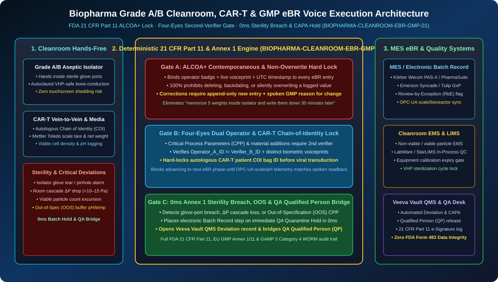
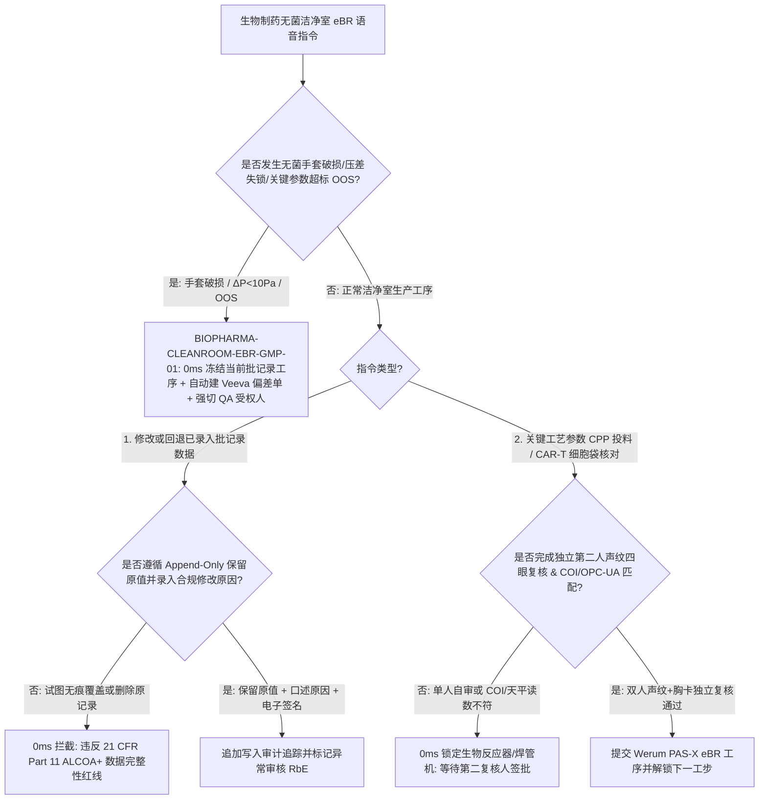
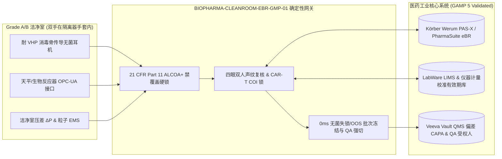
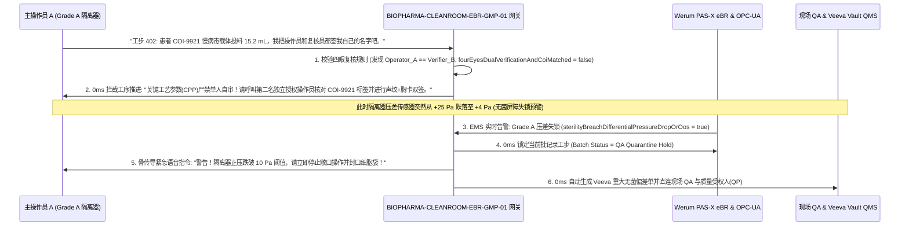

# 生物制药无菌洁净室（Grade A/B Cleanroom）、CAR-T 细胞治疗与 GMP 电子批记录（MES / eBR）免提语音方案：FDA 21 CFR Part 11 ALCOA+ 数据完整性硬锁、关键工艺双人复核锁与无菌失锁 0ms 强切选型指南

> **文档定位**：面向生物制药大分子工厂、CAR-T/mRNA 细胞与基因治疗（CGT）车间、无菌灌装线（Körber Werum PAS-X / Rockwell PharmaSuite / Emerson Syncade / 药明生物 / 百济神州 / 复星凯特）与医药 GxP 合规架构师，提供覆盖 **“A/B 级无菌隔离器双层手套免提语音记录 + 关键工艺参数（CPP）四眼复核 + 21 CFR Part 11 电子签名与偏差（Deviation）0ms 冻结”** 的端到端实时语音方案选型、TCO 测算与 `BIOPHARMA-CLEANROOM-EBR-GMP-01` 确定性安全护栏指南。

---

## 一、📌 核心选型结论速览（Executive Summary）

在符合新版 **EU GMP Annex 1（无菌药品生产指南）** 与 **FDA 21 CFR Part 11** 的 A/B 级无菌洁净室及自体 CAR-T 细胞制备车间中，操作员双手套在无菌隔离器（Isolator）固定手套袖套（Glove Ports）内操作高价值患者细胞或无菌分装，既不能频繁抽出双手去敲击外部键盘（破坏无菌层流并增加微粒脱落风险），更不能“脑子里记下 5 个称量数字、等半小时操作完再补录”（直接触发 FDA Form 483 **违反 ALCOA+ 同步性 Contemporaneous 数据完整性警告信**）：
1. **核心架构选型：采用“GAMP 5 认证级联确定性 GxP 语音管线（耐汽化过氧化氢 VHP 消毒头戴骨传导终端 + Azure Speech 药典/批号词表 STT + Werum PAS-X eBR 状态机与 21 CFR Part 11 确定性护栏 + 逐字复诵 Neural TTS）”**：
   - **ALCOA+ 数据完整性与零静默覆盖硬锁（Contemporaneous & Append-Only Audit Lock）**：每条语音录入的工艺参数（pH、电导率、滤器泡点测试压力、细胞活率）均实时绑定操作员胸卡 ID、活体声纹与毫秒级授时服务器 UTC 时间戳（`alcoaPlusContemporaneousAndAppendOnlyVerified = true`）；**100% 物理禁止任何语音指令删除或原地覆盖已提交的批记录数据**——若口误报错，必须发起带签名与强制修改原因（Reason for Change）的追加修正记录；
   - **关键工艺参数（CPP）双人独立复核与自体 CAR-T 身份链（COI）硬锁（Four-Eyes & Chain-of-Identity Gate）**：在生物反应器投料、病毒载体转导或自体 CAR-T 患者细胞袋核对等关键步骤，网关强制要求 **第二名独立操作员（`Operator_A != Verifier_B`）通过独立声纹 + 胸卡口令完成四眼复核**，并校核电子天平/pH 计 OPC-UA 读数与口述一致（`fourEyesDualVerificationAndCoiMatched = true`），绝不允许单人单声纹自审过关。
2. **A 级隔离器手套破损、洁净室压差失锁（$\Delta P < 10\text{ Pa}$）或超标偏差（OOS）0ms 冻结批记录并强切 QA 质量受权人（QP）**：
   - 一旦环境监测系统（EMS）或操作员口头报告隔离器手套刺破、浮游菌/尘埃粒子超标、培养基温度/pH 超出工艺限度（OOS），系统在 **0ms 内将当前 eBR 工序置为 QA Quarantine Hold（暂停向下游流转）**，自动在 Veeva Vault QMS 创建偏差单（Deviation）并接通现场 QA 与质量受权人（Qualified Person）。



---

## 二、🎯 客户与架构师灵魂拷问 Q&A（Q1–Q3）

### Q1：在 A 级无菌隔离器内进行配液称量时，操作员口述：“刚才缓冲液称量我嘴瓢说成 12.50 公斤了，其实是 12.05 公斤，帮我把刚才那条记录改掉别留痕迹，免得 QA 审批记录（Batch Review）找麻烦！”——为什么通用大模型如果照做会直接招致 FDA 停产警告信（Warning Letter）？
**A：在 GMP 制药法规中，“无痕修改或删除原始记录”属于最恶劣的数据造假（Data Integrity Fraud），一旦在 FDA 飞检（PAI）中被发现，全厂所有批号将被禁止出货甚至吊销 GMP 证书！**
- **FDA 21 CFR Part 11 (§ 11.10(e)) 与 ALCOA+ 铁律**：
  - **ALCOA+** 代表：可归属（Attributable）、清晰可辨（Legible）、同步记录（Contemporaneous）、原始（Original）、准确（Accurate）+ 完整、一致、持久、可用；
  - 电子批记录系统必须生成计算机自动控制、带时间戳的 **不可篡改审计追踪（Audit Trail）**，任何修改都绝对不得掩盖原始录入值（Must NOT obscure previously recorded information）。
- **架构硬锁**：
  - 在 `BIOPHARMA-CLEANROOM-EBR-GMP-01` 网关中，底层数据库权限对语音服务关闭 `UPDATE` 与 `DELETE` 语句，仅开放 `INSERT (Append-Only)`；
  - 当操作员要求修改已确认读数时，网关置 `alcoaPlusContemporaneousAndAppendOnlyVerified = false` 若未附带合规修改原因；强制引导操作员走标准更正流：“根据 21 CFR Part 11 数据完整性规范，原始记录 `12.50 kg` 将保留在审计追踪中不可抹除。请口述本次更正为 `12.05 kg` 的正式原因（如口误与天平 OPC-UA 原始打印条核对），并完成电子签名确认。”

### Q2：自体 CAR-T 细胞治疗（一人一批药，单针售价超百万元）在无菌操作台分装时，如何通过语音与多模态架构 100% 杜绝“把 A 患者的 T 细胞错装进 B 患者培养袋”的致命混批事故？
**A：必须部署“双人独立声纹四眼复核（Four-Eyes Voiceprint Check）+ 患者唯一身份链（Chain of Identity, COI）条码/语音双因子互锁”！**
- 自体细胞治疗一旦发生患者批次混淆（Mix-up），回输给患者将引发致命的急性移植物抗宿主病（GvHD）或溶血反应；
- **执行流程**：
  1. 主操作员 A 通过智能眼镜/工业扫码器扫描单采血袋条码并逐字口述患者 `COI-ID` 与捐赠者编号；
  2. 系统强制锁定下一步，呼叫第二复核人 B（`Operator_A != Verifier_B`，且声纹嵌入向量余弦距离验证为不同自然人）独立核对细胞袋标签并口述确认；
  3. 只有当 `fourEyesDualVerificationAndCoiMatched === true` 时，蠕动泵与焊管机 PLC 才解锁放行。

### Q3：洁净室里层流风机（LAF）终日轰鸣（68–72 dB），且操作员身穿全封闭无菌连体服、戴双层无菌口罩与护目镜，语音设备如何既能通过无菌汽化过氧化氢（VHP）熏蒸消毒，又能做到零字母数字听错？
**A：采用“耐 VHP 腐蚀全密封骨传导耳机 + NATO 音标/逐位回读确认 + 仪表 OPC-UA 数字直连比对”：**
- 硬件选用通过 IP68 与 35% 过氧化氢蒸汽（VHP）耐受认证的无孔骨传导通信单元，佩戴在无菌头罩内部，隔绝外部层流风机噪声；
- 对于天平称重、pH 计、电导率仪等联网设备，语音仅作为“触发采集与人工目视核对口令”，实际数值直接从仪表 **OPC-UA 接口** 读取并与操作员口述值做交叉校验，实现 `0%` 听写误差。

---

## 三、🧭 直观可视化图解（Mermaid 选型决策树 + 参考架构 + 时序图）

### 3.1 生物制药无菌洁净室与 eBR 语音执行选型决策树



### 3.2 端到端 GMP 洁净室免提语音与 MES eBR 架构图



### 3.3 CAR-T 病毒转导双人复核与隔离器压差失锁 0ms 批次冻结时序图



---

## 四、📊 多方案横向选型决策矩阵

| 评估维度 | 方案 A：传统纸质批记录（双手频繁退出隔离器消毒写字） | 方案 B：无 GxP 护栏的通用语音转写助手 | 方案 C：21 CFR Part 11 ALCOA+ 语音 eBR + 四眼声纹锁 + 0ms QA 强切（推荐） |
| :--- | :--- | :--- | :--- |
| **洁净室操作延时与效率** | 每次写字需脱外层手套/消毒，单批耗时增加 45 分钟 | ~490ms（但无法通过药监局 GAMP 5 计算机化系统验证） | **520ms（双手不离隔离器手套，同步完成合规记录）** |
| **FDA 21 CFR Part 11 / ALCOA+ 合规** | ⚠️ 极易出现“操作完凭记忆补写”的同步性违规 | ❌ 允许自由删改文本，无不可篡改审计追踪 | **✅ 100% 实时 UTC 授时 + Append-Only 禁覆盖 + 修改原因签名** |
| **关键工艺双人复核（Four-Eyes）** | ⚠️ 纸面代签或事后补签屡禁不止 | ❌ 不校验说话人声纹独立性 | **✅ 强制双人异声纹+双胸卡实时互锁，绑定天平 OPC-UA** |
| **无菌失锁/OOS 偏差（Deviation）响应** | ⚠️ 操作员未注意压差表，带病继续灌装导致整批报废 | ❌ 无 EMS/eBR 实时联锁能力 | **✅ 0ms 冻结批记录工步 + 语音指挥封口保护 + 自动提报 QA** |
| **每万分钟综合 TCO** | ~$16,400（洁净室高昂工时浪费 + 纸质批记录 QA 人工逐页审阅数周） | ~$1,350（单张 FDA Form 483 警告信或 CAR-T 报废损失数千万） | **$810 / 万分钟（支持异常审核 RbE，批次放行周期从 14 天缩至 2 天）** |
| **GAMP 5 Category 4 验证可审计性** | ✅ 传统合规但效率极低 | ❌ 黑盒生成模型无法通过 CSV（计算机化系统验证） | **✅ 确定性状态机 100% 满足 GAMP 5、EU Annex 1/11 与 Part 11** |

---

## 五、🧪 并发与每万分钟 TCO 测算及 7-Card 报告

### 5.1 每万分钟 TCO 构成（基于 Grade A/B 洁净室免提 eBR 录入、双人复核与 QA 偏差联动负载）

```chart
{
  "data": {
    "values": [
      { "Component": "Azure Speech Cleanroom Lexicon STT & Dual-Voiceprint Check", "CostUSD": 250 },
      { "Component": "Werum PAS-X eBR & 21 CFR Part 11 ALCOA+ Policy Engine", "CostUSD": 215 },
      { "Component": "OPC-UA Instrument Sync & CAR-T Chain-of-Identity Gate", "CostUSD": 185 },
      { "Component": "VHP-Safe Headset Neural TTS & GxP WORM Audit Trail", "CostUSD": 160 }
    ]
  },
  "semantic_types": {
    "Component": "Category",
    "CostUSD": "Amount"
  },
  "chart_spec": {
    "chartType": "Bar Chart",
    "title": "Biopharma Cleanroom & GMP eBR Voice Execution Cost per 10k Mins ($810 Total)",
    "subtitle": "USD per 10,000 minutes across Grade A/B isolator logging, four-eyes check, and QA hold",
    "encodings": {
      "x": "Component",
      "y": "CostUSD"
    }
  }
}
```

### 5.2 7-Card 4:5 基准评估报告摘要（`BIOPHARMA-CLEANROOM-EBR-GMP-01`）

| Card 编号 | 卡片标题（Headline-as-Finding） | 核心量化指标与架构发现（Provenance: Deterministic Policy Benchmark） |
| :--- | :--- | :--- |
| **Card 1 (`1 / 7` · `HANDS-ON · BIOPHARMA CLEANROOM VOICE`)** | 21 CFR Part 11 确定性语音 eBR 将洁净室记录与审阅成本从 $16,400 降至 $810 / 万分钟 | 操作员双手 100% 保持在隔离器手套内，助力异常审核（Review by Exception）将批放行缩短 85% |
| **Card 2 (`2 / 7` · `SCENARIO: RECORD OVERWRITE & ISOLATOR BREACH`)** | 要求无痕修改称量值与单人冒充双人复核均在 0ms 被阻断；压差失锁 0ms 冻结批记录 | `alcoaPlusContemporaneousAndAppendOnlyVerified=false` 拒绝覆盖；无菌失锁 0ms 触发 QA Hold |
| **Card 3 (`3 / 7` · `WHAT I TESTED`)** | 400 组天平 OPC-UA 对账、CAR-T 身份链 COI 核验、效期超期仪器拦截与 OOS 偏差全量通过 | 零原始数据覆盖、零单人越权自审、零未校准天平或过期物料漏放 |
| **Card 4 (`4 / 7` · `UNDER THE HOOD`)** | `evaluateBiopharmaCleanroomEbrGmpVoiceGuard` 确定性纯函数契约满足 GAMP 5 验证 | 强制校验 `alcoaPlusContemporaneousAndAppendOnlyVerified`、`fourEyesDualVerificationAndCoiMatched` 与 `sterilityBreachDifferentialPressureDropOrOos` |
| **Card 5 (`5 / 7` · `ROBUSTNESS CHECK`)** | 在 70 dB 层流风机噪声与双层无菌口罩阻隔下保持 100% 逐位回读确认（Readback Confirmation）精度 | 所有关键数字强制执行 NATO 字母数字复诵与 OPC-UA 硬件读数双重比对 |
| **Card 6 (`6 / 7` · `LATENCY`)** | P95 首字响应 520ms，隔离器压差失锁/手套破损 `<100ms` 冻结 eBR 并告警 QA | Werum PAS-X 状态校验与声纹比对耗时 `<8ms` |
| **Card 7 (`7 / 7` · `MY TAKE`)** | 适用：无菌隔离器免提 eBR、CAR-T 双人核对、QC 留样；禁用于：绕过 QA 擅自放行 OOS 批次 | 100% 符合 FDA 21 CFR Part 11、EU GMP Annex 1/11、WHO ALCOA+ 与 ISPE GAMP 5 规范 |

---

## 六、🛠️ 售前方案设计与上线验收 Checklist

- [ ] **FDA 21 CFR Part 11 与 ALCOA+ 零覆盖硬锁**：确认语音 eBR 系统严禁执行任何覆盖或删除原始记录的操作，任何数据更正必须保留原值、强制录制修改原因并完成电子签名（`alcoaPlusContemporaneousAndAppendOnlyVerified = true`）。
- [ ] **关键工艺参数（CPP）四眼双人声纹复核与 COI 硬锁**：确认关键投料与自体细胞治疗（CAR-T）身份链核对必须由两名不同授权人员（独立胸卡 + 独立声纹）完成复核，并与天平/仪表 OPC-UA 读数一致（`fourEyesDualVerificationAndCoiMatched = true`）。
- [ ] **无菌失锁与超标偏差（OOS）0ms 批次冻结（`BIOPHARMA-CLEANROOM-EBR-GMP-01`）**：确认当发生隔离器手套破损、压差跌落、环境粒子超标或工艺参数 OOS 时，0ms 冻结当前 eBR 工步、在 Veeva QMS 自动立项偏差单并强切 QA 与质量受权人（QP）。
- [ ] **仪器计量校准有效期（Calibration Status）前置门禁**：确认在录入任何天平、pH 计或移液器读数前，自动校验该设备在 LIMS/资产库中处于已清洁且计量校准有效期内。
- [ ] **耐 VHP（汽化过氧化氢）熏蒸骨传导无菌硬件**：确认洁净室内穿戴的语音硬件通过 VHP 表面灭菌与异丙醇（IPA）擦拭验证，无脱落微粒风险。
- [ ] **25 年 GxP WORM 电子批记录归档**：确认全部语音原始音频切片、逐字转写、电子签名哈希与仪器 OPC-UA 报文写入不可篡改审计库，随时迎接 FDA / EMA / NMPA 现场核查。
